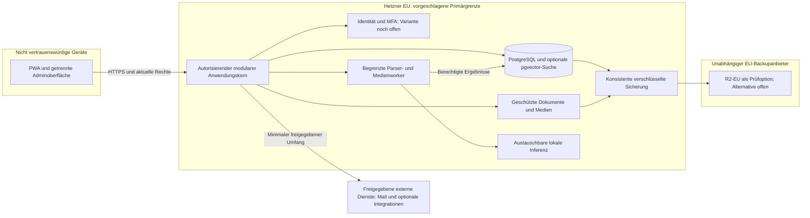

# Technische Architekturstudie — Vergleich und Empfehlung

**Version:** 0.1 · **Stand:** 22.10.2026 · **Status:** Empfohlen / Zur Entscheidung

## 1. Auftrag, Status und Leitentscheidung zur Prüfung

Ausgangsbasis `5ab55032b66e87950411cf6c1323fb3284d63eb6`, bestehender Spezifikationsbranch/PR #1. Mission 5 autorisiert ausschließlich Forschung, Vergleich und Dokumentation mit normalem Commit/Push. Keine Technologie ausgewählt, keine Anwendung, Ressource, Cloudaccount, Modellausführung oder Ausgabe; kein Merge/Deployment. Empfehlungen sind **Empfohlen / Zur Entscheidung**, niemals eine Freigabe.

**Empfohlene Architekturform:** modularer Monolith mit autoritativem Backend, relationalem PostgreSQL-Kern, begrenzten getrennten Workerprozessen und austauschbaren KI-Adaptern. React/Vite-PWA und FastAPI sind die erste Untersuchungsbasis; Next.js/TS und Django bleiben Vergleichsoptionen. Ein Hostanbieter für den Primärbetrieb plus unabhängiger EU-Backupanbieter minimiert Betriebsteile, erfüllt DEC-49 aber erst mit tatsächlichem Beleg. Providerentscheidung bleibt offen: **Oracle zuerst nach DEC-48 prüfen**; bei fehlender Eignung Alternativen nicht künstlich schlechter bewerten.

**Belastbarkeitsgrenze:** aktuelle OCI-/Hetzner-/Scalewaypreise, regionale Zuteilung und Kern-Cloudquoten waren trotz zweitem autorisiertem Abruf nicht erreichbar. Software-/Dokumentationsquellen auf offiziellen GitHub-Repositories waren vielfach zugänglich. Unter 10 EUR brutto/Monat vollständig leistungsfähige Multiuser-KI ist **nicht nachgewiesen**. Ein niedriger hypothetischer Architekturwert ist kein Nachweis erfüllter N1-/N2-/S3-Gates.

## 2. Leseweg und Studienbestand

| Studie | Zuständigkeit |
|---|---|
| [Hostingvergleich](HOSTINGVERGLEICH.md) | OCI Always Free zuerst; Hetzner und Scaleway; ARM64, Kapazitäts-/EU-/Verfügbarkeitsrisiken und Anbieterzahl |
| [Daten und Speicher](DATEN_UND_SPEICHER.md) | PostgreSQL, Alternativen, RLS/Transaktionen, Volltext, optionale Vektoren, Dateien und konsistenter Restore |
| [Stack und Identität](STACK_UND_IDENTITAET.md) | Next.js, Vite/React, TS, FastAPI/Python, Django, IdP-/Bibliotheksvarianten und Adminrechte |
| [KI und Modelle](KI_UND_MODELLE.md) | Motoren, individuelle Gewichtslizenzen, Aufgaben, Hardwarehypothesen, Benchmarks und Datenschutz |
| [Backupvergleich](BACKUPVERGLEICH.md) | restic, R2-EU, Storage Box, B2, Scaleway; unabhängige Schlüssel/Zugänge und Wiederherstellung |
| [Kosten und Machbarkeit](KOSTEN_UND_MACHBARKEIT.md) | Vier Lastszenarien, belegte R2-Teilpreise, offene Hostkosten und Prüfmodell |
| [Offene technische Entscheidungen](OFFENE_ENTSCHEIDUNGEN.md) | Voraussetzungen für spätere Eigentümerentscheidungen/ADRs; keine stillen Beschlüsse |
| [Quellenregister](QUELLEN.md) | Abrufdatum, offizielle Quellen, tatsächlicher Abrufstatus, Release-/Lizenzgrenzen und Prüfsummen |

## 3. Modularer Monolith gegenüber verteilten Diensten

| Gesichtspunkt | Modularer Monolith + begrenzte Worker | Verteilte Geschäftsdienste / Microservices |
|---|---|---|
| Einfachheit und Pflege | Wenige versionierte Artefakte, gemeinsame Fachregeln, klarer Release-/Restorestand | Mehr Deployments, Versionen, Netzwerkfehler und verteilte Traces; höherer Grundbetrieb |
| Kontoisolation | Ein zentral durchgesetztes Rechte-/Eigentumsmodell, zusätzlich DB-/Workergrenzen | Jede Dienstgrenze muss Identität/Scope/Entzug aktuell prüfen; Fehler multiplizieren sich |
| Datenkonsistenz | Transaktionen für Lernbelege, Konfiguration, Aufträge und Beziehungen leichter | Verteilte Wirkungen, Outbox/Sagas/Abgleich nötig; mehr Deduplizierungs-/Restoreprobleme |
| Medien/KI | Isolierter Worker schützt CPU/RAM und Parser; eigenes Inferencebackend austauschbar | Unabhängige Skalierung bei belegtem Bedarf, aber Modell-/Netz-/Datenweitergabegrenzen |
| Kosten | Ein Primärhost kann Start vereinfachen, bleibt Single-Host-Ausfallpunkt | Mehr Mindestressourcen und ggf. Netzwerk-/Managedkosten; nicht automatisch hochverfügbar |
| Wachstum | Erst Engpass messen, dann Worker/DB/Objekte kontrolliert auslagern | Sinnvoll bei nachgewiesener separater Last/Teamverantwortung, nicht allein wegen „moderner Architektur“ |

**Empfehlung:** Geschäftsdienste zunächst modular gemeinsam, untrusted Parser und Inferenz trotzdem isoliert und ressourcenbegrenzt. Kubernetes, Broker, Cachecluster oder separate Vektorplattform nicht ohne belegten Nutzen hinzufügen. Eine zusätzliche Prozessgrenze macht nicht automatisch eine Microservicearchitektur.

## 4. Drei technisch konstruierbare Architekturvorschläge

Alle drei sind **Entwurfskonzepte**, keine durch Preise/Benchmarks bestätigten kostenlosen Angebote oder produktionsbereiten Konfigurationen. In jedem Konzept gleicher Funktionskern: Profil/Module/Projekte, Gespräche, Lernbelege/Progression, internes akademisches Kalender-/Hinweissystem, Einwilligungen/Quoten/Administration, Dateien, Recherche, Audio/Video und kontrollierte KI. Externe Kalender nur lesend, Importe/KI-Planübernahme bestätigen; direkt manuell Speichern ohne künstliche zweite Bestätigung.

### A. OCI EU — VM/Volumes mit ARM64 als erstem Kapazitätskandidaten

Verantwortung: OCI als zentraler Kandidat für Netz/Compute/Volumes; Anwendung trägt Rechte, Daten-/Worker-/Modellbetrieb. Clientdaten nur über autorisierten Kern; sensible Dokumente ggf. geräteseitig zusätzlich verschlüsselt und Serveranalyse pro Vorgang freigeben. Backup verlässt den Primäranbieter ausschließlich verschlüsselt zu unabhängigem geprüftem EU-Ziel. Inferenz-/DB-/Adminschnittstellen nicht öffentlich. Abhängigkeiten: tatsächliche EU-ARM-Kapazität, ARM64-Artefakte, IdP-/Mailpassung, unabhängige Schlüssel und komplette Betriebspflege. Vorteil: möglicher geringer Geldbedarf; Nachteile: ungeklärte Gratiszuteilung/-beständigkeit, CPUkonkurrenz und eigener Betrieb. Reale Kosten variabel, siehe Kostenstudie; V1-Lastziele offen. Wachstum über stärkere getrennte Worker/DB nach Messung, kein automatisches Upgrade.

### B. Hetzner EU — bezahlte VM/Volumes, gebündelter selbst betriebener Kern

Verantwortung/Flüsse wie A, Primärhost mit auswählbarer bezahlter Ressourcenklasse; Dateien zunächst sicherer Volumespeicher, PostgreSQL und Identity-/Workerprozesse kontrolliert. Keine neue Datenweitergabe allein wegen Hostwechsel. Vorteile: wenige eigene Dienste, portable Linux-/DB-/Dateibasis, Kapazitätsplan weniger von einem Free-Tier abhängig. Nachteile: laufender VMpreis und SMTP-/Backupkosten unbestätigt, eigener Patch-/Auth-/Restorebetrieb, einzelner Primärhost bleibt Ausfallpunkt. Aktuelle EU-Region, Tarif, Architektur/Verfügbarkeit und tatsächliche Inferenzleistung prüfen. Wachstum kontrolliert zu mehr RAM/CPU oder ausgelagertem Worker, nicht unmittelbar Microservices. Bei Budgetüberschreitung keine Beschaffung ohne neue Entscheidung.

### C. Scaleway EU — VM plus optional verwaltete DB-/Objekt-/Maildienste

Verantwortung: Anwendung und Worker auf VM; Managed PostgreSQL/Objekte/Mail nur soweit Region/Funktionen/Preis nachgewiesen. Jeder verwaltete Dienst ist eine zusätzliche Zugriffs-/Verarbeitungsgrenze **innerhalb** des Primäranbieters; Private-Network-/TLS-/Servicekonten und gemeinsame Restorekonsistenz nötig. Unabhängiges Backup bleibt extern. Vorteile: mögliche Reduktion externer Primäranbieter und einiger Wartungsaufgaben; Nachteile: mehrere Mindestpreise, Konfigurations-/Serviceabhängigkeiten, kein Nachweis kostenloser LLM-Inferenz. Kosten und EU-Serviceverfügbarkeit unbestätigt, Leistung muss ebenso gemessen werden. Unabhängige Exporte/Restore und Providerwechsel verhindern unnötige Bindung.

Für A/B/C: Backup und optionale externe Analyse sind getrennte Vertrauensgrenzen. Verschlüsselter Backupbetrieb erteilt kein privates Adminleserecht. Provider-/IdP-/Serviceadmins sind nicht automatisch App-Super-Admin. Externe Dienste umfassen notwendige Sicherheitsmail/Domain-DNS sowie tatsächlich aktivierte Push-/Kalender-/Repositorydienste. Je Konzept mindestens zwei Infrastruktur-Anbieter; realistische Gesamtzahl und Bündelungsbedingungen stehen im Hostingvergleich. **Kein Konzept setzt die 46 Kontrollen außer Kraft.**

## 5. Gewichtete Entscheidungsmatrix mit Unsicherheit

Gewichte sind **Vorschlag zur Entscheidung**, nicht bestätigt. Begründung: Isolation/Datenschutz und tatsächlich brauchbare KI bestimmen je 25 %, Betrieb/Pflege 20 %, Kosten 20 %, Portabilität 10 %. Kostenersparnis darf weder Sicherheitsgates noch erforderliche Qualität ersetzen. Einfache Skala 1 ungünstig bis 5 günstig; fehlende Nachweise als **Arbeitshypothese**, nicht als Erfüllung. Harte Gates EU/DEC-49/Lizenzen/Kostenautorisierung/Schutz/N1 gehen immer vor Gesamtscore.

| Kriterium | Gewicht | A OCI | B Hetzner | C Scaleway | Grundlage / Unsicherheit |
|---|---|---|---|---|---|
| Schutz / EU / Restore | 25 % | 3 | 3 | 3 | Neutraler Entwurfswert; Verträge/Umsetzung/Restore für alle offen, kein Provider-Sicherheitsranking |
| KI-/Lasttragfähigkeit | 25 % | 2 | 3 | 3 | A knappe/ungeklärte Gratiszuteilung, B/C wählbare bezahlte Kapazität; **kein Benchmark**, Preis bleibt separater Gate |
| Wartbarkeit / wenige Bausteine | 20 % | 3 | 4 | 4 | A ARM-/Free-Tier-Risiko, B einfacher selbst gehosteter Kern, C mögliche Managedentlastung; Team-/Dienstprüfung offen |
| Vollständige Kosten | 20 % | 3 | 3 | 2 | A/B vorsichtige neutrale Annahme, C zusätzliche Managedmindestkosten als Risiko; aktuelle Angebote fehlen, keine Preisbehauptung |
| Portabilität / Wachstum | 10 % | 4 | 4 | 4 | Gleicher relationaler/portabler Entwurf mit unabhängigem Backup; tatsächliche Ausführung offen |
| Gewichtete Summe / 5 | 100 % | **2,85** | **3,30** | **3,10** | Rechenvergleich von Hypothesen, keine Freigabe |

**Sensitivität:** Werden A-Kosten nach realer kostenloser Zuteilung mit 5 und KI-Leistung nach bestandenem Vergleich mit 3 statt 2 bewertet, steigt A auf **3,50**. Fällt B durch Budget-/EU-/Auth-/KI-Gate, hilft sein Score nicht. Anders gewichtete Betriebsentlastung kann C verbessern. Der Vorsprung von B ist daher kein belastbarer Beschaffungsentscheid; neue Preis-/Leistungsdaten erfordern Neubewertung.

## 6. Empfehlung und nächste Belege

Die robuste Empfehlung betrifft **die Architekturform**, nicht endgültig den Provider: modularer Kern, eine PostgreSQL-Datenhaltung, explizit isolierte Worker, kleine austauschbare Modelle, kein Pflicht-Pay-API, unabhängige EU-Sicherung. B ist der vorläufig günstigste **Entwurfsvergleich** unter den genannten Hypothesen. Gemäß DEC-48 zuerst A anhand aktueller Angebote und gesondert erlaubter Messprobe klären; bei gutem Ergebnis kann A geeigneter sein. C bleibt Bündelungs-/Managedalternative, wenn Gesamtkosten/Betriebsnutzen belegt sind. Kein Entwurf ist derzeit als produktionsreif oder unter 10 EUR nachgewiesen.

**Hybrid nur bei wesentlichem Nutzen:** zusätzliche EU-Inferenzplattform erst bei gemessenem Qualitäts-/Latenzengpass und positivem Datenschutz-/Kostenvergleich. Der Basisbetrieb darf nicht still eine kostenpflichtige KI-API benötigen. Ein privater ständig laufender PC ist keine zentrale Betriebsalternative. Siehe Hosting-/KI-/Kostenstudie.

## 7. Rückverfolgbarkeit und unveränderte Grenzen

| Spezifikationsgrundlage | Technische Untersuchungsfolge |
|---|---|
| 89 FE, FE-56 offen, 66 UC und 25 DEC-V1 | Vollständiger bestätigter Funktionsrahmen bleibt Soll; vereinfachter Prototyp ist keine heimliche V1-Kürzung |
| D1/D2, NFR-01/03/12/16/24; SEC-04/11/15/19 | Relationen, kontogebundene Quellen, Memory-/Chat-Trennung, Konflikte, Schutzvererbung und Lösch-/Restorekontrollstand |
| FE-55, NFR-02/08/19/20 | Echte PWA-/Geräte-/Offline-/Sprach-/Accessibilityprüfungen, keine native Universalgarantie |
| SEC-01..07/18/22/23; S3.5/8 | Auth/OTP-/MFA-/Admin-/Serverrechte-/Bootstrapnachweise und vertrauenswürdige Build-/Toolketten |
| NFR-05/09/13/14/15/21/22/23; SEC-17/20/24/27 | Modelllizenzen, Ressourcen-/Gütebenchmarks, Quoten, Quellen, Promptschutz, keine Schattenkopien |
| DEC-48/49, S2/S3 und 46 REL-Profile | Erstbewertung OCI, unabhängige EU-Sicherung, tatsächliche spätere Prüfungen und menschliche Freigabe |

[Spezifikationsindex](../spec/README.md), [S1](../spec/S1-nachbarsysteme.md), [S2](../spec/S2-datenmigration.md), [S3](../spec/S3-inbetriebnahme.md), [N1](../spec/N1-nichtfunktional.md), [N2](../spec/N2-querschnittskonzepte.md), [Entscheidungsmatrix](../spec/ENTSCHEIDUNGSMATRIX.md), [ADR](../ARCHITECTURE_DECISIONS.md), [46 Kontrollen](../quality/RELEASE_KONTROLLMATRIX.md) und [PACE](../ai/WORKFLOW.md) bleiben maßgeblich. Kein neuer Stack-/Hostingbeschluss wird durch diese Studie eingetragen.
