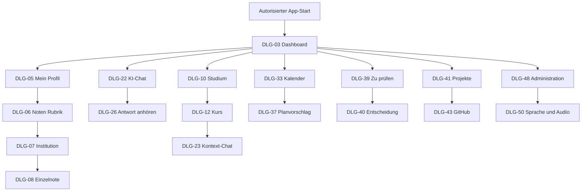

# B1 — Dialogspezifikation

**Projekt:** Syllentra AI\
**Dokument:** B1 — Dialogspezifikation\
**Version:** 0.1 — geprüfter fachlicher Vollentwurf\
**Stand:** 15.10.2026\
**Status:** Zur Prüfung durch den Projektinhaber\
**Methode:** Spezifikationsbaustein nach Johannes Siedersleben (GUI-Statik und GUI-Dynamik), nach der [methodischen Herold-B1-Referenz](https://github.com/carstenlucke/herold/blob/main/docs/spec/B1-dialogspezifikation.md), ohne Übernahme ihrer Authentifizierungs- oder Produktentscheidungen\
**Verifizierter Quellstand:** `docs/spec/p1-p2-mobile-workspaces` in `Viny005/syllentra`, PR #1; P1 v0.5, P2 v0.6, F1 v0.2, F2 v0.1, F3 v0.1, D1 v0.1, D2 v0.1; unveränderter Ausgangsstand `459787027ab941456d61d61da040649fb87709c3`.\
**Freigegebene fachliche Entscheidungen:** FE-01 bis FE-20 aus dem Gespräch; **FE-21** ist eine vom Projektinhaber jetzt hinzugefügte B1-Anforderung, deren Abgleich mit F2/F3/D1/D2 noch aussteht. Die fachliche Abnahme von B1 ist nicht erfolgt.

> **Zweck und Grenze.** Dieses Dokument bestimmt *welche* Dialoge Syllentra anbietet, *welche Informationen* der Eigentümer sieht, *welche Aktionen* er auslösen kann und *welche Reaktionen* er beobachten muss. Es spezifiziert keine Frameworks, CSS-Pixelwerte, API-Endpunkte, Authentifizierungsmethoden, konkreten TTS-Anbieter, Mobilbetriebssystem-Implementierung oder zugesicherte Verfügbarkeit fremder Dienste. Die einzelnen UC-01 bis UC-50, AF-01 bis AF-27, DM-01 bis DM-52, DT-01 bis DT-64, GP-01 bis GP-15, INV-01 bis INV-25 und CFG-01 bis CFG-17 werden nicht umnummeriert oder neu definiert. Die DLG-Kennungen sind neu und gelten zunächst nur für B1.

## B1.1 Leitentscheidungen und fachlicher Geltungsbereich

- **FE-18:** Nach erfolgreichem Zugriff führt der Einstieg zum personalisierten **Dashboard** mit Modulen, Fristen, Lernstand, offenen Vorschlägen und KI-Schnellstart; Widgets sind geschützt und konfigurierbar.
- **FE-19:** Auf dem Telefon gibt es eine **untere Hauptnavigation**, auf breiten Desktopansichten eine **seitliche Navigation**; Tablet und schmale Desktopfenster folgen einer bedienbaren adaptiven Variante ohne Rechte- oder Funktionsverlust.
- **FE-20:** Der Assistent unterstützt Texteingabe und, soweit technisch und vertraglich verfügbar sowie gesondert autorisiert, Diktat und optionale echte Sprachkonversation. Kein Mikrofonzwang.
- **FE-21:** **Antwortvorlesen und Hörmodus**: zu geeigneten Antworten existiert eine bedienbare Vorleseaktion; ein optional vom Nutzer eingeschalteter Hörmodus liest neue erlaubte Antworten automatisch. Pause, Fortsetzung, Replay und eine unterstützte Geschwindigkeitsauswahl sind möglich. Keine Mikrofonberechtigung zum bloßen Vorlesen. Keine standardmäßig laute automatische Wiedergabe, keine ungeprüfte Drittübertragung oder Kosten; nur unterstützte und erlaubte Plattform-/Anbieterfähigkeiten. Die dauerhafte Typisierung und die F2-/F3-Querbezüge müssen später ohne Umnummerierung ergänzt werden.

Bereits verbindlich: FE-01 optionale Einführung; FE-02 bestätigungspflichtige KI-Dokumentzuordnung; FE-03 adaptive Verständnisfragen; FE-04 automatische, sichtbare und korrigierbare Kurs-/Projektchatzuteilung; FE-05 bestätigungspflichtige interne Neuplanung nach Prüfungsänderung; FE-06 selektive Semesterarchivierung; FE-07 abgestufte Hilfen mit vollständiger Lösung auf Wunsch; FE-08 ein zentral und lokal sichtbarer Vorschlag; FE-09 gemeinsames Dokumentoriginal; FE-10 autorisierte adaptive Modellwahl; FE-11 vorläufige Erinnerung; FE-12 Versionen; FE-13 löschbare Erinnerungshistorie; FE-14 datensparsame KI-Statistik; FE-15 originale institutionelle Notenskala und getrennt gekennzeichnete Äquivalenz; FE-16 „Zur Neubewertung“ bei veralteten oder widersprüchlichen Einschätzungen, ohne willkürliche Löschung und ohne Sperre einer autorisierten Löschung; FE-17 nur vorhandene Statistikgranularität.

Die ergänzend erklärte **geschützte Notennavigation** lautet `Mein Profil > Noten > Institution > einzelne Studienleistung`; Einzelnoten bleiben auf Dashboard, in Profilzusammenfassungen, Suchvorschauen und sämtlichen Benachrichtigungen verborgen. **GitHub V1** bleibt gemäß D2 ein *Vorschlag*: öffentliche, gezielt ausgewählte Repositories nur lesend; private Quellen und weitergehende Plattformen erst nach eigener Rechte- und Umfangsklärung. Die institutionelle Beziehung frei erfasster Noten erfordert eine ergänzende D1-/F2-Abstimmung.

## B1.2 Navigation und Verantwortlichkeiten

### B1.2.1 Adaptive Hauptnavigation

| Präsentationskontext | Primärnavigation | Sekundäre Aktionen | Invariante |
|---|---|---|---|
| Smartphone | Untere, erreichbare Navigationsleiste für Dashboard, Studium, KI, Kalender, weiteres Menü | Projekte, Materialien, „Zu prüfen“, Profil und Einstellungen durch klar bezeichneten Zugriff | Kein Informationsverlust durch nur visuelle Verdichtung; aktive Position erkennbar. |
| Tablet / schmales Fenster | Anpassungsfähige untere oder seitliche Leiste abhängig von verfügbarer Breite, Eingabeart und Plattform | Weitere Fachbereiche in verlässlicher Hierarchie | Keine neue Rechtebasis oder zusätzliche Datenkopien. |
| Desktop / breite Webansicht | Seitenleiste mit denselben Hauptzielen | Unterpunkte, Suchzugang, geschützte Aktionen | Gleiche F2-Schritte wie auf Mobilgerät; kein Desktop-exklusives Kernrecht. |
| Sprach-/Hörmodus | Audio-Player und explizite Wiedergabesteuerung, während App erreichbar ist | Sichtbarer Text und Rückkehr zur vorigen Aufgabe | Sprachmodus ersetzt keine fachliche Einwilligung oder Barrierefreiheit. |

Anzahl, Sichtbarkeit und Beschriftung vorhandener Navigationseinträge und Widgets können über die unterstützten Bereiche CFG-04, CFG-05 und CFG-17 angepasst werden; Gesprächsoptionen folgen CFG-15. Dies ist keine Wahl für ein spezifisches UI-Framework oder eine starre Screen-Breite.

### B1.2.2 Navigationsdiagramm

**Leseregel:** Das Diagramm zeigt ausgewählte Einstiegspfade, nicht alle 50 Dialoge oder alle Rücksprünge. Feld-, Aktions- und Rechtebedingungen bleiben in B1.5 maßgeblich. Audioeinstellungen DLG-50 sind auch direkt aus DLG-26 erreichbar; die Administratoransicht ist keine zusätzliche Voraussetzung für eine zulässige Einzelwiedergabe.

### B1.2.3 Sicherheits- und Navigationsgrenzen
- Ein Deep Link oder Suchtreffer prüft dieselben Rechte wie normale Navigation. Bei Noten werden zunächst der Bereich Noten und die ausdrücklich ausgewählte Institution sichtbar durchlaufen; ohne gültige aktuelle Institutionsauswahl kein unmittelbarer Einzelwert. Bereits bewusst ausgewählte Kontexte brauchen keinen redundanten zusätzlichen Bestätigungsschritt. Andere berechtigte Ziele können nach Zugang wiederaufgenommen werden; der gewöhnliche App-Start führt nach FE-18 zum Dashboard.
- Bei Widerruf, Datenlöschung, Abmeldung, Sichtbarkeitsverlust oder Wechsel auf einen nicht mehr berechtigten Kontext werden vertrauliche Inhalte einschließlich laufender Audioausgabe nicht weiter offengelegt.
- Benachrichtigungen enthalten nur minimal erforderliche Angaben. Noten, Gesprächsinhalte, private Kalendereinträge und persönliche Kompetenzschwächen werden nicht auf öffentlichen oder gesperrten Flächen angezeigt.
- Ein zentral angezeigter Vorschlag und sein kursbezogener Zugang referenzieren **dieselbe** DM-39-/DM-40-Identität; das Dialogsystem erzeugt keine zweite unabhängige Entscheidungsinstanz.
- Ein Hauptbereich darf eingeklappt werden, aber zentrale Datenkontroll- und Freigabewege bleiben auffindbar; Ausblenden entzieht keine Rechte.

## B1.3 Dialogkatalog

| Dialog | Bezeichnung | Bereich | F2-Bezüge und Einstiegspunkte |
|---|---|---|---|
| DLG-01 | Zugang und Sitzungszustand | Zugang und Einstieg | UC-01, UC-04, UC-05 |
| DLG-02 | Freiwillige Ersteinrichtung | Zugang und Einstieg | UC-01, UC-02 |
| DLG-03 | Persönliches Dashboard | Navigation und Übersicht | UC-06, UC-09, UC-10, UC-19, UC-23, UC-29, UC-30, UC-32, UC-36, UC-38, UC-39 |
| DLG-04 | Globale Suche und Navigationssprung | Navigation und Übersicht | UC-19, UC-21, UC-39, UC-43 |
| DLG-05 | Mein Profil | Profil und Studienleistungen | UC-02, UC-03, UC-43 |
| DLG-06 | Noten — Institutionen | Profil und Studienleistungen | UC-03, UC-09 |
| DLG-07 | Noten — gewählte Institution | Profil und Studienleistungen | UC-03, UC-09 |
| DLG-08 | Studienleistung erfassen oder korrigieren | Profil und Studienleistungen | UC-03, UC-09 |
| DLG-09 | Berechtigte Geräte und Wiederaufnahme | Profil und Studienleistungen | UC-04, UC-05 |
| DLG-10 | Semesterübersicht | Studium | UC-06, UC-10 |
| DLG-11 | Semester bearbeiten | Studium | UC-06, UC-07, UC-10 |
| DLG-12 | Modul oder Kurs — Arbeitsbereich | Studium | UC-07, UC-08, UC-11, UC-12, UC-18, UC-23, UC-39 |
| DLG-13 | Themen, Kapitel und Lernziele | Studium | UC-08, UC-23, UC-29 |
| DLG-14 | Prüfungen und Nachweise | Studium | UC-09, UC-30, UC-37 |
| DLG-15 | Semesterabschluss und Archivierungsprüfung | Studium | UC-10 |
| DLG-16 | Materialbibliothek | Materialien | UC-11, UC-13, UC-14, UC-15 |
| DLG-17 | Material aufnehmen | Materialien | UC-11, UC-12, UC-16 |
| DLG-18 | KI-Dokumentklassifikation entscheiden | Materialien | UC-12, UC-38 |
| DLG-19 | Dokumentdetail und Versionsverlauf | Materialien | UC-13, UC-14, UC-15, UC-50 |
| DLG-20 | Dokument mit Arbeitsbereichen verknüpfen | Materialien | UC-13, UC-14, UC-40 |
| DLG-21 | Materialauswertung und Medienaufbereitung | Materialien | UC-15, UC-16 |
| DLG-22 | Allgemeiner KI-Chat | Gespräche und Audio | UC-17, UC-19, UC-20, UC-21, UC-22 |
| DLG-23 | Kurs- oder Projektchat | Gespräche und Audio | UC-18, UC-19, UC-20, UC-21, UC-22 |
| DLG-24 | Gesprächshistorie und Suche | Gespräche und Audio | UC-19, UC-21 |
| DLG-25 | Gespräch organisieren und löschen | Gespräche und Audio | UC-21, UC-22, UC-49, UC-50 |
| DLG-26 | Antworten anhören — Audioplayer und Hörmodus | Gespräche und Audio | UC-20, UC-23, UC-24, UC-25, UC-26 |
| DLG-27 | Tutor — individuelle Lerneinheit | Lernen und Prüfungen | UC-23, UC-27, UC-29 |
| DLG-28 | Adaptive Übung und Antwortbewertung | Lernen und Prüfungen | UC-24, UC-28, UC-29 |
| DLG-29 | Schrittweise Hinweise und vollständiger Lösungsweg | Lernen und Prüfungen | UC-25, UC-26 |
| DLG-30 | Prüfungssimulation | Lernen und Prüfungen | UC-28, UC-29 |
| DLG-31 | Lernfortschritt und Kompetenzübersicht | Lernen und Prüfungen | UC-29, UC-31, UC-43 |
| DLG-32 | Prüfungsvorbereitungsplan | Lernen und Prüfungen | UC-30, UC-35, UC-37 |
| DLG-33 | Interner Studienkalender | Kalender und Vorschläge | UC-32, UC-33, UC-34, UC-35, UC-37 |
| DLG-34 | Internen Termin manuell bearbeiten | Kalender und Vorschläge | UC-32 |
| DLG-35 | Stundenplan importieren | Kalender und Vorschläge | UC-33 |
| DLG-36 | Externe Kalenderverfügbarkeit erlauben | Kalender und Vorschläge | UC-34 |
| DLG-37 | KI-Planung und Prüfungsverschiebung | Kalender und Vorschläge | UC-35, UC-37 |
| DLG-38 | Änderungshinweise und Quellenstand | Kalender und Vorschläge | UC-36, UC-37 |
| DLG-39 | Zentrale Liste „Zu prüfen“ | Kalender und Vorschläge | UC-10, UC-12, UC-33, UC-35, UC-37, UC-38, UC-41, UC-46 |
| DLG-40 | Vorschlagsdetails, Entscheidung und Ausführung | Kalender und Vorschläge | UC-10, UC-12, UC-33, UC-35, UC-37, UC-38, UC-41, UC-46 |
| DLG-41 | Projektübersicht | Projekte und Kompetenzen | UC-39, UC-40, UC-41 |
| DLG-42 | Projektarbeitsbereich und Aufgaben | Projekte und Kompetenzen | UC-18, UC-39, UC-40, UC-41 |
| DLG-43 | GitHub-Profil und ausgewählte Repositories | Projekte und Kompetenzen | UC-42, UC-43, UC-45 |
| DLG-44 | Kompetenzportfolio, Nachweise und Erinnerung | Projekte und Kompetenzen | UC-02, UC-19, UC-31, UC-43, UC-49, UC-50 |
| DLG-45 | Studienberatung und Entscheidungsoptionen | Projekte und Kompetenzen | UC-44 |
| DLG-46 | Integrationskatalog | Integrationen und Administration | UC-45, UC-47 |
| DLG-47 | Modellwahl, Kontingent und Berechtigung | Integrationen und Administration | UC-45, UC-46, UC-47 |
| DLG-48 | Verwaltung und Oberflächenkonfiguration | Integrationen und Administration | UC-48 |
| DLG-49 | Dateneinsicht, Export und gezielte Löschung | Integrationen und Administration | UC-22, UC-49, UC-50 |
| DLG-50 | Sprach-, Ausgabe- und Hörmodus-Einstellungen | Integrationen und Administration | UC-20, UC-46, UC-48 |

## B1.4 Schablone der Dialogbeschreibungen

**Leseregel und Prüfstatus:** Ein F2-Bezug kann einen vollständigen Fachablauf, einen Einstieg oder eine Teilansicht abdecken. Insbesondere führt das Dashboard zu UC-09, ohne dort Noten anzuzeigen; FE-21 ergänzt bestehende Gesprächs-/Lernkontexte und wird dadurch nicht rückwirkend als bereits in F2 spezifizierte TTS-Funktion ausgegeben. Ein DLG kann als Seite, Panel oder Schritt ausgestaltet werden. Konkrete Feldanordnung, Rücksprünge, Eingabeprüfung und Wiedergabedetails dieses B1-Entwurfs stehen zur Prüfung; die bestätigten FE-18 bis FE-21 sind davon zu unterscheiden.

**Eingaben, Ausgaben und Grundbedingungen:** Die GUI-Statik unterscheidet Anzeige, Eingabe/Auswahl und deren Kombination im Bearbeitungszustand. Bestehende Werte werden nur aus dem berechtigten aktuellen Objekt übernommen; neue optionale Angaben sind leer, nicht fiktiv vorbelegt. Pflichtangaben richten sich nach D1/D2 und dem jeweiligen Fachstatus. Auslösen einer benannten Aktion bedeutet Aktivieren ihrer beschrifteten Schaltfläche oder gleichwertige Tastatur-/Hilfsmittelbedienung. Verändernde Aktionen setzen gültigen Zugriff, passende Objekt-/Geräterechte, fachlich gültige Eingaben und aktuelle geprüfte Grundlage voraus; externe Verarbeitung zusätzlich die tatsächlich erlaubte Verbindung und den Kostenrahmen.

**Gemeinsame Zustandsregeln:** Während einer Verarbeitung sind ihre Phase und betroffene Aktion erkennbar; widersprüchliche doppelte Auslösung bleibt gesperrt. Fehler nennen bekannte Ursache, Datenwirkung und einen erlaubten nächsten Schritt. Ungültige Eingaben bleiben zur Korrektur erhalten, soweit rechtlich zulässig und weiterhin berechtigt; bei Zugriffsverlust werden vertrauliche Inhalte verdeckt. Reine Navigation oder Abbrechen einer noch nicht ausgeführten Bearbeitung speichert nichts. Bei bereits ausgelöster externer Verarbeitung oder unklarer Wirkung wird deren tatsächlicher Stand erklärt: Schließen eines Dialogs verspricht keine Rücknahme. Veraltete Geräte- und Quellenstände überschreiben keine aktuellen Werte. Die folgenden individuellen Zustandsangaben ergänzen diese Regeln.

Jeder Dialog hat eine **fachliche Zielbeschreibung**, **Einstieg**, **GUI Statik** (beschriftete Ausgaben bzw. Eingaben und ihr D1-/D2-Bezug), **GUI Dynamik** (beobachtbare Aktionen und Konsequenzen), **Zustände und Fehlermeldungen**, **Schutzgrenzen** sowie ein **Abnahmebeispiel**. Diese fachlichen Tabellen sind Dialogspezifikationen, keine Pixel-Mockups oder Implementationstests. Die Standardzustände `leer`, `lädt`, `bereit`, `eingeschränkt`, `fehlerhaft` und `nicht berechtigt` bezeichnen Darstellungszustände, nicht zusätzliche D2-Statuswerte.

## B1.5 Einzelne Dialogspezifikationen

### B1.5.1 Zugang und Einstieg

#### DLG-01 — Zugang und Sitzungszustand

**Ziel und Einstieg:** Start ohne gültige Sitzung; geschützter Deep Link.

**F2-Bezug:** UC-01, UC-04, UC-05.

**GUI Statik — angezeigte oder editierbare Elemente**

| Element/Feld | Art | Bezug | Anfangs- und Darstellungsregel |
|---|---|---|---|
| Zugangsstatus | Anzeige | DM-01; DM-03, DT-16 nur für die Gerätefreigabe | Sitzung und Geräteberechtigung getrennt; DT-16 ist kein gewähltes Anmeldeverfahren |
| Weg zur Wiederaufnahme | Anzeige | DM-03 | bei berechtigtem Gerät sichtbar |
| Unterstützte Anmeldung | Anzeige | — | offiziell verfügbares Verfahren |

**GUI Dynamik — Bedienhandlungen und Zielreaktionen**

| Aktion | Beobachtbare Wirkung / Navigation |
|---|---|
| Zugang fortsetzen | gesicherte Sitzung prüfen und zu DLG-03 führen |
| Gerät freigeben | nur berechtigten Gerätezugang eröffnen |
| Zugriff entziehen | DM-03 nach bewusster Auswahl widerrufen |

**Leere, Lade-, Fehler- und Konfliktzustände:** Leer: noch kein bestätigter Zugriff, nur unterstützter Zugangsweg. Lädt: Zugang prüfen, keine privaten Vorschauen. Fehler/Rechte: Zugang verweigert oder unbekannt erklären; kein Freigeben oder Widerrufen ohne bestehende passende Autorisierung.

**Schutz- und Freigaberegeln:** Keine konkrete Auth-Technologie, kein offener Profilinhalt vor Autorisierung; unbestätigter Zugriff führt nicht zur geschützten Zielseite.

**Abnahmebeispiel:** Ein widerrufenes Mobilgerät öffnet beim Deep Link weder Noten noch alte private Antworten.

#### DLG-02 — Freiwillige Ersteinrichtung

**Ziel und Einstieg:** erste gültige Sitzung oder Profil-Einstieg.

**F2-Bezug:** UC-01, UC-02.

**GUI Statik — angezeigte oder editierbare Elemente**

| Element/Feld | Art | Bezug | Anfangs- und Darstellungsregel |
|---|---|---|---|
| Einrichtungsschritte | Anzeige | DM-02 | optional |
| Angaben, Sprache, Studienziel | Eingabe/Auswahl und Anzeige | DM-02, DM-04 | leer zulässig |
| Fortschritt | Anzeige | — | Schritte einzeln überspringbar |

**GUI Dynamik — Bedienhandlungen und Zielreaktionen**

| Aktion | Beobachtbare Wirkung / Navigation |
|---|---|
| Überspringen | sofort DLG-03 öffnen ohne Pflichtprofil |
| Speichern | gültige Teilangaben sichern |
| Später ergänzen | DLG-05 |

**Leere, Lade-, Fehler- und Konfliktzustände:** Leer: alle freiwilligen Angaben fehlen, Überspringen bleibt möglich. Lädt: nur tatsächlich gespeicherte Schritte als erledigt zeigen. Fehler: ungültige Teilangaben am Feld, andere gültige Angaben und späteres Ergänzen bleiben möglich.

**Schutz- und Freigaberegeln:** FE-01: keine Zwangseingabe freiwilliger Angaben; fehlende Fachberechtigung blockiert nur die darauf bezogene Spezialfunktion.

**Abnahmebeispiel:** Nutzer ohne Hochschule kann „Überspringen“ wählen und eine freie Unterhaltung starten.

### B1.5.2 Navigation und Übersicht

#### DLG-03 — Persönliches Dashboard

**Ziel und Einstieg:** erfolgreicher Einstieg und Primärnavigation.

**F2-Bezug:** UC-06, UC-09, UC-10, UC-19, UC-23, UC-29, UC-30, UC-32, UC-36, UC-38, UC-39.

**GUI Statik — angezeigte oder editierbare Elemente**

| Element/Feld | Art | Bezug | Anfangs- und Darstellungsregel |
|---|---|---|---|
| Meine Module/Projekte | Anzeige | DM-05, DM-06, DM-16 | nur autorisierte |
| anstehende Prüfungen/Fristen | Anzeige | DM-11, DM-35 | Quellenstatus |
| Lernfortschritt | Anzeige | DM-32 | nicht Note |
| Offene Vorschläge | Anzeige | DM-39 | Zähler nur autorisiert |
| KI-Schnellstart | Anzeige | DM-25 | ohne unnötige Freigabe |
| Geschützter Zugang zu Noten | Anzeige | DT-29, DT-58 | nur Navigationsziel über DLG-05, DLG-06, DLG-07, weder Einzelwerte noch Durchschnittsvorschau |

**GUI Dynamik — Bedienhandlungen und Zielreaktionen**

| Aktion | Beobachtbare Wirkung / Navigation |
|---|---|
| Modul öffnen | DLG-12 |
| Termin öffnen | DLG-33 |
| KI starten | DLG-22 |
| Zu prüfen | DLG-39 |
| Widget anpassen | DLG-48 |
| Notenbereich öffnen | über DLG-05/06 zur bewussten Institutionsauswahl in DLG-07 und zum Leistungsdetail DLG-08 |

**Leere, Lade-, Fehler- und Konfliktzustände:** Leer: ohne Module, Fristen oder Lernstand passende Anlegen-/Lerneinstiege statt erfundener Kennzahlen. Lädt: Widgets einzeln kennzeichnen. Fehler/Rechte: nicht abrufbare Daten nicht als null oder erledigt anzeigen, keine Einzelnoten auch bei alter Zwischenspeicherung.

**Schutz- und Freigaberegeln:** FE-18: Startseite; keine Einzelnoten oder fremden Kontoinhalte auf Startseite, Sperrbildschirm oder Widget; Änderungen an Widgets per unterstützter Konfiguration.

**Abnahmebeispiel:** Dashboard zeigt Prüfung in drei Tagen, aber nicht die Note aus einer anderen Hochschule.

#### DLG-04 — Globale Suche und Navigationssprung

**Ziel und Einstieg:** Suche aus geschützter App-Navigation.

**F2-Bezug:** UC-19, UC-21, UC-39, UC-43.

**GUI Statik — angezeigte oder editierbare Elemente**

| Element/Feld | Art | Bezug | Anfangs- und Darstellungsregel |
|---|---|---|---|
| Suchtext | Eingabe/Auswahl und Anzeige | — | leer |
| Treffergruppen | Anzeige | DM-05, DM-07, DM-16, DM-20, DM-25 | nur berechtigt |
| archivierte Treffer | Eingabe/Auswahl und Anzeige | DT-62 | wahlweise eingeblendet |

**GUI Dynamik — Bedienhandlungen und Zielreaktionen**

| Aktion | Beobachtbare Wirkung / Navigation |
|---|---|
| Suchen | berechtigte Objekte filtern |
| Ergebnis öffnen | korrektes Detail mit Rücksprung |
| Archivfilter | Archivinhalte sichtbar schalten |

**Leere, Lade-, Fehler- und Konfliktzustände:** Leer: Suchbegriff fehlt oder kein Treffer; Filter zurücksetzen anbieten. Lädt: gesuchte und tatsächlich vollständige Ergebnisse unterscheiden. Fehler/Rechte: keine verborgenen Treffer oder gelöschten Textausschnitte; Notenziel nur über geschützte Institutionsauswahl.

**Schutz- und Freigaberegeln:** Keine unberechtigten Treffer, privaten Notenvorschauen oder gelöschten Textauszüge in Such-Snippets.

**Abnahmebeispiel:** Eine Suche findet ein archiviertes Gespräch, zeigt aber keine gelöschten Inhalte.

### B1.5.3 Profil und Studienleistungen

#### DLG-05 — Mein Profil

**Ziel und Einstieg:** Hauptnavigation Profil.

**F2-Bezug:** UC-02, UC-03, UC-43.

**GUI Statik — angezeigte oder editierbare Elemente**

| Element/Feld | Art | Bezug | Anfangs- und Darstellungsregel |
|---|---|---|---|
| Profilangaben | Eingabe/Auswahl und Anzeige | DM-02 | freiwillig |
| Studienzugehörigkeiten | Eingabe/Auswahl und Anzeige | DM-04 | verschiedene Einrichtungen |
| Noten Rubrik | Anzeige | DM-12, DT-29 | geschlossen |
| Kompetenzen | Anzeige | DM-13, DM-14 | Nachweisgrad sichtbar |
| Externe Profilquellen | Anzeige | DT-57 | nur genehmigte |

**GUI Dynamik — Bedienhandlungen und Zielreaktionen**

| Aktion | Beobachtbare Wirkung / Navigation |
|---|---|
| Profil bearbeiten | gültige Werte speichern |
| Noten öffnen | DLG-06 |
| Kompetenzen öffnen | DLG-44 |
| Konten/Quellen öffnen | DLG-43 oder DLG-46 |

**Leere, Lade-, Fehler- und Konfliktzustände:** Leer: freiwillige Profilfelder nicht mit Beispieldaten füllen. Lädt: Speichern erkennbar. Fehler: Feldwerte korrigieren, Herkunft und Bestätigung nicht automatisch ändern. Rechte: Profilwerte nicht als öffentliche Konfiguration ausgeben.

**Schutz- und Freigaberegeln:** Keine implizit expandierten Noten. Persönliche Profiländerung ist nicht automatisch administrativer Branding-Parameter.

**Abnahmebeispiel:** Nach Profilaufruf bleiben die Leistungen hinter dem geschlossenen Eintrag „Noten“.

#### DLG-06 — Noten — Institutionen

**Ziel und Einstieg:** DLG-05 > Noten.

**F2-Bezug:** UC-03, UC-09.

**GUI Statik — angezeigte oder editierbare Elemente**

| Element/Feld | Art | Bezug | Anfangs- und Darstellungsregel |
|---|---|---|---|
| Institutionenliste | Eingabe/Auswahl und Anzeige | DM-04 | geschützte Namen |
| je Einrichtung vorhandene Leistungen | Anzeige | DM-12 | Anzahl und Zuordnungsstand ohne Einzelnoten |
| Herkunftsstatus | Anzeige | DT-12 | kenntlich |

**GUI Dynamik — Bedienhandlungen und Zielreaktionen**

| Aktion | Beobachtbare Wirkung / Navigation |
|---|---|
| Einrichtung wählen | DLG-07 mit explizitem Institutsbezug |
| Zurück | DLG-05 |
| Neue Einrichtung | DLG-05 und Studienzugehörigkeit |

**Leere, Lade-, Fehler- und Konfliktzustände:** Leer: keine bekannte Institution, Studienzugehörigkeit freiwillig ergänzen; keine Institution oder Notenskala erfinden. Lädt: geschützte Gruppierungen abrufen. Fehler/Rechte: ungeklärte Leistungszuordnung kenntlich, keine Einzelwerte oder fremden Institutionen freigeben.

**Schutz- und Freigaberegeln:** FE-15: keine globale Vermischung; Noten nicht zufällig in übergeordneten Rubriken oder Benachrichtigungen.

**Abnahmebeispiel:** „THM“ und „Andere Hochschule“ sind auswählbar; vor der Wahl erscheint kein Einzelnotenwert.

#### DLG-07 — Noten — gewählte Institution

**Ziel und Einstieg:** DLG-06 > explizit gewählte Einrichtung.

**F2-Bezug:** UC-03, UC-09.

**GUI Statik — angezeigte oder editierbare Elemente**

| Element/Feld | Art | Bezug | Anfangs- und Darstellungsregel |
|---|---|---|---|
| Einrichtungstitel | Anzeige | DM-04 | sichtbar |
| Notenliste | Eingabe/Auswahl und Anzeige | DM-12, DT-26, DT-27 | nur diese Einrichtung; Leistungstitel und Metadaten, Einzelwert nach Auswahl in DLG-08 |
| ECTS und Nachweis | Anzeige | DM-12, DT-30, DT-13 | getrennt |
| Äquivalenzhinweis | Anzeige | DT-28 | Verfügbarkeit anzeigen; Ergebnis im geschützten Leistungsdetail separat und indikativ |

**GUI Dynamik — Bedienhandlungen und Zielreaktionen**

| Aktion | Beobachtbare Wirkung / Navigation |
|---|---|
| Leistung öffnen | DLG-08 |
| Zurück | DLG-06 |
| Filter Semester | nur Institutsleistungen filtern |
| Neue Note | DLG-08 |

**Leere, Lade-, Fehler- und Konfliktzustände:** Leer: keine Leistung in ausgewählter Institution, passende Erfassung anbieten. Lädt: Auswahl sichtbar halten. Fehler/Konflikt: Zuordnung ungeklärt oder geändert, Auswahl erneut prüfen; keine andere Institution als Ersatz und keine pauschale Umrechnung.

**Schutz- und Freigaberegeln:** Verbindlicher Institutionskontext, auch wenn Kurs-/Modulbezug in DM-12 fehlt: offene D1-Beziehungspräzisierung dokumentieren, nicht mit erfundenen Daten überbrücken.

**Abnahmebeispiel:** Eine Note aus Einrichtung B erscheint bei Auswahl A nicht; Umrechnung wird nie als offizielle Note bezeichnet.

#### DLG-08 — Studienleistung erfassen oder korrigieren

**Ziel und Einstieg:** DLG-07 nach Institutionsauswahl; Einstieg aus Profil, Modul, Deep Link oder Suche führt zunächst über DLG-06, DLG-07 mit ausdrücklicher Institutionsauswahl.

**F2-Bezug:** UC-03, UC-09.

**GUI Statik — angezeigte oder editierbare Elemente**

| Element/Feld | Art | Bezug | Anfangs- und Darstellungsregel |
|---|---|---|---|
| Institution | Anzeige | DM-04 | aktuelle bestätigte Auswahl |
| Originalnote/Skala | Eingabe/Auswahl und Anzeige | DM-12, DT-26, DT-27 | nie automatische fremde Umrechnung |
| Prüfungsversuch/ECTS | Eingabe/Auswahl und Anzeige | DM-11, DM-12 | optional |
| Quelle/Nachweisgrad | Eingabe/Auswahl und Anzeige | DT-12, DT-13 | Herkunft und Bestätigung getrennt; unbekannter Beleg bleibt unbekannt |
| Indikative Äquivalenz | Anzeige | DT-28 | Anzeige nur bei belegter Regel, getrennt von Originalwert und Originalskala |

**GUI Dynamik — Bedienhandlungen und Zielreaktionen**

| Aktion | Beobachtbare Wirkung / Navigation |
|---|---|
| Leistung speichern | Eingaben validieren und DM-12 aktualisieren |
| Nachweis anhängen | DLG-17 |
| Verwerfen | zurück ohne Übernahme |

**Leere, Lade-, Fehler- und Konfliktzustände:** Leer: neue Originalnote, bekannte oder unbekannte Skala ausdrücklich unterscheiden; Modul-/Prüfungsbezug darf fehlen. Lädt: Übernahme nicht vorzeitig melden. Fehler: feldbezogene Skalen-/Werteprüfung, fehlende Umrechnungsregel unterdrückt nur Äquivalenz. Konflikt: aktuellen Leistungsstand prüfen.

**Schutz- und Freigaberegeln:** Ein Nutzerwert ist nicht automatisch offiziell; institutioneller Beleg und Originalskala bleiben getrennt; Fehler direkt am Feld.

**Abnahmebeispiel:** Eine manuell als 2,0 erfasste Originalnote bleibt unverändert und manuell gekennzeichnet; die tatsächliche institutionelle Skala wird belegt oder als unbekannt ausgewiesen. Eine B+-Note einer anderen Institution wird weder ersetzt noch pauschal gleichgesetzt.

#### DLG-09 — Berechtigte Geräte und Wiederaufnahme

**Ziel und Einstieg:** Profileinstellungen oder Fortsetzen auf anderem Gerät.

**F2-Bezug:** UC-04, UC-05.

**GUI Statik — angezeigte oder editierbare Elemente**

| Element/Feld | Art | Bezug | Anfangs- und Darstellungsregel |
|---|---|---|---|
| Geräteliste | Anzeige | DM-03 | nur eigene |
| Abgleichstand | Anzeige | DT-55, DT-54 | bekannt/unbekannt |
| Konflikte | Anzeige | DT-54 | noch nicht gelöst |

**GUI Dynamik — Bedienhandlungen und Zielreaktionen**

| Aktion | Beobachtbare Wirkung / Navigation |
|---|---|
| Gerät widerrufen | Folgen erklären und Widerruf ausführen |
| Abgleichen | aktuellen Berechtigungsstand prüfen |
| Konflikt prüfen | betroffene Fassungen vergleichen |

**Leere, Lade-, Fehler- und Konfliktzustände:** Leer: keine weiteren Geräte, aktuelles Gerät nur soweit bekannt. Lädt: Abgleichstand anzeigen. Fehler/Konflikt: offline oder konkurrierend geändert bleibt unbekannt/veraltet; Widerruf stoppt neue Zugriffe, vorhandene lokale Kopien nicht als gelöscht behaupten.

**Schutz- und Freigaberegeln:** Widerruf entfernt nicht nachweislos vorhandene Offlinekopien; keine stillen Konfliktüberschreibungen.

**Abnahmebeispiel:** Widerrufenes Tablet erhält keinen weiteren geschützten Abgleich.

### B1.5.4 Studium

#### DLG-10 — Semesterübersicht

**Ziel und Einstieg:** Hauptnavigation Studium.

**F2-Bezug:** UC-06, UC-10.

**GUI Statik — angezeigte oder editierbare Elemente**

| Element/Feld | Art | Bezug | Anfangs- und Darstellungsregel |
|---|---|---|---|
| Semesterliste | Anzeige | DM-05 | aktiv/archiviert |
| Studienzugehörigkeit | Eingabe/Auswahl und Anzeige | DM-04 | Filter |
| offene Prüfungen | Anzeige | DM-11 | sichtbar als offen |

**GUI Dynamik — Bedienhandlungen und Zielreaktionen**

| Aktion | Beobachtbare Wirkung / Navigation |
|---|---|
| Semester anlegen | DLG-11 |
| Semester öffnen | DLG-11 |
| Archivierte anzeigen | Statusfilter |
| Abschluss prüfen | DLG-15 |

**Leere, Lade-, Fehler- und Konfliktzustände:** Leer: erstes Semester anlegen, vollständiges Hochschulprofil nicht voraussetzen. Lädt: Semester und offene Prüfungen getrennt. Fehler/Konflikt: Stand unvollständig kennzeichnen; kein Statuswechsel allein aus dem Enddatum.

**Schutz- und Freigaberegeln:** Semesterzeit allein ist keine automatische Archivierung; laufende Prüfungen über Semestergrenzen erhalten.

**Abnahmebeispiel:** Abgelaufenes Semester mit Nachprüfung ist weiter als offen gekennzeichnet.

#### DLG-11 — Semester bearbeiten

**Ziel und Einstieg:** DLG-10 oder Modul-Detail.

**F2-Bezug:** UC-06, UC-07, UC-10.

**GUI Statik — angezeigte oder editierbare Elemente**

| Element/Feld | Art | Bezug | Anfangs- und Darstellungsregel |
|---|---|---|---|
| Bezeichnung und Zeitraum | Eingabe/Auswahl und Anzeige | DM-05, DT-05 | anpassbar |
| Studienzugehörigkeit | Eingabe/Auswahl und Anzeige | DM-04 | optional |
| Module | Eingabe/Auswahl und Anzeige | DM-08 | Mehrfachbezug |
| Archivstatus | Anzeige | DT-62 | nicht von Datum abgeleitet |

**GUI Dynamik — Bedienhandlungen und Zielreaktionen**

| Aktion | Beobachtbare Wirkung / Navigation |
|---|---|
| Semester speichern | bewusste manuelle Änderung |
| Modul hinzufügen | DLG-12 |
| Abschluss vorbereiten | DLG-15 |
| Zurück | DLG-10 |

**Leere, Lade-, Fehler- und Konfliktzustände:** Leer: manuelle Bezeichnung und optionaler Studienkontext. Lädt: Speicherung abwarten. Fehler: ungültigen Zeitraum korrigieren. Konflikt: Modul schon zugeordnet oder abweichender Semesterstand, frühere Leistungen und andere Semesterbezüge nicht überschreiben.

**Schutz- und Freigaberegeln:** Mehrfachbezug eines Moduls in verschiedenen Semestern ist zulässig; Berechtigung und Kollision sichtbar.

**Abnahmebeispiel:** Das Verschieben eines Moduls löscht keine frühere Note.

#### DLG-12 — Modul oder Kurs — Arbeitsbereich

**Ziel und Einstieg:** DLG-03 oder DLG-11.

**F2-Bezug:** UC-07, UC-08, UC-11, UC-12, UC-18, UC-23, UC-39.

**GUI Statik — angezeigte oder editierbare Elemente**

| Element/Feld | Art | Bezug | Anfangs- und Darstellungsregel |
|---|---|---|---|
| Modul-/Kursname | Eingabe/Auswahl und Anzeige | DM-06, DM-07 | aktuell |
| Lernziele/Materialien | Anzeige | DM-09, DM-10, DM-20 | eigene Bezüge |
| Gespräche | Anzeige | DM-25, DM-27 | Kontext |
| Vorschläge | Anzeige | DM-39 | identische Quelle |

**GUI Dynamik — Bedienhandlungen und Zielreaktionen**

| Aktion | Beobachtbare Wirkung / Navigation |
|---|---|
| Kurs bearbeiten | Daten speichern |
| Themen öffnen | DLG-13 |
| Material öffnen | DLG-16 |
| Chat im Kontext starten | DLG-23 |
| Vorschläge öffnen | DLG-40 |
| Projekt anlegen oder verknüpfen | DLG-42 mit sichtbarem Ausgangskontext; Projekt bleibt eigenständig, Modulzuordnung bewusst nach DM-17 wählen |
| Lernen starten | DLG-27 mit sichtbarem Lernkontext |

**Leere, Lade-, Fehler- und Konfliktzustände:** Leer: Kurs/Modul anlegen, unbekannte Modulkennung zulassen. Lädt: Materialien, Gespräche und Vorschläge getrennt. Fehler/Rechte: einzelne fehlende Quelle sperrt nicht alle übrigen erlaubten Funktionen; neue KI-Zuordnung bleibt offen.

**Schutz- und Freigaberegeln:** FE-04: Kurs-Chat ist sofort kontextuell; FE-02: KI-Dokumentzuordnung bleibt separat zu bestätigen.

**Abnahmebeispiel:** Ein neuer Kurschat trägt automatisch den sichtbaren Kurskontext, aber eine ungeprüfte Dokumentklasse bleibt offen.

#### DLG-13 — Themen, Kapitel und Lernziele

**Ziel und Einstieg:** DLG-12.

**F2-Bezug:** UC-08, UC-23, UC-29.

**GUI Statik — angezeigte oder editierbare Elemente**

| Element/Feld | Art | Bezug | Anfangs- und Darstellungsregel |
|---|---|---|---|
| Hierarchie | Eingabe/Auswahl und Anzeige | DM-09 | zyklusfrei |
| Lernzielstatus | Eingabe/Auswahl und Anzeige | DM-10, DM-32 | unbekannt bleibt unbekannt |
| Materialbezüge | Anzeige | DM-20 | geteilt möglich |

**GUI Dynamik — Bedienhandlungen und Zielreaktionen**

| Aktion | Beobachtbare Wirkung / Navigation |
|---|---|
| Thema hinzufügen | DM-09 speichern |
| Umordnen | Zyklen prüfen |
| Lernziel bearbeiten | DM-10 speichern |
| Lernen | DLG-27 |

**Leere, Lade-, Fehler- und Konfliktzustände:** Leer: erstes Thema oder freies Lernziel anlegen. Lädt: Reihenfolgeänderung kenntlich. Fehler: Selbstbezug oder Hierarchiezyklus zurückweisen. Konflikt: entfernten Elternknoten nicht still ersetzen; Lesen ist kein Lernzielnachweis.

**Schutz- und Freigaberegeln:** Abgeschlossenes Kapitel ist kein automatischer Kompetenznachweis; Status und Quelle unterscheiden.

**Abnahmebeispiel:** Eine verschachtelte Themenzuordnung zu ihrem eigenen Kind wird abgewiesen.

#### DLG-14 — Prüfungen und Nachweise

**Ziel und Einstieg:** DLG-12 oder DLG-33.

**F2-Bezug:** UC-09, UC-30, UC-37.

**GUI Statik — angezeigte oder editierbare Elemente**

| Element/Feld | Art | Bezug | Anfangs- und Darstellungsregel |
|---|---|---|---|
| Prüfungsdaten/Versuch | Eingabe/Auswahl und Anzeige | DM-11 | Quellenstand |
| Noten und ECTS | Anzeige | DM-12 | nur innerhalb geschützter Notenansicht vollständig |
| Prüfungsfristen | Anzeige | DM-35 | im Plan |
| Unsicherheit | Anzeige | DT-14 | aktualitätsbezogen |

**GUI Dynamik — Bedienhandlungen und Zielreaktionen**

| Aktion | Beobachtbare Wirkung / Navigation |
|---|---|
| Prüfung planen | DLG-32 |
| Änderung überprüfen | DLG-38 |
| Note erfassen | über DLG-06, DLG-07 zur ausdrücklichen Institutionsauswahl, danach DLG-08 |
| Prüfung öffnen | Details anzeigen |

**Leere, Lade-, Fehler- und Konfliktzustände:** Leer: Prüfung noch ohne Termin oder Quelle, als unbekannt kennzeichnen. Lädt: Quellenstand sichtbar. Fehler/Konflikt: widersprüchliche Datumsstände nicht automatisch übernehmen; Einzelnoten nur im geschützten Leistungsdetail.

**Schutz- und Freigaberegeln:** Dashboard/Kurskarte zeigt Frist und Abschlussstatus, keine unaufgefordert sichtbaren Einzelnoten.

**Abnahmebeispiel:** Verschobene Prüfung zeigt Quelle und abweichenden Stand, ohne interne Planung sofort zu ersetzen.

#### DLG-15 — Semesterabschluss und Archivierungsprüfung

**Ziel und Einstieg:** DLG-10, DLG-11 oder expliziter Vorschlag.

**F2-Bezug:** UC-10.

**GUI Statik — angezeigte oder editierbare Elemente**

| Element/Feld | Art | Bezug | Anfangs- und Darstellungsregel |
|---|---|---|---|
| Abschlussnachweise | Anzeige | DM-11, DM-12 | Abschluss-/Nachweisstatus und Unsicherheit, keine Einzelnote; Werte nur über DLG-06, DLG-07, DLG-08 |
| abschließbare Objekte | Eingabe/Auswahl und Anzeige | DM-05, DM-07 | Auswahl |
| Offene Aufgaben/Projekte | Anzeige | DM-16, DM-18 | aktiv |

**GUI Dynamik — Bedienhandlungen und Zielreaktionen**

| Aktion | Beobachtbare Wirkung / Navigation |
|---|---|
| Archivierung vorschlagen | DLG-40 |
| Nur geprüfte Auswahl bestätigen | DM-41 |
| Abbrechen | nichts archivieren |

**Leere, Lade-, Fehler- und Konfliktzustände:** Leer: keine nachweislich abgeschlossenen Teile, keine Archivierung anbieten. Lädt: Abschlussfähigkeit prüfen. Fehler/Konflikt: offene Prüfungen, Kurse oder Projekte ausschließen; neue Fassung und erneute Auswahl statt alter Freigabe.

**Schutz- und Freigaberegeln:** FE-06: keine Archivierung bloß wegen Datums; FE-08: bestätigungspflichtige Vorschläge zentral + lokal.

**Abnahmebeispiel:** Projekt mit offenem Auftrag bleibt aktiv, während bestätigter Kurs archiviert werden darf.

### B1.5.5 Materialien

#### DLG-16 — Materialbibliothek

**Ziel und Einstieg:** Hauptnavigation oder Kurs/Projekt.

**F2-Bezug:** UC-11, UC-13, UC-14, UC-15.

**GUI Statik — angezeigte oder editierbare Elemente**

| Element/Feld | Art | Bezug | Anfangs- und Darstellungsregel |
|---|---|---|---|
| Materialliste | Anzeige | DM-20 | Originale einmal |
| Filter Arbeitsbereich | Eingabe/Auswahl und Anzeige | DM-22 | nur Beziehungen |
| Versionsanzeige | Anzeige | DM-21 | aktive Fassung |
| Herkunft | Anzeige | DM-23 | prüfbar |

**GUI Dynamik — Bedienhandlungen und Zielreaktionen**

| Aktion | Beobachtbare Wirkung / Navigation |
|---|---|
| Material hochladen | DLG-17 |
| Dokument öffnen | DLG-19 |
| Kontextfilter | Bezüge einschränken |
| Analyse | DLG-21 |

**Leere, Lade-, Fehler- und Konfliktzustände:** Leer: erstes Original aufnehmen oder Filter aufheben. Lädt: aktive Version und Verfügbarkeit getrennt. Fehler/Rechte: nicht verfügbare Inhalte als solche zeigen, keine Kopie aus anderem Arbeitsbereich als neues Original ausgeben.

**Schutz- und Freigaberegeln:** FE-09: dieselbe Ressource nicht als dupliziertes Original pro Kurs ausgeben.

**Abnahmebeispiel:** Ein Dokument erscheint in zwei Kursfiltern, aber nur einmal im Gesamtbestand.

#### DLG-17 — Material aufnehmen

**Ziel und Einstieg:** DLG-16 oder kontextueller Materialdialog.

**F2-Bezug:** UC-11, UC-12, UC-16.

**GUI Statik — angezeigte oder editierbare Elemente**

| Element/Feld | Art | Bezug | Anfangs- und Darstellungsregel |
|---|---|---|---|
| Dateiauswahl | Eingabe/Auswahl und Anzeige | DT-09 | vor Speicherung |
| Titel/Herkunft | Eingabe/Auswahl und Anzeige | DM-20, DM-23 | bearbeitbar |
| Speicherzweck/Rechte | Eingabe/Auswahl und Anzeige | DM-20 | sichtbar |
| Klassifizierungsvorschlag | Anzeige | DM-39 | vorläufig |

**GUI Dynamik — Bedienhandlungen und Zielreaktionen**

| Aktion | Beobachtbare Wirkung / Navigation |
|---|---|
| Original speichern | DM-20 mit erster DM-21 |
| KI-Zuordnung prüfen | DLG-18 |
| Aufnahme abbrechen | keine dauerhafte Kopie |

**Leere, Lade-, Fehler- und Konfliktzustände:** Leer: Material wählen und Aufbewahrungszweck erklären. Lädt: Aufnahme und gegebenenfalls separate Klassifizierung unterscheiden. Fehler: unlesbare oder unzulässige Datei nicht als aufgenommen melden. Abbruch: noch nicht gespeicherte Aufnahme verwerfen; bereits wirksam gespeichertes Original nur nach eigener Löschumfangswahl entfernen.

**Schutz- und Freigaberegeln:** Keine automatische finale KI-Klassifikation; Dateifehler nicht als erfolgreiche Aufnahme ausgeben; kostenlose Verarbeitung nur bei autorisierten Anbietern.

**Abnahmebeispiel:** Hochgeladenes PDF ist dauerhaft gespeichert, sein KI-Kursvorschlag aber noch offen.

#### DLG-18 — KI-Dokumentklassifikation entscheiden

**Ziel und Einstieg:** DLG-17 oder DLG-39, DLG-40.

**F2-Bezug:** UC-12, UC-38.

**GUI Statik — angezeigte oder editierbare Elemente**

| Element/Feld | Art | Bezug | Anfangs- und Darstellungsregel |
|---|---|---|---|
| Original und Version | Anzeige | DM-20, DM-21 | sichtbar |
| vorgeschlagene Kurs-/Projektziele | Eingabe/Auswahl und Anzeige | DM-39, DM-40 | mit Begründung |
| Quellenstand | Anzeige | DM-23 | prüfbar |

**GUI Dynamik — Bedienhandlungen und Zielreaktionen**

| Aktion | Beobachtbare Wirkung / Navigation |
|---|---|
| Vorschlag bestätigen | aktuelle Fassung annehmen |
| Vorschlag bearbeiten | neue offene Fassung |
| Ablehnen | keine Beziehung |
| Später | offen belassen |

**Leere, Lade-, Fehler- und Konfliktzustände:** Leer: kein prüfbarer Klassifizierungsvorschlag, manuelle Zuordnung bleibt möglich. Lädt: Annahme und Ausführung getrennt. Fehler/Konflikt: Quelle/Ziel/Fassung geändert, aktuelle Fassung prüfen; Ablehnung löscht keine unabhängig bestehenden Beziehungen.

**Schutz- und Freigaberegeln:** FE-02: nur finale KI-Zuordnung nach Freigabe; derselbe Vorschlag erscheint im Zentrum und jeweiligen Kontext.

**Abnahmebeispiel:** Bearbeitete Vorschlagsfassung benötigt neue Annahme, selbst wenn alte Fassung bestätigt war.

#### DLG-19 — Dokumentdetail und Versionsverlauf

**Ziel und Einstieg:** DLG-16 oder DLG-12.

**F2-Bezug:** UC-13, UC-14, UC-15, UC-50.

**GUI Statik — angezeigte oder editierbare Elemente**

| Element/Feld | Art | Bezug | Anfangs- und Darstellungsregel |
|---|---|---|---|
| Dokumentmetadaten | Anzeige | DM-20 | nur eigenes |
| Versionen/aktive | Anzeige | DM-21 | genau eine aktive |
| Verwendungsorte | Anzeige | DM-22 | mehrfach |
| Ableitungen | Anzeige | DM-24 | Quellenverweis |

**GUI Dynamik — Bedienhandlungen und Zielreaktionen**

| Aktion | Beobachtbare Wirkung / Navigation |
|---|---|
| Neue Version hinzufügen | DM-21 ohne Überschreibung |
| Aktive wählen | bewusster Wechsel |
| Zuordnungen öffnen | DLG-20 |
| Löschen | DLG-49 mit getrenntem Versions-, Original- oder Beziehungsumfang; bei letzter Version fortbestehendes Original unzulässig |

**Leere, Lade-, Fehler- und Konfliktzustände:** Leer: Original ohne vorhandene Version ist kein gültiger dauerhafter Zustand. Lädt: konkret angeforderte Fassung anzeigen. Fehler: gelöschte oder unerreichbare historische Quelle nicht durch neueste Version ersetzen. Konflikt: Aktivierung nur einer eigenen vorhandenen Version; auch im Archiv genau eine aktive.

**Schutz- und Freigaberegeln:** FE-12: historische Versionen bleiben bis zur gezielten autorisierten Löschung referenzierbar; Entfernung eines Links löscht keine Datei; Original löschen gesondert.

**Abnahmebeispiel:** Fassung V1 und V2 bleiben sichtbar, die aktive V2 ist explizit gekennzeichnet.

#### DLG-20 — Dokument mit Arbeitsbereichen verknüpfen

**Ziel und Einstieg:** DLG-19, Kurs- oder Projektdetail.

**F2-Bezug:** UC-13, UC-14, UC-40.

**GUI Statik — angezeigte oder editierbare Elemente**

| Element/Feld | Art | Bezug | Anfangs- und Darstellungsregel |
|---|---|---|---|
| Verwendungsorte | Anzeige | DM-22 | bestehende Beziehungen |
| Zielauswahl | Eingabe/Auswahl und Anzeige | DM-06, DM-07, DM-09, DM-16 | Modul, Kurs, Thema oder Projekt, nur berechtigt |
| Vorschlagsbezug | Anzeige | DM-39 | ggf. vorläufig |

**GUI Dynamik — Bedienhandlungen und Zielreaktionen**

| Aktion | Beobachtbare Wirkung / Navigation |
|---|---|
| Manuell verknüpfen | ein DM-22 ohne Originalkopie |
| Eine Zuordnung entfernen | nur gewählte Beziehung löschen |
| KI-Vorschlag prüfen | DLG-18 |
| Projekt-Modul-Bezug verwalten | DLG-42; Dokumentbezug DM-22 erzeugt selbst keinen Projekt-Modul-Bezug DM-17 (UC-40 nur als kontextueller Zugang) |

**Leere, Lade-, Fehler- und Konfliktzustände:** Leer: Original noch ohne Arbeitsbereich, zulässiges Ziel manuell wählen. Lädt: Linkänderung kenntlich. Fehler: fremdes, entferntes oder falsches Ziel zurückweisen. Konflikt: bestehende Beziehung nicht duplizieren; Linkentfernung nicht durch Originallöschung ersetzen.

**Schutz- und Freigaberegeln:** Kein unbeabsichtigtes Original-Löschen; KI-Vorschlag braucht Freigabe, direkte manuelle Wahl nicht.

**Abnahmebeispiel:** Ein Dokument bleibt im Projekt nach Entfernen seiner Kursverknüpfung.

#### DLG-21 — Materialauswertung und Medienaufbereitung

**Ziel und Einstieg:** DLG-19 oder Lernkontext.

**F2-Bezug:** UC-15, UC-16.

**GUI Statik — angezeigte oder editierbare Elemente**

| Element/Feld | Art | Bezug | Anfangs- und Darstellungsregel |
|---|---|---|---|
| Quellenansicht | Anzeige | DM-23, DM-24 | Verfügbarkeit |
| Extraktionsstatus | Anzeige | DT-37 | ausgewiesen |
| Unlesbare Abschnitte | Anzeige | DT-14 | nicht erfunden |
| Kosten/Anbieter | Anzeige | DM-43..DM-47 | nur autorisiert |

**GUI Dynamik — Bedienhandlungen und Zielreaktionen**

| Aktion | Beobachtbare Wirkung / Navigation |
|---|---|
| Analyse beginnen | passenden erlaubten Dienst nutzen |
| Zusammenfassung öffnen | mit Quellen anzeigen |
| Audio/Video aufbereiten | nur bei verfügbaren Rechten |
| Abbrechen | Verarbeitungsstatus erklären |

**Leere, Lade-, Fehler- und Konfliktzustände:** Leer: keine auswertbare Quelle, erlaubtes Material wählen. Lädt: Analyse und Medienaufbereitung erkennbar. Fehler: Extraktionslücken oder fehlendes Anbieterrecht, vorhandenen zulässigen Text zeigen; Abbruch behauptet keine Rücknahme bereits erfolgter externer Verarbeitung.

**Schutz- und Freigaberegeln:** Textanalyse nicht mit Lese-TTS verwechseln; externe Lizenz, Datenweitergabe und Kosten sind vorher zu prüfen.

**Abnahmebeispiel:** Ein nicht lesbares PDF-Kapitel wird als Lücke gekennzeichnet, nicht als verifiziert zitiert.

### B1.5.6 Gespräche und Audio

#### DLG-22 — Allgemeiner KI-Chat

**Ziel und Einstieg:** Hauptnavigation KI, Dashboard-Schnellzugriff.

**F2-Bezug:** UC-17, UC-19, UC-20, UC-21, UC-22.

**GUI Statik — angezeigte oder editierbare Elemente**

| Element/Feld | Art | Bezug | Anfangs- und Darstellungsregel |
|---|---|---|---|
| Gespräch | Anzeige | DM-25 | ohne Pflichtkurs |
| Nachrichten | Anzeige | DM-26 | persistenter Verlauf |
| Kontextleiste | Anzeige | DM-27 | optional |
| Antworten mit Audio-Aktion | Anzeige | DM-26 | FE-21 |
| Nachrichtentwurf | Eingabe, optionales Diktat | DM-26 erst nach bewusster Übernahme; temporärer Entwurf | leer oder eigener ungesendeter Text; Aufnahmeindikator getrennt von TTS |
| Eingabemodus und Mikrofonstatus | Auswahl/Anzeige | FE-20; konkrete Berechtigung und Dienstfähigkeit | Text nutzbar, keine Aufnahme ohne passende Freigabe |

**GUI Dynamik — Bedienhandlungen und Zielreaktionen**

| Aktion | Beobachtbare Wirkung / Navigation |
|---|---|
| Senden | Antwort im erlaubten Modus |
| Anhören | DLG-26 auf bestimmte Antwort |
| Suchen | DLG-24 |
| Gespräch organisieren | DLG-25 |
| Gespräch löschen | DLG-49 |
| Neues Gespräch | neue DM-25 ohne Pflichtkurs öffnen |
| Diktat starten/stoppen | nur nach Mikrofon- und Dienstfreigabe; erkannten Text als korrigierbaren, noch nicht gesendeten Entwurf zeigen |
| Sprachkonversation starten/beenden | nur bei verfügbarer, autorisierter Fähigkeit, sichtbarem Aufnahmezustand und erklärtem Verarbeitungsumfang; Textmodus weiter erreichbar |

**Leere, Lade-, Fehler- und Konfliktzustände:** Leer: neue Unterhaltung ohne Pflichtkurs; Texteditor bereit. Lädt: Antwort, Aufnahme und TTS getrennt erkennbar. Fehler: unklare Zustellung nicht blind wiederholen; fehlendes Mikrofon oder Audioangebot blockiert nicht Text. Konflikt/Rechte: aktuellen erlaubten Verlauf prüfen, kein stiller Anbieterwechsel.

**Schutz- und Freigaberegeln:** FE-21: textueller Inhalt bleibt auch bei reiner Audiowiedergabe vorhanden; kein ungefragtes Vorlesen sensibler Inhalte; Audio und Gesprächskontext nicht mit fremden Modellhistorien gleichsetzen.

**Abnahmebeispiel:** Bei erlaubter verfügbarer Sprachausgabe bietet die Antwort „Anhören“; nach bewusster Wahl wird sie hörbar und kann pausiert werden. Fehlende Fähigkeit bleibt erkennbar, der Text nutzbar.

#### DLG-23 — Kurs- oder Projektchat

**Ziel und Einstieg:** aus DLG-12 oder DLG-42.

**F2-Bezug:** UC-18, UC-19, UC-20, UC-21, UC-22.

**GUI Statik — angezeigte oder editierbare Elemente**

| Element/Feld | Art | Bezug | Anfangs- und Darstellungsregel |
|---|---|---|---|
| Aktiver Kontext | Anzeige | DM-27 | sichtbar |
| autorisierte Quellen | Anzeige | DM-20, DM-24 | nur passende |
| Nachrichten | Anzeige | DM-26 | nachvollziehbar |
| Audio-Steuerung | Anzeige | — | je Antwort |
| Nachrichtentwurf | Eingabe, optionales Diktat | DM-26 erst nach bewusster Übernahme; temporärer Entwurf | leer oder eigener ungesendeter Text; Aufnahmeindikator getrennt von TTS |
| Eingabemodus und Mikrofonstatus | Auswahl/Anzeige | FE-20; konkrete Berechtigung und Dienstfähigkeit | Text nutzbar, keine Aufnahme ohne passende Freigabe |

**GUI Dynamik — Bedienhandlungen und Zielreaktionen**

| Aktion | Beobachtbare Wirkung / Navigation |
|---|---|
| Nachricht senden | kontextgebunden verarbeiten |
| Kontext ändern | DM-27 aktualisieren |
| Anhören | DLG-26 |
| Verlauf fortsetzen | DM-25 |
| Diktat oder Sprachkonversation wählen | getrennte Aufnahme-/Dienstfreigaben wie DLG-22; Kurs-/Projektkontext bleibt sichtbar, TTS benötigt kein Mikrofon |

**Leere, Lade-, Fehler- und Konfliktzustände:** Leer: keine Nachricht im gewählten Kurs-/Projektkontext. Lädt: Quellenumfang sichtbar. Fehler/Konflikt: Kontext entfernt oder nicht mehr berechtigt, Auswahl erklären und unzulässigen Zugriff stoppen; keine Übertragung in fremden Kontext. Text bleibt bei bloßem Audioausfall verfügbar.

**Schutz- und Freigaberegeln:** FE-04: sofortige Zuordnung aus bewusst gewähltem Raum; keine stille Datenfreigabe, keine Bestätigungspflicht für anfängliche Zuordnung.

**Abnahmebeispiel:** Ein Projektchat nennt den Projektkontext sichtbar, kann später ohne Datenverlust umgehängt werden.

#### DLG-24 — Gesprächshistorie und Suche

**Ziel und Einstieg:** KI-Bereich oder globale Suche.

**F2-Bezug:** UC-19, UC-21.

**GUI Statik — angezeigte oder editierbare Elemente**

| Element/Feld | Art | Bezug | Anfangs- und Darstellungsregel |
|---|---|---|---|
| Suchfeld | Eingabe/Auswahl und Anzeige | DM-25, DM-26 | nur erlaubte |
| Kategorien | Eingabe/Auswahl und Anzeige | DT-34 | frei/Studium/Projekt |
| Archivfilter | Eingabe/Auswahl und Anzeige | DT-62 | optional |

**GUI Dynamik — Bedienhandlungen und Zielreaktionen**

| Aktion | Beobachtbare Wirkung / Navigation |
|---|---|
| Gespräch öffnen | fortsetzen |
| Suchen | Ergebnisse filtern |
| Archiv anzeigen | DM-25 einblenden |
| Neues Gespräch | DLG-22 |

**Leere, Lade-, Fehler- und Konfliktzustände:** Leer: keine Unterhaltung oder kein Suchtreffer, neues Gespräch/Filterrücknahme anbieten. Lädt: unvollständige Suche kenntlich. Fehler/Rechte: keine gelöschten Treffer, keine privaten Noten in Vorschauteilen; Archiviert ist keine Löschung.

**Schutz- und Freigaberegeln:** Gesprächsverlauf und pädagogische Erinnerung separat; keine unbemerkte Lücke durch stilles Zusammenfassen.

**Abnahmebeispiel:** Eine archivierte Unterhaltung ist auffindbar und fortsetzbar.

#### DLG-25 — Gespräch organisieren und löschen

**Ziel und Einstieg:** DLG-22, DLG-23, DLG-24.

**F2-Bezug:** UC-21, UC-22, UC-49, UC-50.

**GUI Statik — angezeigte oder editierbare Elemente**

| Element/Feld | Art | Bezug | Anfangs- und Darstellungsregel |
|---|---|---|---|
| Titel und Kontext | Eingabe/Auswahl und Anzeige | DM-25, DM-27 | bearbeitbar |
| Archivstatus | Anzeige | DT-62 | klar |
| Löschfolgen | Anzeige | DM-33, DM-34, DM-50 | gesonderte Optionen |

**GUI Dynamik — Bedienhandlungen und Zielreaktionen**

| Aktion | Beobachtbare Wirkung / Navigation |
|---|---|
| Umbenennen | DM-25 speichern |
| Zuordnen | DM-27 speichern |
| Archivieren | ohne Löschung |
| Löschen | DLG-49 mit bestätigtem Umfang |

**Leere, Lade-, Fehler- und Konfliktzustände:** Leer: kein gewähltes Gespräch, kein Löschziel. Lädt: Archivierung oder bestätigte Löschung unterscheiden. Fehler/Konflikt: geänderte Beziehungen erfordern aktuellen Löschumfang; Gespräch und daraus abgeleitete Erinnerung getrennt auswählen.

**Schutz- und Freigaberegeln:** Eine Gesprächslöschung löscht Erinnerung nicht implizit; die Nutzerin/der Nutzer entscheidet über betroffene Klassen.

**Abnahmebeispiel:** „Archivieren“ lässt Chat erhalten; „Löschen“ zeigt separate Optionen für Erinnerungen.

#### DLG-26 — Antworten anhören — Audioplayer und Hörmodus

**Ziel und Einstieg:** „Anhören“ aus jeder zulässigen Textantwort; globale Sprachoptionen.

**F2-Bezug:** UC-20, UC-23, UC-24, UC-25, UC-26.

**GUI Statik — angezeigte oder editierbare Elemente**

| Element/Feld | Art | Bezug | Anfangs- und Darstellungsregel |
|---|---|---|---|
| Antwortbezug | Anzeige | DM-26 | nur sichtbare berechtigte Antwort |
| Wiedergabezustand | Anzeige | — | bereit / vorbereitet / läuft / pausiert / gestoppt / blockiert / fehlerhaft; temporäre B1-Anzeige, keine neue DT-Enumeration |
| Antwortbindung und Position/Geschwindigkeit | Eingabe/Auswahl und Anzeige | DM-26 als Inhaltsquelle; temporäre Ausgabe | konkrete berechtigte Antwort und Inhaltsstand, Position nur soweit bekannt; verfügbare Tempi, keine neue persistente Audiokopie |
| Stimmen-/Sprachoption | Eingabe/Auswahl und Anzeige | DT-07 | nur verfügbare |
| Hörmodus und Ausgabeziel | Eingabe/Auswahl und Anzeige | DM-48 nur als bestehender Konfigurationsrahmen; Typnachtrag offen | standardmäßig aus; aktuelles Gerät, aktive Sitzung und gewählte Ausgabe erkennbar |

**GUI Dynamik — Bedienhandlungen und Zielreaktionen**

| Aktion | Beobachtbare Wirkung / Navigation |
|---|---|
| Anhören | selektierte Antwort wiedergeben |
| Pause/Fortsetzen | Wiedergabe steuern |
| Erneut abspielen | Position zurücksetzen |
| Geschwindigkeit ändern | nur tatsächlich unterstützte Tempi, etwa 0,75×/1×/1,25×/1,5×/2×; Werte sind Beispiele, keine garantierte Plattformfunktion |
| Hörmodus umschalten | Opt-in für neue zulässige Antworten im aktuellen Gespräch, auf diesem berechtigten Gerät und in dieser Sitzung; bestehende Historie nicht ungefragt abspielen |
| Stoppen | aktuelle Ausgabe und Warteschlange beenden, automatische Ausgabe bis zu bewusster Fortsetzung aussetzen; keine weitere automatische Audioerzeugung |

**Leere, Lade-, Fehler- und Konfliktzustände:** Leer/bereit: keine gewählte zulässige Antwort, keine Ausgabe. Lädt: Sprachausgabe vorbereiten, Abbruch anbieten. Eingeschränkt: fehlender Dienst, Ausgaberecht, Kontingent oder unterstütztes Tempo verständlich; Text bleibt zugänglich. Fehler/Konflikt: Textstand geändert, Antwort gelöscht, Wiedergabekanal gewechselt oder Sitzung verloren, keine veraltete Ausgabe automatisch fortsetzen.

**Schutz- und Freigaberegeln:** FE-21: kein Mikrofon für Vorlesen; kein lautes Autoplay per Default; TTS-Datenweitergabe, Rechte, Anbieterlimits und mögliche Kosten vor Nutzung prüfen; Screenreader und textuelle Antwort unabhängig nutzbar; keine Garantie für Hintergrund-/Sperrbildschirmwiedergabe; bei erkanntem Rechte-/Sitzungsverlust oder nicht mehr zulässigem Inhalt Ausgabe und weitere Erzeugung sofort sperren. Eine sofortige Fernlöschung oder Unterbrechung auf einem unerreichbaren Gerät wird nicht behauptet; N2 klärt die technischen Grenzen.

**Abnahmebeispiel:** Bei verweigertem Mikrofon kann der Nutzer mit zulässiger verfügbarer Sprachausgabe eine Antwort anhören, pausieren, fortsetzen, neu starten und ein tatsächlich unterstütztes Tempo wählen. Ohne solche Fähigkeit erscheint ein verständlicher Hinweis; Text bleibt lesbar. Stoppen oder Geräte-/Sitzungsverlust erlaubt keinen automatischen Neustart auf einem anderen Gerät.

### B1.5.7 Lernen und Prüfungen

#### DLG-27 — Tutor — individuelle Lerneinheit

**Ziel und Einstieg:** Dashboard, Modul oder Chat.

**F2-Bezug:** UC-23, UC-27, UC-29.

**GUI Statik — angezeigte oder editierbare Elemente**

| Element/Feld | Art | Bezug | Anfangs- und Darstellungsregel |
|---|---|---|---|
| Lernziel/Modus | Eingabe/Auswahl und Anzeige | DM-10, DT-40 | frei |
| relevante Quellen | Anzeige | DM-24 | nur zulässig |
| letzte Lernschritte | Anzeige | DM-28, DM-32 | bekannt/unbekannt |
| Audio der Erklärung | Anzeige | — | FE-21 |

**GUI Dynamik — Bedienhandlungen und Zielreaktionen**

| Aktion | Beobachtbare Wirkung / Navigation |
|---|---|
| Lernen beginnen | DM-28 |
| Erklärstil ändern | passend adaptieren |
| Übungen öffnen | DLG-28 |
| Anhören | DLG-26 |
| Pause | Zwischenstand halten |

**Leere, Lade-, Fehler- und Konfliktzustände:** Leer: frei wählbares Lernziel ohne Pflichtprofil. Lädt: Erklärung vorbereiten, Lernpause erkennbar. Fehler: fehlende Quelle oder Dienst nur für betroffenen Schritt erklären; Abbruch oder bloßes Anhören nicht als Lernerfolg speichern.

**Schutz- und Freigaberegeln:** FE-03: nicht nach jedem Absatz mechanisch fragen; eigenes Tempo und unterschiedliche Unterstützungsgrade.

**Abnahmebeispiel:** Nutzer verlangt praktisches Beispiel und hört die Erklärung statt sie zu lesen.

#### DLG-28 — Adaptive Übung und Antwortbewertung

**Ziel und Einstieg:** DLG-27 oder Prüfungsvorbereitung.

**F2-Bezug:** UC-24, UC-28, UC-29.

**GUI Statik — angezeigte oder editierbare Elemente**

| Element/Feld | Art | Bezug | Anfangs- und Darstellungsregel |
|---|---|---|---|
| Aufgabe | Anzeige | DM-29 | passende Schwierigkeit |
| eigener Versuch | Eingabe/Auswahl und Anzeige | DM-30 | leer |
| Bewertungsunsicherheit | Anzeige | DT-14 | transparent |
| vorhandene Hilfe | Anzeige | DM-31 | kenntlich |

**GUI Dynamik — Bedienhandlungen und Zielreaktionen**

| Aktion | Beobachtbare Wirkung / Navigation |
|---|---|
| Antwort abgeben | auswerten |
| Hinweis anfordern | DLG-29 |
| Lösung anfordern | DLG-29 |
| Überspringen | nicht als richtig werten |

**Leere, Lade-, Fehler- und Konfliktzustände:** Leer: noch kein eigener Versuch, kein richtiges Ergebnis erfinden. Lädt: Antwort auswerten. Fehler: unvollständige Aufgabe als nicht bewertbar statt sicher falsch; Hilfen und Unsicherheit kenntlich. Konflikt: Aufgabe geändert, alten Versuch nicht neuer Frage zurechnen.

**Schutz- und Freigaberegeln:** Lösungsversuch mit Hilfe ist nicht selbstständige Kompetenz; FE-03/FE-07 beachten.

**Abnahmebeispiel:** Nach falscher Antwort erscheint passende Rückmeldung; ein ausdrücklicher Lösungswunsch bleibt ohne erzwungene Hinweisrunde möglich. Keine erfundene Prüfungspunktzahl.

#### DLG-29 — Schrittweise Hinweise und vollständiger Lösungsweg

**Ziel und Einstieg:** DLG-28 nach Fehlversuch oder direktes Verlangen.

**F2-Bezug:** UC-25, UC-26.

**GUI Statik — angezeigte oder editierbare Elemente**

| Element/Feld | Art | Bezug | Anfangs- und Darstellungsregel |
|---|---|---|---|
| Hinweisstufe | Anzeige | DM-31, DT-43 | genutzte Stufen |
| Aufgaben- und Versuchskontext | Anzeige | DM-29, DM-30 | erhalten |
| Lösungsansicht | Anzeige | DM-31 | erst ausdrücklich gewählt bzw. benötigt |

**GUI Dynamik — Bedienhandlungen und Zielreaktionen**

| Aktion | Beobachtbare Wirkung / Navigation |
|---|---|
| Nächsten Hinweis | bedarfsgerecht erklären |
| Erneut versuchen | zur Aufgabe |
| Vollständige Lösung | sofort auf Wunsch zeigen |
| Anhören | DLG-26 |

**Leere, Lade-, Fehler- und Konfliktzustände:** Leer: noch kein Hinweis und gegebenenfalls kein Versuch; vollständige Lösung bleibt auf ausdrücklichen Wunsch erreichbar. Lädt: gewählte Hilfestufe vorbereiten. Fehler: fehlende sichere Grundlage erklären, keine erfundene Lösung. Spätere Versuche bleiben bei bekannter vorheriger Hilfe unterstützt.

**Schutz- und Freigaberegeln:** FE-07: keine erzwungene Hinweisfolge vor explizitem Lösungswunsch; Simulation kennzeichnet Hilfenutzung.

**Abnahmebeispiel:** Nutzer klickt „Vollständige Lösung“ ohne vorherige Hinweise und erhält Erklärung mit sichtbarer Hilfe-Markierung.

#### DLG-30 — Prüfungssimulation

**Ziel und Einstieg:** Kurs/Prüfungsvorbereitung.

**F2-Bezug:** UC-28, UC-29.

**GUI Statik — angezeigte oder editierbare Elemente**

| Element/Feld | Art | Bezug | Anfangs- und Darstellungsregel |
|---|---|---|---|
| Prüfungsmodus/Zeit | Eingabe/Auswahl und Anzeige | DM-11, DM-28 | konfiguriert |
| Aufgabenfortschritt | Anzeige | DM-29, DM-30 | verfolgbar |
| Hilfenstatus | Anzeige | DM-31 | klar gekennzeichnet |

**GUI Dynamik — Bedienhandlungen und Zielreaktionen**

| Aktion | Beobachtbare Wirkung / Navigation |
|---|---|
| Simulation starten | Aufgaben bereitstellen |
| Antwort abgeben | bewerten |
| Hilfe wählen | DLG-29 mit Kennzeichnung |
| Ergebnis sehen | DLG-31 |

**Leere, Lade-, Fehler- und Konfliktzustände:** Leer: Simulationsrahmen, verfügbare Aufgaben und Bewertungsgrenzen erklären. Lädt: Beginn/Auswertung unterscheiden. Fehler/Unterbrechung: nur tatsächliche Antworten bewerten, unbekannte Zeit nicht erfinden. Hilfe oder Audio ändert keine amtliche Leistung.

**Schutz- und Freigaberegeln:** Simulierte Leistung ist nicht offizielle Note. Audio optional ohne heimliche Änderung der Prüfungssituation.

**Abnahmebeispiel:** Hilfe bei Frage 3 reduziert deren Eigenständigkeitsnachweis, nicht die amtlichen ECTS.

#### DLG-31 — Lernfortschritt und Kompetenzübersicht

**Ziel und Einstieg:** Lerneinheit, Dashboard oder Profil.

**F2-Bezug:** UC-29, UC-31, UC-43.

**GUI Statik — angezeigte oder editierbare Elemente**

| Element/Feld | Art | Bezug | Anfangs- und Darstellungsregel |
|---|---|---|---|
| Bearbeitungsquote | Anzeige | DM-32 | separat |
| Wissensschätzung | Anzeige | DM-32 | vorläufig |
| Nachweise | Anzeige | DM-14 | zuordenbar |
| Erinnerung zur Überprüfung | Anzeige | DM-33, DT-45 | erkennbar |

**GUI Dynamik — Bedienhandlungen und Zielreaktionen**

| Aktion | Beobachtbare Wirkung / Navigation |
|---|---|
| Neu prüfen | DLG-28 |
| Beleg ansehen | DLG-44 |
| Erinnerung korrigieren | DLG-44 |
| Lernziel öffnen | DLG-13 |

**Leere, Lade-, Fehler- und Konfliktzustände:** Leer: kein Nachweis oder unbekannter Wissensstand, keine Nullkompetenz behaupten. Lädt: Fortschritt und Evidenz getrennt. Fehler/Konflikt: widersprechende oder alte Einschätzung zur_neubewertung; keine willkürliche Löschung und keine sichere Weiterverwendung.

**Schutz- und Freigaberegeln:** FE-16: „Zur Neubewertung“ statt stiller Löschung; vollständiges Lesen ≠ nachgewiesene Kompetenz.

**Abnahmebeispiel:** 100 % gelesene Seiten zeigen nicht automatisch 100 % Kompetenz.

#### DLG-32 — Prüfungsvorbereitungsplan

**Ziel und Einstieg:** Prüfungsdetail, Dashboard.

**F2-Bezug:** UC-30, UC-35, UC-37.

**GUI Statik — angezeigte oder editierbare Elemente**

| Element/Feld | Art | Bezug | Anfangs- und Darstellungsregel |
|---|---|---|---|
| Prüfungsprioritäten | Eingabe/Auswahl und Anzeige | DM-11 | mehrere Prüfungen |
| verfügbare Zeit | Anzeige | DM-35, DT-53 | mit Unsicherheit |
| Planvorschlag | Anzeige | DM-39, DM-40 | offen |

**GUI Dynamik — Bedienhandlungen und Zielreaktionen**

| Aktion | Beobachtbare Wirkung / Navigation |
|---|---|
| Plan erzeugen | Vorschlag erstellen |
| Zu prüfen | DLG-40 |
| Plan ändern | neue Fassung |
| Abbrechen | keine Kalenderänderung |

**Leere, Lade-, Fehler- und Konfliktzustände:** Leer: Prüfungen oder Planungsgrundlagen fehlen, gezielt ergänzen. Lädt: Entwurf bilden, noch keine Termine speichern. Fehler/Konflikt: unbekannte Verfügbarkeit, neue Frist oder geänderter Zielstand, Varianten und aktuelle prüfbare Fassung statt alter Annahme.

**Schutz- und Freigaberegeln:** Nur bestätigte interne Termine; persönliche externe Kalender niemals verändern.

**Abnahmebeispiel:** Planänderung bleibt in „Zu prüfen“, bis sie als aktuelle Fassung bestätigt wird.

### B1.5.8 Kalender und Vorschläge

#### DLG-33 — Interner Studienkalender

**Ziel und Einstieg:** Primärnavigation Kalender.

**F2-Bezug:** UC-32, UC-33, UC-34, UC-35, UC-37.

**GUI Statik — angezeigte oder editierbare Elemente**

| Element/Feld | Art | Bezug | Anfangs- und Darstellungsregel |
|---|---|---|---|
| Eigene Termine | Anzeige | DM-35 | intern |
| Quellhinweise | Anzeige | DM-23, DM-38 | Unklarheit sichtbar |
| nur lesende Verfügbarkeit | Anzeige | DM-36, DT-53 | ohne Eventtitel Dritter |
| Planvorschläge | Anzeige | DM-39 | nicht als gespeichert |

**GUI Dynamik — Bedienhandlungen und Zielreaktionen**

| Aktion | Beobachtbare Wirkung / Navigation |
|---|---|
| Manuellen Termin anlegen | DLG-34 |
| Stundenplan importieren | DLG-35 |
| Verfügbarkeit freigeben | DLG-36 |
| Planvorschlag öffnen | DLG-37 |

**Leere, Lade-, Fehler- und Konfliktzustände:** Leer: keine internen Termine, manuell erfassen möglich. Lädt: Quellen und Kalenderarten getrennt. Fehler: externer Abruf fehlgeschlagen bedeutet unbekannte Verfügbarkeit, nicht freie Zeit. Vorschläge bleiben bis Übernahme sichtbar ungespeichert.

**Schutz- und Freigaberegeln:** Keine externen Schreibaktionen auch nach Einwilligung; Quellunsicherheit und Zeitzone kenntlich.

**Abnahmebeispiel:** Manuell erstellter Termin ist intern gespeichert, fremder Kalender bleibt unverändert.

#### DLG-34 — Internen Termin manuell bearbeiten

**Ziel und Einstieg:** DLG-33.

**F2-Bezug:** UC-32.

**GUI Statik — angezeigte oder editierbare Elemente**

| Element/Feld | Art | Bezug | Anfangs- und Darstellungsregel |
|---|---|---|---|
| Titel, Terminart, Datum und Uhrzeit | Eingabe/Auswahl und Anzeige | DM-35, DT-02..DT-05 | Pflicht nur soweit fachlich nötig |
| Fachbezug | Eingabe/Auswahl und Anzeige | DM-05, DM-11, DM-18 | optional |

**GUI Dynamik — Bedienhandlungen und Zielreaktionen**

| Aktion | Beobachtbare Wirkung / Navigation |
|---|---|
| Speichern | bewusste manuelle Eingabe direkt übernehmen |
| Löschen | geschützte direkte Nutzerhandlung |
| Zurück | ohne Speicherung |

**Leere, Lade-, Fehler- und Konfliktzustände:** Leer: neuer interner Eintrag, Datum ohne bekannte Uhrzeit zulassen. Lädt: eigene Speicherung rückmelden. Fehler: ungültige oder mehrdeutige Ortszeit erklären; keine erfundene genaue Uhrzeit. Konflikt: neueren Terminstand prüfen; externe Kalender niemals Schreibziel.

**Schutz- und Freigaberegeln:** Keine zweite künstliche Vorschlagsentscheidung bei direkter manueller Eingabe; Zeiten korrekt in lokaler Zeitzone anzeigen.

**Abnahmebeispiel:** Anlage durch Nutzer erscheint direkt im internen Kalender, ohne in „Zu prüfen“ zu landen.

#### DLG-35 — Stundenplan importieren

**Ziel und Einstieg:** DLG-33.

**F2-Bezug:** UC-33.

**GUI Statik — angezeigte oder editierbare Elemente**

| Element/Feld | Art | Bezug | Anfangs- und Darstellungsregel |
|---|---|---|---|
| Importquelle/Zeitraum | Eingabe/Auswahl und Anzeige | DM-37, DT-05 | prüfbar |
| Kandidatentermine | Anzeige | DM-40 | mit Dublettenhinweis |
| Quellenstand | Anzeige | DM-23 | bekannt/unbekannt |

**GUI Dynamik — Bedienhandlungen und Zielreaktionen**

| Aktion | Beobachtbare Wirkung / Navigation |
|---|---|
| Datei oder Quelle auswählen | Vorschau |
| Übernahme prüfen | DLG-40 |
| Ablehnen | keine Änderung |
| Quelle korrigieren | neue Fassung |

**Leere, Lade-, Fehler- und Konfliktzustände:** Leer: Importquelle wählen. Lädt: Einlesen, Prüfung und Freigabe unterscheiden. Fehler/Konflikt: Dubletten, fehlende Zeitzone oder alte Quelle zeigen; bei Teilübernahme/unklarem Ergebnis tatsächliche Wirkung nach DT-50 prüfen statt erneut alles zu importieren.

**Schutz- und Freigaberegeln:** Import nicht vor Bestätigung wirksam; doppelte Datei nicht doppelt übernehmen.

**Abnahmebeispiel:** Ein zweimal importierter Stundenplan erzeugt nicht unbemerkt zwei Veranstaltungen.

#### DLG-36 — Externe Kalenderverfügbarkeit erlauben

**Ziel und Einstieg:** DLG-33 oder Einstellungen.

**F2-Bezug:** UC-34.

**GUI Statik — angezeigte oder editierbare Elemente**

| Element/Feld | Art | Bezug | Anfangs- und Darstellungsregel |
|---|---|---|---|
| Anbieter, Rechteumfang | Eingabe/Auswahl und Anzeige | DM-36 | nur lesend |
| zu verwendende Verfügbarkeitsfenster | Eingabe/Auswahl und Anzeige | DT-53 | Datenminimierung |
| Widerrufsstatus | Anzeige | DT-16 | sichtbar |

**GUI Dynamik — Bedienhandlungen und Zielreaktionen**

| Aktion | Beobachtbare Wirkung / Navigation |
|---|---|
| Lesen autorisieren | offizieller Erlaubnisweg |
| Widerrufen | weiteren Zugriff stoppen |
| Ohne Kalender fortfahren | manuelle Angaben nutzen |

**Leere, Lade-, Fehler- und Konfliktzustände:** Leer: keine Lesefreigabe, manuelle Verfügbarkeit bleibt möglich. Lädt: offiziellen Freigabestand prüfen. Fehler/Rechte: Ablehnung, Widerruf oder unbekannter Abruf gewähren keinen Zugriff; keine externe Schreiboption und keine dauerhafte Privatkalenderkopie.

**Schutz- und Freigaberegeln:** Keine Erstellung, Verschiebung oder Löschung externer Kalendertermine; keine dauerhafte vollständige Privatkalenderkopie.

**Abnahmebeispiel:** Ohne Einwilligung kann weiterhin ein manueller Lernplan erstellt werden.

#### DLG-37 — KI-Planung und Prüfungsverschiebung

**Ziel und Einstieg:** DLG-32, DLG-33, DLG-38.

**F2-Bezug:** UC-35, UC-37.

**GUI Statik — angezeigte oder editierbare Elemente**

| Element/Feld | Art | Bezug | Anfangs- und Darstellungsregel |
|---|---|---|---|
| Bisherige Termine | Anzeige | DM-35 | zuletzt bestätigt |
| vorgeschlagene Termine | Anzeige | DM-40 | noch nicht gültig |
| Änderungsquelle | Anzeige | DM-23, DM-52 | mit Gewissheitsgrad |

**GUI Dynamik — Bedienhandlungen und Zielreaktionen**

| Aktion | Beobachtbare Wirkung / Navigation |
|---|---|
| Vorschlag öffnen | DLG-40 |
| Bearbeiten | neue aktuelle Vorschlagsfassung |
| Ablehnen | keine Kalenderänderung |

**Leere, Lade-, Fehler- und Konfliktzustände:** Leer: kein belastbarer Änderungsvorschlag, nur Quellenhinweis zeigen. Lädt: neue Planfassung vorbereiten. Fehler/Konflikt: Quelle/Ziel erneut geändert, aktuelle Fassung prüfen; bestehende interne Planung bleibt ohne wirksame Übernahme unverändert.

**Schutz- und Freigaberegeln:** FE-05: bei Prüfungsverschiebung Quelle und Ungewissheit anzeigen; extern weiterhin ausschließlich lesend.

**Abnahmebeispiel:** Ein neuer Prüfungstermin löst Hinweis und Vorschlag, aber keine automatische Umbuchung aus.

#### DLG-38 — Änderungshinweise und Quellenstand

**Ziel und Einstieg:** Dashboard und Hinweise.

**F2-Bezug:** UC-36, UC-37.

**GUI Statik — angezeigte oder editierbare Elemente**

| Element/Feld | Art | Bezug | Anfangs- und Darstellungsregel |
|---|---|---|---|
| Änderungshinweis | Anzeige | DM-52 | mit Quellenangabe |
| Vergleich alter/neuer Stand | Anzeige | DM-38 | Gewissheitsgrad |
| Quellenprüfung | Anzeige | DT-64 | gueltig / ungueltig / nicht_pruefbar nach D2, keine erfundenen DT-64-Werte |
| Gewissheit und Gelesenstatus | Anzeige | DT-14; DM-52 | Unsicherheit getrennt vom Prüfergebnis und vom Lesen des Hinweises |

**GUI Dynamik — Bedienhandlungen und Zielreaktionen**

| Aktion | Beobachtbare Wirkung / Navigation |
|---|---|
| Hinweis lesen | als gelesen markieren |
| Quelle prüfen | öffnen, sofern erlaubt |
| Planungsvorschlag | DLG-37 |

**Leere, Lade-, Fehler- und Konfliktzustände:** Leer: keine bekannten Hinweise, nicht als garantierte Quellenaktualität ausgeben. Lädt: Quellenprüfung kenntlich. Fehler: Abruf nicht möglich → Stand unbekannt; Gelesenstatus, Gewissheit und DT-64-Prüfergebnis getrennt.

**Schutz- und Freigaberegeln:** Ein Hinweis ist kein bestätigungspflichtiger Änderungsvorschlag; Fehler bei Abruf ist nicht „unverändert“.

**Abnahmebeispiel:** Bei Hochschul-Ausfall wird „Stand unbekannt“ angezeigt, nicht „keine Änderung“.

#### DLG-39 — Zentrale Liste „Zu prüfen“

**Ziel und Einstieg:** Primärnavigation oder Dashboard.

**F2-Bezug:** UC-10, UC-12, UC-33, UC-35, UC-37, UC-38, UC-41, UC-46.

**GUI Statik — angezeigte oder editierbare Elemente**

| Element/Feld | Art | Bezug | Anfangs- und Darstellungsregel |
|---|---|---|---|
| Offene Vorschläge | Anzeige | DM-39 | ein Datensatz je Vorschlag |
| Herkunft und Kontext | Anzeige | DM-40 | klar |
| Entscheidungsstand | Anzeige | DM-41 | gleich auf Geräten |

**GUI Dynamik — Bedienhandlungen und Zielreaktionen**

| Aktion | Beobachtbare Wirkung / Navigation |
|---|---|
| Vorschlag öffnen | DLG-40 |
| Nach Kontext filtern | gleiche IDs |
| Abgeschlossene einblenden | historische Entscheidung getrennt |

**Leere, Lade-, Fehler- und Konfliktzustände:** Leer: kein offener Vorschlag oder Filter ohne Treffer, Filterrücknahme anbieten. Lädt: aktuelle Fassung/Entscheidung abgleichen. Fehler/Konflikt: offline/veraltet kenntlich, keine widersprüchliche zweite Entscheidung. Geänderte Fassung und historische Entscheidung getrennt.

**Schutz- und Freigaberegeln:** FE-08: zentral und in relevanten Kurs-/Projektkontexten; keine Duplikate, keine Rechteerweiterung.

**Abnahmebeispiel:** Von zwei Kontexten geöffneter Vorschlag zeigt dieselbe Annahme und denselben Ausführungsstand.

#### DLG-40 — Vorschlagsdetails, Entscheidung und Ausführung

**Ziel und Einstieg:** DLG-39 oder betroffener Kurs/Projekt/Kalender.

**F2-Bezug:** UC-10, UC-12, UC-33, UC-35, UC-37, UC-38, UC-41, UC-46.

**GUI Statik — angezeigte oder editierbare Elemente**

| Element/Feld | Art | Bezug | Anfangs- und Darstellungsregel |
|---|---|---|---|
| Konkrete Version | Anzeige | DM-40 | verbindlich für Entscheidung |
| Herkunft/Folgen/Ziele | Anzeige | DM-39 | sichtbar |
| Entscheidungsstand | Anzeige | DM-40, DM-41; DT-48 | Offen / Angenommen / Abgelehnt / Gegenstand entfallen; offen benötigt kein bereits vorhandenes Entscheidungsobjekt |
| Wirkung | Anzeige | DM-42, DT-50 | Nicht übernommen / Übernahme läuft / Übernommen / Teilweise übernommen / Fehlgeschlagen / Ergebnis unklar; D2.4.1 ordnet dies F2 zu |

**GUI Dynamik — Bedienhandlungen und Zielreaktionen**

| Aktion | Beobachtbare Wirkung / Navigation |
|---|---|
| Annehmen | aktuelle konkrete Fassung und Rechte prüfen, wirksame DM-41-Annahme festhalten; erst danach zulässige Wirkung ausführen und tatsächliches DM-42-Ergebnis anzeigen |
| Ablehnen | keine Wirkung |
| Bearbeiten | neue offene Fassung |
| Später | offen belassen |
| Ergebnis prüfen | ausgeführt vs. angenommen trennen |

**Leere, Lade-, Fehler- und Konfliktzustände:** Leer: Fassung oder Ziel entfallen, Grund anzeigen. Lädt: Übernahme läuft, zweite Auslösung sperren. Fehler: fehlgeschlagen oder tatsächlich teilweise übernommen ausweisen. Unklar: Ergebnis vor Wiederholung klären; abgelehnte/offene Fassung nicht ausführen, historische Annahme bleibt kein Erfolg.

**Schutz- und Freigaberegeln:** FE-08: ein bestätigter Inhalt, eine wirksame Entscheidung je Fassung; Konflikte über Geräte; bei unklarem Ausführungsergebnis keine doppelte Aktion.

**Abnahmebeispiel:** Gerät B kann einen auf Gerät A bereits abgelehnten Vorschlag nicht aus veralteter Ansicht annehmen.

### B1.5.9 Projekte und Kompetenzen

#### DLG-41 — Projektübersicht

**Ziel und Einstieg:** Primärnavigation Projekte.

**F2-Bezug:** UC-39, UC-40, UC-41.

**GUI Statik — angezeigte oder editierbare Elemente**

| Element/Feld | Art | Bezug | Anfangs- und Darstellungsregel |
|---|---|---|---|
| Eigene Projekte | Anzeige | DM-16 | aktiv und archiviert |
| Modulbezüge | Eingabe/Auswahl und Anzeige | DM-17 | optional mehrfach |
| Aufgabenstatus | Anzeige | DM-18 | getrennt von Kompetenz |

**GUI Dynamik — Bedienhandlungen und Zielreaktionen**

| Aktion | Beobachtbare Wirkung / Navigation |
|---|---|
| Projekt anlegen | DLG-42 |
| Öffnen | DLG-42 |
| Archivierte anzeigen | Statusfilter |

**Leere, Lade-, Fehler- und Konfliktzustände:** Leer: eigenständiges Projekt ohne Modul anlegen. Lädt: aktive/archivierte Projekte unterscheiden. Fehler: fehlender Modulbezug ist kein Fehler; keine automatische Archivierung wegen Semesterende.

**Schutz- und Freigaberegeln:** Projekt ohne Modul erlaubt; Semesterschluss archiviert ihn nicht automatisch.

**Abnahmebeispiel:** Persönliches Projekt ohne Kurs wird normal angezeigt.

#### DLG-42 — Projektarbeitsbereich und Aufgaben

**Ziel und Einstieg:** DLG-41 oder Kursverweis.

**F2-Bezug:** UC-39, UC-40, UC-41, UC-18.

**GUI Statik — angezeigte oder editierbare Elemente**

| Element/Feld | Art | Bezug | Anfangs- und Darstellungsregel |
|---|---|---|---|
| Projektziele | Eingabe/Auswahl und Anzeige | DM-16 | bearbeitbar |
| Aufgaben/Fristen | Eingabe/Auswahl und Anzeige | DM-18 | mit Status |
| Modulrelationen | Eingabe/Auswahl und Anzeige | DM-17 | mehrfach |
| Materialien/Chat | Anzeige | DM-20, DM-25 | geteilt |

**GUI Dynamik — Bedienhandlungen und Zielreaktionen**

| Aktion | Beobachtbare Wirkung / Navigation |
|---|---|
| Aufgabe bearbeiten | DM-18 speichern |
| Modulbezug wählen | DM-17 verknüpfen |
| GitHub prüfen | DLG-43 |
| Chat starten | DLG-23 |
| Dokumente | DLG-16 |

**Leere, Lade-, Fehler- und Konfliktzustände:** Leer: neues Projekt mit optionalen Modulbezügen und Aufgaben. Lädt: nur tatsächlichen Fortschritt zeigen. Fehler/Konflikt: Aufgabe oder Modulbezug geändert, aktuellen Stand prüfen; Relation entfernen lässt andere Module, Originale und Projektergebnisse bestehen.

**Schutz- und Freigaberegeln:** Eigene Leistung/Teamleistung/KI-Anteile werden als Nachweis unterschieden.

**Abnahmebeispiel:** Projekt ist gleichzeitig mit zwei Modulen verbunden, ohne Duplikation seiner Aufgaben.

#### DLG-43 — GitHub-Profil und ausgewählte Repositories

**Ziel und Einstieg:** DLG-42, DLG-05 oder Katalog.

**F2-Bezug:** UC-42, UC-43, UC-45.

**GUI Statik — angezeigte oder editierbare Elemente**

| Element/Feld | Art | Bezug | Anfangs- und Darstellungsregel |
|---|---|---|---|
| Profil-Link | Eingabe/Auswahl und Anzeige | DT-57 | noch kein Kontonachweis |
| öffentliche Repositories | Eingabe/Auswahl und Anzeige | DM-19 | nach eindeutiger Auswahl |
| Quellenzugriff und Freigabe | Anzeige | DT-11, DT-15, DT-16; DM-44 bei tatsächlich verbundener Integration | öffentlich ist eine Zugriffseigenschaft, kein Berechtigungsstatus; aktiv/deaktiviert/widerrufen/unbekannt getrennt prüfen |
| Kompetenzvorschläge | Anzeige | DM-14 | mit Quelle |

**GUI Dynamik — Bedienhandlungen und Zielreaktionen**

| Aktion | Beobachtbare Wirkung / Navigation |
|---|---|
| Profil-Link hinzufügen | prüfbaren Locator erfassen |
| Repositories wählen | lesender Umfang |
| Analysieren | nur offiziell erlaubte Daten |
| Kompetenzvorschlag prüfen | DLG-44 |

**Leere, Lade-, Fehler- und Konfliktzustände:** Leer: öffentlicher Profil-Link oder ausgewählte öffentliche Repository-Quelle im vorgeschlagenen Umfang. Lädt: Prüfung mit bekanntem Stand. Fehler: nicht erreichbare/private Quelle, HTTP 403/429 oder fehlendes Recht erklären; kein Login-Scraping und keine vollständige Beitragszuordnung behaupten.

**Schutz- und Freigaberegeln:** Nur als **V1-Kandidat**: öffentliche Repos ohne stillen Privat-/Schreibzugriff; Linkbesitz beweist nicht Konto-Eigentum oder individuelle Urheberschaft; keine verdeckte Kontoüberwachung.

**Abnahmebeispiel:** Aus öffentlichem Java-Repository entsteht ein vorläufiger Beleg, nicht „Java zertifiziert“.

#### DLG-44 — Kompetenzportfolio, Nachweise und Erinnerung

**Ziel und Einstieg:** Profil, Lernfortschritt oder Repositoryprüfung.

**F2-Bezug:** UC-02, UC-19, UC-31, UC-43, UC-49, UC-50.

**GUI Statik — angezeigte oder editierbare Elemente**

| Element/Feld | Art | Bezug | Anfangs- und Darstellungsregel |
|---|---|---|---|
| Kompetenzen | Anzeige | DM-13 | mit Nachweisgrad |
| Belege | Anzeige | DM-14 | Provenienz und eigene Rolle |
| Erinnerungen | Anzeige | DM-33, DM-34 | vorläufig/zur Neubewertung |
| Änderungsverlauf | Anzeige | DM-34 | eigens abrufbar |

**GUI Dynamik — Bedienhandlungen und Zielreaktionen**

| Aktion | Beobachtbare Wirkung / Navigation |
|---|---|
| Nachweis öffnen | Quellenumfang zeigen |
| Kompetenz korrigieren | DM-14 aktualisieren |
| Erinnerung überprüfen | Aussage, Quellen, Unsicherheit und aktuellen Revisionsstand zeigen; bei veraltetem/widersprüchlichem Stand „Zur Neubewertung“ (DT-45 zur_neubewertung) |
| Erinnerung bestätigen oder korrigieren | neue nachvollziehbare DM-34, aktuelle Aussage nach D1 daraus ablesen; Nutzerbestätigung erzeugt keinen amtlichen Nachweis |
| Frühere Revisionen ansehen | eigene erhaltene Historie anzeigen, entfernte Aussagen nicht rekonstruieren |
| Nur Erinnerungshistorie löschen | DLG-49 mit Umfang früherer Revisionen und ausdrücklich beibehaltener aktueller Aussage |
| Erinnerung löschen | DLG-49 mit Umfang |

**Leere, Lade-, Fehler- und Konfliktzustände:** Leer: keine belegten Kompetenzen oder Erinnerungen, unbekannt bleibt unbekannt. Lädt: ausgewählte aktuelle Revision und verfügbare Historie unterscheiden. Fehler/Konflikt: entfernte Quelle oder widersprüchliche Einschätzung zur Neubewertung; gelöschte Revisionen bleiben entfernt. Explizite Löschung bleibt möglich.

**Schutz- und Freigaberegeln:** FE-11/FE-13/FE-16: vorläufige Schätzungen korrigierbar; „Zur Neubewertung“ nie automatische Löschung; bestätigte Nachweise ≠ amtliche Note.

**Abnahmebeispiel:** Veraltete SQL-Einschätzung ist „Zur Neubewertung“ und kann mitsamt früheren Revisionen entfernt werden.

#### DLG-45 — Studienberatung und Entscheidungsoptionen

**Ziel und Einstieg:** Dashboard, Profil oder KI-Chat.

**F2-Bezug:** UC-44.

**GUI Statik — angezeigte oder editierbare Elemente**

| Element/Feld | Art | Bezug | Anfangs- und Darstellungsregel |
|---|---|---|---|
| Anliegen und Kriterien | Eingabe/Auswahl und Anzeige | DM-15 | durch Nutzer gesetzt |
| Beratungsquellen | Anzeige | DM-23 | Datum/Unsicherheit |
| Optionen | Anzeige | DM-15 | abgewogen |

**GUI Dynamik — Bedienhandlungen und Zielreaktionen**

| Aktion | Beobachtbare Wirkung / Navigation |
|---|---|
| Optionen vergleichen | Quellen anzeigen |
| Entwurf für externen Kontakt | Text vorbereiten oder bearbeiten, ohne Versand; nur tatsächlicher externer Versand benötigt passende Verbindung und gesonderte Freigabe |
| Zurück | ohne verbindliche Handlung |

**Leere, Lade-, Fehler- und Konfliktzustände:** Leer: Anliegen/Kriterien ergänzen, ohne amtliche Antwort zu erfinden. Lädt: zulässige Quellen prüfen. Fehler: unzureichende Grundlage/fehlender Versandweg offen ausweisen; Entwurf erstellt ist weder versandt noch verbindlich entschieden.

**Schutz- und Freigaberegeln:** Keine erfundene Amtsentscheidung; Versand an Dritte nur mit erlaubter Verbindung und expliziter Freigabe.

**Abnahmebeispiel:** Ein möglicher Kurswechsel wird als Option dargestellt, nicht als erledigte Hochschul-Ummeldung.

### B1.5.10 Integrationen und Administration

#### DLG-46 — Integrationskatalog

**Ziel und Einstieg:** Einstellungen oder Projektkontext.

**F2-Bezug:** UC-45, UC-47.

**GUI Statik — angezeigte oder editierbare Elemente**

| Element/Feld | Art | Bezug | Anfangs- und Darstellungsregel |
|---|---|---|---|
| Unterstützte Angebote | Anzeige | DM-43 | tatsächlich geprüft |
| Suchtext und Kategorien | Eingabe/Auswahl und Anzeige | DM-43 | Katalog durchsuchen und unterstützte Angebote filtern |
| Kompatible Serviceadresse | Eingabe/Auswahl und Anzeige | DT-11, DM-43 | optional nur für unterstützten geprüften Verbindungstyp; keine Installation durch URL |
| Zugangskanäle | Anzeige | DT-17 | API/Abonnement/Lokal getrennt |
| Berechtigungsstand | Anzeige | DM-44 | kein abgeleiteter API-Zugang |

**GUI Dynamik — Bedienhandlungen und Zielreaktionen**

| Aktion | Beobachtbare Wirkung / Navigation |
|---|---|
| Anbieter öffnen | DLG-47 |
| Verbindung autorisieren | offizieller Weg |
| Verbindung widerrufen | Folgen anzeigen |

**Leere, Lade-, Fehler- und Konfliktzustände:** Leer: kein unterstütztes Angebot oder Suchtreffer, Filter ändern; unbekannte URL installiert nichts. Lädt: offizielle Verfügbarkeit und Freigabe getrennt. Fehler: nicht unterstützter Zugang oder Widerruf ohne behauptete externe Löschung erklären.

**Schutz- und Freigaberegeln:** Consumer-Abonnement nicht gleich API-Erlaubnis; eine URL installiert keinen Code; Kosten/Datentransfer nur im freigegebenen Umfang.

**Abnahmebeispiel:** ChatGPT Plus erscheint nicht als garantiert kostenlose OpenAI-API.

#### DLG-47 — Modellwahl, Kontingent und Berechtigung

**Ziel und Einstieg:** DLG-46 oder KI-Modellwahl.

**F2-Bezug:** UC-45, UC-46, UC-47.

**GUI Statik — angezeigte oder editierbare Elemente**

| Element/Feld | Art | Bezug | Anfangs- und Darstellungsregel |
|---|---|---|---|
| Modelle | Anzeige | DM-45 | nur tatsächlich berechtigt |
| Kosten/Quota | Anzeige | DM-46, DM-47 | bekannt/geschätzt/unbekannt |
| Auswahlmodus | Eingabe/Auswahl und Anzeige | — | automatisch oder manuell |
| Verbrauch | Anzeige | DT-25 | ohne Prompts, Messstand und Einheit je Kennzahl |
| Auswertungsperiode | Eingabe/Auswahl und Anzeige | DT-24 | Tag, Woche, Monat oder benutzerdefinierter Zeitraum; Zeitzone und Datenabdeckung sichtbar |
| Datierte Tarif-/Kontingentgrundlage | Anzeige | DT-20, DT-22, DT-23 | Anbieterangabe, Messung, Berechnung, Schätzung und unbekannt unterscheidbar; Statistik kein Beweis aktueller Restquote |

**GUI Dynamik — Bedienhandlungen und Zielreaktionen**

| Aktion | Beobachtbare Wirkung / Navigation |
|---|---|
| Automatisch wählen | geeignete erlaubte Modelle priorisieren |
| Modell manuell wählen | Rechte prüfen |
| Kosten freigeben | explizit zweckgebunden |
| Widerrufen | keine neuen Aufrufe |
| Zeitraum oder Anbieter-/Modellfilter ändern | nur tatsächlich verfügbare passend aufgelöste Aggregate anzeigen; keine erfundenen Tageswerte aus Monatssummen |

**Leere, Lade-, Fehler- und Konfliktzustände:** Leer: noch keine Nutzung, unbekannte Metrik von Nullverbrauch unterscheiden. Lädt: Modelle, aktuelle Kontingentgrundlage und Statistik getrennt. Fehler: fehlendes Recht, unklare Kosten oder erforderliche Quote sperren abhängige Nutzung; kein kostenpflichtiger Ersatz. Statistiklücke sichtbar statt erfundener Tageswerte.

**Schutz- und Freigaberegeln:** FE-10/FE-14/FE-17: bevorzugte Gratisoption nur passend und offiziell zulässig; Perioden nur bei genügender Quelle; keine stillen Kosten.

**Abnahmebeispiel:** Kostenpflichtiges Modell bleibt gesperrt, wenn das Kontingent erschöpft ist.

#### DLG-48 — Verwaltung und Oberflächenkonfiguration

**Ziel und Einstieg:** Profil > Einstellungen > Administration.

**F2-Bezug:** UC-48.

**GUI Statik — angezeigte oder editierbare Elemente**

| Element/Feld | Art | Bezug | Anfangs- und Darstellungsregel |
|---|---|---|---|
| CFG-01 bis CFG-17 | Eingabe/Auswahl und Anzeige | DM-48, DM-49 | berechtigt |
| Text und Navigation | Eingabe/Auswahl und Anzeige | DM-49 | Vorschau |
| Schutzgrenzen | Anzeige | AF-25 | nicht abschaltbar |

**GUI Dynamik — Bedienhandlungen und Zielreaktionen**

| Aktion | Beobachtbare Wirkung / Navigation |
|---|---|
| Einstellung bearbeiten | unterstützte Werte |
| Vorschau | nur Simulation |
| Speichern | validierte Fassung |
| Rückgängig | vorherige erlaubte Fassung prüfen |

**Leere, Lade-, Fehler- und Konfliktzustände:** Leer: nur tatsächlich unterstützte Bereiche/Optionen anbieten. Lädt: Vorschau, Validierung und wirksame Speicherung unterscheiden. Fehler: ungültige Kombination am Feld, alte gültige Fassung bleibt aktiv. Konflikt: Wiederherstellung gegen aktuelle Schutzgrenzen prüfen, keine Rücknahme echter Löschungen.

**Schutz- und Freigaberegeln:** Konfiguration ohne Quellcode-Änderung soweit unterstützt; versteckter Menüpunkt ist kein Rechteentzug. Vorschau aktiviert nichts; Speichern und Wiederherstellen validieren erneut. Externe Kalender bleiben nur lesbar, Notenschutz und Kostenfreigaben nicht abschaltbar; neue Funktionen können Entwicklung erfordern.

**Abnahmebeispiel:** Der Name „Mein Studium“ wird per Adminoption geändert und bleibt nach Neustart bestehen.

#### DLG-49 — Dateneinsicht, Export und gezielte Löschung

**Ziel und Einstieg:** Profil > Datenschutz; Löschaktion aus Objekt.

**F2-Bezug:** UC-22, UC-49, UC-50.

**GUI Statik — angezeigte oder editierbare Elemente**

| Element/Feld | Art | Bezug | Anfangs- und Darstellungsregel |
|---|---|---|---|
| Datenklassen und Beziehungen | Anzeige | DK-01..DK-12 | Abhängigkeiten und ausdrücklich gewählter Umfang |
| ausgewählter Löschumfang | Eingabe/Auswahl und Anzeige | DM-50 | sichtbar |
| externe Restwirkung | Anzeige | DM-51 | bekannt/unbekannt |
| Exportstatus | Anzeige | DT-59 | kontrolliert |

**GUI Dynamik — Bedienhandlungen und Zielreaktionen**

| Aktion | Beobachtbare Wirkung / Navigation |
|---|---|
| Daten einsehen | nur eigene |
| Exportieren | ohne Zugangsdaten |
| Löschung vorbereiten | Folgen und Quellen ansehen |
| Löschung bestätigen | konkret benannten aktuellen Umfang; neue Abhängigkeiten oder geänderter Zielstand erfordern erneute Prüfung |
| Daten korrigieren | passenden geschützten Fachdialog öffnen; keine künstliche zweite Bestätigung für direkte manuelle Korrektur |
| Ergebnis kontrollieren | tatsächliche lokale Teilergebnisse, Sicherungsreste und externe Restpunkte getrennt ausweisen |
| Abbrechen | ohne Löschung |

**Leere, Lade-, Fehler- und Konfliktzustände:** Leer: noch kein ausgewählter Daten-/Löschumfang, keine Wirkung. Lädt: Einsicht, Export, Korrektur und bestätigte Löschteile unterscheiden. Fehler: lokale Teilwirkung und externe/Sicherungsreste separat erklären. Konflikt: geänderte Ziele/Folgen erfordern aktuelle Umfangswahl; kein fingierter Gesamterfolg.

**Schutz- und Freigaberegeln:** Gespräch, Erinnerung, Versionshistorie und Dokument getrennt steuerbar; Backup und Drittanbieterstatus nicht als erledigt ausgeben ohne Nachweis.

**Abnahmebeispiel:** „Erinnerung inklusive Revisionen löschen“ entfernt keine unbeteiligten Gesprächsverläufe.

#### DLG-50 — Sprach-, Ausgabe- und Hörmodus-Einstellungen

**Ziel und Einstieg:** Einstellungen > Sprache & Audio; aus DLG-26.

**F2-Bezug:** UC-20, UC-46, UC-48.

**GUI Statik — angezeigte oder editierbare Elemente**

| Element/Feld | Art | Bezug | Anfangs- und Darstellungsregel |
|---|---|---|---|
| Standard-Ausgabesprache | Eingabe/Auswahl und Anzeige | DT-07 | Profil oder manuell |
| Einzelwiedergabe und Hörmodus | Eingabe/Auswahl und Anzeige | — | manuelles Anhören bei zulässiger verfügbarer Fähigkeit; automatische Ausgabe standardmäßig aus |
| Stimme/Tempo | Eingabe/Auswahl und Anzeige | — | sofern verfügbar |
| Vorleseanbieter und Kosten | Anzeige | DM-43, DM-46 | explizit |
| Mikrofonfreigabe | Anzeige | — | separat |

**GUI Dynamik — Bedienhandlungen und Zielreaktionen**

| Aktion | Beobachtbare Wirkung / Navigation |
|---|---|
| Hörmodus aktivieren | nur auf bewusstem Nutzerwunsch |
| Stimme/Tempo testen | nur mit autorisierter Verarbeitung |
| Mikrofon erlauben | separat für Diktat/Gespräch |
| Audiomodus deaktivieren | laufende Wiedergabe und wartende Ausgabe beenden; keine weitere automatische Audioerzeugung |

**Leere, Lade-, Fehler- und Konfliktzustände:** Leer: Hörmodus aus, zulässige Einzelwiedergabe unabhängig davon erreichbar. Lädt: nur erlaubten Test vorbereiten. Fehler: fehlende Stimme, Ausgabemöglichkeit, Datenschutzfreigabe oder Kostenrahmen erklären; keine automatische Ersatzintegration. Mikrofon abgelehnt sperrt nur die davon abhängige Eingabe.

**Schutz- und Freigaberegeln:** FE-20 und FE-21 sind getrennt: TTS benötigt keine Mikrofonfreigabe, Echtzeitgespräch nur falls kompatibel und autorisiert; kein Hintergrundabspielversprechen.

**Abnahmebeispiel:** Mit verweigertem Mikrofon bleibt Antwortvorlesen möglich, während Diktat deaktiviert ist.

## B1.6 Querschnittliche Dialogmuster

### B1.6.1 Einheitliche Rückmeldung

Jede ausgelöste Aktion erhält zeitnah wahrnehmbare Statusrückmeldung. Laden und Speichern sind unterscheidbar; ein verzögertes, nur angenommenes oder unklares Ergebnis wird nicht als fertig bezeichnet. Anzeige nach Wiederaufnahme zeigt den aktuellen erlaubten Stand.

### B1.6.2 Fehlermeldungen und Wiederholung

Fehlermeldungen beschreiben Ursache soweit bekannt, Auswirkungen auf den Datenstand und sichere nächste Schritte. Netzwerk- und Anbieterfehler führen nicht zum ungefragten Wechsel eines kostenpflichtigen Modells. Unklar ausgeführte Vorschläge nicht blind doppelt ausführen.

### B1.6.3 Feldvalidierung und Tastatur

Pflichtfelder, Format- und Bereichsfehler werden am betroffenen Eingabefeld mit verständlicher Erklärung kenntlich gemacht; eine Tastaturbedienung ohne Maus bleibt möglich. Zahlen, Dezimaltrennzeichen, Zeitangaben, Noten und Quoten werden gemäß D2 mit Originaleinheit und Herkunft dargestellt.

### B1.6.4 Freigaben, Vorschlagsfassungen und Bestätigungen

Bewusste manuelle Eingaben können direkt gespeichert werden. KI-Vorschläge und Imports erfordern eine erkennbare Fassung mit Herkunft und Zielen; Bearbeiten erzeugt eine neue Fassung. „Später“ lässt sie offen; Annehmen und tatsächlich Ausführen sind unterschiedliche beobachtbare Vorgänge.

### B1.6.5 Datenschutz und geschützte Noten

In Profilübersicht, Dashboard, Suchvorschau, Push und Widgets keine Einzelnoten; auch Konfiguration oder allgemeine Benachrichtigungsfreigabe hebt dies nicht auf. Der Weg über Mein Profil > Noten > konkrete Institution > ausgewählte Studienleistung ist erforderlich; Abkürzungen aus Suche oder Kurs prüfen denselben sichtbaren Kontext. Zusätzliche biometrische Sperre wird nicht als bereits beschlossene technische Pflicht behauptet. Noten bleiben manuell erfassbar; fehlende Institution nicht erfinden und solche Leistungen keiner falschen Gruppe zuordnen. Die geschützte Bearbeitung ungeklärter Zuordnungen sowie der dauerhafte Institutionsbezug ohne Modulkontext sind als D1-/F2-Nachtrag zu präzisieren; daraus entsteht keine ungefragte allgemeine Notenübersicht.

### B1.6.6 Kontext und Ressourcen

Aus Kurs oder Projekt gestartete Chats erhalten sofort sichtbaren Kontext ohne redundante Vorabbestätigung. Nur zu diesem Kontext rechtmäßig verfügbare Ressourcen werden genutzt. KI-Klassifikation neuer Dokumente bleibt unabhängig bestätigungspflichtig.

### B1.6.7 Barrierefreiheit und Medienalternativen

Text muss auch ohne Sound konsumierbar sein, Audio ohne Mikrofon verwendbar; hörbare Aktionen bekommen zugängliche Labels und ihren Zustand. Bedienelemente sind fokussierbar, Statuswechsel für unterstützende Technologien verständlich, Schriftvergrößerung/Zoom und ausreichend erkennbare aktive Zustände werden berücksichtigt. Genaue messbare Kriterien folgen N1/N2.

### B1.6.8 Zeit und Verfügbarkeit

Datum/Uhrzeit, Zeitzone und unklare Quellen werden sichtbar gekennzeichnet; lokale Anzeige ist nicht gleich stiller UTC-Umschreibung. Externe Kalender liefern ausschließlich minimierte Verfügbarkeit. Ohne externe Berechtigung weiterhin manuell planen.

### B1.6.9 Kosten und KI-Anbieter

Angebot und tatsächlich vorhandenes Recht vor Nutzung zeigen. Kostenloses, geeignetes Angebot hat Vorrang innerhalb der erlaubten Auswahl, nicht vor Eignung/Datenschutz. Kein Missbrauch eines Consumer-Abonnements als API und keine unbekannten Drittanbieterkosten.

### B1.6.10 Gerätewechsel, Offlinezustände und Konflikte

Ansichten können offline oder veraltet sein; letzter gültiger Stand und Ungewissheit werden kenntlich gemacht. Das Gerät besitzt durch zwischengespeicherte Daten keine neuen Rechte. Entscheidungen zu derselben Vorschlagsfassung synchronisieren zu einem gemeinsamen Ergebnis ohne widersprüchliche finale Freigabe.

### B1.6.11 Löschen, Archivieren, Widerrufen

Archivierung ist keine Löschung; relationale Entfernung kein Löschen des Originals; Gesprächs- und Erinnerungsentfernung getrennt; löschbare Revisionen dürfen keine versteckte Schattenhistorie bilden. Backup-/externe Restwirkungen als offen anzeigen bis nachgewiesen.

### B1.6.12 Sprachführung und Vorlesen

FE-20: Diktat und Echtzeitmodus benötigen zusätzliche zulässige Kapazität und gegebenenfalls Mikrofonzugriff. FE-21: Vorlesen setzt keine Mikrofonfreigabe voraus. Der Hörmodus ist bis zur Nutzeraktivierung deaktiviert, kann pro berechtigtem Gerät geschaltet werden und verlangt eine vom Nutzer bewusst gewählte Ausgabe. Für jede aktuell berechtigte Antwort sind Anhören, Pause/Fortsetzen, Abbruch, erneutes Hören und soweit unterstützt Tempo/Stimme nutzbar; während Wiedergabe bleibt der Text erreichbar. Falls eine technische Audiogenerierung länger dauert, Anzeige „Bereite Sprachausgabe vor“ und Möglichkeit zum Abbruch. Ist ein Sprachdienst nicht nutzbar oder wäre eine nicht freigegebene Übermittlung bzw. Ausgabe nötig, keine automatische Drittweitergabe und keine verdeckten Kosten: Text bleibt nutzbar, alternativ lokales erlaubtes Vorlesen, sofern verfügbar. Wiedergabe im Hintergrund und auf Sperrbildschirm sind optionale Plattformfähigkeiten, keine pauschale V1-Garantie.

### B1.6.13 Automatisches Vorlesen und Unterbrechungen

Beim Einschalten erklärt der Dialog, dass neue Antworten automatisch hörbar sein können, und bietet eine schnell erreichbare Stoppfunktion. Eingehender Anruf, bereits spielende Medien, Sprachunterbrechung, Navigation zu sensiblen Daten oder Gerätewiderruf werden entsprechend vorhandenen Plattformfunktionen sicher behandelt. Keine unbegrenzte automatische Wiedergabeliste mit unbemerktem Fremdzugriff. Auf fremden Geräten und bei neuer Sitzung ist keine automatische Freigabe anzunehmen.

### B1.6.14 Vorleseumfang und Inhaltstreue

Für Code, Mathematik, Tabellen, fremdsprachige Formeln oder Inhalte mit kritischer Zeichensetzung wird klar bezeichnet, ob ein Abschnitt ausgelassen oder umschrieben wurde. Die hörbare Ausgabe darf keine fachlich andere Zusage geben als der sichtbare Text. Bei unzuverlässiger Aussprache bleibt die Quelle lesbar; relevante Warnhinweise, Ungewissheiten und Quellenangaben dürfen nicht unbemerkt unterdrückt werden.

### B1.6.15 Lese-/Vorlesefortschritt

Nach Wahl „Anhören“ zeigt die App, welche Antwort vorgelesen wird, und soweit zeitliche Daten verfügbar sind, eine nachvollziehbare Abspielposition; optionale Textmarkierung bleibt nur Zusatzkomfort. Fortschritt darf nicht als Leistungsnachweis missverstanden werden. Ein Wechsel zu anderer Antwort stoppt oder wechselt die eindeutige aktive Wiedergabe, ohne mehrere geheime Audiokanäle parallel laufen zu lassen.

### B1.6.16 Beobachtbare Wiedergabezustände und Unterbrechungen

Diese Zustände sind temporäre B1-Ansichten, keine neuen persistenten DM- oder DT-Kennungen. Ihr konkreter Ablauf und die beschriebenen Sicherheitsvorgaben sind Präzisierungen dieses Entwurfs zur Prüfung.

| Ausgang / Auslöser | Sicht- und hörbare Reaktion | Erlaubter nächster Schritt |
|---|---|---|
| Bereite Antwort, „Anhören“ | konkrete Antwort und Inhaltsstand sowie zulässigen Ausgabekanal anzeigen; nur erlaubten Text verarbeiten | Ausgabe vorbereiten; bei neuem Empfänger oder Zusatzkosten zuerst erforderliche Umfangsfreigabe, keine wiederholte künstliche Freigabe bei bereits passendem Rahmen |
| Vorbereitung / Verzögerung | „Bereite Sprachausgabe vor“, noch keinen Abspielerfolg behaupten | Abbrechen; Text bleibt verfügbar, bereits erfolgte externe Verarbeitung nicht als rückgängig gemacht melden |
| Wiedergabe / Pause | hörbare Ausgabe pausiert, Antwortbindung und soweit bekannt Position bleiben sichtbar | bewusst fortsetzen oder neu starten; neue Antworten unterbrechen die Pause nicht und lösen dabei keine weitere automatische Audioerzeugung aus |
| Wiedergabe / Stoppen oder Hörmodus aus | laufende Ausgabe und wartende Wiedergaben enden; automatische Ausgabe ausgesetzt | erst nach bewusster Fortsetzung/erneuter Aktivierung weiter; keine stille Wiederaufnahme |
| Hörmodus aktiv / neue Antwort | nur neue, weiterhin zulässige Antwort desselben aktuellen Gesprächs wiedergeben; aktiver Modus und Stopp erreichbar | keine ungefragte Wiedergabe alter Historie oder mehrerer überlagerter Antworten; Warteschlange begrenzen und Rückstand offen anzeigen |
| Antwort geändert oder gelöscht / Zugriff entzogen | Ausgabe dieser Antwort nicht weiter bereitstellen; aktuellen Inhalts-/Berechtigungsstand erklären | keine still aktualisierte Ansage unter altem Antwortbezug, kein Umgehen der Löschung durch gespeicherte Audiodatei |
| Erkennbare Unterbrechung / Ausgabeweg verloren | Ausgabe pausieren oder sperren, keine unbeabsichtigte Umschaltung etwa vom Kopfhörer zum Lautsprecher | Ausgabeziel und Fortsetzung bewusst wählen; nicht zuverlässig erkennbare Plattformgrenzen anzeigen |
| App verlassen, neue Sitzung, Gerätesperre oder Gerätewechsel | automatische Ausgabe nicht als geräteübergreifende Freigabe behandeln; geschützte Inhalte auch in Medienanzeigen verbergen | standardmäßig keine unbeaufsichtigte Fortsetzung; optionale unterstützte Hintergrundfunktion benötigt bewusste Wahl und zulässige Plattformfähigkeit |
| Anbieterfehler, Rechte-/Kosten-/Kontingentproblem | Text anzeigen, sachlichen Grund und tatsächlich mögliche Optionen nennen | kein stiller Drittanbieterwechsel, keine neue Ausgabe ohne Berechtigung und Kostenrahmen |

TTS-Wiedergabe, Mikrofonaufnahme und eine gegebenenfalls vorhandene Echtzeitkonversation sind getrennt erkennbar und unabhängig stoppbar. Hörmodus aktiviert weder das Mikrofon noch Aufnahme-/Anrufrechte. Reine Diktate erscheinen als bearbeitbarer Entwurf; der Nutzer löst das Senden bewusst aus. Die Freigabe einer Echtzeitkonversation erklärt dagegen deren laufende zulässige Eingabeverarbeitung. Unterstützung durch einen Screenreader bleibt unabhängig nutzbar; mehrere Audioausgaben dürfen den Nutzer nicht ohne erreichbare Abschaltung überlagern.

Noten und andere sensible Inhalte dürfen nicht über TTS, automatisch erzeugte Antwortvorschauen, Player-Metadaten oder gesperrte Flächen außerhalb ihres erlaubten Fachkontexts offengelegt werden. Die geschützte Notennavigation bleibt auch bei Deep Link, Gerätewechsel und Audiowiedergabe erhalten. Für TTS benötigte Zwischendaten unterliegen Zweckende und gewähltem Löschumfang; FE-21 autorisiert keine automatische dauerhafte Audiobibliothek. Konkrete Audiohaltung und Löschverfahren sind mit D1/D2/N2 abzugleichen.

## B1.7 End-to-End-Abläufe zur Abnahme

| Szenario | Dialogpfad | Nachweis / erwartetes Ergebnis |
|---|---|---|
| Frei einsteigen | DLG-01 → DLG-02 (überspringen) → DLG-03 → DLG-22 | Profil darf unvollständig sein; freie Konversation entsteht. |
| Privatnoten nach Institution | DLG-03 → DLG-05 → DLG-06 → DLG-07 → DLG-08 | Nur gewählte Institution; keine Note vorher sichtbar, keine amtliche Scheinumrechnung. |
| Dokument einmal, zwei Kontexte | DLG-16 → DLG-17 → DLG-18 → DLG-19 → DLG-20 → DLG-12, DLG-42 | Ein Original mit Versionen, mehrfachen Bezügen; KI-Klassifikation bestätigt. |
| Kurschat mit Erklärung als Audio | DLG-12 → DLG-23 → DLG-26 | Kurskontext sichtbar, Antwort kann ohne Mikrofon vorgelesen und pausiert werden. |
| Reiner Hörmodus | DLG-50 → Hörmodus aktivieren → DLG-22 → neue Antwort → DLG-26 | Autoplay erst nach Opt-in, Stopp jederzeit, Text alternativ lesbar. |
| Fehlerhafte Übung | DLG-27 → DLG-28 → DLG-29 → DLG-31 | Hinweise und vollständiger Lösungsweg klar unterscheidbar; Eigenständigkeit nicht erfunden. |
| Prüfungsverschiebung | DLG-38 → DLG-37 → DLG-39, DLG-40 → DLG-33 | Quelle und Vorschlag getrennt; nur bestätigter interner Kalender ändert sich. |
| Zwei Geräte, eine Entscheidung | DLG-39 Gerät A → DLG-40 → Entscheidung; Gerät B DLG-39 | Identische DM-39, DM-40, kein widersprüchliches zweites Ja/Nein. |
| Öffentliche GitHub-Projektquelle | DLG-42 → DLG-43 → DLG-44 | Gezielter Lesezugriff, überprüfbare Belege, keine Eigentumsfiktion. |
| Löschbare Erinnerung | DLG-44 → DLG-49 → Bestätigung | Aktuelle Aussage und gewählte Revisionen gelöscht, ohne Chat automatisch zu löschen. |
| KI-Modelllimit | DLG-47 → Auswahl/Kontingent erschöpft | Keine stille kostenpflichtige Nutzung oder unautorisierter Anbieterwechsel. |
| Audio ohne Berechtigung | DLG-22 → DLG-26 → Fehler | Text bleibt verfügbar; keine verdeckte externe Datenübertragung, keine Audio-Behauptung. |
| Hörmodus nach Pause und Gerätewechsel | DLG-26 pausieren → neue Antwort → DLG-09 anderes Gerät | Keine überraschende Ausgabe oder automatische Audioerzeugung während Pause; anderes Gerät beginnt nicht selbst zu sprechen. |
| Verlorener Ausgabekanal | DLG-26 → Kopfhörerwechsel, soweit erkennbar | Pause/Sperre statt ungefragter Lautsprecherausgabe; Text und bewusste Fortsetzung erreichbar. |
| Leistungs-Deep-Link | DLG-01 → Berechtigung → DLG-06/07 → DLG-08 | Kein Einzelwert vor sichtbarer Institutionsauswahl, keine Note im Such- oder Medienvorschaubereich. |
| Letzte oder aktive Dokumentversion löschen | DLG-19 → DLG-49 | Letzte Version nicht bei fortbestehendem Original entfernen; aktive Version nur mit ausdrücklich bestimmtem verbleibendem eigenen Stand; alte Zitate nicht umbiegen. |
| Statistik mit zu grober Datenbasis | DLG-47 → Tagesansicht bei bloßer Monatssumme | Datenauflösung unzureichend sichtbar, keine erfundenen Tageswerte und keine privaten Prompts zur Nachbildung speichern. |
| Nur frühere Erinnerungsrevisionen löschen | DLG-44 → DLG-49 | Gewählte aktuelle Aussage bleibt, alte Aussagen nicht rekonstruierbar; bei Löschung auch der aktuellen Aussage kein stilles Wiederbeleben älterer Stände. |

## B1.8 Nachvollziehbarkeit: F2, F3, D1, D2 und Entscheidungen

### B1.8.1 Vollständige Abdeckung UC-01 bis UC-50

| Anwendungsfall | Zugehörige B1-Dialoge |
|---|---|
| UC-01 — Geführten Einstieg nutzen oder überspringen | DLG-01, DLG-02 |
| UC-02 — Mein Profil bearbeiten | DLG-02, DLG-05, DLG-44 |
| UC-03 — Studieninformationen und Nachweise aktualisieren | DLG-05, DLG-06, DLG-07, DLG-08 |
| UC-04 — Persönlichen Arbeitsstand auf einem berechtigten Gerät fortsetzen | DLG-01, DLG-09 |
| UC-05 — Gerätezugriff beenden oder entziehen | DLG-01, DLG-09 |
| UC-06 — Semester anlegen, wechseln und verwalten | DLG-03, DLG-10, DLG-11 |
| UC-07 — Modul oder Kurs anlegen und zuordnen | DLG-11, DLG-12 |
| UC-08 — Themen, Kapitel und Lernziele organisieren | DLG-12, DLG-13 |
| UC-09 — Noten, ECTS und Prüfungsleistungen erfassen | DLG-03, DLG-06, DLG-07, DLG-08, DLG-14 |
| UC-10 — Semesterabschluss und Archivierung bestätigen | DLG-03, DLG-10, DLG-11, DLG-15, DLG-39, DLG-40 |
| UC-11 — Lernmaterial als dauerhaftes Original aufnehmen | DLG-12, DLG-16, DLG-17 |
| UC-12 — KI-Vorschlag zur Dokumentzuordnung entscheiden | DLG-12, DLG-17, DLG-18, DLG-39, DLG-40 |
| UC-13 — Ein Dokument mit mehreren Arbeitsbereichen verknüpfen | DLG-16, DLG-19, DLG-20 |
| UC-14 — Dokumentenverknüpfung entfernen ohne Original zu löschen | DLG-16, DLG-19, DLG-20 |
| UC-15 — Material analysieren und Quellenlage nachvollziehen | DLG-16, DLG-19, DLG-21 |
| UC-16 — Zulässige Audio- oder Videoinhalte aufbereiten | DLG-17, DLG-21 |
| UC-17 — Allgemeine Unterhaltung beginnen | DLG-22 |
| UC-18 — Unterhaltung aus Kurs oder Projekt mit Kontext starten | DLG-12, DLG-23, DLG-42 |
| UC-19 — Unterhaltung suchen und fortsetzen | DLG-03, DLG-04, DLG-22, DLG-23, DLG-24, DLG-44 |
| UC-20 — Zwischen Text und Sprache im Gespräch wechseln | DLG-22, DLG-23, DLG-26, DLG-50 |
| UC-21 — Gespräch organisieren, zuordnen und archivieren | DLG-04, DLG-22, DLG-23, DLG-24, DLG-25 |
| UC-22 — Unterhaltung mit abgestimmten Löschfolgen entfernen | DLG-22, DLG-23, DLG-25, DLG-49 |
| UC-23 — Interaktive Lerneinheit mit frei gewähltem Einstieg beginnen | DLG-03, DLG-12, DLG-13, DLG-26, DLG-27 |
| UC-24 — Adaptives Verständnis überprüfen | DLG-26, DLG-28 |
| UC-25 — Fehler mit schrittweisen Hinweisen bearbeiten | DLG-26, DLG-29 |
| UC-26 — Vollständige Lösung und Lösungsweg anfordern | DLG-26, DLG-29 |
| UC-27 — Lernstrategie an Rückmeldung und Fortschritt anpassen | DLG-27 |
| UC-28 — Prüfungsnahe Übung oder Simulation durchführen | DLG-28, DLG-30 |
| UC-29 — Lernfortschritt und Wissensstand unterscheiden | DLG-03, DLG-13, DLG-27, DLG-28, DLG-30, DLG-31 |
| UC-30 — Prüfungsvorbereitung für mehrere Prüfungen planen | DLG-03, DLG-14, DLG-32 |
| UC-31 — Lernergebnis in Kompetenzportfolio überführen | DLG-31, DLG-44 |
| UC-32 — Internen Studienkalendereintrag manuell pflegen | DLG-03, DLG-33, DLG-34 |
| UC-33 — Stundenplan importieren und bestätigen | DLG-33, DLG-35, DLG-39, DLG-40 |
| UC-34 — Persönliche Kalender ausschließlich lesend berücksichtigen | DLG-33, DLG-36 |
| UC-35 — KI-Lernplanung in internen Kalender übernehmen | DLG-32, DLG-33, DLG-37, DLG-39, DLG-40 |
| UC-36 — Änderung an autorisierter Studienquelle erkennen und anzeigen | DLG-03, DLG-38 |
| UC-37 — Prüfungsverschiebung prüfen und neu planen | DLG-14, DLG-32, DLG-33, DLG-37, DLG-38, DLG-39, DLG-40 |
| UC-38 — Zentralen Eingang „Zu prüfen“ und kontextuelle Vorschläge verwalten | DLG-03, DLG-18, DLG-39, DLG-40 |
| UC-39 — Projekt unabhängig oder modulbezogen anlegen | DLG-03, DLG-04, DLG-12, DLG-41, DLG-42 |
| UC-40 — Projekt mit mehreren Modulen verknüpfen | DLG-20, DLG-41, DLG-42 |
| UC-41 — Projektaufgaben und Ergebnisse verfolgen | DLG-39, DLG-40, DLG-41, DLG-42 |
| UC-42 — Ausgewähltes Repository lesend analysieren | DLG-43 |
| UC-43 — Kompetenzen, Zertifikate und Nachweise pflegen | DLG-04, DLG-05, DLG-31, DLG-43, DLG-44 |
| UC-44 — Studienentscheidung mit Quellen vorbereiten | DLG-45 |
| UC-45 — Unterstützte Integration aus Katalog verbinden | DLG-43, DLG-46, DLG-47 |
| UC-46 — KI-Dienst aufgabenbezogen auswählen und Kosten freigeben | DLG-39, DLG-40, DLG-47, DLG-50 |
| UC-47 — Integrationsberechtigung deaktivieren oder widerrufen | DLG-46, DLG-47 |
| UC-48 — Administrationskonfiguration ändern und zurücksetzen | DLG-48, DLG-50 |
| UC-49 — Persönliche Daten kontrolliert einsehen und exportieren | DLG-25, DLG-44, DLG-49 |
| UC-50 — Originale, persönliche Daten und Beziehungen kontrolliert löschen | DLG-19, DLG-25, DLG-44, DLG-49 |

### B1.8.2 Verantwortliche Folgedokumente

| Bereich | Referenz und erforderliche Ergänzung |
|---|---|
| **F2** | UC-17 bis UC-26 als bestehende Gesprächs- und Lernbezüge; FE-21 Vorlesen ist neuer Bedienwunsch, kein umnummerierter F2-Anwendungsfall. Falls eigenständiges UC nötig wird, neue Kennung außerhalb UC-01..UC-50 nach expliziter fachlicher Entscheidung festlegen. |
| **F3** | Zweckgebundene Antwort-/Sprachauswahl und Anbieterzugang in AF-01, AF-17..AF-20; ein gegebenenfalls echter neuer Vorlesealgorithmus wird separat begründet, nicht still unter alter AF-Kennung umgedeutet. |
| **D1/D2** | DM-25, DM-26 Gesprächsinhalt, DM-43 bis DM-47 Anbieter/Kosten und DM-48, DM-49 Konfiguration; unterstützte temporäre Wiedergabezustände sind zunächst Dialogzustände, keine ungefragt neue persistente Entität. Etwaige persistente Hörmodus-Präferenz/D2-Typisierung im späteren Abgleich präzisieren. |
| **S1** | Offiziell erlaubte lokale oder externe Text-zu-Sprache-Fähigkeiten, deren Datenübermittlung, Stimmen, Limits und Abrechnung prüfen. Kein Anbieter ist durch B1 verbindlich beschafft. |
| **N1/N2** | Barrierefreiheit, Vorlese-Reaktionszeit, Verfügbarkeit, Sicherung der Sprachausgabe, Session- und Geräteschutz, TTS-Datenschutz und Geheimnisbehandlung messbar festlegen. |
| **B2** | Gegebenenfalls spätere Hintergrundverarbeitung von Medien als gesondert vereinbarte Aufgabe; B1 erfindet keine garantierten kontinuierlichen Jobs. |
| **Gestaltung/Implementierung** | Icons, Layoutgrößen, Screenreader-Testverfahren, Berechtigungsdialoge, konkrete Navigationskomponenten und Plattform-Hintergrundbedingungen später bestimmen. |

### B1.8.3 Entscheidungen FE-01 bis FE-21

| FE | Bindung im Dialog |
|---|---|
| FE-01 | DLG-02, DLG-22 und DLG-27: freiwilliger Einstieg |
| FE-02 | DLG-17, DLG-18: KI-Dokumentklassifizierung erst nach Zustimmung |
| FE-03 | DLG-27, DLG-28: adaptive statt mechanische Fragen |
| FE-04 | DLG-12, DLG-23: sofort sichtbarer Kontext |
| FE-05 | DLG-37, DLG-40: Prüfungsänderung mit bestätigter Planung |
| FE-06 | DLG-15: nur abgeschlossene Elemente archivieren |
| FE-07 | DLG-28, DLG-29: gestufte Hilfen, Lösung direkt auf Wunsch |
| FE-08 | DLG-39, DLG-40: eine zentrale/lokale Vorschlagsinstanz |
| FE-09 | DLG-16, DLG-19, DLG-20: ein Original, viele Beziehungen |
| FE-10 | DLG-46, DLG-47: geeignete erlaubte Modelle, Gratisvorrang wenn passend |
| FE-11 | DLG-44: vorläufige Erinnerung |
| FE-12 | DLG-19: dokumentierte Versionen mit aktiver Fassung |
| FE-13 | DLG-44, DLG-49: löschbare Erinnerungsrevisionen |
| FE-14 | DLG-47: aggregierte Statistik ohne Promptkopie |
| FE-15 | DLG-06, DLG-07, DLG-08: Originalnoten nach Institution |
| FE-16 | DLG-31, DLG-44: Erinnerung als „Zur Neubewertung“ |
| FE-17 | DLG-47: statistische Perioden nur bei Datenbasis |
| FE-18 | DLG-03: personalisiertes Dashboard |
| FE-19 | B1.2: unten mobil, seitlich Desktop |
| FE-20 | DLG-22, DLG-23, DLG-50: Text, Diktat und optionale autorisierte Sprachkonversation; DLG-26 dient FE-21 |
| FE-21 | DLG-22, DLG-23, DLG-26, DLG-50: Vorlesen und opt-in Hörmodus ohne Mikrofon |

### B1.8.4 Verweise, Herkunft und Nachträge

[P1](P1-ziele-rahmenbedingungen.md), [P2](P2-architekturueberblick.md), [F1](F1-geschaeftsprozesse.md), [F2](F2-anwendungsfaelle.md), [F3](F3-anwendungsfunktionen.md), [D1](D1-datenmodell.md), [D2](D2-datentypen.md) und der [Spezifikationsindex](README.md) bleiben unverändert als Quellen maßgeblich. Die vor Bearbeitung geprüfte Branch-/PR-Fassung stimmt mit dem gelieferten Ausgangs-SHA überein. Herold dient ausschließlich als methodische Strukturreferenz. Historische Grundlagen sind die [Projektvision](../PROJECT_VISION.md), insbesondere „Project vision“/„Design principles“, und die [Anforderungen](../REQUIREMENTS.md), Abschnitte 1 und 3; aus [Architekturentscheidungen](../ARCHITECTURE_DECISIONS.md), „Current position“, und [Roadmap](../ROADMAP.md), Phasen 2/3, wird keine technische Lösung übernommen.

| Herkunft | Status und Abgrenzung |
|---|---|
| P1 bis D2, FE-01 bis FE-17 | Übernommene fachliche Vorgaben und Schutzgrenzen; deren jeweiliger dokumentierter Prüfstand bleibt bestehen. |
| Mit der B1-Mission bestätigte FE-18 bis FE-21 | Dashboardstart, adaptive Navigation, optionale Sprachformen und freiwilliger Hörmodus; keine Abnahme des gesamten Dialogentwurfs oder Beschaffung eines Sprachdienstes. |
| B1-Präzisierungen | 50 DLG-Zuordnungen, konkrete Felder, Rücksprünge, Medien- und Fehlerreaktionen sind zur Prüfung; keine Änderung bestehender UC-/AF-/DM-/DT-Identitäten. |
| GitHub V1 | Öffentlicher Profil-Link und manuell ausgewählte öffentliche Repositories bleiben ein Vorschlag. D2 dokumentiert den blockierten offiziellen Quellenabruf (HTTP 403 am 15.10.2026); B1 behauptet keine erneute erfolgreiche Rechteprüfung, keine aktuellen Quoten oder privaten Zugänge. |

**Nachtragsliste für eine später autorisierte Bearbeitung:** F2 muss FE-18 bis FE-21 und die ergänzten Bedienpfade abgleichen, ohne bestehende UC-Titel umzudeuten. F3 prüft benötigte fachliche TTS-/Audioauswahlregeln getrennt von bestehenden Algorithmen. D1/D2 klären Hörmoduspräferenzen, etwaige kurzlebige Audioverweise, Löschfolgen, dauerhafte Institutionszuordnung freier Leistungen sowie den vorgeschlagenen optionalen GitHub-Profilbezug. S1/N1/N2 müssen tatsächliche Anbieter-/Plattformrechte, Datenübertragung, Kosten, Audio-/Barrierefreiheitsqualität und Grenzen bei Offlinegeräten oder Hintergrundausgabe bestimmen. Diese Nachträge werden in dieser Lieferung nicht umgesetzt.

**Korrekturen gegenüber dem vollständigen Anhang:** FE-20 verweist auf Sprachdialoge statt auf DLG-20 (Dokumentverknüpfung); DT-64 nutzt seine tatsächlichen Prüfergebniswerte; die Zahlen im THM-Beispiel behaupten keine ungeprüfte institutionelle Skala. „Zur Neubewertung“ wird DT-45 zugeordnet. Entscheidungs- und Wirkungsausgaben entsprechen F2/D2 einschließlich Gegenstandsentfall, Fehler und Teilübernahme. Katalog, Dialogeinträge und UC-Matrix sind abgeglichen; Quellen-, Rechte-, Noten- und TTS-Grenzen sind präzisiert. Jeder Dialog besitzt eigene Leer-/Lade-/Fehler-/Konfliktfälle statt austauschbarer Standardabsätze.

### B1.8.5 Fachliche Verarbeitungs- und Prozessbezüge

Die folgenden Dialoge stellen Eingaben und Ergebnisse der bestehenden F3-Funktionen dar oder führen zu deren Fachablauf. Sie definieren keine neuen Algorithmen und behaupten keine Ausführung jeder Funktion bei jedem Öffnen eines Dialogs. Die FE-21-Ergänzung benötigt den in B1.8.2 genannten späteren fachlichen Abgleich.

| Bestehende Funktion und unveränderter Titel | B1-Eingabe, Ergebnis oder Einstieg |
|---|---|
| AF-01 — Zulässigen Daten- und Berechtigungskontext bestimmen | DLG-01, DLG-09, DLG-22, DLG-23, DLG-36, DLG-43, DLG-47, DLG-49 |
| AF-02 — Herkunft und Verlässlichkeit bewerten | DLG-08, DLG-14, DLG-21, DLG-38, DLG-45 |
| AF-03 — Aufbereitetes Lernmaterial qualifizieren | DLG-17, DLG-21, DLG-27 |
| AF-04 — Dokumentzuordnung vorschlagen | DLG-17, DLG-18, DLG-20 |
| AF-05 — Gemeinsame Ressourcenbeziehungen bewerten | DLG-19, DLG-20, DLG-25, DLG-42, DLG-49 |
| AF-06 — Vorschlagsfassung und Entscheidung abgleichen | DLG-15, DLG-18, DLG-35, DLG-37, DLG-40 |
| AF-07 — Vorschläge kontextübergreifend konsolidieren | DLG-18, DLG-39, DLG-40 |
| AF-08 — Studienstrukturen auf Konflikte prüfen | DLG-08, DLG-10, DLG-11, DLG-12, DLG-14 |
| AF-09 — Adaptive Lernaufgabe auswählen | DLG-27, DLG-28, DLG-30 |
| AF-10 — Lernantwort begründet einschätzen | DLG-28, DLG-29, DLG-30, DLG-31 |
| AF-11 — Gestufte Hilfe bestimmen | DLG-28, DLG-29, DLG-30 |
| AF-12 — Lernfortschritt und Wissen differenzieren | DLG-08, DLG-31, DLG-44 |
| AF-13 — Studienplanung und Konflikte ableiten | DLG-32, DLG-33, DLG-35, DLG-36, DLG-37 |
| AF-14 — Quellenänderung fachlich vergleichen | DLG-37, DLG-38, DLG-40 |
| AF-15 — Abschluss- und Archivierungseignung prüfen | DLG-10, DLG-15, DLG-42 |
| AF-16 — Gesprächskontext zweckgebunden bilden | DLG-22, DLG-23, DLG-24, DLG-25 |
| AF-17 — KI-Zugangswege auf tatsächliche Berechtigung prüfen | DLG-43, DLG-46, DLG-47 |
| AF-18 — Geeigneten KI-Dienst und geeignetes Modell auswählen | DLG-21, DLG-22, DLG-27, DLG-47 |
| AF-19 — Kontingent und Ausgaben begrenzen | DLG-22, DLG-26, DLG-47, DLG-50 |
| AF-20 — Anbieterfehler und Ersatzoption beurteilen | DLG-21, DLG-22, DLG-26, DLG-47 |
| AF-21 — Vorläufige pädagogische Erinnerungen ableiten | DLG-22, DLG-27, DLG-28, DLG-31, DLG-44 |
| AF-22 — Erinnerungsänderung und -korrektur auswerten | DLG-05, DLG-24, DLG-25, DLG-44, DLG-49 |
| AF-23 — Kompetenznachweise gewichten | DLG-14, DLG-30, DLG-31, DLG-43, DLG-44 |
| AF-24 — Studienoptionen nachvollziehbar vergleichen | DLG-45 |
| AF-25 — Konfiguration regelkonform prüfen | DLG-46, DLG-47, DLG-48 |
| AF-26 — Export- und Löschfolgen ermitteln | DLG-19, DLG-20, DLG-25, DLG-44, DLG-49 |
| AF-27 — Geräteübergreifende Änderungen abgleichen | DLG-09, DLG-24, DLG-25, DLG-39, DLG-40, DLG-48 |

| Bestehender Prozess und unveränderter Titel | Maßgebliche Dialoge oder Fachzugänge |
|---|---|
| GP-01 — Persönlichen Studienkontext pflegen | DLG-02, DLG-05, DLG-06, DLG-07, DLG-08 |
| GP-02 — Semester und Module organisieren | DLG-10, DLG-11, DLG-12, DLG-13, DLG-14, DLG-35 |
| GP-03 — Lernmaterialien und Quellen aufbereiten | DLG-16, DLG-17, DLG-18, DLG-19, DLG-20, DLG-21 |
| GP-04 — Individuelle Lerneinheit durchführen | DLG-22, DLG-26, DLG-27, DLG-28, DLG-29, DLG-31 |
| GP-05 — Prüfungen vorbereiten und Leistungsstand überprüfen | DLG-14, DLG-29, DLG-30, DLG-31, DLG-32 |
| GP-06 — Studium und verfügbare Zeit koordinieren | DLG-32, DLG-33, DLG-34, DLG-35, DLG-36, DLG-37 |
| GP-07 — Relevante Änderungen erkennen und behandeln | DLG-37, DLG-38, DLG-39, DLG-40 |
| GP-08 — Studienentscheidung vorbereiten | DLG-45 |
| GP-09 — Projektarbeit organisieren und begleiten | DLG-20, DLG-23, DLG-41, DLG-42, DLG-43 |
| GP-10 — Unterhaltungen und Lernkontexte fortführen | DLG-09, DLG-22, DLG-23, DLG-24, DLG-25, DLG-26 |
| GP-11 — Kompetenzen erkennen und dokumentieren | DLG-05, DLG-31, DLG-43, DLG-44 |
| GP-12 — Semester abschließen und nächsten Abschnitt vorbereiten | DLG-10, DLG-15, DLG-39, DLG-40 |
| GP-13 — Geeignete KI- und Werkzeugverbindungen verwalten | DLG-43, DLG-46, DLG-47, DLG-50 |
| GP-14 — Oberfläche und Systemverhalten konfigurieren | DLG-03, DLG-48, DLG-50 |
| GP-15 — Persönliche Daten prüfen, exportieren oder löschen | DLG-09, DLG-19, DLG-20, DLG-25, DLG-44, DLG-49 |

Die DM-/DT-Angaben in jeder GUI-Statik verweisen auf die vollständigen Kataloge in D1/D2. DK-01 bis DK-12 klassifizieren den gewählten Datenumfang in DLG-49; CFG-01 bis CFG-17 begrenzen DLG-48. INV-01 bis INV-25 aus D1 gelten unverändert, insbesondere INV-05/06 für Versionen/Bezüge, INV-12 für löschbare Erinnerungshistorie, INV-13/14 für Kalender, INV-15/16/24 für gemeinsame Vorschläge und INV-18 bis INV-23 für Anbieter, Kosten, Konfiguration und Löschfolgen. B1 setzt keine neuen Zugriffsrechte durch eine sichtbare Schaltfläche.

## B1.9 Offene Punkte, keine stillschweigende Freigabe

1. **B1 zur Prüfung:** 50 Dialogkennungen sind beschreibende B1-Entwurfskandidaten, nicht 50 fertige implementierte Screens. Einzelne können später mit Begründung als Schritte, Panels oder modale Dialoge zusammengeführt werden; UC-Verfolgbarkeit muss bestehen bleiben.
2. **FE-21:** Nutzerwunsch bestätigt, aber text-to-speech-spezifische Ergänzungen zu F2/F3/D1/D2 sowie messbare Qualitätsziele und Verfügbarkeitskriterien sind noch abzustimmen. Keine Änderung älterer Dokumente in diesem Arbeitsauftrag.
3. **Notenbezug:** D2 erlaubt Notenansicht nach Institution; D1/F2 brauchen die explizite, eindeutige Beziehung für Studienleistungen ohne Modul-/Prüfungsbezug; B1 simuliert keine bereits modellierte Relation.
4. **GitHub V1:** öffentliche Profil- und Repoanalyse bleibt bis zu offizieller API-/Nutzungsprüfung und Umfangsfreigabe ein Vorschlag. Keine privaten Repositories, keine Schreibrechte, keine unbewiesene Besitz- oder Kompetenzbehauptung.
5. **Geräte und Audio:** ob Vorlesen im Hintergrund, bei gesperrtem Bildschirm, offline oder bei bestimmten Stimmen möglich ist, hängt von der erlaubten und tatsächlich gewählten Plattform-/Anbieterfähigkeit ab; kein unbedingtes Versprechen. Anbieterabhängige Kosten und Sprachqualität sind nicht durch die UI geklärt.
6. **V1-Priorisierung:** Für die erste Auslieferung dürfen nach gesonderter Priorisierung einzelne Dialoge reduziert werden, solange kein als V1 verbindlich bestätigter UC verschwindet. Nicht unterstützte Optionen müssen als solche klar sichtbar sein; ein nicht implementierter Dialog darf nicht als funktionsfähig bezeichnet werden.
7. **Methodischer Stand:** Herold B1 dient der Struktur-Referenz; spezifische Herold-Sicherheitsverfahren (API-Key/TOTP), VoiceNote-Prozess und Screens werden nicht auf Syllentra übertragen.

**Freigabestatus:** `Zur Prüfung` — die Dokumenterstellung oder ein späterer Commit ersetzt nicht die ausdrückliche fachliche Abnahme. Die Lieferung erfolgt über die bestehende PR #1; keine Zusammenführung nach `main` und keine Produktimplementierung.
