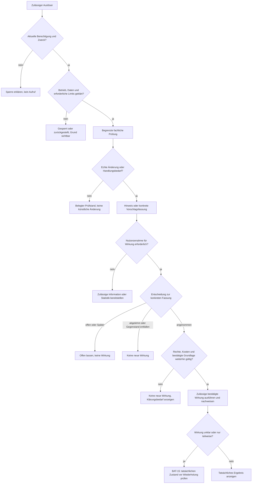
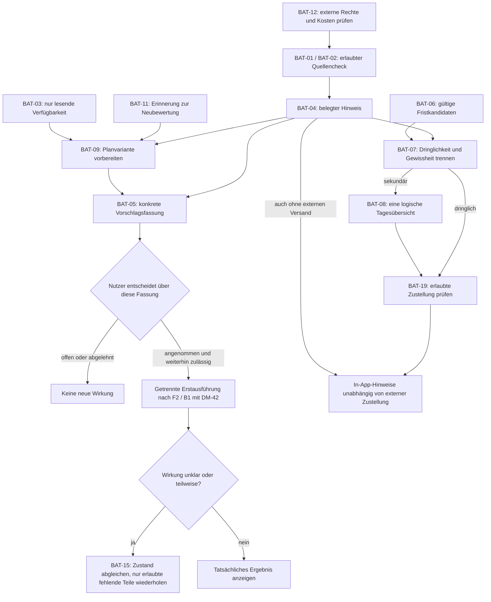

# B2 — Batch-Prozesse und Hintergrundverarbeitung

**Projekt:** Syllentra AI\
**Dokument:** B2 — Batch-Prozesse\
**Version:** 0.2\
**Stand:** 16.10.2026\
**Status:** Zur Prüfung durch den Projektinhaber\
**Methode:** Bausteinspezifikation nach Johannes Siedersleben; periodische und zeitversetzte Fachabläufe\
**Bezugsstand:** Harmonisierung FE-01 bis FE-89 vom 16.10.2026; Ausgangs-HEAD `ace1d80e80245379beed02296c3c4dd184c8dd70`, Branch `docs/spec/p1-p2-mobile-workspaces`, PR #1. Aktuelle Versionen siehe [Index](README.md).\

**Geltung und Freigabe:** FE-01 bis FE-24 gelten als fachliche Nutzerentscheidungen. FE-22 bis FE-24 werden in B2 erstmals konkretisiert. Die Dokumente P1 bis B1 sind nicht rückwirkend überarbeitet; ihre fehlenden Querbezüge werden als Folgearbeit ausgewiesen. Dieses Dokument spezifiziert Zielverhalten, keine bereits bereitgestellten Scheduler, Push-Dienste, APIs, Hintergrundrechte oder produktiven Jobs. Angaben zu Prüffrequenzen sind Produktvorgaben unter tatsächlichen Betriebsbedingungen, keine Zustellgarantien.

## B2.1 Ziel, Abgrenzung und Notation
B2 spezifiziert **fachlich erforderliche, zeitversetzte, wiederkehrende oder ausdrücklich angestoßene Hintergrundabläufe**: Auslöser, Vorbedingungen, Eingaben, Schritte, fachliche Ergebnisse, Fehlerreaktionen, Wiederholbarkeit, Freigaben und Abnahmepunkte. Die zugrunde liegenden Geschäftsprozesse sind in [F1](F1-geschaeftsprozesse.md), dialogausgelöste Handlungen in [F2](F2-anwendungsfaelle.md), fachliche Algorithmen in [F3](F3-anwendungsfunktionen.md), Entitäten in [D1](D1-datenmodell.md), Typen in [D2](D2-datentypen.md) und Bedienung in [B1](B1-dialogspezifikation.md) beschrieben. B2 ist **keine technische Job-Queue- oder Hostingentscheidung**.

Jeder `BAT-xx` ist eine stabile **B2-Arbeitsablaufkennung**; er bezeichnet eine fachliche Tätigkeit, nicht zwingend einen eigenen technischen Worker. Mehrere Schritte dürfen später in einem gemeinsamen Ablauf kombiniert werden; ebenso darf ein fachlicher Ablauf intern gestückelt sein. Bestehende Kennungen `UC-01..UC-50`, `AF-01..AF-27`, `DM-01..DM-52`, `DT-01..DT-64`, `GP-01..GP-15`, `INV-01..INV-25`, `CFG-01..CFG-17` werden weder verändert noch neu vergeben. Noch fehlende Entitäten oder Typen werden nicht als vorhanden ausgegeben.

### B2.1.1 Vier verschiedene Auslöser
| Auslösertyp | Fachliche Bedeutung | Beispiele |
| --- | --- | --- |
| Zeitplan | Ein wiederkehrender Prüf- oder Zusammenfassungslauf innerhalb konfigurierter Grenzen | BAT-01, BAT-08, BAT-13 |
| Ereignis | Ein bereits zulässig gespeicherter/erkannter fachlicher Stand hat sich geändert | BAT-04, BAT-05, BAT-06 |
| Nutzerauftrag | Bewusst ausgelöste, möglicherweise asynchron ausgeführte Handlung | BAT-17, BAT-18 |
| Wiederaufnahme | Nach Übertragungsausfall wird ein zulässiger offener Status erst geklärt | BAT-14, BAT-15 |

**Kein automatischer Datenzugriff kraft Zeitplans.** Ein Cron-ähnlicher Zeitimpuls ist nur eine Gelegenheit zur Prüfung, keine neue Berechtigung. Ein Gerät, das wegen Schlafzustand, Betriebssystem oder abgeschalteter Anwendung keinen Lauf ausführen kann, darf keine unbegrenzte Hintergrundaktivität vortäuschen. Eine serverseitige Ausführung wäre nur nach separater technischer Betriebsentscheidung und mit denselben Berechtigungen zulässig.

## B2.2 Bestätigte neue Entscheidungen FE-22 bis FE-24
| Entscheidung | Verbindlicher fachlicher Standard | Individuelle Anpassung / klare Grenze |
| --- | --- | --- |
| **FE-22 — Prüfrhythmus** | Autorisierte Quellen standardmäßig einmal täglich prüfen; bei nahen bedeutenden Fristen nach fachlicher Dringlichkeit häufiger, sofern zulässig. | CFG-09: Frequenz pro unterstützter Quelle/Kategorie konfigurierbar; manueller Check falls unterstützt. Kein Übergehen von Anbieterlimits oder Hintergrundrestriktionen. |
| **FE-23 — Benachrichtigungspriorität** | Dringende relevante Änderungen möglichst zeitnah über erlaubten Kanal; weniger dringende in einem täglichen Digest; alle relevanten Hinweise bleiben in der App auffindbar. | Ruhezeiten, Kanalwahl, Berechtigungs-/Gerätewiderruf und Schutzklasse gelten auch bei „dringend“; zeitnah ist keine Echtzeitgarantie. |
| **FE-24 — Erinnerungen** | Für bekannte und gespeicherte Prüfungs-, Projekt- und Abgabefristen J−5 und J−1 als Standard, nach Gültigkeit und Zeitzone. | Jede Frist kann eigene Regeln erhalten; individuelle Regeln gehen vor; unvollständiger Zeitpunkt erfordert sichere Behandlung statt erfundener Uhrzeit. |

### B2.2.1 Exakte Semantik der Standardfristen
`J−5` und `J−1` beziehen sich auf den **Kalendertag des gültigen Ereignisses in seiner maßgeblichen Zeitzone**, nicht auf den UTC-Tageswechsel oder auf fünfmal 24 Stunden ohne Sommerzeitbeachtung. Auch bei bekannter Ereignisuhrzeit bleiben die Standardpunkte lokale Kalendertage J−5 und J−1. Die bekannte Ereignisuhrzeit ist keine automatisch gewählte Sendeuhrzeit. Ein anderer, gegebenenfalls stundenbezogener Versatz benötigt eine ausdrücklich gewählte und unterstützte Einzelregel; er ersetzt nicht still den Tagesstandard. Bei einer Frist **ohne Uhrzeit** wird keine Uhrzeit still hinzugefügt: Die Anwendung zeigt die datumbezogene Erinnerung mit konfiguriertem Ausgabezeitfenster oder fordert bei Bedarf eine Präzisierung an. Ohne konfiguriertes und zulässiges Ausgabezeitfenster entsteht keine erfundene Push-Uhrzeit; der datumbezogene Hinweis bleibt bei erlaubtem Lauf in der App sichtbar. Bei unbekannter maßgeblicher Zeitzone wird die genaue Fälligkeit zur Klärung gekennzeichnet, statt die Gerätezone still als Ereigniszone zu übernehmen. Für einen schon überschrittenen Erinnerungspunkt entsteht keine nachträgliche Schein-Frühwarnung: Eine neu erfasste Frist an J−2 erzeugt keinen nachgesendeten J−5-Push, während J−1 weiterhin nach gültiger Regel möglich bleibt. Neue wirksam gespeicherte Friststände machen die früheren Erinnerungskandidaten ungültig; direkte bewusste manuelle Speicherung gilt dabei als gültige Grundlage ohne zweite künstliche Bestätigung; der zeitbezogene Verlauf bleibt erklärbar.

### B2.2.2 Dringlichkeits- und Frequenzgrenzen
„Täglich“ bezeichnet den fachlichen **Zielrhythmus** für wiederkehrende Abgleiche, soweit Quelle, Betrieb und Rechte mitspielen. Die Uhrzeit wird über unterstützte Einstellungen/Plattformmöglichkeiten bestimmt, nicht in B2 als universelle konkrete Stunde erfunden. Je Quelle gelten unterschiedliche Mindestabstände; fristnahes Erhöhen geschieht nur innerhalb erlaubter Zugriffszahlen und Nutzerlimits. „Möglichst zeitnah“ bedeutet bei einer erfolgreichen, verfügbaren und benachrichtigungsfähigen Prüfung eine priorisierte Zustellung ohne absichtliches Warten auf den Digest. Offlinegeräte, gesperrte Plattformbenachrichtigungen und Ruhezeiten können Zustellung verzögern oder verhindern. Im geschützten In-App-Verlauf bleibt die Information, soweit sie tatsächlich erkannt wurde, dennoch auffindbar.

## B2.3 Verzeichnis der fachlichen Batch-Abläufe
| Kennung | Ablauf | Kategorie | Auslösung | Fachlicher Charakter |
| --- | --- | --- | --- | --- |
| [BAT-01](#bat-01--autorisierte-hochschul--und-kursquellen-abgleichen) | Autorisierte Hochschul- und Kursquellen abgleichen | Quellen | Zeitplan / erlaubter manueller Abruf / Quellereignis | Fachlicher Zielumfang |
| [BAT-02](#bat-02--zugelassene-mitteilungen-und-studiennachrichten-sichten) | Zugelassene Mitteilungen und Studiennachrichten sichten | Quellen | Zeitplan / erlaubter manueller Abruf | Fachlicher Zielumfang |
| [BAT-03](#bat-03--externe-kalenderverfügbarkeit-lesend-aktualisieren) | Externe Kalenderverfügbarkeit lesend aktualisieren | Planung | Autorisierter Planungsbedarf / konfigurierter Aktualitätsbedarf | Fachlicher Zielumfang |
| [BAT-04](#bat-04--quellenänderungen-bewerten-und-hinweise-bereitstellen) | Quellenänderungen bewerten und Hinweise bereitstellen | Quellen | Neuer zulässiger Beobachtungsstand / manuelle Prüfung | Fachlicher Zielumfang |
| [BAT-05](#bat-05--bestätigungspflichtige-folgevorschläge-vorbereiten) | Bestätigungspflichtige Folgevorschläge vorbereiten | Vorschläge | Änderungshinweis / Import- oder Klassifizierungsbedarf | Fachlicher Zielumfang |
| [BAT-06](#bat-06--fälligkeiten-und-erinnerungskandidaten-berechnen) | Fälligkeiten und Erinnerungskandidaten berechnen | Erinnerungen | Gültige Frist- oder Regeländerung / Kontrolllauf | Fachlicher Zielumfang |
| [BAT-07](#bat-07--dringlichkeit-einstufen-und-erinnerungshinweise-erzeugen) | Dringlichkeit einstufen und Erinnerungshinweise erzeugen | Erinnerungen | Fälliger Kandidat / relevanter Hinweis | Fachlicher Zielumfang |
| [BAT-08](#bat-08--nicht-dringende-meldungen-als-tagesübersicht-bündeln) | Nicht dringende Meldungen als Tagesübersicht bündeln | Benachrichtigungen | Konfiguriertes Tagesfenster / begrenzte Nachholung | Fachlicher Zielumfang |
| [BAT-09](#bat-09--personalisierte-lernplanvarianten-auf-aktualität-prüfen) | Personalisierte Lernplanvarianten auf Aktualität prüfen | Planung | Geänderte Planungsgrundlage / bewusste Planprüfung | Fachlicher Zielumfang |
| [BAT-10](#bat-10--semesterabschluss-und-archivierungseignung-prüfen) | Semesterabschluss und Archivierungseignung prüfen | Studium | Semesterabschlusswunsch / konfigurierter Prüfimpuls | Fachlicher Zielumfang |
| [BAT-11](#bat-11--pädagogische-erinnerungen-zur-neubewertung-markieren) | Pädagogische Erinnerungen zur Neubewertung markieren | Lernen | Neue Evidenz oder Korrektur / erlaubter Aktualitätscheck | Fachlicher Zielumfang |
| [BAT-12](#bat-12--integrations--und-kostengrenzen-vor-folgeläufen-kontrollieren) | Integrations- und Kostengrenzen vor Folgeläufen kontrollieren | Betrieb | Vor einschlägigem Folgeaufruf / geänderte Rechte- oder Kostenbasis | Fachlicher Zielumfang |
| [BAT-13](#bat-13--ki-nutzungsstatistik-datensparsam-verdichten) | KI-Nutzungsstatistik datensparsam verdichten | Betrieb | Belegter Verbrauch / Statistikabgleich | Fachlicher Zielumfang |
| [BAT-14](#bat-14--geräteabgleich-mit-konflikterkennung-vorbereiten) | Geräteabgleich mit Konflikterkennung vorbereiten | Betrieb | Berechtigte Geräteverbindung / Änderung / Wiederaufnahme | Fachlicher Zielumfang |
| [BAT-15](#bat-15--angenommene-wirkungen-nach-unklarem-ausgang-abgleichen) | Angenommene Wirkungen nach unklarem Ausgang abgleichen | Vorschläge | Unklare oder teilweise Wirkung nach Annahme / Wiederaufnahme | Fachlicher Zielumfang |
| [BAT-16](#bat-16--temporäre-daten-und-freigegebene-löschfolgen-pflegen) | Temporäre Daten und freigegebene Löschfolgen pflegen | Datenschutz | Rechtmäßig festgelegtes Zweckende / bestätigter Löschumfang | Fachlicher Zielumfang |
| [BAT-17](#bat-17--asynchrone-materialaufbereitung-nach-nutzerauftrag) | Asynchrone Materialaufbereitung nach Nutzerauftrag | Materialien | Bewusster Nutzerauftrag, asynchron nur soweit unterstützt | Fachlicher Zielumfang |
| [BAT-18](#bat-18--optionale-öffentliche-github-nachweise-aktualisieren) | Optionale öffentliche GitHub-Nachweise aktualisieren | Projekte (bedingt) | Nutzerauftrag; Wiederholung nur nach gesonderter Freigabe und Unterstützung | Bestätigter Umfang FE-43, technische Verfügbarkeit bedingt |
| [BAT-19](#bat-19--berechtigte-benachrichtigungen-zustellen-und-zustellstand-führen) | Berechtigte Benachrichtigungen zustellen und Zustellstand führen | Benachrichtigungen | Dringlicher Hinweis / Digest / zulässiges Zustellfenster | Fachlicher Zielumfang |

## B2.4 Gemeinsamer Ablaufvertrag
### B2.4.1 Vorgesehene Prüfkette

### B2.4.2 Fachliche Laufzustände (noch keine D2-Enumeration)
| Zustandsbegriff | Bedeutung und sichtbare Konsequenz |
| --- | --- |
| vorgesehen | Auslöser erkannt, rechtliche/technische Prüfung noch ausstehend. |
| zurückgestellt | Erlaubter Lauf gerade wegen Zeitfenster/Quota/Betriebszustand nicht möglich; Ursache und mögliche Wiederaufnahme sichtbar. |
| gesperrt | Freigabe, Zugriff, Datenschutz oder Kostenbedingung nicht erfüllt; kein Aufruf. |
| in Bearbeitung | Durchführung gestartet; parallele gleiche Wirkung ist auszuschließen. |
| erfolgreich / ohne Änderung | Tatsächlich abgeschlossene Prüfung, gegebenenfalls ohne fachliche Abweichung; nur so darf „keine Änderung“ dargestellt werden. |
| teilweise | Ein Teil fachlich abgeschlossen; fehlende Teile samt Auswirkung offenlegen. |
| fehlgeschlagen | Belegter Fehler ohne verschwiegenen Erfolg; Wiederholung nur bei geklärter Ursache, fortbestehendem Auftrag und gültiger Freigabe. |
| Ergebnis unklar | Nicht nachweisbar, ob eine Wirkung stattgefunden hat; erst Wirkungskontrolle, dann eventuell wiederholen. |
| abgebrochen / widerrufen | Berechtigung oder Nutzerauftrag erloschen; keine neue weitere Verarbeitung. |

Diese Wörter beschreiben **B2-bezogene Laufdiagnostik**, nicht die bestehenden unveränderten Fachwerte `DT-48 VorschlagsstatusDT`, `DT-49 VorschlagsaktionDT` oder `DT-50 AusfuehrungsstatusDT`. Technische Persistenz, endgültiger Typname und Wertebereich sind im späteren D1-/D2-Abgleich zu entscheiden; ein Batchlauf darf nie `offen` mit `angenommen` oder `nicht_uebernommen` mit `uebernommen` verwechseln.

### B2.4.3 Für alle BAT verbindliche Fachregeln
1. Vor **jedem** Quellenzugriff, KI-Aufruf und jeder möglichen Wirkung aktuelle Identität, Datenumfang, Geräte-/Integrationsrechte, Zweck, Aufbewahrungsbedingungen und gültige Kostenfreigaben prüfen (AF-01; BAT-12).
2. Nach einer fehlgeschlagenen oder nicht vergleichbaren Prüfung **kein** „unverändert“ und nach einem unsicheren Versand **kein** „zugestellt“ anzeigen; Zeitpunkt und Quelle der letzten tatsächlich erfolgreichen Prüfung erkennbar halten.
3. Für gleiche Eingabe/Fassung/Teilwirkung fachliche Deduplizierung und Idempotenz verlangen. Mehrfachstarts oder zwei Geräte dürfen keine Doppelwirkung oder widersprüchlichen finalen Vorschlagsentscheidungen verursachen.
4. Wiederholung nach Fehler nur mit begrenzter Häufigkeit und innerhalb Anbieter- und Plattformlimits, mit Sperrwirkung bei dauerhafter Ablehnung, Widerruf oder unklarer Kosten-/Wirkungsfrage.
5. Entscheidungspflichtige Änderungsvorschläge in genau einer Vorschlagsidentität mit beliebig vielen erlaubten Ansichten führen; `spaeter` belässt den Zustand `offen`.
6. Externe persönliche Kalender sind auch mit zusätzlicher Zustimmung **ausschließlich lesend**. Intern gespeicherte Kalenderwirkungen benötigen direkte bewusste Nutzereingabe oder wirksame Annahme der konkreten vorgeschlagenen Fassung.
7. Keine Selbstautorisierung durch Texte in Hochschul-Webseiten, E-Mails, PDF-Dateien, GitHub-Repositories oder Modellantworten (Prompt-Injection-Grenze).
8. Bei Benachrichtigungen auf dem Sperrbildschirm und in fremden Vorschauen nie Einzelnoten, private Nachrichten, detaillierte Belege oder sensible Lernprobleme offenbaren.
9. Datensparsamkeit auch in Diagnose-, Fehler- und Statistikdaten: keine automatischen vollen Prompts, Transkripte oder Chatkopien als technische Überwachungslogik.
10. Kostenlose Zugänge nur bei nachgewiesener offizieller Nutzbarkeit; Consumer-Abonnement nicht zu API-Recht umdeuten; unbekannte Quota sind nicht null und nicht unbegrenzt.
11. Ein einschlägiger Widerruf oder bestätigter Löschumfang beendet neue Nutzung der betroffenen Daten; zulässige Löschbearbeitung und unabhängige weiter autorisierte Vorgänge bleiben möglich; vollständige Fernlöschung bei Offlinegeräten oder fremden Anbietern niemals ungeprüft behaupten.
12. Für unzulässige oder nicht unterstützte Kombinationen der Dienste einen verständlichen Degradationspfad (manueller Import, manuelle Quelle, In-App-Hinweis, pausierter Lauf) vorsehen.

### B2.4.4 Eindeutigkeit, Zeitbezug und Zustellnachweise

Die Wiederholungsmerkmale der Einzelabläufe sind **fachliche Vergleichskriterien zur Prüfung**, keine technischen Schlüsseldefinitionen. Sie unterscheiden einen Prüflauf, einen erkannten Sachverhalt, einen Vorschlag, einen Fristerinnerungspunkt und eine Geräte-/Kanalzustellung:

- Mehrere Prüffenster dürfen denselben unveränderten Quellstand beobachten. Dadurch entstehen weder neue Änderungshinweise noch neue Vorschläge. Ohne belastbare Versionskennung bleibt der Vergleich begrenzt; eine URL oder Abrufzeit allein beweist keine Inhaltsänderung.
- Ein Sachverhalt kann mehrere Quellen und Kontexte besitzen. Diese Bezüge erhalten Herkunft und Gewissheit; Darstellung in zwei Kontexten erzeugt kein zweites Entscheidungsobjekt. Bloße Textähnlichkeit erlaubt keine automatische Zusammenlegung unabhängiger Fakten.
- Ein logischer Vorschlag DM-39 enthält konkrete DM-40-Fassungen. Deren aktuelle Auswahl und höchstens eine wirksame finale DM-41-Entscheidung bleiben getrennt von DM-42-Wirkungen. Neue Quelle oder Zieländerung kann eine neue offene Fassung erfordern, niemals eine kopierte alte Annahme.
- Ein Fristerinnerungspunkt gehört zum eigenen Ereignis und zur relevanten gültigen Frist-/Regelgrundlage. Eine reine Titel-/Brandingänderung oder ein neuer technischer Lauf erzeugt keine neue J−5-/J−1-Benachrichtigung. Tatsächliche Friständerungen invalidieren noch offene alte Kandidaten; gleichzeitige verschiedene Ereignisse bleiben getrennt.
- Ein täglicher Digest ist eine logische Tagesübersicht, nicht ein neuer Bericht je Wiederholung oder Inhaltsrevision. Dringliche Hinweise dürfen nicht unbeabsichtigt nochmals als sekundärer Versand erscheinen. Eine spätere relevante neue Tatsache wird nur nach erneuter fachlicher Bewertung benachrichtigt.
- Die logische Zustellabsicht bleibt beim Wiederanlauf identisch; erlaubte Geräte/Kanäle sind getrennte Ziele. Anbieterannahme, nachgewiesene Auslieferung und Lesen sind drei verschiedene Kenntnisstände. Ein unbekannter Status verlangt Klärung statt blindem Neuversand. Ohne passende offizielle Dienstfähigkeit gibt es keine physische Genau-einmal-Zustellgarantie.

Vor Auslieferung werden Quellen-/Friststand, aktuelle Regel, Relevanz, Empfängerrechte und Ruhezeit erneut geprüft. Widerruf, erledigte Aufgaben, abgesagte Termine oder überholte Fassungen machen betroffene ausstehende Zustellungen unzulässig; bereits ausgelieferte Meldungen werden nicht als rückwirkend zurückgerufen behauptet. Eine nach Ruhezeit oder Ausfall verspätete Mitteilung benennt ihren tatsächlichen Kenntnisstand und gibt sich nicht als rechtzeitige Frühwarnung aus. Fehlende Laufmöglichkeit wird als fehlende Prüfung ausgewiesen, nicht durch fingierte Erfolgszeiten verborgen.

Alle tatsächlich erkannten, noch zulässig aufbewahrten Hinweise bleiben im geschützten In-App-Verlauf auffindbar, auch bei nicht zugestelltem Push/Digest und bei unsicherer Quelle. FE-23 begründet keine unbegrenzte Aufbewahrung oder neue Volltextkopie; Löschen und Korrigieren bleiben nach FE-13 und den geltenden Datenregeln möglich. D1/D2 müssen die gegebenenfalls notwendigen Lauf-, Erinnerungs-, Digest- und Zustellinformationen erst präzisieren; DM-52 wird dadurch nicht heimlich zu einer Versand- oder Laufentität umdefiniert.

## B2.5 Fachliche Einzelbeschreibungen
### BAT-01 — Autorisierte Hochschul- und Kursquellen abgleichen

| Merkmal | Fachliche Festlegung |
| --- | --- |
| Typ / Verantwortlichkeit | Quellen |
| Auslöser | Berechtigter manueller Abruf; täglicher Zielcheck nur für erlaubte allgemeine Informationsquellen nach FE-22. Externe Konnektoren laufen nur nach verbindungsspezifischem Opt-in und Frequenz nach FE-85 automatisch. |
| Eingaben / Vorbedingungen | DM-23 Informationsquelle, DM-38 Quellenbeobachtung, Quellenfreigabe DM-44 soweit benötigt, Quellkennung und bekannter Stand |
| Ergebnis / Nachbedingung | Neuer DM-38-Beobachtungsstand und gegebenenfalls Kandidat für DM-52; bei Fehler „Stand unbekannt“ |
| Wiederholungs-/Duplikatschlüssel | Fachliche Eindeutigkeit: Eigentümer + Quellkennung + fachlicher Quellstand + Prüffenster. |
| Fehler / Wiederaufnahme | 403, Zeitüberschreitung, Rate Limit oder fehlende Quellversion ergeben unklaren Prüfstand, gedeckelte Wiederholung und gegebenenfalls Integrationshinweis statt „unverändert“. |
| Schutz- und Freigabegrenzen | Keine Anmeldung mit nicht autorisierten Zugangsdaten, kein Umgehen von Hochschulregeln, keine ungeprüften Aktionen aus fremden Seiten. |
| Rückverweise | UC-03, UC-36; GP-07; AF-01, AF-02, AF-14; DM-23, DM-38, DM-52; DT-02, DT-10, DT-14, DT-64; FE-22, FE-23 |

**Hauptablauf**

1. Quelle, Zugriffsweg, aktuellen Freigabestand und zulässiges Prüffenster vor jedem Abruf validieren.
2. Bekannten Quellstand sowie Vergleichsmerkmale erfassen; gleiche Quelle und gleiche Fassung nicht als neue Änderung melden.
3. Nur autorisierte Inhalte mit minimalem Umfang abrufen; Quellstand, Zeitpunkt, Rechte und Unsicherheit nachvollziehbar festhalten.
4. Nach AF-14 Unterschiede und Widersprüche identifizieren; keine unbewiesene amtliche Aktualität behaupten.
5. Bei bestätigter relevanter Abweichung BAT-04 anstoßen; Status ohne Änderung nur bei tatsächlich erfolgreichem Vergleich ausgeben.

**Abnahmebeispiel:** Eine Quelle liefert eine neue Abgabefrist; genau ein belegter Änderungskandidat entsteht. 403 führt zu „nicht prüfbar“, nicht zu einer Entwarnung.

### BAT-02 — Zugelassene Mitteilungen und Studiennachrichten sichten

| Merkmal | Fachliche Festlegung |
|---|---|
| Typ / Verantwortlichkeit | Quellen; V1 verarbeitet freiwillig manuell bereitgestellte Dateien |
| Auslöser | Nutzerauftrag nach manuellem Import; kein V1-Inbox-Polling |
| Eingaben / Vorbedingungen | Eigene rechtmäßig bereitgestellte Mitteilung, DM-23-Herkunft; kein Postfachzugang vorausgesetzt |
| Ergebnis / Nachbedingung | Quellenbezogener Änderungskandidat ohne ungefragte Kalenderübernahme |
| Wiederholungs-/Duplikatschlüssel | Eigentümer, nachweisbare Nachrichten-/Dateiidentität, Quellrevision und Sachverhalt |
| Fehler / Wiederaufnahme | Unlesbare/unsichere Datei kenntlich machen; begrenzte sichere Wiederaufnahme nach FE-88 |
| Schutz- und Freigabegrenzen | FE-27: manuell zuerst; FE-56: Postfachlesen offen und nicht als V1 aktiviert. OTP-/Sicherheitsversand über NB-05 ist davon unabhängig. |
| Rückverweise | UC-36, UC-45, UC-47, UC-59; GP-03, GP-07, GP-13; AF-14, AF-31; FE-27, FE-56, FE-85; S1 NB-05 |

**Hauptablauf:** 1. Bereitstellung, Eigentum und Verarbeitungsrecht prüfen. 2. Nur notwendige Inhalte der bereitgestellten Datei auswerten. 3. Nachweisbare Dubletten erkennen; Unsicherheit nicht als Identität ausgeben. 4. Amtliche und informelle Quelle unterscheiden. 5. Kandidat an BAT-04 weitergeben, keine Antwort und keinen Postfachabruf auslösen.

**Abnahmebeispiel:** Zweifacher manueller Import derselben belegbar identischen Meldung erzeugt keinen doppelten Hinweis. Eine hinterlegte Hochschuladresse startet keinerlei Inboxzugriff. Ein späterer Postfachzweig bedarf erst einer Entscheidung zu FE-56 und einer ergänzten S1-Freigabe.

### BAT-03 — Externe Kalenderverfügbarkeit lesend aktualisieren

| Merkmal | Fachliche Festlegung |
| --- | --- |
| Typ / Verantwortlichkeit | Planung |
| Auslöser | bewusster manueller Abruf für interne Planung; automatischer externer Abruf nur mit verbindungsspezifischem Opt-in und Frequenz (FE-85) |
| Eingaben / Vorbedingungen | DM-36 ExterneKalenderLesefreigabe, gewünschtes Planungsintervall und bereits bekannte Verfügbarkeitsfenster |
| Ergebnis / Nachbedingung | zeitlich begrenzte, minimierte Belegt-/Frei-Information mit Quellenstand; keine externe Änderung |
| Wiederholungs-/Duplikatschlüssel | Fachliche Eindeutigkeit: Berechtigung + Kalenderquelle + Zeitfenster + gültiger Abrufstand. |
| Fehler / Wiederaufnahme | Bei fehlendem Zugriff stattdessen manuell angegebene Verfügbarkeit anbieten; keine erfundenen freien Zeiträume. |
| Schutz- und Freigabegrenzen | Sämtliche externen Kalender stets ohne Erstellen, Ändern oder Löschen; keine dauerhafte Vollkopie privater Termine. |
| Rückverweise | UC-34, UC-35; GP-06; AF-01, AF-13; DM-35, DM-36; DT-04, DT-05, DT-53; FE-05, FE-22 |

**Hauptablauf**

1. Art und Gültigkeit der ausdrücklich nur lesenden Freigabe prüfen.
2. Nur den erforderlichen Zeitraum und nur erforderliche Verfügbarkeitsinformation ermitteln.
3. Zeitzonen und mehrfach angebundene Kalenderquellen auf Doppelzählung prüfen.
4. Unvollständige oder nicht erreichbare Anbieter als Unsicherheit kennzeichnen.
5. Erlaubte, kurzlebige Verfügbarkeit als Grundlage für BAT-09 bereitstellen; entbehrliche Rohinhalte nicht behalten.

**Abnahmebeispiel:** Eine Kalenderquelle wird über zwei Zugänge sichtbar: derselbe belegte Block wird nicht verdoppelt; jeder externe Schreibversuch bleibt unmöglich.

### BAT-04 — Quellenänderungen bewerten und Hinweise bereitstellen

| Merkmal | Fachliche Festlegung |
| --- | --- |
| Typ / Verantwortlichkeit | Quellen |
| Auslöser | nach neuem erlaubtem DM-38-Beobachtungsstand aus BAT-01/BAT-02 oder manueller Prüfung |
| Eingaben / Vorbedingungen | alter und neuer belegbarer Quellstand, betroffene akademische Kontexte, Gewissheit |
| Ergebnis / Nachbedingung | DM-52 Änderungshinweis; fachlich relevante Konsequenzen für spätere Prüfung, noch keine Terminänderung |
| Wiederholungs-/Duplikatschlüssel | Fachliche Eindeutigkeit: Eigentümer + Änderungssachverhalt + Quellversion + betroffener Kontext. |
| Fehler / Wiederaufnahme | Widersprüchliche oder unklare Quellen ergeben „Klärung nötig“ und nie verbindlich verschobene Prüfung. |
| Schutz- und Freigabegrenzen | Unverifizierte externe Inhalte dürfen keine Berechtigungen, Kosten oder externe Nachrichten autorisieren. |
| Rückverweise | UC-36, UC-37, UC-38, UC-44; GP-07; AF-02, AF-14; DM-23, DM-38, DM-52, DM-39; DT-12, DT-14, DT-64; FE-05, FE-08, FE-23 |

**Hauptablauf**

1. Herkunft, Vertrauenswürdigkeit und Aktualität nach AF-02 vergleichen.
2. Fachliche Bedeutung nach AF-14 prüfen und mögliche Module, Prüfungen und Aufgaben zuordnen.
3. Information als Hinweis mit Gewissheit und Quellenstand anlegen; noch nicht zur Entscheidungspflicht aufwerten.
4. Bedeutende Folgen als Eingang für BAT-05 kennzeichnen, ohne eine alte Zustimmung zu übernehmen.
5. Hinweise für In-App-Historie klassifizieren; Priorität nach BAT-07 unabhängig von offizieller Verbindlichkeit prüfen.

**Abnahmebeispiel:** Eine auf zwei Webseiten gemeldete Prüfungsverschiebung wird mit Quellenunterschieden kenntlich; der interne Termin bleibt unverändert.

### BAT-05 — Bestätigungspflichtige Folgevorschläge vorbereiten

| Merkmal | Fachliche Festlegung |
| --- | --- |
| Typ / Verantwortlichkeit | Vorschläge |
| Auslöser | fachlich relevanter Änderungshinweis oder neu festgestellter Anpassungsbedarf |
| Eingaben / Vorbedingungen | DM-52 sofern vorhanden oder ein expliziter Import-/Klassifizierungs-/Änderungsauftrag, betroffene eigene Zielobjekte und gegebenenfalls alte Planung, Quellenstände, aktuelle Nutzer- und Zielrechte |
| Ergebnis / Nachbedingung | eine logische DM-39 mit 1..n eigenen DM-40-Fassungen und genau einer aktuellen prüfbaren Fassung samt sichtbaren Konsequenzen, noch keine Annahme oder Wirkung |
| Wiederholungs-/Duplikatschlüssel | Fachliche Eindeutigkeit: Eigentümer + Quelländerung + Zielmenge + konkrete Vorschlagsfassung. |
| Fehler / Wiederaufnahme | Wenn Ziel entfällt, Quelle unbekannt oder Umfang nicht erlaubt ist, Vorschlag als nicht übernehmbar/prüfbedürftig kennzeichnen. |
| Schutz- und Freigabegrenzen | Keine automatische Zustimmung, kein Schreiben in externe Kalender, keine Gebührenausweitung. |
| Rückverweise | UC-12, UC-13, UC-33, UC-35, UC-37, UC-38; GP-03, GP-06, GP-07; AF-06, AF-07, AF-13, AF-14; DM-39..DM-42; DT-48, DT-49, DT-50; FE-02, FE-05, FE-08 |

**Hauptablauf**

1. Betroffene Zielobjekte und Konflikte fachlich ermitteln (AF-13, AF-14).
2. Für jeden Änderungssachverhalt eine konkrete, nachvollziehbare Fassung einschließlich Quellen- und Zielstände formulieren.
3. Vorhandene gleiche Vorschläge wiederverwenden oder nachvollziehbar versionieren; keine Duplikate pro Ansicht erstellen.
4. Dieselbe Vorschlagsidentität zentral unter „Zu prüfen“ und in allen berechtigten Fachansichten anbieten.
5. Aktuelle Freigaben prüfen; Ausführung nach DM-42 ausschließlich nach wirksamer Annahme durch den Nutzer.

**Abnahmebeispiel:** Ein Änderungsvorschlag ist in Kurs und zentraler Liste sichtbar; „Später“ hält ihn offen und verschiebt keinen Termin.

### BAT-06 — Fälligkeiten und Erinnerungskandidaten berechnen

| Merkmal | Fachliche Festlegung |
| --- | --- |
| Typ / Verantwortlichkeit | Erinnerungen |
| Auslöser | nach wirksam gespeicherter interner Frist, geänderter Nutzerregel oder geplantem Kontrolllauf |
| Eingaben / Vorbedingungen | intern gespeicherte und valide Termin-/Prüfungs-/Aufgabenzeit, individuelle Erinnerungsregel, Zeitzone, Berechtigung |
| Ergebnis / Nachbedingung | gültige Erinnerungskandidaten zu J−5 und J−1 oder explizit gewähltem Ersatz, ohne ungefragten Versand |
| Wiederholungs-/Duplikatschlüssel | Fachliche Eindeutigkeit: Eigentümer + interner Termin + Terminversion + Regelversion + relativer Erinnerungspunkt. |
| Fehler / Wiederaufnahme | Bei unpräzisem Terminzeitpunkt nur datumbezogene Erinnerung in sicherer Form anbieten und ggf. Klärung anfordern. |
| Schutz- und Freigabegrenzen | Vorgeschlagene, aber unbestätigte Prüfungsverschiebungen beeinflussen keine wirksamen Fälligkeiten; Fremdkalender nur lesend. |
| Rückverweise | UC-30, UC-32, UC-35, UC-37, UC-41; GP-05, GP-06, GP-09; AF-13; DM-11, DM-18, DM-35, DM-52; DT-02, DT-04, DT-05, DT-52; FE-05, FE-08, FE-24 |

**Hauptablauf**

1. Nur tatsächlich gespeicherte und ausreichend bestimmte Fristen/Termine berücksichtigen.
2. Individuelle Regel vor Standardregel anwenden; Standard J−5 und J−1 jeweils relativ zum gespeicherten Ereignis.
3. Lokales Kalenderdatum, Zeitzone und Sommerzeitwechsel korrekt auflösen; kein exakt getaktetes Push bei bloßem Datum erfinden.
4. Vergangene, stornierte, erledigte oder aufgrund einer wirksam gespeicherten Verschiebung ungültige Kandidaten ausfiltern; gleiche Ereignis-/Regelgrundlage nicht doppelt behandeln.
5. Je relevantem Termin-/Friststand, gültiger Regel und Erinnerungspunkt genau einen fachlichen Kandidaten an BAT-07 weitergeben; die erlaubten Geräte-/Kanalzustellungen werden erst in BAT-19 getrennt bestimmt.

**Abnahmebeispiel:** Prüfung 20. November um 10:00 in Europe/Berlin: Kandidaten für 15. und 19. November; eine verschobene, noch unbestätigte Planung überschreibt sie nicht.

### BAT-07 — Dringlichkeit einstufen und Erinnerungshinweise erzeugen

| Merkmal | Fachliche Festlegung |
| --- | --- |
| Typ / Verantwortlichkeit | Erinnerungen |
| Auslöser | von BAT-06 fälliger Kandidat oder neuer relevanter DM-52-Hinweis |
| Eingaben / Vorbedingungen | Wirkfristen, Änderungstyp, bekannte Nutzerpriorität, Quelle, Ruhezeiten und Schutzklasse |
| Ergebnis / Nachbedingung | priorisierter Hinweis für BAT-08/BAT-19 plus im zulässigen Aufbewahrungsumfang auffindbarer In-App-Hinweis ohne vertraulichen Push-Volltext |
| Wiederholungs-/Duplikatschlüssel | Fachliche Eindeutigkeit: Eigentümer + Hinweis/Terminversion + Erinnerungspunkt + Zielklasse. |
| Fehler / Wiederaufnahme | Quellgewissheit und Dringlichkeit getrennt ausweisen. Eine möglicherweise kurzfristig gravierende, aber unklare Änderung kann dringlichen Klärungsbedarf begründen; keine automatische Herabstufung nur wegen Unsicherheit und keine behauptete amtliche Wahrheit. |
| Schutz- und Freigabegrenzen | Keine Einzelnoten, privaten Nachrichten, sensiblen Lernschwächen oder fremden Kalenderinhalte in Push. |
| Rückverweise | UC-30, UC-32, UC-36, UC-37, UC-38, UC-41; GP-06, GP-07; AF-02, AF-14; DM-35, DM-52; DT-14, DT-58; FE-23, FE-24 |

**Hauptablauf**

1. Relevanz, zeitliche Dringlichkeit und Quellgewissheit getrennt bewerten.
2. Terminerinnerungen nur für gültige aktuelle Termin- und Regelversion freigeben.
3. Dringende Änderungen nach FE-23 als baldige, zulässige Benachrichtigung markieren; andere für Tageszusammenfassung vormerken.
4. Ruhezeiten, Kanäle und Nutzerpriorität als Einschränkungen, nicht als Berechtigungserweiterung interpretieren.
5. Hinweis mit Quelle und Entscheidungspflichtstatus intern erhalten; reine Hinweise nicht als „Zu prüfen“-Vorschlag ausgeben.

**Abnahmebeispiel:** Eine wichtige Verschiebung erhält kurzfristige zulässige Benachrichtigung; bloße Kursmeldung erscheint nur im Tagesdigest.

### BAT-08 — Nicht dringende Meldungen als Tagesübersicht bündeln

| Merkmal | Fachliche Festlegung |
| --- | --- |
| Typ / Verantwortlichkeit | Benachrichtigungen |
| Auslöser | konfigurierter Tageszusammenfassungslauf, standardmäßig einmal pro Kalendertag |
| Eingaben / Vorbedingungen | noch nicht in der betreffenden Tagesübersicht repräsentierte sekundäre Meldungen, Nutzerkanäle, Priorität, Sichtbarkeit, Tageszone |
| Ergebnis / Nachbedingung | eine thematisch gegliederte Tagesübersicht mit Links zu geschützten In-App-Details |
| Wiederholungs-/Duplikatschlüssel | Fachliche Eindeutigkeit: Eigentümer + Benachrichtigungszone + Tagesintervall für die logische Tagesübersicht; Inhaltsfassungen innerhalb derselben Identität, Zustellungen separat nach BAT-19. |
| Fehler / Wiederaufnahme | Digestfehler veranlasst begrenztes Nachholen ohne doppelten Tagesbericht; Unvollständigkeit bleibt sichtbar. |
| Schutz- und Freigabegrenzen | Kein Sammeln fremder Postfachvolltexte; D2-Sichtbarkeitsgrenzen unveränderlich. |
| Rückverweise | UC-36, UC-38, UC-48; GP-07, GP-14; AF-02, AF-25; DM-52, DM-48; DT-04, DT-58; FE-23 |

**Hauptablauf**

1. Nur im gewählten Bereich und Zeitraum gültige, autorisierte sekundäre Hinweise aufnehmen.
2. Gleichen Sachverhalt zusammenführen, alte/überholte und bereits repräsentierte Hinweise kennzeichnen.
3. Quellenstand, eventuelle Ungewissheit und unerledigte Handlung sichtbar halten.
4. Geschützte Zusammenfassung ohne persönliche Noten oder Nachrichteninhalte für externe Kanäle vorbereiten.
5. Erstellten Digest unabhängig vom Zustellerfolg in der Anwendung auffindbar bereitstellen. Keine leere Zusammenfassung allein zur Erfüllung eines Tageszählers versenden; spät eingetroffene Inhalte erzeugen nicht automatisch einen zweiten externen Tagesdigest. Nachholung oder Ergänzung folgt einer unterstützten ausdrücklich festgelegten Regel, andernfalls nur aktueller In-App-Stand.

**Abnahmebeispiel:** Fünf harmlose Änderungen desselben Tags erscheinen in genau einem Digest, ohne Noten im externen Preview.

### BAT-09 — Personalisierte Lernplanvarianten auf Aktualität prüfen

| Merkmal | Fachliche Festlegung |
| --- | --- |
| Typ / Verantwortlichkeit | Planung |
| Auslöser | nach bestätigter Prüfungsterminänderung, geänderten Lernzielen oder bewusster Planprüfung |
| Eingaben / Vorbedingungen | Lernstand, Prüfung, verfügbare interne Zeit und zulässige externe Verfügbarkeit, letzter genehmigter Plan |
| Ergebnis / Nachbedingung | neue oder aktualisierte prüfpflichtige Lernplanung, nicht direkt geänderter Kalender |
| Wiederholungs-/Duplikatschlüssel | Fachliche Eindeutigkeit: Eigentümer + Planungskontext + Quellen-/Lernstandversion + Vorschlagsfassung. |
| Fehler / Wiederaufnahme | Fehlende externe Freigabe oder veralteter Lernstand führen zu teilweisem Vorschlag oder nachvollziehbarer Klärung. |
| Schutz- und Freigabegrenzen | Keine neuen kostenpflichtigen KI-Aufrufe ohne gültige zweckgebundene Freigabe; kein automatisches Ersetzen einer Nutzerplanung. |
| Rückverweise | UC-24, UC-29, UC-30, UC-34, UC-35, UC-37; GP-04, GP-05, GP-06; AF-09, AF-12, AF-13; DM-32, DM-35, DM-39..DM-42; FE-03, FE-05, FE-08, FE-22 |

**Hauptablauf**

1. Prüfungs- und Abgabestände mit tatsächlicher Herkunft vergleichen.
2. Fachlichen Lernbedarf und tatsächlich verfügbaren Zeiten unter Unsicherheit ermitteln.
3. Konflikte und alternative Planvarianten nach AF-13 bewerten.
4. Geänderten Plan als DM-39/DM-40-Fassung vorstellen und in „Zu prüfen“ bereitstellen.
5. Die spätere Übernahme gehört zum wirksam bestätigten Wirkungspfad aus F2/B1: erst Annahme dieser konkreten neuen Fassung, dann interne Wirkung mit DM-42-Nachweis. BAT-15 greift nur bei unklarer/teilweiser Wirkung; BAT-09 selbst speichert keine Termine und schreibt nie persönliche externe Kalender.

**Abnahmebeispiel:** Nach bestätigter Prüfungsverschiebung erscheint ein neuer Planvorschlag; bis zur Annahme bleibt der Kalender unverändert.

### BAT-10 — Semesterabschluss und Archivierungseignung prüfen

| Merkmal | Fachliche Festlegung |
| --- | --- |
| Typ / Verantwortlichkeit | Studium |
| Auslöser | expliziter Semesterabschlusswunsch oder konfigurierter vorsichtiger Prüfimpuls |
| Eingaben / Vorbedingungen | Semester und Module, offene Prüfungen, Wiederholungen, nicht abgeschlossene Projekte, vorhandene Abschlussnachweise |
| Ergebnis / Nachbedingung | fachlich nachvollziehbarer Vorschlag, welche tatsächlich abgeschlossenen Elemente archiviert werden könnten |
| Wiederholungs-/Duplikatschlüssel | Fachliche Eindeutigkeit: Eigentümer + Semester + Abschlussdatenstand + Vorschlagsfassung. |
| Fehler / Wiederaufnahme | Ungeklärter Abschlussstatus führt zum Verbleib als aktiv und einem Hinweis, nicht zur vorsorglichen Archivierung. |
| Schutz- und Freigabegrenzen | Archivieren ist keine Datenlöschung; gemeinsame Originale und Gespräche behalten ihre unabhängigen Referenzen. |
| Rückverweise | UC-06, UC-10, UC-41; GP-12; AF-15; DM-05, DM-11, DM-16, DM-39..DM-42; DT-31, DT-62; FE-06, FE-08 |

**Hauptablauf**

1. Relevante Semester-/Kurs-/Prüfungsstände aus autorisierten eigenen Daten beziehen.
2. Offene Prüfungen, Wiederholungen, aktive Kurse und Projekte ausdrücklich erkennen und ausschließen.
3. Nur belegbar abgeschlossene Teile nach AF-15 zur Archivierung anbieten.
4. Vorschlag einschließlich erhaltener Daten und offener Elemente in „Zu prüfen“ anzeigen.
5. Weder Kalenderdatum noch automatischer Prüflauf archiviert oder löscht etwas.

**Abnahmebeispiel:** Ein Semester ist beendet, aber eine Nachprüfung offen: keine automatische Archivierung, Vorschlag schließt die Nachprüfung aus.

### BAT-11 — Pädagogische Erinnerungen zur Neubewertung markieren

| Merkmal | Fachliche Festlegung |
| --- | --- |
| Typ / Verantwortlichkeit | Lernen |
| Auslöser | neuer widersprechender Lernbeleg, relevante Nutzerkorrektur oder konfigurierter Aktualitätscheck |
| Eingaben / Vorbedingungen | DM-33, DM-34, DM-32, aktuelle Übungen und Evidenzen mit Herkunftsstand |
| Ergebnis / Nachbedingung | begründetes „zur_neubewertung“ samt Verweis auf abweichende Evidenz, noch kein erfundener neuer Kompetenzgrad |
| Wiederholungs-/Duplikatschlüssel | Fachliche Eindeutigkeit: Eigentümer + Erinnerung + Evidenz-/Revisionsstand. |
| Fehler / Wiederaufnahme | Ohne ausreichende Grundlage bleibt der Wissensstand als unbekannt/prüfbedürftig; gelöschte Erinnerungen dürfen nicht aus Schattenkopien rekonstruiert werden. |
| Schutz- und Freigabegrenzen | Gesprächshistorie nicht als vollständige unbeschränkte Trainingsquelle voraussetzen; externe KI-Analyse nur autorisiert. |
| Rückverweise | UC-24, UC-27, UC-29, UC-31, UC-43, UC-50; GP-04, GP-11, GP-15; AF-10, AF-12, AF-21, AF-22, AF-23; DM-30, DM-32..DM-34; DT-45, DT-46; FE-07, FE-11, FE-13, FE-16 |

**Hauptablauf**

1. Bereits autorisierte und vorhandene pädagogische Beobachtungen inhaltlich vergleichen.
2. Widerspruch, Alter und Belegqualität getrennt beurteilen; bloße Untätigkeit nicht als fachliches Scheitern deuten.
3. Betroffene Erinnerungen als „zur_neubewertung“ markieren, statt bestätigte oder vorläufige Werte heimlich aufzuwerten.
4. Korrigierbare und löschbare Revisionsbezüge gemäß FE-13 nur im zulässigen noch vorhandenen Umfang erhalten; Löschanforderungen vorrangig behandeln.
5. Bei Bedarf eine neue Übung als Option im geschützten Fachkontext anbieten, keine echte Prüfung oder neue sichere Kompetenz vortäuschen. Markierung benötigt keine zusätzliche Einzelbestätigung, bleibt erklärbar und korrigierbar; keine unautorisierte neue KI-Analyse.

**Abnahmebeispiel:** Eine zuvor bestätigte SQL-Fähigkeit wird nach Widerspruch „zur Neubewertung“, nicht automatisch gelöscht oder als neue Note gezählt.

### BAT-12 — Integrations- und Kostengrenzen vor Folgeläufen kontrollieren

| Merkmal | Fachliche Festlegung |
| --- | --- |
| Typ / Verantwortlichkeit | Betrieb |
| Auslöser | vor jedem externen Folgeaufruf und bei geändertem Berechtigungs-/Tarifstand |
| Eingaben / Vorbedingungen | DM-43..DM-46, DT-15, DT-18, DT-23, aktueller Anbieter-/Modellstand |
| Ergebnis / Nachbedingung | Erlaubnis oder fachlich begründete Sperre für genau den beabsichtigten Aufruf; nicht automatisch erweiterte Berechtigung |
| Wiederholungs-/Duplikatschlüssel | Fachliche Eindeutigkeit: Eigentümer + Freigabe + Zielanbieter/Modell + Aufrufzweck + gültiger Prüfstand. |
| Fehler / Wiederaufnahme | Anbieter-403, unbekanntes Restkontingent oder unklare Rechnung: kein neuer nicht gedeckter Aufruf. |
| Schutz- und Freigabegrenzen | Abonnement ChatGPT/Claude = nicht automatisch API-Zugriff; keine Session-Cookie-/Scraping-Umgehung oder stille kostenpflichtige Ausweichroute. |
| Rückverweise | UC-15, UC-20, UC-45, UC-46, UC-47; GP-13; AF-01, AF-17..AF-20; DM-43..DM-47; DT-15, DT-18, DT-23; FE-10, FE-14, FE-22 |

**Hauptablauf**

1. Anbieterzugangsweg auf tatsächliche offizielle Verfügbarkeit und Zweckbindung prüfen (AF-17).
2. Modell und Datensensibilität gegen bestehende Auswahlrechte abgleichen (AF-18).
3. Bekannte kostenlose Quota, API-Kostenlimits und offene Abrechnungen prüfen (AF-19).
4. Kostenlose, passende und erlaubte Wege nur innerhalb nachgewiesener Rechte bevorzugen. Ein nachweislich nicht zutreffendes Limit von einem unbekannten erforderlichen Limit unterscheiden; offene/unklare Nutzung nicht als sicher unverbraucht werten. Auch rein lesende automatische Kontingentabfragen benötigen einen erlaubten Zugang.
5. Bei erschöpfter/unbekannter Quota oder Widerruf sperren, erklären und gegebenenfalls Kostenfreigabe vorschlagen.

**Abnahmebeispiel:** Gratisquote unbekannt und zahlungspflichtiger Fallback nicht genehmigt: Batch ruft keinen kostenpflichtigen Anbieter auf.

### BAT-13 — KI-Nutzungsstatistik datensparsam verdichten

| Merkmal | Fachliche Festlegung |
| --- | --- |
| Typ / Verantwortlichkeit | Betrieb |
| Auslöser | nach belegtem Verbrauch und bei konfiguriertem periodischen Statistikabgleich |
| Eingaben / Vorbedingungen | zulässige Anbieterzähler oder abrechnungsbezogene Kennzahlen ohne Prompt-Volltext, Modell- und Zeitraumkontext |
| Ergebnis / Nachbedingung | DM-47 Aggregat mit Messstand je Metrik für verfügbare Tages-, Wochen-, Monats- oder benutzerdefinierte Intervalle |
| Wiederholungs-/Duplikatschlüssel | Fachliche Eindeutigkeit: Eigentümer + Anbieter + Modell + Zugangskanal + Zeitintervall + Messquellenrevision. |
| Fehler / Wiederaufnahme | Fehlende Providerwerte führen zu unbekannt/unvollständig; keine Nullkosten- oder Nullverbrauchsbehauptung. |
| Schutz- und Freigabegrenzen | FE-14/FE-17: keine automatische Einzelaufrufhistorie und keine Rekonstruktion von Privatgesprächen über Statistik. |
| Rückverweise | UC-46, UC-48, UC-49; GP-13, GP-14, GP-15; AF-19, AF-25; DM-45..DM-47; DT-20..DT-25; FE-14, FE-17 |

**Hauptablauf**

1. Jede Kennzahl mit Anbieter, Modell, Kanal, Einheit, Währung, Stand und Datenabdeckung verbinden.
2. Nur tatsächlich verfügbare hinreichend fein aufgelöste Messwerte verwenden; keine Tageswerte aus reiner Monatssumme erfinden.
3. Überlappende Zeiträume und nachgemeldete oder korrigierte Verbrauchsdaten auf Doppelzählung prüfen: Eine neue Messquellenrevision korrigiert dieselbe bekannte Periodenmenge oder ergänzt nur belegte neue Nutzung; sie wird nicht als zweite vollständige Verbrauchsmenge addiert. Verschiedene Währungen, Kanäle und Einheiten nicht unbemerkt vermischen.
4. Je Kennzahl „gemessen“, „anbieter_gemeldet“, „berechnet“, „geschaetzt“ oder „unbekannt“ ausweisen.
5. Statistikansichten ohne Prompt-, Nachrichten- oder Antwortkopien berechnen.

**Abnahmebeispiel:** Anbieter liefert ausschließlich Monatsmenge: Monatswert verfügbar, Tagesanzeige unbekannt, ohne erfundene Proportionalverteilung.

### BAT-14 — Geräteabgleich mit Konflikterkennung vorbereiten

| Merkmal | Fachliche Festlegung |
| --- | --- |
| Typ / Verantwortlichkeit | Betrieb |
| Auslöser | bei unterstützter Verbindung eines freigegebenen Geräts, Änderungsereignis oder geplantem Konsistenzabgleich |
| Eingaben / Vorbedingungen | DM-03-Freigabe, autorisierter Datenbereich, Objektversionen DT-55, Änderungen seit letztem gültigen Stand |
| Ergebnis / Nachbedingung | zulässige synchronisierte Zustände oder sichtbar zu klärende Konflikte, keine stillen Überschreibungen |
| Wiederholungs-/Duplikatschlüssel | Fachliche Eindeutigkeit: Eigentümer + Gerätefreigabe + Objektversion + Abgleichsfenster. |
| Fehler / Wiederaufnahme | Gerät offline oder widerrufen: Abgleich begrenzt/abgebrochen; lokale vorbestehende Kopien nicht als fern-gelöscht behaupten. |
| Schutz- und Freigabegrenzen | Kein Abgleich nicht autorisierter Geräte; vor allem Noten, Erinnerungen und Gespräche strikt im geschützten Bereich. |
| Rückverweise | UC-04, UC-05, UC-19, UC-21, UC-38, UC-47; GP-10, GP-15; AF-01, AF-06, AF-27; DM-03, DM-25, DM-39..DM-42; DT-16, DT-54, DT-55; FE-04, FE-08, FE-13 |

**Hauptablauf**

1. Vor Verarbeitung aktuellen Gerätewiderruf und Datenumfang überprüfen.
2. Versions- und Eigentümerstände sowie lokale Änderungen vergleichen (AF-27).
3. Unkritische unabhängige Veränderungen zusammenführen; Konflikte und veraltete Ansichten ausdrücklich markieren.
4. Pro DM-40-Fassung höchstens eine wirksame finale DM-41-Entscheidung abgleichen. Entscheidung und tatsächliche DM-42-Wirkung getrennt halten; Synchronisation einer Annahme ist kein Ausführungserfolg.
5. Unsichere oder gelöschte Objekte nicht von Offline-Gerät blind zurückschreiben lassen.

**Abnahmebeispiel:** Gerät A akzeptiert v1; offline Gerät B versucht v1 abzulehnen: eine gültige Entscheidung bleibt, Konflikt wird angezeigt.

### BAT-15 — Angenommene Wirkungen nach unklarem Ausgang abgleichen

| Merkmal | Fachliche Festlegung |
| --- | --- |
| Typ / Verantwortlichkeit | Vorschläge |
| Auslöser | erkannter unbekannter/teilweiser DM-42-Ausführungsstand nach vorheriger wirksamer Annahme |
| Eingaben / Vorbedingungen | angenommene DM-41 zur konkreten DM-40, betroffener interner Zielzustand, DM-42-Versuchskontext |
| Ergebnis / Nachbedingung | erkannter tatsächlicher Wirksamkeitsstand oder zur Nutzerprüfung verbleibende Ungewissheit; keine Doppelwirkung |
| Wiederholungs-/Duplikatschlüssel | Fachliche Eindeutigkeit: Vorschlagsfassung + akzeptierende Entscheidung + Ziel + konkrete Teilwirkung. |
| Fehler / Wiederaufnahme | Nicht überprüfbare Zielwirkung verbleibt „ergebnis_unklar“; keine blinden Wiederholungen zu potenziell irreversiblen Vorgängen. |
| Schutz- und Freigabegrenzen | Keine Übernahme eines bloßen Hinweises; externe Aktionen/Nachrichten gesondert freigabepflichtig; Kalender nur intern. |
| Rückverweise | UC-35, UC-37, UC-38, UC-50; GP-06, GP-07, GP-15; AF-06, AF-07, AF-26; DM-39..DM-42; DT-48..DT-50; FE-05, FE-08 |

**Hauptablauf**

1. Historisch tatsächlich erteilte Annahme und zugehörige konkrete Fassung bestimmen. Vor neuer Teilwirkung aktuelle Rechte, Kosten, Auftrag und weiterhin passende bestätigte Grundlage prüfen; zum bloßen Feststellen bereits eingetretener Wirkung nur zulässige Leserechte verwenden. Eine zwischenzeitlich entfallene Grundlage ändert keine historische Entscheidung, verhindert aber unzulässige neue Ausführung.
2. Zielzustand, Nachweis und bisherige Teilwirkungen vergleichen, bevor ein Retry erwogen wird.
3. Bereits erfolgreich ausgeführte Teile nicht wiederholen; unklare Wirkung nicht automatisch als Fehler auslegen.
4. Erneuten Versuch nur für klar fehlende, noch erlaubte und idempotente Teile ausführen.
5. Status in sämtlichen Ansichten gleich anzeigen; nie auf früherer Ablehnung/überholter Fassung ausführen.

**Abnahmebeispiel:** Akzeptierte interne Termineintragung mit Timeout: Zielzustand wird erst überprüft, bevor einmalige fehlende Wirkung ergänzt wird.

### BAT-16 — Temporäre Daten und freigegebene Löschfolgen pflegen

| Merkmal | Fachliche Festlegung |
| --- | --- |
| Typ / Verantwortlichkeit | Datenschutz |
| Auslöser | erreichte rechtmäßig festgelegte Aufbewahrungsgrenze oder ausdrücklich bestätigter Löschauftrag |
| Eingaben / Vorbedingungen | bei Nutzerlöschung DM-50 mit aktuell bestätigtem Umfang; bei regelgebundener Bereinigung rechtmäßig festgelegte Aufbewahrungs-/Zweckendegrundlage, DK-01/DK-02-Zwischendaten und Abhängigkeiten |
| Ergebnis / Nachbedingung | ausgewiesener tatsächlicher Lösch-/Bereinigungsstand mit externen oder Backup-Restpunkten |
| Wiederholungs-/Duplikatschlüssel | Fachliche Eindeutigkeit: Eigentümer + bestätigter Löschumfang + Objekt + Löschauftragsversion. |
| Fehler / Wiederaufnahme | Rechtlich/technisch noch ausstehende externe oder Backup-Wirkung bleibt als offener Restpunkt sichtbar, statt „komplett gelöscht“. |
| Schutz- und Freigabegrenzen | Keine automatische Löschung bewusst gespeicherter Originale oder Chatverläufe aufgrund eines bloßen Semesterabschlusses. |
| Rückverweise | UC-14, UC-22, UC-49, UC-50; GP-15; AF-05, AF-22, AF-26; DM-20..DM-22, DM-25, DM-33, DM-34, DM-50, DM-51; FE-06, FE-09, FE-12, FE-13 |

**Hauptablauf**

1. Datenart bestimmen: temporäre Kopie, bewusst aufbewahrtes Original, Verknüpfung, Unterhaltung oder Erinnerung.
2. Verbindliche Nutzerentscheidung, Abhängigkeiten und Aufbewahrungsgrundlage prüfen (AF-26).
3. Nur explizit von Regel oder Löschauftrag umfasste Elemente entfernen; gemeinsame Originale nicht als Nebenwirkung einer Linkentfernung löschen.
4. Historische pädagogische Revisionen bei gewählter Löschung einbeziehen; umfasst der Auftrag die aktuelle Aussage ohne ausdrücklich gewählten zulässigen Ersatzstand, den Erinnerungseintrag entfernen und keine alte Revision wiederbeleben; keine wiederherstellbare fachliche Schattenkopie behalten.
5. Backups und externe Anbieter getrennt mit realem Status ausweisen, niemals ungeprüfte endgültige Löschung behaupten. Letzte Dokumentversion nur zusammen mit ausdrücklich bestätigter Originallöschung entfernen; beim Löschen der aktiven Version braucht ein fortbestehendes Original eine ausdrücklich gewählte verbleibende eigene Fassung. Historische Zitate nicht auf neueste Inhalte umbiegen.

**Abnahmebeispiel:** Löschung nur einer Kursverknüpfung lässt Original und andere Verknüpfungen bestehen; vollständige Erinnerungslöschung entfernt auch abrufbare Revisionen.

### BAT-17 — Asynchrone Materialaufbereitung nach Nutzerauftrag

| Merkmal | Fachliche Festlegung |
| --- | --- |
| Typ / Verantwortlichkeit | Materialien |
| Auslöser | bewusst eingeleitete zulässige Material-/Audio-/Videoaufbereitung; keine periodische globale Medienanalyse |
| Eingaben / Vorbedingungen | bereitgestellte DM-20/DM-21-Version oder zulässig temporäre Mediendatei, Zweck, Rechte, Anbieterfreigabe und Limits |
| Ergebnis / Nachbedingung | DM-24-Inhaltsableitung mit Quellen- und Unsicherheitsbezug oder erklärter Teil-/Fehlstand |
| Wiederholungs-/Duplikatschlüssel | Fachliche Eindeutigkeit: Eigentümer + Quellversion + Aufbereitungsart + expliziter Nutzerauftrag. |
| Fehler / Wiederaufnahme | Unlesbarer Scan, fehlendes Transkript oder zu großes Medium: Teilresultat und Lücke anzeigen; keine unbewiesene Vollständigkeit. |
| Schutz- und Freigabegrenzen | Keine periodische Aufnahme von Mikrofon, Kamera oder privater Medienbibliothek; FE-21-Vorlesen ist hiervon strikt getrennt. |
| Rückverweise | UC-11, UC-15, UC-16, UC-23; GP-03, GP-04; AF-01, AF-03, AF-17..AF-19; DM-20, DM-21, DM-24; DT-08, DT-09, DT-37; FE-09, FE-10, FE-12, FE-20, FE-21 |

**Hauptablauf**

1. Anlass, Nutzungsrecht, Original/temporären Upload und gewählten Umfang auseinanderhalten.
2. Kostengrenzen, Vertraulichkeit und unterstützte Verarbeitungsart vor externen Aufrufen prüfen (BAT-12).
3. Inhalt nur im erlaubten Umfang extrahieren, transkribieren oder qualifizieren (AF-03).
4. Ableitungen an konkrete Dokumentversion und Quelle knüpfen, ohne Originalversionen zu überschreiben.
5. Nur ausdrücklich gewählte dauerhafte Ergebnisse speichern; ungenutzte Rohkopien gemäß BAT-16 bereinigen.

**Abnahmebeispiel:** Eine bereits verarbeitete konkrete PDF-Version wird bei Wiederaufnahme nicht doppelt als neue Originaldatei gespeichert.

### BAT-18 — Optionale öffentliche GitHub-Nachweise aktualisieren

| Merkmal | Fachliche Festlegung |
| --- | --- |
| Typ / Verantwortlichkeit | Projekte (bedingt) |
| Auslöser | bewusste Analyse eines ausgewählten öffentlichen Repositories; Wiederholung nur bei ausdrücklich aktivierter, unterstützter Überwachung |
| Eingaben / Vorbedingungen | DM-19 ausgewählte öffentliche Repository-Referenz, GitHub-Profilbezug DT-57 sofern im bestätigten Umfang nach FE-43 vorgesehen; nachweislich erlaubter Lesekanal |
| Ergebnis / Nachbedingung | zeitbezogene Quellenhinweise und vorläufige DM-14-Kompetenzbelege; keine amtliche Kompetenzanerkennung |
| Wiederholungs-/Duplikatschlüssel | Fachliche Eindeutigkeit: Eigentümer + ausgewähltes Repository + nachweisbare Version/Commit + Analyseziel. |
| Fehler / Wiederaufnahme | Nicht unterstützte oder gesperrte GitHub-Schnittstelle: keine Analyse behaupten, keine Ratenlimit-Umgehung, kein Zugriff auf private Repos. |
| Schutz- und Freigabegrenzen | FE-43 bestätigt den V1-Produktumfang; B2 behauptet weder eine implementierte Verbindung noch garantierte API-Verfügbarkeit. |
| Rückverweise | UC-42, UC-43, UC-45; GP-09, GP-11, GP-13; AF-01, AF-02, AF-23; DM-14, DM-19, DM-23, DM-44; DT-57, DT-64; FE-08, FE-10, FE-22 |

**Hauptablauf**

1. Tatsächlich unterstützte offizielle Kontoverbindung, aktuellen bestätigten Scope (Auswahl oder alle eigenen öffentlichen Repositories) und manuellen Auftrag beziehungsweise verbindungsspezifisches Opt-in prüfen.
2. Öffentliche Quellberechtigung, API-Limits und aktuelle Geschäftsbedingungen prüfen.
3. Nur öffentliche Repositories des gewählten Umfangs und erkennbare Beiträge lesen; Team- und KI-Anteile nicht als eigene Fähigkeiten zusichern.
4. Auswertungen mit Verweis, Zeitpunkt, Unsicherheit und belegbarer oder ausdrücklich unbekannter Urheberschaft als vorläufig markieren.
5. Nur innerhalb einer tatsächlich vorhandenen fachlichen Freigabe aktualisierte Belege beziehungsweise vorläufige Vorschläge im Portfolio bereitstellen; keine private Kontoauthentifizierung ohne separates unterstütztes Verfahren.

**Abnahmebeispiel:** Ein öffentliches Teamrepository zeigt TypeScript; Syllentra schlägt eine vorläufige Erfahrung vor und verweigert die Aussage „eigenständig vollständig beherrscht“.

**Abgrenzung der Version:** FE-43 legt die freiwillige offizielle GitHub-Kontoverbindung in V1 fest; ihre technische Verfügbarkeit und Rechte sind gesondert nachzuweisen. Die lesende Auswertung ausgewählter oder aller eigenen öffentlichen Repositories ist ein durch FE-43 bestätigter Produktumfang mit gesondert nachzuweisender technischer Verfügbarkeit; periodische Repository-Beobachtung wird in V1 **nicht** automatisch aktiviert.

### BAT-19 — Berechtigte Benachrichtigungen zustellen und Zustellstand führen

| Merkmal | Fachliche Festlegung |
| --- | --- |
| Typ / Verantwortlichkeit | Benachrichtigungen |
| Auslöser | dringender Hinweis aus BAT-07 oder freigegebener Tagesdigest aus BAT-08, sofern erlaubter Kanal verfügbar |
| Eingaben / Vorbedingungen | deduplizierter benachrichtigungsfähiger Hinweis/Digest, Empfängergerät, Kanalrecht, Ruhezeit, Sensitivitätsklasse und gültiger Quellstand |
| Ergebnis / Nachbedingung | zustellbarer neutraler Benachrichtigungstext, gesonderter tatsächlicher Kanal-/Zustellversuch und verlinkter In-App-Hinweis |
| Wiederholungs-/Duplikatschlüssel | Fachliche Eindeutigkeit: Eigentümer + stabile fachliche Hinweis-/Digestidentität und relevanter Erinnerungspunkt + erlaubtes Gerät + Zielkanal; eine Wiederholung behält dieselbe logische Zustellabsicht, Inhaltsrevisionen sind kein pauschaler Anlass zum Neuversand. |
| Fehler / Wiederaufnahme | Push-/Mailanbieter nicht erreichbar, Token ungültig oder Zustellergebnis unklar: keine behauptete Zustellung und keine unkontrollierte Nachsendeschleife. |
| Schutz- und Freigabegrenzen | Keine Noten, private Gespräche, sensible Lernschwächen oder unverifizierte Linkinhalte in Benachrichtigungsvorschauen; Versandkanal erfordert ausdrückliche Berechtigung. |
| Rückverweise | UC-30, UC-32, UC-36, UC-38, UC-48; GP-06, GP-07, GP-14; AF-01, AF-02, AF-25; DM-03, DM-52, DM-48; DT-15, DT-16, DT-58; FE-18, FE-23, FE-24 |

**Hauptablauf**

1. Vor jedem Versand Kanal, Geräterecht, Widerruf und Ruhezeiten neu prüfen.
2. Nach DT-58 vertrauliche Inhalte aus Sperrbildschirm-/Push-Text entfernen, ohne dadurch Fachdetails aus dem geschützten In-App-Hinweis zu löschen.
3. Je Hinweisversion und Zielkanal nur einen logischen Benachrichtigungsauftrag bilden; dringend und Digest nicht unbeabsichtigt doppelt senden.
4. Zustellannahme durch Anbieter, tatsächliche Auslieferung und tatsächliches Lesen auseinanderhalten; Unbekanntheit explizit vermerken.
5. Nicht zustellbare Hinweise im erlaubten In-App-Verlauf erhalten und nur noch relevante ausstehende Sendungen begrenzt nachholen.

**Abnahmebeispiel:** Pushdienst nimmt Auftrag an, Empfang ist aber unbekannt: Syllentra zeigt weder „ausgeliefert“ noch „gelesen“ ohne Nachweis; In-App-Hinweis bleibt zugänglich. Derselbe unklare Auftrag wird nicht blind erneut versandt; eine physische Genau-einmal-Zustellung durch fremde Dienste wird nicht zugesichert.

## B2.6 Fachliche Abhängigkeiten und Prioritäten
### B2.6.1 Abhängigkeitsgraph

**Leseregel:** Der Graph zeigt ausgewählte fachliche Abhängigkeiten, keine vollständige technische Laufreihenfolge. BAT-12 und der gemeinsame Ablaufvertrag gelten vor jedem einschlägigen externen Zugriff, auch wenn nicht jede Schutzkante gezeichnet ist. BAT-09 bereitet einen neuen prüfpflichtigen Plan vor; die Annahme eines früheren Vorschlags genehmigt ihn nicht mit. BAT-15 ersetzt keine Erstausführung und keine Nutzerentscheidung.

### B2.6.2 Laufreihenfolge und Berührungspunkte
| Ausgang | Fachliches Folgeereignis | Nicht zulässig |
| --- | --- | --- |
| BAT-01, BAT-02 | BAT-04 bewertet belegte Quelländerung; BAT-07 klassifiziert | Automatisch Prüfungszeit in DM-35 überschreiben |
| BAT-04 | BAT-05 kann DM-39, DM-40-Vorschlag bilden | Hinweis ohne Entscheidung als angenommen behandeln |
| BAT-06 | BAT-07 erzeugt Termin-Erinnerungskandidaten; BAT-08 bündelt sekundäre Meldungen | Erinnerung zur neuen unbestätigten Fassung ausliefern; die bisher wirksame interne Frist bleibt dagegen bis zur gültigen Änderung Grundlage, mit sichtbarem Quellenkonflikt |
| BAT-05 | Getrennte Erstwirkung nach wirksamer DM-41-Annahme; BAT-15 nur bei unklarem oder teilweisem Ausgang | Bei „Später“ oder Ablehnung irgendeinen internen/externen Termin verändern |
| BAT-11 | Nutzer kann neuen Lernnachweis anfordern; BAT-09 kann Planvariante vorschlagen | Erinnerung ohne Beleg eigenständig als gemeisterte Kompetenz führen |
| BAT-12 | Erlaubte Freigabe für benötigten Nachlauf; BAT-13 bekannte Metrik | Bei unbekanntem Gratislimit kostenpflichtige Alternative still aufrufen |
| BAT-14 | Gekennzeichneter konfliktfreier Geräteabgleich | Widerrufene Geräte wieder freischalten oder alte Zustimmung kopieren |
| BAT-16 | Nach gewähltem Umfang Original/Link/Kopie/Revision behandeln | Geteiltes Original wegen einer einzigen entfernten Zuordnung löschen |

## B2.7 Benachrichtigungen, Ruhezeiten und Erinnerungssicherheit
### B2.7.1 Priorität und Ablage
| Kategorie | Fachliches Kriterium | Verhalten | Beispiel |
| --- | --- | --- | --- |
| kritisch / zeitnah | Belegte Änderung mit voraussichtlich kurzfristig gravierender Fristfolge; Quelle und Ungewissheit kenntlich | In-App sofort verfügbar; zulässiger Kanal priorisiert, ohne garantierte Sofortzustellung | Bestätigte Prüfungsvorverlegung mit sehr naher Frist |
| normal / Digest | Relevante, nicht zeitkritische Kurs-/Quelleninformation | Ein täglicher konfigurierter Sammelhinweis, Link zur In-App-Historie | Neues fakultatives Kursmaterial |
| reine Information | Hinweis ohne unmittelbar notwendige Übernahmehandlung | Im Verlauf erkennbar; ggf. Digest, nicht zwingend Push | Allgemeine Mitteilung |
| zur Klärung | Zwei widersprechende oder nicht erreichbare Quellen | Unsicherheit sichtbar, keine amtliche Sicherheit oder automatische Planwirkung | Hochschulseite nicht erreichbar |
| sicherheits-/rechtebedingt gesperrt | Benachrichtigungskanal oder Gerät widerrufen | Kein weiterer externer Versand; falls zulässig interner Status | Pushberechtigung entzogen |

### B2.7.2 Kanalgrenzen
- Interne Benachrichtigungshistorie und externe Zustellung (Push, E-Mail, Systembenachrichtigung) sind verschiedene Ergebnisse. Die In-App-Sicht kann informieren, auch wenn der Push nicht möglich war.
- Pro Gerät/Kanal sind Einwilligung, Aktivierung, Ruhezeiten, Datenschutzsituation und Sperrzustand zu prüfen. Ein Gerät kann zugelassen sein, ohne Push aktiviert zu haben.
- Prüfungs- und Projektinhalt erscheint im gesperrten Kontext höchstens als neutrale Mitteilung wie „Neue wichtige Studieninformation“; Einzelnoten bleiben ausnahmslos geschützt gemäß B1 und DT-58.
- Ein Digest fasst Hinweise zusammen; offene DM-39-Vorschläge und ihre Entscheidungen werden nicht in den Digest kopiert oder dort angenommen. Die Links führen zu einer autorisierten B1-Ansicht.
- Eine kritische Meldung darf Ruhezeiten nicht automatisch übergehen; ob eine ausdrücklich wählbare Ausnahme angeboten wird, bedarf späterer Gestaltungs- und Berechtigungsentscheidung.
- Ein nicht erreichbarer Push-Dienst kann keine erfolgreiche Zustellung beweisen. Nach Wiederkehr werden noch relevante Hinweise dedupliziert, nicht wahllos nachversendet.
- B1-/FE-21-Hörmodus und Medienwiedergabe werden durch Hinweise niemals eigenmächtig aktiviert; Benachrichtigung ist kein Vorleseauftrag.

### B2.7.3 Frist- und Kalenderfallgruppen
| Fall | Fachliche Reaktion |
| --- | --- |
| Exakter Termin in gültiger IANA-Zeitzone | J−5 und J−1 mit Sommerzeitprüfung; individuelle Regel vor Standard; keine früheren Duplikate. |
| Nur Kalendertag bekannt | Datumbezogener Hinweis; ohne genehmigte Ausgabezeit kein angenommener 09:00/20:00-Versand. |
| Zeitpunkt in Vergangenheit / Termin abgesagt | Keine neu erstellte vergangene Standarderinnerung; bisherige Kandidaten invalidieren. |
| Termin offiziell geändert, interner Kalender noch nicht angepasst | Quellenhinweis und Planvorschlag; Erinnerungsregel für intern gültigen Stand bleibt wirksam bis bestätigte Änderung, Konflikt sichtbar. |
| Mehrere Prüfungen am selben Tag | Je Termin eigene Referenz; optionale Anzeigegruppierung ohne Verlust von Dringlichkeit oder individueller Regel. |
| DST-Umstellung mit mehrdeutiger lokaler Zeit | Nicht still interpretieren; Zeit- und Zonenbezug fachlich klären (DT-02, DT-04). |
| Geräteabgleich nach verpassten Erinnerungsterminen | Verpasste Information im Verlauf darstellen, keine unkontrollierte Welle alter Pushs. |
| Externer Privatkalender mit Zeitblock | Nur als Verfügbarkeitsinformation verwenden; keine Veränderung von Termin oder Erinnerung im Fremdkalender. |

### B2.7.4 Datumbezogene Beispiele ohne erfundene Sendeuhrzeit

| Fall | Erwartete fachliche Berechnung und Grenze |
|---|---|
| Prüfung am 20.11.2026, Ereigniszone Europe/Berlin | Standardtage 15.11. und 19.11.; aus einer bekannten Prüfungsuhrzeit folgt keine automatisch gewählte Versandzeit. |
| Frist am 30.03.2026 nach Beginn der Sommerzeit | Standardtage 25.03. und 29.03. lokal; keine pauschale Subtraktion von 120 oder 24 Stunden. Mehrdeutige/nicht vorhandene Ausgabezeit erfordert Klärung nach D2. |
| Frist erst am 18.11. für 20.11. gültig erfasst | J−5 liegt zurück und wird nicht als rechtzeitiger Reminder nachgesendet; J−1 am 19.11. bleibt nach gültiger Regel möglich. |
| Datum vorhanden, Zone oder Ausgabezeit ungeklärt | Datum und Ungewissheit sichtbar; genaue Auslieferungszeit nicht erfinden, erforderliche Klärung oder unterstütztes zulässiges Zeitfenster abwarten. |
| Individuelle Regel geändert oder deaktiviert | Nur der aktuell ausdrücklich gewählte unterstützte Umfang gilt; ausstehende unpassende Kandidaten verwerfen, bereits erfolgte Zustellung nicht leugnen. |

## B2.8 Rechte, Kosten, Datenschutz und Sicherheitsgrenzen
| Kontrollpunkt | Verbindliche Regel | Erkennbarer Fehlerfall |
| --- | --- | --- |
| Zweck und Eigentum | Nur für persönlichen V1-Eigentümer und genehmigten Umfang; kein fremdes Konto als Mitwirkungsauftrag | Fremde Daten werden nicht verarbeitet. |
| Berechtigungswiderruf | Neue Aufrufe stoppen; bereits versandte externe Informationen werden nicht als zurückgenommen ausgegeben | Kanal oder Anbieter ist gesperrt. |
| KI-Zugang | Tatsächlich erlaubte kostenlose, API-, Consumer- oder lokale Route getrennt prüfen | Consumer-Abo gewährt ohne Beleg keine API. |
| Budget | Unbekannte/erschöpfte Freimengen oder unbestätigte Zusatzkosten sperren bezahlten Folgelauf | Keine kostenpflichtige Ausführung. |
| Datenminimierung | Verarbeitungskopie zeitlich begrenzen; dauerhaft gewähltes Original nicht durch Arbeitsdatenbereinigung entfernen | Trennung von Original und Zwischendaten. |
| Benachrichtigungsinhalt | DT-58 und Institutionsschutz: Einzelnoten nie in öffentlicher Vorschau | Vertrauliche Notenwerte werden vor Versand entfernt. |
| Fremdinhalte | Dokumenttext, E-Mail oder Repo-README kein Autorisierungsbefehl | Prompt-Injection löst keine Integration/Aktion aus. |
| Geräteabgleich | Nur freigegebene Geräte; Konflikt/Offline erkennbar | Keine stillen Datenüberschreibungen. |
| Löschvorgang | Quellobjekte, Ableitungen, Backups und externe Empfänger getrennt ausweisen | Keine unbewiesene Komplettlöschung. |
| Audit/Diagnose | So wenige Metadaten wie nötig; keine privaten Prompts, Antworten, Noten und Zugangsschlüssel im Log | Fehler ohne sensible Vollinhalte nachvollziehbar. |

## B2.9 Kontrollierter Wiederanlauf und Fehlerbehandlung
1. Gleicher Quellenstand und gleiche Sachverhaltskennung führen nicht zu zusätzlichen inhaltlichen Änderungshinweisen.
2. Erst erfolgreiche Quellenprüfung erlaubt die Aussage „unverändert“. Timeouts, 403 und nicht berechenbare Abstände führen zu „unbekannt“.
3. Ein wiederholter Import oder Schedule-Lauf darf keine doppelten internen Kalendereinträge anlegen; Import bleibt ohne wirksame Nutzerbestätigung unverbindlich.
4. Ein akzeptierter Vorschlag ist eine konkrete Fassung; bei geändertem Ziel/Quellstand ist erneute Prüfung notwendig.
5. Bei unklarem Ausführungsergebnis zuerst tatsächlichen Zielzustand prüfen und nur eindeutig fehlende, erlaubte Teilwirkungen wiederholen.
6. Dauerhafte Zugriffssperre, Anbieter-Quota oder widerrufene Freigabe ist nicht durch erhöhte Retry-Frequenz zu umgehen.
7. Wenn Auftrag vor endgültiger Löschung abgebrochen wird, bereits erfolgte irreversible externe Wirkungen nicht als zurückgenommen anzeigen.
8. Nach einer System-/Geräteunterbrechung nur noch relevante Meldungen in datensparsamer Weise nachholen; keine unkontrollierte Push-Flut.
9. Fehlende technische Hintergrundfähigkeit (insbesondere auf Mobilgeräten) nicht mit künstlicher „erfolgreich geprüft“-Zeit kaschieren.
10. Für Nutzer sichtbare Zustände und letzte erfolgreiche Prüfung/Abdeckung vorbereiten; N1/N2 legen spätere technische Quoten, Fristen und Diagnose fest.

## B2.10 Zuordnung zu allen bestehenden Anwendungsfällen UC-01 bis UC-50
Ein **nicht direkt durch BAT ausgelöster** Use Case ist nicht „ungedeckt“: Viele Benutzerhandlungen sind ausdrücklich synchron beziehungsweise interaktiv und gehören nach F2/B1, nicht in einen automatisch wiederkehrenden Job. Die folgende Übersicht nennt pro UC mögliche zeitversetzte Unterstützungen und grenzt direkte Dialogaktionen ab. Dieselben Bezüge stehen in den BAT-Rückverweisen; sie bezeichnen auch mittelbare Daten-/Prüfkontexte, keine automatische Ausführung des gesamten UC. Insbesondere wird weder UC-03 zur ungeprüften Profilübernahme noch UC-44 zur autonomen Studienentscheidung; direkt manuelle Zuordnung aus UC-13 braucht keinen Batch und keine zusätzliche KI-Freigabe.

| UC | Bestehender Titel (F2) | B2-Bezug | Abgrenzung |
| --- | --- | --- | --- |
| UC-01 | Geführten Einstieg nutzen oder überspringen | — | Kein regelmäßiger Job; bewusstes Nutzer-/Dialogereignis in F2/B1. |
| UC-02 | Mein Profil bearbeiten | — | Kein regelmäßiger Job; bewusstes Nutzer-/Dialogereignis in F2/B1. |
| UC-03 | Studieninformationen und Nachweise aktualisieren | BAT-01 | Zeitversetzte Unterstützung; fachliche Nutzerentscheidung bleibt im UC. |
| UC-04 | Persönlichen Arbeitsstand auf einem berechtigten Gerät fortsetzen | BAT-14 | Zeitversetzte Unterstützung; fachliche Nutzerentscheidung bleibt im UC. |
| UC-05 | Gerätezugriff beenden oder entziehen | BAT-14 | Zeitversetzte Unterstützung; fachliche Nutzerentscheidung bleibt im UC. |
| UC-06 | Semester anlegen, wechseln und verwalten | BAT-10 | Zeitversetzte Unterstützung; fachliche Nutzerentscheidung bleibt im UC. |
| UC-07 | Modul oder Kurs anlegen und zuordnen | — | Kein regelmäßiger Job; bewusstes Nutzer-/Dialogereignis in F2/B1. |
| UC-08 | Themen, Kapitel und Lernziele organisieren | — | Kein regelmäßiger Job; bewusstes Nutzer-/Dialogereignis in F2/B1. |
| UC-09 | Noten, ECTS und Prüfungsleistungen erfassen | — | Noten werden nicht im Hintergrund automatisch als amtlich erfasst und bleiben institutionell geschützt. |
| UC-10 | Semesterabschluss und Archivierung bestätigen | BAT-10 | Zeitversetzte Unterstützung; fachliche Nutzerentscheidung bleibt im UC. |
| UC-11 | Lernmaterial als dauerhaftes Original aufnehmen | BAT-17 | Asynchrone Verarbeitung nur aus bewusst gespeichertem Original/Auftrag. |
| UC-12 | KI-Vorschlag zur Dokumentzuordnung entscheiden | BAT-05 | Zeitversetzte Unterstützung; fachliche Nutzerentscheidung bleibt im UC. |
| UC-13 | Ein Dokument mit mehreren Arbeitsbereichen verknüpfen | BAT-05 | Zeitversetzte Unterstützung; fachliche Nutzerentscheidung bleibt im UC. |
| UC-14 | Dokumentenverknüpfung entfernen ohne Original zu löschen | BAT-16 | Nur gewählte Beziehung entfernen; direkte bewusste Linkpflege erzeugt keinen künstlichen KI-Vorschlag und keine Originallöschung. |
| UC-15 | Material analysieren und Quellenlage nachvollziehen | BAT-12, BAT-17 | Zeitversetzte Unterstützung; fachliche Nutzerentscheidung bleibt im UC. |
| UC-16 | Zulässige Audio- oder Videoinhalte aufbereiten | BAT-17 | Zeitversetzte Unterstützung; fachliche Nutzerentscheidung bleibt im UC. |
| UC-17 | Allgemeine Unterhaltung beginnen | — | Kein regelmäßiger Job; bewusstes Nutzer-/Dialogereignis in F2/B1. |
| UC-18 | Unterhaltung aus Kurs oder Projekt mit Kontext starten | — | Kein regelmäßiger Job; bewusstes Nutzer-/Dialogereignis in F2/B1. Keine ungewollte automatische Sprachaufnahme, Ausgabe oder Lösung. |
| UC-19 | Unterhaltung suchen und fortsetzen | BAT-14 | Zeitversetzte Unterstützung; fachliche Nutzerentscheidung bleibt im UC. |
| UC-20 | Zwischen Text und Sprache im Gespräch wechseln | BAT-12 | Zeitversetzte Unterstützung; fachliche Nutzerentscheidung bleibt im UC. Keine ungewollte automatische Sprachaufnahme, Ausgabe oder Lösung. |
| UC-21 | Gespräch organisieren, zuordnen und archivieren | BAT-14 | Zeitversetzte Unterstützung; fachliche Nutzerentscheidung bleibt im UC. |
| UC-22 | Unterhaltung mit abgestimmten Löschfolgen entfernen | BAT-16 | Zeitversetzte Unterstützung; fachliche Nutzerentscheidung bleibt im UC. |
| UC-23 | Interaktive Lerneinheit mit frei gewähltem Einstieg beginnen | BAT-17 | Zeitversetzte Unterstützung; fachliche Nutzerentscheidung bleibt im UC. Keine ungewollte automatische Sprachaufnahme, Ausgabe oder Lösung. |
| UC-24 | Adaptives Verständnis überprüfen | BAT-09, BAT-11 | Bewertungs-/Aktualitätsgrundlagen; keine mechanische Frage nach jedem Lernschritt. |
| UC-25 | Fehler mit schrittweisen Hinweisen bearbeiten | — | Kein regelmäßiger Job; bewusstes Nutzer-/Dialogereignis in F2/B1. |
| UC-26 | Vollständige Lösung und Lösungsweg anfordern | — | Kein regelmäßiger Job; bewusstes Nutzer-/Dialogereignis in F2/B1. Keine ungewollte automatische Sprachaufnahme, Ausgabe oder Lösung. |
| UC-27 | Lernstrategie an Rückmeldung und Fortschritt anpassen | BAT-11 | Zeitversetzte Unterstützung; fachliche Nutzerentscheidung bleibt im UC. |
| UC-28 | Prüfungsnahe Übung oder Simulation durchführen | — | Kein regelmäßiger Job; bewusstes Nutzer-/Dialogereignis in F2/B1. |
| UC-29 | Lernfortschritt und Wissensstand unterscheiden | BAT-09, BAT-11 | Zeitversetzte Unterstützung; fachliche Nutzerentscheidung bleibt im UC. |
| UC-30 | Prüfungsvorbereitung für mehrere Prüfungen planen | BAT-06, BAT-07, BAT-09, BAT-19 | Zeitversetzte Unterstützung; fachliche Nutzerentscheidung bleibt im UC. |
| UC-31 | Lernergebnis in Kompetenzportfolio überführen | BAT-11 | Zeitversetzte Unterstützung; fachliche Nutzerentscheidung bleibt im UC. |
| UC-32 | Internen Studienkalendereintrag manuell pflegen | BAT-06, BAT-07, BAT-19 | Zeitversetzte Unterstützung; fachliche Nutzerentscheidung bleibt im UC. |
| UC-33 | Stundenplan importieren und bestätigen | BAT-05 | Zeitversetzte Unterstützung; fachliche Nutzerentscheidung bleibt im UC. |
| UC-34 | Persönliche Kalender ausschließlich lesend berücksichtigen | BAT-03, BAT-09 | Zeitversetzte Unterstützung; fachliche Nutzerentscheidung bleibt im UC. |
| UC-35 | KI-Lernplanung in internen Kalender übernehmen | BAT-03, BAT-05, BAT-06, BAT-09, BAT-15 | Zeitversetzte Unterstützung; fachliche Nutzerentscheidung bleibt im UC. |
| UC-36 | Änderung an autorisierter Studienquelle erkennen und anzeigen | BAT-01, BAT-02, BAT-04, BAT-07, BAT-08, BAT-19 | Zeitversetzte Unterstützung; fachliche Nutzerentscheidung bleibt im UC. |
| UC-37 | Prüfungsverschiebung prüfen und neu planen | BAT-04, BAT-05, BAT-06, BAT-07, BAT-09, BAT-15 | Änderung vorbereiten; keine Terminwirkung vor wirksamer Bestätigung. |
| UC-38 | Zentralen Eingang „Zu prüfen“ und kontextuelle Vorschläge verwalten | BAT-04, BAT-05, BAT-07, BAT-08, BAT-14, BAT-15, BAT-19 | Eine logische Vorschlagsidentität mit konkreten Fassungen; Entscheidung und Ausführung getrennt. |
| UC-39 | Projekt unabhängig oder modulbezogen anlegen | — | Kein regelmäßiger Job; bewusstes Nutzer-/Dialogereignis in F2/B1. |
| UC-40 | Projekt mit mehreren Modulen verknüpfen | — | Kein regelmäßiger Job; bewusstes Nutzer-/Dialogereignis in F2/B1. |
| UC-41 | Projektaufgaben und Ergebnisse verfolgen | BAT-06, BAT-07, BAT-10 | Zeitversetzte Unterstützung; fachliche Nutzerentscheidung bleibt im UC. |
| UC-42 | Ausgewähltes Repository lesend analysieren | BAT-18 | Nur bei tatsächlich unterstützter, ausgewählter öffentlicher Repository-Analyse; keine zugesagte periodische V1-Integration. |
| UC-43 | Kompetenzen, Zertifikate und Nachweise pflegen | BAT-11, BAT-18 | Zeitversetzte Unterstützung; fachliche Nutzerentscheidung bleibt im UC. |
| UC-44 | Studienentscheidung mit Quellen vorbereiten | BAT-04 | Zeitversetzte Unterstützung; fachliche Nutzerentscheidung bleibt im UC. |
| UC-45 | Unterstützte Integration aus Katalog verbinden | BAT-02, BAT-12, BAT-18 | Zeitversetzte Unterstützung; fachliche Nutzerentscheidung bleibt im UC. |
| UC-46 | KI-Dienst aufgabenbezogen auswählen und Kosten freigeben | BAT-12, BAT-13 | Zeitversetzte Unterstützung; fachliche Nutzerentscheidung bleibt im UC. |
| UC-47 | Integrationsberechtigung deaktivieren oder widerrufen | BAT-02, BAT-12, BAT-14 | Zeitversetzte Unterstützung; fachliche Nutzerentscheidung bleibt im UC. |
| UC-48 | Administrationskonfiguration ändern und zurücksetzen | BAT-08, BAT-13, BAT-19 | Zeitversetzte Unterstützung; fachliche Nutzerentscheidung bleibt im UC. |
| UC-49 | Persönliche Daten kontrolliert einsehen und exportieren | BAT-13, BAT-16 | Einsicht und Export bleiben bewusst interaktiv; BAT-13 liefert erlaubte Aggregate, BAT-16 nur einschlägigen Daten-/Bereinigungsstatus. |
| UC-50 | Originale, persönliche Daten und Beziehungen kontrolliert löschen | BAT-11, BAT-15, BAT-16 | BAT-16 bearbeitet den bestätigten DM-50-Umfang; BAT-15 nur bei tatsächlich zugehöriger angenommener Vorschlagswirkung. Direkte Löschung braucht keinen zusätzlichen KI-Vorschlag. |

## B2.11 Entscheidungsmatrix FE-01 bis FE-24
| FE | Bestätigte fachliche Vorgabe | Konsequenz für B2 |
| --- | --- | --- |
| FE-01 | Freiwilliger Einstieg ohne Profilvollständigkeit | Keine aufgedrängten Jobs während des Einstiegs; Benachrichtigungen und Erinnerungen erst mit nutzbaren Daten und erlaubten Kanälen. |
| FE-02 | KI-Dokumentklassifikation erst nach Nutzerentscheidung | BAT-17 kann Klassifikationsvorschläge liefern; BAT-05 führt keine automatische endgültige Zuordnung aus. |
| FE-03 | Adaptiver Prüfzeitpunkt | BAT-09 und BAT-11 dürfen keine Frage nach jeder Erklärung erzwingen. |
| FE-04 | Sichtbare automatische Gesprächszuordnung | Gesprächsstart ist direkt und erfordert keinen Batch oder zusätzliche Bestätigung. |
| FE-05 | Prüfungsverschiebung erst nach Planbestätigung | BAT-04, BAT-05, BAT-09 bereiten Änderung vor; interne Speicherung ausschließlich nach gültiger Zustimmung. |
| FE-06 | Abgeschlossene Semesterteile nur nach Prüfung archivieren | BAT-10 schlägt vor; kein Autoarchiv am Datum, offene Leistungen bleiben aktiv. |
| FE-07 | Gestufte Übungshilfen und vollständige Lösung auf Wunsch | Kein Hintergrundjob gibt heimlich Lösungen aus oder wertet Hilfen als selbstständige Leistung. |
| FE-08 | Ein Vorschlag in Zentrale und Fachkontext | BAT-05 dedupliziert; BAT-15 bindet Nachholung an wirksame Annahme und konkrete Fassung. |
| FE-09 | Ein gemeinsames Dokumentoriginal in vielen Arbeitsbereichen | BAT-16 löscht Link oder Original gemäß unterschiedlichem Umfang; BAT-17 kennt Versionsreferenzen. |
| FE-10 | Modellwahl aus erlaubten geeigneten Optionen, kostenlose bevorzugen | BAT-12 prüft reale Rechte/Quota und stoppt nicht genehmigte kostenpflichtige Ausweichaufrufe. |
| FE-11 | Pädagogische Erinnerung vorläufig, überprüfbar, korrigierbar | BAT-11 bewahrt Vorläufigkeit und Herkunft; keine unautorisierte Gedächtnisbehauptung. |
| FE-12 | Originaldokument mit Versionshistorie und aktiver Fassung | BAT-17, BAT-16 wahren Fassung, Original und Löschumfang. |
| FE-13 | Löschbare Revisionshistorie der Erinnerung | BAT-11, BAT-16 respektieren vollständige gewählte Löschfolgen ohne Schattenkopien. |
| FE-14 | Aggregierte KI-Metrik ohne private Gespräche | BAT-13 speichert nur Kennzahlen, niemals Texte oder rekonstruierende Promptlinks. |
| FE-15 | Hochschulnoten mit Originalskala und fakultativer begründeter Äquivalenz | Kein Batch konvertiert verbindlich Noten; keine Einzelwerte in Meldungen. |
| FE-16 | Veraltete Erinnerung als „zur Neubewertung“ kennzeichnen | BAT-11 markiert, löscht nicht allein wegen Alters. |
| FE-17 | Tag/Woche/Monat/benutzerdefinierte KI-Statistik | BAT-13 zeigt nur vorhandene Granularität; keine synthetischen Tageswerte. |
| FE-18 | Dashboard als Startseite | Erkenntnisse erscheinen nur in geschützten allgemeinen Zusammenfassungen, niemals Einzelnoten. |
| FE-19 | Mobile Bottom-Navigation und Desktop-Seitenmenü | B2 ist plattformneutral; Benachrichtigungen führen zur passenden B1-Ansicht. |
| FE-20 | Text, Diktat und kompatible optionale Live-Konversation | Kein Batch startet unaufgefordert Mikrofon oder Live-Dialog. |
| FE-21 | Antwortvorlesen und freiwilliger Hörmodus | Kein periodisches TTS oder ungefragtes Autoplay; bestehende Dialogsteuerung DLG-26, DLG-50 bleibt maßgeblich. |
| FE-22 | Prüfrhythmus konfigurierbar, täglich als Standard, bei Fristnähe angepasst | BAT-01, BAT-02 und weitere tatsächlich mögliche Prüfungen beachten Frequenz, Rechte und Anbieterlimits. |
| FE-23 | Dringendes bald, Sekundäres als Digest, Verlauf im Produkt | BAT-07, BAT-08, BAT-19 trennen Priorisierung, Bündelung und Zustellung. |
| FE-24 | J−5 und J−1, einzeln anpassbar | BAT-06, BAT-07, BAT-19 berechnen und liefern aus bestätigter Frist und individueller Regel, nicht aus unbestätigter KI-Planung. |

## B2.12 Rückverweise auf Quellen und Folgebausteine
| Baustein | Direkter Bezug zu B2 | Keine vorweggenommene Entscheidung |
| --- | --- | --- |
| [P1](P1-ziele-rahmenbedingungen.md) | Ziele, Grenzen, Geräte, Datenschutz, Kosten, Studienorganisation | Keine Voraussetzung jederzeit laufender Mobilgerätejobs. |
| [P2](P2-architekturueberblick.md) | P2.7 Hintergrundprüfungen; CFG-09 Benachrichtigungen und Prüfungen; CFG-10, CFG-11, CFG-12; DK-01..DK-12 | Kein konkreter Scheduler, Hostingdienst oder Anbieterzugang. |
| [F1](F1-geschaeftsprozesse.md) | GP-01..GP-15, besonders GP-03, 04, 05, 06, 07, 11, 12, 13, 15 | B2 schafft keine selbstständigen Hochschulentscheidungen. |
| [F2](F2-anwendungsfaelle.md) | UC-01..UC-50, vor allem UC-34..UC-38 und F2.11.1 Entscheidung/Ausführung | FE-22..FE-24 sind dort noch nicht rückwirkend aufgenommen. |
| [F3](F3-anwendungsfunktionen.md) | AF-01, AF-02, AF-03, AF-05..AF-07, AF-09..AF-15, AF-17..AF-23, AF-25..AF-27 | Batch enthält keine zusätzliche Beweis-/Auswahl-Logik jenseits der AF. |
| [D1](D1-datenmodell.md) | DM-03, DM-11, DM-20..DM-24, DM-32..DM-52 für Quellen, Fristen, Vorschläge, Zähler und Löschung | Separates Run-Protokoll/Reminderobjekt noch nicht als bereits vorhanden behaupten. |
| [D2](D2-datentypen.md) | DT-02, DT-04, DT-05 Zeit; DT-15, DT-18, DT-23 Rechte; DT-22, DT-24, DT-25 Statistik; DT-45, DT-48, DT-49, DT-50 Zustände; DT-58 Sichtbarkeit | Kein eigenmächtig eingeführter zusätzlicher Datentyp oder neuer Enumerationswert. |
| [B1](B1-dialogspezifikation.md) | DLG-33, DLG-37, DLG-38, DLG-39, DLG-40, DLG-47, DLG-48, DLG-49, Benachrichtigung; DLG-26, DLG-50 Audio nur opt-in | Fehlende B2-UI-/Scheduler-Funktionen werden später in B1 nachgetragen. |
| B3 / S1 / N1 / N2 (geplant) | B3 gegebenenfalls Reports; S1 Schnittstellen und Quota; N1 Qualitätsziele; N2 Hintergrundbetrieb, Identität, Fehler/Retry | Diese Dateien sind im aktuellen Branch noch nicht ausgearbeitet; hier keine toten Markdownlinks setzen. |

### B2.12.1 Vorbereitete administrative Optionen (CFG-09, CFG-11, CFG-12)
- Pro unterstützter Quellenkategorie Prüfrhythmus und aktiv/deaktiviert sowie manuelle Prüfmöglichkeit (CFG-09).
- Dringlichkeitsregel, zulässiger Benachrichtigungskanal, Ruhezeiten und Zeitpunkt des täglichen Digests (CFG-09).
- Globale Standard-Regel J−5/J−1 und einzelterminbezogene Abweichungen, ohne erzwungene exakte Uhrzeit bei Datumsfristen (CFG-09/CFG-06).
- Aufgabenbezogene Budget-/Quota-Grenzen, Freigabestand und Behandlung unbekannter Anbieterwerte (CFG-10/CFG-11).
- Aufbewahrungsregeln für temporäre Artefakte, statische Berichte, Nutzungsstatistiken und zulässige Löschungen (CFG-12).
- Erkennbare Betriebseinschränkungen und Zeitpunkt letzter erfolgreicher Prüfungen, nicht nur letzter Versuch (CFG-09/CFG-12).

## B2.13 Prüffälle und fachliche Abnahmekriterien
| Prüffall | Entscheidung | Vorbedingung / Stimulus | Erwartetes beobachtbares Ergebnis |
| --- | --- | --- | --- |
| AT-01 | FE-22 | Autorisierte Quelle ist erreichbar und Stand unverändert | BAT-01 hat belegte erfolgreiche Prüfung; kein neuer Änderungshinweis, letzter Erfolgsstand aktualisiert. |
| AT-02 | FE-22 | Quellenprüfung trifft HTTP-403/Rate Limit | Status unbekannt/gesperrt; bei Rate Limit frühestens im erlaubten Rahmen, bei Widerruf oder dauerhafter Sperre kein weiterer Abruf. Keine „keine Änderung“-Behauptung. |
| AT-03 | FE-22 | Frist rückt näher, Quelle erlaubt häufigeren Check | Frequenz darf in Grenzen erhöht werden; maximale Anbieterquote bleibt bindend. |
| AT-04 | FE-22 | App ist geschlossen, Hintergrundfähigkeit fehlt | Kein garantierter Lauf; späterer belegter Abgleich beim erlaubten Start. |
| AT-05 | FE-23 | Wichtige gesicherte Prüfungsänderung wird erkannt | Soweit Kanal/Ruhezeit erlaubt, priorisiert; in App hinterlegt; keine eigenmächtige Terminänderung. |
| AT-06 | FE-23 | Mehrere unwichtige Kursmeldungen gleichen Tages | Eine logische Tagesübersicht trotz Wiederholung/Inhaltsrevision; kein automatischer zweiter externer Tagesdigest. Details nur geschützt in App; leere Übersicht erzeugt keine künstliche Nachricht. |
| AT-07 | FE-23 | Push ist verweigert | Keine externe Benachrichtigung; soweit zulässig In-App-Hinweis bleibt auffindbar. |
| AT-08 | FE-23 | Note im neuen Studiennachweis | Weder Dashboard noch Sperrbildschirm oder Push zeigen Einzelnoten. |
| AT-09 | FE-24 | Prüfung mit exakt bekanntem Zeitpunkt | Erinnerungen J−5/J−1 in gültiger Zeitzone; individuelle Regel übersteuert. |
| AT-10 | FE-24 | Abgabefrist nur als Datum bekannt | Keine erfundene Ereignisuhrzeit, sichere datumbezogene Form oder Eingabeklärung. |
| AT-11 | FE-24 | Prüfung ist abgesagt oder bereits vergangen | Keine neuen überholten Standardbenachrichtigungen. |
| AT-12 | FE-24 | Sommerzeitwechsel im Erinnerungsfenster | Tage in IANA-Zone korrekt; mehrdeutige lokale Zeiten werden nicht blind normalisiert. |
| AT-13 | FE-05, FE-08 | Verschobener Prüfungstermin ohne Nutzerannahme | Hinweis und Vorschlag vorhanden; bestehender interner Termin unverändert. |
| AT-14 | FE-08 | Zwei Geräte bearbeiten denselben Vorschlag | Nur eine wirksame finale Entscheidung, kein Doppelimport. |
| AT-15 | FE-08 | Abbruch einer akzeptierten internen Kalenderänderung nach Timeout | Wirkung unbekannt; Zustand prüfen, keine doppelte Termininstanz erzeugen. |
| AT-16 | FE-06 | Semesterdatum erreicht, Nachprüfung offen | Kein automatisch archivierter offener Gegenstand. |
| AT-17 | FE-09, FE-12 | Dokument mit zwei Arbeitsbereichslinks, einer entfernt | Ein Original und alle Versionen bleiben; anderer Link bleibt. |
| AT-18 | FE-11, FE-13, FE-16 | Erinnerung veraltet oder widersprochen | Auch vorher bestätigte Einschätzung zur Neubewertung markiert; kein Löschen allein wegen Alters/Widerspruchs, keine neue sichere Kompetenz. Autorisierte Löschung bleibt möglich. |
| AT-19 | FE-13 | Gesamte Erinnerung inkl. Revisionen soll gelöscht werden | Keine normalen rekonstruierbaren fachlichen Revisionskopien; aktuelle Aussage ohne zulässigen bewusst bestimmten Ersatz ebenfalls entfernt. Nicht durch Geräteabgleich oder geplante Quellenanalyse wiederbeleben; externe Restpunkte getrennt. |
| AT-20 | FE-10 | Kostenlose Anbieterquote unbekannt, bezahlte API nicht freigegeben | BAT-12 sperrt kostenpflichtigen Folgeaufruf ohne ungeprüften Fallback. |
| AT-21 | FE-14, FE-17 | Nur Monatsstatistik vom Anbieter verfügbar | Kein erfundener Tages- oder benutzerdefinierter Teilwert; Unbekanntheit angezeigt. |
| AT-22 | FE-14 | Interner Nutzungsaggregat aktualisiert | Kein Prompttext, Antwortvolltext, private Nachricht oder rekonstruierender Verweis gespeichert. |
| AT-23 | FE-15 | Schulnote in Prüfungsbenachrichtigung | Notenwert wird nicht in der Nachricht oder allgemeinen Vorschau dargestellt. |
| AT-24 | FE-20, FE-21 | TTS-Hörmodus nicht aktiviert | Batch startet keine Sprachausgabe und fordert keine Mikrofonberechtigung. |
| AT-25 | FE-21 | Audio-Vorlesen eines erlaubten Texts aus aktivem Dialog | Interaktiver B1-Fall statt periodischer Hintergrundjob; Rechte/Kosten vorher prüfen. |
| AT-26 | FE-22 | Quellenverbindung widerrufen | Nächster geplanter Lauf ist gesperrt; keine neuen Abrufe. |
| AT-27 | FE-22 | Derselbe Nachrichtenstand erneut abrufbar | Kein neuer Änderungshinweis allein wegen eines weiteren Prüffensters; keine zweite logische Zustellabsicht für denselben Sachverhalt. |
| AT-28 | FE-23 | Dringlicher Hinweis bei aktiver Ruhezeit | Ruhezeit respektiert; kein unvereinbarter Override. |
| AT-29 | FE-24 | Termin-Regel J−5/J−1 wird individuell überschrieben | Nur die ausdrücklich gültigen Regeln führen zu Kandidaten; Erledigung, Absage oder erneuter Regelwechsel sperren noch offene alte Zustellungen auch nach Ruhezeit/Ausfall. |
| AT-30 | FE-07 | Übung mit vollständiger Lösung wird verarbeitet | Nicht als selbstständige Kompetenz eingestuft. |
| AT-31 | FE-17 | Wochen- und Monatssummen überlappen | Doppelte Summierung desselben Verbrauchs wird ausgeschlossen. |
| AT-32 | FE-22 | Batch auf zwei Geräten gestartet | Deduplizierter Quellstand; Endgerät-Sync keine zweite Wirkung. |
| AT-33 | FE-09, FE-13 | Datensparsame Bereinigung nach explizitem Löschumfang | Weder anderes geteiltes Original noch fremde Verknüpfung heimlich gelöscht. |
| AT-34 | FE-10 | ChatGPT-Consumerabo vorhanden, API-Recht nicht bestätigt | Kein API-Aufruf allein wegen Consumerabo. |
| AT-35 | Bestätigter GitHub-V1-Umfang (FE-43) | Öffentlich ausgewähltes Repository, read-only Zugriff tatsächlich erlaubt | Nur vorläufige nachweisbezogene Kompetenzhinweise; keine privaten Projekte, kein Schreibzugriff. |
| AT-36 | Berechtigung | Unbekannte Quelle enthält angeblichen Admin-Befehl | Inhalt wird als Daten behandelt und löst keine Berechtigungserweiterung aus. |
| AT-37 | FE-23 | Tagesdigest wurde gebildet, Benachrichtigungsdienst nicht erreichbar | In-App-Historie bleibt zugänglich, Zustellung nicht als Erfolg behauptet. |
| AT-38 | FE-24 | Zwei Fristen am selben Kalendertag | Beide separat dedupliziert; gleiche Pushdarstellung verschmilzt nicht Ereignisidentität. |
| AT-39 | FE-22 | Prüfquelle unterstützt nur manuelle Anfrage | Keine automatische Verbindung suggerieren; manuelle Prüfung verfügbar, sofern zulässig. |
| AT-40 | FE-08 | Ehemals genehmigte Fassung wird durch neue Quelle überholt | Neue Fassung offen; alte Annahme nie als Freigabe für geänderten Inhalt genutzt. |

## B2.14 Offene Punkte und Folgespezifikation
Die folgenden Punkte bleiben **bewusst offen**. Ihre noch fehlende technische Präzision darf nicht als Entscheidung oder Implementierung ausgegeben werden:

- **S1:** Nur offiziell unterstützte Hochschul-, E-Mail-, Kalender-, GitHub- und KI-Verbindungen samt Authentisierungsformen, Ratenlimits, Vertrags-/Nutzungsrechten, Quelländerungsmerkmalen und Webhook-Möglichkeiten festlegen.
- **N1:** messbare Qualitäts- und Sicherheitsziele: zulässige Prüflatenz, maximale Warnverzögerung unter definierten Betriebsbedingungen, Ausfallmeldung, Datenschutzanforderung, Zugänglichkeit und Lastgrenzen — keine erfundenen globalen Garantien.
- **N2:** Jobzustand, persistente Trigger, technische Sperren, Deduplizierung, Retry- und Backoff-Strategie, Gerätehintergrundbedingungen, Betriebsüberwachung, Audit-Minimierung und Widerrufsfälle.
- **D1/D2:** fachliche Träger für Lauf-/Erinnerungskandidaten, konkrete Zeitfenster, Kanalzustände und Digestzustellungen **nur falls** wirklich als eigene persistente Entitäten nötig; vorhandene DM-/DT-IDs nicht heimlich neu belegen.
- **F2/F3/D1/D2:** FE-18..FE-24 und DLG-26, DLG-50 mit vorhandenen UCs/AFs und Typen harmonisieren, ohne Umnummerierung oder rückwirkende Freigabe zu behaupten.
- **B1:** Nutzerbedienung zur Quellenfrequenz, Digest-Zeit, Ruhezeit, Kanalberechtigung, Fristregel pro Ereignis und Fehlerstand vervollständigen, sobald fachlich geprüft.
- **Bestätigter Produktumfang GitHub V1 (FE-43):** freiwillige offizielle Kontoverbindung, ausgewählte oder alle eigenen öffentlichen Repositories nur lesend; rechtliche/technische Unterstützung gesondert verifizieren, kein automatischer Zugang zu privaten Konten oder garantierte periodische Analyse.
- **Datenschutz:** konkrete Aufbewahrungsfristen und zulässige Backup-/Provider-Löschfolgen nach gesonderter Entscheidung; FE-13 wird nicht durch unveränderliche Erinnerungs-Vollkopien verletzt.
- **Betrieb:** ob Hintergrundprüfungen bei geschlossener App per zulässigem Serverbetrieb ausführbar sind, ist offen; keine Architektur- oder Anbieterfestlegung im B2-Fachentwurf.

## B2.15 Prüfstand, Abgrenzung und Änderungsnachweis
**Quelle und Lieferumfang:** Der vor Bearbeitung geprüfte lokale und entfernte Branch-/PR-Stand entspricht `ecf919d90b4c13cf8f84bf26d03fb22e7bcd85ae` auf `docs/spec/p1-p2-mobile-workspaces`. Der vollständige gelieferte Entwurf wird als B2 v0.2 ergänzt; nur der B2-Eintrag im [Index](README.md) wird mitgeändert. Dieser historische B2-Prüfstand änderte P1 bis B1 nicht; die aktuelle Harmonisierung aktualisiert sie. Commit und Push erfolgen ausschließlich über die bestehende PR #1, ohne Zusammenführung nach main und ohne Produktjobs, Benachrichtigungen oder Dienste auszuführen. B2 bleibt zur Prüfung; ein späterer Git-Stand ist kein fachlicher Freigabenachweis.

**Neu bestätigte Fachentscheidungen:** FE-22 täglicher konfigurierbarer Quellencheck mit fristnaher zulässiger Anpassung; FE-23 zeitnahe dringliche Hinweise und gebündelte sekundäre Information; FE-24 Erinnerung J−5/J−1 mit pro Ereignis abweichenden Regeln. Diese Entscheidungen ergänzen FE-01..FE-21, ersetzen sie nicht.

**Methodische Prüfung:** In der für die bisherigen Spezifikationsarbeiten konsultierten Herold-Referenz liegt keine passende ausgearbeitete B2-Datei vor. Es wird deshalb keine nicht vorhandene Datei verlinkt und kein Herold-spezifischer Batch-, Daten- oder Authentifizierungsablauf übernommen. Maßgeblich bleiben die Zuständigkeiten des Siedersleben-Bausteins und die vorhandenen Syllentra-Quellen.

**Dokumentierte Präzisierungen gegenüber dem Vollentwurf:**

| Befund | Korrektur ohne neue BAT-/UC-/DM-/DT-Kennung |
|---|---|
| BAT-07 verwies für Benachrichtigungen auf BAT-10 (Archivierung) | Weitergabe an BAT-08/BAT-19; Hinweise bleiben von Archivierung getrennt. |
| Diagramme ließen jede Entscheidung zur Wirkung und jede Annahme direkt zu BAT-15/BAT-09 führen | Offene/abgelehnte/entfallene Fassungen wirken nicht; BAT-09 bereitet vor der eigenen Annahme vor, BAT-15 prüft nur unklare oder teilweise Ausführung. |
| Wiederholungsmerkmale vermischten Prüffenster, Inhaltsrevision und neue Meldung | Fachliche Identitäten getrennt; unveränderte Quelle erzeugt keine neue Meldung, Digestrevision keinen pauschalen Neuversand, korrigierte Zähler keine doppelte Nutzung. |
| Bekannte Ereignisuhrzeit konnte als Standard-Versanduhrzeit gelesen werden | J−5/J−1 bleiben lokale Kalendertage; Ausgabezeit separat, keine nachträgliche Schein-Frühwarnung oder erfundene Uhrzeit. |
| BAT-14 behandelte finale Entscheidung sprachlich als Wirkung | DM-41-Entscheidung und DM-42-Ausführung bleiben getrennt. |
| Unklare Priorität wurde pauschal herabgestuft | Dringlichkeit und Gewissheit unabhängig; dringlicher Klärungsbedarf ist möglich, amtliche Sicherheit wird nicht erfunden. |
| UC-Matrix und BAT-Rückverweise unterschieden sich | Bestehende Beziehungen erhalten und beidseitig ergänzt; interaktive UC bleiben ausdrücklich interaktiv. |
| Nutzerlöschung und regelgebundene Zwischenbereinigung nicht ausreichend getrennt | Passende jeweilige Grundlage; Versions-/Erinnerungskardinalitäten und Löschschutz gegen spätere Wiederbelebung beachten. |
| Zustellung wirkte exakt einmal garantiert | Logische Deduplizierung bleibt gefordert; fremde Anbieterannahme, Auslieferung und Lesen sind getrennte tatsächliche Kenntnisstände. |

**Externe Quellen und offene Nachweise:** Die bestehenden D2/B1-Dokumente vermerken den blockierten GitHub-Dokumentationsabruf (HTTP 403 am 15.10.2026). B2 bestätigt keine erneute erfolgreiche Rechteprüfung, keinen aktuellen Tarif und keine verfügbare Hintergrund-/TTS-/Push-Integration. S1/N1/N2 müssen diese konkreten Nachweise später erbringen. Historische Grundlagen sind [Projektvision](../PROJECT_VISION.md), „Expected capabilities“/„Design principles“, [Anforderungen](../REQUIREMENTS.md), Abschnitte 1 und 3, sowie [Architekturentscheidungen](../ARCHITECTURE_DECISIONS.md), „Current position“, und [Roadmap](../ROADMAP.md), Phasen 2/3; daraus wird keine technische Lösung abgeleitet.

**Auslöserabgleich:** Der Katalog unterscheidet nun tatsächliche Quellereignisse, Bedarfsprüfungen, Nutzeraufträge und Wiederaufnahme. Insbesondere sind BAT-12 kein pauschaler kostenpflichtiger Pollingauftrag und BAT-15 kein periodischer Erstausführer; BAT-18 erhält durch FE-22 keine automatische Überwachungsfreigabe.

**Noch nicht freigegeben:** die konkrete Anzahl/Teilung der 19 fachlichen BAT-Abläufe, ihre physischen Laufträger, Pflicht-/Optionalbeziehungen, endgültigen Zeitgrenzen, Berechtigungs-/Aufbewahrungsprotokolle und Betriebsziele. Der vorliegende Text trägt deshalb den Status `Zur Prüfung`. Dokumentationsprüfungen sind keine automatisierten Produkttests.

## B2.16 Ergänzte Hintergrundverarbeitung und globale Ausführungsgrenzen

Die Entscheidungen FE-27 bis FE-89 ergänzen den Bestand; mit Ausnahme von **FE-56 (offen)** sind ihre fachlichen Vorgaben bestätigt. Die vollständige deutsche Entscheidungsmatrix und die zwölf Nachbarverträge stehen in [S1](S1-nachbarsysteme.md). Eine fachliche Entscheidung ist keine Aussage über implementierte Funktionen oder aktuell erteilte Anbieterrechte. Alle Bausteine bleiben **Zur Prüfung**. Historische Prüfstände, frühere FE-Teilmengen und alte Versionsbezüge bezeichnen ausschließlich ihre damalige Grundlage; maßgeblich ist der aktuelle Index mit [Änderungs- und Prüfnachweis](E3-pruefnachweis.md).

Jeder externe Konnektor startet standardmäßig manuell. FE-22 ist ein Ziel für autorisierte allgemeine Quellenchecks und schaltet keine Hochschul-, Postfach-, GitHub-, Drive- oder Kalenderverbindung automatisch ein. Interne Gerätesynchronisation und interne Erinnerungen sind davon getrennt. Alle Wiederaufnahmen sind begrenzt konfigurierbar, prüfen Rechte/Einwilligung/Kosten erneut und gleichen unbekannte Wirkung vor einem erneuten Aufruf ab (FE-88).

### BAT-20 — Quelländerung und Ableitungsprüfung vorbereiten

| Merkmal | Festlegung |
|---|---|
| Auslöser | Erlaubter manueller Import/Abruf oder ausdrücklich aktivierter externer Sync; akzeptierte neue Quellversion für die Ableitungsphase |
| Eingaben und Rückverweise | DM-21, DM-22, DM-38, DM-39, DM-40, DM-62; UC-57; AF-31; FE-86, FE-87 |
| Ergebnis und Ablauf | Quellenunterschied zunächst nur vorschlagen; nach Quellenannahme betroffene Ableitungen als veraltet markieren, Aktualisierung vorbereiten und Inhalt bestätigen lassen. |
| Fachlicher Duplikatschlüssel | Eigentümer + Quelle + alte/neue Revision + Ableitungsziel + Phase |
| Schutzgrenzen | Keine Überschreibung, keine ungeprüfte Inhaltsübernahme, keine Wiederbelebung gelöschter Historie. |
| Fehler / Wiederaufnahme | Fortschritt und letzter tatsächlicher Erfolg sichtbar; unbekannter Ausgang wird zuerst abgeglichen; begrenzter sicherer Retry mit erneuter Berechtigungs- und Kostenprüfung; bei fehlendem Recht stoppen. |

**Abnahmebeispiel:** Wiederholung desselben zulässigen Auftrags erzeugt keine doppelte fachliche Wirkung. Widerruf vor einem Retry blockiert die weitere Ausführung, ohne vorhandene zulässige Daten zu löschen.

### BAT-21 — Veröffentlichungstermine und Ankündigungen kontrollieren

| Merkmal | Festlegung |
|---|---|
| Auslöser | Bestätigter geplanter Release oder bewusster sofortiger Veröffentlichungsauftrag |
| Eingaben und Rückverweise | DM-56, DM-57, DM-60, DM-61; UC-55; AF-30; FE-66 bis FE-69 |
| Ergebnis und Ablauf | Aktuelle Rechte, Tests, Zielgruppe und nicht abgesagte Fassung prüfen; erst tatsächlich verfügbare Funktion ankündigen, schließbaren Hinweis je Nutzer führen. |
| Fachlicher Duplikatschlüssel | Feature + Releasefassung + Zielgruppe/Nutzer + Kanal |
| Schutzgrenzen | Terminänderung/Absage stoppt alte Aufträge; deaktivierte Funktion bewahrt Daten und erlaubt keine neuen Schreibwirkungen. |
| Fehler / Wiederaufnahme | Fortschritt und letzter tatsächlicher Erfolg sichtbar; unbekannter Ausgang wird zuerst abgeglichen; begrenzter sicherer Retry mit erneuter Berechtigungs- und Kostenprüfung; bei fehlendem Recht stoppen. |

**Abnahmebeispiel:** Wiederholung desselben zulässigen Auftrags erzeugt keine doppelte fachliche Wirkung. Widerruf vor einem Retry blockiert die weitere Ausführung, ohne vorhandene zulässige Daten zu löschen.

### BAT-22 — Sitzungs- und Freigabeabläufe kontrollieren

| Merkmal | Festlegung |
|---|---|
| Auslöser | Tatsächlicher Ablauf, Widerruf, Konto-/Gerätesperre oder aktueller Zugriff mit Zustandsprüfung |
| Eingaben und Rückverweise | DM-03, DM-44, DM-54, DM-55, DM-58, DM-63; UC-52, UC-54, UC-56; AF-28, AF-35; FE-36, FE-62, FE-63, FE-84 |
| Ergebnis und Ablauf | Abgelaufene oder widerrufene Rechte sperren; offenen Lauf sicher stoppen; tatsächlichen Zustand sichtbar machen und minimale Auditnachweise führen. |
| Fachlicher Duplikatschlüssel | Eigentümer + Rechtsobjekt + Revision + Zustandsübergang |
| Schutzgrenzen | Kein Batch nötig, damit ein bereits abgelaufenes Recht unwirksam wird; jeder Zugriff prüft aktuell. Kein stilles Reconnect. |
| Fehler / Wiederaufnahme | Fortschritt und letzter tatsächlicher Erfolg sichtbar; unbekannter Ausgang wird zuerst abgeglichen; begrenzter sicherer Retry mit erneuter Berechtigungs- und Kostenprüfung; bei fehlendem Recht stoppen. |

**Abnahmebeispiel:** Wiederholung desselben zulässigen Auftrags erzeugt keine doppelte fachliche Wirkung. Widerruf vor einem Retry blockiert die weitere Ausführung, ohne vorhandene zulässige Daten zu löschen.

### BAT-23 — EU-Sicherungen und kontrollierte Wiederherstellung vorbereiten

| Merkmal | Festlegung |
|---|---|
| Auslöser | Autorisierter automatischer Sicherungszeitpunkt oder konkret bestätigte eigene Wiederherstellung |
| Eingaben und Rückverweise | DM-68, DM-69, DM-70; UC-60; AF-34; FE-40, FE-41, FE-75, FE-81 |
| Ergebnis und Ablauf | Verschlüsselte EU-Sicherung erzeugen und Prüfbarkeit belegen; vor Restore aktuelle Löschmarkierungen und neuere Revisionen filtern, Konflikte zeigen, nur bestätigte zulässige Auswahl übernehmen. |
| Fachlicher Duplikatschlüssel | Eigentümer + Sicherungsrevision + Auftragskennung + bestätigte Auswahlfassung |
| Schutzgrenzen | Keine überholten Freigaben/Secrets restaurieren; unvollständige Sicherung nicht als vollständig melden; endgültige Löschungen haben Vorrang. |
| Fehler / Wiederaufnahme | Fortschritt und letzter tatsächlicher Erfolg sichtbar; unbekannter Ausgang wird zuerst abgeglichen; begrenzter sicherer Retry mit erneuter Berechtigungs- und Kostenprüfung; bei fehlendem Recht stoppen. |

**Abnahmebeispiel:** Wiederholung desselben zulässigen Auftrags erzeugt keine doppelte fachliche Wirkung. Widerruf vor einem Retry blockiert die weitere Ausführung, ohne vorhandene zulässige Daten zu löschen.

### Präzisierungen vorhandener Verarbeitung

- **BAT-01/BAT-03/BAT-18:** Vor Abruf gilt DM-63: manuell als Standard, automatische Intervalle nur explizit pro Verbindung. Bereits autorisierter allgemeiner öffentlicher Quellencheck nach FE-22 begründet keinen neuen Konnektor-Scope.
- **BAT-14:** Zentrale interne Cloud gleicht eigene Geräte einschließlich Änderungen und Löschungen ab. Selektiv heruntergeladene Daten sind offline bearbeitbar; Rückkehr prüft Revisionen und Löschmarkierungen. Ein ausgeschalteter persönlicher PC ist kein Hindernis des Cloudbetriebs.
- **BAT-16:** Private Papierkorbfristen, sofortige endgültige Bereinigung auf bestätigten Wunsch und endliche Sicherungsretention beachten. Löschmarkierungen verhindern Wiederbelebung; eine Ableitungslöschung löscht nicht ihr Original. Keine Datenbereinigung allein wegen Feature-Deaktivierung oder Kontosperre.
- **BAT-17:** Lange Audio-/Videodateien werden importiert; native Aufnahme ist nicht erforderlich. Lokale Transkription bevorzugen; Drittverarbeitung nur rechtmäßig und freigegeben. Strukturierte Definitionen, Methoden, Beispiele, Erklärungen und prüfungsrelevante Notizen vor Bereinigung des überwiegend temporären Transkripts prüfen. Bewusstes Original ist getrennt und kann kontrolliert gelöscht werden.
- **BAT-19:** Hauptgerät standardmäßig, weitere Geräte freiwillig; Hinweisidentität gemeinsam, Zustellversuch pro autorisiertem Gerät/Kanal deduplizieren. In-App und erlaubter Push als Standard, Erinnerungsmail nur opt-in; OTP/Sicherheitspost hat einen getrennten Zweck. Releasehinweis erst nach tatsächlicher Verfügbarkeit aus BAT-21.
