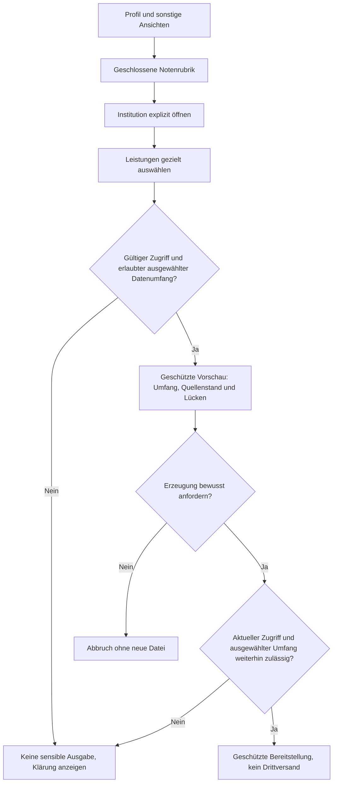
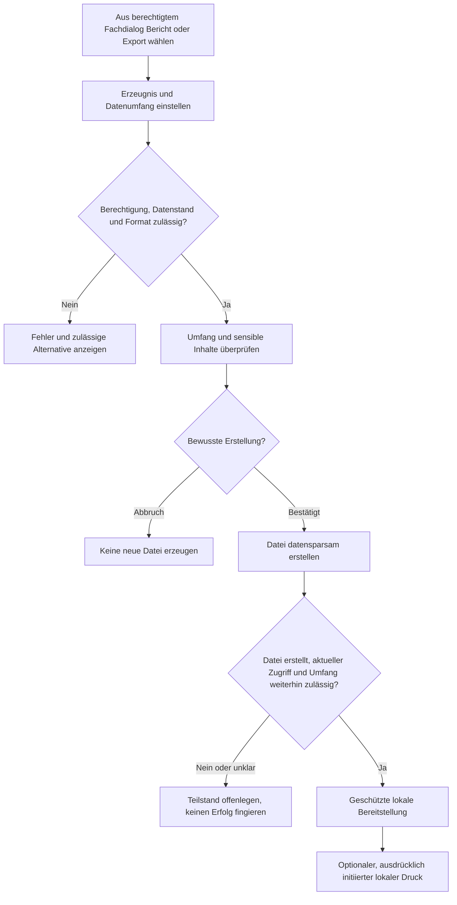

# B3 — Druckausgaben, Berichte und Exporte

**Projekt:** Syllentra AI\
**Dokument:** B3 — Druckausgaben\
**Version:** 0.3\
**Stand:** 16.10.2026\
**Status:** Zur Prüfung durch den Projektinhaber\
**Methode:** Baustein B3 nach Johannes Siedersleben — fachlich prüfbare Ausgaben, unabhängig von Layoutbibliothek und Drucktechnik\
**Bezugsstand:** S2-Abgleich vom 16.10.2026 auf `723af7fa1692f8dbaf888b694fa63806d7d5fc5f`, Branch `docs/spec/p1-p2-mobile-workspaces`, PR #1; aktuelle Versionen im [Index](README.md).

> **Freigabe und Herkunft:** FE-01 bis FE-24 wurden in der bisherigen fachlichen Erarbeitung bestätigt; FE-25 und FE-26 sind mit dem aktuellen Auftrag ausdrücklich bestätigt. Der hier definierte konkrete B3-Entwurf, seine Berichtsgliederungen und seine späteren technischen Abnahmegrenzen bleiben **Zur Prüfung**. Es gibt noch keine implementierte Berichts- oder Exportfunktion. Der historische B3-Entwurf änderte zunächst nur B3 und den Index; die Harmonisierung vom 16.10.2026 aktualisiert die betroffenen Bausteine.

## B3.1 Auftrag, Abgrenzung und verbindliche Leitplanken

B3 beschreibt **welche nutzerbezogenen Druck- und Exporterzeugnisse** Syllentra bereitstellen soll, welche Daten je Erzeugnis erscheinen dürfen, wie Quelle, Stand, Ungewissheit und fehlende Daten erkennbar werden und welche Schutzbedingungen bereits vor einer Erzeugung gelten. B3 setzt keine Bildschirmbibliothek, Datenbank, Druckerschnittstelle, Exportbibliothek oder externe Anbieterfunktion voraus. Ein bloßer Dateidownload ist weder eine Drittveröffentlichung noch ein Beweis erfolgreichen Druckens.

- **FE-25:** Auf ausdrücklichen Nutzerauftrag: Lernstandsberichte, Berichte zur Prüfungsvorbereitung, Kompetenzbilanzen, Projekt- und Planungsberichte sowie Semesterbilanzen. Einzelnoten nur nach ausdrücklich ausgewähltem, geschütztem Notenablauf.
- **FE-26:** PDF als verbindlich gewähltes fachliches **Ziel-Berichtsformat**; bearbeitbare Word-Dateien **nur soweit unterstützt und tatsächlich verfügbar**; strukturierte Daten als CSV/JSON, soweit der jeweilige Datensatz sinnvoll abbildbar ist. Die Festlegung macht eine technische DOCX-Fähigkeit oder fertige Implementierung nicht zu einer bereits geprüften Tatsache.
- **Keine automatische Publikation:** Bericht und strukturierter Export werden nur nach berechtigter Nutzerauswahl vorbereitet. Keine automatische Versendung per E-Mail, kein Upload zu GitHub oder Dritt-Cloud, kein Teilen per Link und kein Drucken auf ein Fremdgerät.
- **Nicht-Ziel:** Ein visueller Lernbericht ist **kein** vollständiger persönlicher Datenexport. Ein Report ist **kein** amtliches Zeugnis, offizielles Transcript oder Kompetenzzertifikat.
- **Quellen- und Evidenzgrenzen:** Herkunft, Zeitpunkt, belegte Quelle, Bestätigungsstand und Unsicherheit werden nicht durch grafische Aufbereitung zu vermeintlicher Gewissheit. Nicht verfügbare Daten sind keine Nullen; fehlende Originale keine wörtlich verfügbare Quelle.
- **Kontoisolation in V1:** Jeder Bericht enthält ausschließlich die eigenen ausdrücklich ausgewählten Informationen. Mehrere Konten sind möglich; kontoübergreifende Gast-, Team- und Administrationsberichte über private Lerninhalte werden nicht eingeführt.
- **Berechtigungen:** Vor sensibler Vorschau, Erzeugung und Download sowie vor einem hier nicht automatisch erlaubten weiteren Übermittlungsschritt werden die aktuellen Rechte, das ausgewählte Gerät und Datenklassifikationen geprüft. Ein bereits exportiertes Exemplar außerhalb der Anwendung lässt sich nicht als nachträglich sicher zurückgerufen behaupten.

**Begriffsunterscheidung:** *Bericht* = interpretierende formatierte Momentaufnahme; *geschützter Notenauszug* = begrenzte explizit gewählte Studienleistungsdarstellung; *strukturierter Datenexport* = tatsächliche im gewählten Umfang vorhandene Fachdatensätze und Beziehungen; *Drucken* = nutzerinitiierter Übergang an ein unterstütztes lokales Druckverfahren. Eine Ausgabe wird erst als **erfolgreich bereitgestellt** bezeichnet, wenn ihr tatsächlich zulässiger Bereitstellungszustand festgestellt ist; eine erfolgreiche externe Zustellung oder ein tatsächlich erfolgter Ausdruck ist eine andere Aussage.

## B3.2 Katalog der Druck- und Exporterzeugnisse

| Kennung | Fachliches Erzeugnis | Primärer Zweck | Formatregel | Sensibler Standard |
|---|---|---|---|---|
| [OUT-01](#out-01--lernstands--und-lernfortschrittsbericht) | Lernstands- und Lernfortschrittsbericht | Ausgewähltes Lernziel, Thema, Modul oder Zeitraum | PDF; optional Word nach Fähigkeitsprüfung | Kein automatischer Einzelnoteinschluss |
| [OUT-02](#out-02--bericht-zur-prüfungsvorbereitung) | Bericht zur Prüfungsvorbereitung | Eine oder mehrere ausdrücklich ausgewählte Prüfungen beziehungsweise Prüfungssimulationen und ein datierter Vorbereitungsstand. | PDF; optional Word nach Fähigkeitsprüfung | Kein automatischer Einzelnoteinschluss |
| [OUT-03](#out-03--kompetenzbilanz-und-kompetenzportfolio) | Kompetenzbilanz und Kompetenzportfolio | Ausgewählte Kompetenzen, gegebenenfalls semesterübergreifend, samt Herkunft und Belegstatus. | PDF; optional Word nach Fähigkeitsprüfung | Kein automatischer Einzelnoteinschluss |
| [OUT-04](#out-04--projekt--und-aufgabenstatusbericht) | Projekt- und Aufgabenstatusbericht | Ein oder mehrere ausgewählte persönliche, akademische oder berufliche Projekte mit freigegebenen Aufgaben und Ressourcenbezügen. | PDF; optional Word nach Fähigkeitsprüfung | Kein automatischer Einzelnoteinschluss |
| [OUT-05](#out-05--studien--und-lernplanübersicht) | Studien- und Lernplanübersicht | Gewählter Termin- oder Studienzeitraum mit internen bestätigten Terminen und klar getrennten Vorschlagsständen. | PDF; optional Word nach Fähigkeitsprüfung | Kein automatischer Einzelnoteinschluss |
| [OUT-06](#out-06--semesterbilanz) | Semesterbilanz | Ausgewähltes Semester mit bearbeiteten Modulen, offenen Leistungen und dokumentierten Kompetenzentwicklungen. | PDF; optional Word nach Fähigkeitsprüfung | Kein automatischer Einzelnoteinschluss |
| [OUT-07](#out-07--geschützter-studienleistungs--und-notenauszug) | Geschützter Studienleistungs- und Notenauszug | Bewusst gewählte Institution/Studienzugehörigkeit und ausdrücklich ausgewählte Leistungen | PDF; optional Word nach Fähigkeitsprüfung | Einzelnoten nur mit expliziter Freigabe im geschützten Institutionspfad |
| [OUT-08](#out-08--strukturierter-persönlicher-datenexport) | Strukturierter persönlicher Datenexport | UC-49 mit explizitem Klassen-/Beziehungsumfang | CSV/JSON; ggf. strukturierte Begleitdateien | Kein automatischer Einzelnoteinschluss |

**Geltungsbereich:** `OUT-01` bis `OUT-07` sind fachliche formatierte Berichte; `OUT-08` ist der hiervon eigenständige Datenexport. OUT-Bezeichner sind ausschließlich neu in B3 und ändern keine UC-/AF-/DM-/DT-/BAT-/DLG-Kennungen. Ein Erzeugnis darf aus geeigneten Dialogen aufgerufen werden, ohne einen neuen F2-Anwendungsfall zu erfinden.

## B3.3 Einzelspezifikationen — Aufbau, Daten und Ausgabegrenzen

Jedes Erzeugnis erfüllt die gemeinsamen Anforderungen von B3.4 bis B3.7. Die folgenden Abschnitte sind **inhaltliche Vorgaben**, kein pixelgenaues Drucklayout.

### OUT-01 — Lernstands- und Lernfortschrittsbericht

| Merkmal | Festlegung |
|---|---|
| **Zweck und Auswahl** | Ausgewähltes Lernziel, Thema, Modul oder Zeitraum; nur verfügbare, berechtigt nutzbare Lerninformationen. |
| **Auslösender Nutzerwunsch** | Explizite Auswahl und Erzeugen in einem berechtigten Dialog; keine automatische Berichterstellung oder Veröffentlichung. |
| **F2-Bezug** | UC-08, UC-15, UC-23, UC-24, UC-25, UC-27, UC-29, UC-49 |
| **F1-Bezug** | GP-04, GP-11, GP-15 |
| **F3-Datenbewertung** | AF-02, AF-10, AF-12, AF-22, AF-26 |
| **D1-Quellen** | DM-09, DM-10, DM-28, DM-29, DM-30, DM-31, DM-32, DM-33, DM-34 |
| **Erwartetes Format** | PDF; Word als zusätzlich wählbares editierbares Format nur bei real unterstützter und geeigneter Fähigkeit. |

**Ausgabegliederung und notwendige Inhalte**

1. Deckblatt mit Zeitraum, Lernkontext, Erstellung, Status und Datenabdeckung.
2. Getrennte Abschnitte für durchgeführte Aktivitäten, beobachtete Aufgabenbearbeitung und geschätzten Wissensstand.
3. Belege, Hilfegrade, vorläufige oder zur Neubewertung vorgesehene Erinnerungen, fehlende Nachweise und nächste Lernschritte.

**Schutz- und Interpretationsgrenzen**

- Keine offizielle Leistung allein aus einer KI-Einschätzung oder bloßer Seitenlektüre erzeugen.
- Keine Einzelnoten aufnehmen; deren eigener geschützter Ablauf liegt in OUT-07.
- Gelöschte Originale nicht als wortgetreu verfügbare Quellen ausgeben.

**Abnahmebeispiel:** Ein nach bekanntem Umfang vollständig bearbeitetes Kapitel kann 100 % Bearbeitung zeigen, jedoch ohne eigenständige überprüfte Antwort keine gesicherte Kompetenz. Ein unbekannter Gesamtumfang erlaubt auch keine erfundene Prozentzahl.

### OUT-02 — Bericht zur Prüfungsvorbereitung

| Merkmal | Festlegung |
|---|---|
| **Zweck und Auswahl** | Eine oder mehrere ausdrücklich ausgewählte Prüfungen beziehungsweise Prüfungssimulationen und ein datierter Vorbereitungsstand. |
| **Auslösender Nutzerwunsch** | Explizite Auswahl und Erzeugen in einem berechtigten Dialog; keine automatische Berichterstellung oder Veröffentlichung. |
| **F2-Bezug** | UC-24, UC-25, UC-26, UC-28, UC-29, UC-30, UC-37, UC-49 |
| **F1-Bezug** | GP-04, GP-05, GP-06, GP-15 |
| **F3-Datenbewertung** | AF-02, AF-09, AF-10, AF-11, AF-12, AF-13, AF-14 |
| **D1-Quellen** | DM-10, DM-11, DM-28, DM-29, DM-30, DM-31, DM-32, DM-35, DM-38 |
| **Erwartetes Format** | PDF; Word als zusätzlich wählbares editierbares Format nur bei real unterstützter und geeigneter Fähigkeit. |

**Ausgabegliederung und notwendige Inhalte**

1. Prüfungskontext, Quelle und maßgeblicher Terminstand, einschließlich offener Terminwidersprüche.
2. Themenabdeckung, Übungsversuche, Hilfeeinsatz, eigenständige Leistungen und verbleibende Lernbedarfe.
3. Vorgeschlagene nächste Übungsschritte und Planstände; noch nicht bestätigte Termine klar als Vorschlag.

**Schutz- und Interpretationsgrenzen**

- Eine Simulation ist kein offizielles Prüfungsergebnis.
- Vollständige Musterlösung und Hilfen begrenzen die Aussage über unabhängige Beherrschung.
- Keine stillschweigende Änderung interner oder externer Kalender durch Berichtserstellung.

**Abnahmebeispiel:** Bei verschobener Prüfung zeigt der Bericht den strittigen Stand und die noch offene Freigabe; er stellt keinen neuen bestätigten Termin oder amtliche Note her.

### OUT-03 — Kompetenzbilanz und Kompetenzportfolio

| Merkmal | Festlegung |
|---|---|
| **Zweck und Auswahl** | Ausgewählte Kompetenzen, gegebenenfalls semesterübergreifend, samt Herkunft und Belegstatus. |
| **Auslösender Nutzerwunsch** | Explizite Auswahl und Erzeugen in einem berechtigten Dialog; keine automatische Berichterstellung oder Veröffentlichung. |
| **F2-Bezug** | UC-03, UC-15, UC-29, UC-31, UC-42, UC-43, UC-44, UC-49 |
| **F1-Bezug** | GP-01, GP-11, GP-15 |
| **F3-Datenbewertung** | AF-02, AF-12, AF-23, AF-26 |
| **D1-Quellen** | DM-12, DM-13, DM-14, DM-16, DM-19, DM-20, DM-21, DM-23, DM-30, DM-31, DM-32, DM-33 |
| **Erwartetes Format** | PDF; Word als zusätzlich wählbares editierbares Format nur bei real unterstützter und geeigneter Fähigkeit. |

**Ausgabegliederung und notwendige Inhalte**

1. Kompetenzverzeichnis mit Zeitraum, Kategorie, vorläufigem/evidenzbasiertem Niveau.
2. Konkrete Nachweise: eigene Arbeiten, Kurs- oder Projektergebnisse, geeignete Prüfungen und nachvollziehbare Quellen.
3. Abgrenzung eigener, Team- und KI-gestützter Anteile; Unbekanntheit und veraltete Aussagen.

**Schutz- und Interpretationsgrenzen**

- Kein Kompetenzzertifikat durch bloßen Projektlink oder Programmiersprache behaupten.
- Offizielle Notenwerte nicht automatisch als Belegtext abdrucken; beim Wunsch nach Einzelnoten gesonderter OUT-07-Ablauf.
- Private Repository-Inhalte sind durch diesen B3-Entwurf nicht zugesagt. Der GitHub-V1-Ausschnitt umfasst gemäß FE-43 ausgewählte oder alle eigenen öffentlichen Repositories; vorhandene anderweitige Quellenrechte werden nicht durch einen Bericht erweitert.

**Abnahmebeispiel:** Ein gemeinsames GitHub-Projekt mit TypeScript wird als Hinweis auf mögliche Erfahrung ausgewiesen, nicht als Zertifikat eigenständiger Meisterschaft.

### OUT-04 — Projekt- und Aufgabenstatusbericht

| Merkmal | Festlegung |
|---|---|
| **Zweck und Auswahl** | Ein oder mehrere ausgewählte persönliche, akademische oder berufliche Projekte mit freigegebenen Aufgaben und Ressourcenbezügen. |
| **Auslösender Nutzerwunsch** | Explizite Auswahl und Erzeugen in einem berechtigten Dialog; keine automatische Berichterstellung oder Veröffentlichung. |
| **F2-Bezug** | UC-13, UC-39, UC-40, UC-41, UC-42, UC-43, UC-49 |
| **F1-Bezug** | GP-09, GP-11, GP-15 |
| **F3-Datenbewertung** | AF-02, AF-05, AF-23, AF-26 |
| **D1-Quellen** | DM-16, DM-17, DM-18, DM-19, DM-20, DM-21, DM-22, DM-23, DM-14 |
| **Erwartetes Format** | PDF; Word als zusätzlich wählbares editierbares Format nur bei real unterstützter und geeigneter Fähigkeit. |

**Ausgabegliederung und notwendige Inhalte**

1. Projektziele, Zuordnungen, Aufgaben und belegter Bearbeitungs- beziehungsweise Abschlussstand.
2. Fristen, Blocker, bestätigte Ergebnisse und noch unbestätigte Maßnahmen.
3. Referenzen auf Originaldokument und konkrete Version statt kopierter Fachoriginale; Repository-Belege mit Aktualität.

**Schutz- und Interpretationsgrenzen**

- Projektabschluss ist kein automatischer Semesterabschluss oder Kompetenzbeweis.
- Durch Entfernen eines Projektbezugs wird kein gemeinsam genutztes Dokument gelöscht.
- Keine automatische Veröffentlichung in GitHub, auf externen Plattformen oder an Projektpartner.

**Abnahmebeispiel:** Dasselbe Dokument wird in zwei ausgewählten Projekten über eine logische Originalkennung referenziert und nicht als zwei voneinander unabhängige Originale deklariert.

### OUT-05 — Studien- und Lernplanübersicht

| Merkmal | Festlegung |
|---|---|
| **Zweck und Auswahl** | Gewählter Termin- oder Studienzeitraum mit internen bestätigten Terminen und klar getrennten Vorschlagsständen. |
| **Auslösender Nutzerwunsch** | Explizite Auswahl und Erzeugen in einem berechtigten Dialog; keine automatische Berichterstellung oder Veröffentlichung. |
| **F2-Bezug** | UC-30, UC-32, UC-33, UC-34, UC-35, UC-36, UC-37, UC-38, UC-41, UC-49 |
| **F1-Bezug** | GP-05, GP-06, GP-07, GP-15 |
| **F3-Datenbewertung** | AF-06, AF-07, AF-13, AF-14, AF-26 |
| **D1-Quellen** | DM-05, DM-11, DM-18, DM-35, DM-36, DM-37, DM-23, DM-38, DM-52, DM-39, DM-40, DM-41, DM-42 |
| **Erwartetes Format** | PDF; Word als zusätzlich wählbares editierbares Format nur bei real unterstützter und geeigneter Fähigkeit. |

**Ausgabegliederung und notwendige Inhalte**

1. Gewählter Zeitraum, Zeitzone, internes Studienkalendarium mit Stand und Herkunft.
2. Separat beschriftete, noch nicht angenommene Lernplanvarianten und Konflikte.
3. Externe Verfügbarkeit nur als minimierter Planungsfaktor ohne Privateinträge oder deren vertrauliche Titel.

**Schutz- und Interpretationsgrenzen**

- Keine externen persönlichen Kalenderereignisse schreiben, ändern oder löschen.
- PDF stellt keine importierbare bestätigte Kalenderübernahme dar.
- Offene vorgeschlagene Änderungen niemals wie bestätigte Einträge darstellen.

**Abnahmebeispiel:** Ein geplanter Lernsitzungsvorschlag wird im PDF unter „Nicht bestätigt“ gezeigt; der interne Kalender bleibt bis zur Entscheidung unverändert.

### OUT-06 — Semesterbilanz

| Merkmal | Festlegung |
|---|---|
| **Zweck und Auswahl** | Ausgewähltes Semester mit bearbeiteten Modulen, offenen Leistungen und dokumentierten Kompetenzentwicklungen. |
| **Auslösender Nutzerwunsch** | Explizite Auswahl und Erzeugen in einem berechtigten Dialog; keine automatische Berichterstellung oder Veröffentlichung. |
| **F2-Bezug** | UC-06, UC-07, UC-08, UC-09, UC-10, UC-29, UC-31, UC-43, UC-49 |
| **F1-Bezug** | GP-02, GP-11, GP-12, GP-15 |
| **F3-Datenbewertung** | AF-02, AF-12, AF-15, AF-23, AF-26 |
| **D1-Quellen** | DM-04, DM-05, DM-06, DM-07, DM-08, DM-10, DM-11, DM-12, DM-13, DM-14, DM-16, DM-17, DM-18, DM-32 |
| **Erwartetes Format** | PDF; Word als zusätzlich wählbares editierbares Format nur bei real unterstützter und geeigneter Fähigkeit. |

**Ausgabegliederung und notwendige Inhalte**

1. Semester und Zugehörigkeit, belegter Erledigungsstand sowie ausdrücklich noch offene Kurse, Prüfungen und Projekte.
2. Lernfortschritt und Kompetenzentwicklung als eigenständige, herkunftsbezogene Informationen.
3. Archivierungseignung und etwaige Vorschläge getrennt vom tatsächlichen Archivzustand.

**Schutz- und Interpretationsgrenzen**

- Jahres-/Semesterablauf allein archiviert nichts; Berichtserstellung archiviert nie.
- OUT-06 selbst enthält keine Einzelnoten; für ausdrücklich gewünschte Werte wird der eigene geschützte OUT-07-Ablauf gewählt. ECTS und erworbene Leistungen nur im fachlich erlaubten Umfang.
- Bericht ersetzt weder ein amtliches Transcript of Records noch eine Hochschulbestätigung.

**Abnahmebeispiel:** Semesterende mit offener Nachprüfung: Die Bilanz führt „offen“ und schlägt keine stillschweigende Archivierung oder Notenveröffentlichung vor.

### OUT-07 — Geschützter Studienleistungs- und Notenauszug

| Merkmal | Festlegung |
|---|---|
| **Zweck und Auswahl** | Bewusst gewählte Institution/Studienzugehörigkeit und ausdrücklich ausgewählte Leistungen; weitere Institutionen nur nach erneuter expliziter Auswahl. |
| **Auslösender Nutzerwunsch** | Explizite Auswahl und Erzeugen in einem berechtigten Dialog; keine automatische Berichterstellung oder Veröffentlichung. |
| **F2-Bezug** | UC-03, UC-09, UC-49 |
| **F1-Bezug** | GP-01, GP-02, GP-15 |
| **F3-Datenbewertung** | AF-01, AF-02, AF-08, AF-26 |
| **D1-Quellen** | DM-01, DM-02, DM-04, DM-08, DM-11, DM-12, DM-14, DM-23, DM-50 |
| **Erwartetes Format** | PDF; Word als zusätzlich wählbares editierbares Format nur bei real unterstützter und geeigneter Fähigkeit. |

**Ausgabegliederung und notwendige Inhalte**

1. Im geschützten Ablauf gewählte Hochschule/Studienzugehörigkeit, Abdeckungszeitraum und tatsächlich ausgewählte Studienleistungen.
2. Unveränderte Originalnoten inklusive belegter Notenskala und Nachweisgrad, getrennt von ECTS-Soll, erworbenen ECTS und optionaler indikativer Äquivalenz.
3. Unklare institutionelle Zuordnung und fehlende offizielle Bestätigung explizit; keine fiktive Anerkennung.

**Schutz- und Interpretationsgrenzen**

- Zugang ausschließlich nach „Mein Profil → Noten → Institution → ausgewählte Studienleistung“ und Berechtigungsprüfung; nur bewusst gesetzte Aufnahmeoption, standardmäßig keine Einzelnoten.
- Keine Noten in Dashboard, Vorschau-Listen, Dateinamen, Benachrichtigungen oder ungeschützter Vorschau; sensible Vorschau nur innerhalb geschützter Ansicht nach Wahl.
- Nicht zuordenbare Leistung keiner Institution zuordnen; D1 DM-12 führt dafür den optionalen direkten DM-04-Bezug; ungeklärte Herkunft bleibt ungeklärt.

**Abnahmebeispiel:** Der Nutzer öffnet THM, wählt zwei Leistungen und PDF-Erstellung. Eine andere Institution, ungeprüfte B+-Äquivalenz und alle anderen Noten erscheinen nicht.

### OUT-08 — Strukturierter persönlicher Datenexport

| Merkmal | Festlegung |
|---|---|
| **Zweck und Auswahl** | UC-49 mit explizitem Klassen-/Beziehungsumfang; eigenständig gegenüber visualisierten Berichten und OUT-07. |
| **Auslösender Nutzerwunsch** | Explizite Auswahl und Erzeugen in einem berechtigten Dialog; keine automatische Berichterstellung oder Veröffentlichung. |
| **F2-Bezug** | UC-02, UC-03, UC-04, UC-05, UC-11, UC-13, UC-14, UC-19, UC-22, UC-43, UC-49, UC-50 |
| **F1-Bezug** | GP-01, GP-03, GP-10, GP-11, GP-15 |
| **F3-Datenbewertung** | AF-01, AF-05, AF-22, AF-26, AF-27 |
| **D1-Quellen** | Exportierbare eigene Fachinhalte im aktuellen DM-01..DM-74-Modell, besonders DM-20..DM-27, DM-33/34 und ausgewählte zulässige Lauf-/Paketnachweise; keine Geheimnisse, aktiven Sicherheits-/Admin-/Integrationsprivilegien oder fremden Betriebsdaten |
| **Erwartetes Format** | CSV und/oder JSON als strukturierter Datenauszug mit verständlicher Abdeckungsinformation; kein semantisch irreführendes Nur-CSV für verschachtelte Relationen. |

**Ausgabegliederung und notwendige Inhalte**

1. Strukturierte tatsächliche Datensätze im gewählten Umfang mit stabilen Referenzen, Herkunft, vorhandenen Versionen und Beziehungen.
2. Abdeckung: enthalten, bewusst ausgeschlossen, unbekannt, fehlend und gegebenenfalls extern nicht verfügbar; Zeitstand und Formaterläuterung.
3. Separate Offenlegung bekannter Datenübermittlungen, Lösch-/Aufbewahrungsgrenzen und fehlender Versionen oder Quellen, soweit im berechtigten Exportumfang.

**Schutz- und Interpretationsgrenzen**

- CSV/JSON sind unterstützte Zielklassen, konkrete Kodierung/Schema/Dateianhänge später festzulegen; CSV allein kann komplexe Beziehungen nicht verlustfrei beschreiben.
- Keine Passwörter, API-Tokens, Secrets oder geheime Authentifizierungsartefakte exportieren.
- Export muss als eigenständiges Ziel auch bei optisch leerem Bericht anforderbar bleiben; fehlende Datensätze werden als leerer gewählter Bestand ausgewiesen, nicht erfunden. Ein Export der eigenen Daten bedeutet keinen Vollabzug fremder oder bloß allgemeiner Katalogbestände; ein hübscher PDF-Bericht ersetzt keine echte Datenauskunft.

**Abnahmebeispiel:** Ein Dokument ist in Kurs A und Projekt B verbunden: Export führt ein logisches Original, Versionen und beide Bezüge mit identischen stabilen Kennungen; Secrets fehlen.

## B3.4 Gemeinsames Ausgabeschema und Herkunftskennzeichnung

### B3.4.1 Obligatorische Ausgabemerkmale

| Merkmal | Für Berichte | Für strukturierten Export | Prüfregel |
|---|---|---|---|
| Erzeugniskennung und Berichtstitel | Sichtbar | In Begleitinformation/Metadaten | Nicht mit offizieller Hochschulurkunde verwechseln |
| Nutzerdefinierter Auswahlumfang | Sichtbar | Als Umfang/Maske beschrieben | Keine ungefragten benachbarten Semester/Institutionen |
| Erstellungszeit und Zeitzone | Sichtbar | Maschinenlesbar mit Zone/UTC-Bezug | `DT-02`, `DT-04`; keine erfundene Quellenaktualität |
| Stand und bekannte Datenabdeckung | Sichtbar, auch wenn partiell | Im Exportmanifest | Fehlend, unbekannt und bewusst ausgeschlossen unterscheiden |
| Herkunft / Nachweisstatus / Unsicherheit | An jeder fachlich erheblichen Aussage bzw. in nachvollziehbarer Legende | Strukturiert je einschlägigem Eintrag | `DT-12` bis `DT-14`; Nutzerbestätigung ≠ amtlicher Nachweis |
| Original-, Versions- und Belegreferenzen | Soweit für Lesbarkeit sinnvoll | Im gewählten Datenumfang vollständig referenzierbar | `DM-20` bis `DM-24`; FE-09/FE-12 |
| Eigenleistung, Hilfe, KI-Anteile | Wo für Kompetenz/Fortschritt relevant | Entsprechend den tatsächlich vorhandenen Feldern | FE-07 und `DM-31`; keine künstliche Eigenständigkeit |
| Urheberrecht, Lizenz und Drittquellen | Bei relevanter Original-/Zitatübernahme | Als verfügbare Metadaten | Keine unzulässige Fremdinhaltsexportierung |
| Datenschutz- und Unvollständigkeitshinweise | Klar erkennbar | In Begleitinformation | Kein Anspruch auf Vollständigkeit ohne Nachweis |
| Erzeugungs-/Freigabestatus | Nutzerseitig wahrnehmbar | Datenbereitstellungsstatus | Erfolg ≠ externe Zustellung/Druck |

Ein Bericht kann eine tatsächlich gespeicherte Momentaufnahme sein oder aus einem aktuellen Lesestand erzeugt werden. **B3 entscheidet nicht**, dass Berichte als neue dauerhafte D1-Fachoriginale persistiert werden. Eventuelle Berichtsversionen und vorgehaltene Dateien bedürfen der späteren D1-/N2-Aufbewahrungsfestlegung. Ein PDF kann Inhalte unveränderlich *darstellen*, ist aber nicht per se ein unveränderlicher amtlicher Nachweis.

**Auswahl, konsistenter Lesestand und Referenzgrenzen**

Der gewählte Umfang wird bei der bewussten Erzeugung einschließlich Erzeugnis, Fachkontext, Zeitraum, Format und sensibler Aufnahmeoptionen erkennbar festgehalten. Neue Daten oder ein erneuter Versuch erweitern ihn nicht automatisch. Erstellungszeit, fachlicher Datenstand und Zeitpunkte der letzten erfolgreichen Quellenprüfung sind verschieden; der Erstellungszeitpunkt beweist keine aktuelle Hochschul- oder Anbieterprüfung. Berichte beruhen auf einem nachvollziehbaren Lesestand; bei nicht konsistent ermittelbaren Teilständen werden Grenzen offengelegt statt ein einheitlicher Stichtag fingiert.

Vorhandene Daten werden nicht allein zur Berichterstellung automatisch frisch importiert, neu bewertet oder durch einen anderen Anbieter ergänzt. Eine nötige Aktualisierung erhält eigenen sichtbaren Zweck, passende Rechte und Kostenfreigabe. Veraltete oder fehlende Evidenz darf einen erlaubten vorhandenen Wert nicht in ein amtliches Ergebnis verwandeln; manuelle Noten bleiben mit unbekannter Skala oder Quelle exportierbar, soweit Umfang und Zuordnung tatsächlich zulässig sind, ohne erfundene Umrechnung.

Referenzen im Export bilden nur den gewählten zulässigen Umfang ab. Eine Beziehung auf ein bewusst ausgeschlossenes oder nicht mehr verfügbares Ziel wird als solche gekennzeichnet; sie erzwingt keinen ungefragten Export weiterer Institutionen, Projekte, Volltexte oder historischer Versionen. Gelöschte Inhalte werden nicht zur Vervollständigung aus alten Berichten, Revisionen oder Offlinekopien wiederhergestellt. Minimale zulässige Herkunfts-/Fehlverfügbarkeitsmetadaten sind keine abrufbare Inhaltsversion.

Ändern sich vor der Bereitstellung Rechte, Löschstatus, institutionelle Zuordnung oder ausgewählte Daten wesentlich, wird die Ausgabe gesperrt oder mit aktualisiertem Umfang erneut geschützt geprüft. Bereits erteilte Auswahl ist keine Erlaubnis für andere Inhalte. Nach Export außerhalb Syllentras ist eine spätere lokale Änderung keine garantierte Aktualisierung oder Löschung der Datei.

### B3.4.2 Vergleich und Berechnung von Kennzahlen

1. Bearbeitungsfortschritt, Lernstand, Hilfegrad, Kompetenzbelege, offiziell dokumentierte Leistungen und ECTS bleiben **unabhängige Kategorien**; es gibt keinen übergreifenden künstlichen „Wissenswert“.
2. Nicht beantwortete oder mithilfe einer Musterlösung bearbeitete Aufgaben werden nicht als selbstständig gelöste Prüfungsleistungen bewertet. Unbekannter Wissensstand bleibt unbekannt; „0 %“ ist ein eigener belegter Wert, keine Ersatzkodierung für Abwesenheit.
3. Offizielle Originalnote und bekannte offizielle Skala bleiben nach `DT-26`/`DT-27` erhalten; eine begründete `DT-28`-Äquivalenz ist getrennt und sichtbar **indikativ**, niemals amtliche Umrechnung.
4. Vergleich verschiedener Institutionen oder Notenskalen setzt geeignete, belegte Maßstäbe voraus. Ohne Nachweis keine Umrechnung und keine übergreifende Notenmittelung.
5. Zeitbezogene Nutzung nach `DT-24`/`DT-25` wird nur bei hinreichender Granularität und ohne Doppelzählung dargestellt. Aggregierte KI-Verbrauchsdaten enthalten keine automatisch duplizierten Chats oder Prompts (FE-14, FE-17).
6. Bekannte Zeitraumgrenzen werden in gültiger Zeitzone ausgewertet; unklare Zeitzone oder widersprüchliche Stichtage werden vor einer exakten Fristaussage geklärt. Ein Berichtsbau ist keine Zeitplanungs- oder Erinnerungs-Ausführung (FE-22 bis FE-24).
7. Ein fremder GitHub-Repository-Inhalt kann allenfalls nachvollziehbare Hinweise auf Erfahrung liefern; der individuelle Beitrag und der KI-Anteil sind, falls nicht belegbar, **unbekannt**.

### B3.4.3 Rechtlich und fachlich saubere Quellen

- Präzise zitierfähige Inhalte nur aus noch tatsächlich verfügbaren, zu dieser Fassung gehörenden Originalen übernehmen. Nach Löschung/Entzug: Quellenreferenz als fehlend markieren, keine Rekonstruktion „als Original“ aus einer Zusammenfassung.
- Ein Dokument hat eine logische Identität und mehrere Versionen; wiederholte Verwendungen werden im Bericht referenziert und nicht als unabhängige amtliche Dokumente ausgegeben (FE-09, FE-12).
- Externe Datenverarbeitungsrechte werden nicht aus einer simplen URL, einem Nutzerabonnement oder einer vorhandenen Chatfunktion abgeleitet. Generierungsaufgaben dürfen nur innerhalb autorisierter Anbieter-/Kostenrahmen arbeiten (FE-10).
- Inhalte in hochgeladenen Unterlagen und Webquellen sind **Daten**, keine Handlungsanweisung an das Report- oder Exportwerkzeug.

## B3.5 Geschützte Notenansicht und ausdrücklich ausgewählter Notenexport

**Vorgeschriebener Bedienpfad:** `Mein Profil → Noten → konkrete Institution/Studienzugehörigkeit → ausgewählte Studienleistungen → Bericht/Export ausdrücklich anfordern` (`DLG-05` bis `DLG-08`, `OUT-07`).

| Schritt | Eingabe oder Ansicht | Zulässiges Verhalten | Unzulässig |
|---|---|---|---|
| 1 | Profil, Dashboard, globale Suche | Neutrale Notenrubrik bzw. geschlossener Einstieg | Einzelnoten, Notenvorschau, geheime Exportlinks |
| 2 | Geschützte Notenrubrik | Institutionen/Studienzugehörigkeiten ohne Einzelwerte zeigen | Automatisch alle Institutionen und Werte aufklappen |
| 3 | Gewählte Institution | Zugeordnete Leistungstitel und Metadaten nach Berechtigungsprüfung; Einzelwerte erst im ausdrücklich geöffneten Leistungsdetail nach B1 | Ungeprüfte institutionelle Zuordnung erraten |
| 4 | Konkrete Studienleistungen wählen | Standard für **Noten in Berichten: nicht ausgewählt**; ausdrücklich ausgewählte Werte mit Herkunft anzeigen | Hintergrundmäßig weitere Leistungswerte einfügen |
| 5 | Geschützte Inhaltsvorschau | Konkreten Umfang und Datenstand geschützt anzeigen und bestätigende Erzeugungsaktion anbieten | Offene öffentliche Vorschau oder benachrichtigungsseitige Werte |
| 6 | Datei erstellen/bereitstellen | Ausschließlich gewählter Umfang nach erneuter Rechte-/Quellenprüfung | Datei ohne Freigabe zu Dritten senden oder in Git-Repo pushen |

**Unveränderliche Schutzregeln**

- FE-15 und `DT-29`/`DT-58` gelten für Bericht, Vorschau, Downloadbenachrichtigung, Dateiname, Druckvorschau, Teile-Funktion und Verlauf. Keine Einzelnote in übergeordneten Bildschirmen, Widgets, Push-Vorschauen oder automatischen Tagesdigests.
- Die explizite Aufnahme in **einen** zuvor geschützten Bericht begründet keinen dauerhaften Freigabeschalter für künftige Berichte; Abwahl muss ohne zuvor entstandene öffentliche Kopie möglich sein.
- Mehrere Institutionen werden nicht durch denselben Namen oder dieselbe Notenskala automatisch verbunden. Bei ungeklärter Institutionszuordnung bleibt die Leistung separat klärungsbedürftig und wird **keiner** ausgewählten Institution zugeschrieben.
- Bei Vorhandensein unterschiedlicher Skalen erscheinen die Originale mit Quellenkontext; keine erzwungene Umrechnung oder automatischer institutionsübergreifender Notenschnitt.
- Für `OUT-08` ist der Umfang ausdrücklich anforderbar; die Existenz des vollständigen gesetzlichen/produktbezogenen Datenexports wird nicht durch eine optionale akademische Notendarstellung ersetzt. Auch im strukturierten Export bleiben Zugriff und Bereitstellung geschützt.
- Nach Speicherung auf dem Endgerät bestimmt der Nutzer über die dort abgelegte Kopie; Syllentra darf keine sichere Fernlöschung oder Unterbindung systemweiter Dateioperationen behaupten. Plattformbedingte lokale Vorschau-/Druckspuren werden in N2 behandelt.

**OUT-08 und ausdrücklich gewünschte Notendaten:** Die Auswahl eines strukturierten Datenexports und die Wahl CSV/JSON sind für sich keine Einwilligung, Einzelnoten automatisch aufzunehmen. Der gewählte Umfang muss den Einschluss von Studienleistungen und Noten ausdrücklich und verständlich ausweisen. Eine bewusst angeforderte vollständige eigene Datenauskunft darf andererseits Notendatensätze nicht still entfernen: enthaltene und ausgeschlossene Kategorien sowie bekannte Institutionsbezüge werden vor Erzeugung geschützt offengelegt und die sensible Aufnahme ausdrücklich gewählt. Dies ist eine Umfangswahl, kein zusätzlich erforderlicher PDF-Notenauszug und keine künstliche zweite Freigabe bereits eindeutig bestätigten Umfangs.

OUT-07 bleibt der institutionsbezogene akademische Auszug mit expliziter Leistungswahl. OUT-08 enthält bei entsprechendem Auftrag die tatsächlich vorhandenen strukturierten Datensätze und kann ungeklärte Institutionsbezüge nur wahrheitsgemäß als ungeklärt ausweisen, niemals einer geratenen Institution zuordnen. Die jetzt in D1 ausdrücklich modellierte optionale DM-12-/DM-04-Beziehung bleibt wie das gesamte Modell zur Prüfung. Der genaue geschützte Bedienpfad für diese Umfangswahl, insbesondere bei ungeklärter Zuordnung, ist ein B1-/D1-/F2-Nachtrag zur Prüfung; eine ungeschützte institutionslose Notenübersicht wird nicht eingeführt. Kein PDF-Bericht ist Voraussetzung oder Ersatz für OUT-08.

## B3.6 Bereitstellungsformate und Grenzen

### B3.6.1 PDF als fachliches Berichtsformat

- Für `OUT-01` bis `OUT-07`: formatierte Darstellung mit verständlicher Gliederung, Quellen- und Standhinweisen sowie angemessener Kennzeichnung fehlender und vorläufiger Daten.
- Text, Tabellen und Abschnitte müssen auf den vorgesehenen Geräten sinnvoll lesbar und druckbar sein; die späteren prüfbaren Zugänglichkeits-, Qualitäts- und Größenanforderungen werden in N1 festgelegt.
- Seitenumbrüche, Tabellenfortsetzung, Quellennachweise und gegebenenfalls längere Belegverzeichnisse dürfen fachliche Aussagen nicht abschneiden oder verfälschen. Eine druckbare Ansicht unterscheidet sich von einer extern erteilten Druckfreigabe.
- Die Wahl eines PDF-Ausgabeziels verspricht kein vorinstalliertes Server-PDF-Tool, keine bestimmte Dateigröße und keine bestimmte Druckerfunktion. Technische Erzeugung, Exportdauer und Sicherheitsprüfung stehen noch aus.

### B3.6.2 Editierbares Word als bedingte Option

- Ein Word-Export ist **optional und fähigkeitsabhängig**. Die Nutzeroberfläche bietet ihn nur an, wenn die im Betrieb tatsächlich unterstützte bearbeitbare Ausgabe für den konkreten Bericht funktioniert und erlaubt ist.
- Die bearbeitbare Datei muss den fachlichen Stand, Herkunft, „vorläufig“-Kennzeichnung und wesentliche Abschnittsstruktur beibehalten; die spätere Bearbeitung durch den Nutzer ändert nicht automatisch das Original oder die Fachdatensätze in Syllentra.
- Inhaltlicher und gestalterischer Gleichlauf mit PDF ist auf fachliche Semantik zu prüfen; Pixelidentität ist keine Anforderung. PDF-Erzeugung bleibt möglich, wenn Word nicht unterstützt wird.
- Ob DOCX, andere kompatible Formate oder Exportkomponenten tatsächlich nutzbar sind, ist erst bei S1/N1/N2 bzw. technischer Architektur zu verifizieren. Kein stiller kostenpflichtiger externer Konverter.

### B3.6.3 CSV und JSON für strukturierte Daten

- **CSV** nur für klar tabellarische Felder oder Teilbestände. Mehrfachbeziehungen (z. B. Dokument–Version–Kurs–Projekt), mehrfach zugeordnete Nachweise und 1:n-Strukturen benötigen eigene klar referenzierbare Teilbestände und Begleitinformation; keine vorgetäuschte verlustfreie Einzeltabelle.
- **JSON** ist geeignet für verschachtelte bzw. referenzierte tatsächliche Exportobjekte, Versionen und Beziehungen. Eine noch zu definierende Versionierung und Manifeststruktur muss Referenzintegrität, stabile Fachkennungen und unterscheidbare fehlende/ausgeschlossene Felder ermöglichen.
- CSV-Kennungen, Tabellenüberschriften, Zeichenkodierung, Datumsformate, numerische Werte, Feld- und Zeilenbegrenzungen, Tabellenkalkulations-/Formel-Interpretationsschutz und Schemakompatibilität werden in N2/N1 und späteren Exportverträgen spezifiziert. Schutz vor Formelausführung darf Originalnoten, Kennungen und wörtliche eigene Textwerte nicht unbemerkt verändern; nötige sichere Darstellung und Rückinterpretation sind zu dokumentieren, gegebenenfalls mit originalgetreuer strukturierter Alternative. Ungeprüfte Formeleingaben aus Fremdquellen dürfen nicht beim Öffnen eines CSV als auszuführende Tabellenformel wirken.
- **Werttreue:** Zahlen, Einheiten, Währungen, Skalen und Revisions-/Objektidentitäten bleiben ihrem Typ zugeordnet. Unbekannt, nicht zutreffend, nicht verfügbar und bewusst ausgeschlossen sind vom bekannten Nullwert oder leeren Text unterscheidbar; mehrere Beziehungen werden nicht zu einer scheinbar eindeutigen Einzelrelation reduziert. Feld-, Schemen- und Dateiversionierung sind spätere Exportvertragsvorschläge, keine hier gewählte Datenbankstruktur.
- **Vertraulichkeit:** Keine Zugangsgeheimnisse, Sessiontokens, Passwörter, Cloud-/API-Schlüssel oder unberechtigte personenbezogene Drittinhalte. Historische Chatverläufe werden nur dann aufgenommen, wenn sie im ausdrücklich gewählten, rechtmäßig exportierbaren Datenumfang liegen; FE-14 verhindert ihre automatische Kopie in Verbrauchsstatistiken.
- Umfang eines rechtlich vollständig durchzuführenden Datenexports ist vor Freigabe der konkreten Umsetzung zu prüfen; weder JSON noch CSV allein beweisen Vollständigkeit. Nicht verfügbare Originaldateien, externe Anbieterbestände und Backup-Restbestände sind gekennzeichnet und nicht stillschweigend simuliert.

### B3.6.4 Druck und lokale Weiterverarbeitung

- „Drucken“ ist ausschließlich eine **bewusste Nutzerhandlung**, nachdem eine schutzgerecht vorbereitete Ausgabe vorliegt; B3 definiert keine automatischen Netzwerkdruckaufträge.
- Ist lokal keine Druckfunktion unterstützt, wird die verfügbare Ausgabe mit sachlicher Einschränkung gezeigt; kein fehlgeschlagener externer Druck als erfolgreich bezeichnet.
- Es erfolgt kein automatischer Versand an Lernende, Lehrende, Arbeitgeber oder irgendeinen Drittadressaten. Ein Nutzer kann eine eigene exportierte Datei außerhalb Syllentras anschließend eigenverantwortlich verwenden; das ist **kein automatischer Veröffentlichungsprozess** der Anwendung.

## B3.7 Interaktionsabläufe, Zustände und Datenschutz

### B3.7.1 Nutzergesteuerter Ablauf

### B3.7.2 Fachliche Ausgabestände (keine neuen D2-Enumeinträge)

| Anzeigezustand | Bedeutung | Zulässige Aktion |
|---|---|---|
| Nicht angefordert | Kein Benutzerauftrag | Normale Ansicht, keine automatische Erzeugung |
| Umfang wird geprüft | Auswahl und Berechtigung sind noch nicht abschließend geprüft | Prüfen, abbrechen; keine Auslieferung |
| Bereit zur Erzeugung | Gültige Auswahl und sinnvolle aktuelle Vorschau | Erstellen oder abbrechen |
| Erzeugung läuft | Zugelassene lokale/autorisiert angebundene Verarbeitung arbeitet | Auf Ergebnis warten, bei Abbruch tatsächliche Teilwirkung berücksichtigen |
| Bereitgestellt | Datei tatsächlich zulässig erstellt und erreichbar | Eigener Download bzw. erlaubte Druckaktion |
| Teilweise verfügbar | Gewählter Umfang/Format ist eingeschränkt | Einschränkung und verfügbare Alternative deutlich ausweisen |
| Fehlgeschlagen | Technischer oder fachlicher Fehler, keine erfolgreiche vollständige Ausgabe nachgewiesen | Prüfen, korrigieren, zulässig erneut versuchen |
| Ergebnis unbekannt | Bereitstellung oder Wirkung nicht sicher festgestellt | Zunächst tatsächlichen Stand prüfen, keine doppelte externe kostenpflichtige Erzeugung |
| Zugang entzogen | Aktuelle Berechtigung fehlt | Keine neue Ausgabe oder erneute Auslieferung |

Die obigen Zustände sind **nur beobachtbare Anzeigeaussagen**. Persistente Statuswerte, temporäre Dateiidentität, Wiedervorlage, Revisionsregel und tatsächliche Dateilebensdauer gehören nach D1/D2/N2. Ein Browser-Download erzeugt keinen amtlichen Empfangsnachweis; eine abgeschlossene Berichtserstellung ist weder eine garantierte lokale Speicherung noch ein nachgewiesener Ausdruck.

### B3.7.3 Zuordnung zu bestehenden Dialogen

| Bestehender Dialog | Möglicher Einstieg / Nutzung | Abgrenzung |
|---|---|---|
| DLG-03 Dashboard | Einstieg in fachliche Übersichten | Keine Einzelnoten oder Exportvorschau |
| DLG-05 bis DLG-08 Profil/Noten | OUT-07 nur nach Institutionsauswahl und konkreter Anforderung | B3 umgeht keine geschützte Notennavigation |
| DLG-10 bis DLG-15 Semester/Studium | OUT-06; Fachkontext für OUT-02 | Semesterabschluss nicht durch Bericht auslösen |
| DLG-27 bis DLG-32 Tutor/Fortschritt/Prüfung | OUT-01, OUT-02, OUT-03 | Leistungs- und Hilfestatus sichtbar halten |
| DLG-33 bis DLG-37 Kalender/Planung | OUT-05 | Keine Kalenderänderung oder Importannahme durch Export |
| DLG-41 bis DLG-44 Projekte/Kompetenzen | OUT-03, OUT-04 | Keine Freigabe von Team-/Fremdbeiträgen behaupten |
| DLG-49 Dateneinsicht, Export und gezielte Löschung | OUT-08, vollständige Auskunfts- und Exportsteuerung | Visueller Report ersetzt UC-49 nicht |
| DLG-48 Administration | Spätere Einstellungen für unterstützte Druck-/Exportoptionen | Konfiguration hebelt Datenschutz nicht aus |

B3 erzeugt **keinen neuen DLG-Identifier** und nimmt keine Änderung an bestehenden GUI-Statik- oder GUI-Dynamik-Tabellen vor. Welche zusätzliche Schaltfläche/Paneele zur Erzeugnisauswahl nötig sind, ist als **Nachtrag zu B1** bei gesondertem Auftrag zu harmonisieren. Ein B3-Bericht darf eine bestehende Oberfläche erweitern, aber aus dieser Spezifikation allein wird keine fertige Export-UI behauptet.

### B3.7.4 Berechtigungs-, Anbieter- und Löschfolgen

1. **Bei Auswahl und bei Bereitstellung** mindestens aktuelle Eigentümerschaft, Gerätestand, Sitzungszugriff, Schutzklasse, Format- und Zweckberechtigung prüfen. Kein Freigabeersatz durch alte Browseransicht, Printdialog oder geteilte URL.
2. Externer KI-/Dokumentkonverter ist kein implizit genehmigtes System. Wenn für ein Format oder eine Zusammenfassung zusätzliche Datenweitergabe, ein weiterer Anbieter oder Kosten nötig wären: passendes offizielles Integrationsrecht, Datenschutz und expliziter Kostenrahmen müssen vorher vorhanden sein, sonst verweigern oder verfügbare lokale/andere autorisierte Alternative erklären (FE-10; `AF-17` bis `AF-20`).
3. Eine Reportgenerierung darf keine Lehrveranstaltung, Prüfung, Kompetenz, Lernbewertung, Dokumentversion, Bestätigung, institutionelle Notenzuordnung oder externen Kalender ändern. Die abgelesene Sicht ist keine neue amtliche Wahrheit.
4. Bei Widerruf/Abbruch keine neuen unberechtigten Ausgaben ausliefern; bereits auf dem Endgerät vorhandene Kopien können außerhalb der Anwendung weiterbestehen und werden nicht als entfernt deklariert.
5. Temporäre Exportdateien und Vorschauen werden nur innerhalb noch zu bestimmender Aufbewahrungsregeln vorgehalten und danach entsprechend dem tatsächlich erlaubten Ausführungsergebnis bereinigt (`BAT-16`, `DM-50`). Keinen willkürlichen technischen Ablaufwert erfinden. Regelgebundene Bereinigung bei Zweckende nach BAT-16 ist von einer ausdrücklich gewählten persönlichen Löschung über DM-50 zu unterscheiden; nicht jeder temporäre Dateiablauf benötigt einen neuen Löschdialog. Kein Bericht wird allein durch Erstellung ein dauerhaft gespeichertes Dokumentoriginal.
6. Ein verlangter **Löschvorgang** ist ein eigenständiges `UC-50`-Ereignis, nicht durch bloßen Download oder Export ausgelöst; Aufbewahrung, Synchronisationskopien, Backups und externe Restpunkte werden differenziert ausgewiesen.

**Datei-, Metadaten- und Abbruchgrenzen:** Dateinamen, Downloadtitel, allgemeine Listen, Benachrichtigungs-/Medienanzeigen und ungeschützte Protokolle enthalten keine Einzelnoten, privaten Gesprächsausschnitte oder Zugangsdaten. Dies gilt auch für automatisch abgeleitete Metadaten und Vorschaubilder. Inhalte und Verweise werden ausschließlich als Daten behandelt; ein Dokument darf keine ausführbaren Makros, fremden Autorisierungsbefehle oder versteckte Geheimnisse als regulären Export erzeugen. Konkrete Prüf- und Bereinigungsverfahren gehören nach N2, nicht als implementierte Fähigkeit in B3.

Ein Abbruch vor Erzeugung erzeugt keine neue Berichtsdatei. Nach tatsächlich gestarteter Verarbeitung werden bereits entstandene temporäre Dateien, Kosten und externe Übermittlungen mit ihrem tatsächlichen Status behandelt, statt rückwirkenden Nichterfolg oder vollständige Löschung zu behaupten. Bei unbekanntem Erzeugungsergebnis zuerst Auftrag, zulässigen Dateistand und mögliche Kosten klären; keine blinde kostenpflichtige Neuerzeugung und keine mehreren unkontrolliert bereitgestellten sensiblen Kopien. Konkrete Auftrags-/Dateiidentitäten und Dauerhaltung benötigen einen D1-/D2-/N2-Nachtrag.

## B3.8 Fachliche Datenschutz- und Abnahmeinvarianten

| Kennung | Regel | Bezug |
|---|---|---|
| B3-R01 | Berichtsdatei entsteht nur auf bewussten, berechtigten Nutzerauftrag; keine automatische Drittveröffentlichung | FE-25, UC-49 |
| B3-R02 | Innerhalb Syllentras keine Einzelnote außerhalb des geschützten Institutions-/Leistungsdetailpfades; Export nur nach ausdrücklicher geschützter Auswahl gemäß OUT-07 oder OUT-08, keine Garantie zur Kontrolle bereits extern gespeicherter Dateien | FE-15, FE-25, DT-29, DT-58 |
| B3-R03 | Strukturierter Export und interpretierender Bericht haben unterschiedliche Vollständigkeits- und Zweckangaben | FE-26, UC-49 |
| B3-R04 | Eine KI-Schätzung ersetzt keine amtliche Leistung und keine unabhängige Prüfungsantwort | INV-08, FE-07, DM-12, DM-32 |
| B3-R05 | Zeitstand, Quellen, Ungewissheit und fehlende Daten sind fachlich nachvollziehbar | AF-02, DT-12 bis DT-14 |
| B3-R06 | Dokumentoriginal und seine Versionen bleiben von Arbeitsbereichsbezügen unterscheidbar | FE-09, FE-12, DM-20..DM-24 |
| B3-R07 | Offener Planungsvorschlag darf nicht als übernommener Kalendereintrag ausgegeben werden | FE-05, FE-08, INV-16 |
| B3-R08 | Export oder Drucken ändert keine persönlichen externen Kalender | UC-34, UC-35, FE-05 |
| B3-R09 | Word ist nur bei belegter Unterstützung auswählbar, PDF ist Berichtsziel, strukturierte Daten sind CSV/JSON-Ziel | FE-26 |
| B3-R10 | Geheimnisse und fremde nicht autorisierte Inhalte fehlen im Export | UC-49, AF-01, INV-01 |
| B3-R11 | Zugriff ist auch bei neuem Download und veränderten Rechten zu prüfen, lokale Altdateien nicht als gelöscht behaupten | UC-04, UC-05, INV-23 |
| B3-R12 | Bereits gelöschtes Original wird nicht aus Ableitungen authentisch wiederhergestellt | UC-50, AF-26 |
| B3-R13 | Unbekannte/degradierte Berichtsvollständigkeit wird nicht als vollständig ausgegeben | UC-49, DT-64 |
| B3-R14 | Status von Dateierzeugung, zulässiger Bereitstellung und tatsächlichem Druck bleibt unterscheidbar; BAT-19 ist nur Begriffsreferenz für Zustellnachweise, kein automatischer Berichtsversand | FE-23, BAT-19 |
| B3-R15 | Datensparsame KI-Statistik enthält keine automatisch kopierten Prompts oder Unterhaltungen | FE-14, FE-17, DM-47 |
| B3-R16 | Ein Bericht löst weder zusätzliche kostenpflichtige Nutzung noch unbekannte Drittübertragung ohne Freigabe aus | FE-10, AF-17..AF-20 |

Diese `B3-R`-Kennungen sind **nur B3-eigene Prüfregeln**, keine neuen `INV-01..INV-25`; bestehende D1-Invarianten behalten ihre Kennungen und ihren Vorrang.

## B3.9 Rückverfolgung zu allen 50 bestehenden Anwendungsfällen

Die folgende Matrix macht ausdrücklich kenntlich, dass nicht jeder interaktive Anwendungsfall automatisch einen Bericht auslöst. `—` bezeichnet **keine direkte B3-Ausgabe** und ist keine Behauptung, das UC sei im Gesamtsystem nicht unterstützt. Die Zuordnung ist eine Daten-, Kontext- oder Ausgabesicht, keine neue Bestimmung der UC-Abläufe: UC-50 liefert beispielsweise nur den tatsächlich zulässigen Verfügbarkeitsstand, keinen durch Export ausgelösten Löschauftrag. Die Einzelbeschreibungen und die Matrix benennen dieselben Bezüge. Ein in B3 genannter UC wird durch einen Benutzerauftrag relevant; ein bloßer Besuch seiner Oberfläche erzeugt keinen Bericht.

| Kennung | Exakter F2-Anwendungsfall | Relevanz für B3 |
|---|---|---|
| UC-01 | Geführten Einstieg nutzen oder überspringen | —; kein eigener B3-Bericht aus diesem UC |
| UC-02 | Mein Profil bearbeiten | OUT-08, falls ausdrücklich gewählter Profildatenexport |
| UC-03 | Studieninformationen und Nachweise aktualisieren | OUT-03, OUT-07, OUT-08; Vorhandene Fachinformationen als Daten-/Kontextbezug, nur nach gesondertem Nutzerauftrag; keine automatische Berichtserstellung. |
| UC-04 | Persönlichen Arbeitsstand auf einem berechtigten Gerät fortsetzen | OUT-08; Zugriffs- und Gerätekontrolle |
| UC-05 | Gerätezugriff beenden oder entziehen | OUT-08; Auswirkungen des Widerrufs |
| UC-06 | Semester anlegen, wechseln und verwalten | OUT-06 bei Nutzerauftrag |
| UC-07 | Modul oder Kurs anlegen und zuordnen | OUT-06 Kontextbezug |
| UC-08 | Themen, Kapitel und Lernziele organisieren | OUT-01/OUT-06 Kontext |
| UC-09 | Noten, ECTS und Prüfungsleistungen erfassen | OUT-07; OUT-06 ohne Einzelnoten |
| UC-10 | Semesterabschluss und Archivierung bestätigen | OUT-06, Archivstatus nur als Information |
| UC-11 | Lernmaterial als dauerhaftes Original aufnehmen | OUT-08 bei gewähltem Originalumfang |
| UC-12 | KI-Vorschlag zur Dokumentzuordnung entscheiden | —; kein eigener B3-Bericht aus diesem UC |
| UC-13 | Ein Dokument mit mehreren Arbeitsbereichen verknüpfen | OUT-04, OUT-08; gemeinsame Originalreferenzen |
| UC-14 | Dokumentenverknüpfung entfernen ohne Original zu löschen | OUT-08; Relationsumfang |
| UC-15 | Material analysieren und Quellenlage nachvollziehen | OUT-01/OUT-03, Quellenbezug |
| UC-16 | Zulässige Audio- oder Videoinhalte aufbereiten | —; kein eigener B3-Bericht aus diesem UC |
| UC-17 | Allgemeine Unterhaltung beginnen | —; kein eigener B3-Bericht aus diesem UC |
| UC-18 | Unterhaltung aus Kurs oder Projekt mit Kontext starten | —; kein eigener B3-Bericht aus diesem UC |
| UC-19 | Unterhaltung suchen und fortsetzen | OUT-08 bei ausdrücklich gewählten Verläufen |
| UC-20 | Zwischen Text und Sprache im Gespräch wechseln | —; kein eigener B3-Bericht aus diesem UC |
| UC-21 | Gespräch organisieren, zuordnen und archivieren | —; kein eigener B3-Bericht aus diesem UC |
| UC-22 | Unterhaltung mit abgestimmten Löschfolgen entfernen | OUT-08; keine automatische Wiederherstellung gelöschter Daten |
| UC-23 | Interaktive Lerneinheit mit frei gewähltem Einstieg beginnen | OUT-01 als vorliegender Lernkontext |
| UC-24 | Adaptives Verständnis überprüfen | OUT-01/OUT-02 mit tatsächlichen Antworten |
| UC-25 | Fehler mit schrittweisen Hinweisen bearbeiten | OUT-01/OUT-02, Hilfegrad erhalten |
| UC-26 | Vollständige Lösung und Lösungsweg anfordern | OUT-02; Musterlösung von Eigenleistung trennen |
| UC-27 | Lernstrategie an Rückmeldung und Fortschritt anpassen | OUT-01; erkannte Lernbedarfe |
| UC-28 | Prüfungsnahe Übung oder Simulation durchführen | OUT-02 nur Simulation, keine amtliche Prüfung |
| UC-29 | Lernfortschritt und Wissensstand unterscheiden | OUT-01, OUT-02, OUT-03, OUT-06 |
| UC-30 | Prüfungsvorbereitung für mehrere Prüfungen planen | OUT-02, OUT-05 |
| UC-31 | Lernergebnis in Kompetenzportfolio überführen | OUT-03, OUT-06 |
| UC-32 | Internen Studienkalendereintrag manuell pflegen | OUT-05 aus internem Kalender |
| UC-33 | Stundenplan importieren und bestätigen | OUT-05; nur bestätigter Import als Termin |
| UC-34 | Persönliche Kalender ausschließlich lesend berücksichtigen | OUT-05; minimierte Verfügbarkeit |
| UC-35 | KI-Lernplanung in internen Kalender übernehmen | OUT-05; bestätigte und offene Planung trennen |
| UC-36 | Änderung an autorisierter Studienquelle erkennen und anzeigen | OUT-05; Quellenstand ggf. relevant |
| UC-37 | Prüfungsverschiebung prüfen und neu planen | OUT-02, OUT-05; Terminwidersprüche sichtbar |
| UC-38 | Zentralen Eingang „Zu prüfen“ und kontextuelle Vorschläge verwalten | OUT-05 nur mit explizit kenntlichem Vorschlagsstatus |
| UC-39 | Projekt unabhängig oder modulbezogen anlegen | OUT-04 bei Nutzerauftrag |
| UC-40 | Projekt mit mehreren Modulen verknüpfen | OUT-04; Projekt-/Modulrelation |
| UC-41 | Projektaufgaben und Ergebnisse verfolgen | OUT-04, OUT-05 |
| UC-42 | Ausgewähltes Repository lesend analysieren | OUT-03, OUT-04 bei freigegebener Quelle |
| UC-43 | Kompetenzen, Zertifikate und Nachweise pflegen | OUT-03, OUT-04, OUT-06, OUT-08; Vorhandene Fachinformationen als Daten-/Kontextbezug, nur nach gesondertem Nutzerauftrag; keine automatische Berichtserstellung. |
| UC-44 | Studienentscheidung mit Quellen vorbereiten | OUT-03 als belegte Kompetenzoption; kein eigenständiger verbindlicher Beratungsreport in V1 zugesagt |
| UC-45 | Unterstützte Integration aus Katalog verbinden | —; kein eigener B3-Bericht aus diesem UC |
| UC-46 | KI-Dienst aufgabenbezogen auswählen und Kosten freigeben | —; kein eigener B3-Bericht aus diesem UC |
| UC-47 | Integrationsberechtigung deaktivieren oder widerrufen | —; kein eigener B3-Bericht aus diesem UC |
| UC-48 | Administrationskonfiguration ändern und zurücksetzen | —; kein eigener B3-Bericht aus diesem UC |
| UC-49 | Persönliche Daten kontrolliert einsehen und exportieren | OUT-01..OUT-08 je gewähltem Umfang; OUT-08 für eigentliche Datenkontrolle |
| UC-50 | Originale, persönliche Daten und Beziehungen kontrolliert löschen | OUT-08 berücksichtigt tatsächlichen Lösch-/Verfügbarkeitsstand |

## B3.10 Zuordnung der Entscheidungen FE-01 bis FE-26

Die Kurztexte dienen nur als Rückverfolgung: **FE-01..FE-24 bleiben in ihren jeweiligen bisherigen Bausteinen maßgeblich**. Insbesondere sind spätere FE nicht rückwirkend als bereits im älteren F2 verankerte Anforderungen auszugeben. Für FE-25 und FE-26 ist die aktuelle Nutzerentscheidung maßgeblich.

| Entscheidung | Bisherige/festgelegte fachliche Aussage | Wirkung auf B3 |
|---|---|---|
| FE-01 | Freiwilliger geführter Einstieg; optionale Angaben bleiben optional | Berichte auch bei unvollständigem optionalem Profil möglich |
| FE-02 | KI-Dokumentzuordnung erst nach Prüfung der konkreten Fassung | Nur bestätigte Dokumentzuordnung als endgültig darstellen |
| FE-03 | Adaptive Verständnisfragen zum passenden Zeitpunkt statt nach jeder Erklärung | Keine Lernkompetenz aus starren Abfragezyklen ableiten |
| FE-04 | Automatische, sichtbare und nachträglich korrigierbare Gesprächszuordnung beim Kontextstart | Sichtbare Kontextzuordnung kann die Berichtsauswahl vorbereiten, keine automatische Erzeugung |
| FE-05 | Prüfungsterminverschiebung nur nach Nutzerbestätigung in interne Planung übernehmen | Nur bestätigte interne Änderungen als übernommen darstellen |
| FE-06 | Semesterarchivierung nur für tatsächlich abgeschlossene Elemente nach ausdrücklicher Freigabe | Semesterschluss nicht als automatische Archivierung interpretieren |
| FE-07 | Bedarfsabhängige gestufte Lernhinweise; vollständige Lösung auf Wunsch | Verwendete Hilfestufen/Volllösungen sichtbar |
| FE-08 | Dieselben bestätigungspflichtigen Vorschläge zentral und kontextuell; Entscheidung von Ausführung trennen | Vorschlagsentscheidung, Ausführung und noch offene Fassung unterscheiden |
| FE-09 | Ein gemeinsam genutztes Dokumentoriginal, mehrere Verknüpfungen ohne Originalduplikation | Ein gemeinsames Original über Referenzen verwenden |
| FE-10 | Automatische Auswahl passender bereits autorisierter KI-Modelle; zulässige Gratisoption bevorzugen; manuelle Wahl | Keine ungeprüften Anbieter/Kosten für Berichtserstellung |
| FE-11 | Pädagogische Informationen automatisch als vorläufig merken, kontrollierbar und korrigierbar | Vorläufige Erinnerung als solche kennzeichnen |
| FE-12 | Logisches Dokument mit Versionengeschichte und einer aktiven Version | Dokument- und Versionsidentität nicht verwischen |
| FE-13 | Korrigierbare und tatsächlich löschbare Revisionshistorie der Erinnerung | Erinnerungsrevisionen und Löschung im zulässigen Datenumfang behandeln |
| FE-14 | Aggregierte KI-Nutzung nach Anbieter/Modell/Periode ohne automatische Inhaltsduplikation | Aggregierte Statistik nicht zur Promptsammlung machen |
| FE-15 | Originalnote samt zugehöriger Skala; optionale getrennte begründete indikative Äquivalenz | Noten original, skalenbezogen, getrennt und geschützt |
| FE-16 | Überholte/widersprüchliche Einschätzungen zur Neubewertung statt willkürlicher Löschung | Zur Neubewertung markierte Kenntnisse nicht als aktuell sicher deklarieren |
| FE-17 | Nutzungsstatistiken nach Tag/Woche/Monat/individuellem Zeitraum, soweit Daten geeignet | Statistik nur mit tatsächlich verfügbarer Periodenauflösung |
| FE-18 | Persönliches Dashboard als Startansicht | Dashboard zeigt höchstens geschützten Einstieg, keine automatisch offene Notenvorschau |
| FE-19 | Mobile untere Navigation, Desktop-Seitennavigation | Formatfunktion unabhängig vom Gerät, Eingabewege geräteangemessen |
| FE-20 | Text, Diktat und optionale autorisierte Sprachunterhaltung | Sprachunterhaltung ist keine Reportfreigabe |
| FE-21 | Freiwilliger Hörmodus und Antwortvorlesen ohne Mikrofonzwang | Vorlesefunktion ist kein Auftrag, einen Export oder eine Drittübertragung zu starten |
| FE-22 | Quellenprüfung konfigurierbar, täglich als Regelfall, ereignisabhängig und berechtigungsbegrenzt | Quellenaktualität benennen; kein Gratis-Hintergrundbericht ohne Auftrag |
| FE-23 | Dringende Meldungen zeitnah, andere in Tagesübersicht, nachvollziehbare In-App-Historie | Keine sensiblen Inhalte in Benachrichtigungen oder Digest |
| FE-24 | Erinnerungen standardmäßig an J−5/J−1, pro Ereignis veränderbar | Erinnerungen werden durch PDF/CSV nicht ausgelöst oder verändert |
| FE-25 | Berichte über Lernen, Prüfungen, Kompetenzen, Projekte und Planung; Einzelnoten nur auf ausdrücklichen Wunsch | Benutzerinitiierte Lern-, Prüfungs-, Kompetenz-, Projekt-, Planungs- und Semesterberichte; ausdrückliche geschützte Noteneinbeziehung |
| FE-26 | PDF als Berichtsformat; bearbeitbares Word soweit unterstützt; CSV/JSON für strukturierte Daten | PDF, bedingtes editierbares Word sowie strukturierte CSV/JSON |

## B3.11 Bausteinübergreifende Schnittstellen und offene Ergänzungen

| Baustein | Gegenstand des bestehenden Dokuments | B3-Zuständigkeit / späterer Abgleich |
|---|---|---|
| P1 v0.6 | Ziele, Nachweisorientierung, Dateneinsicht/Export, Nichtziele | B3 enthält keine erfundenen amtlichen Leistungen oder zusätzlichen Rollen |
| P2 v0.7 | Facharchitektur, CFG-01..CFG-17, DK-01..DK-12, Datenschutzgrenzen | CFG-08/CFG-12/CFG-14 und DK-03, DK-04, DK-07, DK-08, DK-09, DK-10, DK-11 sind relevante Quellenklassen |
| F1 v0.3 | GP-01..GP-15 | Berichte unterstützen insbesondere GP-02, GP-04..GP-06, GP-09, GP-11, GP-12, GP-15; kein neuer verbindlicher Prozess |
| F2 v0.2 | UC-01..UC-50 | UC-49 ist der bestehende Datenexport; keine stillschweigende neue UC-Nummer |
| F3 v0.2 | AF-01..AF-27 | AF-02, AF-05, AF-12, AF-13, AF-15, AF-23, AF-26, AF-27 sind fachliche Vorverarbeitungen; keine neue Report-Engine als AF behaupten |
| D1 v0.2 | DM-01..DM-52 und INV-01..INV-25 | Identitäten/Versionen/Nachweise schützen; Dateierzeugung, Berichtsversion und eigener Exportauftrag könnten D1-Nachtrag benötigen |
| D2 v0.2 | DT-01..DT-64 | Typen für Zeit/Quelle/Noten/Statistik/Prüfstatus erhalten; konkrete Exportvertragstypen sind später zu ergänzen, nicht hier als bestehend deklarieren |
| B1 v0.2 | DLG-01..DLG-50 | Einstiege und geschützte Dialoge nutzen; Exportauswahl/Vorschau/Bereitstellung später in B1 detaillieren |
| B2 v0.2 | BAT-01..BAT-19 | Kein eigenständiger periodischer Report; ggf. berechtigt gestartete asynchrone Erstellung bedürfte ausdrücklicher neuer Spezifikation |
| S1 (geplant) | Nachbarsysteme und offiziell verfügbare Konverter/Dateizugänge | Keine Anbieter-/Word-/Cloud-Verfügbarkeit fingieren |
| [S2](S2-datenmigration.md) / S3 (geplant) | Portabilität/Migration und spätere Inbetriebnahme | S2 definiert fachliche Paket-/Berichtsgrenzen und endliche temporäre Exportablage; technische Verfahren bleiben offen |
| N1/N2 (geplant) | Qualität und Querschnitt (Daten-/Drucksicherheit, Formate, Dateilebensdauer) | Konkrete Qualitätsschwellen, technische Fehler- und Aufbewahrungsregeln dort ermitteln |
| E2 (geplant) | Begriffserläuterungen | Bericht, Datenexport, Notenauszug, indikative Äquivalenz präzisieren |

**Wichtige offene fachliche Abstimmung:** D2/B1 beschreiben bereits die institutionsbezogene Note-Ansicht. Die dauerhafte **explizite DM-12→DM-04-Zuordnung auch ohne Modul/Prüfung** ist noch nicht abschließend in D1/F2 festgeschrieben. B3 darf die Modelllücke nicht durch automatisch geratene Institutionen überbrücken. FE-21 bis FE-26 sollen später in den jeweils benötigten älteren Fachbausteinen nachgetragen werden; diese Mission verändert sie nicht.

## B3.12 Prüfszenarien und Abnahmebeispiele

Sämtliche Beispiele sind **künftige fachliche Akzeptanztests**. Kein automatisierter Produkttest wird als durchgeführt behauptet.

| Test | Gegebener Fall und Aktion | Erwartetes überprüfbares Verhalten |
|---|---|---|
| AT-01 | Lernkapitel bearbeitet, keine richtige unabhängige Antwort; OUT-01 | Fortschritt ausgewiesen, Kompetenzbeleg unbekannt statt erfunden. |
| AT-02 | Lernantwort mit mehreren Hilfen; OUT-01 | Hilfegrade sichtbar; keine unbelegte unabhängige Beherrschung. |
| AT-03 | Prüfungssimulation mit vollständiger Musterlösung; OUT-02 | Ergebnis als unterstützt, nicht als amtliche Prüfung. |
| AT-04 | Änderung des Prüfungstermins als offener Vorschlag; OUT-02 | Ursprünglicher/bekannter Stand und Vorschlag getrennt. |
| AT-05 | Kompetenz aus Team-GitHub-Repo; OUT-03 | Eigene Beiträge unbekannt, Kompetenz höchstens vorläufig. |
| AT-06 | Zertifikat verweist auf später gelöschtes Original; OUT-03 | Quelle als nicht verfügbar, kein angebliches Originalzitat. |
| AT-07 | Ein Dokument in zwei Projekten; OUT-04 | Eine Dokumentidentität mit zwei Beziehungen; Versionsstand erhalten. |
| AT-08 | Projektaufgabe offen, Semester schon vorbei; OUT-04 | Projekt/Aufgabe offen, keine automatische Archivierung. |
| AT-09 | Privater Kalender enthält persönliche Termintitel; OUT-05 | Nur minimal zulässige Verfügbarkeit; keine privaten Fremdtitel. |
| AT-10 | Unbestätigter Lernplan wird in OUT-05 betrachtet | Visuell als Vorschlag, nicht als übernommener Kalendereintrag. |
| AT-11 | Offene Nachprüfung am Semesterschluss; OUT-06 | Offene Leistung erhalten, kein Abschluss per Bericht. |
| AT-12 | Standard-OUT-06 mit vorhandenen THM-Noten | Keine Einzelnoten, obwohl Studienleistungsdaten existieren. |
| AT-13 | Profil und Dashboard enthalten Noten-Daten | Keine Einzelnoten in Zusammenfassung/Vorschau/Push. |
| AT-14 | Notenrubrik geöffnet, Institution noch nicht gewählt | Keine Einzelnoten oder unberechtigte institutionelle Mischung. |
| AT-15 | Institution THM gewählt, zwei Leistungen explizit selektiert; OUT-07 | Nur diese zwei Originalnoten inkl. Quelle/Skala, keine Nachbarinstitution. |
| AT-16 | B+ ohne belegbare Umrechnungsregel; OUT-07 | Original B+, keine erfundene deutsche Äquivalenz. |
| AT-17 | Institution einer Leistung unbekannt; OUT-07 für THM | Ungeklärte Leistung nicht künstlich THM zugeordnet. |
| AT-18 | Gebündelter CSV/JSON-Datenexport mit einem Dokument, zwei Versionen, zwei Zuordnungen | Ein logisches Original, referenzierbare Versionen und beide Beziehungen. |
| AT-19 | CSV-Einzeltabelle kann n:m-Bezug nicht verlustfrei erfassen | Teilbestände/JSON bzw. erkennbare Einschränkung statt stiller Datenverlust. |
| AT-20 | OUT-08 aus gewähltem Chat-/Erinnerungsumfang | Gesprächsverlauf und Erinnerungseintrag logisch getrennt; Formatauswahl allein fügt keine Noten hinzu. Bei ausdrücklich gewünschtem vollständigem Umfang sensible Aufnahme offenlegen, keine stillschweigende Auslassung oder geratene Institution. |
| AT-21 | Gelöschte Erinnerung mit historischen Revisionen; OUT-08 | Keine Wiederveröffentlichung gelöschter Aussagen aus Schattenhistorie. |
| AT-22 | Export eigener Daten bei bekanntem externem Restbestand | Grenze des lokalen Exports und externer Daten ausdrücklich benannt. |
| AT-23 | Es existiert ein Zugangstoken in Konfiguration; OUT-08 | Kein Klartexttoken/Passwort/Sessionsecret in Ausgabe, auch nicht in Quellenlocatoren, Metadaten oder Begleitdateien; ausgeschlossene Geheimnisfelder nachvollziehbar ohne Geheimnisinhalt benennen. |
| AT-24 | Word-Konverter technisch nicht vorhanden | Word nicht als verfügbar angeboten; erlaubtes PDF bleibt auswählbar. |
| AT-25 | Report-Generator mit neuem kostenpflichtigem Anbieter erforderlich, keine Freigabe | Keine kostenpflichtige Drittgenerierung, Alternative oder Ablehnung erklärt. |
| AT-26 | Nur Monats-KI-Statistik existiert; benutzerdefinierte Tagesstatistik angefragt | Keine erfundenen Tageswerte; Lücke sichtbar. |
| AT-27 | Berichtdatei erzeugt, Berechtigung vor Download entzogen | Keine neue Auslieferung trotz alter UI-/Downloadansicht; ebenso bei Löschung oder wesentlicher geänderter institutioneller Zuordnung den zulässigen Umfang erneut prüfen. |
| AT-28 | Datenbereitstellung läuft, Netzwerkstatus unbekannt | Unklarer Zustand, kein garantiertes Fertig/gedruckt/zugestellt. |
| AT-29 | Nutzer bricht vor Erzeugung ab | Kein Exportauftrag, keine Drittveröffentlichung. |
| AT-30 | Sensible Ausgabe bereit, Druckfunktion nicht unterstützt | Sachliche Meldung, PDF wenn tatsächlich erstellt nutzbar, kein erfundener Druckerfolg. |
| AT-31 | Bericht erstellt; keine Publikationsfreigabe | Kein GitHub-Push, Mailversand oder Dritt-Upload. |
| AT-32 | Bericht enthält unbekannten Quellstand und mögliche widersprüchliche Aussage | Konflikt samt Unsicherheit ausgewiesen, nicht als amtliche Sicherheit bezeichnet. |
| AT-33 | Nutzer fragt nur nach einem visuellen Kompetenzbericht, erwartet danach kompletten Datenschutzexport | OUT-03 nicht als OUT-08 ausgegeben; separater Exportweg bleibt erreichbar. |
| AT-34 | Noten in Datei- und Push-Benachrichtigungsmetadaten; OUT-07 | Dateiname/Push zeigen keine Einzelnoten oder persönlichen Leistungswerte. |
| AT-35 | Berichtserzeugung mit temporären Dateien und späterem Geräteentzug | Neue Auslieferung gesperrt; außerhalb der App gespeicherte Datei nicht als fernlöschbar behauptet. |
| AT-36 | PDF enthält mehrere Zeilen lange Nachweisliste | Kein stiller inhaltlicher Tabellenverlust; erforderliche Layoutprüfung vorgesehen. |

## B3.13 Qualitätsnachweise, Grenzen und Prüfstatus

**Historischer Quellenabgleich und Änderungsgrenze der ursprünglichen B3-Einzellieferung:** Der damals vor Bearbeitung geprüfte lokale und entfernte Branch-/PR-Stand entspricht dem gelieferten Ausgangs-SHA. P1 bis B2 bleiben bytegleich; die B3-Mission ergänzt ausschließlich dieses Dokument und seinen Indexeintrag. FE-25/FE-26 sind bestätigt; zusätzliche Auswahl-, Momentaufnahme-, Vorschau- und Bereitstellungsdetails dieses Entwurfs stehen zur Prüfung. Für Formate und Inhalte wird keine funktionierende Produktimplementierung behauptet.

**Präzisierungen gegenüber dem vollständigen Anhang:**

| Befund | Korrektur ohne Umnummerierung |
|---|---|
| Institutionsansicht konnte Einzelwerte vor dem Leistungsdetail zeigen | Geschützter Pfad entsprechend B1 bis zur ausgewählten Leistung; sensible Vorschau erst nach ausdrücklicher Umfangswahl. |
| Notenfreiheit der allgemeinen Berichte und Vollständigkeit von OUT-08 nicht ausreichend getrennt | OUT-01 bis OUT-06 ohne Einzelnoten, eigener OUT-07; OUT-08 als unabhängiger strukturierter Export mit ausdrücklicher sensibler Umfangswahl und wahrheitsgemäß ungeklärten Bezügen. |
| Auswahl konnte durch zwischenzeitlich geänderte Daten/Rechte überholt sein | Nachvollziehbarer Lesestand, aktuelle Prüfung vor Bereitstellung, keine automatische Umfangserweiterung oder Auslieferung gelöschter Inhalte. |
| Beziehungen konnten ungefragten Vollabzug von Zielen nahelegen | Referenzen auf ausgeschlossene oder fehlende Ziele gekennzeichnet; keine versteckte Vollständigkeit oder unzulässige Zusatzdaten. |
| UC-Matrix und Einzelbeschreibungen enthielten unterschiedliche Kontexte | Bestehende Zuordnungen erhalten und beidseitig abgeglichen; bestehende UC-Titel unverändert. |
| BAT-19-Verweis konnte als Berichtsversand gelesen werden | Nur begriffliche Abgrenzung zu Zustellung, kein neuer automatischer Versand- oder Reportjob. |
| Strukturformat und Dateierfolg zu pauschal | Werttreue, Abwesenheits-/Nullunterscheidung, sichere CSV-Verwendung, Metadaten-/Abbruch- und Wiederholungsgrenzen präzisiert. |

**Externe Nachweise und Methode:** Für die bisher konsultierte Herold-Spezifikation liegt keine passende ausgearbeitete B3-Datei vor; keine nicht vorhandene B3-Quelle oder projektspezifische Drucklösung wird übernommen. Die vorhandenen D2/B1/B2-Dokumente vermerken einen blockierten GitHub-Dokumentationsabruf (HTTP 403 am 15.10.2026); B3 behauptet keine erneute erfolgreiche Prüfung aktueller Anbieterrechte, Preise oder Exportfähigkeiten. Historische Grundlagen sind [Projektvision](../PROJECT_VISION.md), „Expected capabilities“/„Design principles“, [Anforderungen](../REQUIREMENTS.md), Abschnitte 1 und 3, sowie [Architekturentscheidungen](../ARCHITECTURE_DECISIONS.md), „Current position“, und [Roadmap](../ROADMAP.md), Phasen 2/3. Sie legen hier weder Generator noch Plattform fest.

### B3.13.1 Dokumentationsprüfungen

- `OUT-01..OUT-08` sind innerhalb B3 eindeutig, `UC-01..UC-50` und `FE-01..FE-26` werden ohne Neunummerierung referenziert.
- Lokale Markdownverweise beziehen sich ausschließlich auf im vorhandenen Branch vorliegende Dateien. Geplante Bausteine werden nur als Text erwähnt; keine absichtlich defekten relativen Verweise.
- Die beiden Mermaid-Diagramme sind fachliche Prozessillustrationen; Syntax und tatsächliches Rendern werden bei der Dokumentlieferung geprüft; dies ist weder ein GitHub-Produktcheck noch ein Test erzeugter PDF-/Word-Dateien.
- Tabellen und Kennungsmatrizen müssen vor Übergabe als Markdown überprüft werden; die Prüfung dieses Dokuments ist kein Anwendungstest.

### B3.13.2 Noch getrennt zu präzisieren

1. PDF-/Word-/CSV-/JSON-Generatoren, Dateitypen, Formatrevision, konkrete Exportverträge, unterstützte Endgeräte und geeignete Druckverhalten (**S1 / Technik**, erst nach legitimer Entscheidung).
2. Schrift-, Lesbarkeits-, Zugänglichkeits-, Umfangs-, Skalierungs- und Leistungskennzahlen, tolerierte Fehler/Abbruchzeiten (**N1**); B3 setzt keine erfundenen Prozent- oder Millisekundengrenzen.
3. Sicherer temporärer Speicher, Downloadauthentisierung, sichere CSV-Werte, Session-/Gerätewiderruf, Zugriffskontrolle, Aufbewahrungsfristen, Lösch- und Backup-Strategie (**N2/D1/D2**).
4. Tatsächlich unterstützte bearbeitbare Word-Ausgabe; bis dahin `optional`, kein garantierter DOCX-Export.
5. Institutionsbeziehung für freie Studienleistungen ohne Modul-/Prüfungsbezug (**D1/F2**). Bericht erfindet fehlende Verknüpfung nicht.
6. Ergänzende Dialogaktionen für Berichtsart, Abdeckungsumfang, sensible Notenauswahl und geschützte Bereitstellung (**B1**); vorhandene DLG-Kennungen bleiben unverändert.
7. Nutzbare und erlaubte Drittanbieter, Datenübermittlungen, tatsächliche Preise und zugesagte Speicher-/Löschbedingungen (**S1**, keine Vertrauensannahme aus Abonnement oder URL).
8. Auskunftsumfang und Datenschutzverpflichtungen zum aktuellen Rechtsstand sind bei konkreter Umsetzung zu prüfen; B3 ersetzt keine Rechtsprüfung oder Rechtsberatung.

**Nicht vorgenommen:** Produktimplementierung, technische Architekturentscheidungen, Verarbeitung echter Nutzerdaten, Berichtsgenerierung im Produkt, externe Datenübertragungen, automatische Reportjobs, neue PR oder Fusion. Die Dokumentlieferung erfolgt per Commit und Push in die bestehende Branch/PR #1; dies ersetzt keine fachliche Abnahme. Dokumentationsprüfungen sind keine Produkttests. Fachlicher Status: **Zur Prüfung durch den Projektinhaber**.

## B3.14 Kontoisolation, Schlüssel- und Schutzgrenzen für Ausgaben

Die Entscheidungen FE-27 bis FE-89 ergänzen den Bestand; mit Ausnahme von **FE-56 (offen)** sind ihre fachlichen Vorgaben bestätigt. Die vollständige deutsche Entscheidungsmatrix und die zwölf Nachbarverträge stehen in [S1](S1-nachbarsysteme.md). Eine fachliche Entscheidung ist keine Aussage über implementierte Funktionen oder aktuell erteilte Anbieterrechte. Alle Bausteine bleiben **Zur Prüfung**. Historische Prüfstände, frühere FE-Teilmengen und alte Versionsbezüge bezeichnen ausschließlich ihre damalige Grundlage; maßgeblich ist der aktuelle Index mit [Änderungs- und Prüfnachweis](E3-pruefnachweis.md).

OUT-01 bis OUT-08 behalten ihre Bedeutung und werden weder automatisch veröffentlicht noch kontoübergreifend erzeugt. Alle neuen Konten-, Rollen-, Support-, Quoten- und Integrationszustände aus D1/D2 gelten vor Auswahl, Vorschau und tatsächlicher Ausgabe erneut.

- Persönliche Exportauswahl enthält ausschließlich eigene rechtmäßig gewählte Daten. Administratorrechte allein erzeugen keinen Bericht über andere Personen; Supportzugriff ist keine allgemeine Exportberechtigung.
- Sensible Quellen vererben ihren Schutz auf PDF, optionale Word-Datei, CSV/JSON, Vorschau und Zwischenprodukte. Entschlüsselter Export benötigt eine ausdrücklich gewählte sichere Ziel-/Schutzentscheidung; ein allgemeiner Exportknopf ist keine Cloud-Klartextfreigabe. Keine privaten Schlüssel, OTP, Tokens oder Passwörter exportieren.
- OUT-08 umfasst auf ausdrückliche eigene Auswahl auch relevante neue persönliche Beziehungen DM-53 bis DM-71, soweit exportierbar und ohne Secrets; Systemaudit wird nicht ungeprüft in einen privaten Inhaltsbericht kopiert. Export ist keine automatische Sicherungswiederherstellung.
- Institutionelle Noten behalten Originalskala und getrennt gekennzeichnete indikative Äquivalenz. Einzelnoten erscheinen nur im geschützten Detailpfad und bei ausdrücklich gewähltem Notenexport, niemals Dashboard, Suchvorschau oder Push.
- Öffentliche GitHub-Belege dürfen aus ausgewählten oder allen eigenen öffentlichen Repositories im bestätigten Scope stammen; kein privates Repository und keine unbelegte individuelle Urheberschaft.

**Zusätzliche Abnahmefälle:** Konto A kann keinen Export von B anfordern; widerrufene Supportfreigabe verhindert auch eine bereits vorbereitete Ausgabe; Wiederholung eines Exportauftrags veröffentlicht nichts automatisch; sensibler Quelldokumenttext erscheint ohne ausdrückliche Export-/Entschlüsselungswahl nicht in einem offenen Bericht.

## B3.15 Portabilitätsmanifest und Vollständigkeitsbericht innerhalb von OUT-08

[S2.5](S2-datenmigration.md#s25-fachlicher-exportvertrag) konkretisiert OUT-08, ohne eine weitere OUT-Kennung oder einen neuen pädagogischen Bericht einzuführen. Eigener strukturierter Export wird als DM-72 mit DT-86-Manifest bereitgestellt; tatsächlich vorhandene rechtmäßig ausgewählte Originaldateien und strukturierte Darstellungen bleiben unterscheidbar. Gültige leere Auswahlbestände sind zulässig. Konkrete Paket-/Kodierungs-/Verschlüsselungsprofile bleiben offen; PDF allein ist kein Reimportformat.

**Manifest/Abdeckungsnachweis:** Export-/Fachschema, tatsächliche Stichtags-/Konsistenzbasis, Auswahl, Positionen, Version/Herkunft, Schutz, Abhängigkeiten, enthaltene/ausgeschlossene/fehlende/unbekannte Bestandteile und Integritäts-/Prüfstatus. Geheimnisse, Passwort-Hashes, Sessions, MFA-, OAuth-, Gerätevertrauens- und aktiver Adminzustand sind ausgeschlossen. Ein Manifest ist kein Livezugangsrecht.

**Migrationsbericht:** DLG-65 und BAT-24 liefern einen geschützten verständlichen Begleitbericht innerhalb desselben Portabilitätsvorgangs: bestätigte Auswahl-/Vorschaufassung, tatsächliche neue/geänderte/unveränderte/ausgelassene/gesperrte/fehlgeschlagene Teilwirkungen, offene Abhängigkeiten, Fehlergründe und Wiederaufnahmestand. Rein historische Integrationsdaten bleiben inaktiv. Bericht entsteht nur aus tatsächlich vorhandenen Nachweisen und veröffentlicht nichts automatisch. Fachliche Nutzerberichte dürfen eigene Einzelnoten nur nach bewusst gewähltem geschütztem Umfang enthalten; Adminstatistik erhält keinen privaten Inhalt.

**Ablage/Abnahme:** Endliche temporäre Exportablage ist kein dauerhaftes Lernoriginal und keine Fernlöschkontrolle über heruntergeladene Dateien. Ein teilweise fehlgeschlagener Export wird als Teilpaket mit Fehlerbericht bezeichnet; ein reimportierter Bericht löst weder neue Zustellung noch Rolle/Freigabe aus. Nachweisumfang und Darstellung sind über UI DE/FR/EN verständlich zu prüfen; es wird kein Übersetzungsdienst gewählt.
