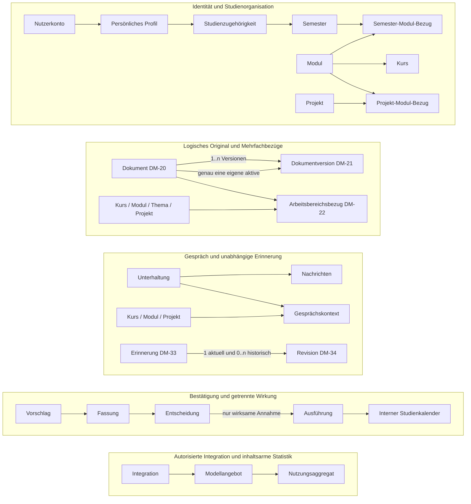

# D1 — Datenmodell

**Projekt:** Syllentra AI\
**Dokument:** D1 — Datenmodell\
**Version:** 0.5\
**Stand:** 22.10.2026\
**Status:** Zur Prüfung durch den Projektinhaber\
**Spezifikationsmethode:** Bausteine nach Johannes Siedersleben\
**Bezugsstand:** Vier bestätigte Entscheidungen vom 19.10.2026; Ausgangs-HEAD `53ef171be4783748b5c7e3a84bb0cc363d5b4194`, Branch `docs/spec/p1-p2-mobile-workspaces`, PR #1; aktuelle Fassungen im [Index](README.md).

> **Freigabe:** FE-01 bis FE-14 sind bestätigte fachliche Entscheidungen; die dokumentübergreifende Abnahme dieses D1-Entwurfs steht noch aus. Dieses Dokument beschreibt **kein implementiertes Datenbankschema**, keinen fertigen Dienst und keine beschaffte Anbieterberechtigung.

## D1.1 Auftrag, Modellgrenzen und Begriffe

D1 beschreibt fachlich eigenständig identifizierbare Informationen, ihre Beziehungen, Multiplizitäten, Besitz- und Herkunftsgrenzen und überprüfbare Integritätsregeln. Damit wird konkretisiert, **welche Informationen Syllentra für seine Use Cases benötigt**; nicht, in welcher Datenbank oder mit welchen ORM-Klassen sie gespeichert werden. Maßgeblich sind die bereits ausgearbeiteten Bausteine [P1](P1-ziele-rahmenbedingungen.md), [P2](P2-architekturueberblick.md), [F1](F1-geschaeftsprozesse.md), [F2](F2-anwendungsfaelle.md) und [F3](F3-anwendungsfunktionen.md). Die [D1-Referenz im Herold-Projekt](https://github.com/carstenlucke/herold/blob/main/docs/spec/D1-datenmodell.md) erläutert die methodische Grenze zwischen Informationsmodell, D2-Datentypen und Implementierung; Herold-spezifische Felder, Technologien und Authentisierungsentscheidungen werden nicht übernommen.

Die Kennungen **DM-01 bis DM-78** bezeichnen **fachliche Entitätstypen** und sind keine existierenden Datenbanktabellen oder API-Endpunkte. Attribute sind logisch beschreibend; konkrete Datentypdefinitionen, Wertbereiche, Pflichtfelder im jeweiligen Status und Typprüfungen folgen in **D2**. `Kennung` bedeutet stabile Identifizierbarkeit innerhalb der fachlichen Eigentumsgrenze. `0..1`, `1`, `0..n`, `1..n` beschreiben Multiplizitäten. Die nachfolgend präzisierten Kardinalitäten sind konzeptuelle D1-Vorschläge zur Prüfung, soweit sie nicht unmittelbar aus FE-01 bis FE-14 folgen. Ein optionaler Bezug ist nicht automatisch eine öffentlich auflösbare URL. Statuswörter sind fachliche Begriffe; ihre abschließende Enumeration gehört nach D2.

**Fachliche Verantwortungsbereiche:** Persönliche, intern verwaltete Informationen gehören zu Syllentra; Hochschulen, KI-/Medienanbieter, GitHub, Onlinedienste und Geräteplattformen behalten ihre externe fachliche Autorität. Externe Daten werden nur als erlaubter Bezug, herkunftsbehafteter Ausschnitt oder zulässiger Verarbeitungsnachweis modelliert. Externe Kalenderereignisse selbst werden **nicht** als intern schreibbare Entitäten angelegt. Ein Nutzerkonto, persönliches Profil, mehrere Geräte und die Administratorrolle sind nicht identisch.

**Eigentum, Herkunft und Löschumfang:** Jedes persönliche Objekt hat genau einen fachlichen Eigentümer DM-01, unmittelbar oder über den unten genannten eindeutigen Elternbezug; optionale Studien- und Arbeitsbereichsbezüge ersetzen diesen Eigentümer nicht. Katalogangebote DM-43/DM-45 sind nicht persönliche Inhalte; ihr Anbieter behält die externe Autorität. Die Administratorrolle erweitert keine fremden Rechte. Herkunft (manuell, importiert, KI-abgeleitet), Nutzerbestätigung, amtlicher Nachweis, Unsicherheit und Gültigkeitszeit sind getrennte Merkmale. Für Aussagen mit mehreren Quellen sind 0..n erlaubte, zeitbezogene Quellenbezüge möglich; fehlende Herkunft wird als unbekannt gekennzeichnet. Quellenmetadaten dürfen keine heimliche Kopie gelöschter Inhalte bilden.

Die Löschfolgen je Entität ergänzen D1.5/D1.6 und werden über DM-50 im gewählten Umfang ausgewiesen. Keine dort genannte Folge bedeutet pauschale Kaskadenlöschung fremder oder unabhängig gespeicherter Objekte. Tatsächlich geltende Aufbewahrungspflichten, Sicherungen und externe Restpunkte sind getrennt anzugeben; ohne belegte Durchführung gilt eine Löschung nicht als abgeschlossen.

**Entwurfskonvention:** Ein Attribut wie `Inhalt/Referenz` bedeutet eine fachliche Information oder ein erlaubter Verweis auf deren Inhalt, nicht die Festlegung eines Datei- oder Datenbankformats. Ein Datentyp kann in D2 noch in mehrere strukturierte Bestandteile zerlegt werden. Fachliche Relationen dürfen eine eigene Entität tragen, wenn ihre Herkunft, Freigabe, zeitliche Gültigkeit oder ihr Löschumfang relevant ist.

## D1.2 Übersicht der Informationsbereiche

| Bereich | Fachliche Fragestellung | Bezug zu P2.6.2 |
|---|---|---|
| Identität | Wer ist berechtigt, welche persönlichen Daten oder Geräte zu nutzen? | DK-05, DK-07 |
| Studium | Wie hängen Hochschule, Semester, Module, Kurse, Themen, Prüfung, Leistungen und Kompetenzen zusammen? | DK-04, DK-11 |
| Projektarbeit | Wie bestehen Projekte unabhängig von Semestern und mit mehreren Modulbezügen? | DK-09, DK-11 |
| Materialien | Wie existiert ein gemeinsames Original mit aktiver Version und historischen Fassungen? | DK-01, DK-02, DK-10, DK-11 |
| Kommunikation | Wie bleibt ein Gespräch samt Kontext und Nachrichten wiederauffindbar? | DK-08, DK-11 |
| Lernen / Erinnerung | Wie unterscheiden sich Lernhandlungen, selbstständige Leistungen, Hilfen und vorläufiges Langzeitwissen? | DK-03, DK-04 |
| Planung / Vorschläge | Welche Daten sind intern schreibbar, welche extern nur lesbar und was muss bestätigt werden? | DK-11, DK-12 |
| Integrationen | Welche tatsächlich erlaubten Zugänge, Modelle, Budgets und aggregierten Kennzahlen sind bekannt? | DK-05, DK-06 |
| Administration / Datenkontrolle | Wie werden gültige Einstellungen und nachvollziehbare Korrektur-, Export- und Löschhandlungen abgebildet? | DK-03, DK-05, DK-06, DK-11 |

### D1.2.1 Konzeptübersicht (vereinfachtes Diagramm)

**Leseregel:** Das Diagramm ist bewusst vereinfacht und ersetzt nicht die unten genannten Multiplizitäten. Gleichartige Kontextbezeichnungen in verschiedenen Bereichen stehen für dieselben fachlichen Entitätstypen, nicht für Kopien. Die Erinnerung ist nicht Teil der Nachrichtenhistorie; externe Kalender besitzen keine Schreibkante. Externe Quellen und Kalender werden in fachlichen Nachweisen beziehungsweise Lesefreigaben referenziert, nicht als vollständig kontrollierbare Syllentra-Datensätze behandelt.

## D1.3 Entitätsverzeichnis

| Kennung | Entitätstyp | Bereich | Kernaussage |
|---|---|---|---|
| DM-01 | Nutzerkonto | Identität | Einzelnes isoliertes Nutzerkonto der Mehrbenutzer-V1; E-Mail/Passwort und E-Mail-OTP, getrennt von administrativen Rollen. |
| DM-02 | PersönlichesProfil | Identität | Bearbeitbare persönliche Angaben, akademischer Kontext und Präferenzen mit erkennbarer Herkunft und Bestätigung. |
| DM-03 | Gerätefreigabe | Identität | Berechtigung eines konkret autorisierten Geräts zur Nutzung und Synchronisation. |
| DM-04 | Studienzugehörigkeit | Studium | Zeitbezogene Verbindung zwischen persönlichem Profil und Hochschule beziehungsweise Studiengang. |
| DM-05 | Semester | Studium | Persönlicher Studienabschnitt mit eigenem Zeitraum, Organisation und Abschlussstatus. |
| DM-06 | Modul | Studium | Modul als fachliche Studieneinheit, die über mehrere Semester relevant bleiben kann. |
| DM-07 | Kurs | Studium | Konkrete Lehrveranstaltung, Kursinstanz oder organisatorischer Teil eines Moduls. |
| DM-08 | SemesterModulBezug | Studium | Expliziter zeit- und statusbezogener Bezug eines Moduls zu einem Semester. |
| DM-09 | Themenknoten | Studium | Ordnungspunkt für Themen, Kapitel und Unterkapitel mit optionaler Hierarchie. |
| DM-10 | Lernziel | Studium | Benennbares Verständnis-, Übungs- oder Anwendungsziel. |
| DM-11 | Prüfung | Studium | Ein konkreter Prüfungstermin beziehungsweise Prüfungsversuch mit seinen Anforderungen. |
| DM-12 | Studienleistung | Studium | Benotete Leistung, ECTS-Zuordnung oder anderweitiger akademischer Leistungsnachweis. |
| DM-13 | Kompetenz | Studium | Benennbare Fähigkeit, die semester- und projektübergreifend bewertet werden kann. |
| DM-14 | Kompetenzbeleg | Studium | Nachvollziehbare, überprüfbare Zuordnung einer Kompetenz zu eigener Erfahrung, Projektergebnis, Prüfung oder vorläufiger Einschätzung. |
| DM-15 | Studienentscheidung | Studium | Dokumentierbarer persönlicher Entscheidungsanlass und abgewogene Handlungsoptionen. |
| DM-16 | Projekt | Projektarbeit | Eigenständiger oder studienbezogener Arbeitskontext, der Semestergrenzen überdauern kann. |
| DM-17 | ProjektModulBezug | Projektarbeit | Mehrfachrelation zwischen Projekt und Modul, bei Bedarf mit Semesterkontext. |
| DM-18 | Projektaufgabe | Projektarbeit | Konkrete Tätigkeit mit Verantwortungsbezug, Frist und eigenem Fortschritt. |
| DM-19 | RepositoryBezug | Projektarbeit | Vom Nutzer ausdrücklich ausgewählter lesender Verweis auf ein externes Repository. |
| DM-20 | Dokument | Materialien | Logisches, bewusst dauerhaft aufgenommenes Original als identitätsstiftende Ressource. |
| DM-21 | Dokumentversion | Materialien | Bestimmte unveränderlich referenzierbare fachliche Fassung eines logischen Originals. |
| DM-22 | DokumentArbeitsbereichBezug | Materialien | Explizite Mehrfachzuordnung eines Originals zu Kurs, Modul, Projekt oder Thema. |
| DM-23 | Informationsquelle | Materialien | Herkunfts-, Rechte- und Aktualitätskontext für Inhalte, Studienregeln und Belege. |
| DM-24 | Inhaltsableitung | Materialien | Aus einem dokumentierten Ausgangsmaterial gewonnene, bewusst erhaltene Zusammenfassung, Transkription oder fachliche Extraktion. |
| DM-25 | Unterhaltung | Kommunikation | Wiederauffindbare text- oder sprachgestützte Sitzung über Geräte und Zeiträume. |
| DM-26 | Nachricht | Kommunikation | Ein einzelner Gesprächsbeitrag mit Reihenfolge, Autorrolle und gegebenenfalls Medienbezug. |
| DM-27 | GesprächskontextBezug | Kommunikation | Kontrollierbarer Bezug einer Unterhaltung auf Kurs, Modul oder Projekt. |
| DM-28 | Lerneinheit | Lernen | Zeitlich oder thematisch abgegrenzte Bearbeitung eines Lernziels mit erlaubtem Kontext. |
| DM-29 | Übungsaufgabe | Lernen | Prüffrage oder Übung samt erwarteter Anforderung und Quellenbezug. |
| DM-30 | Lösungsversuch | Lernen | Konkreter eigenständiger oder unterstützter Bearbeitungsversuch zu einer Aufgabe. |
| DM-31 | Hilfenachweis | Lernen | Nachweis gestufter Hinweise oder vollständiger Lösungshilfe für einen Lösungsversuch. |
| DM-32 | Lernstand | Lernen | Herkunftsbezogene fachliche Einschätzung, getrennt von Bearbeitungsfortschritt und amtlichen Leistungen. |
| DM-33 | PädagogischerErinnerungseintrag | Erinnerung | Zweckgebundene längerfristige Beobachtung über Kenntnisse, Schwierigkeiten, Präferenzen oder Lernziele. |
| DM-34 | Erinnerungsrevision | Erinnerung | Korrigierbare nachvollziehbare Fassung eines Erinnerungseintrags mit ihrer Änderungsgeschichte. |
| DM-35 | InternerStudientermin | Planung | Vom Nutzer manuell gespeicherter oder nach Bestätigung übernommener Eintrag des internen Studienkalenders. |
| DM-36 | ExterneKalenderLesefreigabe | Planung | Zweckbegrenzte Autorisierung, externe Kalender auf Verfügbarkeit zu prüfen. |
| DM-37 | Importvorgang | Planung | Quellenbezogener akademischer Import mit geprüfter Fassung und Übernahmestand. |
| DM-38 | Quellenbeobachtung | Planung | Vergleichbarer letzter beobachteter Quellenstand, soweit Abruf rechtmäßig erlaubt. |
| DM-39 | Entscheidungsvorschlag | Vorschläge | Ein fachlicher KI-, Import- oder Archivierungsvorschlag, der an mehreren berechtigten Stellen angezeigt werden kann. |
| DM-40 | Vorschlagsfassung | Vorschläge | Konkrete prüfbare Fassung mit Auswirkungen, Quellenstand und Gegenstandsbezügen. |
| DM-41 | Vorschlagsentscheidung | Vorschläge | Entscheidungsaktion zu einer konkreten Vorschlagsfassung: finale Annahme oder Ablehnung beziehungsweise nicht finale Vertagung. |
| DM-42 | Vorschlagsausführung | Vorschläge | Von der Entscheidung unterscheidbares konkretes Übernahmeergebnis in einem fachlichen Ziel. |
| DM-43 | Integrationsangebot | Integrationen | Prüfbarer Eintrag im unterstützten Integrations- und Anbieterkatalog. |
| DM-44 | Integrationsberechtigung | Integrationen | Zweckgebundene Nutzer-/Administratorfreigabe zur Nutzung eines unterstützten Zugangs. |
| DM-45 | Modellangebot | Integrationen | Beschreibbare aufgabenbezogene KI-Modelloption, deren Eigenschaften zeitabhängig sind. |
| DM-46 | Kosten- und Nutzungsfreigabe | Integrationen | Explizit genehmigter Kosten-, Kontingent- und Zweckrahmen. |
| DM-47 | KI-Nutzungsaggregat | Integrationen | Datensparsamer Verbrauchs- und gegebenenfalls Kostensummenwert pro Anbieter, Modell und Periode. |
| DM-48 | Konfiguration | Administration | Verwaltbarer Satz unterstützter UI-, Lern-, Integrations-, Datenschutz- oder Kostenparameter. |
| DM-49 | Konfigurationsfassung | Administration | Geprüfter gültiger oder vorgeschlagener Stand einer Konfiguration. |
| DM-50 | Datenkontrollvorgang | Datenkontrolle | Abgegrenzte Einsicht, Korrektur, Export- oder Löschhandlung samt bestätigtem Wirkungsumfang. |
| DM-51 | ExterneDatenübermittlung | Datenkontrolle | Nachvollziehbarer minimaler Beleg eines autorisierten Datentransfers mit Empfänger, Zweck und bekanntem Kontrollstatus. |
| DM-52 | Änderungshinweis | Planung | Benutzerbezogener Hinweis über relevante neue oder widersprechende Informationen. |
| DM-53 | EMailAdresse | Konten / Administration | Verifizierte persönliche Adressen und getrennte Rollen |
| DM-54 | Verifikationsvorgang | Konten / Administration | Zweckgebundene Prüfung mit tatsächlichem Ergebnis |
| DM-55 | Sitzung | Konten / Administration | Serversitzung getrennt von lokaler Sperre |
| DM-56 | RollenZuweisung | Konten / Administration | Begrenzte aktuelle Rollenrechte |
| DM-57 | Administrationsaudit | Konten / Administration | Geschützter Administrationsnachweis ohne Geheimnisse |
| DM-58 | Supportfreigabe | Konten / Administration | Enger befristeter und widerrufbarer Supportumfang |
| DM-59 | Nutzerquota | Konten / Administration | Grundquoten mit erlaubten Kontoausnahmen |
| DM-60 | Funktionsfreigabe | Konten / Administration | Serverseitige Funktionssichtbarkeit und Wirkung |
| DM-61 | Veröffentlichungsfassung | Konten / Administration | Geprüfte Konfigurations-/Funktionsveröffentlichung |
| DM-62 | Integrationslauf | Integrationen | Konkreter Integrationslauf ohne fingierten Erfolg |
| DM-63 | Synchronisationsregel | Integrationen | Manueller Standard und explizite Automatik je Verbindung |
| DM-64 | Schutzkennzeichnung | Datenschutz | Vererbte Sensitivität und Sichtbarkeit |
| DM-65 | DokumentSchlüsselbezug | Datenschutz | Opaque Schlüsselreferenz, kein Klartextschlüssel |
| DM-66 | Verarbeitungsfreigabe | Datenschutz | Konkrete minimale Verarbeitungsfreigabe |
| DM-67 | Papierkorbeintrag | Datenschutz | Privater begrenzter Papierkorb |
| DM-68 | Löschmarkierung | Datenschutz | Inhaltsfreie Kontrolle gegen Wiederbelebung |
| DM-69 | Sicherungspunkt | Sicherung / Materialien | Verschlüsselter unabhängiger Sicherungsstand |
| DM-70 | Wiederherstellungsvorgang | Sicherung / Materialien | Kontrollierte tatsächliche Wiederherstellungswirkung |
| DM-71 | Archivextraktionsbezug | Sicherung / Materialien | Herkunft von Archiv und getrennten Extrakten |
| DM-72 | Portabilitätspaket | Portabilität | Eigener geschützter Export-/Importumfang |
| DM-73 | Migrationslauf | Portabilität | Versionierter persönlicher oder administrativer Lauf |
| DM-74 | MigrationsTeilwirkung | Portabilität | Einzelne belegte Migrationswirkung |
| DM-75 | PädagogischeLernreihenfolge | Lernplanung / Hinweise | Persönliche nichtterminierte pädagogische Reihenfolge |
| DM-76 | PädagogischePlanänderung | Lernplanung / Hinweise | Begründete Planrevision mit begrenztem Undo |
| DM-77 | PersönlicheErinnerungsregel | Lernplanung / Hinweise | Persönliche Regelvererbung, keine Kanalberechtigung |
| DM-78 | Benachrichtigungszustellung | Lernplanung / Hinweise | Externer Zustellnachweis getrennt vom Hinweis |

## D1.4 Fachliche Entitätstypen im Detail

Jede Entität wird mit einem minimalen fachlichen Attributvorrat beschrieben. `0..n`-Aufzählungen in der Attributspalte sind keine Entscheidung für konkrete Tabellen, Listen oder eingebettete JSON-Felder. Wo mögliche Belege oder Beziehungen noch optional sind, wird keine fiktive amtliche Bestätigung angenommen.

### D1.4.1 Identität

#### DM-01 — Nutzerkonto

Einzelnes isoliertes Nutzerkonto der Mehrbenutzer-V1; E-Mail/Passwort und E-Mail-OTP, getrennt von administrativen Rollen.

| Modellmerkmal | Fachliche Festlegung |
|---|---|
| **Wesentliche Attribute** | Kennung; Zugangsstatus; Anlagezeitpunkt; letzter bestätigter Zugriff [optional] |
| **Wesentliche Bezüge** | DM-02, DM-03, DM-48 |
| **Integrität und Grenzen** | V1 kennt mehrere isolierte Konten; die fachliche Eigentümerschaft eines persönlichen Objekts ist eindeutig. Genau ein Super Admin verwaltet sekundäre Administratoren, ohne privaten Inhaltszugriff zu erhalten. Konto und Profil bleiben getrennt; keine Zugangsdaten im öffentlichen Repository. |
| **Eigentum und Kardinalität** | Eigene persönliche Identität; 0..1 Profil, 0..n Geräte und Konfigurationen. |
| **Löschfolgen und Herkunftsgrenze** | Kontolöschung umfasst ausdrücklich gewählte persönliche Daten und Freigaben; keine behauptete Löschung fremder Anbieterbestände. |

#### DM-02 — PersönlichesProfil

Bearbeitbare persönliche Angaben, akademischer Kontext und Präferenzen mit erkennbarer Herkunft und Bestätigung.

| Modellmerkmal | Fachliche Festlegung |
|---|---|
| **Wesentliche Attribute** | Kennung; Nutzerbezug; Anzeigename [optional]; Avatarbezug [optional]; Sprachen [0..n]; Präferenzen [0..n]; Aktualisierungsstand |
| **Wesentliche Bezüge** | DM-01, DM-04, DM-14, DM-33 |
| **Integrität und Grenzen** | Optionale Felder dürfen den Einstieg nicht blockieren (FE-01). Studienleistungen liegen nicht redundant als amtliche Werte im Profil; Schätzungen und Quellen unterscheiden. |
| **Eigentum und Kardinalität** | Genau ein DM-01; je Profil 0..n Studienzugehörigkeiten. |
| **Löschfolgen und Herkunftsgrenze** | Profilkorrektur oder Feldlöschung ist keine automatische Löschung von Leistungen, Gesprächen oder Erinnerungen; deren Umfang separat wählen. |

**FE-21 / persönliche Präferenzen:** Erlaubte Ausgabe-/Audiosprache und unterstützte Stimme/Geschwindigkeit sind persönliche Präferenzen über DM-48/DM-49 und DT-07/DT-61, keine Mikrofon- oder Anbieterberechtigung. Eine Präferenz ist weder laufende Wiedergabe noch Nachweis, dass das Gerät sie ausführen kann.

**Präzisierung DEC-V1-05/06/18/19:** Sichtbare persönliche Lernpräferenzen und zulässige Annahmen korrigierbar/begrenzbar/zurücksetzbar; diskrete Hilfe-/Pausenpräferenzen optional und deaktivierbar. Manuelle Präferenz ist keine feste Lernstilklasse und kein Gesundheitsurteil. Reset betrifft gewählten Umfang, nicht automatisch amtliche Leistungen.

[Entscheidungsmatrix](ENTSCHEIDUNGSMATRIX.md).

#### DM-03 — Gerätefreigabe

Berechtigung eines konkret autorisierten Geräts zur Nutzung und Synchronisation.

| Modellmerkmal | Fachliche Festlegung |
|---|---|
| **Wesentliche Attribute** | Kennung; Nutzerbezug; erkennbare Gerätebezeichnung; Berechtigungsstatus; Freigabezeit; Widerrufszeit [optional]; letzter Abgleich [optional] |
| **Wesentliche Bezüge** | DM-01, DM-25, DM-27, DM-41 |
| **Integrität und Grenzen** | Widerruf verhindert künftige berechtigte Zugriffe; bereits lokal verfügbare Daten dürfen nicht ohne Nachweis als gelöscht behauptet werden. |
| **Eigentum und Kardinalität** | Genau ein DM-01; ein konkret erkennbares Gerät je Freigabe. |
| **Löschfolgen und Herkunftsgrenze** | Widerruf statt fingierter Fernlöschung; verbleibende lokale Kopien und Status gemäß DM-50 ausweisen. |

### D1.4.2 Studium

#### DM-04 — Studienzugehörigkeit

Zeitbezogene Verbindung zwischen persönlichem Profil und Hochschule beziehungsweise Studiengang.

| Modellmerkmal | Fachliche Festlegung |
|---|---|
| **Wesentliche Attribute** | Kennung; Profilbezug; Einrichtung; Studiengang; Abschlussziel [optional]; Gültigkeitszeitraum [optional]; Herkunft; Nachweisstatus |
| **Wesentliche Bezüge** | DM-02, DM-05 |
| **Integrität und Grenzen** | Ein Nutzer kann historische oder gleichzeitige Studienzugehörigkeiten besitzen; der aktuelle Bezug ist nicht allein aus maximalem Semesterindex ableitbar. |
| **Eigentum und Kardinalität** | Genau ein DM-02 und darüber ein DM-01; 0..n Semester. |
| **Löschfolgen und Herkunftsgrenze** | Bezug entfernen, ohne historische Semester oder Leistungen still zu löschen; Herkunft verfügbarer Nachweise erhalten. |

**Präzisierung L-09:** Optionale belegte Prüfungsordnungsfassung, Einschreibungs-/Kohortenzuordnung und Übergangsbezüge ergänzen die Studienzugehörigkeit. Unbekannte Zuordnung bleibt unbekannt. Zeitliche Geltung der Zugehörigkeit allein beweist nicht Geltung einer Studienregel. Zu den eigenen DM-24-Vorgaben-/Abgleichableitungen bestehen 0..n nachvollziehbare Bezüge; keine Institution oder Kohorte wird geraten.

#### DM-05 — Semester

Persönlicher Studienabschnitt mit eigenem Zeitraum, Organisation und Abschlussstatus.

| Modellmerkmal | Fachliche Festlegung |
|---|---|
| **Wesentliche Attribute** | Kennung; Eigentümer; Studienzugehörigkeit [optional]; Bezeichnung; Zeitraum [optional]; Status; Abschlussprüfung [optional] |
| **Wesentliche Bezüge** | DM-04, DM-06, DM-09, DM-16, DM-35 |
| **Integrität und Grenzen** | Kalenderdatum allein beendet oder archiviert weder Semester noch offene abhängige Elemente (FE-06). |
| **Eigentum und Kardinalität** | Genau ein DM-01; 0..1 Studienzugehörigkeit, 0..n DM-08 und optionale Projektbezüge. |
| **Löschfolgen und Herkunftsgrenze** | Archivierung nur bestätigter abgeschlossener Elemente; bei Löschung Modulbezüge gesondert behandeln, Module, offene Prüfungen und Projekte bleiben eigenständig. |

#### DM-06 — Modul

Modul als fachliche Studieneinheit, die über mehrere Semester relevant bleiben kann.

| Modellmerkmal | Fachliche Festlegung |
|---|---|
| **Wesentliche Attribute** | Kennung; Modulkennung [optional]; Titel; Beschreibung [optional]; ECTS-Soll [optional]; Quelle [optional] |
| **Wesentliche Bezüge** | DM-07, DM-08, DM-09, DM-10, DM-11, DM-12, DM-17 |
| **Integrität und Grenzen** | Eine Wiederholungsprüfung oder ein erneuter Modulbesuch darf nicht die Stamminformation oder frühere Leistungen überschreiben. |
| **Eigentum und Kardinalität** | Genau ein DM-01; 0..n Semesterbezüge DM-08, Kurse und Projektbezüge DM-17. |
| **Löschfolgen und Herkunftsgrenze** | Modullöschung zeigt betroffene Bezüge und Leistungen; keine pauschale Löschung verbundener Projekte oder Dokumentoriginale. |

#### DM-07 — Kurs

Konkrete Lehrveranstaltung, Kursinstanz oder organisatorischer Teil eines Moduls.

| Modellmerkmal | Fachliche Festlegung |
|---|---|
| **Wesentliche Attribute** | Kennung; Titel; Modulbezug [optional]; Semesterbezug [optional]; Lehrformat [optional]; Quelle [optional]; Status |
| **Wesentliche Bezüge** | DM-05, DM-06, DM-10, DM-20, DM-21, DM-22 |
| **Integrität und Grenzen** | Ein Kurs darf zur Organisation auch ohne vollständig bekannte offizielle Modulkennung angelegt werden; unbekannte Zuordnung bleibt offen. |
| **Eigentum und Kardinalität** | Genau ein DM-01; 0..1 Modul und 0..1 Semester; Materialien über DM-22 zum Original DM-20, historische Belege gegebenenfalls zu DM-21. |
| **Löschfolgen und Herkunftsgrenze** | Kurs entfernen betrifft seine Zuordnungen; Originale, Gespräche, Leistungen und Projekte nur nach eigener Umfangswahl. |

#### DM-08 — SemesterModulBezug

Expliziter zeit- und statusbezogener Bezug eines Moduls zu einem Semester.

| Modellmerkmal | Fachliche Festlegung |
|---|---|
| **Wesentliche Attribute** | Kennung; Semesterbezug; Modulbezug; Belegungsstatus; Quelle [optional]; bestätigte Fassung [optional] |
| **Wesentliche Bezüge** | DM-05, DM-06, DM-12 |
| **Integrität und Grenzen** | Ein Modul kann mehreren Semestern zugeordnet sein; Entfernen eines Bezugs löscht weder Modul noch Leistungen. |
| **Eigentum und Kardinalität** | Eigentümer aus genau einem Semester DM-05; genau ein Modul DM-06 desselben Nutzers. |
| **Löschfolgen und Herkunftsgrenze** | Nur Relation entfernen; Modul und frühere Leistungen bleiben bestehen. |

#### DM-09 — Themenknoten

Ordnungspunkt für Themen, Kapitel und Unterkapitel mit optionaler Hierarchie.

| Modellmerkmal | Fachliche Festlegung |
|---|---|
| **Wesentliche Attribute** | Kennung; Titel; fachlicher Kontext; übergeordneter Themenknoten [optional]; Sortierinformation [optional]; Status |
| **Wesentliche Bezüge** | DM-05, DM-06, DM-07, DM-10, DM-11 |
| **Integrität und Grenzen** | Zyklen in der Themenhierarchie sind unzulässig. Themen können an Kurs oder Modul gebunden sein; ein Lernziel ist eine eigene Aussage. |
| **Eigentum und Kardinalität** | Genau ein DM-01; genau ein primärer Kontext aus DM-05, DM-06 oder DM-07; 0..1 Elternknoten desselben Kontexts, 0..n Kinder. |
| **Löschfolgen und Herkunftsgrenze** | Kindknoten und Lernzielbezüge vor Entfernen offenlegen; kein stilles Umhängen oder Löschen von Materialien. |

**Präzisierung DEC-V1-02/09:** 0..n zusätzliche fachliche Beziehungen zu eigenen Themen/Lernzielen anderer eigener Kurse mit Grund, Quellenbezug, Herkunft und Unsicherheit. Diese sekundären Beziehungen ändern weder den genau einen primären Kontext noch die azyklische Elternhierarchie. Karte ist eine Projektion bestehender Bezüge, keine neue Entität und keine kontoübergreifende Freigabe.

[Entscheidungsmatrix](ENTSCHEIDUNGSMATRIX.md).

#### DM-10 — Lernziel

Benennbares Verständnis-, Übungs- oder Anwendungsziel.

| Modellmerkmal | Fachliche Festlegung |
|---|---|
| **Wesentliche Attribute** | Kennung; Beschreibung; Themen-, Kurs- oder Modulbezug [optional]; angestrebtes Niveau [optional]; Aktualität; Herkunft |
| **Wesentliche Bezüge** | DM-06, DM-09, DM-28, DM-31 |
| **Integrität und Grenzen** | Lernzielerreichung wird nicht aus bloßer Materiallektüre abgeleitet. |
| **Eigentum und Kardinalität** | Genau ein DM-01; 0..1 primärer Kontext aus DM-06, DM-07 oder DM-09; 0..n Lerneinheiten. |
| **Löschfolgen und Herkunftsgrenze** | Erreichte oder geschätzte Lernstände nicht ohne Umfangswahl mitlöschen; verwaiste Zielbezüge kenntlich machen. |

**Präzisierung DEC-V1-25:** Ein bewusst angenommenes/selbst gespeichertes Wochenziel bleibt ein eigenes Lernziel mit bekanntem Wochenzeitraum (DT-05) und gewähltem Inhalt. Zielwert, tatsächliche Erfüllungsbelege und Unsicherheit getrennt; Ablehnung/Aufschub legt kein Pflichtziel oder Termin an. Freiwillige Präferenz/Historie nur im zulässigen gewählten Umfang.

[Entscheidungsmatrix](ENTSCHEIDUNGSMATRIX.md).

#### DM-11 — Prüfung

Ein konkreter Prüfungstermin beziehungsweise Prüfungsversuch mit seinen Anforderungen.

| Modellmerkmal | Fachliche Festlegung |
|---|---|
| **Wesentliche Attribute** | Kennung; Modul- oder Kursbezug; Versuchskontext [optional]; Termin [optional]; veröffentlichte Quelle [optional]; Terminstand; Prüfungsstatus |
| **Wesentliche Bezüge** | DM-06, DM-07, DM-12, DM-35, DM-37 |
| **Integrität und Grenzen** | Mehrere Prüfungsversuche bleiben unterscheidbar; Änderungen an Quellen sind nicht automatisch eine amtlich bestätigte neue Prüfung. |
| **Eigentum und Kardinalität** | Genau ein DM-01; genau ein primärer Modul- oder Kursbezug; 0..n Studienleistungen und zugehörige interne Termine. |
| **Löschfolgen und Herkunftsgrenze** | Prüfungsversuch nicht durch späteren Versuch ersetzen; Löschen erfordert getrennte Folgen für Nachweise, Termine und offene Planung. |

#### DM-12 — Studienleistung

Benotete Leistung, ECTS-Zuordnung oder anderweitiger akademischer Leistungsnachweis.

| Modellmerkmal | Fachliche Festlegung |
|---|---|
| **Wesentliche Attribute** | Kennung; direkter Studienzugehörigkeitsbezug DM-04 [optional]; Modul-/Prüfungsbezug [optional]; Wert/Note [optional]; ECTS [optional]; Leistungsart; Herkunft; Nachweisstatus; Nachweisbezug [optional] |
| **Wesentliche Bezüge** | DM-04, DM-06, DM-08, DM-11, DM-14, DM-20 |
| **Integrität und Grenzen** | Offizielle Nachweise, manuelle Werte und KI-Einschätzungen bleiben semantisch getrennt; bloße KI-Aussage wird keine Hochschulnote. |
| **Eigentum und Kardinalität** | Genau ein DM-01; jeweils 0..1 Modul-, SemesterModul- und Prüfungsbezug, sofern bekannt; 0..n Belege. |
| **Löschfolgen und Herkunftsgrenze** | Leistungswert löschen oder korrigieren betrifft abhängige Nachweise; ECTS-Soll des Moduls und tatsächlich erworbene ECTS bleiben getrennt. |

#### DM-13 — Kompetenz

Benennbare Fähigkeit, die semester- und projektübergreifend bewertet werden kann.

| Modellmerkmal | Fachliche Festlegung |
|---|---|
| **Wesentliche Attribute** | Kennung; Bezeichnung; Beschreibung [optional]; Bereich; Quelle/Taxonomie [optional] |
| **Wesentliche Bezüge** | DM-14, DM-16, DM-31, DM-33 |
| **Integrität und Grenzen** | Kompetenzbezeichnung allein ist kein Nachweis; Mehrfachnennungen derselben Fähigkeit sollen erkennbar zusammengeführt werden können. |
| **Eigentum und Kardinalität** | Genau ein DM-01 für die persönliche Kompetenzbeschreibung; 0..n Kompetenzbelege. |
| **Löschfolgen und Herkunftsgrenze** | Bezeichnung entfernen ist kein Löschnachweis externer Zertifikate; abhängige Behauptungen prüfen. |

#### DM-14 — Kompetenzbeleg

Nachvollziehbare, überprüfbare Zuordnung einer Kompetenz zu eigener Erfahrung, Projektergebnis, Prüfung oder vorläufiger Einschätzung.

| Modellmerkmal | Fachliche Festlegung |
|---|---|
| **Wesentliche Attribute** | Kennung; Kompetenzbezug; Evidenzreferenz [optional]; Einschätzungsgrad [optional]; Herkunft; Selbstständigkeitsgrad; Bestätigungsstand; Gültigkeitsbezug |
| **Wesentliche Bezüge** | DM-12, DM-13, DM-16, DM-20, DM-31, DM-33 |
| **Integrität und Grenzen** | Ein mit KI-Hilfe gelöster Versuch wird nicht als unabhängiger Leistungsbeleg ausgegeben; Löschung eines Nachweises entfernt/entwertet abhängige Behauptungen. |
| **Eigentum und Kardinalität** | Genau ein DM-01 und genau eine Kompetenz DM-13; 0..n nachweisbare Evidenzbezüge, bei Dokumentbelegen auf konkrete DM-21. |
| **Löschfolgen und Herkunftsgrenze** | Wegfall der Evidenz entwertet ihre Belegbarkeit; keine stillschweigende Umdeutung zur selbstständigen oder amtlichen Leistung. |

#### DM-15 — Studienentscheidung

Dokumentierbarer persönlicher Entscheidungsanlass und abgewogene Handlungsoptionen.

| Modellmerkmal | Fachliche Festlegung |
|---|---|
| **Wesentliche Attribute** | Kennung; Anliegen; Zielkriterien; betrachtete Optionen; Quellenbezüge [0..n]; Unsicherheiten; Nutzerentscheidung [optional]; Entscheidungsstand |
| **Wesentliche Bezüge** | DM-02, DM-23, DM-39 |
| **Integrität und Grenzen** | Syllentra empfiehlt; Nutzer oder zuständige Stelle entscheidet. Eine Empfehlung ist keine verbindliche Hochschulentscheidung. |
| **Eigentum und Kardinalität** | Genau ein DM-01; 0..n Quellen und Vorschläge zu einem Entscheidungsanlass. |
| **Löschfolgen und Herkunftsgrenze** | Entscheidungsnotiz löschbar; fachlich unabhängige Quellen und bereits ausgeführte Handlungen werden nicht zurückgenommen. |

### D1.4.3 Projektarbeit

#### DM-16 — Projekt

Eigenständiger oder studienbezogener Arbeitskontext, der Semestergrenzen überdauern kann.

| Modellmerkmal | Fachliche Festlegung |
|---|---|
| **Wesentliche Attribute** | Kennung; Name; Beschreibung [optional]; Projektart; Ziele; Status; Beginn [optional]; Abschlussbeleg [optional] |
| **Wesentliche Bezüge** | DM-05, DM-13, DM-17, DM-18, DM-19, DM-20, DM-21, DM-22 |
| **Integrität und Grenzen** | Projekt existiert unabhängig vom Modulbezug. Semesterschluss bewirkt keine automatische Projektarchivierung. |
| **Eigentum und Kardinalität** | Genau ein DM-01; 0..n Modulbezüge DM-17, optionale Semesterkontexte, 0..n Aufgaben und Repository-Bezüge. Materialien über DM-20/DM-22; DM-21 nur als konkreter Fassungsbeleg. |
| **Löschfolgen und Herkunftsgrenze** | Archivieren oder Löschen beeinflusst keine anderen Module, Projekte oder geteilten Originale ohne ausdrücklich gewählten Umfang. |

#### DM-17 — ProjektModulBezug

Mehrfachrelation zwischen Projekt und Modul, bei Bedarf mit Semesterkontext.

| Modellmerkmal | Fachliche Festlegung |
|---|---|
| **Wesentliche Attribute** | Kennung; Projekt; Modul; Semesterkontext [optional]; Beziehungstyp; Gültigkeitsstand |
| **Wesentliche Bezüge** | DM-06, DM-16 |
| **Integrität und Grenzen** | Ein Projekt kann null, ein oder viele Module haben. Löschen einer Relation löscht weder Projekt noch Modul. |
| **Eigentum und Kardinalität** | Eigentümer über genau ein DM-16; genau ein DM-06 desselben Nutzers, 0..1 Semesterkontext. |
| **Löschfolgen und Herkunftsgrenze** | Relation entfernen lässt Projekt und Modul bestehen. |

#### DM-18 — Projektaufgabe

Konkrete Tätigkeit mit Verantwortungsbezug, Frist und eigenem Fortschritt.

| Modellmerkmal | Fachliche Festlegung |
|---|---|
| **Wesentliche Attribute** | Kennung; Projekt; Titel; Aufgabenstatus; Fälligkeit [optional]; Verantwortungsangabe [optional]; Ergebnisbezug [optional] |
| **Wesentliche Bezüge** | DM-16, DM-20, DM-35 |
| **Integrität und Grenzen** | Aufgabenstatus und erreichte Kompetenz sind nicht gleichbedeutend; Vorschläge zu Terminen bleiben bis zur Bestätigung offen. |
| **Eigentum und Kardinalität** | Eigentümer über genau ein DM-16; 0..n Ergebnisressourcen, 0..n interne Termine. |
| **Löschfolgen und Herkunftsgrenze** | Aufgabe löschen löscht keine geteilten Ressourcen; Termine und Nachweise als eigene Folgen ausweisen. |

#### DM-19 — RepositoryBezug

Vom Nutzer ausdrücklich ausgewählter lesender Verweis auf ein externes Repository.

| Modellmerkmal | Fachliche Festlegung |
|---|---|
| **Wesentliche Attribute** | Kennung; Projekt; Repository-Locator; ausgewählter Umfang; Berechtigungsstand; Quelle/Aktualität |
| **Wesentliche Bezüge** | DM-16, DM-23, DM-44 |
| **Integrität und Grenzen** | Kein stillschweigender GitHub-Schreibzugriff. Fremde Inhalte oder Zugangsdaten werden nicht zu internem Eigentum erklärt. |
| **Eigentum und Kardinalität** | Eigentümer über genau ein DM-16; genau ein Repository-Locator und erlaubter Leseumfang; externe Autorität bleibt beim Repository-Anbieter. |
| **Löschfolgen und Herkunftsgrenze** | Bezug oder Freigabe widerrufen; kein Löschen oder Schreiben im Repository, keine Zusage über bereits abgeleitete Inhalte ohne Prüfung. |

### D1.4.4 Materialien

#### DM-20 — Dokument

Logisches, bewusst dauerhaft aufgenommenes Original als identitätsstiftende Ressource.

| Modellmerkmal | Fachliche Festlegung |
|---|---|
| **Wesentliche Attribute** | Kennung; Eigentümer; Titel; Medienart; Aufbewahrungszweck; Rechtehinweis [optional]; aktiver Versionsbezug; Archivstatus |
| **Wesentliche Bezüge** | DM-01, DM-21, DM-22, DM-23, DM-24 |
| **Integrität und Grenzen** | FE-12: genau ein aktiver Versionsverweis aus den eigenen vorhandenen Versionen. Archivierung oder Verknüpfungsentfernung ist keine Löschung. |
| **Eigentum und Kardinalität** | Genau ein DM-01; 1..n vorhandene DM-21 und genau eine eigene aktive Version, auch archiviert; 0..n DM-22. |
| **Löschfolgen und Herkunftsgrenze** | Letzte Version nicht bei fortbestehendem Original löschen. Original-, Versions- und Linklöschung sind getrennte bestätigte Wirkungen; D1.5.3. |

#### DM-21 — Dokumentversion

Bestimmte unveränderlich referenzierbare fachliche Fassung eines logischen Originals.

| Modellmerkmal | Fachliche Festlegung |
|---|---|
| **Wesentliche Attribute** | Kennung; Dokumentbezug; Versionsbezeichnung/Nummer; Fassungszeit; Inhaltsreferenz; Herkunft; ersetzte Version [optional]; Erhaltungsstatus |
| **Wesentliche Bezüge** | DM-20, DM-23, DM-24, DM-39 |
| **Integrität und Grenzen** | FE-12: Aktualisieren erzeugt eine neue Fassung, kein stilles Überschreiben historischer Fassungen. Version gehört exakt zu einem logischen Dokument. |
| **Eigentum und Kardinalität** | Eigentümer über genau ein DM-20; pro Dokument 0..n historische und genau eine aktive Version. Ersetzungsbezug 0..1 zu einer eigenen älteren Fassung, ohne Zyklus. |
| **Löschfolgen und Herkunftsgrenze** | Referenzstabilität bedeutet keine Unlöschbarkeit. Aktive Version nur bei ausdrücklich bestimmter verbleibender eigener Version entfernen, letzte Version nur zusammen mit dem Original; D1.5.3. |

#### DM-22 — DokumentArbeitsbereichBezug

Explizite Mehrfachzuordnung eines Originals zu Kurs, Modul, Projekt oder Thema.

| Modellmerkmal | Fachliche Festlegung |
|---|---|
| **Wesentliche Attribute** | Kennung; Dokument; Zieltyp; Zielkennung; Herkunft der Zuordnung; Bestätigung; optionaler Gültigkeitsstand |
| **Wesentliche Bezüge** | DM-06, DM-07, DM-09, DM-16, DM-20, DM-39 |
| **Integrität und Grenzen** | FE-09: dasselbe Original darf vielen Bereichen zugeordnet sein; Entfernung einer Zuordnung verändert weder das Original noch andere Bezüge. |
| **Eigentum und Kardinalität** | Eigentümer über genau ein DM-20; genau ein Ziel aus DM-06, DM-07, DM-09 oder DM-16 desselben Nutzers. |
| **Löschfolgen und Herkunftsgrenze** | Nur dieser Bezug verschwindet; kein dupliziertes Original und keine Änderung historischer Fassungsbelege. |

#### DM-23 — Informationsquelle

Herkunfts-, Rechte- und Aktualitätskontext für Inhalte, Studienregeln und Belege.

| Modellmerkmal | Fachliche Festlegung |
|---|---|
| **Wesentliche Attribute** | Kennung; Quellentyp; Locator [optional]; Name; Veröffentlichungsstand [optional]; Abruf-/Beobachtungsstand [optional]; Vertrauensgrenze; Lizenz-/Nutzungshinweis [optional] |
| **Wesentliche Bezüge** | DM-11, DM-12, DM-15, DM-19, DM-20, DM-21, DM-24, DM-37 |
| **Integrität und Grenzen** | Eine Quelle dokumentiert Herkunft, nicht automatisch Wahrheit oder Bearbeitungsrecht. Entfernte Originale dürfen nicht als weiterhin wortgetreu zitierbar gelten. |
| **Eigentum und Kardinalität** | Genau ein DM-01 für den persönlichen Herkunftsnachweis; externe Quelle behält ihre Autorität; 0..n Verwendungen und Beobachtungen. |
| **Löschfolgen und Herkunftsgrenze** | Quellinhalt und Herkunftsmetadaten unterscheiden. Entfall wird kenntlich; minimale zulässige Metadaten enthalten keinen gelöschten Vollinhalt. |

#### DM-24 — Inhaltsableitung

Aus einem dokumentierten Ausgangsmaterial gewonnene, bewusst erhaltene Zusammenfassung, Transkription oder fachliche Extraktion.

| Modellmerkmal | Fachliche Festlegung |
|---|---|
| **Wesentliche Attribute** | Kennung; Ableitungsart; Ausgangsversion/Quelle; Inhalt oder Inhaltsreferenz; Unsicherheit; Erstellungszeit; Aufbewahrungszweck; Bearbeitungsstand |
| **Wesentliche Bezüge** | DM-21, DM-23, DM-25, DM-33 |
| **Integrität und Grenzen** | Temporäre Arbeitskopien ohne Aufbewahrungszweck sind keine dauerhaft gespeicherten Dokumentversionen. Bei gelöschtem Quellinhalt bleibt zulässige Herkunftsmetainformation erkennbar, aber der Inhalt ist nicht mehr nachprüfbar. Keine Behauptung wortgetreuer Verfügbarkeit und kein verdeckter Quellersatz. |
| **Eigentum und Kardinalität** | Genau ein DM-01; 1..n Ausgangsbezüge zu konkreten DM-21 und/oder DM-23, 0..n Verwendungen. |
| **Löschfolgen und Herkunftsgrenze** | Eigenständig gespeicherte Ableitungen im Löschumfang aufführen; keine automatische Behauptung, Quelllöschung habe alle Zusammenfassungen entfernt. |

**Präzisierung L-09:** Unterstützte fachliche Extraktion umfasst strukturierte Studienvorgaben und quellengebundene Soll-Ist-Abgleiche DT-95. Vorhandene Quellen-/Dokumentversionsbezüge bleiben Pflicht; dazu 0..1 persönlicher DM-04-Geltungskontext und 0..n relevante DM-06/DM-11/DM-12-Belege. Extraktionsfassung, Nutzerprüfung, persönliche Geltung, Quellautorität und Abgleichsstand sind getrennt. Eine bestätigte persönliche Ableitung ist kein amtlicher Anerkennungsakt. Fehlende oder widersprüchliche Regelanteile markieren Teilabdeckung; neue Quelle führt zur Neubewertung statt Überschreibung. Dafür wird keine neue Entität für ein zweites Modul-/Regelwerk eingeführt.

### D1.4.5 Kommunikation

#### DM-25 — Unterhaltung

Wiederauffindbare text- oder sprachgestützte Sitzung über Geräte und Zeiträume.

| Modellmerkmal | Fachliche Festlegung |
|---|---|
| **Wesentliche Attribute** | Kennung; Eigentümer; Titel [optional]; Erstellungszeit; letzte Aktivität; Archivstatus; gewählte Kontextart [optional] |
| **Wesentliche Bezüge** | DM-01, DM-26, DM-27, DM-28, DM-33 |
| **Integrität und Grenzen** | Verlauf und pädagogische Erinnerung bleiben eigenständig; Archivieren bewahrt Nachrichten, Löschen ist eigenständiger bestätigter Vorgang. |
| **Eigentum und Kardinalität** | Genau ein DM-01; 0..n Nachrichten und Kontextbezüge, 0..n unabhängige Erinnerungsherkünfte. |
| **Löschfolgen und Herkunftsgrenze** | Löschumfang umfasst gewählte Nachrichten und Bezüge; abgeleitete Erinnerungen separat auswählen, Herkunftsausfall dort kenntlich machen. |

**FE-21-Ausgabekontext:** Anhören referenziert eigene zulässige Antworten DM-26 in ihrer tatsächlichen Fassung; es legt kein zweites Gespräch und keine neue Lernleistung an. Vorbereitetes Audio und Wiedergabeposition sind vorübergehender Ausgabestand mit geerbtem Schutz, keine automatische dauerhafte Originaldatei. Pausierte oder erneut abgespielte Inhalte bleiben unter aktuellen Rechten; Löschung/Widerruf sperrt weitere verbotene Ausgabe. Präferenzen DM-48 sind von Lauf-/Fehlerzustand und Aufnahmeberechtigung getrennt.

#### DM-26 — Nachricht

Ein einzelner Gesprächsbeitrag mit Reihenfolge, Autorrolle und gegebenenfalls Medienbezug.

| Modellmerkmal | Fachliche Festlegung |
|---|---|
| **Wesentliche Attribute** | Kennung; Unterhaltung; Sequenz; Autor-/Systemrolle; Inhalt/Medienreferenz; Zeit; Verarbeitungsstatus; Verfügbarkeit |
| **Wesentliche Bezüge** | DM-25, DM-24, DM-33 |
| **Integrität und Grenzen** | Nachricht ist ihrem Gespräch eindeutig zugeordnet. Wechsel zwischen Text und Sprache ist kein neues ungefragtes Profil- oder Erinnerungsrecht. |
| **Eigentum und Kardinalität** | Eigentümer über genau eine DM-25; Reihenfolge dort eindeutig; 0..n erlaubte Quellenbezüge, Dokumentzitate auf konkrete DM-21. |
| **Löschfolgen und Herkunftsgrenze** | Gelöschte Beiträge nicht durch Statistik oder Revisionskopien wiederherstellen. Neue aktive Dokumentversion verändert alte Zitate nicht. |

#### DM-27 — GesprächskontextBezug

Kontrollierbarer Bezug einer Unterhaltung auf Kurs, Modul oder Projekt.

| Modellmerkmal | Fachliche Festlegung |
|---|---|
| **Wesentliche Attribute** | Kennung; Unterhaltung; Kontexttyp; Kontextkennung; Herkunft/Startanlass; Gültigkeit; Nutzeränderung [optional] |
| **Wesentliche Bezüge** | DM-06, DM-07, DM-16, DM-25 |
| **Integrität und Grenzen** | FE-04: Start aus Kurs/Projekt erzeugt sofort sichtbare, änderbare Zuordnung ohne zweite Bestätigung. Allgemeine Unterhaltung darf null Bezüge besitzen. |
| **Eigentum und Kardinalität** | Eigentümer über genau eine DM-25; genau ein Ziel aus DM-06, DM-07 oder DM-16; allgemeines Gespräch darf ohne Kontextbezug bestehen. |
| **Löschfolgen und Herkunftsgrenze** | Relation ändern oder entfernen löscht weder Gespräch noch Ziel; frühere zitierte Quellenstände werden nicht rückwirkend ersetzt. |

### D1.4.6 Lernen

#### DM-28 — Lerneinheit

Zeitlich oder thematisch abgegrenzte Bearbeitung eines Lernziels mit erlaubtem Kontext.

| Modellmerkmal | Fachliche Festlegung |
|---|---|
| **Wesentliche Attribute** | Kennung; Lernziel [optional]; Unterhaltung [optional]; Beginn; Ende [optional]; Lernmodus; Ergebnisstand; Hilfebedarf |
| **Wesentliche Bezüge** | DM-10, DM-25, DM-29, DM-31 |
| **Integrität und Grenzen** | Unterbrechung ist kein Beherrschungsnachweis; individuelles Lernziel und Ergebnis dürfen bewusst offen bleiben. |
| **Eigentum und Kardinalität** | Genau ein DM-01; jeweils 0..1 Lernziel und Unterhaltung; 0..n Aufgaben. Prüfungssimulation ist ein Lernmodus mit bekannten Kriterien. |
| **Löschfolgen und Herkunftsgrenze** | Abbruch oder Löschung ist kein Erfolg; Folgen für Versuche und Nachweise getrennt ausweisen. |

**Präzisierung DEC-V1-08/17/21:** Freiwilliges Sitzungsfeedback mit manueller Herkunft und Korrekturstand optional; ausgelassen ist keine negative Bewertung. Tatsächlich beobachtete Lerndauer mit Messgrundlage und Lücken/Unterbrechungen optional, geschätzte Zeit getrennt. Optionale Sitzungsbilanz ist eine aus eigenen DM-28/DM-30/DM-31/DM-32-Nachweisen abgeleitete Ansicht, kein zusätzliches Original oder amtlicher Leistungsnachweis.

[Entscheidungsmatrix](ENTSCHEIDUNGSMATRIX.md).

#### DM-29 — Übungsaufgabe

Prüffrage oder Übung samt erwarteter Anforderung und Quellenbezug.

| Modellmerkmal | Fachliche Festlegung |
|---|---|
| **Wesentliche Attribute** | Kennung; Lerneinheit/Prüfungssimulation [optional]; Aufgabentext/Referenz; Schwierigkeitsgrad [optional]; Themenziel [optional]; Quellenstand [optional] |
| **Wesentliche Bezüge** | DM-10, DM-28, DM-30, DM-23 |
| **Integrität und Grenzen** | Auswahl darf adaptiv sein (FE-03), aber Bewertung und Nachweisgrad hängen von Antwort, Hinweisen und Unsicherheit ab. |
| **Eigentum und Kardinalität** | Genau ein DM-01; 0..1 Lerneinheit, 0..n Versuche und Hilfen, optionale Lernziel- und Quellenbezüge. |
| **Löschfolgen und Herkunftsgrenze** | Aufgabeninhalt und zugehörige Versuche/Hilfen im gewählten Löschumfang zeigen; Belegausfälle in Lernständen berücksichtigen. |

#### DM-30 — Lösungsversuch

Konkreter eigenständiger oder unterstützter Bearbeitungsversuch zu einer Aufgabe.

| Modellmerkmal | Fachliche Festlegung |
|---|---|
| **Wesentliche Attribute** | Kennung; Aufgabe; Antwort/Referenz; Zeitpunkt; Bewertung [optional]; Unsicherheit; Eigenständigkeit; Versuchszähler |
| **Wesentliche Bezüge** | DM-29, DM-31 |
| **Integrität und Grenzen** | Eine nicht beantwortete Frage ist keine richtige Antwort; Hilfeumfang ist nicht in der Note zu verstecken. |
| **Eigentum und Kardinalität** | Eigentümer über genau eine DM-29; 0..n zugeordnete Hilfen DM-31. |
| **Löschfolgen und Herkunftsgrenze** | Versuchslöschung entwertet davon abhängige Kompetenzbehauptungen. Fehlender Hilfenachweis beweist keine Eigenständigkeit; bekannte früher gezeigte Lösungen bleiben bei späterer Bewertung relevant. |

#### DM-31 — Hilfenachweis

Nachweis gestufter Hinweise oder vollständiger Lösungshilfe für einen Lösungsversuch.

| Modellmerkmal | Fachliche Festlegung |
|---|---|
| **Wesentliche Attribute** | Kennung; Aufgabe; Versuch [optional]; Hilfestufe; Hilfetyp; Ausgabestand/Zeit; Eigenleistungsauswirkung |
| **Wesentliche Bezüge** | DM-29, DM-30, DM-14, DM-32 |
| **Integrität und Grenzen** | FE-07: bedarfsgerechte Hinweise; eine vollständige Lösung auf ausdrücklichen Wunsch auch unmittelbar ohne erzwungenen Vorversuch; Hilfen bleiben nachvollziehbar und mindern ggf. Nachweis der Selbstständigkeit. |
| **Eigentum und Kardinalität** | Eigentümer über genau eine DM-29; 0..1 direkter DM-30-Versuch derselben Aufgabe. Vollständige Lösung darf ohne vorherigen Versuch angefordert werden. |
| **Löschfolgen und Herkunftsgrenze** | Entfernen des Hilfetexts macht einen unterstützten Versuch nicht nachträglich unabhängig; verbleibende Bewertung als eingeschränkt oder unbekannt kennzeichnen. |

#### DM-32 — Lernstand

Herkunftsbezogene fachliche Einschätzung, getrennt von Bearbeitungsfortschritt und amtlichen Leistungen.

| Modellmerkmal | Fachliche Festlegung |
|---|---|
| **Wesentliche Attribute** | Kennung; Nutzer; Lernziel/Thema; Bearbeitungsfortschritt [optional]; Wissenseinschätzung [optional]; Unsicherheit; Evidenzbezüge; Aktualität |
| **Wesentliche Bezüge** | DM-01, DM-10, DM-29, DM-30, DM-31, DM-33 |
| **Integrität und Grenzen** | Lesestatus, geschätztes Können, belegte Kompetenz, Note und ECTS sind eigenständige Aussagen. |
| **Eigentum und Kardinalität** | Genau ein DM-01; genau ein primäres Lernziel oder Thema und 0..n zeitbezogene Evidenzbezüge. |
| **Löschfolgen und Herkunftsgrenze** | Wegfall von Evidenz begrenzt Einschätzung; Löschung ist keine automatische Löschung amtlicher Leistungen. |

**Präzisierung L-08/L-02:** Bearbeitet, Verständnis überprüft, Wissensstand geschätzt und Kompetenz nachgewiesen haben jeweils eigene Beleg-/Zeitgrundlage, keine automatische gemeinsame Stufenleiter. Verpasste Wiederholung ist weder falsche Antwort noch sichere Wissenslücke. DM-75-Reihenfolge und DM-76-Undo schreiben jüngere gültige Lernstände nicht zurück.

### D1.4.7 Erinnerung

#### DM-33 — PädagogischerErinnerungseintrag

Zweckgebundene längerfristige Beobachtung über Kenntnisse, Schwierigkeiten, Präferenzen oder Lernziele.

| Modellmerkmal | Fachliche Festlegung |
|---|---|
| **Wesentliche Attribute** | Kennung; Eigentümer; aktuelle Aussage als Sicht auf die aktuelle Revision; Themenbezug [optional]; Herkunftsbezug [optional]; Bestätigungsstatus; Gültigkeit; aktuelle Revision |
| **Wesentliche Bezüge** | DM-02, DM-13, DM-25, DM-32, DM-34 |
| **Integrität und Grenzen** | FE-11: relevante KI-Ableitungen dürfen als vorläufig gespeichert werden; sie sind nicht automatisch offiziell oder vom Nutzer bestätigt. Verlauf nicht identisch mit Nachrichtenverlauf. |
| **Eigentum und Kardinalität** | Genau ein DM-01; 1..n vorhandene DM-34, davon genau eine aktuelle eigene Revision und 0..n historische. Aktuelle Aussage/Bestätigung werden aus dieser Revision gelesen, nicht als widersprechende Zweitkopie geführt. |
| **Löschfolgen und Herkunftsgrenze** | Historie oder ganzer Eintrag gezielt löschbar. Bei Entfernung der aktuellen Aussage kein stiller Rückgriff auf ältere Behauptungen; D1.5.4. |

#### DM-34 — Erinnerungsrevision

Korrigierbare nachvollziehbare Fassung eines Erinnerungseintrags mit ihrer Änderungsgeschichte.

| Modellmerkmal | Fachliche Festlegung |
|---|---|
| **Wesentliche Attribute** | Kennung; Erinnerungseintrag; Revisionsfolge; Änderungstyp; geänderte Aussage/Metadaten; Quelle/Anlass; Zeit; Löschstatus [optional] |
| **Wesentliche Bezüge** | DM-33, DM-50 |
| **Integrität und Grenzen** | FE-13: Historie einsehbar und löschbar. Keine unveränderliche Vollkopie, die eine verlangte Löschung der Aussage heimlich unterläuft. Löschfolgen auch für abgeleitete Belege beachten. |
| **Eigentum und Kardinalität** | Eigentümer über genau ein DM-33; Quellen, Anlass, Aussage, Unsicherheit und Bestätigungsstand je Revision, sofern vorhanden. |
| **Löschfolgen und Herkunftsgrenze** | Autorisierte endgültige Löschung entfernt auch rekonstruierbare Altwerte und verdeckte vollständige Kopien im normalen Fachmodell; zulässige Restmetadaten ohne gelöschte Aussage; D1.5.4. |

### D1.4.8 Planung

#### DM-35 — InternerStudientermin

Vom Nutzer manuell gespeicherter oder nach Bestätigung übernommener Eintrag des internen Studienkalenders.

| Modellmerkmal | Fachliche Festlegung |
|---|---|
| **Wesentliche Attribute** | Kennung; Titel; Terminzeit/Zeitzone; Terminart; fachlicher Bezug [optional]; Eingabeherkunft; Bestätigungsbezug [optional]; Status |
| **Wesentliche Bezüge** | DM-05, DM-11, DM-18, DM-36, DM-39, DM-42 |
| **Integrität und Grenzen** | Direkte manuelle Speicherung braucht keine künstliche zweite Bestätigung. KI-/Importvorschläge dürfen erst nach Entscheidung wirksam werden. Externe Kalender werden nie beschrieben. |
| **Eigentum und Kardinalität** | Genau ein DM-01; 0..n fachliche Bezüge zu Kurs, Prüfung, Aufgabe oder Lerneinheit; bei Vorschlagsübernahme genau die wirksame DM-42-Herkunft. |
| **Löschfolgen und Herkunftsgrenze** | Interner Termin löschbar; niemals Löschung oder Änderung externer Ereignisse. Lesefreigabe ist nur Verfügbarkeitsgrundlage, kein Eigentums- oder Schreibrecht. |

**Präzisierung L-08/L-04:** Manuelle Fixierung und bereits bestätigter Terminstatus begrenzen pädagogische Umordnung; DM-75 ist kein Kalenderobjekt. Verschieben/Löschen braucht die jeweils erforderliche aktuelle Zustimmung. Ereignisbezogene DM-77-Regeln beziehen sich nur auf tatsächlich wirksame Terminrevisionen; eine unbestätigte DM-40-Fassung verändert keine Erinnerungspunkte.

#### DM-36 — ExterneKalenderLesefreigabe

Zweckbegrenzte Autorisierung, externe Kalender auf Verfügbarkeit zu prüfen.

| Modellmerkmal | Fachliche Festlegung |
|---|---|
| **Wesentliche Attribute** | Kennung; Eigentümer; Anbieter-/Geräteart; Rechteumfang = nur lesend; Freigabestatus; Widerrufszeit [optional]; erlaubter Zeitraum [optional] |
| **Wesentliche Bezüge** | DM-01, DM-03, DM-35, DM-44 |
| **Integrität und Grenzen** | Ausnahmslos keine Erstellung/Änderung/Löschung externer Ereignisse. Kein vollständiges dauerhaftes Abbild privater Kalender, nur minimale erforderliche Verfügbarkeitsinformation. |
| **Eigentum und Kardinalität** | Genau ein DM-01; konkreter externer Kalenderzugang mit ausschließlich erlaubtem Leseumfang, Gerätebezug optional. |
| **Löschfolgen und Herkunftsgrenze** | Widerruf stoppt weiteres Lesen; entbehrliche Verfügbarkeitsausschnitte bereinigen, interne Termine und externe Originalereignisse nicht automatisch löschen. |

#### DM-37 — Importvorgang

Quellenbezogener akademischer Import mit geprüfter Fassung und Übernahmestand.

| Modellmerkmal | Fachliche Festlegung |
|---|---|
| **Wesentliche Attribute** | Kennung; Quellbezug; Importart; Eingangsstand; Prüfergebnis; Vorschlagsbezug [optional]; bestätigter Umfang; Übernahmestatus |
| **Wesentliche Bezüge** | DM-05, DM-07, DM-23, DM-35, DM-39, DM-40, DM-42 |
| **Integrität und Grenzen** | Duplikate und widersprechende Zeitstände müssen erkannt werden; ohne Bestätigung keine verbindliche interne Kalenderübernahme. |
| **Eigentum und Kardinalität** | Genau ein DM-01; genau eine Informationsquelle; 0..n vorgeschlagene Ergebnisse. Vorschlagsbezug und bestätigter Umfang dürfen nur vor Übernahme oder bei Abbruch fehlen. |
| **Löschfolgen und Herkunftsgrenze** | Jede wirksame Übernahme braucht eine gültig angenommene konkrete DM-40-Fassung mit DM-41/DM-42. Importentwurf löschen ist keine Rücknahme schon gespeicherter Termine. |

#### DM-38 — Quellenbeobachtung

Vergleichbarer letzter beobachteter Quellenstand, soweit Abruf rechtmäßig erlaubt.

| Modellmerkmal | Fachliche Festlegung |
|---|---|
| **Wesentliche Attribute** | Kennung; Quelle; Beobachtungszeit; Versions-/Standindikator; Abrufstatus; Unsicherheit; Minimierungsstand |
| **Wesentliche Bezüge** | DM-23, DM-39, DM-52 |
| **Integrität und Grenzen** | Abruffehler bedeutet unbekannten Stand, nicht „keine Änderung“. Fremde Inhalte autorisieren keine Handlungen. |
| **Eigentum und Kardinalität** | Eigentümer über genau eine DM-23; je Quelle 0..n Beobachtungen; 0..n Änderungshinweise. |
| **Löschfolgen und Herkunftsgrenze** | Beobachtung löschen lässt Quelle und bestehende Termine unberührt; Vergleichsbasis danach gegebenenfalls unbekannt. |

#### DM-52 — Änderungshinweis

Benutzerbezogener Hinweis über relevante neue oder widersprechende Informationen.

| Modellmerkmal | Fachliche Festlegung |
|---|---|
| **Wesentliche Attribute** | Kennung; Nutzer; Quellen-/Beobachtungsbezug; Beschreibung; Gewissheitsgrad; Erstellungszeit; Gelesenstatus; optionaler Vorschlagsbezug |
| **Wesentliche Bezüge** | DM-01, DM-23, DM-38, DM-39 |
| **Integrität und Grenzen** | Hinweis ist nicht identisch mit einem freizugebenden Vorschlag und ändert keine Termine. Ohne Geräteberechtigung keine private Sperrbildschirminformation offenlegen. |
| **Eigentum und Kardinalität** | Genau ein DM-01; mindestens ein nachvollziehbarer Quellen-, Beobachtungs- oder eigener interner Ereignis-/Änderungsbezug, 0..n zugehörige Vorschläge. |
| **Löschfolgen und Herkunftsgrenze** | Lesen oder Löschen des Hinweises ist keine Annahme eines Vorschlags und ändert keine Quelle oder Termine. |

**Präzisierung L-04:** Der bestehende benutzerbezogene logische Hinweis dient auch einer neu fälligen eigenen Ereigniserinnerung und dem eigenen Hinweisverlauf. Seine nachvollziehbare Ursache ist eine Quelle/Beobachtung **oder** ein eigenes wirksames Ereignis DM-35/DM-11/DM-18 bzw. eine erlaubte pädagogische Änderung DM-76; für eine manuell erfasste Ereigniserinnerung wird keine externe Quelle erfunden. Hinweise behalten ihre logische Identität; externe Zustellversuche sind ausschließlich DM-78 und verdoppeln keinen Hinweisinhalt. Kategorien, erzeugende Regelrevision, Ruhe-/Fokuszurückstellung und Gelesen-/Löschstatus sind soweit erforderlich nachvollziehbar. Verlaufslöschung ist keine Quellen-/Termin-/Lernstandslöschung; private Inhalte nicht in Wiederholungsnachweisen erhalten.

### D1.4.9 Vorschläge

#### DM-39 — Entscheidungsvorschlag

Ein fachlicher KI-, Import- oder Archivierungsvorschlag, der an mehreren berechtigten Stellen angezeigt werden kann.

| Modellmerkmal | Fachliche Festlegung |
|---|---|
| **Wesentliche Attribute** | Kennung; Vorschlagsart; Eigentümer; Kontextbezüge [0..n]; Ursprung; aktueller Fassungsbezug; Bearbeitungsstatus; Frist [optional] |
| **Wesentliche Bezüge** | DM-01, DM-21, DM-22, DM-35, DM-37, DM-40, DM-41, DM-42 |
| **Integrität und Grenzen** | FE-08: eine Vorschlagsidentität für Zentrale „Zu prüfen“ und Fachkontexte; Anzeige dupliziert nicht das Entscheidungsobjekt. |
| **Eigentum und Kardinalität** | Genau ein DM-01; 1..n DM-40, genau eine aktuelle eigene Fassung und 0..n Kontextansichten auf dieselbe Identität. |
| **Löschfolgen und Herkunftsgrenze** | Vorschlag entfernen ist keine Rücknahme ausgeführter Wirkungen; noch benötigte Entscheidungsbezüge und gewählten Löschumfang offenlegen. |

#### DM-40 — Vorschlagsfassung

Konkrete prüfbare Fassung mit Auswirkungen, Quellenstand und Gegenstandsbezügen.

| Modellmerkmal | Fachliche Festlegung |
|---|---|
| **Wesentliche Attribute** | Kennung; Vorschlag; Fassungsnummer; Inhalt/Änderungsvorschlag; Quellenstand; Zielobjektstände; Erzeugungszeit; Gültigkeitsstatus |
| **Wesentliche Bezüge** | DM-21, DM-35, DM-37, DM-39, DM-41, DM-42 |
| **Integrität und Grenzen** | Eine Änderung macht eine neue Fassung prüfpflichtig. Entscheidung über alte Fassung autorisiert niemals stillschweigend neuen Inhalt. |
| **Eigentum und Kardinalität** | Eigentümer über genau ein DM-39; 0..n Entscheidungsaktionen DM-41, höchstens eine wirksame finale Entscheidung; Quellen- und Zielstände konkret, Dokumente gegebenenfalls fassungsgebunden. |
| **Löschfolgen und Herkunftsgrenze** | Prüfinhalt einer entschiedenen Fassung nicht überschreiben; bei Inhaltsänderung neue Fassung. Löschung zeigt Folgen für Entscheidungen und Nachweise, keine stillschweigende Freigabe. |

#### DM-41 — Vorschlagsentscheidung

Entscheidungsaktion zu einer konkreten Vorschlagsfassung: finale Annahme oder Ablehnung beziehungsweise nicht finale Vertagung.

| Modellmerkmal | Fachliche Festlegung |
|---|---|
| **Wesentliche Attribute** | Kennung; Fassungsbezug; Nutzerentscheidung; Änderungsbezug [optional]; Entscheidungszeit; berechtigter Entscheider; Konfliktstatus [optional] |
| **Wesentliche Bezüge** | DM-03, DM-39, DM-40, DM-42 |
| **Integrität und Grenzen** | Für eine Fassung höchstens eine wirksame finale Annahme oder Ablehnung; „Später“ ist kein finales Nein. Parallele Geräte dürfen nicht gegensätzlich final entscheiden. |
| **Eigentum und Kardinalität** | Eigentümer über genau eine DM-40; berechtigter Entscheider DM-01, 0..1 auslösendes Gerät; 0..n getrennte Zielwirkungen DM-42. |
| **Löschfolgen und Herkunftsgrenze** | „Später“ lässt offen, Bearbeiten erzeugt bei Inhaltsänderung eine neue Fassung. Finale Annahme/Ablehnung bleibt von Ausführung getrennt; kein Löschen zur erneuten unbemerkten Ausführung. |

#### DM-42 — Vorschlagsausführung

Von der Entscheidung unterscheidbares konkretes Übernahmeergebnis in einem fachlichen Ziel.

| Modellmerkmal | Fachliche Festlegung |
|---|---|
| **Wesentliche Attribute** | Kennung; Entscheidung; Zielreferenz; Ausführungsstand; Versuchskontext; Zeit; Fehlerhinweis [optional]; Wirknachweis [optional] |
| **Wesentliche Bezüge** | DM-35, DM-37, DM-39, DM-40, DM-41 |
| **Integrität und Grenzen** | Annahme ist nicht Erfolg. Bei unklarer Wirkung keine blinde doppelte Ausführung; abgelehnte/offene Version wird nicht ausgeführt. |
| **Eigentum und Kardinalität** | Eigentümer über genau eine wirksam annehmende DM-41; je Fassung, Ziel und Teilwirkung genau eine logische Wirkung, darin gegebenenfalls mehrere Ausführungsversuche. |
| **Löschfolgen und Herkunftsgrenze** | Mehrere Ziele erklären 0..n Ergebnisse pro Annahme. Wiederholung erzeugt keine doppelte Wirkung; bei unklarem Ergebnis zuerst Wirkung klären. Nachweis löschen macht reale Änderungen nicht rückgängig. |

### D1.4.10 Integrationen

#### DM-43 — Integrationsangebot

Prüfbarer Eintrag im unterstützten Integrations- und Anbieterkatalog.

| Modellmerkmal | Fachliche Festlegung |
|---|---|
| **Wesentliche Attribute** | Kennung; Anbieter; angebotene Funktion; offizieller Zugangstyp; veröffentlichte Nutzungsbedingungen/Stand; unterstützter Status |
| **Wesentliche Bezüge** | DM-44, DM-45, DM-46, DM-47 |
| **Integrität und Grenzen** | Keine unbekannte ausführbare Erweiterung allein durch URL. Gratisangebot, Verbraucherabonnement, API und lokales Modell ausdrücklich unterscheiden. |
| **Eigentum und Kardinalität** | Verwalteter Katalogeintrag mit externer Anbieterautorität; 0..n persönliche DM-44 und 0..n Modellangebote. |
| **Löschfolgen und Herkunftsgrenze** | Katalogentfernung stoppt Auswahl; bestehende Nachweise oder externe Daten nicht als mitgelöscht ausgeben. |

#### DM-44 — Integrationsberechtigung

Zweckgebundene Nutzer-/Administratorfreigabe zur Nutzung eines unterstützten Zugangs.

| Modellmerkmal | Fachliche Festlegung |
|---|---|
| **Wesentliche Attribute** | Kennung; Eigentümer; Integrationsangebot; offiziell zugelassener Zugangsweg; Berechtigungsumfang; Aktivierungsstatus; Widerrufszeit [optional] |
| **Wesentliche Bezüge** | DM-01, DM-19, DM-36, DM-43, DM-46, DM-51 |
| **Integrität und Grenzen** | Ein ChatGPT-/Claude-Verbraucherabonnement ist nicht automatisch API-Berechtigung. Widerruf unterbindet weitere Aufrufe, löscht nicht nachweislos externe Verarbeitung. |
| **Eigentum und Kardinalität** | Genau ein DM-01 und genau ein DM-43; 0..n Kostenfreigaben und Übermittlungsnachweise zum tatsächlich zugelassenen Zugang. |
| **Löschfolgen und Herkunftsgrenze** | Deaktivierung/Widerruf stoppt neue Nutzung; frühere externe Verarbeitung und echte Löschrestpunkte gesondert behandeln. |

#### DM-45 — Modellangebot

Beschreibbare aufgabenbezogene KI-Modelloption, deren Eigenschaften zeitabhängig sind.

| Modellmerkmal | Fachliche Festlegung |
|---|---|
| **Wesentliche Attribute** | Kennung; Integration; Modellbezeichnung; mögliche Fähigkeiten; Qualitätsgrundlage [optional]; verfügbare Zugangskanäle; Preisinformation/Stand [optional]; Beschränkungen |
| **Wesentliche Bezüge** | DM-43, DM-46, DM-47 |
| **Integrität und Grenzen** | FE-10: automatische Wahl nur aus tatsächlich berechtigten Optionen; kostenlose Wege bevorzugen, sofern geeignet und autorisiert. Keine angeblich garantierten unveränderlichen Freikontingente. |
| **Eigentum und Kardinalität** | Genau ein DM-43; Anbieterautorität für veröffentlichte Eigenschaften; 0..n persönliche Freigabe- und Aggregatbezüge. |
| **Löschfolgen und Herkunftsgrenze** | Nicht mehr verfügbares Modell nicht weiter auswählen; historische Aggregatbezüge behalten nur erforderliche zeitbezogene Metadaten. |

#### DM-46 — Kosten- und Nutzungsfreigabe

Explizit genehmigter Kosten-, Kontingent- und Zweckrahmen.

| Modellmerkmal | Fachliche Festlegung |
|---|---|
| **Wesentliche Attribute** | Kennung; Eigentümer; Integration/Modellbezug [optional]; erlaubter Zweck; Maximalrahmen; Gültigkeitszeitraum; Freigabestatus; verbleibend/ungewiss |
| **Wesentliche Bezüge** | DM-01, DM-43, DM-44, DM-45, DM-47 |
| **Integrität und Grenzen** | Zusätzliche kostenpflichtige Nutzung ohne explizite Freigabe unzulässig; ein erschöpftes oder unbekanntes Kontingent wird nicht als kostenlos ausgegeben. |
| **Eigentum und Kardinalität** | Genau ein DM-01 und genau eine DM-44, dazu 0..1 konkretes Modell derselben Integration; Zweck, Gültigkeit, Einheit und Währung des Rahmens explizit. |
| **Löschfolgen und Herkunftsgrenze** | Widerruf verhindert neue Zusatzkosten; ausstehende und unklare Nutzung bei verfügbarem Rahmen berücksichtigen, keine fingierte Kostenerstattung. |

#### DM-47 — KI-Nutzungsaggregat

Datensparsamer Verbrauchs- und gegebenenfalls Kostensummenwert pro Anbieter, Modell und Periode.

| Modellmerkmal | Fachliche Festlegung |
|---|---|
| **Wesentliche Attribute** | Kennung; Eigentümer; Anbieter; Modell; Zugangskanal; Zeitperiode mit Zeitzonenbezug; Vorgangsanzahl [optional]; aggregierter messbarer Verbrauch [optional]; Kostenbetrag mit Währung [optional]; Herkunft, Einheit und Mess-/Schätz-/Kenntnisstand je Kennzahl; Datenstand |
| **Wesentliche Bezüge** | DM-43, DM-45, DM-46 |
| **Integrität und Grenzen** | FE-14: keine automatische Speicherung privater Prompts, Nachrichtentexte oder Antwortinhalte für Statistik. Extern nicht verfügbare Quota oder Preise als unbekannt zeigen; Periodenaggregation nicht als exakte Restquota behaupten. |
| **Eigentum und Kardinalität** | Genau ein DM-01, ein Anbieterangebot DM-43 und ein zugehöriges DM-45 je Zugangskanal und Periode; persönliche Berechtigungsgrenze bleibt erhalten. |
| **Löschfolgen und Herkunftsgrenze** | Nur erlaubte Metriken/Metadaten. Keine Prompt-, Nachrichten- oder vollständigen Antwortkopien, auch nicht über rekonstruierende Statistikverweise; Gesprächsspeicherung separat und beabsichtigt. |

### D1.4.11 Administration

#### DM-48 — Konfiguration

Verwaltbarer Satz unterstützter UI-, Lern-, Integrations-, Datenschutz- oder Kostenparameter.

| Modellmerkmal | Fachliche Festlegung |
|---|---|
| **Wesentliche Attribute** | Kennung; Besitzer; Konfigurationsbereich; aktuelle gültige Fassung; Sichtbarkeit/Sensitivitätsklasse |
| **Wesentliche Bezüge** | DM-01, DM-43, DM-46, DM-49 |
| **Integrität und Grenzen** | CFG-01 bis CFG-17 sind unterstützte Konfigurationsbereiche, kein Freibrief für beliebige Softwarelogik oder Aufhebung von Sicherheitsgrenzen. |
| **Eigentum und Kardinalität** | Genau ein DM-01; 1..n DM-49, genau eine eigene gültige aktuelle Fassung. Entwürfe ändern sie nicht. |
| **Löschfolgen und Herkunftsgrenze** | Entfernen zeigt Auswirkungen auf unterstützte Einstellungen; keine Wiederherstellung gelöschter Inhalte oder widerrufener Rechte durch Konfigurationsrollback. |

**FE-21:** Unterstützte persönliche Sprache, Stimme, Tempo und freiwillige Hörmoduswahl werden als validierte Konfigurationswerte DT-61 referenziert; Ausgabe standardmäßig nicht automatisch aktiv. Laufende/pausierte Wiedergabe ist temporärer Zustand, keine Konfigurationsfassung und keine Rolle. Wiederaufnahme nach App-/Gerätewechsel und Hintergrundfähigkeit müssen technisch nachgewiesen werden, keine neue Plattformgarantie.

#### DM-49 — Konfigurationsfassung

Geprüfter gültiger oder vorgeschlagener Stand einer Konfiguration.

| Modellmerkmal | Fachliche Festlegung |
|---|---|
| **Wesentliche Attribute** | Kennung; Konfiguration; Revisionsnummer; geänderte Werte; Validierungsstand; Freigabe-/Zeitstand; Wiederherstellbarkeit [optional] |
| **Wesentliche Bezüge** | DM-48, DM-50 |
| **Integrität und Grenzen** | Rollback prüft aktuelle Schutzgrenzen erneut; Rücknahme einer Konfiguration rückabwickelt keine gesendete Nachricht, Zahlung oder tatsächliche Löschung. |
| **Eigentum und Kardinalität** | Eigentümer über genau ein DM-48; 0..n historische oder vorgeschlagene Fassungen neben genau einer gültigen aktuellen. |
| **Löschfolgen und Herkunftsgrenze** | Historische Werte nur im zulässigen Umfang behalten; Vorschau ändert keine aktive Einstellung, Wiederherstellung erfordert erneute Validierung. |

### D1.4.12 Datenkontrolle

#### DM-50 — Datenkontrollvorgang

Abgegrenzte Einsicht, Korrektur, Export- oder Löschhandlung samt bestätigtem Wirkungsumfang.

| Modellmerkmal | Fachliche Festlegung |
|---|---|
| **Wesentliche Attribute** | Kennung; Eigentümer; Handlungstyp; betroffene Objekte/Bezüge; Umfang; bestätigte Fassung [optional]; Ausführungsstand; externe Restpunkte [optional] |
| **Wesentliche Bezüge** | DM-01, DM-20, DM-25, DM-33, DM-34, DM-49, DM-51 |
| **Integrität und Grenzen** | Löschen von Original, Verknüpfung, Unterhaltung, Erinnerung und Änderungshistorie sind verschiedene Wirkungen. Wirkung in Backups/externen Systemen erst nach Nachweis als abgeschlossen deklarieren. |
| **Eigentum und Kardinalität** | Genau ein DM-01; 1..n ausdrücklich gewählte Auswahlbereiche, daraus 0..n tatsächlich vorhandene Objekte/Bezüge und 0..n externe Restpunkte. Ein leerer zulässiger Export ist möglich. |
| **Löschfolgen und Herkunftsgrenze** | Einsicht und bewusste direkte Korrektur verlangen keine künstliche zweite Bestätigung; sensible Löschungen brauchen bestätigten Umfang. Abschluss nur für tatsächlich ausgeführte Teile. |

#### DM-51 — ExterneDatenübermittlung

Nachvollziehbarer minimaler Beleg eines autorisierten Datentransfers mit Empfänger, Zweck und bekanntem Kontrollstatus.

| Modellmerkmal | Fachliche Festlegung |
|---|---|
| **Wesentliche Attribute** | Kennung; Berechtigung; Empfänger; Zweck; Datenkategorien statt ungeschützter Vollinhalte; Übermittlungszeit/Umfang; externer Lösch-/Aufbewahrungsstatus [optional] |
| **Wesentliche Bezüge** | DM-23, DM-33, DM-44, DM-50 |
| **Integrität und Grenzen** | Datenübermittlung ist kein Recht zur unbegrenzten Weiterverarbeitung. Kein Geheimnis oder vollständiger Prompt als Standardprotokoll, keine fingierte externe Löschbestätigung. |
| **Eigentum und Kardinalität** | Genau ein DM-01 über genau eine gültige DM-44 zum Übermittlungszeitpunkt; 0..n betroffene Datenkategorien und Kontrollvorgänge. |
| **Löschfolgen und Herkunftsgrenze** | Nur minimaler tatsächlicher Übermittlungsnachweis. Manueller externer Gebrauch außerhalb Syllentras wird nicht als nachweislich übermittelter oder gelöschter Inhalt fingiert. |

## D1.5 Beziehungen, Kardinalitäten und Lebenszyklen

### D1.5.1 Beziehungstabelle

Die Tabelle zählt **fachliche** Multiplizitäten: Die Zahl an der Quelle gibt die Zahl möglicher Quellen je Ziel an, die Zahl am Ziel die möglichen Ziele je Quelle. Bei mehreren alternativ genannten Quelltypen gilt die Zahl für die gemeinsame erlaubte Zielrolle, nicht jeweils zusätzlich für jeden Typ. Identische Beziehungsobjekte können bei Bedarf über einen gemeinsamen Eigentümer oder über eine dedizierte Assoziationsentität referenziert werden. Für typisierte Arbeitsbereichsbezüge (Kurs/Modul/Thema/Projekt) gilt: Die Zielart muss zu genau einem erlaubten konkreten Ziel führen; unaufgelöste Fremdzieltypen sind nicht zulässig.

| Quelle | Multiplizität Quelle | Ziel | Multiplizität Ziel | Beziehung / Bedingung |
|---|---:|---|---:|---|
| DM-01 | 1 | DM-02 | 0..1 | besitzt ein persönliches Profil; unvollständiger Einstieg erlaubt |
| DM-01 | 1 | DM-03 | 0..n | autorisiert Geräte; Widerruf wirkt auf künftige Zugriffe |
| DM-02 | 1 | DM-04 | 0..n | hat historische/gleichzeitige Studienzugehörigkeiten |
| DM-04 | 0..1 | DM-05 | 0..n | optionale bekannte Studienzugehörigkeit; eigenes Semester ohne ausgefülltes Profil möglich |
| DM-05 | 1 | DM-08 | 0..n | hat Semester-Modul-Verknüpfungen |
| DM-06 | 1 | DM-08 | 0..n | kann in mehreren Semestern auftreten |
| DM-06 | 0..1 | DM-07 | 0..n | optionaler bekannter Modulbezug konkreter Kurse |
| DM-09 | 0..1 | DM-09 | 0..n | optionale azyklische Eltern-Kind-Hierarchie |
| DM-06, DM-07 oder DM-09 | 0..1 | DM-10 | 0..n | optionaler primärer Lernkontext; freie persönliche Lernziele möglich |
| DM-06 oder DM-07 | 1 | DM-11 | 0..n | können mehrere Prüfungen/Wiederholungen haben |
| DM-11 | 0..1 | DM-12 | 0..n | kann zu gesonderten Leistungen führen |
| DM-13 | 1 | DM-14 | 0..n | kann verschiedene Nachweisgrade haben |
| DM-16 | 1 | DM-17 | 0..n | hat optionale Modulbezüge |
| DM-06 | 1 | DM-17 | 0..n | ist Bezug mehrerer Projekte |
| DM-16 | 1 | DM-18 | 0..n | hat Projektaufgaben |
| DM-16 | 1 | DM-19 | 0..n | hat ausdrücklich genehmigte Repository-Bezüge |
| DM-20 | 1 | DM-21 | 1..n | hat eine oder mehrere fachliche Versionen (FE-12) |
| DM-20 | 0..1 | DM-21 | 1 aktive | verweist genau auf eine eigene vorhandene aktive Version, auch bei archiviertem Dokument |
| DM-20 | 1 | DM-22 | 0..n | hat mehrere Arbeitsbereichsbezüge (FE-09) |
| DM-06, DM-07, DM-09 oder DM-16 | 1 | DM-22 | 0..n | können dasselbe Dokument referenzieren |
| DM-21 | 0..n | DM-24 | 0..n | dokumentbasierte Ableitungen referenzieren konkrete Fassungen; andere erlaubte Quellen über DM-23, mindestens ein Ausgangsbezug |
| DM-25 | 1 | DM-26 | 0..n | enthält geordnete Nachrichten |
| DM-25 | 1 | DM-27 | 0..n | hat kontrollierbare fachliche Kontextbezüge |
| DM-06, DM-07 oder DM-16 | 1 | DM-27 | 0..n | können Kontext eines Gesprächs sein |
| DM-28 | 0..1 | DM-29 | 0..n | Aufgaben können vor ihrer Verwendung in einer Lerneinheit vorliegen; Simulation als Lernmodus |
| DM-29 | 1 | DM-30 | 0..n | hat einzelne Bearbeitungsversuche |
| DM-29 | 1 | DM-31 | 0..n | hat Hilfen mit optionalem Versuch |
| DM-30 | 0..1 | DM-31 | 0..n | direkter Versuch zur Hilfe optional; sofern vorhanden dieselbe Aufgabe |
| DM-33 | 1 | DM-34 | 1..n | hat korrigierbare und löschbare Revisionen, solange Eintrag vorhanden |
| DM-33 | 0..1 | DM-34 | 1 aktuelle | aktueller Verweis; genau eine eigene aktuelle Revision je Eintrag, sonst historische oder gelöscht |
| DM-39 | 1 | DM-40 | 1..n | hat fachliche Vorschlagsfassungen |
| DM-39 | 0..1 | DM-40 | 1 aktuelle | aktueller Verweis genau auf eine eigene Fassung |
| DM-40 | 1 | DM-41 | 0..n | hat Vertagungen oder höchstens eine finale wirksame Entscheidung |
| DM-41 | 1 | DM-42 | 0..n | hat getrennte Ausführungsergebnisse, nur bei wirksamer Annahme |
| DM-43 | 1 | DM-45 | 0..n | bietet verschiedene Modelloptionen |
| DM-43 | 1 | DM-44 | 0..n | kann zweckgebunden freigegeben werden |
| DM-44 | 1 | DM-46 | 0..n | persönliche Kosten-/Nutzungsrahmen zu genau diesem erlaubten Zugang |
| DM-44 | 1 | DM-51 | 0..n | minimaler Nachweis tatsächlicher Übermittlung bei damals gültiger Freigabe |
| DM-43 | 1 | DM-47 | 0..n | Anbieterintegration des Aggregats |
| DM-45 | 1 | DM-47 | 0..n | konkretes Modell derselben Integration; unbekannter Modellstand ausdrücklich kenntlich |
| DM-48 | 1 | DM-49 | 1..n | hat Fassungen; genau eine eigene gültige aktuelle Fassung, weitere können noch ungeprüft sein |
| DM-50 | 0..n | DM-51 | 0..n | kann Nachweis externer Lösch-/Kontrollschritte referenzieren |
| DM-23 | 1 | DM-38 | 0..n | kann über die Zeit beobachtet werden |
| DM-38 | 0..1 | DM-52 | 0..n | führt ggf. zu Hinweisen |

### D1.5.2 Lebenszyklen und Nicht-Lösch-Kopplungen

**Dokument:** `neu → mit erster Version gespeichert → weitere Version ergänzt → aktive Version bei bewusster Entscheidung gewechselt → optional archiviert → gegebenenfalls gezielt gelöscht`. Ein Dokument kann nach FE-12 verschiedene historische Versionen behalten. Eine Löschung aller Originalfassungen ist kein normales „Verknüpfung entfernen“; sie erfordert gesonderte Behandlung betroffener Ableitungen, Belege, Zitate und Arbeitsbereiche.

**Gespräch:** `aktiv ↔ archiviert → nach bestätigter Umfangswahl ggf. gelöscht`. Der Verlauf ist separat von pädagogischen Erinnerungen; die Löschentscheidung zeigt beabsichtigte Auswirkungen auf beide. Kontextbezüge können unabhängig geändert werden.

**Pädagogische Erinnerung:** `vorläufig → ggf. bestätigt/korrigiert/überholt → ggf. gelöscht`. Eine Korrektur fügt einen überprüfbaren Änderungsstand hinzu, darf aber nach FE-13 nicht als unentfernbarer Schatteneintrag dem Löschwunsch widersprechen.

**Vorschlag:** `entworfen → eine oder mehrere Fassungen → zur Entscheidung bereit/offen → pro Fassung final angenommen oder abgelehnt beziehungsweise bewusst vertagt → nur nach wirksamer Annahme ggf. ausgeführt`. Die fachlichen Ausführungsstände aus F2.11.1 bleiben erhalten: „Nicht übernommen“, „Übernahme läuft“, „Übernommen“, „Teilweise übernommen oder fehlgeschlagen“ sowie „Ergebnis unklar“. D2 präzisiert ihre Typdarstellung, ohne diese Unterscheidungen zu beseitigen. Ein Akzeptieren garantiert keine Wirkung.

**Kalender:** Ein manueller interner Eintrag entsteht aus einer bewussten Speicherung direkt. Ein vorgeschlagener oder importierter Eintrag entsteht oder ändert sich erst nach entsprechend bestätigter Fassung; persönliche externe Kalendereinträge werden nie von Syllentra geschrieben.

**Kosten:** Ein autorisierter Zugriff kann gültige, abgelaufene oder widerrufene Freigaben besitzen. Bei erschöpften oder unbekannten Limits darf ein Modell nicht als sicher kostenlos behandelt werden. Aggregierte Kennzahlen sind keine unbegrenzten Zugriffsprotokolle mit Prompts.

### D1.5.3 Dokumentversionen und gezielte Löschung (FE-09, FE-12)

Ein bestehendes, auch archiviertes DM-20 hat mindestens eine vorhandene DM-21 und genau eine aktive eigene Version. Eine neue Version ergänzt die Historie, überschreibt keinen Altinhalt und ändert ohne bewusste Auswahl nicht die aktive Version. Bei der ersten Speicherung ist die einzige Version aktiv. Eine spätere Aktivierung folgt keiner hier erfundenen automatischen Regel „neueste ist richtig“.

DM-22 verbindet Arbeitsbereiche mit dem logischen Original. Normale aktuelle Materialansichten können dessen aktive Fassung zeigen; historische Zitate, Ableitungen, Kompetenzbelege und entschiedene Vorschlagsfassungen referenzieren dagegen die tatsächlich verwendete DM-21. Ein Versionswechsel ersetzt diese Bezüge nicht. Keine der beiden Bezugsarten erzeugt ein zweites Original.

| Gewählter Vorgang | Zulässige Wirkung und Abgrenzung |
|---|---|
| Einen Arbeitsbereichsbezug entfernen | Nur ausgewählte DM-22 entfernen; Original, Versionen und andere Arbeitsbereiche unverändert. |
| Original archivieren | Zugriff im Archiv und Versionsidentitäten bleiben erhalten; genau eine aktive Version weiterhin erforderlich. |
| Historische Version löschen | Betroffene Zitate, Ableitungen und Belege vor Bestätigung zeigen. Danach keine abrufbare Vollkopie als versteckte Version; historische Referenz kennzeichnet fehlenden Quellinhalt statt auf eine andere Fassung zu zeigen. |
| Aktive Version löschen | Nur mit ausdrücklich bestimmter verbleibender eigener aktiver Version; ohne solche Auswahl kein gültiger Endzustand. Kein automatischer Rückgriff auf die vermeintlich beste Version. |
| Letzte Version löschen | Bei fortbestehendem Dokument unzulässig. Entweder Vorgang ablehnen oder ausdrücklich bestätigte Originallöschung mit deren weiterem Umfang behandeln. |
| Original löschen | Alle eigenen Versionen und Arbeitsbereichsbezüge im Umfang ausweisen; eigenständig gespeicherte Ableitungen, Gesprächszitate, Erinnerungen, Nachweise und Übermittlungen separat behandeln. Originalentfernung allein beweist deren Löschung nicht. |

Ein minimaler zulässiger Fehlverfügbarkeitsnachweis ist keine noch vorhandene Dokumentversion und enthält keinen gelöschten Inhalt. Nur belegte Aufbewahrungsgründe dürfen einen gesondert geschützten Rest rechtfertigen; kein allgemeiner Vorbehalt für unbegrenzte Vollkopien.

### D1.5.4 Erinnerungskorrektur und löschbare Historie (FE-11, FE-13)

DM-33 besitzt eine aktuelle DM-34 und optional frühere Revisionen; aktuelle Aussage und ihr Prüfstand sind eine Sicht auf diese Revision. Quellen, Änderungsanlass und Unsicherheit werden kenntlich gemacht, soweit verfügbar. Automatische Erkenntnisse bleiben vorläufig; Nutzerbestätigung ist kein amtlicher Leistungsnachweis. Eine Korrektur erzeugt einen erklärbaren neuen Stand, soweit der zugehörige Altstand noch zulässig vorhanden ist.

„Historie löschen“ kann die früheren Revisionen entfernen und die ausdrücklich beibehaltene aktuelle Aussage erhalten. Umfasst der Löschwunsch die aktuelle Aussage, muss der gewählte Umfang auch diese entfernen: Ein fortbestehender Eintrag braucht einen ausdrücklich bestimmten zulässigen aktuellen Stand; andernfalls wird der gesamte Erinnerungseintrag gelöscht. Eine alte Aussage wird dabei nicht stillschweigend wiederbelebt. Die Mindestkardinalität rechtfertigt keine Aufbewahrung gegen den bestätigten Löschumfang.

Nach abgeschlossener autorisierter Löschung dürfen normale Historien, Differenzen, exportähnliche Schattenkopien oder Protokollinhalte die gelöschten Aussagen nicht vollständig rekonstruieren. Minimale Statusmetadaten sind davon zu unterscheiden. Tatsächlich gebotene Aufbewahrung, noch vorhandene Sicherungen und externe Restpunkte bleiben als begrenzte, gesondert zugängliche Ausnahmen mit echtem Bearbeitungsstand sichtbar. Gesprächs- und Erinnerungslöschung bleiben getrennte Umfangsentscheidungen; Quellenentfall begrenzt danach die Nachprüfbarkeit der beibehaltenen Erinnerung.

### D1.5.5 Nutzungsmetriken und zeitabhängige Berechtigungen (FE-10, FE-14)

DM-47 enthält ausschließlich erlaubte aggregierte Kennzahlen je Eigentümer, Anbieter, Modell, Zugangskanal und Periode. Gemessener Verbrauch, geschätzter Verbrauch oder Kosten, zeitbezogene Tarifangabe sowie vom Anbieter gemeldete oder unbekannte Restkontingente haben getrennte Herkunfts-, Einheiten- und Kenntnisstände. Fehlende Werte sind weder Null noch unbegrenzt. Ein Monatssummenwert beweist keinen aktuellen Rest eines täglich oder zugangsspezifisch geltenden Limits. Nicht vergleichbare Einheiten, Währungen und Zeiträume werden nicht ohne erkennbare Umrechnung summiert.

Tarifstand und Quotenmeldung gehören zu den zeitbezogenen Angebots-/Berechtigungsinformationen DM-44 bis DM-46; das Aggregat kann deren datensparsame Bewertungsgrundlage referenzieren. Es ersetzt keine aktuelle Berechtigungs- oder Kostenprüfung. Bekannte offene oder unklare Nutzung darf bei Kostenfreigaben nicht als sicher unverbraucht gelten. Verbraucherabonnement und API-Recht bleiben unabhängig. Kostenlose Modelle werden nur bei offizieller Erlaubnis, Eignung, Datenschutzverträglichkeit und verfügbaren Limits bevorzugt; automatische kostenpflichtige Ausweichwege sind nicht freigegeben.

Eine absichtlich gespeicherte Unterhaltung DM-25/DM-26 ist keine Statistik. DM-47 enthält keine automatischen Kopien von Prompts, privaten Nachrichten oder vollständigen Antworten und auch keine Verweise, deren Zweck deren Rekonstruktion für die Statistik ist. Personenbeziehbare Aggregate bleiben geschützt und unterliegen der gewählten Datenkontrolle.

## D1.6 Invarianten und prüfbare Datenregeln

Diese Regeln gelten unabhängig von Datenbank, Synchronisationsmechanismus oder Benutzeroberfläche. Die technischen Durchsetzungs- und Teststrategien werden erst später festgelegt.

| Kennung | Regel | Entitäten | Nachweisbezug |
|---|---|---|---|
| **INV-01** — Eigentümerschaft und Rechte | Alle personenbezogenen Objekte gehören einem autorisierten Nutzerkontext; V1 unterstützt getrennte verifizierte Nutzerkonten; jedes persönliche Objekt besitzt genau einen Eigentümer; Datenzugriff wird trotz Gerätefreigabe und Administratorrolle geprüft. | DM-01, DM-03, DM-44 | UC-02, UC-04, UC-05, UC-45, UC-49; AF-01 |
| **INV-02** — Freiwilliger Einstieg | Fehlende optionale Profilfelder sperren keine allgemeinen Lern- und Gesprächsfunktionen; fehlende für eine Spezialfunktion notwendige Eingaben betreffen nur diese Funktion. | DM-02, DM-25, DM-28 | UC-01, UC-17, UC-23; FE-01 |
| **INV-03** — Studienkontext historisierbar | Semester, Modul, Kurs, Prüfung und Studienleistung besitzen eigene Identität; erneute Prüfungsversuche überschreiben alte Ergebnisse nicht. | DM-04..DM-12 | UC-06..UC-10 |
| **INV-04** — Statuswechsel am Semesterende | Nur tatsächlich als abgeschlossen geprüfte Elemente dürfen nach Nutzerbestätigung archiviert werden. Offene Prüfungen, Kurse und Projekte bleiben aktiv. | DM-05, DM-11, DM-16, DM-39..DM-42 | UC-10; FE-06 |
| **INV-05** — Logisches Original und Version | Ein bewusst gespeichertes logisches Dokument hat mindestens eine Version; die aktive Fassung muss zu diesem Dokument gehören. Eine neue Revision ersetzt die referenzierbare alte Version nicht stillschweigend. | DM-20, DM-21 | UC-11, UC-15; FE-12 |
| **INV-06** — Dokumentreferenzen statt Kopien | Ein Original kann mehreren Arbeitsbereichen angehören. Das Entfernen genau eines Bezugs entfernt keine Version, kein Original und keinen anderen Bezug. | DM-20..DM-22 | UC-13, UC-14, UC-50; FE-09 |
| **INV-07** — Klassifizierung erst nach Bestätigung | Eine KI-abgeleitete Dokumentklassifizierung bleibt Vorschlag. Sie wird nur für die geprüfte Fassung als endgültige Zuordnung übernommen. Bewusste direkte manuelle Zuordnung ist eine Nutzerhandlung. | DM-22, DM-39..DM-42 | UC-12, UC-13; FE-02, FE-08 |
| **INV-08** — Herkunft und Unsicherheit | Offizielle, manuell erfasste, importierte und KI-geschätzte Informationen behalten unterscheidbare Herkunft und Verlässlichkeitsgrad; Nutzerbestätigung ersetzt kein offizielles Zeugnis. | DM-12, DM-14, DM-23, DM-24, DM-32 | UC-03, UC-09, UC-15, UC-44; AF-02 |
| **INV-09** — Gesprächskontext und Verlauf | Aus Kurs/Projekt gestartete Gespräche erhalten sichtbar und korrigierbar Kontext, ohne redundanten Dialog. Allgemeine Gespräche dürfen ohne Kontext existieren. Nachrichtenverlauf ist nicht pädagogische Erinnerung. | DM-25..DM-27, DM-33 | UC-17..UC-22; FE-04 |
| **INV-10** — Adaptive Lernbelege | Fragen und Schwierigkeitsgrad hängen von Ziel, Antworten und Schwierigkeiten ab. Hilfen und vollständige Lösungen bleiben als Einflussfaktoren getrennt von selbstständigem Erfolg. | DM-28..DM-32 | UC-24..UC-29; FE-03, FE-07 |
| **INV-11** — Provisorische Erinnerung | Pädagogisch relevante Erkenntnisse können ohne vorherigen Einzeldialog mit Quellen-/Begründungsbezug als vorläufig gespeichert werden. Bestätigung und amtlicher Nachweis sind gesondert. | DM-33, DM-34 | UC-19, UC-31, UC-43; FE-11 |
| **INV-12** — Korrigierbare, löschbare Erinnerungshistorie | Erinnerungsänderungen sind nachvollziehbar und einsehbar, jedoch nach dem gewählten autorisierten Umfang löschbar; die alte Aussage darf nicht in einer unveränderlichen Schattenhistorie fortbestehen. | DM-33, DM-34, DM-50 | UC-49, UC-50; FE-13 |
| **INV-13** — Externe Kalender ausschließlich lesend | Aus externen Kalendern dürfen nur genehmigte verfügbarkeitsbezogene Informationen ausgewertet werden. Keine Syllentra-Operation erzeugt, ändert oder löscht externe private Ereignisse. | DM-36 | UC-34; P2.3 |
| **INV-14** — Interne Termine mit passender Freigabe | Bewusste manuelle Kalenderpflege kann direkt gespeichert werden. Imports und KI-Vorschläge verändern DM-35 erst nach ausdrücklicher Prüfung der anzuwendenden Vorschlagsfassung. | DM-35, DM-37, DM-39..DM-42 | UC-32, UC-33, UC-35, UC-37; FE-05, FE-08 |
| **INV-15** — Ein Vorschlag, viele Sichten | Zentrale Liste und fachlicher Kontext zeigen denselben logischen Vorschlag mit gemeinsamer Versions- und Entscheidungsidentität; die Anzeige selbst erzeugt keine Kopie. | DM-39..DM-41 | UC-38; FE-08 |
| **INV-16** — Entscheidung und Ausführung trennen | Eine Annahme ist nicht der Nachweis erfolgreicher Ausführung. Übernahme wird idempotent bzw. mit nachprüfbarer Wirkung behandelt; Fehlversuche werden sichtbar, Ablehnung wird nicht ausgeführt. | DM-40..DM-42 | UC-12, UC-35, UC-37, UC-38; AF-06, AF-07 |
| **INV-17** — Quellenänderungen mit Zeitbezug | Ein fehlgeschlagener Abruf ist keine Bestätigung des früheren Standes. Ändert sich die Quelle oder das Ziel, wird eine alte Vorschlagsfassung nicht unbesehen wirksam. | DM-23, DM-38..DM-42, DM-52 | UC-36, UC-37; AF-14 |
| **INV-18** — Freier Weg nur mit offizieller Erlaubnis | Anbietermodelle werden nur über offiziell zulässige Zugangskanäle und bestehende Freigaben ausgewählt. Kostenlose geeignete Modelle bevorzugen, aber keine Abonnements als API-Rechte, keine Umgehung von Limits. | DM-43..DM-46 | UC-45, UC-46; FE-10, AF-17..AF-20 |
| **INV-19** — Nutzungsauswertung ohne private Inhalte | Aggregierte Statistik speichert Anbieter, Modell, Periode und zulässige Kennzahlen. Prompts, Nachrichten, vollständige Antworten und unzulässige Identifikatoren werden nicht automatisch für Statistik gespeichert. | DM-47 | UC-46, UC-49; FE-14 |
| **INV-20** — Kostenfreigabe vor Zusatzkosten | Unbekannte Gebühren und fehlende Rechte werden nicht als Freigabe behandelt. Verbrauchsschätzung und Anbieteranzeige sind keine Garantie exakter Kontingentstände. | DM-44, DM-46, DM-47 | UC-46, UC-47; FE-10 |
| **INV-21** — Konfiguration ohne Rechteausweitung | Eine gespeicherte Konfigurationsfassung darf weder externe Schreibrechte noch neue ungenehmigte Kosten oder beliebige Codeausführung freischalten; Wiederherstellen validiert erneut. | DM-48, DM-49 | UC-48; CFG-01..CFG-17 |
| **INV-22** — Gezielte Löschfolgen | Link entfernen, Original löschen, Version löschen, Gespräch löschen, Erinnerung löschen, Revisionshistorie löschen und Konto kontrollieren haben verschiedene deklarierte Wirkungen; geteilte Bezüge zuerst ausweisen. | DM-20..DM-27, DM-33, DM-34, DM-50 | UC-14, UC-22, UC-49, UC-50; AF-26 |
| **INV-23** — Begrenzte Aussage externer Löschung | Externe Daten und lokale Gerätekopien werden nur mit tatsächlichem Nachweis als gelöscht gemeldet; Sicherungen und Anbieterfristen werden offen ausgewiesen. | DM-03, DM-50, DM-51 | UC-05, UC-47, UC-50 |
| **INV-24** — Gerätekonflikte ohne stillen Datenverlust | Parallel geänderte Arbeitsstände und final entschiedene Vorschlagsfassungen dürfen nicht unbemerkt überschrieben oder mehrfach angewandt werden. | DM-03, DM-20, DM-25, DM-39..DM-42, DM-49 | UC-04, UC-19, UC-38; AF-27 |
| **INV-25** — Datenminimierung und Schutz von Geheimnissen | Zugangsgeheimnisse sind keine normalen öffentlich konfigurierbaren Profilattribute. Dokumente, private Kalendereinträge, Modelleingaben und sensible Notizen sind nur zweckmäßig zugänglich. | DM-01..DM-03, DM-36, DM-44, DM-51 | UC-45..UC-50; P1/P2 |

### D1.6.1 Fachliche Eindeutigkeit und Referenzgültigkeit

1. Kennungen sind innerhalb der Nutzer- und Domänengrenze stabil. Eine importierte Hochschulkennung, eine Dateisignatur oder eine externe URL ist für sich allein kein automatisch weltweit eindeutiger Syllentra-Objektschlüssel.
2. Assoziationsobjekte (`DM-08`, `DM-17`, `DM-22`, `DM-27`) müssen auf vorhandene, für den Nutzer zugängliche Ziele zeigen; absichtlich historische Beziehungen erhalten ihren zeitlichen Status. Fachliche Dubletten sind auszuwerten, nicht durch automatische Zusammenlegung ungeprüft zu löschen.
3. Unzulässig sind Zyklen bei `DM-09`, aktive Dokumentversionsbezüge auf fremde Dokumente, finale widersprüchliche Entscheidungen zu derselben `DM-40`-Fassung oder Ausführungen ohne wirksame Freigabe.
4. Eigentümerschaft, Berechtigung, Quellenherkunft, amtliche Evidenz, Nutzerbestätigung und Zeitstand sind **unterschiedliche Dimensionen**; ein Feld oder ein einzelner Wahrheitswert darf nicht stillschweigend alle ersetzen.
5. Eine Revision, für die der Nutzer eine endgültige Löschung im zulässigen Umfang erwirkt, darf nicht im normalen Fachmodell als weiterhin abrufbarer vollständiger Altwert bestehen. Verpflichtende Aufbewahrungsgründe oder bereits vorhandene Backups müssen gesondert erklärt werden.

### D1.6.2 Zeitbezug und Geräteabgleich

- Zeitangaben unterscheiden Ereigniszeit, Quellenstand, Gültigkeitszeitraum und Zeitpunkt der Kenntnisnahme. Prüfungstermine und Kalenderereignisse tragen einen nachvollziehbaren Zeitzonenbezug.
- Neue Versionen eines Dokuments, einer Erinnerung, eines Vorschlags oder einer Konfiguration dürfen nicht durch veraltete Gerätedaten unsichtbar überschrieben werden. Konflikte, gescheiterte Synchronisierung und unbekannter externer Übermittlungsstand sind fachliche Ergebnisse, keine impliziten Erfolge.
- Anbieterpreise, Modelleigenschaften, Gratisquoten, Kostenrahmen und offiziell erlaubte Zugangskanäle sind zeitabhängig. Unbekannte Werte werden nicht mit Nullkosten gleichgesetzt.
- Ein für mehrere Kontexte zugänglicher Vorschlag (`DM-39`) wird über seine eigene Kennung samt konkreter Fassung (`DM-40`) referenziert. Zwei Ansichten auf zwei Geräten erzeugen keine zwei voneinander unabhängigen finalen Entscheidungen.

## D1.7 Drei bestätigte neue Entscheidungen und ihre Folgen

| Entscheidung | Bestätigter Wortlaut / fachliche Konsequenz | Modellfolgen | Abnahmesituation |
|---|---|---|---|
| **FE-12** — Dokumentversionierung | Ein logisches Original hat eine Versionshistorie und genau eine aktuelle Version. | `DM-20 Dokument` 1 — 1..n `DM-21 Dokumentversion`; aktiver Versionsbezug gehört zum selben Original. `DM-22` referenziert das Original statt eine kopierte Datei. | Nach ausdrücklicher Auswahl wird die neue Fassung aktiv; bloßes Hochladen aktiviert sie nicht automatisch. Ältere Fassungen bleiben bis zur gezielten Löschung identifizierbar und bei Berechtigung abrufbar. |
| **FE-13** — Korrekturhistorie der Lern-Erinnerung | Änderungen pädagogischer Erinnerungen sind einsehbar und gezielt löschbar. | `DM-33 PädagogischerErinnerungseintrag` 1 — 1..n `DM-34 Erinnerungsrevision`; `DM-50` steuert Korrektur-/Löschumfang. | Nach Korrektur einer unzutreffenden Kompetenzbehauptung sieht der Nutzer die Änderung; bei bestätigter Löschung der alten Revision ist deren Aussage fachlich nicht mehr abrufbar. |
| **FE-14** — Datenarme KI-Nutzungsstatistik | Anbieter-, Modell- und Periodensummen statt automatische Speicherung privater Nachrichten oder Prompts. | `DM-47 KI-Nutzungsaggregat` mit erlaubten, ggf. unvollständigen Kennzahlen; Anbieter/Modell- und Kostenfreigabebezüge. | Der Nutzer sieht Verbrauch pro Anbieter und Monat, aber keine Kopie des privaten Prompttexts im Statistikbereich. Unverfügbarer Quota-Stand wird als unbekannt ausgewiesen. |

**Abgrenzung:** FE-12 erlaubt nicht das automatische Ersetzen eines Zitats in einem alten Gespräch durch die neueste Dokumentfassung. FE-13 verlangt keine unantastbare Vollhistorie; tatsächliche Löschbarkeit hat Vorrang. FE-14 verbietet keine gesondert vom Nutzer beabsichtigte Speicherung seines Gesprächsverlaufs nach FE-04, sondern ausschließlich dessen *automatische Duplikation für Verbrauchsstatistiken*.

## D1.8 Trennung der P2-Datenklassen und Speicherkonsequenzen

| P2-Klasse | Entitätsbezug im konzeptuellen Modell | Lebenszyklus und Aussagegrenze |
|---|---|---|
| DK-01 | Keine zwangsläufig dauerhaft gespeicherte Entität für flüchtige Rohkopien | Löschen bei Zweckende; bewusst gewähltes Original geht nach DM-20/DM-21. |
| DK-02 | DM-24 nur bei bewusst behaltenen Ableitungen; flüchtige Zwischenschritte sonst außerhalb des dauerhaften Katalogs | Inhalt und herkunftsabhängige Verfügbarkeit unterscheiden. |
| DK-03 | DM-33, DM-34, DM-32 | Erinnerungen getrennt von Nachrichten DM-26; Revisionen nach FE-13 kontrollierbar. |
| DK-04 | DM-04 bis DM-15, DM-28 bis DM-32 | Amtliches, manuelles und geschätztes Wissen unterscheiden; historische Leistungen erhalten. |
| DK-05 | DM-03, DM-36, DM-43 bis DM-46, DM-48, DM-49 | Nur gültig autorisierte, persistente Optionen; keine ungeschützten Secrets. |
| DK-06 | DM-51 als minimierter Übermittlungsbeleg, nicht als Vollkopie jedes Anbieter-Prompts | Externe Verarbeitung und Löschstatus nicht fingieren. |
| DK-07 | DM-02, DM-04 | Persönliche Angaben und akademische Stammdaten fachlich getrennt. |
| DK-08 | DM-25, DM-26, DM-27 | Nachrichtenverlauf unabhängig von Langzeitgedächtnis. |
| DK-09 | DM-16 bis DM-19 | Projekt kann eigenständig sein und mehrere Module betreffen. |
| DK-10 | DM-20, DM-21, DM-24 | Logisches Original, Versionen, gezielt behaltene Ableitungen; FE-12. |
| DK-11 | DM-08, DM-17, DM-22, DM-27, DM-39 bis DM-42 sowie Quellbezüge | Mehrfachrelationen und Herkunft explizit; FE-09. |
| DK-12 | DM-35, DM-36, DM-37, DM-38, DM-52 | Interne Termine schreibbar nach Regeln; externe private Kalender ausschließlich lesbar. |

## D1.9 Historische Ausgangsmatrix UC-01 bis UC-50

Diese Tabelle bewahrt den ursprünglichen Bezugsumfang. Ergänzte Kennungen stehen im vollständigen Katalog und den jeweiligen Nachträgen; die [aktuelle Entscheidungsmatrix](ENTSCHEIDUNGSMATRIX.md) ergänzt die 25 DEC-V1. Kein alter Eintrag entfällt.

Die folgenden UC-Kennungen stammen **unverändert** aus [F2](F2-anwendungsfaelle.md). Diese Matrix benennt zentrale fachliche Daten, nicht jede indirekte technische Abhängigkeit. Kein Use Case erhält hier eine neue Kennung.

| Use Case | Unveränderter Titel aus F2 | Führende D1-Entitäten |
|---|---|---|
| UC-01 | Geführten Einstieg nutzen oder überspringen | DM-01, DM-02 |
| UC-02 | Mein Profil bearbeiten | DM-02, DM-33, DM-34 |
| UC-03 | Studieninformationen und Nachweise aktualisieren | DM-04, DM-12, DM-23 |
| UC-04 | Persönlichen Arbeitsstand auf einem berechtigten Gerät fortsetzen | DM-03, DM-25, DM-39, DM-41 |
| UC-05 | Gerätezugriff beenden oder entziehen | DM-03, DM-50 |
| UC-06 | Semester anlegen, wechseln und verwalten | DM-05, DM-08 |
| UC-07 | Modul oder Kurs anlegen und zuordnen | DM-06, DM-07, DM-08 |
| UC-08 | Themen, Kapitel und Lernziele organisieren | DM-09, DM-10 |
| UC-09 | Noten, ECTS und Prüfungsleistungen erfassen | DM-11, DM-12, DM-23 |
| UC-10 | Semesterabschluss und Archivierung bestätigen | DM-05, DM-11, DM-16, DM-39, DM-41 |
| UC-11 | Lernmaterial als dauerhaftes Original aufnehmen | DM-20, DM-21, DM-23 |
| UC-12 | KI-Vorschlag zur Dokumentzuordnung entscheiden | DM-20, DM-22, DM-39..DM-42 |
| UC-13 | Ein Dokument mit mehreren Arbeitsbereichen verknüpfen | DM-20, DM-22 |
| UC-14 | Dokumentenverknüpfung entfernen ohne Original zu löschen | DM-20, DM-22 |
| UC-15 | Material analysieren und Quellenlage nachvollziehen | DM-21, DM-23, DM-24 |
| UC-16 | Zulässige Audio- oder Videoinhalte aufbereiten | DM-20, DM-21, DM-24 |
| UC-17 | Allgemeine Unterhaltung beginnen | DM-25, DM-26 |
| UC-18 | Unterhaltung aus Kurs oder Projekt mit Kontext starten | DM-25, DM-26, DM-27 |
| UC-19 | Unterhaltung suchen und fortsetzen | DM-25, DM-26, DM-27, DM-33 |
| UC-20 | Zwischen Text und Sprache im Gespräch wechseln | DM-25, DM-26 |
| UC-21 | Gespräch organisieren, zuordnen und archivieren | DM-25, DM-27 |
| UC-22 | Unterhaltung mit abgestimmten Löschfolgen entfernen | DM-25, DM-26, DM-33, DM-50 |
| UC-23 | Interaktive Lerneinheit mit frei gewähltem Einstieg beginnen | DM-28, DM-29 |
| UC-24 | Adaptives Verständnis überprüfen | DM-28..DM-32 |
| UC-25 | Fehler mit schrittweisen Hinweisen bearbeiten | DM-29..DM-31 |
| UC-26 | Vollständige Lösung und Lösungsweg anfordern | DM-29, DM-31 |
| UC-27 | Lernstrategie an Rückmeldung und Fortschritt anpassen | DM-28, DM-32, DM-33 |
| UC-28 | Prüfungsnahe Übung oder Simulation durchführen | DM-11, DM-29..DM-31 |
| UC-29 | Lernfortschritt und Wissensstand unterscheiden | DM-12, DM-14, DM-30..DM-32 |
| UC-30 | Prüfungsvorbereitung für mehrere Prüfungen planen | DM-11, DM-32, DM-35, DM-39 |
| UC-31 | Lernergebnis in Kompetenzportfolio überführen | DM-13, DM-14, DM-31..DM-34 |
| UC-32 | Internen Studienkalendereintrag manuell pflegen | DM-35 |
| UC-33 | Stundenplan importieren und bestätigen | DM-35, DM-37, DM-39..DM-42 |
| UC-34 | Persönliche Kalender ausschließlich lesend berücksichtigen | DM-36 |
| UC-35 | KI-Lernplanung in internen Kalender übernehmen | DM-35, DM-39..DM-42 |
| UC-36 | Änderung an autorisierter Studienquelle erkennen und anzeigen | DM-23, DM-38, DM-52 |
| UC-37 | Prüfungsverschiebung prüfen und neu planen | DM-11, DM-35, DM-38..DM-42 |
| UC-38 | Zentralen Eingang „Zu prüfen“ und kontextuelle Vorschläge verwalten | DM-39..DM-42, DM-52 |
| UC-39 | Projekt unabhängig oder modulbezogen anlegen | DM-16, DM-17 |
| UC-40 | Projekt mit mehreren Modulen verknüpfen | DM-06, DM-16, DM-17 |
| UC-41 | Projektaufgaben und Ergebnisse verfolgen | DM-16, DM-18, DM-35 |
| UC-42 | Ausgewähltes Repository lesend analysieren | DM-16, DM-19, DM-23 |
| UC-43 | Kompetenzen, Zertifikate und Nachweise pflegen | DM-13, DM-14, DM-20 |
| UC-44 | Studienentscheidung mit Quellen vorbereiten | DM-15, DM-23 |
| UC-45 | Unterstützte Integration aus Katalog verbinden | DM-43, DM-44, DM-46 |
| UC-46 | KI-Dienst aufgabenbezogen auswählen und Kosten freigeben | DM-43..DM-47 |
| UC-47 | Integrationsberechtigung deaktivieren oder widerrufen | DM-44, DM-50, DM-51 |
| UC-48 | Administrationskonfiguration ändern und zurücksetzen | DM-48, DM-49 |
| UC-49 | Persönliche Daten kontrolliert einsehen und exportieren | DM-20, DM-25, DM-33, DM-34, DM-47, DM-50 |
| UC-50 | Originale, persönliche Daten und Beziehungen kontrolliert löschen | DM-20..DM-22, DM-25, DM-26, DM-33, DM-34, DM-50, DM-51 |

## D1.10 Entscheidungen FE-01 bis FE-14 und Nachvollziehbarkeit

| Entscheidung | Gegenstand | Führende Entitäten | Relevante Use Cases |
|---|---|---|---|
| FE-01 | Freiwillige geführte Einrichtung | DM-01, DM-02 | UC-01, UC-02, UC-17, UC-23 |
| FE-02 | KI-Dokumentzuordnung nur nach Nutzerprüfung | DM-20, DM-22, DM-39..DM-42 | UC-11..UC-13 |
| FE-03 | Adaptive Verständniskontrolle | DM-28..DM-32 | UC-24, UC-27 |
| FE-04 | Sichtbarer automatischer Gesprächskontext | DM-25..DM-27 | UC-18, UC-21 |
| FE-05 | Prüfungsverschiebung mit genehmigter Neuplanung | DM-11, DM-35, DM-38..DM-42 | UC-37 |
| FE-06 | Bestätigte Archivierung nur abgeschlossener Arbeit | DM-05, DM-11, DM-16, DM-39..DM-42 | UC-10 |
| FE-07 | Gestufte Hinweise vor vollständiger Lösung | DM-29..DM-31 | UC-25, UC-26, UC-28 |
| FE-08 | Zentrale und kontextbezogene gemeinsame Vorschläge | DM-39..DM-42 | UC-12, UC-35, UC-38 |
| FE-09 | Ein Original mit mehreren Beziehungen | DM-20..DM-22 | UC-13, UC-14 |
| FE-10 | Autorisierte, kosten- und datensensible KI-Modellwahl | DM-43..DM-47 | UC-45, UC-46 |
| FE-11 | Vorläufige automatische Lern-Erinnerung | DM-33, DM-34 | UC-19, UC-31, UC-43 |
| FE-12 | Dokumentversionen mit aktivem Stand | DM-20, DM-21 | UC-11, UC-15, UC-49, UC-50 |
| FE-13 | Löschbares Änderungsprotokoll der Erinnerung | DM-33, DM-34, DM-50 | UC-49, UC-50 |
| FE-14 | Aggregierte KI-Nutzungsstatistik ohne Prompt-Inhalte | DM-43, DM-45..DM-47 | UC-46, UC-49 |

### D1.10.1 Rückverfolgung zu F1 und F3

Die folgenden Zuordnungen übernehmen die UC-Zuordnung des jeweiligen veröffentlichten Verzeichnisses in F2 beziehungsweise F3 unverändert. Die Entitäten ergeben sich als Vereinigung der führenden Daten dieser UC in D1.9; die Tabelle behauptet weder neue Prozesszuordnungen noch zusätzliche Algorithmusausführung in jedem Ablauf.

| Kennung und unveränderter Titel | Bestehende UC-Zuordnung | Führende D1-Daten aus diesen UC |
|---|---|---|
| GP-01 — Persönlichen Studienkontext pflegen | UC-01, UC-02, UC-03 | DM-01, DM-02, DM-04, DM-12, DM-23, DM-33, DM-34 |
| GP-02 — Semester und Module organisieren | UC-03, UC-06, UC-07, UC-08, UC-09, UC-33, UC-40 | DM-04, DM-05, DM-06, DM-07, DM-08, DM-09, DM-10, DM-11, DM-12, DM-16, DM-17, DM-23, DM-35, DM-37, DM-39, DM-40, DM-41, DM-42 |
| GP-03 — Lernmaterialien und Quellen aufbereiten | UC-11, UC-12, UC-13, UC-14, UC-15, UC-16, UC-38 | DM-20, DM-21, DM-22, DM-23, DM-24, DM-39, DM-40, DM-41, DM-42, DM-52 |
| GP-04 — Individuelle Lerneinheit durchführen | UC-08, UC-16, UC-20, UC-23, UC-24, UC-25, UC-26, UC-27, UC-29, UC-46 | DM-09, DM-10, DM-12, DM-14, DM-20, DM-21, DM-24, DM-25, DM-26, DM-28, DM-29, DM-30, DM-31, DM-32, DM-33, DM-43, DM-44, DM-45, DM-46, DM-47 |
| GP-05 — Prüfungen vorbereiten und Leistungsstand überprüfen | UC-25, UC-26, UC-28, UC-29, UC-30, UC-31 | DM-11, DM-12, DM-13, DM-14, DM-29, DM-30, DM-31, DM-32, DM-33, DM-34, DM-35, DM-39 |
| GP-06 — Studium und verfügbare Zeit koordinieren | UC-30, UC-32, UC-33, UC-34, UC-35, UC-37, UC-38, UC-41 | DM-11, DM-16, DM-18, DM-32, DM-35, DM-36, DM-37, DM-38, DM-39, DM-40, DM-41, DM-42, DM-52 |
| GP-07 — Relevante Änderungen erkennen und behandeln | UC-36, UC-37, UC-38 | DM-11, DM-23, DM-35, DM-38, DM-39, DM-40, DM-41, DM-42, DM-52 |
| GP-08 — Studienentscheidung vorbereiten | UC-44 | DM-15, DM-23 |
| GP-09 — Projektarbeit organisieren und begleiten | UC-13, UC-18, UC-39, UC-40, UC-41, UC-42 | DM-06, DM-16, DM-17, DM-18, DM-19, DM-20, DM-22, DM-23, DM-25, DM-26, DM-27, DM-35 |
| GP-10 — Unterhaltungen und Lernkontexte fortführen | UC-04, UC-17, UC-18, UC-19, UC-20, UC-21, UC-22 | DM-03, DM-25, DM-26, DM-27, DM-33, DM-39, DM-41, DM-50 |
| GP-11 — Kompetenzen erkennen und dokumentieren | UC-09, UC-29, UC-31, UC-42, UC-43 | DM-11, DM-12, DM-13, DM-14, DM-16, DM-19, DM-20, DM-23, DM-30, DM-31, DM-32, DM-33, DM-34 |
| GP-12 — Semester abschließen und nächsten Abschnitt vorbereiten | UC-10, UC-38 | DM-05, DM-11, DM-16, DM-39, DM-40, DM-41, DM-42, DM-52 |
| GP-13 — Geeignete KI- und Werkzeugverbindungen verwalten | UC-45, UC-46, UC-47 | DM-43, DM-44, DM-45, DM-46, DM-47, DM-50, DM-51 |
| GP-14 — Oberfläche und Systemverhalten konfigurieren | UC-48 | DM-48, DM-49 |
| GP-15 — Persönliche Daten prüfen, exportieren oder löschen | UC-04, UC-05, UC-14, UC-22, UC-47, UC-49, UC-50 | DM-03, DM-20, DM-21, DM-22, DM-25, DM-26, DM-33, DM-34, DM-39, DM-41, DM-44, DM-47, DM-50, DM-51 |

| Kennung und unveränderter Titel | Bestehende UC-Zuordnung | Führende D1-Daten aus diesen UC |
|---|---|---|
| AF-01 — Zulässigen Daten- und Berechtigungskontext bestimmen | UC-04, UC-05, UC-18, UC-42, UC-46 | DM-03, DM-16, DM-19, DM-23, DM-25, DM-26, DM-27, DM-39, DM-41, DM-43, DM-44, DM-45, DM-46, DM-47, DM-50 |
| AF-02 — Herkunft und Verlässlichkeit bewerten | UC-03, UC-09, UC-15, UC-36, UC-44 | DM-04, DM-11, DM-12, DM-15, DM-21, DM-23, DM-24, DM-38, DM-52 |
| AF-03 — Aufbereitetes Lernmaterial qualifizieren | UC-11, UC-15, UC-16, UC-23 | DM-20, DM-21, DM-23, DM-24, DM-28, DM-29 |
| AF-04 — Dokumentzuordnung vorschlagen | UC-11, UC-12, UC-13, UC-38 | DM-20, DM-21, DM-22, DM-23, DM-39, DM-40, DM-41, DM-42, DM-52 |
| AF-05 — Gemeinsame Ressourcenbeziehungen bewerten | UC-13, UC-14, UC-22, UC-40, UC-50 | DM-06, DM-16, DM-17, DM-20, DM-21, DM-22, DM-25, DM-26, DM-33, DM-34, DM-50, DM-51 |
| AF-06 — Vorschlagsfassung und Entscheidung abgleichen | UC-10, UC-12, UC-35, UC-37, UC-38 | DM-05, DM-11, DM-16, DM-20, DM-22, DM-35, DM-38, DM-39, DM-40, DM-41, DM-42, DM-52 |
| AF-07 — Vorschläge kontextübergreifend konsolidieren | UC-12, UC-35, UC-38, UC-46 | DM-20, DM-22, DM-35, DM-39, DM-40, DM-41, DM-42, DM-43, DM-44, DM-45, DM-46, DM-47, DM-52 |
| AF-08 — Studienstrukturen auf Konflikte prüfen | UC-03, UC-06, UC-07, UC-09 | DM-04, DM-05, DM-06, DM-07, DM-08, DM-11, DM-12, DM-23 |
| AF-09 — Adaptive Lernaufgabe auswählen | UC-23, UC-24, UC-27, UC-28 | DM-11, DM-28, DM-29, DM-30, DM-31, DM-32, DM-33 |
| AF-10 — Lernantwort begründet einschätzen | UC-24, UC-25, UC-28, UC-29 | DM-11, DM-12, DM-14, DM-28, DM-29, DM-30, DM-31, DM-32 |
| AF-11 — Gestufte Hilfe bestimmen | UC-25, UC-26, UC-28 | DM-11, DM-29, DM-30, DM-31 |
| AF-12 — Lernfortschritt und Wissen differenzieren | UC-09, UC-29, UC-31, UC-43 | DM-11, DM-12, DM-13, DM-14, DM-20, DM-23, DM-30, DM-31, DM-32, DM-33, DM-34 |
| AF-13 — Studienplanung und Konflikte ableiten | UC-30, UC-33, UC-34, UC-35, UC-37 | DM-11, DM-32, DM-35, DM-36, DM-37, DM-38, DM-39, DM-40, DM-41, DM-42 |
| AF-14 — Quellenänderung fachlich vergleichen | UC-36, UC-37, UC-38 | DM-11, DM-23, DM-35, DM-38, DM-39, DM-40, DM-41, DM-42, DM-52 |
| AF-15 — Abschluss- und Archivierungseignung prüfen | UC-06, UC-10, UC-41 | DM-05, DM-08, DM-11, DM-16, DM-18, DM-35, DM-39, DM-41 |
| AF-16 — Gesprächskontext zweckgebunden bilden | UC-17, UC-18, UC-19, UC-20, UC-21 | DM-25, DM-26, DM-27, DM-33 |
| AF-17 — KI-Zugangswege auf tatsächliche Berechtigung prüfen | UC-45, UC-46, UC-47 | DM-43, DM-44, DM-45, DM-46, DM-47, DM-50, DM-51 |
| AF-18 — Geeigneten KI-Dienst und geeignetes Modell auswählen | UC-15, UC-16, UC-23, UC-24, UC-46 | DM-20, DM-21, DM-23, DM-24, DM-28, DM-29, DM-30, DM-31, DM-32, DM-43, DM-44, DM-45, DM-46, DM-47 |
| AF-19 — Kontingent und Ausgaben begrenzen | UC-15, UC-20, UC-45, UC-46 | DM-21, DM-23, DM-24, DM-25, DM-26, DM-43, DM-44, DM-45, DM-46, DM-47 |
| AF-20 — Anbieterfehler und Ersatzoption beurteilen | UC-20, UC-23, UC-24, UC-46 | DM-25, DM-26, DM-28, DM-29, DM-30, DM-31, DM-32, DM-43, DM-44, DM-45, DM-46, DM-47 |
| AF-21 — Vorläufige pädagogische Erinnerungen ableiten | UC-19, UC-24, UC-27, UC-31 | DM-13, DM-14, DM-25, DM-26, DM-27, DM-28, DM-29, DM-30, DM-31, DM-32, DM-33, DM-34 |
| AF-22 — Erinnerungsänderung und -korrektur auswerten | UC-02, UC-19, UC-22, UC-43, UC-49, UC-50 | DM-02, DM-13, DM-14, DM-20, DM-21, DM-22, DM-25, DM-26, DM-27, DM-33, DM-34, DM-47, DM-50, DM-51 |
| AF-23 — Kompetenznachweise gewichten | UC-09, UC-28, UC-31, UC-43 | DM-11, DM-12, DM-13, DM-14, DM-20, DM-23, DM-29, DM-30, DM-31, DM-32, DM-33, DM-34 |
| AF-24 — Studienoptionen nachvollziehbar vergleichen | UC-44 | DM-15, DM-23 |
| AF-25 — Konfiguration regelkonform prüfen | UC-45, UC-46, UC-47, UC-48 | DM-43, DM-44, DM-45, DM-46, DM-47, DM-48, DM-49, DM-50, DM-51 |
| AF-26 — Export- und Löschfolgen ermitteln | UC-14, UC-22, UC-49, UC-50 | DM-20, DM-21, DM-22, DM-25, DM-26, DM-33, DM-34, DM-47, DM-50, DM-51 |
| AF-27 — Geräteübergreifende Änderungen abgleichen | UC-04, UC-05, UC-19, UC-21, UC-38, UC-48 | DM-03, DM-25, DM-26, DM-27, DM-33, DM-39, DM-40, DM-41, DM-42, DM-48, DM-49, DM-50, DM-52 |

### D1.10.2 Unterstützte Konfigurationsbereiche aus P2

Jeder Bereich wird über DM-48 und seine DM-49-Fassungen verwaltet. Feldwerte im Profil oder Kurs sind keine beliebig ausführbaren Konfigurationsanweisungen. Vorschau und Wiederherstellung beachten die aktuelle Validierung und alle INV-Regeln.

| P2-Kennung | Unveränderter Bereich | Fachliche Datenabgrenzung neben DM-48/DM-49 |
|---|---|---|
| CFG-01 | Anwendung und Branding | Identität und unterstützte Branding-Ressourcen, keine Zugangsdaten |
| CFG-02 | Texte und Sprache | Unterstützte Texte und Sprachvarianten |
| CFG-03 | Erscheinungsbild | Unterstützte Gestaltungsoptionen, keine frei ausführbare Erweiterung |
| CFG-04 | Navigation und Seiten | Vorhandene Navigation; Freigaben und Datenkontrolle erreichbar |
| CFG-05 | Dashboard | Unterstützte Widgets und geschützte Kennzahlen, insbesondere DM-47 |
| CFG-06 | Studienorganisation | DM-05 bis DM-11 und DM-35; keine amtlichen Ergebnisse erfinden |
| CFG-07 | Pädagogisches Verhalten | DM-10 und DM-28 bis DM-34; FE-03/FE-07/FE-11 beachten |
| CFG-08 | Fortschritt und Kompetenzen | DM-12 bis DM-14 und DM-32; Schätzung nicht als Note behandeln |
| CFG-09 | Benachrichtigungen und Prüfungen | DM-38 und DM-52; Geräte- und Benachrichtigungsfreigaben beachten |
| CFG-10 | Integrationen und KI | DM-43 bis DM-45; offizielle Rechte statt URL-Ausführung |
| CFG-11 | Kostenkontrolle | DM-46/DM-47; keine neue Ausgabe ohne ausdrückliche Freigabe |
| CFG-12 | Datenschutz und Datenhaltung | DM-50/DM-51; wirkliche Löschung und externe Restpunkte unterscheiden |
| CFG-13 | Rollen und Aktionsfreigaben | DM-01/DM-03/DM-44; keine Erweiterung verbindlicher Schutzgrenzen |
| CFG-14 | Mein Profil | DM-02/DM-04; persönliche Werte bleiben geschützte Nutzerdaten |
| CFG-15 | Unterhaltungen | DM-25 bis DM-27 getrennt von DM-33/DM-34 |
| CFG-16 | Kurse und Projekte | DM-06 bis DM-10 und DM-16 bis DM-18; unabhängige und transversale Projekte erhalten |
| CFG-17 | Mobile Navigation | Unterstützte mobile Bereiche; Gerätefreigabe und Datenkontrolle zugänglich |

## D1.11 Verantwortlichkeiten der Folgebausteine

| Block | Zuständigkeit / bewusst nicht in D1 festgelegt |
|---|---|
| `D2 — Datentypen` | Endgültige Wertebereiche, optionale Feld- und Statusstrukturen, Typen von Zeitzonen, Geldbeträgen, IDs, Dokumentreferenzen, Beleggraden, Quota- und Kenntnisständen. Als Prüfentwurf vorhanden; konkrete technische Umsetzung weiterhin offen. |
| `B1 — Dialogspezifikation` | Sichtbare Bedienung von Versionen, Beziehungsverwaltung, zentralem Posteingang „Zu prüfen“, Erinnerungshistorie, Kostenübersicht und Löschfolgen. Als Prüfentwurf vorhanden; konkrete technische Umsetzung weiterhin offen. |
| `B2 — Batch` | Geplante Quellenprüfungen, zulässige Archivvorschlagsläufe, Kontingentaktualisierung und regelbasierte Bereinigung entbehrlicher Zwischenstände. Als Prüfentwurf vorhanden; konkrete technische Umsetzung weiterhin offen. |
| `S1 — Nachbarsysteme` | Anbieter-, Kalender-, Hochschul-, GitHub- und Gerätezugangsverfahren samt offizieller Rechteprüfung. Als Prüfentwurf vorhanden; konkrete technische Umsetzung weiterhin offen. |
| [S2 — Datenmigration](S2-datenmigration.md) | Versionierter persönlicher Export/Reimport, Vorschau, Duplikat-/Revisionsabgleich, sichere Betriebsüberführung und Wiederherstellung; konkrete Formate/Verfahren weiterhin nachweispflichtig. |
| `N1 — Nichtfunktional` | Messbare Qualitäts- und Verfügbarkeitsziele, Synchronisationsleistungsfähigkeit, Sicherheit und Datenschutzanforderungen. Als Prüfentwurf vorhanden; konkrete technische Umsetzung weiterhin offen. |
| `N2 — Querschnittskonzepte` | Durchsetzung von Zugriffsschutz, Verschlüsselung, Datenminimierung, Löschfristen, Konflikterkennung, Protokollierungsgrenzen. Als Prüfentwurf vorhanden; konkrete technische Umsetzung weiterhin offen. |
| Architektur / Implementierung | Datenbankprodukt, relationale Tabellenschemata, Dokument-/Objektspeicher, Indexe, API-Design, konkrete Authentifizierungsmechanismen, Versionierungsverfahren, Server und Deployment. |

Die genannten D2/B1/B2/S1/S2/N1/N2-Prüfentwürfe sind vorhanden und im [Index](README.md) verlinkt. Noch fehlende technische Ausarbeitung ist von fehlenden Dateien zu unterscheiden; S3 bleibt geplant.

## D1.12 Abnahmebeispiele und Gegenprüfungen

| ID | Ausgangslage | Operation | Erwartete fachliche Datenwirkung |
|---|---|---|---|
| AT-D1-01 | Profil optional leer | Nutzer startet Lernunterhaltung | DM-25 anlegbar; DM-02 braucht keine fiktive Hochschule. |
| AT-D1-02 | Modul in zwei Semestern besucht | Wiederholungsprüfung anlegen | Ein DM-06-Modul, zwei DM-08-Bezüge bzw. getrennte DM-11-Versuche; alte Leistung bleibt. |
| AT-D1-03 | Dokument A mit Version 1 in Kurs X und Projekt Y | Version 2 hochladen und aktivieren | DM-20 identisch, zwei DM-21; Aktivierung erst nach Auswahl, DM-22-Verknüpfungen X/Y unverändert. Altes Zitat bleibt auf Version 1; Archivierung erhält genau eine aktive Version. Löschen der letzten Version bei fortbestehendem Original wird abgewiesen. |
| AT-D1-04 | Wie AT-D1-03 | Verknüpfung Kurs X entfernen | Nur betreffender DM-22-Bezug entfernt; DM-20/21 und Projekt Y bleiben. |
| AT-D1-05 | KI schlägt Kurs Z als neues Ziel vor | Nutzer klickt „Später“ | DM-39/40 offen, DM-22 nicht endgültig durch Vorschlag erweitert. |
| AT-D1-06 | Unterhaltung aus Kurs X | Neue Unterhaltung | DM-27 sofort sichtbar, korrigierbar; keine zusätzliche Bestätigung. |
| AT-D1-07 | Allgemeine neue Unterhaltung | Erste Frage | DM-25 ohne erzwungenen DM-27-Bezug; keine fingierte Kurszuordnung. |
| AT-D1-08 | Übung falsch beantwortet | 1. Hinweis, neue Antwort, vollständige Lösung | DM-30-Versuche und DM-31-Hilfen unterscheiden eigene und unterstützte Leistung. |
| AT-D1-09 | KI vermutet neue Java-Kompetenz | Erkenntnis ableiten | DM-33 mit Status „vorläufig“, nicht „amtlich“; DM-34-Revision nachvollziehbar. |
| AT-D1-10 | Erinnerung hat Revisionen R1/R2 | Nutzer verlangt nach Einsicht Löschung R1 | R1-Aussage nach gültiger Löschdurchführung weder direkt noch aus Schattenhistorie rekonstruierbar; aktuelle R2 bleibt, wenn so gewählt. Löschen auch der aktuellen Aussage führt ohne ausdrücklich gewählten Ersatzstand zur Eintragslöschung, nicht zum Wiederaufleben von R1. |
| AT-D1-11 | Keine externe Kalenderfreigabe | Interne Planung manuell erfassen | DM-35 nutzbar, kein DM-36-Zugriff erzwungen. |
| AT-D1-12 | Externer privater Kalender freigegeben | KI schlägt Lernen am Dienstag vor | Nur erlaubte Verfügbarkeit gelesen; keinerlei externes Kalenderereignis geschrieben. |
| AT-D1-13 | Prüfungstag ändert sich in offizieller Quelle | Änderung wird festgestellt | DM-52-Hinweis und ggf. DM-39/40-Vorschlag; DM-35 unverändert bis Bestätigung. |
| AT-D1-14 | Derselbe Vorschlag zentral und in Kurs | Gerät A bestätigt, Gerät B zeigt alten Stand | Eine finale DM-41-Wirkentscheidung zur konkreten Fassung; Gerät B muss abgleichen statt zweite Übernahme. Neue Fassung benötigt neue Entscheidung; DM-42 ohne wirksame Annahme unzulässig, Wiederholung erzeugt keine doppelten Termine. |
| AT-D1-15 | Vorschlag wurde angenommen | Ausführung scheitert | DM-41 = angenommen, DM-42 = fehlgeschlagen/unklar; kein fiktiver Termin. |
| AT-D1-16 | Semesterende, offenes Projekt | Archivierung vorschlagen | Offenes DM-16 bleibt aktiv; keine archivierende Wirkung ohne Nutzerentscheidung. |
| AT-D1-17 | Offizieller Gratisweg verfügbar und geeignet | KI-Modell automatisch wählen | DM-44-Berechtigung, DM-45-Eignung, DM-46-Rahmen geprüft; kein erfundener API-Zugang. |
| AT-D1-18 | Privater Chat mit Aufgabenstellung | KI-Verbrauch pro Monat aggregieren | DM-47 enthält Anbieter/Modell/Monat/Kennzahlen; keinen Prompt- oder Antwortinhalt und keine rekonstruierende Kopie. Gesondert beabsichtigter Gesprächsverlauf bleibt unabhängig. Gemessene und geschätzte Werte, Tarifstand, Einheit und Währung sind erkennbar getrennt. |
| AT-D1-19 | Anbieter meldet Quota nicht | Nutzungsübersicht öffnen | Quota unbekannt, nicht „0 EUR“ oder „unbegrenzt kostenlos“. |
| AT-D1-20 | Bestätigte Löschung des Dokuments A | Löschfolgen prüfen | DM-20/21, DM-22-Bezüge, DM-24-Ableitungen, Nachweise und bekannte DM-51-Übermittlungsfolgen transparent behandelt. |
| AT-D1-21 | Konfiguration „externe Kalender schreiben“ | Administrator versucht Änderung | DM-49 darf keinen gültigen Zustand herstellen; Schutzgrenze bleibt erhalten. |
| AT-D1-22 | Gerät nach Widerruf offline | Synchronisiert später | Kein neuer Zugriff; die Löschbarkeit bereits lokal vorhandener Daten wird nicht unbelegt behauptet. |

## D1.13 Prüfstand und bewusste offene Punkte

### D1.13.1 Herkunft und Verbindlichkeit

| Herkunft | Übernommener Inhalt | Status |
|---|---|---|
| Bestehende Spezifikation P1/P2/F1/F2/F3 | Ziele und Schutzgrenzen, GP-01 bis GP-15, UC-01 bis UC-50, AF-01 bis AF-27, FE-01 bis FE-11, DK-01 bis DK-12 und CFG-01 bis CFG-17 | Unverändert referenziert; deren dokumentierter Prüf-/Freigabestand wird hier nicht heraufgesetzt. |
| Mit der D1-Mission bestätigt | FE-12 Dokumentversionierung, FE-13 korrigierbare und löschbare Erinnerungshistorie, FE-14 inhaltsarme KI-Statistik | Fachliche Entscheidungen bestätigt; keine fertige Implementierung behauptet. |
| Konzeptueller D1-Entwurf | 52 Entitätstypen, konkrete Kardinalitäten, Eigentumsableitung, Lösch- und Nachweisbeziehungen sowie Prüfbeispiele | Zur Prüfung; diese Modellpräzisierungen ersetzen keine gemeinsame Abnahme. |

**Historischer Bestandsabgleich der ursprünglichen D1-Einzellieferung:** Der damalige Bezugsstand entspricht dem seinerzeit geprüften Branch-/PR-Stand. P1, P2, F1 und F2 enthalten die später in F3 beziehungsweise dieser Mission bestätigten FE-10 bis FE-14 noch nicht vollständig; dies ist ein zeitlicher Dokumentstand, keine Erlaubnis zur nachträglichen Umnummerierung. Auch die älteren Indexstatus von P1/P2 werden in dieser D1-Mission nicht geändert.

**Im Entwurf beschrieben:**

- Eine konzeptionelle, technologieneutrale Struktur von **52 fachlichen Entitätstypen** mit Beziehungen und Integritätsregeln.
- Referenzen auf alle **50 F2-Anwendungsfälle** und alle **FE-01 bis FE-14**, ohne Neuzuordnung bestehender Kennungen.
- **FE-12:** Ein gemeinsames Dokumentoriginal mit mehreren Versionen und einem aktiven Versionsverweis.
- **FE-13:** Revisionen pädagogischer Erinnerung sind fachlich nachvollziehbar und löschbar, nicht als unantastbare Schattenprotokolle gestaltet.
- **FE-14:** Verbrauchsstatistik als Aggregat nach Anbieter, Modell und Periode, ohne automatische Speicherung privater Eingaben und Antworten.
- Die Grenzen: externe persönliche Kalender strikt lesend, keine ungeprüften Modellzugänge, keine zusätzliche Ausgabe ohne Genehmigung, keine verschwiegene Datenlöschung oder fremde Quellenautorität.

### D1.13.2 Weiter zu präzisieren, ohne die bestätigten Entscheidungen erneut zu öffnen

1. D2-Typdefinitionen für Statuswerte, Nachweisqualitäten, Zeiträume, Quota- und Währungseinheiten.
2. Konkrete Archivierungs- und Aufbewahrungsfristen einschließlich zulässiger Backups und externer Verpflichtungen.
3. Vertragskonforme Anbieterzugänge, echte Freikontingente, benutzerseitig einsehbare Statistiken und deren Granularität.
4. Reale Hochschulquellen, Dokumentformate, Import- und Exportformate, Rechte und Aktualität.
5. Geeignete Identitäts- und Geräteautorisierung sowie technische Konfliktbehandlung, ohne jetzt ein Authentifizierungsverfahren zu wählen.
6. Repräsentative Qualitäts- und Lernbewertungsmaßstäbe, die nicht aus bloßer Aktivität einen Kompetenznachweis machen.
7. Ob einzelne fachliche Entitätstypen in der späteren physischen Realisierung zusammengeführt oder getrennt gespeichert werden, ohne ihre Konzepte zu verlieren.

### D1.13.3 Korrekturen gegenüber dem gelieferten Vollentwurf

| Widerspruch oder Lücke | Präzisierung ohne Umnummerierung |
|---|---|
| Archivierte Dokumente ohne aktive Version; implizite Aktivierung neuer Fassungen | Genau eine eigene aktive Version während der gesamten Existenz, ausdrücklicher Wechsel, differenzierte Versions-/Original-/Linklöschung; historische Belege bleiben fassungsgebunden. |
| Erinnerungshistorie und aktuelle Aussage unzureichend getrennt | Eine aktuelle Revision mit optionaler löschbarer Historie; keine normale vollständige Schattenhistorie und kein heimliches Wiederbeleben gelöschter Aussagen. |
| Ausführung mit optionalem Entscheidungsbezug | Jede Ausführung braucht genau eine wirksame Annahme; mehrere Ziele oder Wiederholungen erklären keine doppelten Wirkungen. „Später“ bleibt offen; F2-Ausführungsstände bleiben erhalten. |
| Optionaler Kurs-Modul-Bezug im Text, aber Pflichtbezug in der Tabelle | Optionalität vereinheitlicht; freiwilliger Einstieg und freie Lernziele auch ohne vollständigen Studienkontext. |
| Eigentum, Löschfolgen und Messqualität teilweise nur global genannt | Alle 52 Definitionen ergänzt; Kennzahlen und Kontingente mit Einheiten, Zeit- und Kenntnisstand; statistische Volltextduplikate ausgeschlossen. |
| UC-Titel sowie GP-/AF-/CFG-Nachweise fehlten im D1-Verzeichnis | Exakte bestehende Titel und Zuordnungen ergänzt; alle 50 UC, 15 GP, 27 AF und 17 CFG nachverfolgbar. |

**Freigabestatus:** `Zur Prüfung`. Dieser Baustein darf vor seiner gemeinsamen Abnahme nicht als freigegeben bezeichnet werden. Die Ablage und der Git-Commit ersetzen keine fachliche Abnahme und nehmen keine technische Architekturentscheidung vor.

## D1.14 Fachlicher Modellnachtrag zu Konten, Schutz und Lebenszyklus

Die Entscheidungen FE-27 bis FE-89 ergänzen den Bestand; mit Ausnahme von **FE-56 (offen)** sind ihre fachlichen Vorgaben bestätigt. Die vollständige deutsche Entscheidungsmatrix und die zwölf Nachbarverträge stehen in [S1](S1-nachbarsysteme.md). Eine fachliche Entscheidung ist keine Aussage über implementierte Funktionen oder aktuell erteilte Anbieterrechte. Alle Bausteine bleiben **Zur Prüfung**. Historische Prüfstände, frühere FE-Teilmengen und alte Versionsbezüge bezeichnen ausschließlich ihre damalige Grundlage; maßgeblich ist der aktuelle Index mit [Änderungs- und Prüfnachweis](E3-pruefnachweis.md).

Die nachfolgenden Entitäten sind ein fachlicher Modellnachtrag. Alte DM-Kennungen behalten ihre Bedeutung. Besitz ist je persönlichem Objekt eindeutig; globale Konfiguration und Audit erhalten gesonderte Rechte statt eines fiktiven Lernkontoeigentums.

### DM-53 — EMailAdresse

**Attribute:** `kennung`, adresse, rolle, primaer, verifikationsstand, zeitpunkt; Herkunft, Revision und Zeit soweit fachlich erforderlich.

**Beziehungen und Kardinalität:** DM-01 1 : 1..n DM-53; genau eine verifizierte private Primäradresse vor Anwendungsdatenzugang.

**Integrität und Lebenszyklus:** Hochschuladresse ist optional und erlaubt weder Inboxlesen noch automatische Reminder. Entzug/Verifikation/Sperre sind keine Löschung. Tatsächliche Löschfolgen und notwendige Restfristen werden im kontoeigenen Löschauftrag DM-50 ausgewiesen; gelöschte Inhalte bleiben nicht in Metadaten rekonstruierbar.

**Prüfbeispiel:** Unverifizierte Zusatzadresse ersetzt die Primäradresse nicht.

### DM-54 — Verifikationsvorgang

**Attribute:** `kennung`, zweck, empfaengerbezug, ausgabezeit, ablauf, verbrauchsstatus, geschuetzter_nachweis; Herkunft, Revision und Zeit soweit fachlich erforderlich.

**Beziehungen und Kardinalität:** DM-01 1 : 0..n DM-54; E-Mail-Bezug DM-53 0..1; Gerät DM-03 0..1.

**Integrität und Lebenszyklus:** OTP und persönliche Einmal-Recoverycodes zweckgebunden, kurzlebig und niemals in sichtbaren Logs; Werte und technische Nachweise N2. Entzug/Verifikation/Sperre sind keine Löschung. Tatsächliche Löschfolgen und notwendige Restfristen werden im kontoeigenen Löschauftrag DM-50 ausgewiesen; gelöschte Inhalte bleiben nicht in Metadaten rekonstruierbar.

**Prüfbeispiel:** Verbrauchter Einmalcode kann keine zweite Verifikation autorisieren.

### DM-55 — Sitzung

**Attribute:** `kennung`, beginn, letzter_zulaessiger_zugriff, serverablauf, lokalsperre, widerruf; Herkunft, Revision und Zeit soweit fachlich erforderlich.

**Beziehungen und Kardinalität:** DM-01 1 : 0..n DM-55; jede Sitzung genau ein Gerätebezug DM-03.

**Integrität und Lebenszyklus:** Mehrtagessitzung ist Ziel ohne erfundene Frist; lokale Sperre, OS-Entsperren, Schließen, Abmelden und Ablauf getrennt. Entzug/Verifikation/Sperre sind keine Löschung. Tatsächliche Löschfolgen und notwendige Restfristen werden im kontoeigenen Löschauftrag DM-50 ausgewiesen; gelöschte Inhalte bleiben nicht in Metadaten rekonstruierbar.

**Prüfbeispiel:** Lokaler Unlock hebt Serverablauf nicht auf.

### DM-56 — RollenZuweisung

**Attribute:** `kennung`, rollenprofil, einzelne_rechte, ausschluesse, vergeben_durch, gueltigkeit; Herkunft, Revision und Zeit soweit fachlich erforderlich.

**Beziehungen und Kardinalität:** DM-01 1 : 0..n DM-56; genau ein globaler Super Admin, sekundäre Rechte nur durch ihn.

**Integrität und Lebenszyklus:** Sekundäre verwalten weder sich selbst noch andere Administratoren; exklusive Rechte nicht delegierbar. Entzug/Verifikation/Sperre sind keine Löschung. Tatsächliche Löschfolgen und notwendige Restfristen werden im kontoeigenen Löschauftrag DM-50 ausgewiesen; gelöschte Inhalte bleiben nicht in Metadaten rekonstruierbar.

**Prüfbeispiel:** Branding-Recht enthält kein Kontosperrrecht.

### DM-57 — Administrationsaudit

**Attribute:** `kennung`, akteur, recht, aktion, zielkennung, zeit, grund, ergebnis; Herkunft, Revision und Zeit soweit fachlich erforderlich.

**Beziehungen und Kardinalität:** DM-01 Akteur 1 : 0..n DM-57; Ziele referenziert, kein privater Vollinhalt.

**Integrität und Lebenszyklus:** Änderungsnachweis geschützt und endlich aufbewahrt; keine OTP, Schlüssel, Tokens oder Gesprächskopien. Entzug/Verifikation/Sperre sind keine Löschung. Tatsächliche Löschfolgen und notwendige Restfristen werden im kontoeigenen Löschauftrag DM-50 ausgewiesen; gelöschte Inhalte bleiben nicht in Metadaten rekonstruierbar.

**Prüfbeispiel:** Supportwiderruf ist nachvollziehbar ohne Dokumenttext.

### DM-58 — Supportfreigabe

**Attribute:** `kennung`, geber, supportperson, zweck, objektumfang, rechte, beginn, ende, widerruf; Herkunft, Revision und Zeit soweit fachlich erforderlich.

**Beziehungen und Kardinalität:** DM-01 Geber 1 : 0..n DM-58; Begünstigter 1; eigener Gegenstand 1..n.

**Integrität und Lebenszyklus:** Standard nur lesend; Änderung braucht gesonderte ausdrückliche Freigabe; Ablauf/Widerruf sperrt Folgezugriffe. Entzug/Verifikation/Sperre sind keine Löschung. Tatsächliche Löschfolgen und notwendige Restfristen werden im kontoeigenen Löschauftrag DM-50 ausgewiesen; gelöschte Inhalte bleiben nicht in Metadaten rekonstruierbar.

**Prüfbeispiel:** Freigabe eines Kurses erschließt kein fremdes Konto.

### DM-59 — Nutzerquota

**Attribute:** `kennung`, dimension, grundwertbezug, kontowert, verbrauch, warnstatus; Herkunft, Revision und Zeit soweit fachlich erforderlich.

**Beziehungen und Kardinalität:** DM-01 1 : 0..n DM-59; globale unterstützte Grundwerte DM-48.

**Integrität und Lebenszyklus:** Speicher, Dateigröße, Medienlänge, Archiv- und Rechenumfang getrennt; Zahlen offen. Volle Quote sperrt nur betroffene Neuaufnahme. Entzug/Verifikation/Sperre sind keine Löschung. Tatsächliche Löschfolgen und notwendige Restfristen werden im kontoeigenen Löschauftrag DM-50 ausgewiesen; gelöschte Inhalte bleiben nicht in Metadaten rekonstruierbar.

**Prüfbeispiel:** Speichergrenze löscht keine vorhandene Datei.

### DM-60 — Funktionsfreigabe

**Attribute:** `kennung`, funktionskennung, sichtbarkeit, zielrollen, tester, aktiv, sichere_lesesicht; Herkunft, Revision und Zeit soweit fachlich erforderlich.

**Beziehungen und Kardinalität:** DM-60 global 1 : 0..n DM-61 Fassungen; Rechteprüfung je DM-01.

**Integrität und Lebenszyklus:** Neue programmierte Funktion zunächst verborgen; Deaktivierung erhält Daten und sperrt neue Schreibwirkungen. Entzug/Verifikation/Sperre sind keine Löschung. Tatsächliche Löschfolgen und notwendige Restfristen werden im kontoeigenen Löschauftrag DM-50 ausgewiesen; gelöschte Inhalte bleiben nicht in Metadaten rekonstruierbar.

**Prüfbeispiel:** Versteckte Funktion bleibt auch per Direktaufruf unzugänglich.

### DM-61 — Veröffentlichungsfassung

**Attribute:** `kennung`, entwurf, vorschau, testnachweis, zielgruppe, termin, status, vorgaenger, hinweistext; Herkunft, Revision und Zeit soweit fachlich erforderlich.

**Beziehungen und Kardinalität:** DM-60 1 : 0..n DM-61; aktive Fassung höchstens 1 je Geltungsbereich.

**Integrität und Lebenszyklus:** Sofort und geplant; Termin ändern/absagen; nur tatsächliche Verfügbarkeit löst schließbare Ankündigung aus. Rollback revalidiert heutige Rechte. Entzug/Verifikation/Sperre sind keine Löschung. Tatsächliche Löschfolgen und notwendige Restfristen werden im kontoeigenen Löschauftrag DM-50 ausgewiesen; gelöschte Inhalte bleiben nicht in Metadaten rekonstruierbar.

**Prüfbeispiel:** Abgesagter Termin löst keinen Release aus.

### DM-62 — Integrationslauf

**Attribute:** `kennung`, zweck, scopebezug, quellenkennungen, start, ende, ergebnis, fehlerklasse, letzter_erfolg; Herkunft, Revision und Zeit soweit fachlich erforderlich.

**Beziehungen und Kardinalität:** DM-44 1 : 0..n DM-62; Besitzer über DM-44 eindeutig; DM-63 0..1.

**Integrität und Lebenszyklus:** Privates Journal auch für Aktivierung, Umfang und Widerruf; keine Secrets und keine unnötigen Inhaltskopien. Endliche konfigurierbare Retention. Entzug/Verifikation/Sperre sind keine Löschung. Tatsächliche Löschfolgen und notwendige Restfristen werden im kontoeigenen Löschauftrag DM-50 ausgewiesen; gelöschte Inhalte bleiben nicht in Metadaten rekonstruierbar.

**Prüfbeispiel:** Letzter Erfolg ändert sich bei 403 nicht.

### DM-63 — Synchronisationsregel

**Attribute:** `kennung`, modus, frequenz, opt_in_zeit, widerruf, naechster_zulaessiger_lauf; Herkunft, Revision und Zeit soweit fachlich erforderlich.

**Beziehungen und Kardinalität:** DM-44 1 : 0..1 DM-63; keine externe Regel für interne Gerätesynchronisation.

**Integrität und Lebenszyklus:** Pro externer Verbindung Standard manuell; automatisches Intervall nur freiwillig und widerrufbar. Entzug/Verifikation/Sperre sind keine Löschung. Tatsächliche Löschfolgen und notwendige Restfristen werden im kontoeigenen Löschauftrag DM-50 ausgewiesen; gelöschte Inhalte bleiben nicht in Metadaten rekonstruierbar.

**Prüfbeispiel:** Cloud-Geräteabgleich läuft ohne Drive-Automatikrecht.

### DM-64 — Schutzkennzeichnung

**Attribute:** `kennung`, schutzstufe, ursprung, vererbungsbezug, explizite_abstufung; Herkunft, Revision und Zeit soweit fachlich erforderlich.

**Beziehungen und Kardinalität:** Eigene Objekte DM-20/DM-21 und Ableitungen 1 : 1 DM-64; mehrere Quellen 0..n.

**Integrität und Lebenszyklus:** Sensibler Quellschutz gilt auch für Lernnotizen, Erinnerung, Suchindex, Vorschau, Benachrichtigung und Backup; Herabstufung nur explizit. Entzug/Verifikation/Sperre sind keine Löschung. Tatsächliche Löschfolgen und notwendige Restfristen werden im kontoeigenen Löschauftrag DM-50 ausgewiesen; gelöschte Inhalte bleiben nicht in Metadaten rekonstruierbar.

**Prüfbeispiel:** Sensible Zusammenfassung bleibt geschützt.

### DM-65 — DokumentSchlüsselbezug

**Attribute:** `kennung`, dokumentbezug, berechtigtes_geraet, geschuetzter_schluesselverweis, wiederherstellungsstatus; Herkunft, Revision und Zeit soweit fachlich erforderlich.

**Beziehungen und Kardinalität:** DM-21/DM-64 1 : 0..n DM-65; DM-03 je Bezug genau 1.

**Integrität und Lebenszyklus:** Nur autorisierte Geräte; keine privaten Klartextschlüssel im Backend oder bei Administratoren. Persönliche Schlüsselwiederherstellung getrennt von DM-54-Kontorecovery. Entzug/Verifikation/Sperre sind keine Löschung. Tatsächliche Löschfolgen und notwendige Restfristen werden im kontoeigenen Löschauftrag DM-50 ausgewiesen; gelöschte Inhalte bleiben nicht in Metadaten rekonstruierbar.

**Prüfbeispiel:** Verifiziertes neues Konto besitzt damit noch keinen privaten Dokumentenschlüssel.

### DM-66 — Verarbeitungsfreigabe

**Attribute:** `kennung`, vorgang, zweck, ausschnittumfang, ziel, beginn, ende, widerruf; Herkunft, Revision und Zeit soweit fachlich erforderlich.

**Beziehungen und Kardinalität:** DM-01 1 : 0..n DM-66; DM-64 1..n; genau eine konkrete Operation.

**Integrität und Lebenszyklus:** Eigene Cloud darf ausdrücklich freigegebenen minimalen Klartext temporär sehen; keine privaten Schlüssel oder permanenten Klartextkopien. Dritt-KI benötigt zusätzlich Anbieter-/Kategorie-/Zweckrecht. Entzug/Verifikation/Sperre sind keine Löschung. Tatsächliche Löschfolgen und notwendige Restfristen werden im kontoeigenen Löschauftrag DM-50 ausgewiesen; gelöschte Inhalte bleiben nicht in Metadaten rekonstruierbar.

**Prüfbeispiel:** Freigabe einer Seite erlaubt keine Übertragung des Gesamtarchivs.

### DM-67 — Papierkorbeintrag

**Attribute:** `kennung`, objektbezug, loeschzeit, frist, status, wiederherstellbarkeit; Herkunft, Revision und Zeit soweit fachlich erforderlich.

**Beziehungen und Kardinalität:** DM-01 1 : 0..n DM-67; je persönlichem Ziel 0..1 aktiver Eintrag.

**Integrität und Lebenszyklus:** Private Wiederherstellung vor Ablauf oder sofortige endgültige Bereinigung nach passender Bestätigung; nie durch Archivierung ersetzen. Entzug/Verifikation/Sperre sind keine Löschung. Tatsächliche Löschfolgen und notwendige Restfristen werden im kontoeigenen Löschauftrag DM-50 ausgewiesen; gelöschte Inhalte bleiben nicht in Metadaten rekonstruierbar.

**Prüfbeispiel:** Archiviertes Gespräch gilt nicht als gelöscht.

### DM-68 — Löschmarkierung

**Attribute:** `kennung`, zielkennung, loeschrevision, zeit, umfang, abgleichstand; Herkunft, Revision und Zeit soweit fachlich erforderlich.

**Beziehungen und Kardinalität:** DM-01 1 : 0..n DM-68; Referenz auf endgültig entferntes Ziel ohne dessen Inhalt.

**Integrität und Lebenszyklus:** Verhindert Wiederbelebung durch Offlinegeräte und Backups; nur minimale Nachweise, endliche begründete Aufbewahrung ohne Inhalte. Entzug/Verifikation/Sperre sind keine Löschung. Tatsächliche Löschfolgen und notwendige Restfristen werden im kontoeigenen Löschauftrag DM-50 ausgewiesen; gelöschte Inhalte bleiben nicht in Metadaten rekonstruierbar.

**Prüfbeispiel:** Alter Offlineupload ist kein neuer zulässiger Originalbestand.

### DM-69 — Sicherungspunkt

**Attribute:** `kennung`, eigentuemer, erstellzeit, revisionsstand, verschluesselungsbezug, eu_region, ablauf; Herkunft, Revision und Zeit soweit fachlich erforderlich.

**Beziehungen und Kardinalität:** DM-01 1 : 0..n DM-69; fachlich begrenzter Sicherungsumfang.

**Integrität und Lebenszyklus:** Automatische verschlüsselte EU-Sicherung; endliche Retention; kein genereller Administratorzugang zu entschlüsselten Inhalten. Entzug/Verifikation/Sperre sind keine Löschung. Tatsächliche Löschfolgen und notwendige Restfristen werden im kontoeigenen Löschauftrag DM-50 ausgewiesen; gelöschte Inhalte bleiben nicht in Metadaten rekonstruierbar.

**Prüfbeispiel:** Abgelaufene Sicherung darf nicht als garantiert wiederherstellbar erscheinen.

**DEC-49:** Sicherungsmetadaten weisen Primäranbieter und unabhängigen Sicherungsspeicher, EU-Standort, Integritäts-/Verschlüsselungs-/geschützten Schlüsselbezug, Zugriffsschutz und tatsächlichen Restore-Prüfstand nach. Anbieteridentität ist kein Geheimniswert oder privater Klartextschlüssel. Fehlende Unabhängigkeits-/Wiederherstellbarkeitsnachweise bleiben unbekannt, nicht bestanden. DM-70 führt die tatsächliche Restorewirkung unter aktuellem Kontrollstand; Retention-/Löschgrenzen bleiben erhalten.

### DM-70 — Wiederherstellungsvorgang

**Attribute:** `kennung`, sicherung, auswahl, differenzen, konfliktentscheidung, bestaetigung, ausfuehrungsstand; Herkunft, Revision und Zeit soweit fachlich erforderlich.

**Beziehungen und Kardinalität:** DM-69 1 : 0..n DM-70; DM-01 Ziel genau derselbe Eigentümer.

**Integrität und Lebenszyklus:** Selektiv/gesamt; neuere Daten und Löschmarkierungen abgleichen; vorzugsweise neue Version; keine Wiederbelebung alter Freigaben. Entzug/Verifikation/Sperre sind keine Löschung. Tatsächliche Löschfolgen und notwendige Restfristen werden im kontoeigenen Löschauftrag DM-50 ausgewiesen; gelöschte Inhalte bleiben nicht in Metadaten rekonstruierbar.

**Prüfbeispiel:** Restore eines Kontos auf ein anderes scheitert.

### DM-71 — Archivextraktionsbezug

**Attribute:** `kennung`, originalarchiv, extrakt, relativer_pfad, format, pruefstand, fehlerklasse; Herkunft, Revision und Zeit soweit fachlich erforderlich.

**Beziehungen und Kardinalität:** DM-20 Originalarchiv 1 : 0..n DM-71; Extrakt DM-20 1 je erfolgreichem Bezug.

**Integrität und Lebenszyklus:** Ordnerstruktur und Provenienz erhalten, Extraktion sicher begrenzt; Originalarchiv und Extrakte unabhängig löschbar; kein ausgeführter Inhalt. Entzug/Verifikation/Sperre sind keine Löschung. Tatsächliche Löschfolgen und notwendige Restfristen werden im kontoeigenen Löschauftrag DM-50 ausgewiesen; gelöschte Inhalte bleiben nicht in Metadaten rekonstruierbar.

**Prüfbeispiel:** Löschen eines Extrakts entfernt weder Archiv noch übrige Extrakte.

### Ergänzungen bestehender Beziehungen

- **DM-01:** Je Konto genau ein persönlicher Eigentumskontext; mehrere solche Konten in V1. Kontostatus DT-65, Adresse DM-53, Sitzung DM-55 und Rolle DM-56 sind getrennt. Genau ein Super Admin ist eine globale Rollenregel, keine Einschränkung der Nutzerzahl.
- **DM-02:** Getrennte Präferenzen für UI, KI-Antworten, Übungen und Audio (DT-84), durch ausdrücklich gesetzte Kurs-/Gesprächspräferenzen überschreibbar; Originalfachbegriffe bleiben erhalten.
- **DM-12:** Studienleistung erhält einen ausdrücklichen optionalen Bezug `0..1` auf Studienzugehörigkeit DM-04, unabhängig von optionalem Modul-/Semesterbezug. Eine Institution besitzt `0..n` zugehörige Leistungen. Ohne belegte Institution bleibt sie ungeklärt statt erfunden; Notenansicht gruppiert nur belegte Zuordnungen. Originalskala und indikative Äquivalenz sind getrennt (FE-15).
- **DM-19/DM-23/DM-44:** Optionaler dauerhafter GitHub-Profil-/Kontobezug ohne erfundenen Identitätsnachweis; Scope DT-57 erlaubt ausgewählte oder alle eigenen öffentlichen Repositories. Projekt-/Kompetenzbelege bleiben zeitbezogen und bezüglich eigener Urheberschaft prüfbedürftig.
- **DM-20/DM-21:** Dokumentkatalog, Originalarchiv und Extrakt sind unterscheidbar; externe Quellkennung und DT-76-Revision begründen Versionsvergleich. Neue Quelle bestätigt keine bestehende Ableitung.
- **DM-03:** Gerät enthält Autorisierung, Entzug, Hauptbenachrichtigungsziel und freiwillige weitere Ziele sowie selektiven Offlinecache. Freigabe ersetzt keine Sitzung oder Dokumentenschlüssel.
- **DM-48:** Unterstützte Übersetzungen FR/DE/EN, Navigation, Quoten, Sperr-/Retention-/Retryvorgaben, Konfigurationsentwurf und Release werden validiert und versioniert. Keine beliebige neue Softwarefunktion entsteht aus einem Wert.

### Ergänzende Integritätsregeln

| Kennung | Regel |
|---|---|
| INV-26 | Kontogrenzen gelten bei Liste, Suche, Cache, Export, Support, Hintergrundlauf und Wiederherstellung; Adminrolle ist kein privates Inhaltsrecht. |
| INV-27 | Ohne erfolgreiche E-Mail-OTP-Verifikation kein Anwendungsdatenzugang; lokale Entsperrung ist keine Serversitzungserneuerung. |
| INV-28 | Genau ein Super Admin verwaltet sekundäre Administratoren; sekundäre Rollen dürfen weder sich selbst erweitern noch andere Administratoren verwalten. |
| INV-29 | Backend/Administration besitzen keine privaten Klartext-Dokumentenschlüssel; temporärer sensibler Cloudklartext benötigt eine konkrete Freigabe; Ableitungen erben Schutz. |
| INV-30 | Externe Synchronisation ist manuell, sofern kein aktuelles verbindungsspezifisches Opt-in besteht; Widerruf sperrt auch Retries. |
| INV-31 | Endgültige Löschung wird durch Backup, Offlinekopie, Versionshistorie und Konfigurationsrollback nicht rückgängig gemacht. |

## D1.15 Fachliche Portabilitäts- und Laufnachweise für S2

Die bestehende Datenkontrolle DM-50 und Sicherung/Restore DM-69/DM-70 bleiben erhalten. Eigener Reimport ist kein generischer Dateiimport und ein Paket ist kein bewusst dauerhaftes Lernoriginal DM-20. Die neuen Entitäten schließen die nachgewiesene Manifest-/Lauf-/Teilwirkungslücke aus [S2](S2-datenmigration.md); sie sind kein Datenbankschema.

### DM-72 — Portabilitätspaket

**Attribute:** Kennung, eindeutiger Eigentümer, Paketzweck, Export-/Fachschemafassung, Stichtags-/Konsistenzbasis, Auswahl, Manifest DT-86, tatsächliche Abdeckung, Schutz, Artefaktverweis, Erstell-/Ablauf-/Bereinigungsstand.

**Beziehungen:** Genau ein DM-01; 0..n DM-50-Kontrollvorgänge; 0..n erlaubte Quellen-/Objektverweise einschließlich DM-20/DM-21; 0..n zugehörige persönliche DM-73-Läufe. Eine explizite Auswahl kann null vorhandene Inhalte ergeben. Ein Paket kann extern beim Nutzer vorliegen, ohne dauerhafte serverseitige Inhaltskopie.

**Integrität/Lebenszyklus:** Nur eigene exportierbare Inhalte, tatsächliche Lücken sichtbar. Manifest ist kein Liveberechtigungsnachweis. Keine Passwort-Hashes, OTP, Tokens, MFA-Secrets, privaten Klartextschlüssel oder aktiven Privilegien. Temporäre Artefakte endlich aufbewahren und real bereinigen. Nach Ablauf kann ein minimaler zulässiger Nachweis ohne Paketinhalt verbleiben; ein Download ist kein Fernlöschversprechen. Sensibler Quellschutz bleibt erhalten.

**Abnahme:** Leeres eigenes Konto erzeugt ein wahrheitsgemäß leeres Manifest. Das Manifest eines fremden Kontos erlaubt weder Paketanzeige noch Reimport.

### DM-73 — Migrationslauf

**Attribute:** Kennung, Weg DT-90, Zweck, Auftraggeber-/Rechtenachweis ohne Secrets, Quell-/Zielschemata und -revisionen, Auswahl, Vorschaufassung und Delta DT-88, Bestätigung/Planfreigabe, Zustand DT-87, Fortschritt, Fehlerklasse, zulässiger Retryrahmen, Ergebnis-/Ablaufzeit.

**Beziehungen/Kardinalität:** Persönlicher EXP-/IMP-/ACA-/DEV-Lauf besitzt genau einen DM-01-Kontext; paketbezogen 0..1 DM-72 und 0..1 DM-50. Sicherungsbezogen 0..1 DM-69/DM-70. Jeder Lauf hat 0..n DM-74-Teilwirkungen. Ein interner UPG-/MOV-/Disaster-BAK-Betriebslauf ist gesondert administrativ autorisiert, kein fremdes persönliches Konto als Eigentumstrick; seine Metadaten sind kontenfrei/minimiert, seine fachlichen Teilwirkungen behalten jeweils ihren tatsächlichen Konto- und Objektbezug. Nutzer sehen ausschließlich ihre eigenen erlaubten Teilnachweise.

**Integrität/Lebenszyklus:** Vorschau bindet aktuelle Auswahl und Vergleichsgrundlage; Nutzerbestätigung oder genehmigter Betriebsplan vor Wirkung. Kontrolle und Wiederaufnahme dürfen keine Konto-, Schlüssel- oder Rollenrechte aus dem Paket ableiten. Zustandsfortschritt und Erfolg folgen tatsächlicher Wirkung; keine unbekannte Wirkung als Fehler oder Erfolg erfinden. Historie endlich, geschützt und ohne private Vollinhalte.

**Abnahme:** Konto B erhält keine Metadaten zu As Lauf. Unterbrochener Lauf kehrt nur nach neuer Rechte-/Lösch-/Kostenprüfung zu sicher fortsetzbaren offenen Teilwirkungen zurück.

### DM-74 — MigrationsTeilwirkung

**Attribute:** Kennung, Laufbezug, betroffener tatsächlicher Eigentümer, Quell-/Zielobjekt, Basis-/Quell-/Zielrevision, Inhalts-/Abhängigkeitsbezug, vorgeschlagene Aktion, Konfliktwahl, Schutz, Entscheidungsfassung, Duplikatvergleich, Zustand DT-89, nachgewiesene Wirkung, Fehler-/Reststatus.

**Beziehungen:** Genau ein DM-73; eigene tatsächliche Quell-/Zielobjekte 0..n je Seite, unbekannte/fehlende Bezüge ausdrücklich markiert. Bezüge zu Vorschlägen DM-39 bis DM-42 optional, sofern ein echter bestätigungspflichtiger Vorschlag vorliegt; keine künstliche Verdoppelung jedes Exportauftrags. Keine fremde Objektfreigabe durch gemeinsamen Betriebslauf.

**Integrität/Lebenszyklus:** Fachliche Einheit ist entweder nachweisbar angewandt, offen, ausgelassen, gesperrt, fehlgeschlagen oder unklar. Bestätigte Einheit bleibt an Zielrevision gebunden; idempotente Fortsetzung berücksichtigt bereits erfolgte Wirkung. Ein späterer Korrekturvorgang ist eine neue autorisierte Wirkung, kein pauschales Undo jüngerer Fortschritte. Endgültig gelöschte Inhalte sind weder als Kopie noch im Verlauf rekonstruierbar.

**Abnahme:** Timeout nach bereits angewandter Einheit führt zum Wirkungsabgleich; dieselbe Einheit erzeugt nach Wiederaufnahme kein zweites Dokument und keine erneute Nachricht.

## D1.16 Persönliche Lernreihenfolge und Benachrichtigungsnachweise

Die folgenden Ergänzungen schließen die L-08-/L-04-Lücken. Sie trennen nichtterminierte Pädagogik von DM-35 und logische Hinweise DM-52 von äußerer Zustellung. UC-65 verwendet DM-77/DM-78 und den bestehenden Hinweis DM-52. L-09/UC-66 nutzt die erweiterten DM-04/DM-24 und vorhandenen Studien-/Quellentypen; keine zusätzliche Studienvorgabenentität.

### DM-75 — PädagogischeLernreihenfolge

**Attribute:** Kennung, Eigentümer, Kontext, aktuelle Revision, geordnete Lernziel-/Themenbezüge, Wiederholungsgrundlagen DT-91, persönlich ausdrücklich aktivierter/deaktivierter Automatikzustand und dessen Revision, verfügbare Zeit-/Prioritätsgrundlage.

**Beziehungen/Kardinalität:** Genau ein DM-01; 0..n eigene DM-09/DM-10-Ziele, DM-28-Lerneinheiten und DM-32-Evidenzbezüge; 0..n DM-76-Änderungen. Kontext allgemeines Lernen, Kurs oder mehrere eigene Prüfungsvorbereitungen. Optionale DM-35-Verweise sind nur zeitliche Randbedingungen, niemals schreibbare Terminfelder.

**Integrität/Lebenszyklus:** Hybrid aus zeitlichen Wiederholungsregeln und aktueller Evidenz, Formel offen. Ohne ausdrücklich aktivierte Automatik keine selbsttätige Umordnung; manuelle Reihenfolgepflege bleibt möglich. Eine Empfehlung/Fälligkeit ist weder Kalenderbuchung noch Lernerfolg. Deaktivierung beendet künftige automatische Änderungen; Entfernen der Reihenfolge löscht keine unabhängigen Lernnachweise, Termine oder Originale.

**Abnahme:** Lernziel B wird begründet vor A priorisiert, während bestätigter Termin A unverändert bleibt. Bei fehlender Evidenz keine behauptete Beherrschung oder Diagnose.

**Präzisierung DEC-V1-14/15/16:** Gewählten manuellen/automatischen/hybriden Modus, bewusste Fixierungen und verfügbare Evidenz-/Zeitgrundlage getrennt führen. Automatik erfordert bestehenden ausdrücklichen Aktivierungsnachweis; Moduswahl importiert keine Kalenderzustimmung. Keine zusätzliche Wiederholungsformel oder Gewichtung festgelegt.

[Entscheidungsmatrix](ENTSCHEIDUNGSMATRIX.md).

### DM-76 — PädagogischePlanänderung

**Attribute:** Kennung, Reihenfolgebezug, Vorher-/Nachherrevision und geänderte Reihenfolge, Änderungsart, Grund, Zeit, auslösende Evidenz-/Automatikrevision, Akteur, konfliktgeprüfter Wirkungsnachweis DT-92, optionaler Rücknahmebezug.

**Beziehungen:** Genau eine eigene DM-75; 0..n zulässige DM-32/DM-30/DM-34-Belege. Eine Rücknahme referenziert genau eine frühere angewandte eigene Änderung, ist ihrerseits eine neue nachvollziehbare Änderung; kein Zyklus oder pauschales Zurücksetzen aller Daten.

**Integrität/Lebenszyklus:** Jede angewandte automatische Umordnung begründet und im geschützten Verlauf sichtbar; sichere begrenzte Rücknahmegrundlage muss vor Anwendung verfügbar sein, sonst keine automatische Wirkung. Vor Wirkung aktuelle Rechte, Plan-, Evidenz- und Aktivierungsrevision prüfen. Undo bei konkurrierender manueller Änderung neu bewerten statt überschreiben. Jüngere gültige Antworten, Korrekturen, Löschungen und Fortschritte erhalten. Historie kontrolliert löschbar mit endlicher Retention; keine verdeckte Vollkopie gelöschter Lerninhalte. Ohne noch verfügbare sichere Rücknahmegrundlage keine fingierte Wiederherstellung.

**Abnahme:** Rücknahme einer Reihenfolgeänderung nach neuer richtiger Antwort ändert nur die Reihenfolge; die neue Antwort und ihr Lernnachweis bleiben bestehen.

### DM-77 — PersönlicheErinnerungsregel

**Attribute:** Kennung, Eigentümer, expliziter Geltungsbereich global/Kategorie/Ereignis, Erinnerungspunkte, Aktivierung, Kanalpräferenzen, Ruhezeit, Benachrichtigungszeitzone, Dringlichkeits-/Digestwahl, Regelrevision DT-93.

**Beziehungen:** Genau ein DM-01, pro Ereignisregel genau ein eigenes Ereignis DM-35/DM-11/DM-18; Kategorie-/globale Regel ohne fingierten Ereignisbezug. Haupt-/weitere Geräte referenzieren autorisierte DM-03, E-Mail-Ziel nur zulässige DM-53; diese Rechte werden nicht dupliziert. 0..n erzeugte DM-52-Hinweise mit tatsächlich wirksamer Regel-/Ereignisfassung.

**Integrität/Lebenszyklus:** Nur ausdrücklich gesetzte Merkmale überschreiben geerbte Werte; Aus ist ein Wert, kein Zurückfallen auf Standard. Ereignis vor Kategorie vor persönlicher globaler Regel vor Standard. Ausgang J−5/J−1 und Ruhezeit 22:00–08:00 konfigurierbar; Stundenpunkte nur bei belegter Uhrzeit/Zone. Kanalpräferenz ist kein OS-/Dienstrecht. Löschen/Ändern weist Folgen für noch offene Kandidaten aus, löscht keine Ereignisse oder Lernstände und wiederholt keine alten Zustellungen.

**Abnahme:** Ereignis A mit ausgeschalteten Erinnerungen erbt keine trotzdem aktiven globalen Erinnerungen; Ereignis B behält seine bisher gültige Regel.

### DM-78 — Benachrichtigungszustellung

**Attribute:** Kennung, eigener Hinweis-/Digestbezug, relevante Erinnerungsabsicht, erlaubter Zielkanal/-bezug, tatsächliche Versuche, Providerannahme/Auslieferung/Lesen jeweils mit Nachweis oder unbekannt, Fehler-/Widerrufsstand DT-94.

**Beziehungen/Kardinalität:** Genau ein logischer eigener DM-52-Hinweis, bei Digest nachvollziehbare eigene Hinweisbezüge; je fachlicher Absicht, berechtigtem Zielgerät/-kanal genau ein logischer Zustellnachweis mit 0..n Versuchen. Mehrere Zielgeräte erzeugen keine neue fachliche Hinweisidentität. In-App-Verlauf/Gelesenstatus verbleibt bei DM-52, keine zweite Inhaltskopie in DM-78.

**Integrität/Lebenszyklus:** M8-Ausbau, keine aktive Integration durch das Modell. Berechtigung/Präferenz, Ruhezeit, aktuelle Relevanz und Widerruf vor jedem Versuch; unbekannte Wirkung zuerst prüfen, keine blinde Doppelzustellung. Keine Note, unnötigen Lerninhalte, Geheimnisse oder Rohadressen im technischen Nachweis. Kontrollierte Historienlöschung und endliche minimale Wiederholungs-/Löschinformation verhindern Neuversand gelöschter Hinweise, ohne ein privates Schattenarchiv zu schaffen. Eine physische Genau-einmal-Zustellung eines fremden Dienstes wird nicht garantiert.

**Abnahme:** Providerannahme ohne Auslieferungsbeleg zeigt „Auslieferung unbekannt“. Nach Widerruf keine weiteren Versuche; der zulässige In-App-Hinweis bleibt unabhängig verfügbar.
