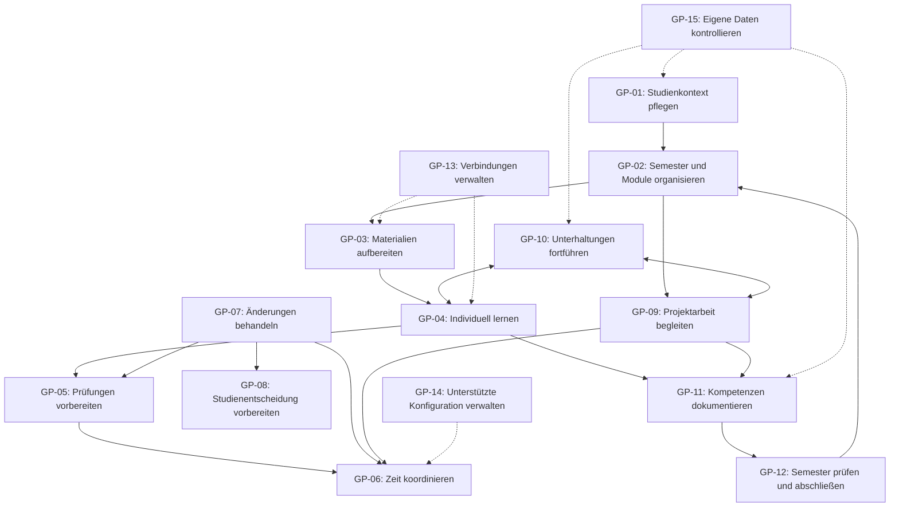
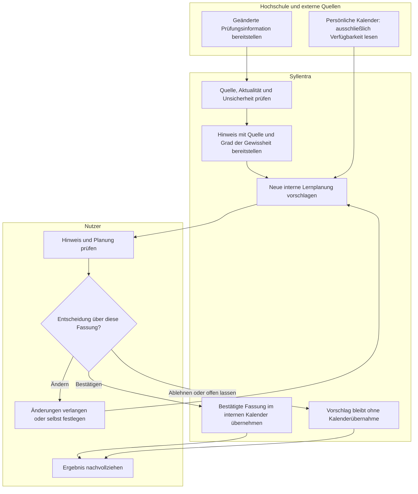

# F1 — Geschäftsprozesse

**Projekt:** Syllentra AI\
**Dokument:** F1 — Geschäftsprozesse\
**Version:** 0.8\
**Stand:** 26.10.2026\
**Status:** Zur Prüfung durch den Projektinhaber\
**Spezifikationsmethode:** Bausteine nach Johannes Siedersleben\
**Geltungsbereich:** Fachlicher Zielumfang der ersten Produktversion (V1), auf Grundlage der aktuellen P1-/P2-Fassungen im [Spezifikationsindex](README.md)

---

## F1.1 Zweck und fachliche Abgrenzung

Dieser Baustein beschreibt reale Studien-, Lern- und Verwaltungsprozesse vom fachlichen Anlass bis zum nachvollziehbaren Ergebnis. Die Prozesse bestehen auch ohne Syllentra: Studierende wählen Lernziele, bearbeiten Materialien, koordinieren Verpflichtungen, erbringen Leistungen und prüfen ihre Entwicklung. Syllentra unterstützt Teile dieser Abläufe; Hochschulen, Lehrende und externe Anbieter behalten ihre jeweiligen Zuständigkeiten.

Die Darstellung folgt der [methodischen F1-Referenz von Carsten Lucke](https://github.com/carstenlucke/herold/blob/main/docs/spec/F1-geschaeftsprozesse.md): zeitlich und logisch geordnete Aktivitäten, verantwortliche Akteure, weitergegebene Artefakte und Grenzen der Systemunterstützung. Herold-spezifische Technologien, Anbieter und Abläufe werden nicht übernommen.

F1 beschreibt keine Bildschirmfolge, API, interne Komponentenarchitektur oder Datenbankstruktur. F2 präzisiert später die systemunterstützten Anwendungsfälle, F3 die fachlichen Funktionen, D1/D2 die Daten und Beziehungen und B1 die Dialoge. Die Prozessbeschreibungen und ihre Varianten tragen die fachliche Aussage; die Diagramme veranschaulichen sie.

V1 unterstützt mehrere isolierte Studierende nach offener Registrierung und E-Mail-OTP. Ein persönliches Profil ist keine Berechtigungsrolle. Genau ein Super Admin verwaltet sekundäre Administratoren; die getrennte Administration verleiht keinen privaten Inhaltszugriff (FE-59 bis FE-72). Arbeitsbereiche für Semester, Module, Kurse und Projekte strukturieren die Arbeit, sind aber keine Voraussetzung für jede allgemeine Unterhaltung oder Lerneinheit.

Die sechs ausdrücklich bestätigten Entscheidungen sind in F1.6 unter FE-01 bis FE-06 dokumentiert. Ihr Bestätigungsstand ist von der noch ausstehenden Freigabe des gesamten Dokuments zu unterscheiden. Die folgenden Abläufe beschreiben den vorgesehenen Produktumfang, keine bereits implementierten Funktionen.

## F1.2 Akteure und Verantwortlichkeiten

| Akteur | Art | Fachliche Verantwortung |
|---|---|---|
| Lernender / persönlicher Nutzer | Mensch | Ziele und Anliegen bestimmen, Materialien rechtmäßig bereitstellen, lernen, Angaben prüfen, Vorschläge entscheiden und eigene Daten kontrollieren |
| Eigentümer / Administrator | Mensch mit gesonderten administrativen Rechten, ohne pauschalen Zugriff auf Lerninhalte | Unterstützte Konfigurationen, Integrationen, Berechtigungen, Gerätefreigaben, Aufbewahrung und Kostenrahmen verwalten |
| Syllentra einschließlich KI-Assistent | Unterstützendes System | Informationen aufbereiten, Zusammenhänge und Unsicherheiten darstellen, Lernaktivitäten begleiten, Vorschläge vorbereiten und ausschließlich erlaubte Handlungen ausführen |
| Lehrende, Prüfende und Beratungsstellen | Externe Menschen | Lehrinhalte und Feedback bereitstellen, Leistungen beurteilen und fachliche beziehungsweise organisatorische Auskünfte geben |
| Hochschule und ihre Studienverwaltung | Externe Institution und Systeme | Verbindliche Studienregeln, Modulangebote, Prüfungstermine, Noten, ECTS und amtliche Entscheidungen verantworten |
| Quellen- und Projektanbieter | Externe Menschen und Systeme | Rechtmäßig zugängliche Lernmaterialien, Informationen und ausdrücklich freigegebene Projektquellen bereitstellen |
| Persönliche Kalenderdienste und Gerätekalender | Externe Systeme | Verfügbarkeitsinformationen ausschließlich lesend bereitstellen; bleiben außerhalb der Syllentra-Schreibzuständigkeit |
| Zugelassene KI-, Werkzeug- und gegebenenfalls Speicherdienste | Externe Systeme | Nur die freigegebene Aufgabe mit zulässigen Daten, Nutzungslimits und Verarbeitungsbedingungen unterstützen |
| Geräteumgebung und Benachrichtigungsdienste | Unterstützende externe Systeme | Berechtigte Text- und Spracheingaben, Anzeige, erlaubte Benachrichtigungen und Nutzung auf autorisierten Geräten ermöglichen |

Die installierbaren Android-/iOS-Anwendungen und die Nutzung auf Computern sind Zugangsformen zum selben fachlichen Produkt. Ein Gerätewechsel begründet weder eine neue Benutzerrolle noch eine neue Freigabe für Datenübermittlung an Dritte. V1 verwendet eine installierbare PWA; Framework und spätere native Verteilung bleiben offen. Die zentrale EU-Cloud ist intern, externe Verbindungen bleiben optional. Externe Systeme entsprechen den Nachbarsystemkategorien NB-01 bis NB-12 in P2; der KI-Assistent ist keine unabhängige Instanz mit eigener Entscheidungsbefugnis.

## F1.3 Prozesslandkarte

Die Kennungen GP-01 bis GP-15 bezeichnen eigenständige Prozesse. Die Gruppen erleichtern die Orientierung; sie legen keine obligatorische Reihenfolge fest. Ein Prozess kann erneut, teilweise oder parallel zu anderen Prozessen durchgeführt werden.

| Kennung | Geschäftsprozess | Gruppe | Fachliches Ergebnis |
|---|---|---|---|
| GP-01 | Persönlichen Studienkontext pflegen | Grundlagen | Vom Nutzer gespeicherter oder bewusst unvollständiger Studienkontext mit nachvollziehbarer Herkunft |
| GP-02 | Semester und Module organisieren | Grundlagen | Geprüfte Semester-, Modul- und Kursstruktur mit aktuellen und früheren Bezügen |
| GP-03 | Lernmaterialien und Quellen aufbereiten | Grundlagen | Nutzbare, herkunftsbezogene Materialien mit validierter Zuordnung oder ausdrücklich offenem Vorschlag |
| GP-04 | Individuelle Lerneinheit durchführen | Lernen | Bearbeiteter Lernschritt mit Feedback, erkennbarem Kenntnisstand und möglicher Fortsetzung |
| GP-05 | Prüfungen vorbereiten und Leistungsstand überprüfen | Lernen | Geprüfter Vorbereitungsstand, Planungsvorschlag und getrennte Leistungsnachweise |
| GP-06 | Studium und verfügbare Zeit koordinieren | Organisation | Bewusst gespeicherte interne Studienplanung und nachvollziehbare Konflikte |
| GP-07 | Relevante Änderungen erkennen und behandeln | Organisation | Quellenbezogener Hinweis und vom Nutzer entschiedene Folgemaßnahmen |
| GP-08 | Studienentscheidung vorbereiten | Beratung | Nachvollziehbare Entscheidungsgrundlage und Entscheidung des Nutzers beziehungsweise der zuständigen Stelle |
| GP-09 | Projektarbeit organisieren und begleiten | Projektarbeit | Geordnete Projektarbeit mit Aufgaben, Ressourcen, Fortschritt und Ergebnissen |
| GP-10 | Unterhaltungen und Lernkontexte fortführen | Kontinuität | Auffindbarer und fortsetzbarer Gesprächsverlauf mit kontrollierbaren Kontextbezügen |
| GP-11 | Kompetenzen erkennen und dokumentieren | Kontinuität | Korrigierbare Kompetenzdokumentation mit Nachweisen oder kenntlicher vorläufiger Einschätzung |
| GP-12 | Semester abschließen und nächsten Abschnitt vorbereiten | Kontinuität | Geprüfte Semesterbilanz, bestätigte Archivierung abgeschlossener Elemente und aktive offene Arbeit |
| GP-13 | Geeignete KI- und Werkzeugverbindungen verwalten | Verwaltung | Geprüfte und autorisierte Verbindung oder nachvollziehbare Ablehnung, Deaktivierung beziehungsweise Widerruf |
| GP-14 | Oberfläche und Systemverhalten konfigurieren | Verwaltung | Gültige, geschützte und persistente Konfiguration oder kontrollierte Rücknahme |
| GP-15 | Persönliche Daten prüfen, exportieren oder löschen | Datenkontrolle | Korrigierte Daten, kontrollierter Export oder nachvollziehbarer Löschstatus im bestätigten Umfang |

Jede Kennung wird in F1.5 genau einmal ausführlich beschrieben. Wiederholungen in Tabellen und Diagrammen sind Verweise auf dieselben Prozesse.

## F1.4 Zusammenwirken und Abhängigkeiten

### F1.4.1 Fachliche Übergaben

| Zusammenhang | Übergebenes Ergebnis und Bedingung |
|---|---|
| GP-01 und GP-02 an GP-03 bis GP-09 | Verfügbare Ziele und Studienbezüge verbessern die Unterstützung; optionale Profilangaben dürfen den Einstieg nicht blockieren |
| GP-03 an GP-04, GP-05 und GP-09 | Rechtmäßig nutzbare Inhalte mit Herkunft; ein KI-Klassifizierungsvorschlag ist noch keine endgültige Dokumentzuordnung |
| GP-04 an GP-05 und GP-11 | Antworten, Feedback und nachvollziehbare Lernaktivitäten; Bearbeitung allein beweist keine Kompetenz |
| GP-05 und GP-09 an GP-06 | Prüfungstermine, Vorbereitungsbedarf, Aufgaben und Fristen für einen Planungsvorschlag |
| GP-07 an GP-02, GP-05, GP-06 oder GP-08 | Geprüfter Änderungshinweis; notwendige Folgeschritte werden nicht ohne ihre jeweilige Validierung ausgeführt |
| GP-10 mit GP-03, GP-04, GP-08 und GP-09 | Verfügbarer Gesprächskontext und relevante autorisierte Ressourcen; keine automatische Freigabe neuer Quellen |
| GP-11 an GP-01, GP-04 und GP-12 | Kompetenzeinträge und Einschätzungen mit Herkunft, Prüfstand und Nachweisen |
| GP-12 an GP-02 und GP-06 | Semesterbilanz und offene Arbeit für den nächsten Abschnitt; nur bestätigte abgeschlossene Elemente werden archiviert |
| GP-13 und GP-14 zu allen unterstützten Abläufen | Zulässige Verbindungen und unterstützte Einstellungen; nur tatsächlich benötigte Rechte und freigegebene Kosten |
| GP-15 zu allen betroffenen Abläufen | Korrigierter Datenstand, entzogene Freigaben oder Löschfolgen; nachfolgende Unterstützung berücksichtigt fehlende Daten |

### F1.4.2 Übersicht der Prozessbeziehungen

Pfeile zeigen mögliche fachliche Übergaben, keine zwingende Ablaufkette, vollständige Funktionsabhängigkeit oder technischen Aufruf. Gestrichelte Beziehungen markieren beispielhaft übergreifende Unterstützung und Kontrolle. Allgemeine Gespräche, unabhängige Projekte und Lerneinheiten mit unmittelbar bereitgestellten Materialien bleiben ohne vollständig gepflegte Semesterstruktur möglich. Validierung und Ablehnung sind in den Prozessbeschreibungen enthalten und werden durch keinen Pfeil ersetzt.

## F1.5 Beschreibung der Geschäftsprozesse

Für jeden Prozess benennt die Spalte „Verantwortung“ die jeweils verantwortliche Person oder das unterstützende System. Externe Mitwirkung ist als eigener Schritt oder ausdrücklich bedingte Variante beschrieben. Kein Prozess setzt voraus, dass jeder mögliche Drittanbieter bereits angebunden ist. „Beendet“ bedeutet, dass der aktuelle fachliche Vorgang einen ausgewiesenen Abschluss, eine bewusste Unterbrechung oder ein abgelehntes Ergebnis erreicht hat; es bedeutet nicht, dass sämtliche Studienziele bereits erreicht sind.

### F1.5.1 GP-01 — Persönlichen Studienkontext pflegen

**Auslöser:** Erste Nutzung, geänderte Studiensituation oder Wunsch nach Korrektur persönlicher Angaben.\
**Ende:** Ausgewählte Angaben sind bewusst gespeichert; ausgelassene Angaben bleiben offen. Bei Abbruch bleiben unbestätigte Änderungen unübernommen.\
**Akteure:** Nutzer, Syllentra; bei einem autorisierten Import Hochschule oder Nachweisanbieter.\
**Artefakte:** Profil, Foto oder Avatar, Sprachen, Hochschule, Studiengang, Abschluss, Semesterbezüge, Noten und ECTS, Ziele, Kompetenzen, Zertifikate, Projekte, Erfahrungen und Lernpräferenzen mit Herkunft und Bestätigungsstand.

Der Lernende bestimmt selbst, welche relevanten persönlichen Angaben er bereitstellt. Profilpflege ist keine Ausübung administrativer Rechte über fremde Daten.

| Schritt | Verantwortung | Aktivität |
|---|---|---|
| 1 | Nutzer | Eigenen Studienkontext und gewünschten Unterstützungsbedarf bestimmen; bei erster Nutzung die optionale geführte Einrichtung beginnen oder überspringen |
| 2 | Syllentra | Bereits verfügbare Angaben und optionale Ergänzungen erklären; fehlende freiwillige Felder nicht als Zugangssperre behandeln |
| 3 | Nutzer; extern gegebenenfalls Hochschule | Angaben manuell bereitstellen oder einen zulässigen Import autorisieren; externe Stelle liefert vorhandene Nachweise |
| 4 | Syllentra | Eingaben beziehungsweise importierte Angaben mit Herkunft, Unsicherheiten und getrenntem Bestätigungsstand aufbereiten |
| 5 | Nutzer | Angaben prüfen, korrigieren und manuell speichern beziehungsweise Import bestätigen; Schritte auch einzeln auslassen |
| 6 | Syllentra | Gespeicherten Kontext für erlaubte Zwecke verfügbar halten; Nutzer kann direkt lernen und das Profil später ergänzen |

**Varianten und Grenzen:** FE-01 gilt auch bei einem völlig unvollständigen optionalen Profil. Eine fehlende für eine konkrete Funktion notwendige Quelle oder Berechtigung wird nur für diese Funktion erklärt. Manuelle Angaben oder KI-Schätzungen werden nicht zu amtlichen Leistungen erklärt. Persönliche Werte sind geschützte veränderbare Daten, niemals fest im Code oder im öffentlichen Repository hinterlegt. Allgemeine Datenkontrolle erfolgt in GP-15.

### F1.5.2 GP-02 — Semester und Module organisieren

**Auslöser:** Beginn eines Studienabschnitts, Modulwahl, neuer Kurs oder notwendige Korrektur der Studienübersicht.\
**Ende:** Gewählte Semester-, Modul- und Kursbezüge sind gespeichert oder ein Import ist ausdrücklich verworfen beziehungsweise zur Prüfung offen.\
**Akteure:** Nutzer, Syllentra; Hochschule und Lehrende als Verantwortliche für Angebote und offizielle Angaben.\
**Artefakte:** Aktuelle und frühere Semester, Modul- und Kursbeschreibungen, Lernziele, Kapitel, Themen, Übungen, Bewertungen, Studienleistungen, Termine und zugeordnete Ressourcen.

Die akademische Struktur soll den tatsächlichen Studienverlauf abbilden, einschließlich überlappender Prüfungszeiträume und wiederholter Lehrveranstaltungen.

| Schritt | Verantwortung | Aktivität |
|---|---|---|
| 1 | Nutzer | Relevanten Studienabschnitt, Module und Kurse auswählen oder Änderungen benennen |
| 2 | Hochschule / Lehrende | Offizielle Modulbeschreibungen, Kursinformationen und Studienregeln bereitstellen, soweit verfügbar |
| 3 | Nutzer | Angaben manuell erfassen oder zulässige Hochschulunterlagen zur Übernahme bereitstellen |
| 4 | Syllentra | Zusammenhänge, Herkunft, fehlende Angaben sowie mögliche Dubletten und widersprüchliche Zuordnungen darstellen |
| 5 | Nutzer | Manuelle Eingaben bewusst speichern; bei Imports die vorgeschlagenen Angaben und Zuordnungen prüfen, ändern und bestätigen oder ablehnen |
| 6 | Syllentra | Gewählte Struktur mit Materialien, Gesprächen, Projekten und Terminen nutzbar machen; frühere Semester und offene Leistungen erhalten |

**Varianten und Grenzen:** Ohne direkten Hochschulzugang bleibt die manuelle Pflege möglich. Noten und ECTS führen Herkunft und Nachweise getrennt von KI-Wissenseinschätzungen. Die Entfernung einer Zuordnung löscht keine gemeinsam genutzten Inhalte. Ein Semesterwechsel archiviert nichts automatisch; GP-12 entscheidet über tatsächlich abgeschlossene Arbeit.

**Ergänzung L-09:** Der Nutzer stellt zulässige Modulhandbücher, Prüfungsordnungen und Verlaufspläne bereit. Syllentra prüft deren Geltung für Hochschule, Studiengang, Ordnung, Kohorte und Übergangsregeln; unbekannte Geltung bleibt offen. Extraktion und Zuordnung werden als prüfbare Vorschläge behandelt. UC-66 vergleicht anschließend die bestätigte Grundlage mit vorhandener Studienstruktur und Nachweisen, ohne amtliche Anerkennung oder pauschale Korrektur eigener Daten.

### F1.5.3 GP-03 — Lernmaterialien und Quellen aufbereiten

**Auslöser:** Ein Lernanlass, neu erhaltenes Material oder eine zu überprüfende fachliche Quelle.\
**Ende:** Verarbeitbare Inhalte und Quellenhinweise stehen im erlaubten Umfang bereit; endgültige Zuordnungen sind vom Nutzer validiert oder bleiben ausdrücklich offen.\
**Akteure:** Nutzer, Syllentra, Lehrende und Quellenanbieter; gegebenenfalls zugelassener Verarbeitungsdienst.\
**Artefakte:** Dokumente, Folien, Notizen, Aufgaben, rechtmäßige Aufzeichnungen, Transkripte, extrahierte Inhalte, Quellenhinweise und Klassifizierungsvorschläge.

Der fachliche Vorgang beginnt mit der Beschaffung rechtmäßig nutzbarer Materialien, nicht erst mit einer Dateiübertragung.

| Schritt | Verantwortung | Aktivität |
|---|---|---|
| 1 | Nutzer; Lehrende / Quellenanbieter | Lernanlass bestimmen und nutzungsberechtigte Unterlagen beziehungsweise Quellen bereitstellen |
| 2 | Nutzer | Materialien auswählen, Verarbeitungszweck und zulässigen Umfang festlegen |
| 3 | Syllentra; gegebenenfalls zugelassener Dienst | Inhalte im freigegebenen Umfang analysieren, zusammenfassen oder transkribieren; Herkunft und Verarbeitungsgrenzen kenntlich machen |
| 4 | Syllentra | Eine Zuordnung zu Kurs, Modul, Projekt oder Thema mit Begründung vorschlagen; sie als vorläufig kennzeichnen |
| 5 | Nutzer | Vorgeschlagene Zuordnung prüfen, korrigieren, bestätigen oder ablehnen beziehungsweise Prüfung auf später verschieben |
| 6 | Syllentra | Nur die validierte Auswahl als endgültige Klassifizierung übernehmen; Inhalte und Quellenbezüge für erlaubte Folgearbeit verfügbar halten |

**Varianten und Grenzen:** FE-02 gilt auch für Material, das aus einem bereits bestehenden Arbeitsbereich bereitgestellt wird: Eine von der KI vorgeschlagene endgültige Dokumentklassifizierung benötigt Validierung. Eine ausdrücklich manuell gewählte Zuordnung ist bereits eine bewusste Nutzerentscheidung. Bis zur Entscheidung bleibt der Vorschlag vorläufig; die erlaubte Analyse und eine allgemeine Lerneinheit können dennoch stattfinden. Unlesbare Teile, widersprüchliche Quellen und fehlende Nutzungsrechte werden ausgewiesen. Temporäre Verarbeitungskopien sind von bewusst aufbewahrten Originalen getrennt; GP-15 regelt Löschfolgen. FE-04 über Gesprächskontext ersetzt diese Dokumentvalidierung nicht.

### F1.5.4 GP-04 — Individuelle Lerneinheit durchführen

**Auslöser:** Der Nutzer möchte einen Inhalt verstehen, wiederholen oder auf eine Aufgabe anwenden; alternativ nimmt er eine vorbereitete Lernmaßnahme an.\
**Ende:** Der bearbeitete Lernschritt, das Feedback und gegebenenfalls die offene Fortsetzung sind nachvollziehbar; eine Unterbrechung wird nicht als Kompetenznachweis ausgegeben.\
**Akteure:** Nutzer, Syllentra; gegebenenfalls zugelassener KI- oder Mediendienst.\
**Artefakte:** Lernziel, relevante Materialien, Gesprächsverlauf, Erklärungen, Übungen, Antworten, Feedback und getrennte Fortschritts- beziehungsweise Wissenseinschätzungen.

Der Lernende arbeitet selbst: Er formuliert Fragen, versucht Lösungen und erklärt Zusammenhänge. Der Assistent ergänzt diese Tätigkeit durch adaptive Unterstützung.

| Schritt | Verantwortung | Aktivität |
|---|---|---|
| 1 | Nutzer | Lernziel, Thema und gewünschte Arbeitsweise wählen; Zusammenfassung optional nutzen oder überspringen |
| 2 | Syllentra | Verfügbares Vorwissen, freigegebenen Gesprächskontext, Schwierigkeiten und relevante autorisierte Quellen berücksichtigen |
| 3 | Syllentra; gegebenenfalls zugelassener Dienst | Inhalte als Überblick, seitenweise, thematisch oder schrittweise erklären; Quellen und Unsicherheiten unterscheiden |
| 4 | Nutzer | Fachlich mitarbeiten, eigene Lösungsversuche oder Erklärungen geben und Verständnis beziehungsweise Schwierigkeiten rückmelden |
| 5 | Syllentra | Zeitpunkt, Häufigkeit und Schwierigkeit von Verständnisfragen und Übungen an Kenntnisstand, Antworten, Schwierigkeiten und Ziele anpassen; Feedback geben und Strategie bei Bedarf ändern |
| 6 | Nutzer und Syllentra | Bearbeiteten Schritt reflektieren; Nutzer entscheidet über Fortsetzung oder Pause, Syllentra hält erlaubte Ergebnisse und offene Lernbedarfe nachvollziehbar fest |

**Varianten und Grenzen:** FE-03 schließt eine mechanische Frage nach jeder Erklärung aus. Text und verfügbare Sprachformen können unter Erhalt des verfügbaren Kontexts gewechselt werden; ohne Mikrofonfreigabe bleibt Text nutzbar. Nicht verfügbare Kontextteile werden benannt. Geeignete zusätzliche Audio- und Videoinhalte können unterstützen, ersetzen aber keine fachliche Überprüfung. Aufgabenwahl erfolgt nur innerhalb freigegebener Dienste und Kosten; aktive Mitarbeit, Kapitelbearbeitung und offiziell nachgewiesene Kompetenz bleiben getrennt.

**Ergänzung L-08/L-02:** Wiederholte Schwierigkeiten, vorhandene Antworten und aktuelle Evidenz können zu alternativen Erklärungen und Übungen führen. Nur ausdrücklich aktivierte persönliche Lernheftautomatik ordnet die pädagogische Reihenfolge um, mit Grund, Revisionsverlauf und sicherer Rücknahme. Verpasste Wiederholung ist kein falscher Lösungsversuch. Der Nutzer kann einen ablenkungsarmen Modus freiwillig einschalten und jederzeit verlassen; Lernartefakte bleiben erhalten und Fortschrittsarten getrennt. UC-23 bis UC-29 und AF-09/AF-12 konkretisieren diesen Ablauf.

### F1.5.5 GP-05 — Prüfungen vorbereiten und Leistungsstand überprüfen

**Auslöser:** Anstehende Prüfung, festgestellte Wissenslücke oder Wunsch nach einer überprüfbaren Einschätzung des Vorbereitungsstands.\
**Ende:** Der Lernende hat einen nachvollziehbaren Vorbereitungsstand und eine entschiedene nächste Maßnahme; offizielle Ergebnisse werden nur mit ihrer tatsächlichen Herkunft dokumentiert.\
**Akteure:** Nutzer, Syllentra, Lehrende / Prüfende und Hochschule.\
**Artefakte:** Prüfungstermin, relevante Themen, Lernziele, verfügbare Nachweise, Übungsantworten, Prüfungssimulation, Feedback und Vorbereitungsvorschlag.

Prüfungsvorbereitung ist von der tatsächlichen Leistungserbringung und amtlichen Bewertung zu unterscheiden. Syllentra kann weder Prüfungsergebnisse garantieren noch Hochschulentscheidungen ersetzen.

| Schritt | Verantwortung | Aktivität |
|---|---|---|
| 1 | Hochschule / Lehrende; Nutzer | Verfügbare Prüfungstermine, Anforderungen und rechtmäßig nutzbare Prüfungsaufgaben bereitstellen beziehungsweise auswählen |
| 2 | Syllentra | Quellenstand, relevante Themen, verbleibende Zeit und bisherige Lernnachweise zusammenführen; Unsicherheiten anzeigen |
| 3 | Nutzer | Fragen, Übungen, eigenständige Erklärungen oder eine geeignete Prüfungssimulation bearbeiten |
| 4 | Syllentra | Antworten fachlich rückmelden, bekannte Lücken priorisieren und einen auf verfügbaren Nachweisen beruhenden Vorbereitungsstand darstellen |
| 5 | Syllentra und Nutzer | Assistent bereitet Maßnahmen für gegebenenfalls mehrere Prüfungen vor; Nutzer entscheidet über Ziele und weitere Arbeit, Kalenderübernahme folgt GP-06 |
| 6 | Nutzer; extern Prüfende / Hochschule | Weiterlernen oder die tatsächliche Prüfung außerhalb von Syllentra ablegen; später erhaltene offizielle Ergebnisse als gesonderten Nachweis zur Studienübersicht beitragen |

**Varianten und Grenzen:** Ein Durchlauf kann vor der tatsächlichen Prüfung mit einer geprüften Vorbereitungsempfehlung enden. Wiederholungsprüfungen und außerhalb der Vorlesungszeit liegende Termine bleiben relevant. Vorläufiger Kenntnisstand, Bearbeitungsfortschritt, amtliche Note und ECTS werden niemals gleichgesetzt. Ein geänderter Termin wird nach GP-07 behandelt; bestehende interne Lernzeiten werden nicht ohne Bestätigung umgeplant.

### F1.5.6 GP-06 — Studium und verfügbare Zeit koordinieren

**Auslöser:** Neue Lehrveranstaltung, Prüfung, Abgabe, Projektaufgabe, veränderte Verfügbarkeit oder Wunsch nach Revision der Lernplanung.\
**Ende:** Bewusst gespeicherter interner Plan oder abgelehnter beziehungsweise offener Vorschlag; bekannte Konflikte und Quellenstände bleiben erkennbar.\
**Akteure:** Nutzer, Syllentra, Hochschule / Lehrende sowie persönliche Online- und Gerätekalender.\
**Artefakte:** Interner Studienkalender, Stundenplan, Prüfungen, Fristen, Lernbedarf, Aufgaben und minimierte freie beziehungsweise belegte Zeiträume.

Die Koordination verbindet akademische Verpflichtungen mit tatsächlicher persönlicher Verfügbarkeit. Der Nutzer bleibt für die gewählten Prioritäten verantwortlich.

| Schritt | Verantwortung | Aktivität |
|---|---|---|
| 1 | Nutzer; Hochschule / Lehrende | Verpflichtungen, relevante Stundenpläne, Prüfungen und Fristen bereitstellen und Planungsziele bestimmen |
| 2 | Nutzer | Verfügbarkeiten manuell angeben oder einen streng lesenden Zugriff auf persönliche Kalender erlauben |
| 3 | Externe Kalender; Syllentra | Freie und belegte Zeiten im genehmigten Umfang bereitstellen beziehungsweise auswerten; private Inhalte minimieren, Herkunft, Zeitzonen und doppelte Bezüge berücksichtigen |
| 4 | Syllentra | Lern-, Wiederholungs- und Arbeitszeiten vorschlagen oder Importdaten aufbereiten; Überschneidungen und Unsicherheiten zeigen |
| 5 | Nutzer | Vorschlag oder Import prüfen, ändern, bestätigen oder ablehnen; alternativ eigene Termine direkt manuell speichern |
| 6 | Syllentra | Bestätigte Vorschläge beziehungsweise bewusste manuelle Eingaben ausschließlich im internen Studienkalender übernehmen und auf autorisierten Geräten verfügbar machen |

**Varianten und Grenzen:** Die direkte manuelle Speicherung benötigt keine zweite künstliche Bestätigung. Imports und KI-Vorschläge benötigen dagegen Bestätigung vor Speicherung; ein geänderter Vorschlag muss in seiner tatsächlich übernommenen Fassung bestätigt sein. Externe persönliche Kalender sind ausnahmslos nur lesbar, auch nach Zustimmung. Fehlender Kalenderzugriff erlaubt manuelle Verfügbarkeitsangaben. Wiederholte Imports dürfen keine unbemerkten Dubletten oder Überschreibungen erzeugen; Synchronisationskonflikte bleiben sichtbar.

**Ergänzung L-08/L-04:** Pädagogische Priorisierung ist von Terminplanung getrennt. Manuelle Fixierungen und bestätigte Kalendertermine bleiben ohne erforderliche Zustimmung unverändert; ein Vorschlag aus UC-35/UC-37 ist keine aktive Verschiebung. Über UC-65 pflegt der Nutzer Ereignispunkte, globale/Kategorieregeln, Ruhezeiten und Kanalwahl. Die konfigurierbare Ausgangsruhezeit ist 22:00–08:00; interne Hinweise bleiben zugänglich, fehlendes Pushrecht erteilt kein E-Mail-Recht. M5/M8 sind im begrenzten Entwicklungsplan getrennt.

### F1.5.7 GP-07 — Relevante Änderungen erkennen und behandeln

**Auslöser:** Vorgesehene erneute Quellenprüfung, neue Mitteilung oder vom Nutzer bemerkte Änderung.\
**Ende:** Änderung ist nachvollziehbar mitgeteilt und eine Folgemaßnahme angenommen, angepasst, abgelehnt oder bewusst offen gelassen.\
**Akteure:** Nutzer, Syllentra, Hochschule / Lehrende, autorisierte Informations- oder E-Mail-Dienste und erlaubte Benachrichtigungsdienste.\
**Artefakte:** Quelleninformation, Aktualisierungsstand, Änderungshinweis, Unsicherheitskennzeichnung und Vorschlag für Lern-, Studien- oder Terminmaßnahmen.

Ein neuer Hinweis ist noch keine Freigabe, bestehende Planungen zu verändern. Fachliche Auswirkungen müssen vor einer Übernahme verstanden werden können.

| Schritt | Verantwortung | Aktivität |
|---|---|---|
| 1 | Externe Verantwortliche oder Nutzer | Neue Information, geänderten Termin oder widersprüchliche Mitteilung bereitstellen |
| 2 | Syllentra | Zulässige aktuelle Quelle mit bekanntem Stand vergleichen; fehlgeschlagene Abrufe und Widersprüche kenntlich machen |
| 3 | Syllentra; gegebenenfalls Benachrichtigungsdienst | Relevante Änderung mit Quelle, Aktualität und Grad der Gewissheit mitteilen; Hinweis innerhalb der Anwendung auffindbar halten |
| 4 | Syllentra | Auswirkungen auf Prüfungen, Lernzeiten, Abgaben oder Entscheidungen erklären und geeignete Folgemaßnahmen vorbereiten |
| 5 | Nutzer; gegebenenfalls zuständige Hochschule | Quelle und Bedeutung prüfen; bei ungeklärtem Widerspruch zuständige Stelle um Klärung bitten, Planvorschlag validieren, verändern oder ablehnen |
| 6 | Syllentra | Nur bestätigte interne Planänderungen nach GP-06 übernehmen; Entscheidung beziehungsweise offene Klärung nachvollziehbar festhalten |

**Varianten und Grenzen:** FE-05 gilt insbesondere für Prüfungsverschiebungen. Hinweise dürfen schon vor einer Planfreigabe erscheinen; vorgeschlagene Terminänderungen bleiben bis zur Bestätigung unübernommen. Eine spätere Quellenänderung erfordert eine erneute Prüfung der betroffenen Vorschlagsfassung. Externe Kalender bleiben unverändert. Hintergrundprüfungen und Benachrichtigungen hängen von erlaubten Quellen, Betrieb und Gerätefreigaben ab; fehlende Zustellung ist keine Aussage über unveränderte Quellen. Ein Dateninhalt darf niemals Berechtigungs- oder Kostenregeln ersetzen.

### F1.5.8 GP-08 — Studienentscheidung vorbereiten

**Auslöser:** Frage zur Modulwahl, Studienplanung, einem Studienproblem oder akademischen beziehungsweise beruflichen Entwicklungsmöglichkeiten.\
**Ende:** Eine nachvollziehbare Entscheidungsgrundlage liegt vor; der Nutzer entscheidet oder die notwendige Entscheidung einer zuständigen Stelle bleibt als ausstehend ausgewiesen.\
**Akteure:** Nutzer, Syllentra, Lehrende, Beratungsstellen und Hochschule.\
**Artefakte:** Anliegen, relevante Studienregeln, Quellen, Optionen, Empfehlung, gegebenenfalls Nachrichtenentwurf und Antwort der zuständigen Stelle.

Beratung stärkt die eigene Entscheidungsfähigkeit. Sie darf keine verbindliche Anerkennung oder Verwaltungsentscheidung der Hochschule vortäuschen.

| Schritt | Verantwortung | Aktivität |
|---|---|---|
| 1 | Nutzer | Anliegen, eigene Ziele und relevante Einschränkungen formulieren |
| 2 | Syllentra | Verfügbare Profil-, Studien- und Kompetenzinformationen sowie zulässige offizielle Quellen berücksichtigen |
| 3 | Syllentra | Handlungsoptionen, Gründe, mögliche Folgen und Unsicherheiten erläutern; gegebenenfalls zuständige Beratungsstelle benennen |
| 4 | Nutzer | Optionen abwägen und selbst entscheiden oder eine erforderliche institutionelle Klärung wählen |
| 5 | Nutzer; optional Syllentra | Kontakt eigenständig herstellen oder einen vorbereiteten Entwurf mit Empfänger und Inhalt ausdrücklich zum Versand freigeben, sofern eine zulässige Integration besteht |
| 6 | Externe zuständige Stelle; Nutzer | Fachliche Auskunft oder amtliche Entscheidung geben; Nutzer prüft die Antwort und übernimmt gewählte Konsequenzen in seine Studienarbeit |

**Varianten und Grenzen:** Ohne Versandintegration kann der Nutzer einen Entwurf manuell verwenden. Bis zur externen Antwort bleibt das Ergebnis ausdrücklich offen. Nachrichtenversand oder verbindliche Hochschulvorgänge benötigen gesonderte Freigabe; eine allgemeine Beratung autorisiert sie nicht. Eine Terminvereinbarung erlaubt niemals Änderungen persönlicher externer Kalender. Gebührenpflichtige Optionen benötigen die entsprechende Kostenautorisierung.

### F1.5.9 GP-09 — Projektarbeit organisieren und begleiten

**Auslöser:** Eigene Projektidee, akademische Aufgabenstellung, berufliches Vorhaben oder Änderungsbedarf in laufender Projektarbeit.\
**Ende:** Der aktuelle Projektabschnitt ist organisiert, bearbeitet und mit Fortschritt oder offenem Bedarf dokumentiert; das Gesamtprojekt kann weiter aktiv bleiben.\
**Akteure:** Nutzer, Syllentra; gegebenenfalls Lehrende, Projektbeteiligte und ausdrücklich freigegebene Projektquellen.\
**Artefakte:** Projektbeschreibung und Ziele, Ressourcen und Dateien, zugehörige Unterhaltungen, Aufgaben, Fristen, Fortschritt, Ergebnisse, Kompetenznachweise und erlaubte Repository-Bezüge.

Persönliche, akademische und berufliche Projekte können eigenständig bestehen, mehreren Modulen zugeordnet sein und Semestergrenzen überschreiten. Externe Beteiligte erhalten dadurch keine V1-Konten oder automatischen Zugriffsrechte.

| Schritt | Verantwortung | Aktivität |
|---|---|---|
| 1 | Nutzer; gegebenenfalls externe Auftraggebende / Lehrende | Projektanlass, Ziele und gegebenenfalls äußere Anforderungen bestimmen |
| 2 | Nutzer | Projekt manuell anlegen oder überarbeiten; eigenständigen oder modulübergreifenden Kontext festlegen |
| 3 | Nutzer und Syllentra | Nutzer wählt rechtmäßige Ressourcen und ausdrücklich erlaubte Repositories; Syllentra bereitet Inhalte und Dokumentklassifizierung nach GP-03 vor |
| 4 | Syllentra und Nutzer | Assistent schlägt Aufgaben und Fristen vor; Nutzer legt die tatsächliche Arbeit fest, Kalenderübernahme folgt GP-06 |
| 5 | Nutzer; gegebenenfalls externe Beteiligte | Projektaufgaben selbst bearbeiten, Beiträge abstimmen und Ergebnisse beziehungsweise Rückmeldungen bereitstellen |
| 6 | Syllentra und Nutzer | Ergebnisse und Fortschritt nachvollziehbar zuordnen; Nutzer prüft nächste Schritte, geeignete Nachweise gehen in GP-11 ein |

**Varianten und Grenzen:** Gespräche aus dem Projekt erhalten den vorhersehbaren Kontext nach FE-04. GitHub-Analyse bleibt lesend und auf ausdrücklich ausgewählte Repositories begrenzt; keine automatische Schreibfreigabe. Eigene, fremde und KI-generierte Beiträge werden soweit belegbar unterschieden. Das Entfernen eines Modulbezugs löscht nicht das Projekt oder gemeinsam genutzte Ressourcen. Ein offenes Projekt bleibt nach Semesterende aktiv.

### F1.5.10 GP-10 — Unterhaltungen und Lernkontexte fortführen

**Auslöser:** Neue Frage, Fortsetzung einer früheren Diskussion, Wechsel zwischen Text und Sprache oder Wechsel auf ein autorisiertes Gerät.\
**Ende:** Gewählte Unterhaltung ist angelegt beziehungsweise fortgesetzt, auffindbar und mit kontrollierbarer Zuordnung gespeichert; fehlender Kontext ist kenntlich.\
**Akteure:** Nutzer, Syllentra; berechtigte Geräteumgebung und gegebenenfalls zugelassener Kommunikationsdienst.\
**Artefakte:** Persistenter Nachrichtenverlauf, Titel, Thema, Zeitbezüge, Zuordnungen, Archivstatus und verfügbare fachliche Kontextinformationen.

Eine Unterhaltung dient dem fachlichen Austausch. Ihr Verlauf dokumentiert Nachrichten; die langfristige pädagogische Erinnerung enthält davon getrennte, zweckgebundene Erkenntnisse.

| Schritt | Verantwortung | Aktivität |
|---|---|---|
| 1 | Nutzer | Allgemeine Unterhaltung beginnen, aus einem Kurs oder Projekt starten oder eine gespeicherte Diskussion auswählen |
| 2 | Syllentra | Bei Start aus Kurs oder Projekt den entsprechenden Kontext automatisch zuordnen und sichtbar machen; eine allgemeine Diskussion darf ohne Zuordnung bleiben |
| 3 | Syllentra und Nutzer | Verfügbaren Verlauf sowie ausschließlich relevante autorisierte Ressourcen berücksichtigen; Nutzer kann die Zuordnung sehen, korrigieren, entfernen oder in einen anderen Kontext verschieben |
| 4 | Nutzer und Syllentra | Gespräch führen und gegebenenfalls Text, Sprache oder autorisiertes Gerät wechseln; verfügbare Zusammenhänge erhalten, fehlende Teile offenlegen |
| 5 | Nutzer | Diskussion umbenennen, suchen, sortieren, organisieren oder archivieren; gegebenenfalls eine Löschung mit gewähltem Umfang anfordern |
| 6 | Syllentra | Gewählten Verlauf und Zuordnungen im erlaubten Umfang verfügbar halten; bestätigte Löschung nach GP-15 behandeln, Erinnerung nicht unbemerkt mitverändern |

**Varianten und Grenzen:** FE-04 verlangt keinen zusätzlichen Bestätigungsdialog für die vorhersehbare anfängliche Gesprächszuordnung. Sie autorisiert keine neue Datenquelle und bestätigt keine KI-Dokumentklassifizierung nach FE-02. Verschieben einer Zuordnung schreibt historische Nachrichten nicht um und überträgt keine ungeprüften Informationen an neue Anbieter. Archivierte Gespräche bleiben auffindbar; Archivierung ist keine Löschung. Gerätesynchronisation darf weder veraltete Stände still überschreiben noch nicht autorisierten Geräten Zugriff geben.

### F1.5.11 GP-11 — Kompetenzen erkennen und dokumentieren

**Auslöser:** Neuer Leistungsnachweis, beendete Lern- oder Projektaktivität, vorhandene außerhochschulische Erfahrung oder notwendige Korrektur einer Bewertung.\
**Ende:** Kompetenzbezug ist mit Herkunft und Prüfstand dokumentiert beziehungsweise korrigiert; ungeklärte Einschätzungen bleiben erkennbar vorläufig.\
**Akteure:** Nutzer, Syllentra, Prüfende / Hochschule sowie gegebenenfalls Zertifikats- oder Projektverantwortliche.\
**Artefakte:** Aufgabenlösungen, Prüfungsnachweise, Projekte, Zertifikate, Erfahrungen, Kompetenzeinträge, Einschätzungen und semesterbezogene Entwicklungsübersicht.

Kompetenzdokumentation berücksichtigt akademische, technische, sprachliche und persönliche Fähigkeiten. Sie soll nachvollziehbare Entwicklung zeigen, ohne Aktivität mit Beherrschung gleichzusetzen.

| Schritt | Verantwortung | Aktivität |
|---|---|---|
| 1 | Nutzer oder externe nachweisgebende Stelle | Vorhandene Erfahrung, Aufgabe, Leistung oder Zertifikat bereitstellen |
| 2 | Syllentra | Relevante Tätigkeit und Nachweise mit Studien-, Projekt- oder Lernkontext verbinden |
| 3 | Syllentra | Neue Kompetenzen oder Entwicklung einschätzen; Begründung, Herkunft und Grenzen des Nachweises ausweisen |
| 4 | Nutzer; gegebenenfalls externe Stelle | Eintrag prüfen und korrigieren beziehungsweise einen zusätzlichen tatsächlichen Nachweis bereitstellen |
| 5 | Syllentra | Kompetenzportfolio aktualisieren; KI-Einschätzung, persönliche Bestätigung und offizieller Leistungsnachweis getrennt kennzeichnen |
| 6 | Nutzer und Syllentra | Entwicklung reflektieren und dokumentierte Kenntnisse für künftige Lernziele oder die Semesterbilanz berücksichtigen |

**Varianten und Grenzen:** Automatisch erkannte Fortschritte dürfen innerhalb der freigegebenen Erinnerung als begründete vorläufige Einträge festgehalten werden; eine amtliche Bestätigung wird nicht erfunden. Gute Note, ECTS, Lesen eines Kapitels oder bloße Teilnahme beweisen nicht die vollständige Beherrschung aller Inhalte. Veraltete Einschätzungen bleiben korrigierbar; exakte Quellen und eigene beziehungsweise fremde Projektbeiträge sind soweit verfügbar identifizierbar. Der Nutzer kontrolliert Aufbewahrung und Löschung nach GP-15.

### F1.5.12 GP-12 — Semester abschließen und nächsten Abschnitt vorbereiten

**Auslöser:** Wunsch des Nutzers nach Semesterbilanz oder nahendes beziehungsweise erreichtes Ende eines Studienabschnitts als Anlass für eine Prüfung.\
**Ende:** Nutzer hat Bilanz und Übergang geprüft; ausschließlich ausgewählte tatsächlich abgeschlossene Elemente sind bestätigt archiviert, offene Arbeit bleibt aktiv.\
**Akteure:** Nutzer, Syllentra; Hochschule / Prüfende als Quellen noch ausstehender Leistungen und Termine.\
**Artefakte:** Semesterbilanz, Fortschritt, Leistungen, Kompetenzentwicklung, Liste abgeschlossener und offener Arbeit sowie Vorschlag für den nächsten Abschnitt.

Ein kalenderseitiges Semesterende bedeutet keinen fachlichen Abschluss aller zugehörigen Tätigkeiten. Die Bilanz betrachtet tatsächlich erledigte Arbeit und noch bestehende Verpflichtungen.

| Schritt | Verantwortung | Aktivität |
|---|---|---|
| 1 | Nutzer | Bilanz anstoßen oder einen entsprechenden Hinweis zum Semesterende aufgreifen |
| 2 | Hochschule / Prüfende; Syllentra | Verfügbare offizielle Ergebnisse und aktuelle Termine liefern beziehungsweise mit Studien- und Projektständen zusammenführen |
| 3 | Syllentra | Leistungen und Kompetenzen darstellen; noch aktive Kurse, offene Prüfungen, Wiederholungsprüfungen, Abgaben und Projekte gesondert ausweisen |
| 4 | Syllentra | Archivierung ausschließlich tatsächlich abgeschlossener Elemente vorschlagen; offene oder unklare Elemente nicht als erledigt behandeln |
| 5 | Nutzer | Vorschlag prüfen, korrigieren und ausgewählte Archivierung bestätigen oder ablehnen; nächste Lern- und Studienziele festlegen |
| 6 | Syllentra und Nutzer | Nur die bestätigte zulässige Auswahl archivieren; offene Arbeit aktiv in den nächsten Abschnitt übernehmen und dessen Organisation nach GP-02 beziehungsweise GP-06 vorbereiten |

**Varianten und Grenzen:** FE-06 verbietet automatisches Archivieren allein aufgrund eines Datums. Bei fehlendem Abschlussnachweis bleibt ein Element offen oder zur Klärung aktiv. Ein Nutzer kann die Bilanz durchführen, ohne etwas zu archivieren. Archivierung erhält Inhalte, Gesprächsverläufe, Nachweise und Beziehungen; Löschen wäre ein eigener Vorgang nach GP-15. Semesterübergreifende Projekte und Wiederholungsprüfungen behalten ihren Kontext und ihre aktiven Fristen.

### F1.5.13 GP-13 — Geeignete KI- und Werkzeugverbindungen verwalten

**Auslöser:** Bedarf an einer unterstützten Fähigkeit, Anbieterwechsel, erschöpftes Kontingent oder Wunsch nach Deaktivierung beziehungsweise Widerruf.\
**Ende:** Eine geprüfte Verbindung ist im autorisierten Umfang nutzbar oder nachvollziehbar abgelehnt; Deaktivierung beziehungsweise Widerruf und ihre Grenzen sind erkennbar.\
**Akteure:** Eigentümer / Administrator, Syllentra und Anbieter des unterstützten Dienstes.\
**Artefakte:** Katalogeintrag, zulässige Dienstkonfiguration, Berechtigungsumfang, Verarbeitungsbedingungen, Kostenfreigabe, Kontingente und Verbindungsstatus; Geheimnisse bleiben geschützt.

Die Auswahl richtet sich nach fachlicher Eignung und tatsächlicher Zulässigkeit, nicht allein nach einem bekannten Produktnamen oder einer eingegebenen Adresse.

| Schritt | Verantwortung | Aktivität |
|---|---|---|
| 1 | Eigentümer / Administrator | Benötigte Fähigkeit und Zweck bestimmen; unterstützte Integrationen suchen und auswählen |
| 2 | Anbieter | Offizielle Verbindungsverfahren, verfügbare Leistungen, Nutzungsrechte, Kosten und Verarbeitungsbedingungen bereitstellen |
| 3 | Syllentra | Anbieteridentität, unterstütztes Verfahren, erforderliche Daten, Rechte, Aufbewahrung und mögliche Zusatzkosten prüfen und Grenzen erklären |
| 4 | Eigentümer / Administrator | Zulässige Verbindung offiziell autorisieren, kompatible Adresse gegebenenfalls konfigurieren und erforderliche Kosten ausdrücklich im gewählten Umfang freigeben |
| 5 | Syllentra und Anbieter | Freigegebene Verbindung prüfen und aktivieren; unterstützte Anbieter- und aufgabenbezogene Modellwahl unter Beachtung von Rechten, Datenschutz, Limits und Kosten ermöglichen |
| 6 | Eigentümer / Administrator; Syllentra; gegebenenfalls Anbieter | Nutzung kontrollieren oder Verbindung deaktivieren beziehungsweise Freigabe entziehen; weitere Aufrufe unterbinden und erreichbaren externen Widerrufsstatus anzeigen |

**Varianten und Grenzen:** ChatGPT- oder Claude-Abonnement bedeutet keinen automatischen API-Zugang oder Zugriff auf fremde Gesprächserinnerungen. Eine URL installiert oder startet keinen unbekannten Konnektor. Nicht unterstützte Verbindungstypen und neue Fähigkeiten können gesonderte Entwicklung benötigen. Ungeeignete Anbieter erhalten keine betreffenden Daten; zusätzliche Kosten entstehen nur innerhalb ausdrücklicher Autorisierung. Ein Ausfall rechtfertigt keinen stillen Ersatzanbieter. Widerruf einer Verbindung garantiert nicht die sofortige Löschung bereits extern verarbeiteter Daten; GP-15 behandelt den verbleibenden Status.

### F1.5.14 GP-14 — Oberfläche und Systemverhalten konfigurieren

**Auslöser:** Gewünschte redaktionelle, gestalterische, organisatorische oder pädagogische Anpassung einer ausdrücklich unterstützten Einstellung.\
**Ende:** Gültige Konfiguration ist geschützt und dauerhaft gespeichert beziehungsweise eine geeignete frühere Fassung ist kontrolliert wiederhergestellt; unzulässige Änderungen bleiben unwirksam.\
**Akteure:** Eigentümer / Administrator, Syllentra; gegebenenfalls Geräteplattform für plattformgebundene Anwendungsmerkmale.\
**Artefakte:** Unterstützte Parameter CFG-01 bis CFG-17, Änderungsentwurf, geeignete Vorschau, gültige Konfigurationsfassung und nachvollziehbarer Änderungsstand.

Die Konfiguration betrifft vorhandene unterstützte Möglichkeiten: Identität und Branding, Texte, Themen, Navigation, Dashboard, pädagogische Parameter, Studien-, Projekt-, Profil- und Gesprächsoptionen, Integrationen, Benachrichtigungen, Berechtigungen, Kosten und Aufbewahrung.

| Schritt | Verantwortung | Aktivität |
|---|---|---|
| 1 | Eigentümer / Administrator | Anpassungsbedarf und tatsächlich unterstützten Konfigurationsbereich bestimmen |
| 2 | Syllentra | Bestehenden Wert, Bedeutung, Grenzen und erforderliche Verwaltungsberechtigung erklären |
| 3 | Eigentümer / Administrator | Gewünschte Parameter bearbeiten, ohne Quellcode manuell zu ändern |
| 4 | Syllentra | Werte, Zusammenhänge und unveränderliche Schutzgrenzen prüfen; für geeignete Änderungen eine Vorschau bereitstellen |
| 5 | Eigentümer / Administrator | Geprüfte Fassung bewusst speichern oder Änderung verwerfen; erforderliche gesonderte sensible Freigaben bleiben bestehen |
| 6 | Syllentra; gegebenenfalls Geräteplattform | Gültige Konfiguration persistent und konsistent berücksichtigen beziehungsweise eine geeignete frühere Fassung erneut validieren und wiederherstellen; plattformbedingte Installationsgrenzen ausweisen |

**Varianten und Grenzen:** Eine gewöhnliche manuelle Parameteränderung braucht keinen künstlichen zweiten Dialog; sensible Folgen müssen weiterhin verständlich und autorisiert sein. Rücknahme einer Konfiguration macht keine ausgegebene Zahlung, versandte Nachricht oder endgültige Datenlöschung rückgängig. Profilwerte und Gesprächsinhalte sind geschützte Nutzerdaten, keine öffentlichen Konfigurationstexte. Ausblenden eines Bereichs entzieht keine Datenrechte. Parameter dürfen keine externen Kalenderschreibrechte, ungeprüften Code oder beliebige neue Funktionen schaffen. Ein neues Merkmal kann Entwicklungsarbeit erfordern.

### F1.5.15 GP-15 — Persönliche Daten prüfen, exportieren oder löschen

**Auslöser:** Auskunfts-, Korrektur-, Export- oder Löschwunsch; alternativ Ende eines zulässigen temporären Verarbeitungszwecks.\
**Ende:** Gewählter Vorgang ist durchgeführt oder abgelehnt beziehungsweise mit klar benannten noch ausstehenden externen oder aufbewahrungsbedingten Schritten ausgewiesen.\
**Akteure:** Nutzer, Syllentra; gegebenenfalls autorisierte Geräte und externe Verarbeitungs- oder Speicherdienste.\
**Artefakte:** Datenübersicht, Herkunft und Ableitungsbezüge, Korrektur, kontrollierter Export, angezeigter Löschumfang, Bestätigung und tatsächlicher Ausführungsstatus.

Der Nutzer kontrolliert Profil, Nachrichtenverlauf, Arbeitsbereiche, Dokumente, Ressourcen und langfristige pädagogische Erkenntnisse getrennt und zusammenhängend. Datenkontrolle beginnt mit dem Verständnis des vorhandenen Umfangs.

| Schritt | Verantwortung | Aktivität |
|---|---|---|
| 1 | Nutzer oder Syllentra | Nutzer benennt seinen Prüf-, Export- oder Löschwunsch, auch in einer Unterhaltung; Syllentra erkennt alternativ entbehrliche temporäre Daten nach geltender Aufbewahrungsregel |
| 2 | Syllentra | Betroffene Originale, Verläufe, Erkenntnisse, Beziehungen, Geräte und bekannte externe Übermittlungen sowie Folgen darstellen |
| 3 | Nutzer | Umfang konkretisieren, Angaben korrigieren oder einen geschützten Export wählen; bei folgenreicher Löschung den tatsächlich gewünschten Umfang ausdrücklich bestätigen |
| 4 | Syllentra | Erlaubte Korrektur, Export oder bestätigte Löschung ausführen; entbehrliche temporäre Kopien nach geltenden autorisierten Regeln entfernen |
| 5 | Externe Dienste; Syllentra | Erforderliche externe Löschschritte über zulässige Verfahren bearbeiten; tatsächlich erreichbare Ergebnisse und verbleibende Aufbewahrung kenntlich machen |
| 6 | Syllentra und Nutzer | Ergebnis prüfen, verbliebene Einschränkungen erklären und betroffene Kontexte aktualisieren; Nutzer kann fehlende Daten ergänzen oder Folgeschritte veranlassen |

**Varianten und Grenzen:** Archivieren ist keine Löschung. Löschen eines Gesprächs oder Originals löscht nicht unbemerkt jede abgeleitete Erkenntnis; deren Einschluss wird ausdrücklich wählbar. Nach Originallöschung sind fehlende Quellen kenntlich und exakte Zitate daraus nicht mehr als verfügbar auszugeben. Gemeinsam genutzte Ressourcen werden durch bloßes Entfernen einer Zuordnung nicht gelöscht. Regelbasierte Entfernung entbehrlicher temporärer Kopien ist von einer neuen destruktiven Nutzeranforderung zu unterscheiden. Externe Löschung, Sicherungskopien und bereits lokal vorhandene Gerätedaten dürfen nicht ohne Nachweis als vollständig entfernt gelten. Export erfolgt kontrolliert und enthält keine Zugangsdaten; private Daten werden nicht im öffentlichen Repository veröffentlicht.

## F1.6 Bestätigte fachliche Entscheidungen

Die folgenden Entscheidungen sind bereits durch den Projektinhaber bestätigt. Sie werden hier für die Prozesskonsistenz festgehalten und nicht erneut als offene Fragen behandelt. Die Freigabe des vollständigen F1-Dokuments bleibt davon getrennt.

| Kennung | Bestätigte Entscheidung | Maßgebliche Prozessstellen |
|---|---|---|
| FE-01 | Die geführte Einrichtung bei erster Nutzung ist freiwillig. Der Nutzer kann Schritte auslassen, unmittelbar einsteigen und sein Profil später ergänzen; fehlende optionale Angaben sperren die Nutzung nicht. | GP-01 Schritte 1, 2, 5 und 6; Einstieg in GP-04 und GP-10 |
| FE-02 | Die KI analysiert ein Dokument und schlägt dessen Zuordnung zu Kurs, Modul, Projekt oder Thema vor. Der Nutzer kann korrigieren; erst nach seiner Validierung wird die vorgeschlagene Zuordnung als endgültige Klassifizierung gespeichert. | GP-03 Schritte 4 bis 6 |
| FE-03 | Zeitpunkt, Häufigkeit und Schwierigkeit von Verständnisfragen richten sich adaptiv nach erkannten Kenntnissen und Schwierigkeiten, Antworten und Zielen. Es gibt keine mechanische Frage nach jeder Erklärung. | GP-04 Schritte 2, 4 und 5 |
| FE-04 | Eine aus einem Kurs oder Projekt gestartete Unterhaltung erhält automatisch dessen sichtbaren Kontext und nutzt ausschließlich relevante autorisierte Ressourcen. Der Nutzer kann den Bezug sehen, korrigieren, entfernen oder verschieben. Allgemeine Gespräche dürfen ohne Zuordnung bleiben; die vorhersehbare Zuordnung benötigt keine zusätzliche Bestätigung. | GP-10 Schritte 1 bis 3; Projektgespräche in GP-09 |
| FE-05 | Bei erkanntem Prüfungsdatumswechsel wird der Nutzer mit Quellenangabe und ausgewiesenem Grad der Gewissheit informiert. Eine neue Planung wird vorgeschlagen und kann validiert, verändert oder abgelehnt werden. Änderungen gelangen erst nach Bestätigung in den internen Kalender; externe persönliche Kalender bleiben auch dann ausschließlich lesbar. | GP-07 Schritte 2 bis 6; Übernahme in GP-06 |
| FE-06 | Zum Semesterabschluss wird nur die Archivierung tatsächlich abgeschlossener Elemente vorgeschlagen und nach Nutzerprüfung bestätigt ausgeführt. Offene Prüfungen, aktive Kurse, Wiederholungsprüfungen und unvollständige Projekte bleiben aktiv; ein Datum allein löst keine automatische Archivierung aus. Archivierung ist keine Löschung. | GP-12 Schritte 3 bis 6 |

**Unterschied zwischen FE-02 und FE-04:** Die Dokumentklassifizierung ist ein vom Assistenten erschlossener Vorschlag über das Material; ihre endgültige Übernahme benötigt Nutzerprüfung. Der anfängliche Gesprächskontext folgt dagegen der bewussten Entscheidung, eine Unterhaltung aus einem bestimmten Kurs oder Projekt zu beginnen. Diese vorhersehbare Zuordnung wird sofort sichtbar und bleibt kontrollierbar. Ein automatisch zugeordnetes Gespräch bestätigt weder darin neu bereitgestellte Dokumentvorschläge noch zusätzliche Zugriffsrechte.

**Verhältnis zu P1/P2:** Die Entscheidungen konkretisieren deren Ziele und Handlungsgrenzen. „Regelmäßige Verständnisfragen“ aus P1.4 B bedeutet in F1 adaptive wiederkehrende Überprüfung, keine feste Frage nach jedem Erklärungsschritt. Allgemeine Benutzerkontrolle über Zuordnungen verlangt nach FE-04 keine redundante Vorabbestätigung der bewusst gewählten Gesprächsumgebung. Die in P1/P2 geforderte Bestätigung von Imports und Kalenderplanung bleibt vollständig bestehen.

## F1.7 Validierung, Übergänge und unveränderliche Grenzen

### F1.7.1 Fachliche Entscheidungspunkte

| Gegenstand | Übergang | Verantwortliche Validierung | Folge bei Ablehnung oder ausstehender Entscheidung |
|---|---|---|---|
| Freiwillige Profileinrichtung | Offen zu ausgewählten manuell gespeicherten Angaben | Nutzer bestimmt und speichert seine Angaben; Importdaten werden vorher geprüft | Profil bleibt teilweise leer, zulässiger Einstieg bleibt möglich |
| KI-Dokumentklassifizierung | Vorläufiger Vorschlag zu endgültiger Zuordnung | Nutzer validiert die tatsächlich gewählte Fassung | Keine endgültige vorgeschlagene Zuordnung; Korrektur oder spätere Prüfung möglich |
| Anfänglicher Gesprächskontext aus Kurs / Projekt | Bewusster Start zu automatisch sichtbarer Zuordnung | Startentscheidung des Nutzers genügt für den vorhersehbaren Bezug | Nutzer kann Bezug nachträglich ändern oder entfernen; keine neue Quellenfreigabe |
| Allgemeine Unterhaltung | Start ohne Bezug zu gegebenenfalls manuell gewähltem Bezug | Nutzer legt einen später gewünschten Bezug selbst fest | Gespräch bleibt ohne Zuordnung nutzbar |
| Interner Plan aus Import oder KI-Vorschlag | Entwurf zu übernommener interner Planung | Nutzer prüft und bestätigt Umfang und tatsächliche Fassung | Interner Kalender bleibt hinsichtlich des Vorschlags unverändert |
| Direkte manuelle Kalenderpflege | Nutzereingabe zu bewusst gespeichertem internem Termin | Speicheraktion des Nutzers, kein künstlicher zweiter Dialog | Nicht gespeicherte Eingabe verändert den Bestand nicht |
| Persönlicher externer Kalender | Erteilte Leseberechtigung zu zweckbegrenzter Verfügbarkeitsnutzung | Nutzer autorisiert den erforderlichen Leseumfang | Manuelle Verfügbarkeit; niemals externer Schreibübergang |
| Prüfungsänderung | Quellenhinweis zu geprüftem Neuplanungsvorschlag zu bestätigter Übernahme | Nutzer kann validieren, ändern oder ablehnen; unklare amtliche Angaben benötigen zuständige Klärung | Vorschlag bleibt offen oder verworfen; Hinweise bleiben nachvollziehbar |
| Semesterabschluss | Bilanz zu Auswahl tatsächlich abgeschlossener Elemente zu Archivierung | Nutzer prüft und bestätigt die zulässige Auswahl | Nicht ausgewählte, offene oder unklare Arbeit bleibt aktiv |
| Externe Nachricht / verbindlicher Vorgang | Entwurf zu tatsächlicher Ausführung | Ausdrückliche zweckbezogene Freigabe von Inhalt und Empfänger beziehungsweise Ziel | Kein Versand und kein verbindlicher Vorgang |
| Integration und zusätzliche Ausgabe | Geprüfte Eignung zu autorisierter Verbindung beziehungsweise Nutzung | Eigentümer autorisiert Rechte und etwaige Ausgaben innerhalb eines ausgewiesenen Rahmens | Kein ungeprüfter Aufruf, Ersatzanbieter oder zusätzlicher Verbrauch |
| Unterstützte Konfiguration | Änderungsentwurf zu gültiger persistenter Fassung | Berechtigter Administrator speichert; Syllentra prüft Grenzen | Ungültige oder nicht autorisierte Änderung bleibt unwirksam |
| Datenlöschung | Konkreter Löschumfang zu bestätigter Ausführung zu ausgewiesenem Ergebnis | Nutzer bestätigt folgenreiche Löschung; temporäre Kopien folgen bereits autorisierten Regeln | Keine neu angeforderte destruktive Löschung; externe Restschritte bleiben ausgewiesen |

Diese Übergänge beschreiben fachliche Zustände und Verantwortlichkeiten. Sie sind kein technisches Zustandsmodell oder Datenbankschema. Eine Freigabe gilt für den dargestellten Zweck und Umfang; eine spätere wesentliche Veränderung darf nicht mit einer überholten Bestätigung ausgeführt werden.

### F1.7.2 Beispielhafter Ablauf einer Prüfungsverschiebung

Die Darstellung zeigt GP-07 mit Übergabe an GP-06. Eine erforderliche Klärung widersprüchlicher Quellen geschieht vor einer als verbindlich dargestellten Planung und ist in GP-07 beschrieben. Nach einer Änderungsanforderung wird die tatsächlich übernommene Fassung erneut geprüft und bestätigt. Es gibt keinen Schreibpfad zu persönlichen externen Kalendern. Manuelle direkte Kalenderpflege ist ein eigener zulässiger Weg nach GP-06 und wird durch dieses Vorschlagsdiagramm nicht mit einem zusätzlichen Dialog belastet.

### F1.7.3 Übergreifende Prozessgrenzen

- **Lernen und offizielle Leistungen:** Antworten, Quellen und Kompetenznachweise müssen fachlich überprüfbar bleiben. KI-Schätzungen, persönliche Angaben, bestätigte Einschätzungen, amtliche Noten und ECTS sind unterscheidbar. Keine Garantie bestimmter Prüfungsergebnisse.
- **Erinnerung und Verlauf:** Persistenter Nachrichtenverlauf und langfristig verdichtete pädagogische Kenntnisse sind getrennt kontrollierbar. Eine Archivierung oder Kontextverschiebung darf diese Trennung nicht unbemerkt aufheben. Autorisierte nützliche Erkenntnisse bleiben über Sitzungen und Semester hinweg erhalten.
- **Ressourcen und Beziehungen:** Projekte können unabhängig, modulübergreifend und semesterübergreifend sein. Ein Dokument oder Gespräch kann mehrere Bezüge haben. Beziehungsentfernung, Archivierung und Inhaltslöschung haben unterschiedliche Folgen.
- **Verbindungen und Kosten:** Offizielle zulässige Integrationen, geeignete Verarbeitungsbedingungen, minimale Rechte und freigegebene Kontingente begrenzen jede externe Nutzung. Ein Verbraucherabonnement ist keine API-Berechtigung. Eine URL legitimiert keine Konnektorausführung. Zusätzliche Ausgaben erfordern Autorisierung.
- **Daten und Quellen:** Nicht vertrauenswürdige Dokumente, Webseiten, E-Mails oder Werkzeugergebnisse sind Daten, keine berechtigenden Befehle. Persönliche Daten und Geheimnisse werden nicht im öffentlichen Repository veröffentlicht. Export, Löschung und temporäre Bereinigung beachten bekannte externe Aufbewahrung und Herkunftsbezüge.
- **Geräte und Benachrichtigungen:** Nutzung erfolgt über installierbare Android-/iOS-Anwendungen und auf Computern ohne Festlegung des Frameworks. Nur autorisierte Geräte erhalten synchronisierte Daten; fehlende Berechtigungen und Bearbeitungskonflikte bleiben erkennbar. Sprachaufnahme, Kalenderzugriff und Benachrichtigungen beachten Ablehnung und Widerruf; keine unbegrenzte Hintergrundausführung.
- **Administration:** Konfiguration betrifft ausdrücklich unterstützte Optionen und Texte. Rechte, Sicherheitsgrenzen und erforderliche sensible Freigaben bleiben wirksam; eine Variable erzeugt keine beliebige neue Funktion.

## F1.8 Fachliche Beispiele und prüfbare Abläufe

Die Beispiele verwenden ausschließlich fiktive Situationen. Sie dienen späteren Prüfungen als fachliche Ausgangspunkte, ersetzen jedoch keine detaillierten F2-Anwendungsfälle oder B1-Dialoge.

### F1.8.1 Einstieg ohne vollständiges Profil

Eine studierende Person öffnet Syllentra erstmals auf ihrem installierten Android-Gerät, überspringt die geführte Einrichtung und beginnt eine allgemeine Unterhaltung über lineare Algebra. Hochschule, Foto und aktuelles Semester bleiben zunächst leer. GP-01 und GP-10 dürfen diesen Einstieg nach FE-01 nicht sperren. Vorhandene zulässige Lernfunktionen stehen bereit; eine tatsächlich fehlende benötigte Dienstverbindung würde ausschließlich die davon abhängige Funktion begrenzen. Die Person ergänzt später unter GP-01 ihre Hochschule und Lernpräferenzen.

**Prüfergebnis:** Freiwillige Angaben bleiben offen; Gespräch ist ohne Arbeitsbereich vorhanden und fortsetzbar. Spätere Profilpflege verändert weder Rolle noch bisherige Gesprächshistorie.

### F1.8.2 Dokumentvorschlag und Gesprächskontext unterscheiden

Der Nutzer beginnt im Kurs „Analysis I“ eine Unterhaltung. GP-10 ordnet das Gespräch nach FE-04 ohne zweiten Dialog sichtbar diesem Kurs zu. Der Nutzer stellt anschließend ein Dokument bereit, das auch für ein unabhängiges Modellierungsprojekt geeignet ist. GP-03 schlägt nach FE-02 eine Zuordnung zum Projekt vor. Der Nutzer korrigiert den Vorschlag auf Kurs und Projekt und validiert diese Auswahl.

**Prüfergebnis:** Gesprächskontext ist bereits sichtbar; die KI-Dokumentklassifizierung bleibt bis zur Validierung vorläufig. Korrektur und Mehrfachzuordnung sind möglich. Der Gesprächsstart bestätigt keine neue Quelle oder endgültige Dokumentklassifizierung automatisch.

### F1.8.3 Adaptive Verständnisprüfung

Ein Nutzer erklärt ein bereits vertrautes Konzept korrekt, verwechselt aber anschließend zwei verwandte Begriffe. In GP-04 richtet Syllentra Zeitpunkt und Schwierigkeit der nächsten Verständnisfragen nach dieser beobachteten Schwierigkeit aus, bietet ein alternatives Beispiel und prüft den Zusammenhang erneut, sobald dies dem Lernziel dient.

**Prüfergebnis:** Es folgt keine feste Frage nach jedem Erklärungsschritt. Rückmeldungen und Ergebnisse beeinflussen die nächste Aktivität; bearbeiteter Text gilt nicht automatisch als nachgewiesene Kompetenz.

### F1.8.4 Prüfung verschoben, Planung noch unbestätigt

Eine autorisierte Hochschulmitteilung verlegt eine Klausur vom 20. auf den 27. November. GP-07 zeigt Quelle, Aktualität und Grad der Gewissheit. Syllentra bereitet eine angepasste Planung unter Berücksichtigung des lesend zugänglichen privaten Kalenders vor. Der Nutzer verändert einen vorgeschlagenen Wiederholungstermin, prüft die neue Fassung und bestätigt sie nach GP-06. Alternativ kann er ablehnen oder die Entscheidung offen lassen.

**Prüfergebnis:** Vor Bestätigung bleibt die vorgeschlagene interne Terminänderung unübernommen. Nach Bestätigung wird ausschließlich der interne Studienkalender geändert. Der externe Kalender bleibt in sämtlichen Varianten unverändert.

### F1.8.5 Semesterende mit offenen Aufgaben

Zum Ende der Vorlesungszeit sind ein Kurs abgeschlossen, eine Wiederholungsprüfung noch offen und ein Projekt aus zwei Modulen noch in Arbeit. GP-12 erstellt eine Bilanz und schlägt nur den tatsächlich abgeschlossenen Kurs zur Archivierung vor. Der Nutzer prüft und bestätigt diese Auswahl. Prüfung und Projekt bleiben im nächsten Abschnitt aktiv.

**Prüfergebnis:** Kein Element wird allein aufgrund des Datums archiviert. Offene Prüfungen, weiterhin aktive Kurse und unvollständige Projekte bleiben aktiv. Der archivierte Kurs, seine Nachweise und Beziehungen bleiben erhalten; es erfolgt keine Löschung.

### F1.8.6 Projektfortsetzung und Kompetenznachweis

Ein unabhängiges Softwareprojekt wird später zwei Studienmodulen zugeordnet. Der Nutzer erlaubt ausschließlich die Analyse eines bestimmten GitHub-Repositories, bearbeitet selbst Aufgaben und stellt einen nachvollziehbaren eigenen Beitrag bereit. GP-09 dokumentiert Projektstand und Termine; GP-11 verknüpft die demonstrierte Tätigkeit mit einer begründeten Kompetenzeinschätzung. Ein Wechsel auf ein autorisiertes iPhone setzt die gespeicherte Unterhaltung nach GP-10 fort.

**Prüfergebnis:** Modulzuordnung setzt keine Projektkopie oder Semesterbindung voraus. Andere Repositories bleiben unzugänglich; kein Schreibrecht entsteht. Eigener Beitrag und KI-Anteil bleiben soweit belegbar unterscheidbar, und Kontext ist nur im tatsächlich verfügbaren Umfang fortgesetzt.

### F1.8.7 Anbieter- und Konfigurationsgrenzen

Der Eigentümer möchte einen bestehenden KI-Dienst nutzen und die Beschriftung eines vorhandenen Bereichs ändern. GP-13 prüft offiziell erlaubten Zugang, Verarbeitungsvorgaben und Kosten; ein vorhandenes ChatGPT- oder Claude-Abonnement allein genügt nicht für einen API-Aufruf. GP-14 übernimmt eine gültige Beschriftung ohne manuelle Quellcodeänderung. Eine unbekannte Plugin-Adresse und ein Parameter, der externe Kalenderschreibrechte erlauben soll, werden nicht aktiviert.

**Prüfergebnis:** Keine ungeprüfte Konnektorausführung oder nicht autorisierte Zusatzkosten. Gültige unterstützte Konfiguration bleibt nach Neustart erhalten und kann, soweit vorgesehen, auf eine weiterhin gültige frühere Fassung zurückgenommen werden. Neue Funktionen entstehen dadurch nicht.

### F1.8.8 Gesprächslöschung mit getrennten Erkenntnissen

Der Nutzer verlangt in einer Unterhaltung die Löschung eines früheren Gesprächs. GP-15 erklärt Verlauf, abgeleitete Erkenntnisse, Bezüge und bekannte externe Verarbeitung. Der Nutzer wählt ausdrücklich Verlauf und daraus abgeleitete pädagogische Erkenntnisse und bestätigt die Folgen. Syllentra führt die zulässigen Schritte aus und zeigt eine gegebenenfalls noch bestehende externe Aufbewahrung an.

**Prüfergebnis:** Archivierung wird nicht als Löschung ausgegeben. Der gewählte Umfang ist vor Ausführung verständlich, nicht gewählte gemeinsam genutzte Ressourcen bleiben erhalten. Ein bloßer Verbindungswiderruf oder eine noch ausstehende externe Löschung wird nicht als vollständige Datenlöschung behauptet.

## F1.9 Verweise und Nachvollziehbarkeit

### F1.9.1 Zuordnung zu P1 und P2

Die folgenden Verweise dienen der Herkunft und Konsistenzprüfung. Sie führen keine neuen Ziele, Nachbarsysteme oder Akzeptanzkennungen in P1/P2 ein.

| Prozessbezug | Ziele und Rahmenbedingungen aus P1 | Erfolgskriterien aus P1 | Kontext aus P2 |
|---|---|---|---|
| Bezug auf GP-01 | G-33, CON-28, CON-35 | SC-37, SC-38, SC-50 | P2.1.2, P2.6.2; DK-07 und DK-04 |
| Bezug auf GP-02 | G-11, G-14, G-35, CON-21, CON-30 | SC-14, SC-15, SC-41, SC-42 | P2.2.4, P2.2.5, P2.6.2; NB-03 und NB-04 |
| Bezug auf GP-03 | G-02, G-07, CON-12, CON-15 | SC-01, SC-08, SC-42, SC-44 | P2.2.3, P2.6.2, P2.6.3; DK-01, DK-02 und DK-10 |
| Bezug auf GP-04 | G-01, G-03 bis G-06, G-08, CON-04 | SC-02 bis SC-07, SC-09 | P2.1.2, P2.2.2, P2.2.9 |
| Bezug auf GP-05 | G-09, G-10, G-13, CON-16 | SC-10 bis SC-12, SC-16, SC-28 | P2.2.5, P2.6.2; DK-04 |
| Bezug auf GP-06 | G-10, G-37, CON-10, CON-32 | SC-11, SC-12, SC-19, SC-46 | P2.2.7, P2.2.13, P2.3 |
| Bezug auf GP-07 | G-16, G-17, CON-15 | SC-17 bis SC-19, SC-23 | P2.2.6, P2.2.10, P2.7 |
| Bezug auf GP-08 | G-18 bis G-20, CON-10 | SC-20, SC-21, SC-36 | P2.2.5, P2.2.6, P2.7.2 |
| Bezug auf GP-09 | G-22, G-36, CON-30 | SC-43, SC-44 | P2.1.2, P2.2.8, P2.6.2; DK-09 |
| Bezug auf GP-10 | G-08, G-34, G-39, CON-29, CON-31 | SC-07, SC-39, SC-40, SC-45 | P2.2.2, P2.6.4; DK-08 |
| Bezug auf GP-11 | G-21 bis G-25, CON-16, CON-20 | SC-24 bis SC-28 | P2.6.2, P2.6.4; DK-03 und DK-04 |
| Bezug auf GP-12 | G-11, G-12, G-25, CON-20, CON-21 | SC-13 bis SC-15, SC-27 | P2.1.2, P2.6.2, P2.6.4 |
| Bezug auf GP-13 | G-31, G-38, CON-24, CON-33, CON-34 | SC-34, SC-35, SC-47, SC-48 | P2.2.9, P2.2.12, P2.4; NB-08 und NB-11 |
| Bezug auf GP-14 | G-30, CON-19 | SC-29, SC-49 | P2.5; CFG-01 bis CFG-17 |
| Bezug auf GP-15 | G-31, CON-06 bis CON-09, CON-13, CON-35 | SC-32, SC-33, SC-50 | P2.6.5, P2.7.2; DK-01 bis DK-12 |

### F1.9.2 Verantwortungsgrenzen der Folgedokumente

| Baustein | Spätere Detaillierung |
|---|---|
| F2 | Systemunterstützte Anwendungsfälle, Vorbedingungen, Alternativabläufe und Ergebnisse der hier beschriebenen Aktivitäten |
| F3 | Wiederverwendbare fachliche Regeln und Funktionen, insbesondere adaptive Lernbegleitung, Zuordnung und Quellenprüfung |
| D1 / D2 | Profil-, Gesprächs-, Studien-, Projekt-, Material-, Kalender- und Kompetenzdaten, Beziehungen, Herkunft und Wertebereiche |
| B1 | Dialoge, Navigation, Darstellung der Quellen, Änderungen und Freigaben auf den vorgesehenen Geräteklassen |
| B2 | Zulässige wiederkehrende Prüfungen und Hintergrundverarbeitung |
| B3 | Semesterbilanzen, Berichte und Exporte |
| S1 | Tatsächlich unterstützte Nachbarsysteme und zulässiger Austausch einschließlich Widerruf und Fehlerfällen |
| S2 / S3 | Übernahme vorhandener Daten sowie Voraussetzungen für Nutzung und Inbetriebnahme |
| N1 / N2 | Messbare Qualitätsvorgaben sowie übergreifende Regeln für Sicherheit, Rechte, Kosten, Aufbewahrung, Geräte, Synchronisation und Nachvollziehbarkeit |

Geplante Bausteine werden hier mit ihren Kennungen genannt und nicht mit Links auf noch fehlende Dateien versehen. Diese Überarbeitung beginnt weder F2/F3 noch die technische Architektur.

### F1.9.3 Referenzdokumente

- [P1 — Ziele und Rahmenbedingungen](P1-ziele-rahmenbedingungen.md), aktuelle Fassung laut [Index](README.md), insbesondere P1.4, P1.5, P1.6 und P1.9.
- [P2 — Architekturüberblick](P2-architekturueberblick.md), aktuelle Fassung laut [Index](README.md), insbesondere Nachbarsysteme, Kalender, Integrationen, Administration und Datenkontrolle.
- [Spezifikationsindex und Leseanleitung](README.md), insbesondere Trennung der Bausteine und Statuskonventionen.
- [Projektvision](../PROJECT_VISION.md), insbesondere Lernkontinuität, adaptive Unterstützung und schrittweise Entwicklung.
- [Bisherige Anforderungen](../REQUIREMENTS.md), insbesondere funktionale Anforderungen, Einwilligung und Datenschutz.
- [Architekturentscheidungen](../ARCHITECTURE_DECISIONS.md), insbesondere der noch offene Technologie-Stack.
- [Roadmap](../ROADMAP.md), insbesondere Anforderungs-, Validierungs- und Implementierungsphasen.
- [Herold — F1 als methodische Referenz](https://github.com/carstenlucke/herold/blob/main/docs/spec/F1-geschaeftsprozesse.md), insbesondere Akteure, geordnete Aktivitäten, Artefakte und Grenzen der Systemunterstützung.

## F1.10 Prüfstand, Grenzen und spätere Konkretisierung

Die aktuelle F1-Fassung umfasst fünfzehn Prozesse mit Auslöser, Ende, Akteuren, geordneten Aktivitäten mit zugeordneten Verantwortlichkeiten, Artefakten, Varianten und Grenzen. Die Entscheidungen FE-01 bis FE-06 werden als bereits bestätigte fachliche Vorgaben übernommen. Das vollständige Dokument steht zur Prüfung; daraus folgt keine Behauptung bereits implementierter oder abgenommener Produktfunktionen.

Die ursprüngliche F1-Einzellieferung v0.3 konkretisierte damals P1 v0.6 und P2 v0.7. Der heutige Abgleich verwendet die aktuellen P1-/P2-Fassungen im [Index](README.md). P1/P2 werden durch dieses Dokument weder stillschweigend umgeschrieben noch um technische Entscheidungen ergänzt. Bei später erkannten Widersprüchen ist eine ausdrückliche fachliche Klärung nötig; bis dahin dürfen Schutzgrenzen nicht durch großzügigere Interpretation eines Prozessschritts aufgehoben werden.

Für nachfolgende Arbeiten bleiben insbesondere zu konkretisieren:

1. Repräsentative Lernmaterialien und fachliche Maßstäbe zur Bewertung von Erklärungen, Prüfungsfeedback und Kompetenzen.
2. Unterstützte Hochschulquellen, Importmöglichkeiten und Behandlung tatsächlicher Quellenwidersprüche.
3. Datenfelder, Beziehungskardinalitäten und Darstellung von Mehrfachzuordnungen sowie Folgeänderungen.
4. Unterstützte Exportformate, konkrete Aufbewahrungsfristen, Sicherungskopien und nachweisbare externe Löschverfahren.
5. Geräteautorisierung, Entzug, Umgang mit bereits vorhandenen lokalen Daten und Synchronisationskonflikten.
6. Konkrete zulässige Anbieterzugänge, Nutzungskontingente, Kostenrahmen und unterstützte Konfigurationsoptionen.
7. Detaillierte Dialoge und prüfbare Anwendungsfälle für die in F1 beschriebenen Validierungs- und Ablehnungswege.

Diese Punkte betreffen die spätere Detaillierung. Freiwilliger Einstieg, bestätigte Dokumentvorschläge, adaptive Fragen, automatischer kontrollierbarer Gesprächskontext, bestätigte interne Neuplanung und überprüfter Semesterabschluss werden nicht erneut zur Entscheidung gestellt.

---

**Ende von F1 — Geschäftsprozesse.**\
**Freigabestatus:** Zur Prüfung. Die Prüfung dieser Dokumentfassung umfasst Prozessvollständigkeit, Verantwortlichkeiten, Übergänge und Konsistenz mit P1/P2; FE-01 bis FE-06 sind bereits bestätigt.

## F1.11 Erweiterter V1-Prozessrahmen ohne neue Prozesskennungen

Die Entscheidungen FE-27 bis FE-89 ergänzen den Bestand. FE-56 war beim historischen Abgleich noch offen; seit der Eigentümerentscheidung aus Mission 19 vom 23.10.2026 sind Postfachlektüre, -synchronisation und -überwachung in V1 ausgeschlossen. Ausgehende OTP-/Sicherheitsmails, autorisierte Benachrichtigungen und manueller Import ausgewählter Inhalte bleiben möglich; eine spätere Integration ist unverbindlich. Die übrigen bestätigten Vorgaben bleiben erhalten. Die vollständige deutsche Entscheidungsmatrix und die zwölf Nachbarverträge stehen in [S1](S1-nachbarsysteme.md). Eine fachliche Entscheidung ist keine Aussage über implementierte Funktionen oder aktuell erteilte Anbieterrechte. Alle Bausteine bleiben **Zur Prüfung**. Historische Prüfstände, frühere FE-Teilmengen und alte Versionsbezüge bezeichnen ausschließlich ihre damalige Grundlage; maßgeblich ist der aktuelle Index mit [Änderungs- und Prüfnachweis](E3-pruefnachweis.md).

| Bestehender Prozess | Ergänzter fachlicher Ablauf und Abschluss |
|---|---|
| GP-01 | Offene Registrierung, private Primäradresse und OTP vor eigener Studienarbeit; UI FR/DE/EN und unabhängig wählbare KI-/Übungs-/Audiosprachen. |
| GP-03 | Manuelle Hochschulmaterialien, Mehrfachupload/ZIP/7z mit Herkunft und sicheren Grenzen; lange Medien lokal bevorzugt aufbereiten; bestätigte strukturierte Lernnotizen statt unnötiger Transkriptbestände. |
| GP-06/GP-07 | Manuelle ICS-/Bild-/PDF-Stundenpläne mit Versionsvergleich und Bestätigung; externe Kalender nur lesend und nur tatsächlich verfügbar. Quellenänderung markiert abhängige Lerninhalte erst nach Annahme der neuen Quelle und erneuter Inhaltsprüfung. |
| GP-10 | Eigene zentrale EU-Cloud synchronisiert autorisierte Geräte einschließlich Löschungen; selektiver Offlinecache, Offlinebearbeitung und kontrollierte Konfliktlösung ohne zwingend eingeschalteten PC. |
| GP-13 | Offizielle freiwillige Verbindung, Rechte-/Zweck-/Kategorieentscheidung, standardmäßig manuelle Synchronisation, private Historie und freiwillige Reauthentifizierung; bereits importierte erlaubte Daten bleiben bei Ausfall nutzbar. |
| GP-14 | Separate Admin-MFA, ein Super Admin, kontrollierte sekundäre Rollen, Quoten, Entwurf/Vorschau/Test, geplante oder sofortige Freigabe; deaktivierte Funktionen bewahren Daten. |
| GP-15 | Freiwilliger enger Support, sensible Geräteschlüssel, pro Vorgang erlaubte Cloudanalyse, verschlüsselte EU-Sicherung, Differenzrestore, Papierkorb, KI-Löschbestätigung und Konto-Pause/Löschung; administrative Sperre ist gesondert. |

**Akteure und Ende:** Studierende sind jeweils eigene Dateninhaber. Administratoren führen ausschließlich zugewiesene Verwaltungsarbeit aus; Support endet bei Ablauf/Widerruf. Externe Dienste besitzen keine autonome Entscheidungsbefugnis. Produktiv verfügbares Ergebnis, fachliche Bestätigung, tatsächliche Ausführung und Prüfstatus bleiben unterscheidbar.

**FE-56 — V1-Grenze aus Mission 19:** GP-03/GP-07 verarbeiten ausgewählte manuell bereitgestellte E-Mail-Inhalte, keine Postfächer. Lektüre, Synchronisation oder Überwachung eines Postfachs ist in V1 auch nach Opt-in ausgeschlossen. Angeforderte OTP, Sicherheitsmeldungen und autorisierte Benachrichtigungen dürfen ausgehend versandt werden. Spätere Integration bleibt unverbindlich und braucht einen neuen Fachauftrag.

## F1.12 Portabilität als begrenzte Vertiefung von GP-15

GP-15 und [S2](S2-datenmigration.md) verbinden Datenkontrolle mit Wiederverwendbarkeit: Der verifizierte Kontoinhaber bestimmt einen vollständigen/selektiven Exportumfang, prüft Schutz und tatsächliche Abdeckung und erhält ein versioniertes Paket. Ein späterer eigener Reimport (UC-64) prüft Format, Herkunft, Eigentum, Rechte und Löschgrenzen, zeigt eine aktuelle Differenzvorschau und übernimmt nur konkret bestätigte Teilwirkungen. Ergebnis und verbleibende Fehler bleiben privat nachvollziehbar; Unterbrechung führt nicht zur doppelten Wirkung. Ein leeres eigenes Konto kann einen wahrheitsgemäß leeren Export erhalten.

UC-60 bleibt für eigene Sicherung/Restore zuständig; UC-49 für Export. Die operative Ausführung von Schema-/Betriebswechseln ist ein ausdrücklich autorisierter Betriebsprozess nach S2.10 und später S3, keine von GP-14 automatisch erlaubte einfache Konfigurationsänderung und keine Inhaltsfreigabe an Administratoren. GP-01 bis GP-15 behalten ihre Identität.

**Abnahmebeispiel:** Ein Nutzer exportiert Kurs A. Bei späterem Reimport bleibt eine inzwischen manuell verschobene Sitzung erhalten, bis genau eine aktuelle abweichende Fassung ausdrücklich bestätigt wird; jüngere Lernleistungen und endgültige Löschungen werden niemals durch den alten Paketstand zurückgesetzt.

## F1.13 Konsolidierte DEC-V1-Varianten ohne neue Prozesse

Die 25 bestätigten DEC-V1 werden in der [Matrix](ENTSCHEIDUNGSMATRIX.md) einzeln verfolgt. GP-02/03 verbinden die zugängliche Themenliste mit einer einfachen optionalen Wissenskarte und belegten Quellenpassagen. GP-04/05 tragen freiwillig gestartete Übungen/Probeprüfungen, adaptive Erklärungsalternativen, freiwillige Sitzungsrückmeldung, diskrete Hilfe/Pausenangebote und optionale Bilanz. GP-01/11 halten ein einsehbares korrigierbares Lernprofil sowie belegabhängige aktuelle Einschätzungen; keine feste Lernstil- oder Gesundheitsklassifikation. GP-06 umfasst manuelle/automatische/hybride pädagogische Priorität und freiwillige Wochenziele unter erhaltenem Schutz manueller Termine. GP-15 wahrt die Daten-/Lösch-/Restoregrenzen einschließlich DEC-49. Das sind Varianten der 15 bestehenden Prozesse, keine neue Produktentscheidung, keine neuen GP/UC und keine implizite Freigabe externer Datenverarbeitung.

Alle freiwilligen Angebote sind ohne erfundene negative Bewertung ablehnbar; fehlende Rückmeldung bleibt unbekannt. Reine Ansichten/Bilanzen/Quellenzugänge starten keinen neuen KI-Auftrag oder Kalenderlauf. Konkrete Algorithmen, Impulsschwellen und Wirksamkeitsnachweise bleiben offen; kein Gesundheitsurteil oder Erfolg allein aus gelesener Zeit.

## F1.14 Darstellung und Quellen als bestehende Prozessvarianten (Mission 23)

GP-01/GP-14: Nutzer wählen in ihrem persönlichen Bereich eine erlaubte Darstellung, prüfen Vorschau und wirksame Richtlinie und speichern oder verwerfen; Reset verwendet den aktuellen zulässigen Standard. Die getrennte Administration verwaltet freigegebene Themes, Saisonzuordnung, personalisierbare Optionen und unterstützte Texte einschließlich DE/FR/EN-Fassungen. Bearbeiten, Vorschau, Veröffentlichen, Verlauf und Rücknahme bleiben unterschiedliche Schritte; die bewusste direkte Übernahme verlangt keine künstliche zweite Bestätigung. FE-57/58 und heutige serverseitige Rechte gelten vor jeder Wirkung.

GP-02/03/04/09/10: Die Lernarbeit bleibt über Semester, Module, Kurse, Materialien, Aufgaben, Planung und Fortschritt erreichbar; der Assistent unterstützt diese Kontexte. Beim Quellenklick wird die tatsächliche verwendete Originalrevision samt belegter Seite/Zeit geöffnet, soweit zugänglich und unterstützt. Bei fehlendem Anker wird nur eine erreichbare Quelle mit kenntlicher Präzisionslücke angeboten; bei fehlendem Recht kein Inhalt oder verräterischer Metadatensatz.

GP-15: Persönliche Darstellungswerte werden geschützt abgeglichen, exportiert, zurückgesetzt oder gelöscht; eine zeitweise administrativ gesperrte Präferenz bleibt nur innerhalb erlaubter Retention erhalten. Entsperren, Reimport oder Rücknahme kann weder gelöschte Werte noch Rechte reaktivieren. Rahmen: [P2.5.6](P2-architekturueberblick.md#p256-verbindlicher-darstellungs--und-konfigurationsrahmen-aus-mission-23); Sollfälle: [B1.14](B1-dialogspezifikation.md#b114-darstellung-konfiguration-und-quellennavigation-mission-23). Keine neuen GP/FE.
