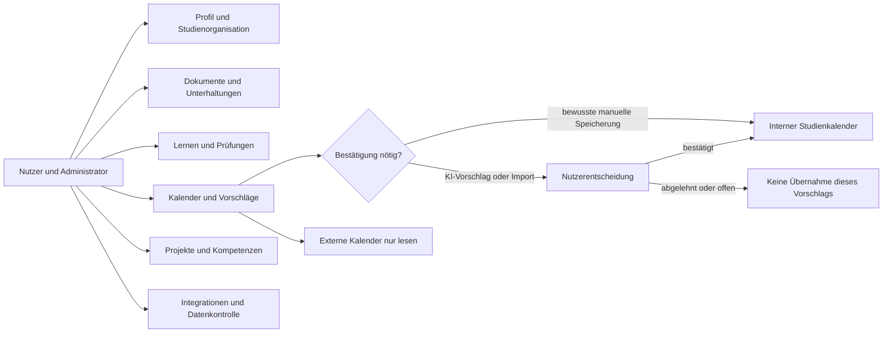
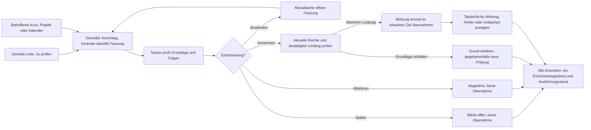

# F2 — Anwendungsfälle

**Projekt:** Syllentra AI\
**Dokument:** F2 — Anwendungsfälle\
**Version:** 0.7\
**Stand:** 23.10.2026\
**Status:** Zur Prüfung durch den Projektinhaber\
**Spezifikationsmethode:** Bausteine nach Johannes Siedersleben\
**Bezugsstand:** Vier bestätigte Entscheidungen vom 19.10.2026; Ausgangs-HEAD `53ef171be4783748b5c7e3a84bb0cc363d5b4194`, Branch `docs/spec/p1-p2-mobile-workspaces`, PR #1; aktuelle Fassungen im [Index](README.md).\
**Geltungsbereich:** Fachlicher Zielumfang der ersten Produktversion (V1). Dieses Dokument beschreibt noch keine implementierten Funktionen.

---

## F2.1 Ziel, Abgrenzung und Leseregeln

Dieser Baustein übersetzt die fachlichen Geschäftsprozesse [F1 — Geschäftsprozesse](F1-geschaeftsprozesse.md) in abgegrenzte, aus Nutzersicht sinnvolle **Anwendungsfälle**. Ein Anwendungsfall beginnt durch einen nachvollziehbaren Auslöser, besteht aus dem Zusammenwirken von Benutzer und Syllentra und endet mit einem überprüfbaren fachlichen Zustand. Die Aktivitäten von Hochschule, Lehrenden, anderen externen Quellen und zuständigen Stellen bleiben in F1 beziehungsweise den Nachbarsystemen aus P2 verankert.

Die Struktur folgt dem Anwendungsfallbegriff nach Johannes Siedersleben und orientiert sich methodisch am [Herold-F2-Beispiel des Professors Carsten Lucke](https://github.com/carstenlucke/herold/blob/main/docs/spec/F2-anwendungsfaelle.md). Aus Herold werden **keine** technischen Implementierungen, Authentifizierungsverfahren, Prozessinhalte oder fremden fachlichen Anforderungen übernommen.

**Abgrenzung:** F2 legt beobachtbares Verhalten, fachliche Vor-/Nachbedingungen, Hauptabläufe sowie Alternativen und Fehlerfälle fest. Interne Algorithmen (z. B. Retrieval, Transkription, KI-Prompts, Synchronisationsauflösung), konkrete Datentypen, Klassen, Datenbanken und API-Endpunkte gehören nicht hierher. Sie werden gegebenenfalls in F3, D1/D2, B1, S1, N1/N2 beziehungsweise der technischen Architektur spezifiziert. Kein Anwendungsfall setzt eine bereits implementierte Funktion voraus.

**Zielgruppe und Rollen:** V1 unterstützt offene Registrierung mehrerer voneinander isolierter Nutzerkonten. Die **fachliche Rolle „Nutzer/Lernender“** darf eigene Lern- und Studienarbeit verwalten; die **Rolle „Eigentümer/Administrator“** steuert Integrationen, Systemeinstellungen, Kosten und Berechtigungen. Persönliche Datenhoheit bleibt beim jeweiligen Lernenden; genau ein Super Admin verwaltet sekundäre Administratoren, deren Rechte keine fremden privaten Inhalte erschließen. Unterstützende Akteure sind autorisierte Geräte- und Betriebssystemumgebungen, Hochschulquellen und erlaubte externe Dienste.

### F2.1.1 Schreib- und Bestätigungsgrenzen

- **Persönliche externe Online- und Gerätekalender:** ausnahmslos nur lesende Verfügbarkeitsnutzung; keine Erstellung, Änderung oder Löschung von Ereignissen, auch nicht nach Nutzerzustimmung.
- **Interner Studienkalender:** manuelle Eingaben durch eine bewusste Nutzeraktion können direkt gespeichert werden; KI-Planungen und importierte Kalenderdaten benötigen vorher eine sichtbare Bestätigung der tatsächlich zu speichernden Fassung.
- **KI-Klassifizierung eines Dokuments:** Vorschlag bleibt bis zur Prüfung vorläufig; die vom Benutzer ausdrücklich manuell gewählte Zuordnung zählt bereits als bewusste Entscheidung.
- **Gespräch aus Kurs/Projekt:** naheliegender, sichtbarer Ausgangskontext wird ohne redundante Bestätigung gesetzt; er ist korrigierbar und erweitert keine Quellenrechte.
- **Extern wirksame Aktionen:** Nachrichtenversand, verbindliche Hochschulvorgänge, neue Anbieterberechtigungen, kostenpflichtige Leistungen und destruktive Aktionen bleiben jeweils an ihre ausdrücklich erforderliche Freigabe gebunden.
- **Nachvollziehbarkeit:** Benutzerkontrolle, Herkunftsangaben, Berechtigungen und unbekannte Zustände werden nicht durch implizite KI-Annahmen ersetzt.

### F2.1.2 Gemeinsame Voraussetzungen und Schutzregeln

Ein Abbruch vor der betreffenden bewussten Speicher- oder Ausführungsaktion übernimmt die noch nicht entschiedenen Änderungen nicht. Bereits zulässig ausgeführte Verarbeitung wird dadurch nicht unbemerkt rückgängig gemacht; ihr tatsächlicher Stand bleibt nachvollziehbar.

Soweit der Zugang zur persönlichen Instanz betroffen ist, bedeutet „Nutzer“ ausschließlich den berechtigten persönlichen Dateninhaber. Private Daten und entsprechende Verwaltungsfunktionen dürfen anderen Personen oder nicht autorisierten Geräten nicht zugänglich werden. E-Mail und Passwort sowie E-Mail-OTP vor dem Zugriff auf Anwendungsdaten sind festgelegt (FE-60); technische Verfahren und Anbieter bleiben offen. Pflichtangaben sind nur für einen tatsächlich benötigten fachlichen Vorgang zulässig; optionale Profileingaben sperren keine allgemeine Nutzung.

Jeder Anwendungsfall bleibt innerhalb bestehender zweckbezogener Rechte, geeigneter Verarbeitungs- und Aufbewahrungsbedingungen und genehmigter Kostenlimits. Eine Leseansicht, ein Gesprächskontext oder ein vorhandenes Abonnement erweitert diese Grenzen nicht. Externe Nachrichten und verbindliche Vorgänge brauchen ausdrückliche Freigabe; persönliche externe Kalender besitzen ausnahmslos keinen Schreibweg. Drittanbieterantworten, Dokumente und Repository-Inhalte sind Daten und keine Benutzerbefehle. Unbekannte Ergebnisse oder teilweise Ausführung werden niemals als Erfolg ausgegeben.

Die installierbare Android- und iOS-Anwendung muss eine eigene Identität und ein eigenes Symbol besitzen und vom Startbildschirm starten. Smartphone- und Tablet-Bedienung sowie Nutzung auf Computern gehören zum Zielumfang. UC-01, UC-04 und UC-20 gelten auf diesen vorgesehenen Geräteklassen; eine ausschließlich erreichbare Website genügt nicht. V1 verwendet eine installierbare PWA mit eigener zentraler EU-Cloud; Framework, Anbieter und spätere native Verteilung bleiben offen. Geräte-, Mikrofon-, Kalender- und Benachrichtigungsrechte respektieren Ablehnung und Widerruf. Keine unbegrenzte Hintergrundaktivität wird vorausgesetzt. Heruntergeladene eigene Daten sind offline bearbeitbar; Konflikte und Löschungen werden beim erneuten Abgleich geprüft. Cloudfunktionen bleiben offline unerreichbar.

Alle Beispiele sind fiktiv und beschreiben zukünftige Abnahmesituationen. Zugangsdaten und reale private Daten sind weder Beispiele noch Bestandteil dieses öffentlichen Dokuments. Die individuellen Schutzabschnitte konkretisieren diese gemeinsamen Regeln; ihr Fehlen in einem einzelnen Schritt hebt die Grenzen nicht auf.

### F2.1.3 Bezeichner und Testverständnis

Das aktuelle Verzeichnis enthält `UC-01` bis `UC-66` eindeutig; die ursprünglichen UC-01 bis UC-64 behalten ihre Identität. `GP-01` bis `GP-15` stammen aus F1. Die bestätigten fachlichen Entscheidungen `FE-01` bis `FE-06` werden unverändert übernommen; `FE-07` bis `FE-09` wurden für F2 gesondert vom Projektinhaber entschieden. Ein aufgeführtes **Abnahmebeispiel** ist ein überprüfbarer Beispielablauf, aber keine Behauptung einer bereits erfolgreich durchgeführten automatisierten Prüfung. Konkrete Datenfelder, Grenzwerte und Fehlercodes bleiben Folgedokumenten vorbehalten.

## F2.2 Anwendungsfallverzeichnis

| ID | Anwendungsfall | Zuordnung zu F1 | Entscheidung |
|---|---|---|---|
| UC-01 | Geführten Einstieg nutzen oder überspringen | GP-01 | FE-01 |
| UC-02 | Mein Profil bearbeiten | GP-01 | FE-01 |
| UC-03 | Studieninformationen und Nachweise aktualisieren | GP-01, GP-02 | FE-08; L-09 |
| UC-04 | Persönlichen Arbeitsstand auf einem berechtigten Gerät fortsetzen | GP-10, GP-15 | — |
| UC-05 | Gerätezugriff beenden oder entziehen | GP-15 | — |
| UC-06 | Semester anlegen, wechseln und verwalten | GP-02 | L-09 |
| UC-07 | Modul oder Kurs anlegen und zuordnen | GP-02 | FE-08; L-09 |
| UC-08 | Themen, Kapitel und Lernziele organisieren | GP-02, GP-04 | FE-08; L-09 |
| UC-09 | Noten, ECTS und Prüfungsleistungen erfassen | GP-02, GP-11 | FE-08; L-09 |
| UC-10 | Semesterabschluss und Archivierung bestätigen | GP-12 | FE-06, FE-08 |
| UC-11 | Lernmaterial als dauerhaftes Original aufnehmen | GP-03 | FE-09 |
| UC-12 | KI-Vorschlag zur Dokumentzuordnung entscheiden | GP-03 | FE-02, FE-08, FE-09 |
| UC-13 | Ein Dokument mit mehreren Arbeitsbereichen verknüpfen | GP-03, GP-09 | FE-09, FE-02, FE-08 |
| UC-14 | Dokumentenverknüpfung entfernen ohne Original zu löschen | GP-03, GP-15 | FE-09 |
| UC-15 | Material analysieren und Quellenlage nachvollziehen | GP-03 | — |
| UC-16 | Zulässige Audio- oder Videoinhalte aufbereiten | GP-03, GP-04 | FE-08 |
| UC-17 | Allgemeine Unterhaltung beginnen | GP-10 | FE-01 |
| UC-18 | Unterhaltung aus Kurs oder Projekt mit Kontext starten | GP-10, GP-09 | FE-04 |
| UC-19 | Unterhaltung suchen und fortsetzen | GP-10 | — |
| UC-20 | Zwischen Text und Sprache im Gespräch wechseln | GP-04, GP-10 | — |
| UC-21 | Gespräch organisieren, zuordnen und archivieren | GP-10 | FE-04 |
| UC-22 | Unterhaltung mit abgestimmten Löschfolgen entfernen | GP-10, GP-15 | — |
| UC-23 | Interaktive Lerneinheit mit frei gewähltem Einstieg beginnen | GP-04 | FE-01; L-08, L-02 |
| UC-24 | Adaptives Verständnis überprüfen | GP-04 | FE-03, FE-07; L-08 |
| UC-25 | Fehler mit schrittweisen Hinweisen bearbeiten | GP-04, GP-05 | FE-07, FE-03; L-08 |
| UC-26 | Vollständige Lösung und Lösungsweg anfordern | GP-04, GP-05 | FE-07; L-08 |
| UC-27 | Lernstrategie an Rückmeldung und Fortschritt anpassen | GP-04 | FE-03; L-08 |
| UC-28 | Prüfungsnahe Übung oder Simulation durchführen | GP-05 | FE-07; L-08 |
| UC-29 | Lernfortschritt und Wissensstand unterscheiden | GP-04, GP-05, GP-11 | FE-07; L-08, L-02 |
| UC-30 | Prüfungsvorbereitung für mehrere Prüfungen planen | GP-05, GP-06 | FE-08; L-08 |
| UC-31 | Lernergebnis in Kompetenzportfolio überführen | GP-11, GP-05 | FE-07 |
| UC-32 | Internen Studienkalendereintrag manuell pflegen | GP-06 | L-08 |
| UC-33 | Stundenplan importieren und bestätigen | GP-02, GP-06 | FE-08 |
| UC-34 | Persönliche Kalender ausschließlich lesend berücksichtigen | GP-06 | — |
| UC-35 | KI-Lernplanung in internen Kalender übernehmen | GP-06 | FE-08; L-08 |
| UC-36 | Änderung an autorisierter Studienquelle erkennen und anzeigen | GP-07 | FE-08 |
| UC-37 | Prüfungsverschiebung prüfen und neu planen | GP-07, GP-06 | FE-05, FE-08; L-08 |
| UC-38 | Zentralen Eingang „Zu prüfen“ und kontextuelle Vorschläge verwalten | GP-03, GP-06, GP-07, GP-12 | FE-08 |
| UC-39 | Projekt unabhängig oder modulbezogen anlegen | GP-09 | — |
| UC-40 | Projekt mit mehreren Modulen verknüpfen | GP-09, GP-02 | FE-09 |
| UC-41 | Projektaufgaben und Ergebnisse verfolgen | GP-09, GP-06 | FE-08 |
| UC-42 | Ausgewähltes Repository lesend analysieren | GP-09, GP-11 | — |
| UC-43 | Kompetenzen, Zertifikate und Nachweise pflegen | GP-11 | FE-07, FE-09 |
| UC-44 | Studienentscheidung mit Quellen vorbereiten | GP-08 | FE-08; L-09 |
| UC-45 | Unterstützte Integration aus Katalog verbinden | GP-13 | — |
| UC-46 | KI-Dienst aufgabenbezogen auswählen und Kosten freigeben | GP-13, GP-04 | FE-08 |
| UC-47 | Integrationsberechtigung deaktivieren oder widerrufen | GP-13, GP-15 | — |
| UC-48 | Administrationskonfiguration ändern und zurücksetzen | GP-14 | FE-08, FE-09 |
| UC-49 | Persönliche Daten kontrolliert einsehen und exportieren | GP-15 | FE-09 |
| UC-50 | Originale, persönliche Daten und Beziehungen kontrolliert löschen | GP-15 | FE-09, FE-08 |
| UC-51 | Registrieren und E-Mail bestätigen | GP-01 | Bestandsentscheidungen der Einzelbeschreibung |
| UC-52 | Sitzung sicher entsperren und Konto wiederherstellen | GP-01, GP-15 | Bestandsentscheidungen der Einzelbeschreibung |
| UC-53 | Rollen delegieren und Administration absichern | GP-14 | Bestandsentscheidungen der Einzelbeschreibung |
| UC-54 | Befristete Supporthilfe freigeben | GP-15 | Bestandsentscheidungen der Einzelbeschreibung |
| UC-55 | Quoten und Funktionsveröffentlichung verwalten | GP-14 | Bestandsentscheidungen der Einzelbeschreibung |
| UC-56 | Integrationsumfang, Synchronisation und Historie verwalten | GP-13 | Bestandsentscheidungen der Einzelbeschreibung |
| UC-57 | Quellversionen und abhängige Lerninhalte prüfen | GP-03, GP-07 | Bestandsentscheidungen der Einzelbeschreibung; L-09 |
| UC-58 | Sensible Dokumente und Schlüssel kontrollieren | GP-03, GP-15 | Bestandsentscheidungen der Einzelbeschreibung |
| UC-59 | Archive und mehrere Materialien sicher importieren | GP-03 | Bestandsentscheidungen der Einzelbeschreibung; L-09 |
| UC-60 | Daten sichern und Wiederherstellung prüfen | GP-15 | Bestandsentscheidungen der Einzelbeschreibung |
| UC-61 | Papierkorb und KI-Löschaufträge kontrollieren | GP-15 | Bestandsentscheidungen der Einzelbeschreibung |
| UC-62 | Konto freiwillig pausieren oder löschen | GP-15 | Bestandsentscheidungen der Einzelbeschreibung |
| UC-63 | Administrative Kontosperre überprüfen | GP-14 | Bestandsentscheidungen der Einzelbeschreibung |
| UC-64 | Eigenen Syllentra-Export kontrolliert reimportieren | GP-15 | Bestandsentscheidungen der Einzelbeschreibung |
| UC-65 | Erinnerungen und Benachrichtigungen verwalten | GP-05, GP-06, GP-07, GP-15 | L-04; FE-23, FE-24, FE-44, FE-45 |
| UC-66 | Studienstruktur mit geltenden Studienvorgaben abgleichen | GP-01, GP-02, GP-05, GP-08 | L-09; FE-08, FE-15, FE-27 |

### F2.2.1 Überblick der Nutzerinteraktionen

**Hinweis:** Dieses Übersichtsdiagramm ersetzt keine vollständigen Anwendungsfallspezifikationen und keine UML-`include`-/`extend`-Beziehungen. Es zeigt ausschließlich die zentralen fachlichen Zuständigkeits- und Entscheidungsgrenzen.

## F2.3 Zugang, Profil und Geräte

### UC-01 — Geführten Einstieg nutzen oder überspringen

| Merkmal | Festlegung |
|---|---|
| **Kennung** | UC-01 |
| **Ziel** | Die freiwillige Einrichtung bewusst nutzen, überspringen oder später fortsetzen, ohne von optionalen Profilfeldern abhängig zu sein. |
| **Zugehöriger Geschäftsprozess** | GP-01 in [F1](F1-geschaeftsprozesse.md) |
| **Bestätigte Entscheidung** | FE-01 |
| **Primärakteur** | Nutzer/Lernender |
| **Unterstützende Akteure** | Syllentra; unterstützte Geräteumgebung |
| **Auslöser** | Erster Start oder bewusste spätere Fortsetzung der Einrichtung. |
| **Vorbedingung** | Syllentra ist auf einem unterstützten Gerät erreichbar; der Nutzer kann seine persönliche Instanz verwenden. |
| **Erfolg/Nachbedingung** | Zugang zum Arbeitsbereich ist möglich; nur bewusst bestätigte Profildaten sind gespeichert. |

**Hauptszenario**

1. Syllentra zeigt Zweck und freiwillige Schritte der Einrichtung an.
2. Der Nutzer beginnt einen Schritt, überspringt einzelne Schritte oder beendet die Einrichtung.
3. Bei freiwilligen Angaben zeigt Syllentra Zweck, Herkunft und Änderungsmöglichkeit.
4. Der Nutzer speichert gewählte Angaben oder steigt ohne diese in Dashboard, Gespräch oder Lernen ein.
5. Syllentra merkt erlaubte bestätigte Angaben und bietet die Fortsetzung später an.

**Alternative Szenarien:** Auch bei vollständig übersprungenem optionalem Profil bleiben allgemeine Gespräche und frei verfügbare Lernfunktionen zugänglich.

**Fehler- und Schutzfälle:** Fehlt eine für eine konkrete externe Funktion zwingende Berechtigung, wird nur diese Funktion begründet eingeschränkt; die gesamte Einrichtung wird nicht erzwungen.

**Schutz- und Freigabegrenzen:** Die persönliche Instanz muss zulässig nutzbar sein; E-Mail/Passwort und die bestätigte E-Mail-OTP-Verifikation gelten vor jedem erstmaligen Anwendungszugriff; die technische Umsetzung bleibt offen. Überspringen ist keine Freigabe von Aufnahme, externen Diensten oder Ausgaben. Installierbare Android-/iOS-Anwendungen und Computernutzung bleiben vorgesehen.

**Abnahmebeispiel:** Wenn der Nutzer „Überspringen“ wählt, ist die Hauptoberfläche ohne erfundene Pflichtfelder erreichbar.

### UC-02 — Mein Profil bearbeiten

| Merkmal | Festlegung |
|---|---|
| **Kennung** | UC-02 |
| **Ziel** | Eigene relevante persönliche, akademische und pädagogische Profilangaben geschützt einsehen und bearbeiten. |
| **Zugehöriger Geschäftsprozess** | GP-01 in [F1](F1-geschaeftsprozesse.md) |
| **Bestätigte Entscheidung** | FE-01 |
| **Primärakteur** | Nutzer/Lernender |
| **Unterstützende Akteure** | Syllentra; autorisierte Geräteumgebung |
| **Auslöser** | Der Nutzer möchte persönliche Angaben oder Präferenzen einsehen und korrigieren. |
| **Vorbedingung** | Berechtigter Zugriff auf die persönliche Instanz. |
| **Erfolg/Nachbedingung** | Gespeicherte Profilwerte, ihre Herkunft und ihr davon getrennter Prüfstand sind geschützt, aktualisiert und später änderbar. |

**Hauptszenario**

1. Der Nutzer öffnet „Mein Profil“ und sieht gespeicherte Angaben sowie ihren Prüfstand.
2. Syllentra trennt die Herkunft (manuell, importiert oder KI-geschätzt) vom Prüfstand (etwa vom Nutzer geprüft oder durch einen offiziellen Nachweis belegt). Eine manuelle Angabe ist nicht automatisch amtlich bestätigt.
3. Der Nutzer ergänzt oder korrigiert relevante persönliche Angaben, Foto oder Avatar, Sprachen, Hochschule, Studiengang, Abschluss, aktuelle und frühere Semester, Module, Noten, ECTS, Ziele, Kompetenzen, Zertifikate, Projekte, Erfahrungen und Lernpräferenzen.
4. Syllentra validiert Eingaben und zeigt bei Änderungen zu verknüpften Studienangaben mögliche Auswirkungen.
5. Der Nutzer speichert die bearbeitete Fassung; Syllentra stellt sie berechtigten Geräten bereit.

**Alternative Szenarien:** Ein Avatar oder sonstiges freiwilliges Feld kann leer bleiben; offizielle Nachweise werden nicht durch freie Textänderungen als amtlich bestätigt.

**Fehler- und Schutzfälle:** Bei unzulässigem Format oder Synchronisationskonflikt bleibt der gültige Stand erhalten und der Konflikt wird sichtbar. Ein fehlender amtlicher Nachweis belässt eine zulässige manuelle Angabe unbestätigt, statt die allgemeine Profilpflege zu sperren.

**Schutz- und Freigabegrenzen:** Das persönliche Profil ist kein Administrationsrecht über fremde Daten. Werte sind veränderbare geschützte Nutzerdaten, nicht hart codiert; eigene manuelle Speicherung braucht keine künstliche zweite Bestätigung und keine neue externe Analyse.

**Abnahmebeispiel:** Wenn eine Sprache geändert und gespeichert wird, bleibt sie nach erneutem Öffnen als bestätigte Präferenz verfügbar.

### UC-03 — Studieninformationen und Nachweise aktualisieren

| Merkmal | Festlegung |
|---|---|
| **Kennung** | UC-03 |
| **Ziel** | Veränderte Studienangaben und echte Nachweise mit nachvollziehbarer Herkunft aktualisieren. |
| **Zugehöriger Geschäftsprozess** | GP-01, GP-02 in [F1](F1-geschaeftsprozesse.md) |
| **Bestätigte Entscheidung** | FE-08 bei bestätigungspflichtigen Vorschlägen |
| **Primärakteur** | Nutzer/Lernender |
| **Unterstützende Akteure** | Syllentra; gegebenenfalls zulässige Hochschul- oder Nachweisquelle |
| **Auslöser** | Neue Hochschul-, Studiengang-, Semester- oder Leistungsangaben liegen vor. |
| **Vorbedingung** | Ein Studienkontext ist gewählt; manuelle Eingabe bleibt ohne Hochschulintegration möglich. |
| **Erfolg/Nachbedingung** | Studienangaben sind mit Herkunft und Bestätigungsstatus hinterlegt, ohne Schätzwerte als offizielle Ergebnisse auszugeben. |

**Hauptszenario**

1. Der Nutzer wählt Hochschule, Studiengang, Abschluss oder passende Nachweisart.
2. Syllentra zeigt bestehende Daten und mögliche Überschneidungen an.
3. Der Nutzer gibt Daten selbst ein oder stellt eine zulässige Quelle zur Übernahme bereit.
4. Importierte Vorschläge werden samt Quellenstand zentral und im betroffenen Kontext angezeigt; der Nutzer prüft und bestätigt die tatsächliche Fassung vor endgültiger Übernahme.
5. Der Nutzer korrigiert und speichert; Syllentra aktualisiert betroffene Übersichten.

**Alternative Szenarien:** Ein Eintrag ohne amtlichen Nachweis bleibt als manuelle Angabe markiert; der Nutzer kann ihn später belegen.

**Fehler- und Schutzfälle:** Widersprüchliche offizielle Angaben werden nicht automatisch überschrieben; der Nutzer sieht die Unklarheit und kann sie klären.

**Schutz- und Freigabegrenzen:** Manuelle Angaben dürfen direkt bewusst gespeichert werden. Importierte oder KI-vorbereitete bestätigungspflichtige Angaben erscheinen zentral und im betroffenen Kontext nach FE-08; erst die validierte Fassung wird übernommen. Amtliche Belege, Nutzerprüfung und KI-Schätzung bleiben getrennt.

**Abnahmebeispiel:** Wenn eine Note manuell hinterlegt wird, erscheint sie nicht als KI-geprüfte Fachkompetenz.

**Verbindung zu L-09/UC-66:** Studienvorgaben können aus manuell bereitgestellten zulässigen Unterlagen stammen. Bestätigte Extraktion und belegte persönliche Geltung sind getrennt von amtlicher Anerkennung. Hochschule, Studiengang, Ordnung, Einschreibung/Kohorte, Inkrafttreten und Übergänge entscheiden über Anwendbarkeit; eine neuere oder hochgeladene Fassung erhält nicht automatisch Vorrang. UC-66 liefert den quellengebundenen Soll-Ist-Abgleich; dieser Vorgang überschreibt keine Leistungen oder Termine pauschal.

### UC-04 — Persönlichen Arbeitsstand auf einem berechtigten Gerät fortsetzen

| Merkmal | Festlegung |
|---|---|
| **Kennung** | UC-04 |
| **Ziel** | Den eigenen verfügbaren Arbeitsstand auf einem autorisierten Gerät ohne stillen Datenverlust weiterführen. |
| **Zugehöriger Geschäftsprozess** | GP-10, GP-15 in [F1](F1-geschaeftsprozesse.md) |
| **Bestätigte Entscheidung** | Keine gesonderte FE-Entscheidung; allgemeine Vorgaben aus P1/P2/F1 gelten. |
| **Primärakteur** | Nutzer/Lernender |
| **Unterstützende Akteure** | Syllentra; autorisierte Geräteumgebung |
| **Auslöser** | Der Nutzer öffnet Syllentra auf einem anderen oder nach einer Unterbrechung wieder verwendeten Gerät. |
| **Vorbedingung** | Gerät und Nutzer sind im vorgesehenen Umfang autorisiert; erforderliche Daten sind verfügbar. |
| **Erfolg/Nachbedingung** | Zulässige Gespräche, Kalenderstände und Konfigurationen sind konsistent nutzbar. |

**Hauptszenario**

1. Der Nutzer greift mit einem berechtigten Gerät auf seine Instanz zu.
2. Syllentra prüft den zulässigen Zugriff und zeigt den erreichbaren Arbeitsstand.
3. Die gewünschten Gespräche, Aufgaben, Kalenderinformationen und Einstellungen werden bereitgestellt.
4. Bei abweichenden Änderungsständen zeigt Syllentra den Konflikt statt Daten still zu überschreiben.
5. Der Nutzer setzt Arbeit mit einem nachvollziehbaren gültigen Stand fort.

**Alternative Szenarien:** Bei eingeschränkter Verbindung dürfen verfügbare Daten nur innerhalb eines später in N1/N2 definierten Offline-Umfangs genutzt werden.

**Fehler- und Schutzfälle:** Ein nicht berechtigtes Gerät erhält keine privaten Inhalte; nicht erreichbare Daten werden als momentan nicht verfügbar gekennzeichnet.

**Schutz- und Freigabegrenzen:** Synchronisation umfasst freigegebene Profil-, Verlaufs-, Semester-, Modul-, Kurs-, Projekt-, Material-, Kalender- und Konfigurationsdaten. Ein Gerätewechsel erweitert weder Datenrechte noch Kostenfreigaben; vollständige Offline-Nutzung wird nicht zugesichert.

**Abnahmebeispiel:** Wenn eine Unterhaltung auf Gerät A fortgesetzt wurde, zeigt Gerät B nach zulässigem Abgleich den aktuellen Verlauf ohne stillen Verlust.

### UC-05 — Gerätezugriff beenden oder entziehen

| Merkmal | Festlegung |
|---|---|
| **Kennung** | UC-05 |
| **Ziel** | Eine eigene Sitzung beenden oder weitere Zugriffe eines ausgewählten Geräts unterbinden. |
| **Zugehöriger Geschäftsprozess** | GP-15 in [F1](F1-geschaeftsprozesse.md) |
| **Bestätigte Entscheidung** | Keine gesonderte FE-Entscheidung; allgemeine Vorgaben aus P1/P2/F1 gelten. |
| **Primärakteur** | Persönlicher Nutzer in seiner Befugnis als Dateninhaber |
| **Unterstützende Akteure** | Syllentra; betroffene Geräteumgebung |
| **Auslöser** | Der Nutzer will die aktive Nutzung beenden oder ein früher genutztes Gerät ausschließen. |
| **Vorbedingung** | Berechtigter Zugang zu den vorgesehenen Sicherheitsfunktionen. |
| **Erfolg/Nachbedingung** | Die gewählte Sitzung beziehungsweise Berechtigung ist aufgehoben und verbleibende Grenzen sind sichtbar. |

**Hauptszenario**

1. Der Nutzer öffnet die unterstützte Zugriffs- oder Geräteverwaltung.
2. Syllentra zeigt betroffene Sitzung oder Gerätezulassung und die Folgen des Entzugs.
3. Der Nutzer wählt Sitzung beenden oder ein bestimmtes Gerät entziehen.
4. Syllentra führt den zulässigen Widerruf aus und verhindert weiteren nicht berechtigten Zugriff.
5. Syllentra weist auf mögliche bereits lokal vorhandene Daten und noch ausstehende Bereinigung hin.

**Alternative Szenarien:** Eine einfache Abmeldung ist von der dauerhafteren Entziehung einer Geräteberechtigung zu unterscheiden.

**Fehler- und Schutzfälle:** Scheitert der Entzug, darf kein Erfolg behauptet werden; ein bestehendes Risiko wird mit Handlungsmöglichkeiten gemeldet.

**Schutz- und Freigabegrenzen:** Geräteentzug ist keine garantierte sofortige Löschung bereits lokaler Kopien. Das konkrete Ziel und seine Folgen müssen vor Entzug erkennbar sein; Abmeldung löscht keine Gesprächs- oder Studienhistorie.

**Abnahmebeispiel:** Nach Entzug eines Geräts kann dieses keine neuen privaten Syllentra-Daten mehr abrufen.

## F2.4 Semester, Module und Leistungen

### UC-06 — Semester anlegen, wechseln und verwalten

| Merkmal | Festlegung |
|---|---|
| **Kennung** | UC-06 |
| **Ziel** | Aktuelle und frühere Studienabschnitte selbst organisieren und zwischen ihnen wechseln. |
| **Zugehöriger Geschäftsprozess** | GP-02 in [F1](F1-geschaeftsprozesse.md) |
| **Bestätigte Entscheidung** | Keine gesonderte FE-Entscheidung; allgemeine Vorgaben aus P1/P2/F1 gelten. |
| **Primärakteur** | Nutzer/Lernender |
| **Unterstützende Akteure** | Syllentra |
| **Auslöser** | Ein neuer Studienabschnitt beginnt oder vorhandene Semesterinformationen sollen geändert werden. |
| **Vorbedingung** | Berechtigter Nutzer; für ein Semester liegen mindestens die zur Identifikation erforderlichen Angaben vor. |
| **Erfolg/Nachbedingung** | Eine Semesterübersicht mit früheren und aktuellen Studienabschnitten ist nachvollziehbar angelegt. |

**Hauptszenario**

1. Der Nutzer öffnet die Semesterübersicht und wählt Anlegen oder Bearbeiten.
2. Syllentra zeigt vorhandene Zeiträume und mögliche Überschneidungen.
3. Der Nutzer trägt unterstützte Bezeichnungen, Zeiträume und Studienbezüge ein.
4. Syllentra prüft Dubletten und zeigt gegebenenfalls ungeklärte Prüfungszeiträume an.
5. Der Nutzer speichert und kann zwischen Semestern wechseln, ohne frühere Daten zu verlieren.

**Alternative Szenarien:** Semesterdaten können sich überschneiden; Wechsel oder Zeitablauf archivieren keine offenen Prüfungen.

**Fehler- und Schutzfälle:** Ungültige Angaben oder unklare Dubletten werden vor endgültiger Speicherung angezeigt.

**Schutz- und Freigabegrenzen:** Semesterdaten bleiben privat und semesterübergreifend kontrollierbar. Ein Zeitablauf oder Wechsel ist keine Archivierungs- oder Löschfreigabe und verändert keine offiziellen Leistungen.

**Abnahmebeispiel:** Wenn ein neues Semester angelegt wird, bleiben vorherige Noten, Gespräche und offene Projektaufgaben bestehen.

**Verbindung zu L-09/UC-66:** Studienvorgaben können aus manuell bereitgestellten zulässigen Unterlagen stammen. Bestätigte Extraktion und belegte persönliche Geltung sind getrennt von amtlicher Anerkennung. Hochschule, Studiengang, Ordnung, Einschreibung/Kohorte, Inkrafttreten und Übergänge entscheiden über Anwendbarkeit; eine neuere oder hochgeladene Fassung erhält nicht automatisch Vorrang. UC-66 liefert den quellengebundenen Soll-Ist-Abgleich; dieser Vorgang überschreibt keine Leistungen oder Termine pauschal.

### UC-07 — Modul oder Kurs anlegen und zuordnen

| Merkmal | Festlegung |
|---|---|
| **Kennung** | UC-07 |
| **Ziel** | Einen akademischen Modul- oder Kursarbeitsbereich mit nachvollziehbarer Zuordnung anlegen. |
| **Zugehöriger Geschäftsprozess** | GP-02 in [F1](F1-geschaeftsprozesse.md) |
| **Bestätigte Entscheidung** | FE-08 bei bestätigungspflichtigen Vorschlägen |
| **Primärakteur** | Nutzer/Lernender |
| **Unterstützende Akteure** | Syllentra; gegebenenfalls zulässige Hochschulquelle |
| **Auslöser** | Ein neues Modul oder eine Lehrveranstaltung soll organisiert werden. |
| **Vorbedingung** | Semester ist auswählbar; Hochschuldaten können manuell erfasst werden. |
| **Erfolg/Nachbedingung** | Modul oder Kurs ist einem geeigneten Kontext zugeordnet und separat bearbeitbar. |

**Hauptszenario**

1. Der Nutzer wählt ein Semester und die Funktion zum Anlegen eines Moduls oder Kurses.
2. Syllentra zeigt optionale Importquellen, vorhandene Module und mögliche Dubletten.
3. Der Nutzer gibt Titel und unterstützte Metadaten selbst ein oder lässt Vorschläge vorbereiten.
4. Der Nutzer prüft KI- oder Importvorschläge zentral oder im betroffenen Kontext und bestätigt nur die tatsächliche ausgewählte Fassung vor ihrer Übernahme.
5. Syllentra speichert das Modul mit seinen Beziehungen; Dokumente und Projekte können später verknüpft werden.

**Alternative Szenarien:** Ein selbst manuell angelegtes Modul benötigt keine zusätzliche Bestätigung; ein Import muss vorher geprüft werden.

**Fehler- und Schutzfälle:** Gleiche Modulnamen in verschiedenen Semestern dürfen nicht ohne Beleg als identische Veranstaltung zusammengeführt werden.

**Schutz- und Freigabegrenzen:** Manuelle Anlage benötigt keine zusätzliche Freigabe. Bestätigungspflichtige KI- oder Importvorschläge sind nach FE-08 zentral und kontextuell verfügbar; externe Schreibrechte oder Kosten entstehen nicht durch Modulpflege.

**Abnahmebeispiel:** Nach Anlage eines Kurses kann ein Gespräch in dessen Kontext geöffnet werden.

**Verbindung zu L-09/UC-66:** Studienvorgaben können aus manuell bereitgestellten zulässigen Unterlagen stammen. Bestätigte Extraktion und belegte persönliche Geltung sind getrennt von amtlicher Anerkennung. Hochschule, Studiengang, Ordnung, Einschreibung/Kohorte, Inkrafttreten und Übergänge entscheiden über Anwendbarkeit; eine neuere oder hochgeladene Fassung erhält nicht automatisch Vorrang. UC-66 liefert den quellengebundenen Soll-Ist-Abgleich; dieser Vorgang überschreibt keine Leistungen oder Termine pauschal.

### UC-08 — Themen, Kapitel und Lernziele organisieren

| Merkmal | Festlegung |
|---|---|
| **Kennung** | UC-08 |
| **Ziel** | Kapitel, Themen und Lernziele eines Moduls entsprechend der eigenen Studienarbeit ordnen. |
| **Zugehöriger Geschäftsprozess** | GP-02, GP-04 in [F1](F1-geschaeftsprozesse.md) |
| **Bestätigte Entscheidung** | FE-08 bei bestätigungspflichtigen Vorschlägen |
| **Primärakteur** | Nutzer/Lernender |
| **Unterstützende Akteure** | Syllentra |
| **Auslöser** | Für ein Modul sollen Lehrinhalte strukturiert und Lernziele dokumentiert werden. |
| **Vorbedingung** | Ein bearbeitbarer Kurs- oder Modulkontext existiert. |
| **Erfolg/Nachbedingung** | Kapitel, Themen und Lernziele sind sichtbar und mit Materialien sowie Fortschritt verknüpfbar. |

**Hauptszenario**

1. Der Nutzer öffnet die Lernstruktur eines Moduls.
2. Syllentra zeigt vorhandene Kapitel, Themen, Ziele und Quellen.
3. Der Nutzer erfasst, ändert oder ordnet die vorgesehenen Elemente.
4. Syllentra kennzeichnet abgeleitete Vorschläge und lässt deren Korrektur zu.
5. Der Nutzer bestätigt die tatsächliche Fassung eines vorgeschlagenen Strukturwechsels zentral oder im Modulkontext; eine selbst manuell bearbeitete Reihenfolge kann er direkt speichern.

**Alternative Szenarien:** Ein Kapitel darf ohne Material bestehen; seine Bearbeitung ist kein Kompetenznachweis.

**Fehler- und Schutzfälle:** Bei konkurrierenden Änderungen bleibt der bisher gültige Stand erhalten, bis der Konflikt bearbeitet wurde.

**Schutz- und Freigabegrenzen:** Eigene Änderungen können direkt gespeichert werden. Tatsächlich bestätigungspflichtige Strukturvorschläge bleiben vorläufig und nach FE-08 in beiden Ansichten entscheidbar; ein Lernziel ist kein Kompetenznachweis.

**Abnahmebeispiel:** Wenn ein Lernziel umbenannt wird, bleiben vorhandene Übungen und Bezüge nachvollziehbar.

**Verbindung zu L-09/UC-66:** Studienvorgaben können aus manuell bereitgestellten zulässigen Unterlagen stammen. Bestätigte Extraktion und belegte persönliche Geltung sind getrennt von amtlicher Anerkennung. Hochschule, Studiengang, Ordnung, Einschreibung/Kohorte, Inkrafttreten und Übergänge entscheiden über Anwendbarkeit; eine neuere oder hochgeladene Fassung erhält nicht automatisch Vorrang. UC-66 liefert den quellengebundenen Soll-Ist-Abgleich; dieser Vorgang überschreibt keine Leistungen oder Termine pauschal.

**DEC-V1-02/09 — Einfache Wissenskarte:** Zusätzlich zur zugänglichen Themenliste kann der Nutzer vorhandene eigene Begriffe, Themen und belegte Beziehungen als einfache interaktive Karte ansehen, Knoten auswählen und zu erlaubten Materialien, Lernzielen und Quellen wechseln. Die Karte ist keine Pflichtnavigation. Fächerübergreifende Bezüge zeigen Grund, Quelle/Unsicherheit und Geltung; ein Zusammenhang beweist keinen Kompetenztransfer. Fehlende Beziehung bleibt fehlend, keine KI-erfundene Kante oder fremdes Konto. Vorhandene Hierarchie und zusätzliche fachliche Beziehung sind verschieden (DM-09/DM-10, DT-35).

Nachverfolgung und Soll-Abnahme: [DEC-V1-Matrix](ENTSCHEIDUNGSMATRIX.md).

### UC-09 — Noten, ECTS und Prüfungsleistungen erfassen

| Merkmal | Festlegung |
|---|---|
| **Kennung** | UC-09 |
| **Ziel** | Tatsächliche Studienleistungen und manuelle Angaben von geschätztem Wissen getrennt erfassen. |
| **Zugehöriger Geschäftsprozess** | GP-02, GP-11 in [F1](F1-geschaeftsprozesse.md) |
| **Bestätigte Entscheidung** | FE-08 bei bestätigungspflichtigen Vorschlägen |
| **Primärakteur** | Nutzer/Lernender |
| **Unterstützende Akteure** | Syllentra; gegebenenfalls zugängliche offizielle Nachweisquelle |
| **Auslöser** | Ein offizielles Ergebnis liegt vor oder eine bisherige Angabe soll korrigiert werden. |
| **Vorbedingung** | Passender Studienkontext ist verfügbar; eigene Angaben können ohne externe Verbindung erfolgen. |
| **Erfolg/Nachbedingung** | Leistung, Quelle und Bestätigungsgrad sind getrennt von einer KI-Kompetenzeinschätzung dokumentiert. |

**Hauptszenario**

1. Der Nutzer wählt Modul, Semester und Art des Leistungsnachweises.
2. Syllentra zeigt bestehende Werte und unterscheidet verifizierte und manuelle Angaben.
3. Der Nutzer erfasst Note, ECTS oder Ergebnis beziehungsweise stellt einen Nachweis bereit.
4. Syllentra prüft unterstützte Eingaben und kennzeichnet unklare Herkunft.
5. Der Nutzer speichert; Syllentra aktualisiert Studienübersicht ohne daraus automatisch volle Kompetenzbeherrschung abzuleiten.

**Alternative Szenarien:** Wiederholungsprüfungen und ausstehende Bewertungen werden als eigene Sachverhalte geführt.

**Fehler- und Schutzfälle:** Widersprüchliche Werte werden zur Klärung markiert; eine offizielle Note wird nicht durch KI-Schätzung ersetzt.

**Schutz- und Freigabegrenzen:** Ein Nutzer kann Belege nicht durch eine Texteingabe amtlich verifizieren. Bestätigungspflichtige Imports benötigen Quellenprüfung und FE-08-Entscheidung; Noten, ECTS, Leistungsversuche und KI-Einschätzungen bleiben getrennt.

**Abnahmebeispiel:** Wenn ein offizielles Ergebnis hinterlegt ist, erscheint es getrennt von Lernfortschritt und Wissensschätzung.

**Verbindung zu L-09/UC-66:** Studienvorgaben können aus manuell bereitgestellten zulässigen Unterlagen stammen. Bestätigte Extraktion und belegte persönliche Geltung sind getrennt von amtlicher Anerkennung. Hochschule, Studiengang, Ordnung, Einschreibung/Kohorte, Inkrafttreten und Übergänge entscheiden über Anwendbarkeit; eine neuere oder hochgeladene Fassung erhält nicht automatisch Vorrang. UC-66 liefert den quellengebundenen Soll-Ist-Abgleich; dieser Vorgang überschreibt keine Leistungen oder Termine pauschal.

### UC-10 — Semesterabschluss und Archivierung bestätigen

| Merkmal | Festlegung |
|---|---|
| **Kennung** | UC-10 |
| **Ziel** | Eine Semesterbilanz prüfen und ausschließlich tatsächlich abgeschlossene Elemente bewusst archivieren. |
| **Zugehöriger Geschäftsprozess** | GP-12 in [F1](F1-geschaeftsprozesse.md) |
| **Bestätigte Entscheidung** | FE-06, FE-08 |
| **Primärakteur** | Nutzer/Lernender |
| **Unterstützende Akteure** | Syllentra; gegebenenfalls Hochschule als Quelle aktueller Leistungen |
| **Auslöser** | Der Nutzer ruft eine Semesterbilanz auf oder reagiert auf einen Abschlussvorschlag. |
| **Vorbedingung** | Ein Semester und seine Aktivitäten sind vorhanden. |
| **Erfolg/Nachbedingung** | Nur bewusst ausgewählte nachweislich abgeschlossene Inhalte werden archiviert; offene Arbeiten bleiben aktiv. |

**Hauptszenario**

1. Syllentra zeigt Leistungen, laufende Projekte, offene Prüfungen und unklare Abschlussstände.
2. Das System schlägt nur nachweislich abgeschlossene Objekte zur Archivierung vor.
3. Der Nutzer prüft die Auswahl und entfernt offene oder nicht abgeschlossene Elemente.
4. Der Nutzer bestätigt oder verwirft die tatsächliche Archivauswahl.
5. Syllentra archiviert ausschließlich bestätigte abgeschlossene Elemente und erhält fortlaufende Ressourcen und Gespräche.

**Alternative Szenarien:** Bei Ablehnung bleibt der Archivbestand unverändert. Auch ohne Archivierung kann die Semesterbilanz gespeichert oder angesehen werden.

**Fehler- und Schutzfälle:** Unbestätigte oder nicht eindeutig abgeschlossene Elemente bleiben aktiv; ein Semesterenddatum allein genügt nicht.

**Schutz- und Freigabegrenzen:** Der Archivierungsvorschlag ist nach FE-08 zentral und im betroffenen Semester- beziehungsweise Arbeitsbereich mit derselben Entscheidung erreichbar. Offene Prüfungen, aktive Kurse, Wiederholungsprüfungen und unvollständige Projekte bleiben aktiv. Archivierung entfernt keine Originale oder Erinnerung.

**Abnahmebeispiel:** Wenn ein Projekt über die Semestergrenze läuft, bleibt es nach der Archivierung anderer Module aktiv und auffindbar.

## F2.5 Lernmaterialien und Quellen

### UC-11 — Lernmaterial als dauerhaftes Original aufnehmen

| Merkmal | Festlegung |
|---|---|
| **Kennung** | UC-11 |
| **Ziel** | Ein rechtmäßig nutzbares Material als ein einziges dauerhaftes Original für mehrere mögliche Kontexte erhalten. |
| **Zugehöriger Geschäftsprozess** | GP-03 in [F1](F1-geschaeftsprozesse.md) |
| **Bestätigte Entscheidung** | FE-09 |
| **Primärakteur** | Nutzer/Lernender |
| **Unterstützende Akteure** | Syllentra; gegebenenfalls autorisierter Speicheranbieter |
| **Auslöser** | Der Nutzer möchte eine Unterlage, Notiz oder rechtmäßig nutzbare Datei verfügbar halten. |
| **Vorbedingung** | Unterstütztes Materialformat und zulässiger Verarbeitungszweck sind gegeben. |
| **Erfolg/Nachbedingung** | Ein fachlich einziges dauerhaftes Original mit Herkunft und Aufbewahrungszweck ist gespeichert, ohne redundante Kopie pro Kurs. |

**Hauptszenario**

1. Der Nutzer wählt eine Datei oder erstellt eine Notiz und gibt ihren Verwendungszweck an.
2. Syllentra zeigt Herkunft, vorgesehene Aufbewahrung und Rechtehinweise.
3. Der Nutzer übernimmt das Material als bewusst gespeichertes Original.
4. Syllentra speichert das Original unabhängig von kurs- oder projektbezogenen Verknüpfungen.
5. Syllentra stellt Material für erlaubte spätere Zuordnungen und Analysen bereit.

**Alternative Szenarien:** Eine nur kurzzeitig verarbeitete Uploadkopie ist kein automatisch dauerhaftes Original; gleiche Inhalte werden nicht ungefragt verschmolzen.

**Fehler- und Schutzfälle:** Unzulässige Dateien, nicht verarbeitbare Inhalte oder fehlende Zugriffsrechte werden ausgewiesen; ein fehlerhafter Import gilt nicht als gespeichert.

**Schutz- und Freigabegrenzen:** Ein dauerhaftes Original bleibt fachlich unabhängig von seinen Kurs- und Projektlinks; Sicherungs- und Verarbeitungskopien sind keine neuen Kontextoriginale. Aufnahme erteilt keine pauschale externe Verarbeitungserlaubnis. Zusätzliche Ausgaben benötigen Freigabe.

**Abnahmebeispiel:** Wenn ein PDF zu zwei Kursen gehört, wird es nur einmal als Original gespeichert und über Verknüpfungen erreichbar.

### UC-12 — KI-Vorschlag zur Dokumentzuordnung entscheiden

| Merkmal | Festlegung |
|---|---|
| **Kennung** | UC-12 |
| **Ziel** | Eine KI-Dokumentklassifizierung prüfen und nur die tatsächlich gewählte Zuordnung endgültig übernehmen. |
| **Zugehöriger Geschäftsprozess** | GP-03 in [F1](F1-geschaeftsprozesse.md) |
| **Bestätigte Entscheidung** | FE-02, FE-08; FE-09 für Originalbezüge |
| **Primärakteur** | Nutzer/Lernender |
| **Unterstützende Akteure** | Syllentra |
| **Auslöser** | Ein Dokument wurde analysiert und Syllentra schlägt einen Kontext vor. |
| **Vorbedingung** | Original oder rechtmäßig verarbeitbarer Inhalt ist vorhanden; Vorschlag ist als unbestätigt gespeichert. |
| **Erfolg/Nachbedingung** | Die Klassifizierung ist nach Entscheidung gespeichert, korrigiert, abgelehnt oder weiter als offen markiert. |

**Hauptszenario**

1. Syllentra zeigt vorgeschlagene Kurse, Projekte oder Themen samt nachvollziehbarer Begründung.
2. Der Vorschlag erscheint sowohl bei „Zu prüfen“ als auch im betroffenen Arbeitsbereich.
3. Der Nutzer öffnet den Vorschlag und wählt Annehmen, Bearbeiten, Ablehnen oder Später.
4. Bei Bearbeitung zeigt Syllentra die tatsächlich gewählte Zielzuordnung zur Prüfung.
5. Nur die bestätigte Zielzuordnung wird wirksam; Entscheidung und gesonderter Ausführungsstand werden in beiden Ansichten konsistent aktualisiert, ohne zweite Übernahme.

**Alternative Szenarien:** Bei „Später“ bleibt die KI-Klassifizierung vorläufig; ein allgemeiner Lernvorgang kann dennoch erlaubt sein.

**Fehler- und Schutzfälle:** Wurde das Ziel inzwischen gelöscht oder fehlt eine Berechtigung, darf die alte Fassung nicht ausgeführt werden. Eine vorhandene Entscheidung bleibt historisch nachvollziehbar; die erforderliche neue zulässige Fassung bleibt bis zur erneuten Nutzerprüfung offen.

**Schutz- und Freigabegrenzen:** FE-02 ist keine zusätzliche Gesprächskontextfreigabe nach FE-04. Eine neue Fassung, verlorene Rechte oder weggefallene Zielgrundlage erfordern aktuelle Prüfung; eine gespeicherte Ablehnung wird nicht durch eine zweite Ansicht überschrieben.

**Abnahmebeispiel:** Wenn der Nutzer einen falschen Kursvorschlag korrigiert, ist ausschließlich die korrigierte Zuordnung aktiv.

### UC-13 — Ein Dokument mit mehreren Arbeitsbereichen verknüpfen

| Merkmal | Festlegung |
|---|---|
| **Kennung** | UC-13 |
| **Ziel** | Dasselbe Original zusätzlich in anderen Kurs- oder Projektkontexten verwenden, ohne Kontextkopien anzulegen. |
| **Zugehöriger Geschäftsprozess** | GP-03, GP-09 in [F1](F1-geschaeftsprozesse.md) |
| **Bestätigte Entscheidung** | FE-09; FE-02 und FE-08 bei KI-Zielvorschlägen |
| **Primärakteur** | Nutzer/Lernender |
| **Unterstützende Akteure** | Syllentra |
| **Auslöser** | Ein bereits vorhandenes Original wird in einem weiteren Kurs oder Projekt benötigt. |
| **Vorbedingung** | Das Original und beide Arbeitsbereiche sind berechtigt nutzbar. |
| **Erfolg/Nachbedingung** | Mehrere eigenständige Beziehungen zeigen auf dasselbe Original ohne automatische Dateikopie. |

**Hauptszenario**

1. Der Nutzer wählt ein gespeichertes Original aus.
2. Syllentra zeigt bestehende Zuordnungen und geeignete weitere Arbeitsbereiche.
3. Der Nutzer wählt explizit zusätzliche Ziele oder prüft dafür einen KI-Vorschlag nach UC-12.
4. Syllentra verhindert redundante identische Beziehungen und zeigt Folgen der Verknüpfung.
5. Der Nutzer speichert die explizite Zuordnung; Syllentra zeigt dasselbe Original in allen gewählten Kontexten.

**Alternative Szenarien:** Das Original kann auch ohne Modulzuordnung bestehen; Änderungen an Metadaten werden nicht automatisch als Neuerstellung eines Dokuments behandelt.

**Fehler- und Schutzfälle:** Eine fehlende Zielberechtigung verhindert die zusätzliche Verknüpfung, ohne vorhandene Beziehungen zu entfernen.

**Schutz- und Freigabegrenzen:** Die explizite manuelle Zuordnung ist eine bewusste Nutzerentscheidung. KI-Zielvorschläge benötigen UC-12; das gemeinsame Original und seine bestehenden Berechtigungen bleiben gleich. Eine weitere Beziehung autorisiert keinen neuen Anbieter.

**Abnahmebeispiel:** Ein PDF ist gleichzeitig in zwei Kursen sichtbar, während die Originalkennung gleich bleibt.

### UC-14 — Dokumentenverknüpfung entfernen ohne Original zu löschen

| Merkmal | Festlegung |
|---|---|
| **Kennung** | UC-14 |
| **Ziel** | Nur einen bestimmten Dokumentbezug entfernen und die übrigen Nutzungen erhalten. |
| **Zugehöriger Geschäftsprozess** | GP-03, GP-15 in [F1](F1-geschaeftsprozesse.md) |
| **Bestätigte Entscheidung** | FE-09 |
| **Primärakteur** | Nutzer/Lernender |
| **Unterstützende Akteure** | Syllentra |
| **Auslöser** | Ein Material soll aus einem Arbeitsbereich entfernt werden, ohne andere Nutzungen zu beeinträchtigen. |
| **Vorbedingung** | Ein Original ist einem oder mehreren Arbeitsbereichen zugeordnet. |
| **Erfolg/Nachbedingung** | Nur die ausgewählte Zuordnung ist entfernt; Original und weitere Beziehungen bleiben bestehen. |

**Hauptszenario**

1. Der Nutzer öffnet die Zuordnungen eines Materials.
2. Syllentra zeigt getrennt die Optionen „Aus diesem Bereich entfernen“ und „Original löschen“.
3. Der Nutzer wählt die betroffene einzelne Verbindung.
4. Syllentra entfernt die ausgewählte Zuordnung und belässt das Original unverändert.
5. Andere berechtigte Arbeitsbereiche zeigen das Original weiterhin an.

**Alternative Szenarien:** Bleibt keine Verknüpfung mehr übrig, kann das Original trotzdem im persönlichen Materialbestand aufbewahrt werden.

**Fehler- und Schutzfälle:** Die tatsächliche Löschung eines Originals ist ein eigener bestätigungspflichtiger Vorgang nach UC-50.

**Schutz- und Freigabegrenzen:** Entfernen einer Beziehung ist keine tatsächliche Originallöschung. Ein fehlender weiterer Link rechtfertigt keine automatische Bereinigung des dauerhaft gewählten Originals; Löschkosten oder externe Aktionen dürfen dabei nicht entstehen.

**Abnahmebeispiel:** Wenn Kurs A ein PDF entfernt, bleibt es in Projekt B unverändert verfügbar.

### UC-15 — Material analysieren und Quellenlage nachvollziehen

| Merkmal | Festlegung |
|---|---|
| **Kennung** | UC-15 |
| **Ziel** | Eine erklärende Auswertung erhalten und ihre tatsächliche Quellen- und Unsicherheitsgrundlage nachvollziehen. |
| **Zugehöriger Geschäftsprozess** | GP-03 in [F1](F1-geschaeftsprozesse.md) |
| **Bestätigte Entscheidung** | Keine gesonderte FE-Entscheidung; allgemeine Vorgaben aus P1/P2/F1 gelten. |
| **Primärakteur** | Nutzer/Lernender |
| **Unterstützende Akteure** | Syllentra; zugelassener Analysedienst und erlaubte Quellen |
| **Auslöser** | Der Nutzer wünscht eine Zusammenfassung, Extraktion oder fachliche Erläuterung. |
| **Vorbedingung** | Zulässiges Material und ein freigegebener Analyseumfang sind vorhanden. |
| **Erfolg/Nachbedingung** | Ergebnisse sind mit Quellen und Unsicherheiten als bearbeitbare Lerninformationen verfügbar. |

**Hauptszenario**

1. Der Nutzer wählt Material und gewünschte Analyseart.
2. Syllentra erläutert benötigte Quellen und gegebenenfalls externe Verarbeitung.
3. Das System analysiert nur freigegebene Inhalte und erzeugt strukturierte Ergebnisse.
4. Syllentra zeigt Herkunft, verfügbare Originalstellen sowie unlesbare und widersprüchliche Passagen.
5. Der Nutzer kann Ergebnisse verwenden, korrigieren oder als unbegründet zurückweisen.

**Alternative Szenarien:** Eine Zusammenfassung ersetzt nicht das Original; ohne vorhandenes Original werden keine exakten Zitate als prüfbar behauptet.

**Fehler- und Schutzfälle:** Bei fehlendem zulässigem Anbieter oder Verarbeitungsausfall bleiben Original und vorhandene Ergebnisse erhalten.

**Schutz- und Freigabegrenzen:** Auswertung ist keine endgültige Dokumentklassifizierung. Nur relevante erlaubte Inhalte dürfen an geeignete autorisierte Anbieter gehen, innerhalb freigegebener Limits. Quellenhinweise, KI-Erklärungen und Originalwortlaut werden nicht verwechselt.

**Abnahmebeispiel:** Ein nicht lesbarer Abschnitt wird als fehlend ausgewiesen, statt eine unbelegte Erklärung als Dokumentinhalt zu kennzeichnen.

**DEC-V1-03 — Quellenpassage:** Von einer Ableitung zur tatsächlich verfügbaren Originalfassung und belegten PDF-Seite oder Audio-/Videozeit springen. Nur belegbare Präzision anzeigen; ohne Zeitanker Quelle/Abschnitt oder kenntliche Lücke anbieten, ohne zugängliches Original keine wörtliche Verifikation vortäuschen. Quellversion und heutige Inhaltsrechte gelten auch beim Sprung (DM-21/DM-23, DT-11).

Nachverfolgung und Soll-Abnahme: [DEC-V1-Matrix](ENTSCHEIDUNGSMATRIX.md).

### UC-16 — Zulässige Audio- oder Videoinhalte aufbereiten

| Merkmal | Festlegung |
|---|---|
| **Kennung** | UC-16 |
| **Ziel** | Eine rechtmäßige Aufnahme oder erlaubte Mediengrundlage in nachvollziehbare Lernartefakte überführen. |
| **Zugehöriger Geschäftsprozess** | GP-03, GP-04 in [F1](F1-geschaeftsprozesse.md) |
| **Bestätigte Entscheidung** | FE-08 bei bestätigungspflichtigen Übernahmevorschlägen |
| **Primärakteur** | Nutzer/Lernender |
| **Unterstützende Akteure** | Syllentra; zugelassener Mediendienst |
| **Auslöser** | Eine rechtmäßig nutzbare Aufnahme soll transkribiert oder für Lernen aufbereitet werden; alternativ sollen aus erlaubten Quellen zusätzliche Audio-/Videolerninhalte entstehen. |
| **Vorbedingung** | Material, erforderliche Rechte und erlaubte Verarbeitungsform sind verfügbar. |
| **Erfolg/Nachbedingung** | Transkript oder nutzbares, soweit unterstützt auch generiertes Audio-/Videolernmaterial ist mit Quellbezug und Fehlerkennzeichnung verfügbar. |

**Hauptszenario**

1. Der Nutzer wählt eine Aufzeichnung zur Aufbereitung oder eine erlaubte Lernquelle für ein unterstütztes Audio-/Videolernartefakt und bestimmt die gewünschte Verarbeitung.
2. Syllentra macht Rechtebedingungen, externe Übertragungen und Grenzen verständlich.
3. Der Nutzer erlaubt den zulässigen Umfang und gegebenenfalls einen Anbieter.
4. Syllentra erstellt im erlaubten Umfang ein Transkript oder Lernartefakt.
5. Der Nutzer überprüft wichtige Ergebnisse und übernimmt oder verwirft sie.

**Alternative Szenarien:** Ohne Mikrofon oder ohne Videofunktion bleibt textbasiertes Lernen verfügbar; der Erwerb einer Aufnahme ist nicht automatisch durch deren Vorhandensein erlaubt.

**Fehler- und Schutzfälle:** Überschrittene Limits, Rechteprobleme oder falsche Transkriptstellen werden angezeigt; sie dürfen nicht als gesicherte Hochschulaussage gelten.

**Schutz- und Freigabegrenzen:** Aufnahmeberechtigung, Nutzungsrechte und Anbieterzugriff sind getrennt zu prüfen. Verarbeitungsgrenzen, erlaubte Aufbewahrung und Kosten gelten auch für generierte Audio-/Videolernartefakte; ein bestätigungspflichtiger Übernahmevorschlag folgt FE-08.

**Abnahmebeispiel:** Wenn eine Passage akustisch unverständlich ist, wird sie markiert und nicht still erfunden.

## F2.6 Unterhaltungen und Kontext

### UC-17 — Allgemeine Unterhaltung beginnen

| Merkmal | Festlegung |
|---|---|
| **Kennung** | UC-17 |
| **Ziel** | Eine neue allgemeine Diskussion ohne erzwungene Kurs- oder Projektzuordnung führen. |
| **Zugehöriger Geschäftsprozess** | GP-10 in [F1](F1-geschaeftsprozesse.md) |
| **Bestätigte Entscheidung** | FE-01 für den freiwilligen Einstieg |
| **Primärakteur** | Nutzer/Lernender |
| **Unterstützende Akteure** | Syllentra; zugelassener Gesprächsdienst |
| **Auslöser** | Der Nutzer hat eine Frage ohne vorherige Kurs- oder Projektzuordnung. |
| **Vorbedingung** | Zugang zu einer zugelassenen Gesprächsfunktion. |
| **Erfolg/Nachbedingung** | Ein auffindbarer neuer Gesprächsverlauf ohne erzwungenen Arbeitsbereichsbezug ist angelegt. |

**Hauptszenario**

1. Der Nutzer wählt „Neue Unterhaltung“ außerhalb eines speziellen Kontexts.
2. Syllentra startet einen leeren oder geeignet vorbereiteten Gesprächsverlauf.
3. Der Nutzer formuliert eine Frage und wählt gegebenenfalls Text oder Sprache.
4. Syllentra antwortet im erlaubten Umfang und kennzeichnet ungesicherte Aussagen.
5. Der Verlauf wird entsprechend den Aufbewahrungsregeln als später fortsetzbare Unterhaltung gespeichert.

**Alternative Szenarien:** Der Nutzer kann die Unterhaltung später einem Kurs oder Projekt zuordnen; dies ist keine Voraussetzung für den Start.

**Fehler- und Schutzfälle:** Bei fehlendem verfügbarem KI-Dienst wird die Einschränkung erklärt und es werden keine erfundenen Ergebnisse gespeichert.

**Schutz- und Freigabegrenzen:** Eine allgemeine Diskussion erzwingt keine Profileinrichtung. Nur relevante autorisierte persönliche Erkenntnisse werden genutzt; Anbieterwechsel, Mikrofonzugriff oder Zusatzkosten benötigen die jeweils erforderliche Freigabe.

**Abnahmebeispiel:** Eine neue allgemeine Unterhaltung wird ohne automatische falsche Kurszuordnung in der Historie gespeichert und später ohne erzwungene Zuordnung wiedergefunden.

### UC-18 — Unterhaltung aus Kurs oder Projekt mit Kontext starten

| Merkmal | Festlegung |
|---|---|
| **Kennung** | UC-18 |
| **Ziel** | Eine neue Diskussion unmittelbar im bewusst gewählten Kurs- oder Projektkontext führen. |
| **Zugehöriger Geschäftsprozess** | GP-10, GP-09 in [F1](F1-geschaeftsprozesse.md) |
| **Bestätigte Entscheidung** | FE-04 |
| **Primärakteur** | Nutzer/Lernender |
| **Unterstützende Akteure** | Syllentra; gegebenenfalls zugelassener Gesprächsdienst |
| **Auslöser** | Der Nutzer startet eine Unterhaltung aus einem Kurs oder Projekt. |
| **Vorbedingung** | Zugriff auf den gewählten Arbeitsbereich und eine zulässige Gesprächsfunktion. |
| **Erfolg/Nachbedingung** | Neuer Verlauf besitzt die sichtbare, korrigierbare Ausgangszuordnung; nur relevante autorisierte Ressourcen werden berücksichtigt. |

**Hauptszenario**

1. Der Nutzer wählt im Kurs oder Projekt den Beginn einer neuen Unterhaltung.
2. Syllentra legt den Verlauf mit dem entsprechenden Kontext an und zeigt die Zuordnung unmittelbar an.
3. Der Nutzer stellt seine Frage; Syllentra berücksichtigt verfügbare relevante Ressourcen innerhalb bestehender Rechte.
4. Der Nutzer kann den Bezug ansehen, korrigieren, entfernen oder in einen anderen erlaubten Kontext verschieben.
5. Syllentra hält Verlauf und gewählte Zuordnung nachvollziehbar verfügbar, ohne historische Nachrichten umzuschreiben.

**Alternative Szenarien:** Nach Entfernung der Zuordnung kann das Gespräch allgemein fortgesetzt werden. Neue Dokumente werden gesondert nach UC-11 und UC-12 behandelt.

**Fehler- und Schutzfälle:** Ein unzugänglicher oder inzwischen entfernter Arbeitsbereich wird nicht als gültiger Kontext behauptet; fehlende Ressourcen werden genannt, nicht durch private fremde Inhalte ersetzt.

**Schutz- und Freigabegrenzen:** Kein zweiter Bestätigungsklick für den vorhersehbaren Ausgangskontext. Die Zuordnung autorisiert weder neue Quellen noch Anbieter oder Kosten und bestätigt keine KI-Dokumentklassifizierung.

**Abnahmebeispiel:** Beim Start aus „Analysis I“ ist der Kurs sofort als Kontext sichtbar. Ein anschließend vorgeschlagener Dokumentbezug bleibt bis UC-12 vorläufig; die Gesprächszuordnung ist unabhängig änderbar.

### UC-19 — Unterhaltung suchen und fortsetzen

| Merkmal | Festlegung |
|---|---|
| **Kennung** | UC-19 |
| **Ziel** | Eine gespeicherte Diskussion anhand ihrer Inhalte oder ihres Titels wiederfinden und weiterführen. |
| **Zugehöriger Geschäftsprozess** | GP-10 in [F1](F1-geschaeftsprozesse.md) |
| **Bestätigte Entscheidung** | Keine gesonderte FE-Entscheidung; allgemeine Vorgaben aus P1/P2/F1 gelten. |
| **Primärakteur** | Nutzer/Lernender |
| **Unterstützende Akteure** | Syllentra; autorisierte Geräteumgebung |
| **Auslöser** | Der Nutzer möchte an eine frühere Erklärung, Projektfrage oder Entscheidung anknüpfen. |
| **Vorbedingung** | Berechtigter Zugriff; der gewünschte Verlauf wurde nicht gelöscht. |
| **Erfolg/Nachbedingung** | Gewählter Verlauf ist geöffnet und neue Beiträge sind unter Erhalt der verfügbaren Vorgeschichte gespeichert. |

**Hauptszenario**

1. Der Nutzer durchsucht seine Unterhaltungen nach Titel, Inhalt oder zugeordnetem Kontext und kann archivierte Gespräche einbeziehen.
2. Syllentra zeigt passende Treffer mit unterscheidbaren Titeln, Zeit- und Kontextbezügen.
3. Der Nutzer wählt einen Treffer; Syllentra stellt den verfügbaren Verlauf und seinen Archivstatus bereit.
4. Der Nutzer setzt die Diskussion fort; Syllentra benennt nicht verfügbare oder nicht einbezogene Kontextteile.
5. Syllentra speichert erlaubte neue Beiträge und macht die aktualisierte Unterhaltung auf autorisierten Geräten auffindbar.

**Alternative Szenarien:** Ohne Treffer kann der Nutzer die Suche ändern oder UC-17 beginnen. Ein archivierter Verlauf kann zur aktiven Fortsetzung zurückgeführt werden, ohne gelöschte Inhalte wiederherzustellen.

**Fehler- und Schutzfälle:** Ein gelöschter Verlauf wird nicht erfunden; bei eingeschränkter Verbindung ist der bekannte Stand als möglicherweise veraltet erkennbar. Gleichnamige Gespräche werden nicht zusammengeführt.

**Schutz- und Freigabegrenzen:** Suche erfasst nur eigene zugängliche Verläufe. Zugriff auf fremde Anbieterhistorien folgt nicht aus einem Abonnement; fortgesetzter Kontext bedeutet kein unbegrenztes Modellgedächtnis.

**Abnahmebeispiel:** Die Suche nach „Eigenwert“ findet auch eine archivierte eigene Unterhaltung. Nach Fortsetzung sind frühere Nachrichten und der neue Beitrag vorhanden, sofern sie tatsächlich gespeichert und verfügbar sind.

### UC-20 — Zwischen Text und Sprache im Gespräch wechseln

| Merkmal | Festlegung |
|---|---|
| **Kennung** | UC-20 |
| **Ziel** | Eine Diskussion in einer anderen unterstützten Kommunikationsform ohne Verlust ihres verfügbaren fachlichen Zusammenhangs fortsetzen. |
| **Zugehöriger Geschäftsprozess** | GP-04, GP-10 in [F1](F1-geschaeftsprozesse.md) |
| **Bestätigte Entscheidung** | FE-20 für Eingabe/Sprachdialog; FE-21 für die getrennte Ausgabe-/Hörmodusvariante. |
| **Primärakteur** | Nutzer/Lernender |
| **Unterstützende Akteure** | Syllentra; Geräteumgebung und zugelassene Sprachdienste |
| **Auslöser** | Der Nutzer wechselt zwischen Text, Sprachnachricht oder verfügbarem Sprachdialog. |
| **Vorbedingung** | Gespräch vorhanden; erforderliche Medienfunktion, Gerätefreigabe und zulässige Verarbeitung verfügbar. |
| **Erfolg/Nachbedingung** | Beiträge bleiben derselben Unterhaltung zugeordnet; verfügbare Kontextinformationen und Erkennungsunsicherheiten sind nachvollziehbar. |

**Hauptszenario**

1. Der Nutzer wählt im laufenden Gespräch eine unterstützte Sprach- oder Textform.
2. Syllentra zeigt erforderliche Mikrofonrechte, Verarbeitung und mögliche Nutzungsgrenzen.
3. Der Nutzer erlaubt erforderliche Zugriffe oder wechselt direkt in den vorhandenen Textmodus.
4. Syllentra verarbeitet den Beitrag im zugelassenen Umfang, erhält den Gesprächsbezug und kennzeichnet unsichere Erkennung.
5. Der Nutzer kann falsch erkannte Inhalte korrigieren und in einer anderen verfügbaren Form weiterarbeiten.

**Alternative Szenarien:** Einzelne Sprachnachrichten sind auch ohne fortlaufenden Sprachdialog nutzbar, soweit unterstützt. Ablehnung des Mikrofons lässt den bestehenden Textverlauf unverändert.

**Fehler- und Schutzfälle:** Bei Sprachdienst-Ausfall wird kein Beitrag als erfolgreich transkribiert behauptet; Wiedergabeprobleme lassen gespeicherten Text erreichbar. Unklare Sprache wird nicht als bestätigte Prüfungsantwort behandelt.

**Schutz- und Freigabegrenzen:** Aufnahme, Übermittlung und Aufbewahrung benötigen entsprechende Rechte und Zwecke. Zusatzkosten erfordern Freigabe; das Wechseln der Kommunikationsform erweitert keine Anbieterrechte.

**Abnahmebeispiel:** Nach einer Textfrage zur Ableitung wird eine Sprachantwort derselben Diskussion zugeordnet. Bei verweigerter Mikrofonberechtigung lässt sich dort ohne neue Unterhaltung weiter schreiben.

**Eigenständige Ausgabevariante FE-21 — Anhören und Hörmodus:** Dies ist keine Mikrofonaufnahme oder bloße Umschaltung der Eingabeform. Der Nutzer wählt an einer zulässigen Antwort „Anhören“; Syllentra prüft aktuelle Inhalts-/Anbieter-/Kostenrechte und tatsächliche TTS-Fähigkeit, bereitet nur den erlaubten Antworttext vor und zeigt Wiedergabestand sowie Fehler. Pause, Fortsetzung, erneutes Abspielen und unterstützte Geschwindigkeitsauswahl sind bedienbar. Ein ausdrücklich eingeschalteter Hörmodus liest neue dafür zulässige Antworten automatisch; automatische Ausgabe ist standardmäßig aus, abschaltbar und erfordert kein Mikrofonrecht. Gespeicherter Text und Gesprächskontext bleiben unverändert; Audiofehler sperren keine Texteingabe. Stimme, Sprache, Offline-/Hintergrundfähigkeit sind nur tatsächlich unterstützt auswählbar, keine Gerätegarantie.

**AUDIO-02/03 — bestätigte Präzisierung:** Unter „Töne und Stimmen“ wählt der Kontoinhaber je Audiosprache eine tatsächlich verfügbare zulässige Stimme; Deutsch, Französisch und Englisch sind die initialen Zielsprachen, keine Garantie identischer Stimmenqualität. Oberfläche und Audiosprache bleiben unabhängig (FE-74), vorhandene Kurs-/Gesprächspräferenzen bleiben wirksam. Vorschau verwendet ausschließlich neutralen Text, nie eine zufällige private Antwort. Tempo und Lautstärke sind nur im belegten Bereich bedienbar. Rechte-/Sitzungsverlust beendet unzulässige laufende Ausgabe und Warteschlange; erneute Anmeldung oder Gerätewechsel startet sie nicht automatisch. Eine gespeicherte Wahl ist keine aktive Hörsitzung. Verfügbarkeitsfehler erklären, Text erhalten, keinen Anbieter still wechseln. Prüffälle: [B1.13](B1-dialogspezifikation.md#b113-abnahmeszenarien-für-töne-und-stimmen).

**Schutz/Abnahme FE-21:** Ohne Mikrofonerlaubnis ist berechtigtes Anhören möglich; ohne eigene Aktivierung keine automatische Ausgabe. Bei verweigertem Medienstart, Widerruf, fehlender Fähigkeit oder nicht freigegebenen Kosten zeigt die App den tatsächlichen Zustand und lässt Text verfügbar, statt fremden Dienst oder Mikrofon zu aktivieren. Eine pausierte Ausgabe lässt sich fortsetzen oder erneut abspielen, soweit unterstützt; private Antworten werden nicht aus gelöschten/entzogenen Quellen wiederhergestellt. DLG-26/DLG-50, AF-01/AF-16/AF-17/AF-18/AF-19/AF-25/AF-32, DM-02/DM-25/DM-26/DM-48 und DT-07/DT-61 tragen Kontext, Präferenz und Schutz. Keine neue UC-Kennung. [Matrix](ENTSCHEIDUNGSMATRIX.md#4-fe-21--getrennte-ausgabevariante-und-abnahme).

### UC-21 — Gespräch organisieren, zuordnen und archivieren

| Merkmal | Festlegung |
|---|---|
| **Kennung** | UC-21 |
| **Ziel** | Gespeicherte Gespräche für die eigene Studienarbeit ordnen und ihre Kontextbezüge kontrollieren. |
| **Zugehöriger Geschäftsprozess** | GP-10 in [F1](F1-geschaeftsprozesse.md) |
| **Bestätigte Entscheidung** | FE-04 |
| **Primärakteur** | Nutzer/Lernender |
| **Unterstützende Akteure** | Syllentra |
| **Auslöser** | Ein Titel, eine Sortierung, Zuordnung oder ein Archivstatus soll geändert werden. |
| **Vorbedingung** | Eigener bearbeitbarer Verlauf und gegebenenfalls zugänglicher Zielkontext. |
| **Erfolg/Nachbedingung** | Gewählte Ordnungsmerkmale sind gespeichert; Archivierung erhält Nachrichten und getrennte Erinnerung. |

**Hauptszenario**

1. Der Nutzer wählt eine Unterhaltung und sieht Titel, Zuordnungen und Archivstatus.
2. Er benennt sie um, wählt unterstützte Sortier- oder Ordnungsmerkmale oder bearbeitet den Bezug zu Kurs, Modul, Projekt oder Thema.
3. Syllentra zeigt die betroffenen Beziehungen; der Nutzer kann einen automatisch gesetzten Ausgangsbezug korrigieren oder entfernen.
4. Der Nutzer speichert die gewählte Organisation beziehungsweise archiviert bewusst den Verlauf.
5. Syllentra zeigt die aktualisierten Merkmale und erhält den Verlauf im auffindbaren Archiv.

**Alternative Szenarien:** Ein Gespräch darf ohne Zuordnung bestehen. Entfernen eines Bezugs ist weder Verlaufslöschung noch Entfernung separat autorisierter Erkenntnisse.

**Fehler- und Schutzfälle:** Nicht mehr zugängliche Ziele können nicht neu zugeordnet werden; gleichzeitige Bearbeitungskonflikte werden angezeigt. Archivieren aus einer laufenden Lerneinheit behauptet keinen Kompetenzabschluss.

**Schutz- und Freigabegrenzen:** Explizite manuelle Organisation benötigt keine künstliche zweite Kontextbestätigung. Neue Anbieter oder Ressourcenrechte werden nicht freigegeben; Löschen folgt UC-22.

**Abnahmebeispiel:** Nach Umbenennen und Archivieren von „Integralfrage“ bleibt der komplette gespeicherte Verlauf über UC-19 auffindbar, ohne dass daraus gespeicherte Kompetenzen gelöscht werden.

### UC-22 — Unterhaltung mit abgestimmten Löschfolgen entfernen

| Merkmal | Festlegung |
|---|---|
| **Kennung** | UC-22 |
| **Ziel** | Einen bestimmten Verlauf mit selbst gewähltem, verständlichem Umfang seiner Ableitungen löschen. |
| **Zugehöriger Geschäftsprozess** | GP-10, GP-15 in [F1](F1-geschaeftsprozesse.md) |
| **Bestätigte Entscheidung** | Keine gesonderte FE-Entscheidung; allgemeine Vorgaben aus P1/P2/F1 gelten. |
| **Primärakteur** | Persönlicher Nutzer als Dateninhaber |
| **Unterstützende Akteure** | Syllentra; gegebenenfalls externe Verarbeitungsdienste |
| **Auslöser** | Löschanforderung zu einer gewählten Unterhaltung, auch innerhalb eines Gesprächs. |
| **Vorbedingung** | Bearbeitungsrecht für den betroffenen gespeicherten Verlauf. |
| **Erfolg/Nachbedingung** | Bestätigter Löschumfang ist ausgeführt oder mit verbleibenden Einschränkungen ausgewiesen; nicht gewählte Daten bleiben erhalten. |

**Hauptszenario**

1. Der Nutzer benennt den zu löschenden Verlauf.
2. Syllentra zeigt Nachrichten, Zuordnungen, relevante Ableitungen, bekannte externe Übermittlung und mögliche Folgen.
3. Der Nutzer wählt nur den Verlauf oder zusätzlich bestimmte daraus abgeleitete pädagogische Erkenntnisse.
4. Syllentra zeigt den tatsächlichen Umfang; der Nutzer bestätigt oder bricht ab.
5. Syllentra führt erlaubte Schritte aus, aktualisiert Beziehungen und weist den erreichten Löschstatus sowie ausstehende Schritte aus.

**Alternative Szenarien:** Statt Löschung kann UC-21 archivieren. Abbruch erhält Verlauf und Erinnerung. Eine eingeschränkte externe Löschung wird als ausstehend beziehungsweise begrenzt dargestellt.

**Fehler- und Schutzfälle:** Bei unklarem Zieldialog wird vor Ausführung konkretisiert. Eine teilweise fehlgeschlagene Löschung wird nicht als abgeschlossen ausgegeben; keine automatische Wiederherstellung durch Konfigurationsrücknahme.

**Schutz- und Freigabegrenzen:** Destruktive Ausführung benötigt Bestätigung des konkreten Umfangs. Gemeinsame Originaldokumente werden nicht durch Verlaufslöschung mitgelöscht; UC-50 entscheidet gesondert darüber.

**Abnahmebeispiel:** Der Nutzer löscht nur das Gespräch „Klausurplanung“. Eine separat erhaltene Kompetenzeinschätzung bleibt mit Hinweis auf den entfernten Verlauf nachvollziehbar; ohne Bestätigung bleibt alles unverändert.

## F2.7 Lernen, Übungen und Prüfungen

### UC-23 — Interaktive Lerneinheit mit frei gewähltem Einstieg beginnen

| Merkmal | Festlegung |
|---|---|
| **Kennung** | UC-23 |
| **Ziel** | Einen Lerninhalt in einer selbst gewählten Arbeitsweise bearbeiten, ohne verpflichtende Zusammenfassung oder vollständiges Profil. |
| **Zugehöriger Geschäftsprozess** | GP-04 in [F1](F1-geschaeftsprozesse.md) |
| **Bestätigte Entscheidung** | FE-01 |
| **Primärakteur** | Nutzer/Lernender |
| **Unterstützende Akteure** | Syllentra; zugelassener Lerndienst |
| **Auslöser** | Der Nutzer möchte ein Thema verstehen oder eine vorbereitete Lernmaßnahme aufgreifen. |
| **Vorbedingung** | Thema oder erlaubtes Material und eine dafür verfügbare Lernfunktion. |
| **Erfolg/Nachbedingung** | Eine begonnene Lerneinheit besitzt nachvollziehbares Ziel, gewählten Einstieg und verfügbaren Kontext. |

**Hauptszenario**

1. Der Nutzer nennt Thema, Material und gegebenenfalls ein Lernziel.
2. Syllentra bietet Überblick, abschnittsweise, seitenweise oder thematische Bearbeitung und eine optionale Zusammenfassung an.
3. Der Nutzer wählt einen Einstieg oder überspringt die Zusammenfassung.
4. Syllentra berücksichtigt vorhandenes autorisiertes Vorwissen und kennzeichnet fehlende Grundlagen.
5. Nutzer und Assistent beginnen die Lernarbeit; offene Schwierigkeiten und verfügbare Quellen bleiben sichtbar.

**Alternative Szenarien:** Allgemeines Lernen ist ohne Kurszuordnung möglich. Eine später geänderte Lernstrategie wird in UC-27 behandelt; eine Pause erlaubt UC-19 zur Fortsetzung.

**Fehler- und Schutzfälle:** Fehlen Materialrechte oder eine nötige Dienstfunktion, wird nur der betreffende Einstieg begrenzt; freiwillige Profilfelder werden nicht nachträglich zur Zugangssperre.

**Schutz- und Freigabegrenzen:** Nur zweckgebundene autorisierte Lerninformationen werden genutzt. Eine begonnene Einheit beweist keine Kompetenz und aktiviert keine kostenpflichtige neue Funktion.

**Abnahmebeispiel:** Der Nutzer wählt „direkt Seite 3 bearbeiten“, ohne Hochschule oder Avatar angegeben zu haben. Die Einheit startet dort ohne vorgeschaltete Zusammenfassung, soweit die benötigte Lernfunktion verfügbar ist.

**Präzisierung L-08:** Zeitliche Wiederholungsregeln werden mit Zielen/Themen/Kapiteln, tatsächlichen Antworten/Hilfen, Schwierigkeiten, Prüfungsnähe, verfügbarer Zeit, abgeschlossenen/verpassten Wiederholungen und Evidenzqualität/-aktualität verbunden. Ohne tragfähige Evidenz bleibt die Einschätzung unsicher; Versäumnis ist keine nachgewiesene Wissenslücke. Automatische pädagogische Umordnung braucht ausdrücklich aktivierte persönliche Automatik, Begründung, Verlauf und konfliktgeprüftes Undo ohne Verlust jüngerer Fortschritte. Sie erzeugt keine Kalenderwirkung. Die konkrete Formel bleibt offen.

**Präzisierung L-02:** Freiwilliger ablenkungsarmer Modus, jederzeitiges Beenden und optionale Zeitbegrenzung verändern keine gespeicherten Antworten/Entwürfe/Fortschritte. Nicht dringende Unterbrechungen werden zurückgestellt; dringende Hinweise respektieren Rechte, Priorität und Vertraulichkeit. Anzeige unterscheidet bearbeitet, Verständnis überprüft, Wissensstand geschätzt und Kompetenz nachgewiesen. Tastatur/Screenreader, reduzierte Bewegung und abschaltbare Motivation sind vorgesehen; keine Ranglistenpflicht, Serienzwänge oder künstlicher Zeitdruck.

**DEC-V1-04/18/19 — Freiwillige Lernimpulse:** Übungen dürfen als geeignete nächste Schritte vorgeschlagen oder bewusst manuell gestartet werden; Vorschlag ist kein Start. Bei tatsächlich erkennbarer Schwierigkeit kann diskrete Hilfe angeboten werden, ohne daraus eine Diagnose oder gesicherte Schwäche abzuleiten. Eine vorsichtige Pause kann angeboten, abgelehnt oder die Impulsfunktion deaktiviert werden; weder Antwort noch Unterbrechung werden erzwungen. Manuelle Arbeitsweise und Entwürfe bleiben erhalten. Konkrete Häufigkeit/Schwellen sind offen; fehlende Nutzersignale werden nicht erfunden.

Nachverfolgung und Soll-Abnahme: [DEC-V1-Matrix](ENTSCHEIDUNGSMATRIX.md).

### UC-24 — Adaptives Verständnis überprüfen

| Merkmal | Festlegung |
|---|---|
| **Kennung** | UC-24 |
| **Ziel** | Durch passende Verständnisaufgaben nachvollziehen, welche Inhalte bereits verstanden sind und wo Unterstützung nötig ist. |
| **Zugehöriger Geschäftsprozess** | GP-04 in [F1](F1-geschaeftsprozesse.md) |
| **Bestätigte Entscheidung** | FE-03, FE-07 |
| **Primärakteur** | Nutzer/Lernender |
| **Unterstützende Akteure** | Syllentra; zugelassener Lerndienst |
| **Auslöser** | Nutzerwunsch oder fachlich begründeter adaptiver Prüfpunkt während einer Lerneinheit. |
| **Vorbedingung** | Lernziel, verfügbare Kenntnisgrundlage und eine geeignete Frage beziehungsweise Aufgabe. |
| **Erfolg/Nachbedingung** | Antwortbezogenes Feedback und eine kenntlich vorläufige Wissenseinschätzung sind verfügbar; benötigte Hilfe ist unterscheidbar. |

**Hauptszenario**

1. Syllentra berücksichtigt Ziel, bisherige Antworten, bekannte Kenntnisse und Schwierigkeiten.
2. Es bietet zu einem geeigneten Zeitpunkt eine passend schwierige Frage oder Aufgabe an.
3. Der Nutzer antwortet, erklärt einen Zusammenhang oder äußert Unsicherheit.
4. Syllentra gibt fachlich begründetes Feedback und bei Fehlern schrittweise Hilfe nach UC-25.
5. Syllentra berücksichtigt Antwort und Hilfen bei der nächsten Aktivität, ohne eine amtliche Leistung zu behaupten.

**Alternative Szenarien:** Der Nutzer kann eine zusätzliche Prüfung anfordern, pausieren oder ausdrücklich die vollständige Lösung nach UC-26 erbitten. Auslassen einer Frage gilt nicht als richtige Antwort.

**Fehler- und Schutzfälle:** Eine uneindeutige Frage oder unzureichende Bewertungsgrundlage führt zu ausgewiesener Unsicherheit statt falscher Gewissheit. Ein unterstütztes Ergebnis wird nicht als selbstständige Beherrschung dokumentiert.

**Schutz- und Freigabegrenzen:** Kein starrer Prüfpunkt nach jeder Erklärung. Verarbeitung und Speicherung erfolgen nur innerhalb der erlaubten Lernbegleitung; Zusatzkosten bleiben autorisierungspflichtig.

**Abnahmebeispiel:** Nach einer zutreffenden Erklärung und einer späteren Begriffsverwechslung passt die nächste Frage ihre Schwierigkeit und ihren Schwerpunkt an. Es erscheint nicht automatisch nach jedem Absatz eine Frage.

**Präzisierung L-08:** Zeitliche Wiederholungsregeln werden mit Zielen/Themen/Kapiteln, tatsächlichen Antworten/Hilfen, Schwierigkeiten, Prüfungsnähe, verfügbarer Zeit, abgeschlossenen/verpassten Wiederholungen und Evidenzqualität/-aktualität verbunden. Ohne tragfähige Evidenz bleibt die Einschätzung unsicher; Versäumnis ist keine nachgewiesene Wissenslücke. Automatische pädagogische Umordnung braucht ausdrücklich aktivierte persönliche Automatik, Begründung, Verlauf und konfliktgeprüftes Undo ohne Verlust jüngerer Fortschritte. Sie erzeugt keine Kalenderwirkung. Die konkrete Formel bleibt offen.

### UC-25 — Fehler mit schrittweisen Hinweisen bearbeiten

| Merkmal | Festlegung |
|---|---|
| **Kennung** | UC-25 |
| **Ziel** | Einen eigenen Fehler mit zunehmender Unterstützung verstehen und möglichst selbst korrigieren. |
| **Zugehöriger Geschäftsprozess** | GP-04, GP-05 in [F1](F1-geschaeftsprozesse.md) |
| **Bestätigte Entscheidung** | FE-07, FE-03 |
| **Primärakteur** | Nutzer/Lernender |
| **Unterstützende Akteure** | Syllentra; zugelassener Lerndienst |
| **Auslöser** | Eine Übungsantwort enthält einen erkannten Fehler oder der Nutzer bittet um einen Hinweis. |
| **Vorbedingung** | Aufgabe, Antwort und ausreichend fachliche Grundlage für hilfreiches Feedback. |
| **Erfolg/Nachbedingung** | Nutzer erhält abgestufte Hilfe und kann erneut lösen; Umfang der Hilfe bleibt vom selbstständigen Ergebnis getrennt. |

**Hauptszenario**

1. Syllentra benennt den erkennbaren Fehler oder die unsichere Stelle, ohne sofort ungefragt die ganze Lösung auszugeben.
2. Es gibt zunächst einen passenden begrenzten Hinweis und ermöglicht einen weiteren eigenen Versuch.
3. Der Nutzer überarbeitet seine Antwort oder bittet um mehr Unterstützung.
4. Syllentra erweitert den Hinweis bedarfsgerecht und kann, wenn nötig, eine vollständige Erklärung anbieten; eine ausdrückliche Lösungsanforderung führt zu UC-26.
5. Feedback und Lernstand unterscheiden zwischen eigener Korrektur, Hinweisnutzung und vollständiger Lösungshilfe.

**Alternative Szenarien:** Der Nutzer darf unmittelbar die vollständige Lösung verlangen; er muss nicht alle Hinweisstufen durchlaufen. Bei einer Simulation wird die Hilfe entsprechend UC-28 kenntlich gehalten.

**Fehler- und Schutzfälle:** Ein unklarer Fehler wird als solcher erläutert, nicht mit erfundener Sicherheit bewertet. Bereits gezeigte Hilfen dürfen nicht aus dem Nachweis einer angeblich unabhängigen Leistung verschwinden.

**Schutz- und Freigabegrenzen:** Hilfen bleiben fachlich adaptiv statt an eine feste Anzahl gebunden. Keine amtliche Kompetenzanerkennung oder zusätzliche nicht freigegebene Anbieterleistung.

**Abnahmebeispiel:** Bei einer falschen Vorzeichenumformung folgt zunächst ein Hinweis auf den betreffenden Schritt. Nach einem neuen Versuch wird das Ergebnis mit genutztem Hinweis dokumentiert, nicht als vollständig selbstständige Simulationsleistung.

**Präzisierung L-08:** Zeitliche Wiederholungsregeln werden mit Zielen/Themen/Kapiteln, tatsächlichen Antworten/Hilfen, Schwierigkeiten, Prüfungsnähe, verfügbarer Zeit, abgeschlossenen/verpassten Wiederholungen und Evidenzqualität/-aktualität verbunden. Ohne tragfähige Evidenz bleibt die Einschätzung unsicher; Versäumnis ist keine nachgewiesene Wissenslücke. Automatische pädagogische Umordnung braucht ausdrücklich aktivierte persönliche Automatik, Begründung, Verlauf und konfliktgeprüftes Undo ohne Verlust jüngerer Fortschritte. Sie erzeugt keine Kalenderwirkung. Die konkrete Formel bleibt offen.

### UC-26 — Vollständige Lösung und Lösungsweg anfordern

| Merkmal | Festlegung |
|---|---|
| **Kennung** | UC-26 |
| **Ziel** | Auf ausdrücklichen Wunsch eine vollständige, nachvollziehbare Lösung erhalten. |
| **Zugehöriger Geschäftsprozess** | GP-04, GP-05 in [F1](F1-geschaeftsprozesse.md) |
| **Bestätigte Entscheidung** | FE-07 |
| **Primärakteur** | Nutzer/Lernender |
| **Unterstützende Akteure** | Syllentra; zugelassener Lerndienst |
| **Auslöser** | Der Nutzer fordert ausdrücklich die Lösung an oder nimmt ein entsprechendes Hilfsangebot an. |
| **Vorbedingung** | Rechtmäßig nutzbare Übungsaufgabe und verfügbare zugelassene Lösungsunterstützung. |
| **Erfolg/Nachbedingung** | Vollständiger Lösungsweg ist mit Unsicherheiten nachvollziehbar angezeigt; Nutzung gilt nicht als unabhängige Leistung. |

**Hauptszenario**

1. Der Nutzer verlangt die vollständige Lösung für eine bestimmte Aufgabe.
2. Syllentra ordnet die Anforderung der Aufgabe zu und weist gegebenenfalls auf die Bedeutung für eine laufende Simulation hin.
3. Es erklärt die Lösung schrittweise mit relevanten Voraussetzungen und begründeten Ergebnissen.
4. Der Nutzer kann Schritte hinterfragen oder eine eigene anschließende Anwendung versuchen.
5. Syllentra hält die erhaltene Lösungshilfe im Lern- beziehungsweise Simulationsergebnis kenntlich.

**Alternative Szenarien:** Eine ausdrückliche Anforderung benötigt kein vorheriges Absolvieren aller Hinweise aus UC-25. Der Nutzer kann stattdessen eine Teilhilfe wählen.

**Fehler- und Schutzfälle:** Fehlt eine ausreichende Grundlage, wird keine vollständige Lösung als gesichert behauptet; offene Annahmen sind sichtbar. Eine Modellantwort ersetzt keine tatsächliche Prüfungsbewertung.

**Schutz- und Freigabegrenzen:** Hinweise und Lösungen sind von einer selbstständigen richtigen Antwort zu trennen. Eine Erklärung darf keine externe Aufgabenabgabe oder zusätzlichen kostenpflichtigen Aufruf ohne passende Freigabe auslösen.

**Abnahmebeispiel:** Auf „Zeige den vollständigen Lösungsweg“ folgt dieser ohne erzwungene Hinweisrunde. In einer Simulation erscheint die Aufgabe anschließend als mit vollständiger Lösungshilfe bearbeitet.

**Präzisierung L-08:** Zeitliche Wiederholungsregeln werden mit Zielen/Themen/Kapiteln, tatsächlichen Antworten/Hilfen, Schwierigkeiten, Prüfungsnähe, verfügbarer Zeit, abgeschlossenen/verpassten Wiederholungen und Evidenzqualität/-aktualität verbunden. Ohne tragfähige Evidenz bleibt die Einschätzung unsicher; Versäumnis ist keine nachgewiesene Wissenslücke. Automatische pädagogische Umordnung braucht ausdrücklich aktivierte persönliche Automatik, Begründung, Verlauf und konfliktgeprüftes Undo ohne Verlust jüngerer Fortschritte. Sie erzeugt keine Kalenderwirkung. Die konkrete Formel bleibt offen.

### UC-27 — Lernstrategie an Rückmeldung und Fortschritt anpassen

| Merkmal | Festlegung |
|---|---|
| **Kennung** | UC-27 |
| **Ziel** | Eine unpassende Lernweise anhand eigener Rückmeldung oder beobachteter Schwierigkeiten verändern. |
| **Zugehöriger Geschäftsprozess** | GP-04 in [F1](F1-geschaeftsprozesse.md) |
| **Bestätigte Entscheidung** | FE-03 |
| **Primärakteur** | Nutzer/Lernender |
| **Unterstützende Akteure** | Syllentra; zugelassener Lerndienst |
| **Auslöser** | Nutzer bittet um andere Erklärung oder die bisherigen Lernaktivitäten zeigen Schwierigkeiten. |
| **Vorbedingung** | Lernziel und verfügbarer Verlauf beziehungsweise relevante Rückmeldungen. |
| **Erfolg/Nachbedingung** | Weitere Erklärung oder Übung folgt einer erkennbar angepassten Strategie; der bisherige fachliche Kontext bleibt erhalten. |

**Hauptszenario**

1. Der Nutzer beschreibt Schwierigkeiten oder Syllentra zeigt einen aus Antworten erkennbaren Lernbedarf.
2. Syllentra nennt geeignete Alternativen, etwa praktische Beispiele, Überblick oder kleinere Bearbeitungsschritte.
3. Der Nutzer wählt eine unterstützte Arbeitsweise oder arbeitet mit einer nachvollziehbaren adaptiven Anpassung weiter.
4. Syllentra erklärt beziehungsweise übt in dieser Form und berücksichtigt beobachtete Ergebnisse.
5. Nutzer und Assistent überprüfen, ob die neue Arbeitsweise das gewünschte Verständnis unterstützt.

**Alternative Szenarien:** Der Nutzer kann die bisherige Strategie beibehalten oder später ändern. Lernpräferenzen dürfen je nach Thema variieren und müssen nicht dauerhaft im Profil festgeschrieben werden.

**Fehler- und Schutzfälle:** Eine Verbesserung wird nicht allein aufgrund der Strategieänderung behauptet; fehlen geeignete Nachweise, bleibt die Wirksamkeit offen.

**Schutz- und Freigabegrenzen:** Adaptive Arbeitsweise ist keine allgemeine Freigabe neuer kostenpflichtiger Medien oder Anbieter. Fragenfrequenz und Schwierigkeit bleiben an Ziel und Antworten orientiert.

**Abnahmebeispiel:** Nach „Das abstrakte Beispiel hilft mir nicht“ folgt eine konkrete Anwendung desselben Konzepts. Die vorherige Frage bleibt im Gespräch erhalten und das Verständnis wird anhand einer neuen Antwort überprüft.

**Präzisierung L-08:** Zeitliche Wiederholungsregeln werden mit Zielen/Themen/Kapiteln, tatsächlichen Antworten/Hilfen, Schwierigkeiten, Prüfungsnähe, verfügbarer Zeit, abgeschlossenen/verpassten Wiederholungen und Evidenzqualität/-aktualität verbunden. Ohne tragfähige Evidenz bleibt die Einschätzung unsicher; Versäumnis ist keine nachgewiesene Wissenslücke. Automatische pädagogische Umordnung braucht ausdrücklich aktivierte persönliche Automatik, Begründung, Verlauf und konfliktgeprüftes Undo ohne Verlust jüngerer Fortschritte. Sie erzeugt keine Kalenderwirkung. Die konkrete Formel bleibt offen.

**DEC-V1-05/06/08 — Rückmeldung und korrigierbares Lernprofil:** Eine freiwillige Rückmeldung nach einer Sitzung kann mit eigenem Inhalt abgegeben, übersprungen oder später korrigiert werden; Überspringen ist keine negative Selbsteinschätzung. Syllentra zeigt, welche vorhandenen Angaben/Beobachtungen die Anpassung begründen, bietet alternative Erklärungen an und lässt Präferenzen/zulässige Lernprofilannahmen einsehen, korrigieren, begrenzen oder zurücksetzen. Nutzerangabe, KI-Schätzung und amtlicher Nachweis bleiben getrennt. Ein Reset von Präferenzen ist keine automatische Löschung amtlicher Leistungen; gewählten Löschumfang gesondert behandeln. Keine starren Lernstilklassen, Gesundheitsdiagnose oder zusätzliche Profilpflicht.

Nachverfolgung und Soll-Abnahme: [DEC-V1-Matrix](ENTSCHEIDUNGSMATRIX.md).

### UC-28 — Prüfungsnahe Übung oder Simulation durchführen

| Merkmal | Festlegung |
|---|---|
| **Kennung** | UC-28 |
| **Ziel** | Den Vorbereitungsstand durch passende prüfungsnahe Aufgaben unter kenntlichen Übungsbedingungen einschätzen. |
| **Zugehöriger Geschäftsprozess** | GP-05 in [F1](F1-geschaeftsprozesse.md) |
| **Bestätigte Entscheidung** | FE-07 |
| **Primärakteur** | Nutzer/Lernender |
| **Unterstützende Akteure** | Syllentra; autorisierte Prüfungsquellen und zugelassener Lerndienst |
| **Auslöser** | Der Nutzer wählt eine prüfungsnahe Übung oder Simulation. |
| **Vorbedingung** | Relevante Themen und rechtmäßig verwendbare Aufgaben mit geeigneter Bewertungsgrundlage. |
| **Erfolg/Nachbedingung** | Antworten, Feedback, genutzte Hilfe und offene Lücken sind nachvollziehbar; keine amtliche Note oder Ergebnisgarantie entsteht. |

**Hauptszenario**

1. Der Nutzer wählt Prüfungsthemen und eine verfügbare Übungs- oder Simulationsform.
2. Syllentra erklärt Rahmen, Bewertungsgrundlage und die Unterscheidung von selbstständiger Arbeit und Hilfe.
3. Der Nutzer bearbeitet Aufgaben; auf Fehler oder Hilfeanforderung gelten UC-25 und UC-26.
4. Syllentra gibt nach der gewählten Arbeitsform begründetes Feedback und kennzeichnet unterstützte Antworten gesondert.
5. Der Nutzer sieht Ergebnis, Unsicherheiten und verbleibende Lernbedarfe und entscheidet über weitere Vorbereitung.

**Alternative Szenarien:** Pause oder Abbruch führt zu einem kenntlichen Teilstand. Eine ausdrücklich angeforderte Lösung bleibt möglich, ändert aber den Nachweis der betreffenden unabhängigen Leistung.

**Fehler- und Schutzfälle:** Fehlende oder widersprüchliche Bewertungskriterien werden angezeigt. Ein gegebener Hinweis oder Lösungsweg wird nicht nachträglich als hilfefreie richtige Antwort gezählt.

**Schutz- und Freigabegrenzen:** Simulation ist keine Hochschulprüfung, ihre Auswertung keine offizielle Note oder ECTS-Vergabe. Nur erlaubte Aufgaben und freigegebene Verarbeitung werden genutzt.

**Abnahmebeispiel:** Von zwei gelösten Aufgaben wurde bei einer die vollständige Lösung angefordert. Die Auswertung unterscheidet ausdrücklich diese unterstützte Bearbeitung von der anderen selbstständigen Antwort.

**Präzisierung L-08:** Zeitliche Wiederholungsregeln werden mit Zielen/Themen/Kapiteln, tatsächlichen Antworten/Hilfen, Schwierigkeiten, Prüfungsnähe, verfügbarer Zeit, abgeschlossenen/verpassten Wiederholungen und Evidenzqualität/-aktualität verbunden. Ohne tragfähige Evidenz bleibt die Einschätzung unsicher; Versäumnis ist keine nachgewiesene Wissenslücke. Automatische pädagogische Umordnung braucht ausdrücklich aktivierte persönliche Automatik, Begründung, Verlauf und konfliktgeprüftes Undo ohne Verlust jüngerer Fortschritte. Sie erzeugt keine Kalenderwirkung. Die konkrete Formel bleibt offen.

**DEC-V1-22/23 — Freiwillige Probeprüfung und Modustrennung:** Nutzer wählt ausdrücklich Training mit kenntlichen Hilfen oder eine Prüfungssimulation mit zuvor sichtbaren Aufgaben-/Bewertungsbedingungen. Kein automatischer Start durch Planung, Restore oder bloßes Öffnen. Genutzte Hilfen und tatsächliche Antworten bleiben im Ergebnis erkennbar; Moduswechsel ist keine nachträglich unabhängige Prüfungsleistung. Bewertung vorläufig/quellenbezogen, keine amtliche Note oder behauptete Bestehensgarantie.

Nachverfolgung und Soll-Abnahme: [DEC-V1-Matrix](ENTSCHEIDUNGSMATRIX.md).

### UC-29 — Lernfortschritt und Wissensstand unterscheiden

| Merkmal | Festlegung |
|---|---|
| **Kennung** | UC-29 |
| **Ziel** | Den eigenen Bearbeitungsfortschritt von geschätztem Wissen und nachgewiesenen Kompetenzen unterscheiden. |
| **Zugehöriger Geschäftsprozess** | GP-04, GP-05, GP-11 in [F1](F1-geschaeftsprozesse.md) |
| **Bestätigte Entscheidung** | FE-07, soweit Übungshilfen die Wissenseinschätzung betreffen |
| **Primärakteur** | Nutzer/Lernender |
| **Unterstützende Akteure** | Syllentra |
| **Auslöser** | Der Nutzer ruft seinen Fortschritt auf oder möchte dessen Grundlage nachvollziehen. |
| **Vorbedingung** | Eigene Lernaktivitäten oder ein ausdrücklich noch leerer Lernstand. |
| **Erfolg/Nachbedingung** | Bearbeitung, Wissensschätzung, Kompetenznachweise und offizielle Leistungen sind getrennt mit ihrer Grundlage einsehbar. |

**Hauptszenario**

1. Der Nutzer wählt Semester, Modul, Kapitel oder Fachgebiet.
2. Syllentra zeigt bearbeitete Inhalte getrennt von Kenntniseinschätzungen und Nachweisen.
3. Der Nutzer kann zu einer Einschätzung die zugrunde liegenden Antworten, genutzten Hilfen und Unsicherheiten ansehen.
4. Syllentra stellt offizielle Noten und ECTS als getrennte, herkunftsbezogene Studienleistungen dar.
5. Der Nutzer kann eine unzutreffende Einschätzung zur Korrektur oder erneuten Überprüfung auswählen.

**Alternative Szenarien:** Ohne geeignete Antworten bleibt der Wissensstand unbekannt, auch wenn alle Seiten gelesen wurden. Eine neue Überprüfung folgt UC-24 oder UC-28.

**Fehler- und Schutzfälle:** Unvollständige oder alte Nachweise werden nicht als aktuelle vollständige Beherrschung dargestellt; fehlende Originale sind erkennbar.

**Schutz- und Freigabegrenzen:** Einsicht ist auf eigene erlaubte Daten begrenzt. Eine unterstützte Lösung verbessert nicht stillschweigend den Nachweis unabhängiger Prüfungsleistung; reine Anzeige löst keine neue Anbieteranalyse aus.

**Abnahmebeispiel:** Ein vollständig bearbeitetes Kapitel ohne beantwortete Verständnisaufgaben zeigt Bearbeitung, aber keinen erfundenen Kompetenznachweis oder amtlichen Leistungspunkt.

**Präzisierung L-08:** Zeitliche Wiederholungsregeln werden mit Zielen/Themen/Kapiteln, tatsächlichen Antworten/Hilfen, Schwierigkeiten, Prüfungsnähe, verfügbarer Zeit, abgeschlossenen/verpassten Wiederholungen und Evidenzqualität/-aktualität verbunden. Ohne tragfähige Evidenz bleibt die Einschätzung unsicher; Versäumnis ist keine nachgewiesene Wissenslücke. Automatische pädagogische Umordnung braucht ausdrücklich aktivierte persönliche Automatik, Begründung, Verlauf und konfliktgeprüftes Undo ohne Verlust jüngerer Fortschritte. Sie erzeugt keine Kalenderwirkung. Die konkrete Formel bleibt offen.

**Präzisierung L-02:** Freiwilliger ablenkungsarmer Modus, jederzeitiges Beenden und optionale Zeitbegrenzung verändern keine gespeicherten Antworten/Entwürfe/Fortschritte. Nicht dringende Unterbrechungen werden zurückgestellt; dringende Hinweise respektieren Rechte, Priorität und Vertraulichkeit. Anzeige unterscheidet bearbeitet, Verständnis überprüft, Wissensstand geschätzt und Kompetenz nachgewiesen. Tastatur/Screenreader, reduzierte Bewegung und abschaltbare Motivation sind vorgesehen; keine Ranglistenpflicht, Serienzwänge oder künstlicher Zeitdruck.

**DEC-V1-07/17/21 — Aktuelle Einschätzung und optionale Sitzungsbilanz:** Nach Wunsch eine Bilanz aus den tatsächlich bearbeiteten Inhalten, Antworten, Hilfen, offenen Schwierigkeiten und belegbaren Fortschritten einer Sitzung anzeigen. Selbstbericht und tatsächliche Aktivitätsnachweise getrennt, fehlende Evidenz unbekannt. Tatsächlich benötigte Lerndauer nur mit bekannter Messgrundlage und Unterbrechungs-/Lückenhinweis ausweisen, gegenüber Schätzung klar unterscheiden; keine erfundene Nettozeit oder Erfolgsquote. Keine zusätzliche versteckte Telemetrie durch diese Anforderung. Bilanz ist eine Sicht auf DM-28/DM-32, keine amtliche Note und kein automatisch publizierter Bericht.

Nachverfolgung und Soll-Abnahme: [DEC-V1-Matrix](ENTSCHEIDUNGSMATRIX.md).

### UC-30 — Prüfungsvorbereitung für mehrere Prüfungen planen

| Merkmal | Festlegung |
|---|---|
| **Kennung** | UC-30 |
| **Ziel** | Mehrere Prüfungstermine, Wissenslücken und verfügbare Zeit in einer gemeinsamen Vorbereitung berücksichtigen. |
| **Zugehöriger Geschäftsprozess** | GP-05, GP-06 in [F1](F1-geschaeftsprozesse.md) |
| **Bestätigte Entscheidung** | FE-08 |
| **Primärakteur** | Nutzer/Lernender |
| **Unterstützende Akteure** | Syllentra; autorisierte Prüfungs- und Verfügbarkeitsquellen |
| **Auslöser** | Nutzer fordert eine gemeinsame Vorbereitung für mehrere Prüfungen an. |
| **Vorbedingung** | Relevante Termine, Themen und verfügbare Angaben zum Lernbedarf; fehlende Angaben sind kenntlich. |
| **Erfolg/Nachbedingung** | Ein gemeinsamer, prüfbarer Vorschlag ist verfügbar; Kalenderübernahme erfolgt ausschließlich nach UC-35. |

**Hauptszenario**

1. Der Nutzer wählt die anstehenden Prüfungen und seine Ziele.
2. Syllentra zeigt Quellenstände, verbleibende Zeit, bekannte Wissenslücken und autorisierte Verfügbarkeiten.
3. Es bereitet eine gemeinsame Priorisierung mit Lernzeiten und sichtbaren Überschneidungen vor.
4. Der Nutzer sieht den Vorschlag zentral und in den betroffenen Prüfungskontexten und kann ihn ändern, ablehnen oder offen lassen.
5. Eine bestätigte konkrete Kalenderplanung wird nach UC-35 übernommen; bloße Erstellung des Vorschlags verändert keinen Terminbestand.

**Alternative Szenarien:** Ohne Kalenderfreigabe dienen manuelle Zeitangaben als Grundlage. Unzureichende verfügbare Zeit wird als Konflikt angezeigt statt durch eine Erfolgsgarantie ersetzt.

**Fehler- und Schutzfälle:** Unklare Prüfungstermine werden nicht als verbindlich ausgegeben; eine neue Quelle kann erneute Prüfung nach UC-37 erforderlich machen.

**Schutz- und Freigabegrenzen:** Externe Kalender bleiben ausschließlich lesbar. Quellenrechte, Datenschutz und Kostenrahmen beschränken Vorbereitung und Anbieterwahl; Bestätigung gilt für die konkrete Fassung.

**Abnahmebeispiel:** Zwei Prüfungen in derselben Woche erzeugen einen gemeinsamen Vorschlag mit beiden Terminen. Vor Bestätigung bleibt der interne Kalender unverändert, auch wenn der Vorschlag aus zwei Kursen erreichbar ist.

**Präzisierung L-08:** Zeitliche Wiederholungsregeln werden mit Zielen/Themen/Kapiteln, tatsächlichen Antworten/Hilfen, Schwierigkeiten, Prüfungsnähe, verfügbarer Zeit, abgeschlossenen/verpassten Wiederholungen und Evidenzqualität/-aktualität verbunden. Ohne tragfähige Evidenz bleibt die Einschätzung unsicher; Versäumnis ist keine nachgewiesene Wissenslücke. Automatische pädagogische Umordnung braucht ausdrücklich aktivierte persönliche Automatik, Begründung, Verlauf und konfliktgeprüftes Undo ohne Verlust jüngerer Fortschritte. Sie erzeugt keine Kalenderwirkung. Die konkrete Formel bleibt offen.

**DEC-V1-14/15/16/25 — Priorität und freiwilliges Wochenziel:** Manuelle, aktivierte automatische und hybride pädagogische Priorisierung unterscheiden; bewusste Fixierungen und jüngere Lernbelege erhalten. Bei Zeitmangel notwendige Auswahl, Konflikte, Quellen und Unsicherheit erklären, keine übervolle Planung als machbar ausgeben. Ein vorgeschlagenes Wochenziel kann angenommen, geändert, abgelehnt oder aufgeschoben werden; Zielwahl erzeugt noch keinen Kalendereintrag und keinen erzwungenen Lernstart. Gewähltes Ziel als eigener DM-10 mit nachvollziehbarem Wochenzeitraum, Fortschritt getrennt von Zielwert. Wiederholungsintervalle bleiben anpassbar und begründet; konkrete Formel und Parameter werden nicht neu festgelegt. Kalenderwirkung bleibt UC-35, automatische nichtterminierte Reihenfolge bleibt L-08/BAT-26.

Nachverfolgung und Soll-Abnahme: [DEC-V1-Matrix](ENTSCHEIDUNGSMATRIX.md).

### UC-31 — Lernergebnis in Kompetenzportfolio überführen

| Merkmal | Festlegung |
|---|---|
| **Kennung** | UC-31 |
| **Ziel** | Eine nachvollziehbare Lernleistung als angemessen gekennzeichneten Kompetenzbezug erhalten. |
| **Zugehöriger Geschäftsprozess** | GP-11, GP-05 in [F1](F1-geschaeftsprozesse.md) |
| **Bestätigte Entscheidung** | FE-07, soweit verwendete Hilfen den Nachweis betreffen |
| **Primärakteur** | Nutzer/Lernender |
| **Unterstützende Akteure** | Syllentra; gegebenenfalls nachweisgebende Stelle |
| **Auslöser** | Ein Lernergebnis liegt vor und soll im Portfolio nachvollziehbar berücksichtigt werden. |
| **Vorbedingung** | Autorisierte Kompetenzdokumentation und verfügbare Angaben zum Ergebnis, einschließlich genutzter Hilfen. |
| **Erfolg/Nachbedingung** | Korrigierbarer Kompetenzbezug mit Herkunft, Begründung und Prüfstand ist dokumentiert; keine amtliche Anerkennung wird erfunden. |

**Hauptszenario**

1. Der Nutzer wählt ein Lernergebnis oder sieht eine im erlaubten Lernkontext erkannte vorläufige Einschätzung.
2. Syllentra zeigt Aufgabe, Antwort, Hilfeumfang und mögliche Kompetenzbezüge.
3. Der Nutzer prüft die Grundlage, ergänzt tatsächliche Nachweise oder korrigiert die Einschätzung.
4. Syllentra führt KI-Schätzung, Nutzerprüfung und offiziellen Nachweis als getrennte Merkmale.
5. Der angemessen gekennzeichnete Eintrag wird im Portfolio und in relevanten Lernkontexten verfügbar.

**Alternative Szenarien:** Ohne ausreichenden Nachweis bleibt der Eintrag vorläufig oder wird nicht übernommen. Bereits erlaubte automatische vorläufige Dokumentation nach F1 wird nicht pauschal in eine neue Zustimmungspflicht umgewandelt.

**Fehler- und Schutzfälle:** Eine kopierte vollständige Lösung oder bloße Kapitelbearbeitung wird nicht als eigenständig erworbene Kompetenz ausgegeben; weggefallene Quellen bleiben erkennbar.

**Schutz- und Freigabegrenzen:** Umfang und Speicherung folgen der freigegebenen pädagogischen Erinnerung. Eine wirklich bestätigungspflichtige zusätzliche Übernahme erscheint nach FE-08, ohne jede vorläufige Einschätzung zum offenen Vorschlag zu erklären.

**Abnahmebeispiel:** Eine mit zwei Hinweisen korrigierte Aufgabe kann als Lernaktivität verknüpft werden. Der Portfolioeintrag benennt Hilfe und vorläufige Einschätzung, ohne eine amtliche Modulkompetenz zu behaupten.

## F2.8 Kalender, Änderungen und Vorschläge

### UC-32 — Internen Studienkalendereintrag manuell pflegen

| Merkmal | Festlegung |
|---|---|
| **Kennung** | UC-32 |
| **Ziel** | Einen eigenen Studien-, Prüfungs-, Abgabe- oder Lerntermin direkt im internen Kalender verwalten. |
| **Zugehöriger Geschäftsprozess** | GP-06 in [F1](F1-geschaeftsprozesse.md) |
| **Bestätigte Entscheidung** | Keine gesonderte FE-Entscheidung; allgemeine Vorgaben aus P1/P2/F1 gelten. |
| **Primärakteur** | Nutzer/Lernender |
| **Unterstützende Akteure** | Syllentra; autorisierte Geräteumgebung |
| **Auslöser** | Nutzer legt einen internen Termin selbst an oder bearbeitet ihn. |
| **Vorbedingung** | Berechtigter Zugriff auf den internen Studienkalender. |
| **Erfolg/Nachbedingung** | Bewusst gespeicherte gültige Fassung ist im internen Kalender vorhanden; externe Bestände bleiben unverändert. |

**Hauptszenario**

1. Der Nutzer wählt einen neuen oder bestehenden internen Termin.
2. Syllentra zeigt Herkunft, verfügbare Kurs- oder Projektbezüge und mögliche Überschneidungen.
3. Der Nutzer trägt Datum, Zeit und unterstützte Angaben selbst ein oder ändert sie.
4. Syllentra prüft die Angaben und zeigt Konflikte; der Nutzer korrigiert gegebenenfalls und speichert bewusst.
5. Die gültige Fassung wird ohne zweiten künstlichen Bestätigungsdialog auf autorisierten Geräten verfügbar.

**Alternative Szenarien:** Abbruch erhält den Bestand. Eine tatsächlich destruktive Löschung behält ihre angemessene Bestätigung; ein KI-Vorschlag oder Import wird nicht als manuelle Eingabe umetikettiert und folgt UC-33 beziehungsweise UC-35.

**Fehler- und Schutzfälle:** Ungültige Zeitangaben werden nicht übernommen; widersprüchliche Geräteänderungen werden nicht still überschrieben. Externe angezeigte Ereignisse sind hier nicht bearbeitbar.

**Schutz- und Freigabegrenzen:** Schreibzuständigkeit besteht ausschließlich im internen Kalender. Direkte Nutzerpflege erzeugt keinen bestätigungspflichtigen Vorschlag und keine zusätzliche externe Berechtigung.

**Abnahmebeispiel:** Der Nutzer speichert eine selbst eingetragene Wiederholung für Dienstag. Sie erscheint intern ohne zweite Freigabeabfrage; ein gleichzeitig sichtbarer privater Kalendertermin bleibt unverändert.

**Präzisierung L-08:** Automatik im Lernheft ist keine Kalenderzustimmung. Manuell fixierte und bereits bestätigte Einträge dürfen ohne erforderliche Zustimmung weder verschoben noch gelöscht werden. Ein neuer Kalenderplan benötigt weiterhin die konkrete aktuelle Entscheidung nach FE-08/UC-35; unbestätigte Änderungen ändern auch keine Erinnerungsfristen. Konflikt-/Undo-Regeln stehen im abschließenden Abschnitt „Vier bestätigte Fachentscheidungen“.

### UC-33 — Stundenplan importieren und bestätigen

| Merkmal | Festlegung |
|---|---|
| **Kennung** | UC-33 |
| **Ziel** | Einen zulässigen Hochschulstundenplan nach Prüfung in die eigene Studienorganisation übernehmen. |
| **Zugehöriger Geschäftsprozess** | GP-02, GP-06 in [F1](F1-geschaeftsprozesse.md) |
| **Bestätigte Entscheidung** | FE-08 |
| **Primärakteur** | Nutzer/Lernender |
| **Unterstützende Akteure** | Syllentra; zulässige Hochschulquelle |
| **Auslöser** | Der Nutzer stellt einen unterstützten Stundenplan bereit oder wählt eine autorisierte Quelle. |
| **Vorbedingung** | Nutzungsrechte und unterstützte Importmöglichkeit; Zielsemester beziehungsweise Kursbezüge sind bestimmbar. |
| **Erfolg/Nachbedingung** | Nur bestätigte ausgewählte Daten sind übernommen; Herkunft, Beziehungen und aktueller Ausführungsstand bleiben nachvollziehbar. |

**Hauptszenario**

1. Der Nutzer wählt die Stundenplanquelle und den vorgesehenen Studienkontext.
2. Syllentra zeigt erkannte Veranstaltungen, Zeiträume, Zeitzonen, Unsicherheiten und mögliche Dubletten.
3. Der Importvorschlag ist zentral unter „Zu prüfen“ und im betroffenen Semester-, Kurs- beziehungsweise Kalenderkontext sichtbar.
4. Der Nutzer korrigiert die Auswahl und bestätigt die tatsächliche Importfassung oder lehnt sie ab.
5. Syllentra übernimmt nur diese Fassung intern und zeigt getrennt Entscheidung und Ausführungsergebnis in allen Ansichten.

**Alternative Szenarien:** Der Nutzer kann einzelne Termine auslassen oder den Vorschlag offen lassen. Ohne direkte Integration kann er eine zulässige Datei bereitstellen oder UC-32 manuell nutzen.

**Fehler- und Schutzfälle:** Ein erneuter Import erzeugt keine unbemerkten Dubletten oder Überschreibungen. Bei veralteter Vorschlagsgrundlage ist erneute Prüfung nötig; teilweise Übernahme oder unbekanntes Ergebnis werden ausdrücklich dargestellt.

**Schutz- und Freigabegrenzen:** Import benötigt Bestätigung vor Speicherung und verändert niemals persönliche externe Kalender. Zulässige Kosten und Datenübermittlungen sind vor einer nötigen externen Verarbeitung geklärt.

**Abnahmebeispiel:** Ein Stundenplan enthält einen bereits übernommenen und einen neuen Kurs. Nach Auswahl und Bestätigung des neuen Eintrags erscheint nur dieser zusätzlich im internen Kalender; der zentrale Vorschlag zeigt dasselbe Ergebnis wie der Kalenderkontext.

### UC-34 — Persönliche Kalender ausschließlich lesend berücksichtigen

| Merkmal | Festlegung |
|---|---|
| **Kennung** | UC-34 |
| **Ziel** | Eigene freie und belegte Zeiten für konfliktärmere Lernplanung bereitstellen, ohne private Kalender zu verändern. |
| **Zugehöriger Geschäftsprozess** | GP-06 in [F1](F1-geschaeftsprozesse.md) |
| **Bestätigte Entscheidung** | Keine gesonderte FE-Entscheidung; allgemeine Vorgaben aus P1/P2/F1 gelten. |
| **Primärakteur** | Nutzer/Lernender |
| **Unterstützende Akteure** | Syllentra; autorisierte Android-/iOS- oder Online-Kalender |
| **Auslöser** | Der Nutzer möchte Verfügbarkeit für eine Planungsaufgabe berücksichtigen. |
| **Vorbedingung** | Unterstützte zulässige Lesemöglichkeit und erteilte erforderliche Berechtigungen. |
| **Erfolg/Nachbedingung** | Genehmigte Verfügbarkeit ist zweckbegrenzt nutzbar; externe Ereignisse und Schreibrechte bleiben unverändert. |

**Hauptszenario**

1. Syllentra erklärt den lesenden Zweck, betroffene Kalender und nötigen Datenumfang.
2. Der Nutzer wählt zugängliche Kalender und autorisiert ausschließlich erforderlichen Lesezugriff.
3. Syllentra berücksichtigt möglichst freie und belegte Zeiträume statt vollständiger privater Termininhalte.
4. Quellenstand, doppelte Bezüge über Geräte- und Online-Kalender und bekannte Konflikte werden kenntlich gemacht.
5. Die Verfügbarkeit kann in UC-30 oder UC-35 genutzt werden; der Nutzer kann Zugriff wieder entziehen.

**Alternative Szenarien:** Bei Ablehnung oder fehlendem Zugang bleiben manuelle Verfügbarkeitsangaben möglich. Die gemeinsame Anzeige mit dem Studienkalender vermischt die Bestände nicht.

**Fehler- und Schutzfälle:** Fehlgeschlagener Abruf gilt nicht als freie Zeit; veraltete Angaben sind gekennzeichnet. Jede Erstellung, Änderung oder Löschung externer Ereignisse durch Syllentra bleibt ausgeschlossen.

**Schutz- und Freigabegrenzen:** Auch Nutzerzustimmung oder administrative Konfiguration schafft keine externe Schreibausnahme. Private Inhalte werden minimiert, nicht pauschal dauerhaft kopiert oder an KI-Dienste weitergereicht.

**Abnahmebeispiel:** Ein privater Termin blockiert ein Zeitfenster für die Lernplanung. Versuche, ihn über Syllentra anzulegen, zu verschieben oder zu löschen, bleiben ohne externe Wirkung; bei entzogenem Zugriff ist die Einschränkung sichtbar.

### UC-35 — KI-Lernplanung in internen Kalender übernehmen

| Merkmal | Festlegung |
|---|---|
| **Kennung** | UC-35 |
| **Ziel** | Einen konkreten KI-Planungsvorschlag prüfen und dessen gewählte Fassung als interne Lernzeiten übernehmen. |
| **Zugehöriger Geschäftsprozess** | GP-06 in [F1](F1-geschaeftsprozesse.md) |
| **Bestätigte Entscheidung** | FE-08 |
| **Primärakteur** | Nutzer/Lernender |
| **Unterstützende Akteure** | Syllentra; autorisierte Verfügbarkeitsquellen |
| **Auslöser** | Ein Lern- oder Wiederholungsplan liegt als Vorschlag vor. |
| **Vorbedingung** | Bearbeitbarer interner Kalender, erkennbare Vorschlagsfassung und verfügbare Planungsgrundlage. |
| **Erfolg/Nachbedingung** | Genau die bestätigte gültige Fassung ist intern übernommen oder als nicht beziehungsweise teilweise ausgeführt ausgewiesen. |

**Hauptszenario**

1. Syllentra zeigt Lernziel, vorgeschlagene Zeiten, Quelle und mögliche Konflikte zentral sowie im betroffenen Kalender- oder Arbeitsbereich.
2. Der Nutzer prüft, ändert oder verwirft die Planung beziehungsweise lässt sie offen.
3. Bei Änderungen zeigt Syllentra die neue tatsächliche Fassung mit ihren Auswirkungen.
4. Der Nutzer bestätigt diese Fassung; Syllentra prüft weiterhin bestehende Rechte und aktuelle Grundlage.
5. Syllentra übernimmt die bestätigten internen Einträge einmal und aktualisiert Entscheidung und Ausführungsstand überall konsistent.

**Alternative Szenarien:** Ablehnung oder „Später“ erzeugt keine Kalenderänderung. Statt des Vorschlags kann der Nutzer einen eigenen Termin direkt nach UC-32 speichern.

**Fehler- und Schutzfälle:** Eine zwischenzeitlich geänderte Prüfung oder konkurrierende Übernahme erfordert Klärung statt blinder Wiederholung. Bei unklarer Ausführung wird nicht automatisch ein zweiter Satz Termine erstellt.

**Schutz- und Freigabegrenzen:** Bestätigung gilt nur für die angezeigte Fassung und den internen Kalender. Externe Kalender bleiben ausschließlich lesbar; bestehende Kostenfreigabe wird nicht erweitert.

**Abnahmebeispiel:** Derselbe Vorschlag wird im Kurs angenommen. In „Zu prüfen“ ist dieselbe Entscheidung erkennbar; erneutes Öffnen erzeugt keine zweite Annahme oder doppelte Lerntermine.

**Präzisierung L-08:** Automatik im Lernheft ist keine Kalenderzustimmung. Manuell fixierte und bereits bestätigte Einträge dürfen ohne erforderliche Zustimmung weder verschoben noch gelöscht werden. Ein neuer Kalenderplan benötigt weiterhin die konkrete aktuelle Entscheidung nach FE-08/UC-35; unbestätigte Änderungen ändern auch keine Erinnerungsfristen. Konflikt-/Undo-Regeln stehen im abschließenden Abschnitt „Vier bestätigte Fachentscheidungen“.

**DEC-V1-10/11/12/13:** Aktivierte pädagogische Reihenfolgeautomatik darf kurze Wiederholungen auf zulässiger Evidenzbasis priorisieren; sie startet weder eine Sitzung noch verschiebt sie einen manuell gesetzten/bestätigten Termin. Manuelle Sitzung nur nach konkreter Verschiebebestätigung ändern. Begrenztes Undo der Reihenfolge erhält zwischenzeitliche Fortschritte; bei Konflikt aktuelle Korrektur statt alter Komplettstand. Ein Datum im Vorschlag ist noch kein bestätigter Termin.

Nachverfolgung und Soll-Abnahme: [DEC-V1-Matrix](ENTSCHEIDUNGSMATRIX.md).

### UC-36 — Änderung an autorisierter Studienquelle erkennen und anzeigen

| Merkmal | Festlegung |
|---|---|
| **Kennung** | UC-36 |
| **Ziel** | Relevante neue oder geänderte Studieninformationen mit Herkunft und Verlässlichkeit nachvollziehen. |
| **Zugehöriger Geschäftsprozess** | GP-07 in [F1](F1-geschaeftsprozesse.md) |
| **Bestätigte Entscheidung** | FE-08, sofern ein bestätigungspflichtiger Folgevorschlag entsteht |
| **Primärakteur** | Nutzer/Lernender |
| **Unterstützende Akteure** | Syllentra; autorisierte Studien- und Mitteilungsquellen, erlaubter Benachrichtigungsdienst |
| **Auslöser** | Erfolgreiche vorgesehene Quellenprüfung oder bereitgestellte neue Mitteilung. |
| **Vorbedingung** | Zulässiger Quellenzugriff beziehungsweise rechtmäßig bereitgestellte Information und bestimmbarer Studienbezug. |
| **Erfolg/Nachbedingung** | Hinweis zeigt Änderung, Quellenstand und Unsicherheit; Folgeänderungen sind nicht unbemerkt übernommen. |

**Hauptszenario**

1. Syllentra vergleicht im genehmigten Umfang verfügbare neue Information mit dem bekannten Stand.
2. Es zeigt relevante Änderung, Quelle, Aktualität, Grad der Gewissheit und mögliche Auswirkungen.
3. Der Nutzer kann den Hinweis innerhalb der Anwendung auch nach einer kurzzeitigen Benachrichtigung einsehen.
4. Syllentra stellt gegebenenfalls notwendige Folgemaßnahmen als Vorschläge bereit; bestätigungspflichtige Vorschläge erscheinen nach FE-08.
5. Der Nutzer entscheidet, ob er die Änderung klärt, einen Vorschlag bearbeitet oder den Hinweis zunächst nur zur Kenntnis nimmt.

**Alternative Szenarien:** Ein bloßer Hinweis benötigt keine Annahme und ist nicht automatisch ein offener Entscheidungsvorschlag. Ein Prüfungswechsel führt zu UC-37; externe Kontaktklärung zu UC-44.

**Fehler- und Schutzfälle:** Ein Abruffehler wird als fehlender aktueller Stand angezeigt, nicht als unveränderte Quelle. Widersprüchliche Mitteilungen erzeugen keine verbindliche automatische Planung.

**Schutz- und Freigabegrenzen:** Benachrichtigungen benötigen erlaubte Kanäle und Geräteberechtigungen; private Sperrbildschirminhalte werden minimiert. Fremde Inhalte können keine Ausgaben, Nachrichten oder Berechtigungen autorisieren.

**Abnahmebeispiel:** Nach Änderung einer autorisierten Abgabefrist erscheint ein herkunftsbezogener Hinweis. Erst ein daraus erzeugter bestätigungspflichtiger Planvorschlag ist zentral und kontextuell entscheidbar; der Hinweis allein verändert keinen Termin.

### UC-37 — Prüfungsverschiebung prüfen und neu planen

| Merkmal | Festlegung |
|---|---|
| **Kennung** | UC-37 |
| **Ziel** | Einen erkannten Prüfungsdatumswechsel beurteilen und eine angepasste interne Planung bewusst entscheiden. |
| **Zugehöriger Geschäftsprozess** | GP-07, GP-06 in [F1](F1-geschaeftsprozesse.md) |
| **Bestätigte Entscheidung** | FE-05, FE-08 |
| **Primärakteur** | Nutzer/Lernender |
| **Unterstützende Akteure** | Syllentra; autorisierte Prüfungsquelle und gegebenenfalls zuständige Hochschulstelle |
| **Auslöser** | Eine neue Quelle nennt einen abweichenden Prüfungstermin. |
| **Vorbedingung** | Bestehender Prüfungsbezug und nachvollziehbare neue Information; Unsicherheit ist kenntlich. |
| **Erfolg/Nachbedingung** | Änderungsgrundlage und Entscheidung sind nachvollziehbar; nur bestätigte gültige interne Planänderungen werden übernommen. |

**Hauptszenario**

1. Syllentra zeigt bisherigen Termin, neue Quellenangabe, Aktualität und Grad der Gewissheit.
2. Es erläutert Auswirkungen auf Lernzeiten und bereitet eine angepasste interne Planung vor.
3. Der Vorschlag ist mit derselben Entscheidung zentral sowie in Prüfung, Kurs und Kalender sichtbar.
4. Der Nutzer validiert die vorgeschlagene Fassung, verändert sie oder lehnt sie ab; bei unklaren Quellen kann er zuerst Klärung verlangen.
5. Syllentra übernimmt nur die bestätigte zulässige Fassung nach UC-35 und zeigt den erreichten Ausführungsstand.

**Alternative Szenarien:** „Später“ hält die vorgeschlagene Änderung offen. Ein abgelehnter Plan lässt bestehende interne Einträge unverändert; die neu erkannte Quelleninformation bleibt als Hinweis verfügbar.

**Fehler- und Schutzfälle:** Erneute Quellenänderung oder inzwischen anderweitig bearbeitete Termine machen eine alte Vorschlagsfassung prüfbedürftig. Eine Nutzerprüfung erklärt eine unbestätigte Quelle nicht zur amtlichen Hochschulentscheidung.

**Schutz- und Freigabegrenzen:** Externe private Kalender bleiben selbst nach Bestätigung unverändert. Quellenhinweis und interner gespeicherter Prüfungsplan sind unterscheidbar; geänderte Planung darf nicht vor Bestätigung als übernommen erscheinen.

**Abnahmebeispiel:** Eine Quelle verschiebt eine Klausur vom 20. auf den 27. November. Bei Ablehnung bleiben die bisherigen internen Termine erhalten; bei Bestätigung wird ausschließlich die geprüfte interne Fassung geändert.

**Präzisierung L-08:** Automatik im Lernheft ist keine Kalenderzustimmung. Manuell fixierte und bereits bestätigte Einträge dürfen ohne erforderliche Zustimmung weder verschoben noch gelöscht werden. Ein neuer Kalenderplan benötigt weiterhin die konkrete aktuelle Entscheidung nach FE-08/UC-35; unbestätigte Änderungen ändern auch keine Erinnerungsfristen. Konflikt-/Undo-Regeln stehen im abschließenden Abschnitt „Vier bestätigte Fachentscheidungen“.

### UC-38 — Zentralen Eingang „Zu prüfen“ und kontextuelle Vorschläge verwalten

| Merkmal | Festlegung |
|---|---|
| **Kennung** | UC-38 |
| **Ziel** | Bestätigungspflichtige Vorschläge an einer zentralen Stelle und in ihren Fachkontexten mit einer einzigen kohärenten Entscheidung bearbeiten. |
| **Zugehöriger Geschäftsprozess** | GP-03, GP-06, GP-07, GP-12 in [F1](F1-geschaeftsprozesse.md); bei weiteren Bestätigungsvorschlägen deren jeweiliger Prozess |
| **Bestätigte Entscheidung** | FE-08 |
| **Primärakteur** | Nutzer/Lernender; Administrator für entsprechend berechtigungspflichtige Vorschläge |
| **Unterstützende Akteure** | Syllentra; autorisierte Geräteumgebung |
| **Auslöser** | Ein bestätigungspflichtiger Vorschlag entsteht oder der Nutzer möchte offene Vorschläge bearbeiten. |
| **Vorbedingung** | Berechtigter Zugriff auf den Vorschlag und die für seine Entscheidung erforderlichen Zielkontexte. |
| **Erfolg/Nachbedingung** | Eine eindeutige Entscheidung zur aktuellen Fassung ist in allen Ansichten sichtbar; Ausführung, Fehler und offener Status sind unterscheidbar. |

**Hauptszenario**

1. Syllentra bietet die Liste „Zu prüfen“ mit parametrierbarer deutscher Beschriftung an und zeigt dieselben Vorschläge in den betroffenen Kursen, Projekten beziehungsweise Kalendern.
2. Der Nutzer wählt einen Vorschlag und sieht Zweck, Herkunft, betroffene Ziele, konkrete Fassung und Auswirkungen.
3. Er nimmt die Fassung an, bearbeitet sie vor Annahme, lehnt sie ab oder lässt sie mit „Später“ offen.
4. Syllentra prüft aktuelle Rechte und Grundlage und hält genau eine Entscheidung zur Fassung fest; eine konkurrierende bereits getroffene Entscheidung wird angezeigt.
5. Alle Ansichten zeigen denselben Entscheidungs- und gesonderten Ausführungsstand; Übernahme erfolgt nur einmal im erlaubten Umfang.

**Alternative Szenarien:** Eine geänderte Vorschlagsfassung bleibt bis zur Prüfung offen. Angenommene oder abgelehnte Entscheidungen können zur Nachvollziehbarkeit einsehbar bleiben; „Später“ ist keine Ablehnung. Eine leere Liste bedeutet nur, dass keine zugänglichen offenen Vorschläge vorliegen.

**Fehler- und Schutzfälle:** Zwischenzeitliche Änderungen an Quelle, Ziel oder Berechtigung verhindern unbesehene alte Übernahme. Bei Ausführungsfehler bleibt die Annahme von ihrem fehlgeschlagenen Ergebnis getrennt; unklare Wirkung erfordert Prüfung statt doppelter Ausführung.

**Schutz- und Freigabegrenzen:** Eine zentrale Ansicht erweitert keine Rechte oder Kostenfreigaben. Direkte manuelle Speicherung und FE-04-Gesprächszuordnung werden nicht künstlich in die Liste gezwungen. Die fachlichen Zustände sind in F2.11 definiert.

**Abnahmebeispiel:** Gerät A lehnt einen Dokumentvorschlag im Kurs ab. Nach Abgleich zeigt Gerät B zentral dieselbe Ablehnung. Ein dortiger späterer Annahmeversuch der alten offenen Ansicht führt nicht zur zweiten widersprüchlichen Entscheidung.

## F2.9 Projekte, Kompetenzen und Studienberatung

### UC-39 — Projekt unabhängig oder modulbezogen anlegen

| Merkmal | Festlegung |
|---|---|
| **Kennung** | UC-39 |
| **Ziel** | Ein persönliches, akademisches oder berufliches Vorhaben als eigenen Arbeitsbereich organisieren. |
| **Zugehöriger Geschäftsprozess** | GP-09 in [F1](F1-geschaeftsprozesse.md) |
| **Bestätigte Entscheidung** | Keine gesonderte FE-Entscheidung; allgemeine Vorgaben aus P1/P2/F1 gelten. |
| **Primärakteur** | Nutzer/Lernender |
| **Unterstützende Akteure** | Syllentra |
| **Auslöser** | Der Nutzer möchte ein eigenes Vorhaben oder eine Projektaufgabe anlegen. |
| **Vorbedingung** | Berechtigter Zugriff und identifizierbare Projektangaben; eine Modulzuordnung ist optional. |
| **Erfolg/Nachbedingung** | Eigenständiger Projektbereich mit gespeicherten Zielen und gewähltem Kontext ist verfügbar. |

**Hauptszenario**

1. Der Nutzer wählt eine Projektart und benennt das Vorhaben.
2. Syllentra zeigt unterstützte Beschreibung, Ziele und optionale Semester- oder Modulbezüge.
3. Der Nutzer erfasst seine Angaben und lässt das Projekt unabhängig oder ordnet es bewusst zu.
4. Syllentra prüft Angaben und macht mögliche Namens- oder Zuordnungskonflikte sichtbar.
5. Der Nutzer speichert; Ressourcen, Aufgaben und Gespräche können im Projekt organisiert werden.

**Alternative Szenarien:** Ein Projekt kann ohne Semester bestehen und später mit mehreren Modulen nach UC-40 verknüpft werden. Ein persönliches Projekt benötigt keine externe Aufgabenstellung.

**Fehler- und Schutzfälle:** Eine ungültige Zielzuordnung verhindert keine zulässige unabhängige Anlage. Gleichnamige Vorhaben werden nicht ungefragt zusammengeführt; Speicherausfall wird als solcher angezeigt.

**Schutz- und Freigabegrenzen:** Manuelle Anlage benötigt keine zweite künstliche Bestätigung. Beteiligte Dritte erhalten keine neuen Benutzerkonten oder Zugriffsrechte; ein Projektlink autorisiert keinen externen Dienst.

**Abnahmebeispiel:** „Lernkartenwerkzeug“ lässt sich ohne Semester oder Kurs anlegen. Seine eigenen Aufgaben und Gespräche bleiben bei einer späteren Modulzuordnung unter demselben Projekt abrufbar.

### UC-40 — Projekt mit mehreren Modulen verknüpfen

| Merkmal | Festlegung |
|---|---|
| **Kennung** | UC-40 |
| **Ziel** | Dasselbe Projekt mehreren akademischen Zusammenhängen zuordnen, ohne es oder seine Ressourcen pro Modul zu duplizieren. |
| **Zugehöriger Geschäftsprozess** | GP-09, GP-02 in [F1](F1-geschaeftsprozesse.md) |
| **Bestätigte Entscheidung** | FE-09 für gemeinsam verwendete Originaldokumente |
| **Primärakteur** | Nutzer/Lernender |
| **Unterstützende Akteure** | Syllentra |
| **Auslöser** | Ein bestehendes Projekt betrifft weitere Module oder überschreitet eine Semestergrenze. |
| **Vorbedingung** | Projekt und gewünschte Module sind zugänglich und bearbeitbar. |
| **Erfolg/Nachbedingung** | Mehrere nachvollziehbare Beziehungen bestehen zum selben Projekt; Ressourcen und Verlauf bleiben erhalten. |

**Hauptszenario**

1. Der Nutzer öffnet die akademischen Bezüge des bestehenden Projekts.
2. Syllentra zeigt vorhandene Modulzuordnungen und verfügbare weitere Ziele.
3. Der Nutzer wählt zusätzliche Module oder entfernt einen nicht mehr zutreffenden Bezug.
4. Syllentra prüft Beziehungen und zeigt betroffene gemeinsam genutzte Ressourcen, ohne eine Inhaltslöschung auszulösen.
5. Der Nutzer speichert; das Projekt ist aus den gewählten Kontexten erreichbar und nutzt dieselben Originale.

**Alternative Szenarien:** Nach Entfernen aller Modulbezüge bleibt das Projekt unabhängig bestehen. FE-09 regelt die Originaldokumente, nicht die Definition einer technischen Projekt-Modul-Beziehung.

**Fehler- und Schutzfälle:** Fehlende Zielrechte verhindern nur die unzulässige Verbindung. Eine Beziehung darf nicht still durch eine separate Projektkopie ersetzt werden; Namensgleichheit allein bedeutet keine Identität.

**Schutz- und Freigabegrenzen:** Beziehungspflege ist weder Archivierung noch Löschen des Projekts. Ursprüngliche Dokumentrechte bleiben bestehen; keine neue Repository- oder Anbieterfreigabe entsteht.

**Abnahmebeispiel:** Ein Projekt ist mit „Programmierung“ und „Datenbanken“ verknüpft. Nach Entfernen des ersten Bezugs bleiben Projekt, Aufgaben und dasselbe PDF-Original im zweiten Kontext erhalten.

### UC-41 — Projektaufgaben und Ergebnisse verfolgen

| Merkmal | Festlegung |
|---|---|
| **Kennung** | UC-41 |
| **Ziel** | Aufgaben, Fristen, Bearbeitungsstand und eigene Projektergebnisse nachvollziehbar organisieren. |
| **Zugehöriger Geschäftsprozess** | GP-09, GP-06 in [F1](F1-geschaeftsprozesse.md) |
| **Bestätigte Entscheidung** | FE-08, wenn bestätigungspflichtige Aufgaben- oder Kalenderplanung vorgeschlagen wird |
| **Primärakteur** | Nutzer/Lernender |
| **Unterstützende Akteure** | Syllentra; gegebenenfalls autorisierte Projektquellen |
| **Auslöser** | Neue Aufgabe, geänderte Frist oder festzuhaltendes Projektergebnis. |
| **Vorbedingung** | Bearbeitbares eigenes Projekt und rechtmäßig nutzbare Ressourcen. |
| **Erfolg/Nachbedingung** | Gewählte Aufgaben, Fortschritt und Ergebnisbezüge sind gespeichert; Planungsvorschläge bleiben bis zur erforderlichen Bestätigung getrennt. |

**Hauptszenario**

1. Der Nutzer wählt eine Projektaufgabe oder legt sie manuell an.
2. Syllentra zeigt unterstützte Ziele, Termine, Bearbeitungsstände und Ressourcenbezüge.
3. Der Nutzer speichert eigene Angaben oder prüft einen tatsächlich bestätigungspflichtigen Vorschlag zentral beziehungsweise im Projekt.
4. Der Nutzer dokumentiert seine Arbeit und bereitgestellte Ergebnisse; Syllentra stellt Fortschritt und offene Aufgaben getrennt dar.
5. Gewünschte interne Kalenderplanung folgt UC-32 oder UC-35; geeignete Kompetenznachweise können UC-43 unterstützen.

**Alternative Szenarien:** Eine Aufgabe darf ohne Kalendertermin bestehen. KI-vorbereitete Maßnahmen sind keine bereits erledigte Arbeit; eine Verschiebung ins nächste Semester schließt sie nicht automatisch ab.

**Fehler- und Schutzfälle:** Widersprüchliche Fristen oder veraltete Bearbeitungsstände werden kenntlich gemacht; eine fehlende Ressource wird nicht als vorhanden ausgegeben.

**Schutz- und Freigabegrenzen:** Externe Aufgabenabgaben oder Veröffentlichungen entstehen nicht durch interne Ergebnisdokumentation. Eigene, fremde und KI-generierte Beiträge bleiben soweit belegbar unterscheidbar.

**Abnahmebeispiel:** Eine manuell als offen angelegte Testaufgabe bleibt nach Semesterwechsel offen. Ein vorgeschlagener Lerntermin erscheint zentral und im Projekt, wird aber erst nach Bestätigung intern gespeichert.

### UC-42 — Ausgewähltes Repository lesend analysieren

| Merkmal | Festlegung |
|---|---|
| **Kennung** | UC-42 |
| **Ziel** | Ein ausdrücklich ausgewähltes Repository als erlaubte Quelle für Projektverständnis oder Kompetenzbelege untersuchen. |
| **Zugehöriger Geschäftsprozess** | GP-09, GP-11 in [F1](F1-geschaeftsprozesse.md) |
| **Bestätigte Entscheidung** | FE-43; Verbindungs- und Scopeverwaltung UC-56. |
| **Primärakteur** | Nutzer/Lernender |
| **Unterstützende Akteure** | Syllentra; offiziell unterstützter Repository-Dienst und gegebenenfalls zugelassener Analysedienst |
| **Auslöser** | Der Nutzer möchte ein bestimmtes Repository für sein Projekt auswerten. |
| **Vorbedingung** | Repository gehört zum ausdrücklich gewählten Scope einzelner oder aller eigenen öffentlichen Repositories der freiwilligen offiziellen Kontoverbindung; gültige Leserechte und zulässige Weiterverarbeitung. |
| **Erfolg/Nachbedingung** | Quellenbezogene Analyse im gewählten Umfang liegt vor; Repository und nicht ausgewählte Kontoinhalte bleiben unverändert beziehungsweise unzugänglich. |

**Hauptszenario**

1. Der Nutzer benennt das bestimmte erlaubte Repository und Analyseziel.
2. Syllentra zeigt den verfügbaren Leseumfang und gegebenenfalls erforderliche externe Verarbeitung.
3. Der Nutzer autorisiert den konkreten Umfang über eine unterstützte Verbindung.
4. Syllentra liest ausschließlich zulässige relevante Projektinhalte und zeigt Herkunft, Stand und Analysegrenzen.
5. Der Nutzer prüft Ergebnisse und mögliche eigene beziehungsweise fremde Beitragsnachweise.

**Alternative Szenarien:** Ohne direkte Verbindung kann rechtmäßig bereitgestellte Dokumentation als Material analysiert werden. Eine Einzelauswahl benötigt vor Erweiterung eine neue Umfangsentscheidung. Bei bewusst gewähltem Scope „alle meine öffentlichen Repositories“ können neue eigene öffentliche Ziele unter der aktuellen erlaubten Synchronisationsregel berücksichtigt werden; private bleiben ausgeschlossen.

**Fehler- und Schutzfälle:** Fehlender Zugriff wird nicht durch Kontoweitsuche umgangen. Unbelegbare Urheberschaft bleibt unklar; nicht vertrauenswürdige Repository-Inhalte sind keine ausführbaren Benutzeranweisungen.

**Schutz- und Freigabegrenzen:** V1-Analyse bleibt ausschließlich lesend, ohne Commit, Push, Issue-Erstellung oder sonstige Schreibaktion. Ein Link allein gewährt keine Rechte; Geheimnisse und private Inhalte werden weder öffentlich ausgegeben noch ohne Erlaubnis an Analyseanbieter übermittelt.

**Abnahmebeispiel:** Bei Einzelauswahl A bleibt B unzugänglich; bei ausdrücklich bestätigtem Gesamtscope sind A und B nur dann lesbar, wenn sie eigene öffentliche Repositories sind. Private Ziele und jede Schreiboperation sind in beiden Fällen ausgeschlossen.

### UC-43 — Kompetenzen, Zertifikate und Nachweise pflegen

| Merkmal | Festlegung |
|---|---|
| **Kennung** | UC-43 |
| **Ziel** | Akademische und außerhochschulische Fähigkeiten mit nachvollziehbaren Belegen verwalten und korrigieren. |
| **Zugehöriger Geschäftsprozess** | GP-11 in [F1](F1-geschaeftsprozesse.md) |
| **Bestätigte Entscheidung** | FE-07 für Hilfeumfang als Nachweismerkmal; FE-09 für verknüpfte Originalbelege |
| **Primärakteur** | Nutzer/Lernender |
| **Unterstützende Akteure** | Syllentra; gegebenenfalls berechtigte Nachweisquelle |
| **Auslöser** | Kompetenz, Zertifikat, Erfahrung oder Bewertung soll eingetragen oder korrigiert werden. |
| **Vorbedingung** | Eigenes Portfolio; vorhandene Belege sind rechtmäßig nutzbar, fehlende Belege dürfen kenntlich bleiben. |
| **Erfolg/Nachbedingung** | Eintrag besitzt erkennbare Herkunft, Prüfstand und Nachweisbezüge; amtliche Leistungen und KI-Schätzungen sind getrennt. |

**Hauptszenario**

1. Der Nutzer wählt einen vorhandenen Kompetenzeintrag oder erfasst eine neue Fähigkeit beziehungsweise Erfahrung.
2. Syllentra zeigt Beschreibung, Herkunft, verfügbare Belege und vorläufige Einschätzungen.
3. Der Nutzer korrigiert Angaben und verknüpft vorhandene Zertifikate oder eigene Projekt- und Lernergebnisse.
4. Syllentra unterscheidet Nutzerprüfung, offizielle Belege und KI-Schätzung einschließlich bekannter Lernhilfen.
5. Der Nutzer speichert; die Entwicklung bleibt auch über Semestergrenzen nachvollziehbar.

**Alternative Szenarien:** Eine Selbsteinschätzung kann ohne Beleg bestehen, bleibt aber kenntlich. Derselbe Originalbeleg darf mehrere Kompetenzen unterstützen, ohne pro Zuordnung kopiert zu werden.

**Fehler- und Schutzfälle:** Entfernte oder unprüfbare Belege werden benannt; manuelles Umbenennen erzeugt keine amtliche Anerkennung. Eine frühere Leistung mit vollständiger Lösungshilfe wird nicht als unabhängiger Nachweis ausgegeben.

**Schutz- und Freigabegrenzen:** Nur eigene zugängliche Informationen werden verwaltet. Inhaltliche Löschung und gemeinsam genutzte Nachweise folgen UC-50, nicht dem Entfernen eines einzelnen Kompetenzbezugs.

**Abnahmebeispiel:** Ein Zertifikat wird mit zwei Kompetenzbezügen verknüpft. Nach Korrektur einer Beschreibung bleibt das Original erhalten; eine unbestätigte KI-Einschätzung erscheint getrennt vom Zertifikatsnachweis.

### UC-44 — Studienentscheidung mit Quellen vorbereiten

| Merkmal | Festlegung |
|---|---|
| **Kennung** | UC-44 |
| **Ziel** | Eine akademische Entscheidung anhand nachvollziehbarer Optionen und Quellen selbst vorbereiten. |
| **Zugehöriger Geschäftsprozess** | GP-08 in [F1](F1-geschaeftsprozesse.md) |
| **Bestätigte Entscheidung** | FE-08, wenn bestätigungspflichtige Folgemaßnahmen vorgeschlagen werden |
| **Primärakteur** | Nutzer/Lernender |
| **Unterstützende Akteure** | Syllentra; zulässige Studienquellen, gegebenenfalls zuständige Lehrende oder Beratungsstelle |
| **Auslöser** | Frage zur Modulwahl, Studienplanung, Prüfungsorganisation oder Entwicklung. |
| **Vorbedingung** | Ein bestimmbares Anliegen; verfügbare Studienangaben und Quellen dürfen unvollständig sein, bleiben aber kenntlich. |
| **Erfolg/Nachbedingung** | Begründete Optionen, Quellen und offene Zuständigkeiten sind sichtbar; keine institutionelle Entscheidung wird durch Syllentra vorgetäuscht. |

**Hauptszenario**

1. Der Nutzer nennt Anliegen, Ziele und bekannte Einschränkungen.
2. Syllentra berücksichtigt relevante erlaubte Profil-, Studien- und Kompetenzinformationen sowie verfügbare offizielle Quellen.
3. Es erklärt Handlungsoptionen, Gründe, Folgen und Unsicherheiten und benennt nötige institutionelle Klärung.
4. Der Nutzer prüft die Grundlage, entscheidet selbst oder wählt einen unterstützten nächsten Klärungsschritt.
5. Gewählte Konsequenzen bleiben nachvollziehbar; tatsächliche externe Antwort und amtliche Entscheidung werden gesondert behandelt.

**Alternative Szenarien:** Der Nutzer kann einen Nachrichtenentwurf selbst verwenden. Wenn zulässiger Versand unterstützt wird, werden konkreter Empfänger, Inhalt, Berechtigung und Folgen vor ausdrücklicher Freigabe dargestellt; ein bestätigungspflichtiger Vorschlag folgt FE-08. Verbindliche Hochschulvorgänge benötigen ebenfalls gesonderte Freigabe und zulässige Integration.

**Fehler- und Schutzfälle:** Widersprüchliche Regeln werden nicht durch unbelegte KI-Gewissheit ersetzt. Fehlender Versanddienst erlaubt keine behauptete Zustellung; ausstehende amtliche Entscheidungen bleiben offen.

**Schutz- und Freigabegrenzen:** Beratung allein autorisiert keinen externen Versand, keine Anmeldung und keine Gebühr. Terminvereinbarung verleiht keine persönlichen Kalenderschreibrechte; Kosten bleiben gesondert zweckgebunden freizugeben.

**Abnahmebeispiel:** Bei unklarer Anerkennung eines Moduls verweist die begründete Empfehlung auf die zuständige Stelle. Ein vorbereiteter Entwurf bleibt ohne explizite Versandfreigabe ungesendet und wird nicht als Anerkennungsbescheid dargestellt.

**Verbindung zu L-09/UC-66:** Studienvorgaben können aus manuell bereitgestellten zulässigen Unterlagen stammen. Bestätigte Extraktion und belegte persönliche Geltung sind getrennt von amtlicher Anerkennung. Hochschule, Studiengang, Ordnung, Einschreibung/Kohorte, Inkrafttreten und Übergänge entscheiden über Anwendbarkeit; eine neuere oder hochgeladene Fassung erhält nicht automatisch Vorrang. UC-66 liefert den quellengebundenen Soll-Ist-Abgleich; dieser Vorgang überschreibt keine Leistungen oder Termine pauschal.

## F2.10 Integrationen, Administration und Datenkontrolle

### UC-45 — Unterstützte Integration aus Katalog verbinden

| Merkmal | Festlegung |
|---|---|
| **Kennung** | UC-45 |
| **Ziel** | Eine geprüfte offiziell unterstützte Integration mit dem notwendigen erlaubten Umfang verbinden. |
| **Zugehöriger Geschäftsprozess** | GP-13 in [F1](F1-geschaeftsprozesse.md) |
| **Bestätigte Entscheidung** | Keine gesonderte FE-Entscheidung; allgemeine Vorgaben aus P1/P2/F1 gelten. |
| **Primärakteur** | Eigentümer/Administrator |
| **Unterstützende Akteure** | Syllentra; Anbieter der unterstützten Integration |
| **Auslöser** | Eine zulässige zusätzliche KI- oder Werkzeugfähigkeit soll verfügbar werden. |
| **Vorbedingung** | Verwaltungsrecht und ein tatsächlich unterstützter Verbindungstyp mit geeigneten Bedingungen. |
| **Erfolg/Nachbedingung** | Verbindung ist im autorisierten Umfang aktiv beziehungsweise nachvollziehbar nicht hergestellt; Rechte und Kosten sind sichtbar. |

**Hauptszenario**

1. Der Administrator sucht in „Integrationen & Plugins“ nach Zweck oder Anbieter und wählt einen unterstützten Eintrag.
2. Syllentra zeigt Fähigkeiten, Identität, offizielle Verbindung, Rechte, Verarbeitungsbedingungen, Kontingente und Kosten.
3. Der Administrator autorisiert die passende offizielle Verbindung oder konfiguriert eine überprüfte kompatible Dienstadresse.
4. Syllentra prüft den zulässigen Umfang und zeigt Verbindungs- und Funktionsstatus.
5. Nur tatsächlich freigegebene Fähigkeiten werden nutzbar; Verwaltung und Entzug bleiben erreichbar.

**Alternative Szenarien:** Ohne geeignete offizielle Verbindung bleibt die Fähigkeit nicht verfügbar; ein neuer Konnektor kann gesonderte Entwicklung erfordern. Auswahl kann ohne Aktivierung abgebrochen werden.

**Fehler- und Schutzfälle:** Unbekannte Adressen installieren oder starten keinen Konnektor. Ungeeignete Aufbewahrungsbedingungen, fehlende offizielle Nutzbarkeit oder gescheiterte Verbindung verhindern Aktivierung.

**Schutz- und Freigabegrenzen:** Ein ChatGPT-/Claude-Verbraucherabonnement ist keine API-Berechtigung oder allgemeine Gesprächshistorienfreigabe. Geheimnisse sind keine sichtbaren Konfigurationstexte; Kosten und Datenweitergabe brauchen ihre jeweiligen Freigaben.

**Abnahmebeispiel:** Eine eingegebene unbekannte Plugin-URL führt zu einer erklärten Einschränkung, ohne Installation oder Ausführung. Ein erlaubter unterstützter Dienst zeigt nur die tatsächlich autorisierten Fähigkeiten.

### UC-46 — KI-Dienst aufgabenbezogen auswählen und Kosten freigeben

| Merkmal | Festlegung |
|---|---|
| **Kennung** | UC-46 |
| **Ziel** | Für eine konkrete Aufgabe einen geeigneten erlaubten Anbieter beziehungsweise ein Modell unter kontrolliertem Verbrauch auswählen. |
| **Zugehöriger Geschäftsprozess** | GP-13, GP-04 in [F1](F1-geschaeftsprozesse.md) |
| **Bestätigte Entscheidung** | FE-08 bei ausdrücklich bestätigungspflichtigen Anbieter- oder Kostenvorschlägen |
| **Primärakteur** | Eigentümer/Administrator für Kostenrahmen; Nutzer für Auswahl innerhalb dieses Rahmens |
| **Unterstützende Akteure** | Syllentra; zugelassene KI- und Werkzeuganbieter |
| **Auslöser** | Aufgabe benötigt ein Modell, der Nutzer wechselt Anbieter oder ein Kontingent ist erschöpft. |
| **Vorbedingung** | Unterstützte autorisierte Anbieter und erkennbare Rechte, Datenbedingungen sowie Limits. |
| **Erfolg/Nachbedingung** | Gewählte geeignete Leistung wird nur innerhalb des autorisierten Umfangs nutzbar; Auswahlgrund und Verbrauch sind nachvollziehbar. |

**Hauptszenario**

1. Der Nutzer benennt Aufgabe und gegebenenfalls einen bevorzugten unterstützten Anbieter.
2. Syllentra zeigt passende Modelle mit Eignung, Datenschutzgrenzen, Verfügbarkeit, Limits und etwaigen Zusatzkosten.
3. Der Nutzer wählt selbst oder lässt die Wahl innerhalb des bestehenden zulässigen Rahmens begründen.
4. Ein tatsächlich bestätigungspflichtiger konkreter Anbieter- oder Kostenvorschlag ist zentral und im Aufgabenbezug mit derselben Entscheidung erreichbar. Bei nötiger zusätzlicher Ausgabe autorisiert der Eigentümer den ausgewiesenen Zweck und Kostenumfang ausdrücklich oder lehnt ab.
5. Syllentra nutzt nur die passende freigegebene Leistung und zeigt erreichbaren Verbrauch und Grenzen; keine stille Erweiterung des Rahmens.

**Alternative Szenarien:** Bereits ausreichend freigegebene Nutzung braucht keine künstliche zweite Kostenbestätigung. Bei Ausfall wird eine zulässige Alternative erläutert statt heimlich ein neuer Anbieter eingesetzt.

**Fehler- und Schutzfälle:** Erschöpfte Limits, ungeeignete Datenbedingungen oder nicht bestätigte Zusatzkosten verhindern den Aufruf. Unklare Abrechnung beziehungsweise unbekannter Ausführungsstand rechtfertigt keine blinde kostenpflichtige Wiederholung.

**Schutz- und Freigabegrenzen:** Modellwahl kann Rechte und Kostenfreigaben nicht erweitern. Ein vorhandenes Verbraucherabonnement ersetzt keinen Nachweis tatsächlicher offizieller Nutzbarkeit; vertrauliche Daten gehen nur an geeignete autorisierte Anbieter.

**Abnahmebeispiel:** Ein bevorzugtes Modell überschreitet das genehmigte Kontingent. Ohne Erweiterungsfreigabe findet kein zusätzlicher kostenpflichtiger Aufruf statt; die Einschränkung ist vor Ausführung sichtbar.

### UC-47 — Integrationsberechtigung deaktivieren oder widerrufen

| Merkmal | Festlegung |
|---|---|
| **Kennung** | UC-47 |
| **Ziel** | Eine nicht mehr gewünschte Verbindung stoppen und ihren Berechtigungsumfang nachvollziehbar entziehen. |
| **Zugehöriger Geschäftsprozess** | GP-13, GP-15 in [F1](F1-geschaeftsprozesse.md) |
| **Bestätigte Entscheidung** | Keine gesonderte FE-Entscheidung; allgemeine Vorgaben aus P1/P2/F1 gelten. |
| **Primärakteur** | Eigentümer/Administrator |
| **Unterstützende Akteure** | Syllentra; betroffener Anbieter |
| **Auslöser** | Nutzer möchte die Verbindung pausieren, Rechte entziehen oder Anbieter wechseln. |
| **Vorbedingung** | Berechtigte Verwaltung einer bestehenden Integration. |
| **Erfolg/Nachbedingung** | Weitere Syllentra-Aufrufe sind im entzogenen Umfang gesperrt; externer Widerrufs- und Datenstatus ist gesondert erkennbar. |

**Hauptszenario**

1. Der Administrator sieht Dienst, freigegebene Fähigkeiten, Rechte und bekannte laufende Verarbeitung.
2. Er wählt Deaktivieren oder Entziehen und sieht deren Folgen für abhängige Funktionen.
3. Syllentra unterbindet weitere nicht mehr berechtigte Aufrufe und entfernt die Verbindung aus zulässiger automatischer Auswahl.
4. Ein unterstützter offizieller externer Widerruf wird durchgeführt beziehungsweise ein erforderlicher externer Schritt erklärt.
5. Syllentra zeigt internen Zustand, extern erreichten Widerruf und bekannte verbleibende Verarbeitung oder Aufbewahrung getrennt.

**Alternative Szenarien:** Deaktivierung und endgültiger Berechtigungsentzug sind unterscheidbar. Spätere Reaktivierung ist nur mit weiterhin gültigen Rechten und Bedingungen möglich.

**Fehler- und Schutzfälle:** Ein nicht erreichbarer Anbieter darf keinen behaupteten externen Widerruf auslösen. Bereits laufende oder übermittelte Verarbeitung wird nicht unbelegt als rückgängig ausgegeben; kein stiller Ersatzanbieter.

**Schutz- und Freigabegrenzen:** Widerruf ist keine Löschung aller bereits an Dritte übermittelten Daten. Löschwünsche folgen UC-50; interne Sperre darf nicht vom Erfolg eines externen Löschvorgangs abhängig sein.

**Abnahmebeispiel:** Nach Deaktivierung wird das betreffende Modell nicht mehr für eine neue Aufgabe aufgerufen. Scheitert der externe Widerruf, bleibt die interne Sperre wirksam und der externe Reststatus sichtbar.

### UC-48 — Administrationskonfiguration ändern und zurücksetzen

| Merkmal | Festlegung |
|---|---|
| **Kennung** | UC-48 |
| **Ziel** | Ausdrücklich unterstützte Anwendungseinstellungen ohne manuelle Quellcodeänderung persistent und geschützt verwalten. |
| **Zugehöriger Geschäftsprozess** | GP-14 in [F1](F1-geschaeftsprozesse.md) |
| **Bestätigte Entscheidung** | FE-08 bei bestätigungspflichtigen Konfigurationsvorschlägen; FE-09 bleibt unveränderliche Datenregel |
| **Primärakteur** | Eigentümer/Administrator |
| **Unterstützende Akteure** | Syllentra; gegebenenfalls Geräteplattform |
| **Auslöser** | Änderung oder geeignete Rücknahme eines unterstützten Parameters aus CFG-01 bis CFG-17. |
| **Vorbedingung** | Verwaltungsrecht und tatsächlich unterstützte Option beziehungsweise gültige frühere Konfiguration. |
| **Erfolg/Nachbedingung** | Gültige Fassung ist persistent und nachvollziehbar gespeichert; unzulässige Werte oder Schutzgrenzenänderungen bleiben unwirksam. |

**Hauptszenario**

1. Der Administrator wählt einen unterstützten Bereich und sieht bestehende Werte und Folgen.
2. Er bearbeitet Identität, Branding, Texte, Themen, Navigation, Dashboard oder vorgesehene Lern-, Studien-, Projekt-, Profil-, Gesprächs-, Integrations-, Rechte-, Benachrichtigungs- und Aufbewahrungsparameter.
3. Syllentra validiert Werte und Grenzen und bietet für geeignete Änderungen eine Vorschau.
4. Der Administrator speichert die geprüfte Fassung oder wählt die erneute Prüfung einer geeigneten früheren Fassung.
5. Syllentra berücksichtigt die gültige Konfiguration konsistent nach Neustart und erklärt plattformgebundene Installationsgrenzen.

**AUDIO-01/02/03 — Administrationsvariante:** Die getrennte Administration verwaltet unterstützte Audioverfügbarkeit, lizenzgeprüfte Tonkataloge, freigegebene Motoren/Stimmen, Rollen-/Serverflags, Quoten, Kostenobergrenzen und Meldungen „Nicht verfügbar“/„In Entwicklung“. Globale Anbietersperre verhindert neue Aufträge und beendet betroffene unzulässige Ausgabe; Rollback stellt keine widerrufenen Rechte her. Direkte API-Versuche ohne aktuelles Verwaltungsrecht bleiben wirkungslos. Kein Admin aktiviert den persönlichen Hörmodus, erzwingt private Tonausgabe, liest pauschal Gespräche oder umgeht Datenschutzpräferenzen. Keine Administrationsimplementierung durch diesen Entwurf.

**Alternative Szenarien:** Der Listentitel „Zu prüfen“ kann geändert werden, ohne Entscheidungsidentität oder Status zu verändern. Eine normale direkte Konfiguration erzeugt keinen zusätzlichen Vorschlagsdialog; ausdrücklich zustimmungspflichtige KI-Vorschläge folgen FE-08.

**Fehler- und Schutzfälle:** Ungültige Werte, Rechteverletzungen oder Bearbeitungskonflikte verhindern unbemerkte Übernahme. Rücknahme erlaubt keine alten verbotenen Berechtigungen und stellt keine gelöschten persönlichen Daten wieder her.

**Schutz- und Freigabegrenzen:** Profilinhalt ist kein öffentlicher Konfigurationstext. Kein ungeprüfter Code, keine beliebige neue Funktion, kein externer Kalenderschreibzugriff und keine nicht autorisierte Ausgabe entstehen durch Parameteränderung.

**Abnahmebeispiel:** Nach Änderung eines unterstützten Seitentitels und des Listentitels bleiben beide nach Neustart erhalten. Derselbe Vorschlag hat überall unveränderten Entscheidungsstand; ein Parameter für externe Kalenderschreibrechte wird zurückgewiesen.

### UC-49 — Persönliche Daten kontrolliert einsehen und exportieren

| Merkmal | Festlegung |
|---|---|
| **Kennung** | UC-49 |
| **Ziel** | Eigene gespeicherte Angaben, Quellen und Lerninformationen nachvollziehen und im ausgewählten Umfang geschützt exportieren. |
| **Zugehöriger Geschäftsprozess** | GP-15 in [F1](F1-geschaeftsprozesse.md) |
| **Bestätigte Entscheidung** | FE-09 für Originale und ihre Beziehungen |
| **Primärakteur** | Persönlicher Nutzer als Dateninhaber |
| **Unterstützende Akteure** | Syllentra; gegebenenfalls autorisierter Speicheranbieter |
| **Auslöser** | Nutzer verlangt Einsicht oder einen Export seiner Daten. |
| **Vorbedingung** | Berechtigter Zugriff und bestimmbarer gewünschter Datenumfang. |
| **Erfolg/Nachbedingung** | Eigene Daten sind mit Herkunft einsehbar; ein ausgewählter Export enthält tatsächliche verfügbare Daten und erkennbare Einschränkungen. |

**Hauptszenario**

1. Der Nutzer wählt Profil, Verläufe, Arbeitsbereiche, Ressourcen, Kompetenzen oder getrennte pädagogische Erinnerung.
2. Syllentra zeigt vorhandene Informationen mit Herkunft, Bestätigungsstand und Beziehungen; der Nutzer kann Korrekturbedarf erkennen.
3. Für einen Export legt der Nutzer den unterstützten Umfang und einen erlaubten geschützten Bereitstellungsweg fest.
4. Syllentra erstellt den ausgewählten Export ohne Zugangsdaten und mit nachvollziehbaren Original- und Ableitungsbezügen.
5. Der Nutzer erhält das Ergebnis mit Hinweisen auf nicht verfügbare Daten und kann weitere Korrekturen oder UC-50 veranlassen.

**Alternative Szenarien:** Reine Einsicht verändert keine Inhalte. Vollständiger oder selektiver Export folgt [S2.5](S2-datenmigration.md#s25-fachlicher-exportvertrag) mit Manifest DM-72/DT-86, Stichtagsbasis und Abdeckungsbericht OUT-08. Ein leerer zulässiger Auswahlbestand wird als leer ausgewiesen. Eigener Reimport ist UC-64, keine automatische Wirkung eines Downloads. Konkrete Formate/Kryptoverfahren bleiben technisch zu spezifizieren.

**Fehler- und Schutzfälle:** Ein unvollständiger oder fehlgeschlagener Export wird nicht als vollständige Datenkopie ausgegeben. Ein entferntes Original wird nicht aus einer Zusammenfassung als authentischer Wortlaut rekonstruiert.

**Schutz- und Freigabegrenzen:** Export ist keine Veröffentlichung im öffentlichen Repository und kein unbeschränkter Transfer an Drittanbieter. Geheimnisse bleiben ausgeschlossen; Rechte und mögliche zusätzliche Kosten sind vor nötiger externer Bereitstellung geklärt.

**Abnahmebeispiel:** Ein Export enthält ausgewählte Profilangaben und Gesprächsverläufe mit Herkunft, aber keine Dienstzugangsdaten. Ein in zwei Kursen genutztes Original ist als dasselbe Dokument mit seinen Beziehungen erkennbar.

### UC-50 — Originale, persönliche Daten und Beziehungen kontrolliert löschen

| Merkmal | Festlegung |
|---|---|
| **Kennung** | UC-50 |
| **Ziel** | Gewählte persönliche Daten oder ein tatsächlich gemeinsames Original nach verständlicher Prüfung ihrer Abhängigkeiten löschen. |
| **Zugehöriger Geschäftsprozess** | GP-15 in [F1](F1-geschaeftsprozesse.md) |
| **Bestätigte Entscheidung** | FE-09; FE-08 bei ausdrücklich vorgeschlagener bestätigungspflichtiger Bereinigung |
| **Primärakteur** | Persönlicher Nutzer als Dateninhaber |
| **Unterstützende Akteure** | Syllentra; gegebenenfalls autorisierte Geräte und externe Speicher- oder Verarbeitungsdienste |
| **Auslöser** | Konkreter Löschwunsch oder Prüfung einer vorgeschlagenen Bereinigung. |
| **Vorbedingung** | Löschrecht und identifizierbarer Umfang; gemeinsame Abhängigkeiten und bekannte Aufbewahrungsgrenzen sind bestimmbar oder als unklar ausgewiesen. |
| **Erfolg/Nachbedingung** | Bestätigte Löschung ist mit tatsächlichem Ergebnis ausgewiesen; erhaltene Ableitungen, externe Restschritte und nicht gewählte Daten sind nachvollziehbar. |

**Hauptszenario**

1. Der Nutzer wählt eine Beziehung, ein Original oder einen bestimmten persönlichen Datenumfang; Syllentra unterscheidet diese Ziele ausdrücklich.
2. Vor Originallöschung zeigt Syllentra alle bekannten betroffenen Kurs-, Projekt-, Nachweis- und Gesprächsbezüge sowie abgeleitete Erkenntnisse und externe Übermittlungen.
3. Der Nutzer bestimmt, ob nur eine Verknüpfung nach UC-14, das gemeinsame Original oder zusätzlich gewählte Ableitungen entfernt werden sollen.
4. Syllentra stellt die konkreten Folgen und Grenzen dar; der Nutzer bestätigt die tatsächliche destruktive Auswahl oder bricht ab.
5. Syllentra führt erlaubte Schritte aus, kennzeichnet fehlende Originalquellen in erhaltenen Ableitungen und zeigt Ergebnis, Fehler und ausstehende externe beziehungsweise lokale Bereinigung getrennt.

**Alternative Szenarien:** Entfernen der letzten Verknüpfung löscht ein bewusst erhaltenes Original nicht automatisch. Autorisierte regelbasierte Entfernung entbehrlicher Verarbeitungskopien ist von einer neuen Originallöschung zu unterscheiden; Archivierung behält Daten.

**Fehler- und Schutzfälle:** Unklare Abhängigkeiten, zwischenzeitlich neue Bezüge oder geänderter Umfang verlangen erneute Prüfung. Keine sofortige vollständige Löschung bei Dritten, auf getrennten Geräten oder in Sicherungen wird ohne Nachweis garantiert.

**Schutz- und Freigabegrenzen:** Originallöschung kann mehrere Bereiche betreffen und braucht eine angemessene Bestätigung. Rechteentzug und Konfigurationsrücknahme ersetzen keine Löschprüfung; geteilte Inhalte außerhalb des gewählten Umfangs bleiben erhalten.

**Abnahmebeispiel:** Ein PDF wird von Kurs A und Projekt B genutzt. „Aus Kurs A entfernen“ lässt Original und Projektbezug erhalten. „Original löschen“ zeigt beide Abhängigkeiten vor Bestätigung und macht nach ausgeführter Löschung die fehlende Quelle in erhaltenen Erkenntnissen kenntlich.

## F2.11 Kohärente Vorschläge, Lernhilfen und gemeinsame Originale

### F2.11.1 Ein Vorschlag, eine Entscheidung zur konkreten Fassung

„Zu prüfen“ ist eine administrativ unterstützte deutsche Beschriftung, keine fest codierte fachliche Identität. Jede Empfehlung, deren Übernahme eine Zustimmung erfordert, ist zentral und in ihren betroffenen zugänglichen Kurs-, Projekt-, Semester- oder Kalenderkontexten erreichbar. Ein kontextübergreifender Vorschlag kann mehrere Bezüge haben; sie zeigen denselben Vorschlag, keine voneinander unabhängigen Entscheidungsobjekte. Ohne bereits zuordenbaren Kurs ist er zentral und beim Ausgangsmaterial beziehungsweise relevanten Anliegen sichtbar. Die spätere Modellierung dieser Beziehungen bleibt D1 vorbehalten.

| Fachlicher Entscheidungsstand | Bedeutung | Erlaubte Folge |
|---|---|---|
| Offen | Die aktuelle konkrete Fassung ist noch nicht angenommen oder abgelehnt; „Später“ belässt diesen Stand | Ansehen, vor Annahme bearbeiten, annehmen oder ablehnen |
| Angenommen | Der Nutzer hat genau diese ausgewiesene Fassung im erforderlichen Umfang angenommen | Ausschließlich ihre zulässige Wirkung ausführen und den tatsächlichen Ausführungsstand anzeigen |
| Abgelehnt | Der Nutzer hat die betreffende Fassung ausdrücklich verworfen | Keine Wirkung dieser Fassung; eine bewusst neu vorbereitete Fassung benötigt eigene aktuelle Prüfung |
| Gegenstand entfallen | Die Fassung kann wegen entfallenem Ziel oder überholter Grundlage nicht mehr gültig übernommen werden | Grund anzeigen; gegebenenfalls eine neue offene Fassung mit nachvollziehbarer Herkunft bereitstellen |

Eine Bearbeitung vor Annahme erzeugt eine aktualisierte offene Fassung innerhalb desselben nachvollziehbaren Vorschlagsverlaufs. Eine spätere Änderung einer bereits entschiedenen Grundlage schreibt die historische Entscheidung nicht um: Ihre Fassung und ihr Ergebnis bleiben nachvollziehbar; eine erforderliche neue Fassung steht wieder offen zur Prüfung. Es wird weder eine bisherige Ablehnung durch eine veraltete Kursansicht überschrieben noch eine alte Annahme als Zustimmung zu neuer Planung verwendet.

Entscheidung und Ausführung sind getrennte Merkmale:

| Ausführungsstand | Fachliche Aussage |
|---|---|
| Nicht übernommen | Es ist noch keine bestätigte Wirkung ausgeführt; das gilt insbesondere für offene und abgelehnte Vorschläge |
| Übernahme läuft | Die bestätigte Wirkung wird bearbeitet; sie darf nicht aus einer zweiten Ansicht nochmals angestoßen werden |
| Übernommen | Die konkrete bestätigte Wirkung ist tatsächlich nachvollziehbar ausgeführt |
| Teilweise übernommen oder fehlgeschlagen | Tatsächlich ausgeführte und noch offene Teile beziehungsweise Fehler sind angezeigt; Annahme allein beweist keinen Erfolg |
| Ergebnis unklar | Eine Wirkung kann noch nicht sicher festgestellt werden; vor Wiederholung ist der tatsächliche Stand zu klären |

Diese Bezeichnungen beschreiben fachlich beobachtbare Zustände, keine technischen Enums oder Infrastruktur. Eine erneute Ausführung nach Fehler setzt weiterhin passende Rechte, Kostenfreigabe, unveränderten bestätigten Umfang und Prüfung bereits erfolgter Wirkung voraus. Bei veränderter Grundlage wird eine aktuelle Fassung erneut validiert. Ein bereits übernommener Vorschlag kann nicht durch spätere „Ablehnung“ unbemerkt rückgängig gemacht werden; eine Änderung der übernommenen Daten ist ein nachvollziehbarer neuer Vorgang.

Bei gleichzeitiger Entscheidung auf zwei autorisierten Geräten bleibt genau eine Entscheidung zur konkreten Fassung maßgeblich. Die später handelnde Ansicht zeigt den bereits aktuellen Stand beziehungsweise einen Klärungsbedarf. Keine zweite Übernahme und keine still widersprüchlichen Zustände entstehen. Während eines fehlenden Abgleichs werden veraltete oder unbekannte Ansichten als solche gekennzeichnet.

**Abgrenzung:** Eine Information ohne erforderliche Übernahmeentscheidung ist ein Hinweis, kein offener Vorschlag. Direkte manuelle Kalenderpflege, vom Nutzer selbst gespeicherte Angaben und die vorhersehbare Gesprächszuordnung nach FE-04 erzeugen keine künstlichen Zustimmungsobjekte. Eine sensible direkte Nutzeraktion behält ihren passenden Bestätigungsschritt, ohne deshalb eine KI-Empfehlung zu sein.

### F2.11.2 Entscheidung über eine Fassung aus mehreren Ansichten

Die Grafik ist eine fachliche Illustration von UC-38, kein Ersatz der Einzelabläufe oder technischer Zustandsautomat. Die Ausführungssperre bei entfallener Grundlage hebt eine historisch getroffene Entscheidung nicht still auf. Bei Kalenderplanung ist das zulässige Schreibziel ausschließlich der interne Studienkalender; persönliche externe Kalender erscheinen in keinem Schreibpfad.

### F2.11.3 Gemeinsames Original und getrennte Beziehungen

Ein bewusst dauerhaft aufbewahrtes Dokument ist fachlich ein einziges Original mit seiner Herkunft. Kurse, Projekte und weitere erlaubte Kontexte nutzen Beziehungen zu diesem Original. Hinzufügen, Umbenennen oder Entfernen eines Kontextbezugs erzeugt keine separate Originaldatei. Sicherungskopien oder temporäre Verarbeitungskopien sind keine zusätzlichen fachlichen Kontextoriginale. Die konkrete Speicherung wird nicht festgelegt.

| Nutzeraktion | Wirkung | Erhaltene Daten und nötige Kontrolle |
|---|---|---|
| Original aufnehmen | Ein dauerhaft gewähltes Material wird unabhängig von Kontextbezügen erhalten | Quelle, Zweck, Rechte und unterscheidbarer Originalbezug |
| Weitere Zuordnung speichern | Weitere Beziehung zu demselben Original | Bestehende Beziehungen und Original unverändert; KI-Zielvorschlag erst nach FE-02-Prüfung |
| Eine Zuordnung entfernen | Ausschließlich der gewählte Bezug entfällt | Original und sämtliche anderen Beziehungen bleiben erhalten |
| Letzte Zuordnung entfernen | Kein Arbeitsbereich verweist mehr auf das Original | Bewusst dauerhaftes Original bleibt im Materialbestand, bis tatsächliche Löschung entschieden ist |
| Original tatsächlich löschen | Bestätigter Originalumfang wird entfernt, soweit durchführbar | Zuvor bekannte Abhängigkeiten und Folgen anzeigen; erhaltene Ableitungen weisen fehlende Quelle aus |
| Arbeitsbereich archivieren | Arbeitsstand erhält einen Archivbezug | Keine automatische Löschung gemeinsam genutzter Originale oder getrennt freigegebener Erkenntnisse |

Gleicher Dateiname oder ähnliche Inhalte sind kein Beweis dafür, dass verschiedene bereitgestellte Quellen identisch sind. Bewusste Versionen und ihre Herkunft bleiben unterscheidbar; FE-09 verlangt gemeinsam genutzte Originale statt Kopien pro Zuordnung, keine ungefragte Verschmelzung verschiedener Quellen. Nach Originalverlust wird eine Zusammenfassung nicht als authentischer vollständiger Wortlaut ausgegeben.

### F2.11.4 Hilfestellung und Leistungsnachweis

FE-07 verlangt bedarfsorientierte progressive Hilfe, keine starre Zahl von Hinweisen und keine Pflicht, alle Stufen zu absolvieren. Ein eigener neuer Versuch nach einem Hinweis, eine weitere Hilfsanforderung und ein ausdrücklicher Wunsch nach der vollständigen Lösung sind unterscheidbare Interaktionen. Umfang der Hilfe ist bei der Auswertung relevant, insbesondere in UC-28 und beim Kompetenzbezug in UC-31 und UC-43.

Eine nach vollständiger Lösungshilfe richtige Antwort ist eine unterstützte Lernaktivität, keine unabhängige richtige Simulationsantwort. Hilfen werden nicht durch spätere Wiederaufnahme oder Gerätewechsel aus der Nachweisgrundlage entfernt. Eine neue tatsächlich selbstständig bearbeitete Aufgabe kann einen neuen separaten Nachweis liefern. Konkrete Bewertungsregeln und Maßstäbe werden in F3/N1 präzisiert, ohne die Trennung der Hilfearten aufzuheben.

## F2.12 Bestätigte Entscheidungen und Abdeckungsmatrizen

### F2.12.1 Maßgebliche Entscheidungen

FE-01 bis FE-06 werden mit dem bestätigten Wortlaut aus F1 v0.3 übernommen. FE-07 bis FE-09 sind die zusätzlich für F2 bestätigten Vorgaben; sie ändern F1 in dieser Überarbeitung nicht.

| Entscheidung | Bestätigte fachliche Vorgabe |
|---|---|
| FE-01 | Die geführte Einrichtung bei erster Nutzung ist freiwillig. Der Nutzer kann Schritte auslassen, unmittelbar einsteigen und sein Profil später ergänzen; fehlende optionale Angaben sperren die Nutzung nicht. |
| FE-02 | Die KI analysiert ein Dokument und schlägt dessen Zuordnung zu Kurs, Modul, Projekt oder Thema vor. Der Nutzer kann korrigieren; erst nach seiner Validierung wird die vorgeschlagene Zuordnung als endgültige Klassifizierung gespeichert. |
| FE-03 | Zeitpunkt, Häufigkeit und Schwierigkeit von Verständnisfragen richten sich adaptiv nach erkannten Kenntnissen und Schwierigkeiten, Antworten und Zielen. Es gibt keine mechanische Frage nach jeder Erklärung. |
| FE-04 | Eine aus einem Kurs oder Projekt gestartete Unterhaltung erhält automatisch dessen sichtbaren Kontext und nutzt ausschließlich relevante autorisierte Ressourcen. Der Nutzer kann den Bezug sehen, korrigieren, entfernen oder verschieben. Allgemeine Gespräche dürfen ohne Zuordnung bleiben; die vorhersehbare Zuordnung benötigt keine zusätzliche Bestätigung. |
| FE-05 | Bei erkanntem Prüfungsdatumswechsel wird der Nutzer mit Quellenangabe und ausgewiesenem Grad der Gewissheit informiert. Eine neue Planung wird vorgeschlagen und kann validiert, verändert oder abgelehnt werden. Änderungen gelangen erst nach Bestätigung in den internen Kalender; externe persönliche Kalender bleiben auch dann ausschließlich lesbar. |
| FE-06 | Zum Semesterabschluss wird nur die Archivierung tatsächlich abgeschlossener Elemente vorgeschlagen und nach Nutzerprüfung bestätigt ausgeführt. Offene Prüfungen, aktive Kurse, Wiederholungsprüfungen und unvollständige Projekte bleiben aktiv; ein Datum allein löst keine automatische Archivierung aus. Archivierung ist keine Löschung. |
| FE-07 | Bei Fehlern in Übungen erfolgt bedarfsgerechte progressive Hilfe vor einer nötigen vollständigen Erklärung. Der Nutzer darf ausdrücklich die vollständige Lösung anfordern. Genutzte Hilfe bleibt von unabhängigem Erfolg unterscheidbar, insbesondere in Simulationen. |
| FE-08 | Jeder bestätigungspflichtige Vorschlag ist zentral unter einer parametrierbaren deutschen Beschriftung wie „Zu prüfen“ und im betroffenen Fachkontext erreichbar. Alle Ansichten teilen denselben Vorschlag und einen kohärenten Entscheidungsstand ohne doppelte Entscheidung oder Wirkung. |
| FE-09 | Ein dauerhaft erhaltenes Dokument besteht als ein gemeinsames Original und kann mehreren Kursen und Projekten zugeordnet sein. Entfernen eines Bezugs erhält Original und andere Beziehungen; tatsächliche Originallöschung erfordert sichtbare Abhängigkeiten und angemessene Bestätigung. |

### F2.12.2 Zuordnung aller Geschäftsprozesse

| Geschäftsprozess aus F1 | Zugeordnete Anwendungsfälle |
|---|---|
| GP-01 Persönlichen Studienkontext pflegen | UC-01, UC-02, UC-03 |
| GP-02 Semester und Module organisieren | UC-03, UC-06, UC-07, UC-08, UC-09, UC-33, UC-40 |
| GP-03 Lernmaterialien und Quellen aufbereiten | UC-11, UC-12, UC-13, UC-14, UC-15, UC-16, UC-38 |
| GP-04 Individuelle Lerneinheit durchführen | UC-08, UC-16, UC-20, UC-23, UC-24, UC-25, UC-26, UC-27, UC-29, UC-46 |
| GP-05 Prüfungen vorbereiten und Leistungsstand überprüfen | UC-25, UC-26, UC-28, UC-29, UC-30, UC-31 |
| GP-06 Studium und verfügbare Zeit koordinieren | UC-30, UC-32, UC-33, UC-34, UC-35, UC-37, UC-38, UC-41 |
| GP-07 Relevante Änderungen erkennen und behandeln | UC-36, UC-37, UC-38 |
| GP-08 Studienentscheidung vorbereiten | UC-44 |
| GP-09 Projektarbeit organisieren und begleiten | UC-13, UC-18, UC-39, UC-40, UC-41, UC-42 |
| GP-10 Unterhaltungen und Lernkontexte fortführen | UC-04, UC-17, UC-18, UC-19, UC-20, UC-21, UC-22 |
| GP-11 Kompetenzen erkennen und dokumentieren | UC-09, UC-29, UC-31, UC-42, UC-43 |
| GP-12 Semester abschließen und nächsten Abschnitt vorbereiten | UC-10, UC-38 |
| GP-13 Geeignete KI- und Werkzeugverbindungen verwalten | UC-45, UC-46, UC-47 |
| GP-14 Oberfläche und Systemverhalten konfigurieren | UC-48 |
| GP-15 Persönliche Daten prüfen, exportieren oder löschen | UC-04, UC-05, UC-14, UC-22, UC-47, UC-49, UC-50 |

Die systemunterstützten Ziele bilden Teilaktivitäten von F1 ab. Tätigkeiten wie die tatsächliche Hochschulprüfung, amtliche Anerkennung und externe Beratung werden dadurch nicht als autonome Syllentra-Funktionen beansprucht. Bei UC-38 gilt außerdem der fachliche Prozess des konkret betroffenen Vorschlags, falls dieser aus einem weiteren unterstützten Bereich stammt.

### F2.12.3 Entscheidungsmatrix

| Entscheidungsbezug | Maßgebliche Anwendungsfälle | Wesentliche Prüfung |
|---|---|---|
| Bezug auf FE-01 | UC-01, UC-02, UC-23; allgemeiner Einstieg UC-17 | Einrichtung überspringbar, Profil später ergänzbar, keine optionale Zugangssperre |
| Bezug auf FE-02 | UC-12; KI-Zuordnungsvariante UC-13 | Nur validierte konkrete Dokumentzuordnung wird endgültig; kein Ersatz durch Gesprächskontext |
| Bezug auf FE-03 | UC-24, UC-25, UC-27 | Zeitpunkt, Schwierigkeit und Häufigkeit folgen Antworten, Kenntnissen, Zielen und Schwierigkeiten |
| Bezug auf FE-04 | UC-18, UC-21 | Sofort sichtbarer Ausgangskontext ohne zweiten Klick; Nutzer kann korrigieren, entfernen oder verschieben |
| Bezug auf FE-05 | UC-37; Hinweis UC-36 und Übernahme UC-35 | Quelle und Grad der Gewissheit vor Neuplanung; externe Kalender immer unverändert |
| Bezug auf FE-06 | UC-10 | Nur tatsächlich abgeschlossene ausgewählte Elemente nach Prüfung archivieren; offene Arbeit erhalten |
| Bezug auf FE-07 | UC-24, UC-25, UC-26, UC-28, UC-29, UC-31, UC-43 | Progressive Hilfe und explizite vollständige Lösung möglich; Hilfe bleibt vom unabhängigen Nachweis getrennt |
| Bezug auf FE-08 | UC-03, UC-07, UC-08, UC-09, UC-10, UC-12, UC-13, UC-16, UC-30, UC-33, UC-35, UC-36, UC-37, UC-38, UC-41, UC-44, UC-46, UC-48, UC-50; weitere tatsächlich bestätigungspflichtige Übernahmen | Zentrale und kontextuelle Sicht teilen dieselbe konkrete Fassung, Entscheidung und getrennt ausgewiesene Wirkung |
| Bezug auf FE-09 | UC-11, UC-12, UC-13, UC-14, UC-40, UC-43, UC-48, UC-49, UC-50 | Gemeinsames Original erhalten; Linkentfernung niemals Originallöschung, Abhängigkeiten vor tatsächlicher Löschung |

Die übergreifenden Schutzregeln gelten auch dort, wo keine eigenständige FE-Entscheidung in der Merkmalstabelle nötig ist. Bedingte Zuordnungen, etwa FE-08 nur bei einem bestätigungspflichtigen Folgeangebot, begründen keine neue pauschale Bestätigungspflicht für jede Antwort, Notiz oder Nutzeraktion.

### F2.12.4 Verweise und Aufgaben der Folgedokumente

| Dokument beziehungsweise Baustein | Aufgabe und Bezug zu F2 |
|---|---|
| [P1](P1-ziele-rahmenbedingungen.md) v0.5 | Ziele, V1-Umfang, Rahmenbedingungen und Erfolgskriterien; insbesondere Profil, Arbeitsbereiche, Geräte, Kalender und Datenkontrolle |
| [P2](P2-architekturueberblick.md) v0.6 | Systemkontext und NB-01 bis NB-12; Integrationen, administrative Bereiche CFG-01 bis CFG-17 und fachliche Datenklassen |
| [F1](F1-geschaeftsprozesse.md) v0.2 | Tatsächliche Geschäftsprozesse GP-01 bis GP-15, menschliche beziehungsweise externe Zuständigkeiten und FE-01 bis FE-06 |
| F3 | Wiederverwendbare fachliche Regeln und interne Verarbeitung, etwa adaptive Auswertung, Quellenprüfung und Zuordnungsunterstützung |
| D1 / D2 | Fachliche Daten, Beziehungen, Wertebereiche, Herkunft, Hilfegrundlage und Vorschlagsfassungen; keine Datenbankentscheidung in F2 |
| B1 | Konkrete Dialoge, mobile Navigation, Freigaben und Darstellung gemeinsamer Vorschläge |
| B2 / B3 | Wiederkehrende Prüfungen, Benachrichtigungsabläufe, Bilanzen und Exportdarstellung |
| S1 / S2 / S3 | Tatsächlich zulässiger Nachbarsystemaustausch, Datenübernahme und Inbetriebnahmevoraussetzungen |
| N1 / N2 | Messbare Qualität und übergreifende Rechte-, Kosten-, Aufbewahrungs-, Lösch-, Synchronisations- und Fehlerregeln |
| [Spezifikationsindex](README.md) | Lesereihenfolge, Zuständigkeiten der Bausteine und Freigabestatus |

Geplante Folgedokumente werden ohne Links auf fehlende Dateien genannt. Die technische Architektur wird separat erarbeitet; hier werden kein Framework, KI-Anbieter oder Datenbankprodukt gewählt. PWA, zentrale EU-Cloud, E-Mail/Passwort und verpflichtende E-Mail-OTP-Verifikation sind fachlich entschieden; deren technische Umsetzung bleibt offen.

## F2.13 Bearbeitungsnachweis, Prüfstand und offene Detaillierung

Der übermittelte F2-Entwurf v0.1 enthält das vollständige Verzeichnis UC-01 bis UC-50, ausgearbeitete UC-01 bis UC-16 und UC-17 bis zu einem abgebrochenen Abnahmebeispiel. Die Überarbeitung erhält sämtliche Kennungen und Verzeichnistitel. UC-01 bis UC-16 werden in ihren vorhandenen Zielen und Abläufen erhalten und um ausdrückliche Ziele, unterstützende Akteure sowie konkrete Schutz- und Freigabegrenzen ergänzt. UC-17 wird vervollständigt; UC-18 bis UC-50 werden auf Grundlage der vorhandenen Verzeichnistitel, Prozesszuordnungen und bestätigten Vorgaben ausgearbeitet. Fehlender Ausgangstext wird nicht als vorliegender vollständiger Entwurf behauptet.

Die ursprüngliche Fehlerformulierung in UC-02 wird präzisiert: Ein fehlender amtlicher Nachweis blockiert eine zulässige manuelle Angabe oder freiwillige Profilpflege nicht; die Angabe bleibt entsprechend unbestätigt.

Präzisierungen betreffen insbesondere die getrennte Herkunft und Bestätigung von Profilangaben, Freigabewege aller Imports, konsistente Entscheidungen in zentralen und fachlichen Ansichten, Entscheidung gegenüber tatsächlicher Ausführung, Kennzeichnung verwendeter Lernhilfen sowie gemeinsames Original gegenüber Einzelbeziehungen. FE-09 in UC-40 betrifft geteilte Dokumentressourcen und wird nicht als technische Projekt-Modul-Modellierung missverstanden. FE-08 in UC-36 gilt für zustimmungspflichtige Folgevorschläge, nicht für jeden bloßen Änderungshinweis. Die Aussage, eine weggefallene Zielgrundlage verhindere die alte Ausführung, wird von der historisch erhaltenen Entscheidung getrennt.

F2 beschreibt geplantes beobachtbares Verhalten. Die Abnahmebeispiele sind Spezifikationen zukünftiger Prüfungen, keine Behauptung bereits ausgeführter Produkt- oder Integrationstests. Die historischen F2-Ergänzungen änderten P1/P2/F1 zunächst nicht; die aktuelle autorisierte Harmonisierung gleicht die bestätigten Entscheidungen dokumentübergreifend ab.

Noch zu detaillieren sind insbesondere:

1. Unterstützte Material- und Exportformate, konkrete fachliche Wertebereiche sowie nachvollziehbare Versions- und Herkunftsbezüge.
2. Fachliche Bewertungsmaßstäbe für adaptive Aufgaben, Hilfeumfang und belastbare Kompetenzeinschätzung.
3. Geeignete offizielle Verbindungen, Anbieterbedingungen, Kostenrahmen und Grenzen einzelner Dienste.
4. Konkrete Dialogdarstellung, Vorschlagsnavigation und Behandlung gleichzeitiger Entscheidungen auf mehreren Geräten.
5. Aufbewahrungsfristen, Sicherungen, bereits lokal vorhandene Daten, externe Löschverfahren und nachweisbare Restzustände.
6. Plattformversionen, Installationswege und messbare Qualitätsvorgaben für Gerätebedienung, Sprache und Verarbeitung.

Diese Punkte entscheiden FE-01 bis FE-09 nicht neu. Unklare Schnittstellen oder Umsetzungsgrenzen dürfen bestehende Schutz-, Bestätigungs- und Kostenregeln nicht stillschweigend abschwächen.

---

**Ende von F2 — Anwendungsfälle.**\
**Freigabestatus:** Zur Prüfung durch den Projektinhaber. Kennungen UC-01 bis UC-66 und die bestätigten Entscheidungen der aktuellen Matrix sind nachvollziehbar; die gesamte Dokumentfassung ist noch nicht freigegeben und beansprucht keine bereits implementierten Funktionen.

## F2.14 Ergänzte Anwendungsfälle für Konten, Datenkontrolle und Integrationsgrenzen

Die Entscheidungen FE-27 bis FE-89 ergänzen den Bestand. FE-56 war beim historischen Abgleich noch offen; seit der Eigentümerentscheidung aus Mission 19 vom 23.10.2026 sind Postfachlektüre, -synchronisation und -überwachung in V1 ausgeschlossen. Ausgehende OTP-/Sicherheitsmails, autorisierte Benachrichtigungen und manueller Import ausgewählter Inhalte bleiben möglich; eine spätere Integration ist unverbindlich. Die übrigen bestätigten Vorgaben bleiben erhalten. Die vollständige deutsche Entscheidungsmatrix und die zwölf Nachbarverträge stehen in [S1](S1-nachbarsysteme.md). Eine fachliche Entscheidung ist keine Aussage über implementierte Funktionen oder aktuell erteilte Anbieterrechte. Alle Bausteine bleiben **Zur Prüfung**. Historische Prüfstände, frühere FE-Teilmengen und alte Versionsbezüge bezeichnen ausschließlich ihre damalige Grundlage; maßgeblich ist der aktuelle Index mit [Änderungs- und Prüfnachweis](E3-pruefnachweis.md).

Die neuen Kennungen ergänzen UC-01 bis UC-50 ohne Umnummerierung. Gemeinsame Vorbedingungen: verifiziertes eigenes Konto, aktuelle Sitzung, passende Geräte- und Funktionsrechte; Registrierung und Recovery sind ausdrücklich beschränkte Ausnahmen.

**FE-56 — verbindliche Grenze:** Kein UC liest, synchronisiert oder überwacht in V1 ein E-Mail-Postfach, auch nicht über UC-45/UC-56 oder administrativen Scope. Angeforderter OTP-/Sicherheitsversand und autorisierte Benachrichtigungen bleiben ausgehende Vorgänge; UC-11/UC-59 dürfen ausgewählte manuell bereitgestellte Inhalte aufnehmen. Zukunftsoption ohne Realisierungszusage, keine neue UC- oder DEC-Kennung.

### UC-51 — Registrieren und E-Mail bestätigen

| Merkmal | Festlegung |
|---|---|
| Akteur / Auslöser | Berechtigter Nutzer beziehungsweise ausdrücklich zuständige Administration; bewusster Auftrag zum genannten Ziel |
| Prozess / Entscheidungen | GP-01; FE-59, FE-60, FE-46 |
| Dialog / Daten | DLG-51; DM-01, DM-53, DM-54 |
| Vorbedingung | Gemeinsame Zugangsgrenzen; bei Registrierung noch kein Anwendungsdatenzugang, bei Administration verpflichtende MFA |
| Erfolg | Nur der bestätigte zulässige Umfang wirkt; Ergebnis, Quellenstand und Ausführungsstatus sind sichtbar |

**Hauptszenario:** Ein Interessent registriert sich mit E-Mail und Passwort. Syllentra sendet den angeforderten OTP an die private Primäradresse. Erst nach gültiger zweckgebundener Bestätigung entsteht ein verifizierter Anwendungszugang; freigegebene Funktionen benötigen keine manuelle Zulassung.

**Alternativen, Fehler und Schutz:** Unbestätigtes Konto darf nur Verifikations-/Recoveryfunktionen aufrufen, keine Anwendungsdaten oder Exporte. Ungültige, abgelaufene oder erneut verwendete OTP geben keinen Zugang. Abbruch vor bestätigter Wirkung erhält den Ausgangsbestand; nach unklarem Ausgang wird zunächst die tatsächliche Wirkung geprüft.

**Abnahmebeispiel:** Konto A wird verifiziert; es erhält sein leeres Dashboard und niemals Inhalte von Konto B.

**Bestätigte R4-Variante:** Ab exakt 24 Stunden (`>= 24 h`) unverifiziertem `pending`-Zustand ist ein kontrollierter neuer Registrierungsdurchlauf zulässig. Die Frist beginnt am verlässlichen serverseitigen Startpunkt und wird durch OTP-Neuversand nicht verlängert. Neuer Passwortnachweis und neue gebundene E-Mail-OTP-Prüfung; alte Challenges werden entwertet. Gleichzeitige Verifikation/Neuregistrierung sind atomar zu prüfen; bereits verifizierte Konten werden niemals zurückgesetzt, unerwartete vorhandene Anwendungsdaten sperren den Reset. Keine Übertragung von Daten oder Privilegien. DM-54, DT-67/85 und N2.2 sind maßgeblich.

**Zusätzliche Soll-Abnahme R4:** Unter 24 h kein Reset mit anderem Passwort; bei exakt 24 h neuer Lauf nur unter den genannten Schutzbedingungen. Eine bereits wirksame Verifikation sperrt jeden nachfolgenden Reset; gewinnt der zulässige Reset zuerst, bleibt der alte OTP ungültig. Ein zurückgesetztes Konto erhält vor neuer gültiger OTP-Prüfung keine Appdaten. Dokumentierter Sollfall, in Mission 19 kein neuer Testlauf.

### UC-52 — Sitzung sicher entsperren und Konto wiederherstellen

| Merkmal | Festlegung |
|---|---|
| Akteur / Auslöser | Berechtigter Nutzer beziehungsweise ausdrücklich zuständige Administration; bewusster Auftrag zum genannten Ziel |
| Prozess / Entscheidungen | GP-01, GP-15; FE-36 bis FE-39, FE-61, FE-62 |
| Dialog / Daten | DLG-52; DM-03, DM-54, DM-55 |
| Vorbedingung | Gemeinsame Zugangsgrenzen; bei Registrierung noch kein Anwendungsdatenzugang, bei Administration verpflichtende MFA |
| Erfolg | Nur der bestätigte zulässige Umfang wirkt; Ergebnis, Quellenstand und Ausführungsstatus sind sichtbar |

**Hauptszenario:** Ein verifiziertes Konto meldet sich mit Passwort an. Ein neues Gerät benötigt zusätzliche berechtigte Verifikation; Freigabe über ein bestehendes Gerät oder sichere Wiederherstellung bei Verlust. Lokale Sperre ist konfigurierbar und manuell auslösbar; Wiederherstellung nutzt verifizierte E-Mail plus persönlichen Einmalcode.

**Alternativen, Fehler und Schutz:** Schließen, lokale Sperre, Abmelden und Serversitzungsablauf sind verschieden. Lokales OS-Biometrie-/PIN-Entsperren verlängert keine abgelaufene Serversitzung. Kontorecovery ersetzt keine Dokumentenschlüssel. Abbruch vor bestätigter Wirkung erhält den Ausgangsbestand; nach unklarem Ausgang wird zunächst die tatsächliche Wirkung geprüft.

**Abnahmebeispiel:** Ein abgelaufener Serverzugang bleibt trotz erfolgreicher lokaler Biometrie gesperrt; verlorene Geräte bleiben widerrufen.

**Bestätigte R1-Variante:** Die Recovery prüft den befristeten gebundenen E-Mail-OTP/Vorgang und den davon unabhängigen persönlichen Einmal-Recoverycode. Letzterer läuft nicht automatisch nach sieben Tagen ab; Verbrauch, Widerruf, kontrollierter Ersatz/Rotation oder Sicherheitsinvalidierung beenden seine Gültigkeit. Abgelaufener OTP, ungültiger persönlicher Code oder gesperrtes Konto erlauben keine Recovery. Kontorecovery ersetzt keine Dokumentenschlüssel oder Admin-MFA; DM-54, DT-67/85 und N2.2 gelten weiter.

**Zusätzliche Soll-Abnahme R1:** Ein älterer, noch gültiger persönlicher Code mit aktuellem erlaubtem OTP bleibt nutzbar; derselbe Code mit abgelaufenem OTP oder nach Verbrauch/Widerruf/Ersetzung/Invalidierung bleibt gesperrt. Keine Änderung der vorhandenen lokalen Implementierung und kein neuer Produkttest durch diesen Nachtrag.

### UC-53 — Rollen delegieren und Administration absichern

| Merkmal | Festlegung |
|---|---|
| Akteur / Auslöser | Berechtigter Nutzer beziehungsweise ausdrücklich zuständige Administration; bewusster Auftrag zum genannten Ziel |
| Prozess / Entscheidungen | GP-14; FE-57, FE-63, FE-70 bis FE-72 |
| Dialog / Daten | DLG-53; DM-55, DM-56, DM-57 |
| Vorbedingung | Gemeinsame Zugangsgrenzen; bei Registrierung noch kein Anwendungsdatenzugang, bei Administration verpflichtende MFA |
| Erfolg | Nur der bestätigte zulässige Umfang wirkt; Ergebnis, Quellenstand und Ausführungsstatus sind sichtbar |

**Hauptszenario:** Genau ein Super Admin betritt die getrennte Administrationskonsole mit verpflichtender MFA. Nur er lädt sekundäre Administratoren ein und ändert, suspendiert oder widerruft deren Rollen mit Rechtevorschau. Rollenprofile und einzelne Rechte werden nachvollziehbar vergeben.

**Alternativen, Fehler und Schutz:** Kein sekundärer Administrator darf sich selbst erweitern, andere Administratoren verwalten oder exklusive Super-Admin-Rechte übernehmen. Sensible Änderungen benötigen erneute Bestätigung. Private Lerninhalte sind standardmäßig unsichtbar. Abbruch vor bestätigter Wirkung erhält den Ausgangsbestand; nach unklarem Ausgang wird zunächst die tatsächliche Wirkung geprüft.

**Abnahmebeispiel:** Ein sekundärer Administrator scheitert auch bei direktem Aufruf an der Selbstbeförderung; ein revisionsbezogener Auditnachweis enthält keine Secrets.

### UC-54 — Befristete Supporthilfe freigeben

| Merkmal | Festlegung |
|---|---|
| Akteur / Auslöser | Berechtigter Nutzer beziehungsweise ausdrücklich zuständige Administration; bewusster Auftrag zum genannten Ziel |
| Prozess / Entscheidungen | GP-15; FE-63 |
| Dialog / Daten | DLG-54; DM-58, DM-57 |
| Vorbedingung | Gemeinsame Zugangsgrenzen; bei Registrierung noch kein Anwendungsdatenzugang, bei Administration verpflichtende MFA |
| Erfolg | Nur der bestätigte zulässige Umfang wirkt; Ergebnis, Quellenstand und Ausführungsstatus sind sichtbar |

**Hauptszenario:** Der Kontoinhaber wählt freiwillig Supportperson, konkreten Gegenstand, Zweck, Umfang und Ablaufzeit. Nach verständlicher Prüfung bestätigt er eine standardmäßig nur lesende Freigabe. Er kann sie vor Ablauf widerrufen.

**Alternativen, Fehler und Schutz:** Globale Adminrolle und bloße Supportanfrage reichen nicht. Verändernde Hilfe benötigt eine gesonderte explizite Freigabe. Ablauf oder Widerruf blockieren weitere Zugriffe. Abbruch vor bestätigter Wirkung erhält den Ausgangsbestand; nach unklarem Ausgang wird zunächst die tatsächliche Wirkung geprüft.

**Abnahmebeispiel:** Support sieht das gewählte Dokument, aber weder andere Unterhaltungen noch weitere Konten; nach Widerruf scheitert erneut versuchter Zugriff.

### UC-55 — Quoten und Funktionsveröffentlichung verwalten

| Merkmal | Festlegung |
|---|---|
| Akteur / Auslöser | Berechtigter Nutzer beziehungsweise ausdrücklich zuständige Administration; bewusster Auftrag zum genannten Ziel |
| Prozess / Entscheidungen | GP-14; FE-58, FE-64 bis FE-69 |
| Dialog / Daten | DLG-55, DLG-56; DM-59, DM-60, DM-61 |
| Vorbedingung | Gemeinsame Zugangsgrenzen; bei Registrierung noch kein Anwendungsdatenzugang, bei Administration verpflichtende MFA |
| Erfolg | Nur der bestätigte zulässige Umfang wirkt; Ergebnis, Quellenstand und Ausführungsstatus sind sichtbar |

**Hauptszenario:** Berechtigte Administration pflegt globale Quoten mit ausdrücklichen Kontoausnahmen. Neue Konten erben die Grundwerte. Unterstützte Funktionen durchlaufen Entwurf, Vorschau, eigenen Nutzertest, ausgewählte Tester und sofortige oder geplante Veröffentlichung; Termin ist änder- und widerrufbar.

**Alternativen, Fehler und Schutz:** Keine erfundenen Zahlen. Eine volle Quote blockiert neue betroffene Aufnahmen, nicht Konto oder vorhandene Daten. Neue programmierte Funktionen sind anfangs verborgen. Deaktivierung bewahrt Daten und erlaubt nur sichere Lesezugriffe; Server prüft Rechte vor jeder Wirkung. Abbruch vor bestätigter Wirkung erhält den Ausgangsbestand; nach unklarem Ausgang wird zunächst die tatsächliche Wirkung geprüft.

**Abnahmebeispiel:** Ein nicht freigegebenes Feature bleibt per Direktaufruf gesperrt; eine abgesagte Veröffentlichung erzeugt keine Neuigkeitsmeldung.

### UC-56 — Integrationsumfang, Synchronisation und Historie verwalten

| Merkmal | Festlegung |
|---|---|
| Akteur / Auslöser | Berechtigter Nutzer beziehungsweise ausdrücklich zuständige Administration; bewusster Auftrag zum genannten Ziel |
| Prozess / Entscheidungen | GP-13; FE-31, FE-43, FE-50, FE-84, FE-85, FE-89 |
| Dialog / Daten | DLG-57; DM-44, DM-62, DM-63 |
| Vorbedingung | Gemeinsame Zugangsgrenzen; bei Registrierung noch kein Anwendungsdatenzugang, bei Administration verpflichtende MFA |
| Erfolg | Nur der bestätigte zulässige Umfang wirkt; Ergebnis, Quellenstand und Ausführungsstatus sind sichtbar |

**Hauptszenario:** Der Nutzer verbindet einen tatsächlich verfügbaren geprüften Konnektor offiziell, wählt Zweck, Kategorie und minimalen Umfang und startet standardmäßig manuell. Für jede Verbindung kann er Automatik mit eigener Frequenz freiwillig aktivieren und widerrufen. Private Historie zeigt Berechtigungen, Quellen, Importe, Erfolge und Fehler.

**Alternativen, Fehler und Schutz:** GitHub: ausgewählte oder alle eigenen öffentlichen Repositories, niemals private oder Schreibzugriff. Drive/OneDrive/Dropbox: ausgewählte Dateien/Ordner nur lesend. Ablauf/Widerruf stoppt Abrufe und Reconnect erfolgt freiwillig; importierte Kopien bleiben zulässig verfügbar. Abbruch vor bestätigter Wirkung erhält den Ausgangsbestand; nach unklarem Ausgang wird zunächst die tatsächliche Wirkung geprüft.

**Abnahmebeispiel:** Wechsel von Einzelrepo zu allen öffentlichen braucht eine sichtbare Umfangsentscheidung; widerrufene Verbindung startet keinen Retry.

### UC-57 — Quellversionen und abhängige Lerninhalte prüfen

| Merkmal | Festlegung |
|---|---|
| Akteur / Auslöser | Berechtigter Nutzer beziehungsweise ausdrücklich zuständige Administration; bewusster Auftrag zum genannten Ziel |
| Prozess / Entscheidungen | GP-03, GP-07; FE-12, FE-49, FE-86, FE-87 |
| Dialog / Daten | DLG-58; DM-21, DM-22, DM-38, DM-39, DM-40 |
| Vorbedingung | Gemeinsame Zugangsgrenzen; bei Registrierung noch kein Anwendungsdatenzugang, bei Administration verpflichtende MFA |
| Erfolg | Nur der bestätigte zulässige Umfang wirkt; Ergebnis, Quellenstand und Ausführungsstatus sind sichtbar |

**Hauptszenario:** Ein erlaubter neuer Quellenstand wird mit belegbarer Identität, Revision/Hash oder Änderungszeit gegenübergestellt. Der Nutzer prüft Unterschiede und akzeptiert eine neue Version oder lehnt ab. Erst nach Annahme werden betroffene Ableitungen und Erinnerungen als veraltet markiert; vorbereitete Aktualisierungen benötigen eigene Inhaltsbestätigung.

**Alternativen, Fehler und Schutz:** Kein automatisches Überschreiben, keine erfundene Aktualität und keine pauschale Löschung. Historische Versionen bleiben im zulässigen Aufbewahrungsrahmen; echte Löschungen haben Vorrang. Abbruch vor bestätigter Wirkung erhält den Ausgangsbestand; nach unklarem Ausgang wird zunächst die tatsächliche Wirkung geprüft.

**Abnahmebeispiel:** Neue Folie ändert eine Definition: Originalfassung bleibt nachvollziehbar; altes Lernblatt wird markiert und erst nach Prüfung ersetzt.

**Verbindung zu L-09/UC-66:** Studienvorgaben können aus manuell bereitgestellten zulässigen Unterlagen stammen. Bestätigte Extraktion und belegte persönliche Geltung sind getrennt von amtlicher Anerkennung. Hochschule, Studiengang, Ordnung, Einschreibung/Kohorte, Inkrafttreten und Übergänge entscheiden über Anwendbarkeit; eine neuere oder hochgeladene Fassung erhält nicht automatisch Vorrang. UC-66 liefert den quellengebundenen Soll-Ist-Abgleich; dieser Vorgang überschreibt keine Leistungen oder Termine pauschal.

### UC-58 — Sensible Dokumente und Schlüssel kontrollieren

| Merkmal | Festlegung |
|---|---|
| Akteur / Auslöser | Berechtigter Nutzer beziehungsweise ausdrücklich zuständige Administration; bewusster Auftrag zum genannten Ziel |
| Prozess / Entscheidungen | GP-03, GP-15; FE-75 bis FE-79 |
| Dialog / Daten | DLG-59; DM-64, DM-65, DM-66 |
| Vorbedingung | Gemeinsame Zugangsgrenzen; bei Registrierung noch kein Anwendungsdatenzugang, bei Administration verpflichtende MFA |
| Erfolg | Nur der bestätigte zulässige Umfang wirkt; Ergebnis, Quellenstand und Ausführungsstatus sind sichtbar |

**Hauptszenario:** Der Nutzer schützt ausgewählte Dokumente zusätzlich geräteseitig. Autorisierte Geräte erhalten sicher zugängliche Schlüsselbezüge; persönliche Schlüsselwiederherstellung ist getrennt von Kontorecovery. Verarbeitung erfolgt bevorzugt lokal. Eigene Cloudanalyse erfordert pro Vorgang die Freigabe notwendiger entschlüsselter Ausschnitte mit Klartextoffenlegung.

**Alternativen, Fehler und Schutz:** Backend und Administration erhalten keine privaten Klartextschlüssel oder dauerhaften Klartextkopien. Der Server sieht den ausdrücklich übertragenen Ausschnitt während der Operation. Ableitungen, Indizes, Vorschauen, Push und Sicherungen erben den Schutz. Abbruch vor bestätigter Wirkung erhält den Ausgangsbestand; nach unklarem Ausgang wird zunächst die tatsächliche Wirkung geprüft.

**Abnahmebeispiel:** Ohne Vorgangsfreigabe geht kein sensibler Ausschnitt an die Cloud; eine Freigabe für Dokument X gilt nicht für Y.

### UC-59 — Archive und mehrere Materialien sicher importieren

| Merkmal | Festlegung |
|---|---|
| Akteur / Auslöser | Berechtigter Nutzer beziehungsweise ausdrücklich zuständige Administration; bewusster Auftrag zum genannten Ziel |
| Prozess / Entscheidungen | GP-03; FE-27 bis FE-29, FE-48, FE-51, FE-52 |
| Dialog / Daten | DLG-60; DM-20, DM-21, DM-23, DM-71 |
| Vorbedingung | Gemeinsame Zugangsgrenzen; bei Registrierung noch kein Anwendungsdatenzugang, bei Administration verpflichtende MFA |
| Erfolg | Nur der bestätigte zulässige Umfang wirkt; Ergebnis, Quellenstand und Ausführungsstatus sind sichtbar |

**Hauptszenario:** Der Nutzer liefert mehrere Dateien, Ordner oder ZIP/7z einschließlich Bildern, Stundenplan-PDF und langen Audio-/Videodateien. Vor der Übernahme werden Rechte, Quoten, tatsächliche Formatunterstützung und sichere Extraktionsgrenzen geprüft. Struktur und Herkunft bleiben sichtbar; Klassifikation und Kalenderimport werden zur Bestätigung angeboten.

**Alternativen, Fehler und Schutz:** Pfadflucht, Bomben, unzulässige Verschachtelung, ausführbare und beschädigte Inhalte werden isoliert und nicht ausgeführt. Originalarchiv und Extrakte sind unabhängig löschbar. Dateiimport benötigt keine Mikrofonfreigabe. Abbruch vor bestätigter Wirkung erhält den Ausgangsbestand; nach unklarem Ausgang wird zunächst die tatsächliche Wirkung geprüft.

**Abnahmebeispiel:** Ein Archiv mit ../pfad wird abgewiesen; eine erlaubte Vorlesungsaufnahme erzeugt geprüfte Lernnotizen statt unkontrollierter dauerhafter Rohkopien.

**Verbindung zu L-09/UC-66:** Studienvorgaben können aus manuell bereitgestellten zulässigen Unterlagen stammen. Bestätigte Extraktion und belegte persönliche Geltung sind getrennt von amtlicher Anerkennung. Hochschule, Studiengang, Ordnung, Einschreibung/Kohorte, Inkrafttreten und Übergänge entscheiden über Anwendbarkeit; eine neuere oder hochgeladene Fassung erhält nicht automatisch Vorrang. UC-66 liefert den quellengebundenen Soll-Ist-Abgleich; dieser Vorgang überschreibt keine Leistungen oder Termine pauschal.

### UC-60 — Daten sichern und Wiederherstellung prüfen

| Merkmal | Festlegung |
|---|---|
| Akteur / Auslöser | Berechtigter Nutzer beziehungsweise ausdrücklich zuständige Administration; bewusster Auftrag zum genannten Ziel |
| Prozess / Entscheidungen | GP-15; FE-40, FE-41, FE-75, FE-81 |
| Dialog / Daten | DLG-61; DM-68, DM-69, DM-70 |
| Vorbedingung | Gemeinsame Zugangsgrenzen; bei Registrierung noch kein Anwendungsdatenzugang, bei Administration verpflichtende MFA |
| Erfolg | Nur der bestätigte zulässige Umfang wirkt; Ergebnis, Quellenstand und Ausführungsstatus sind sichtbar |

**Hauptszenario:** Automatische verschlüsselte EU-Sicherungen und freiwillige manuelle Exporte stehen getrennt von operativer Synchronisation. Bei Wiederherstellung wählt der Nutzer eine eigene tatsächlich verfügbare und berechtigt zugängliche Sicherung, sieht vollständige oder selektive Differenzen und bestätigt die erlaubte Übernahme bevorzugt als neue Version. Die bloße Existenz eines Betriebsbackups beweist keine sofort verfügbare Selbstwiederherstellung. [S2.7](S2-datenmigration.md#s27-löschung-papierkorb-backups-und-nichtwiederbelebung) verlangt aktuellen Lösch-/Entzugskontrollstand vor Freigabe. Persönlicher Paket-Reimport läuft über UC-64, betrieblicher Disaster Restore über einen gesondert genehmigten Betriebsweg.

**Alternativen, Fehler und Schutz:** Neuere Daten und endgültige Löschmarkierungen werden berücksichtigt. Fremde Konten sind ausgeschlossen. Endliche Retention und tatsächliche Restfristen werden ausgewiesen; kein Wiederherstellen gelöschter Secrets oder Widerrufe. Abbruch vor bestätigter Wirkung erhält den Ausgangsbestand; nach unklarem Ausgang wird zunächst die tatsächliche Wirkung geprüft.

**Abnahmebeispiel:** Eine Sicherung vor der endgültigen Löschung eines Dokuments kann dieses Dokument nicht wiederbeleben.

**Präzisierung DEC-49:** Der Sicherungsbestand liegt verschlüsselt und mit begrenzten Rechten unabhängig vom Primärhostinganbieter in der EU. Ein unabhängiger Sicherungszugang ersetzt keine privaten Dokumentenschlüssel oder heutigen Lösch-/Widerrufsnachweis. Regelmäßige Restore-Proben prüfen Integrität und tatsächliche Wiederherstellbarkeit auch bei Ausfall, versehentlicher Löschung, Korruption oder Kompromittierung der Primärumgebung. Anbieter, RPO/RTO, Frequenz und Retention sind offen; diese Spezifikation führt keine Probe aus. Abnahme: Sicherung ausschließlich beim Primäranbieter erfüllt DEC-49 nicht; nach Restore bleibt endgültig Gelöschtes gesperrt. [S2](S2-datenmigration.md), [ADR-0005](../ARCHITECTURE_DECISIONS.md#adr-0005--anbieterunabhängige-verschlüsselte-sicherung-dec-49).

### UC-61 — Papierkorb und KI-Löschaufträge kontrollieren

| Merkmal | Festlegung |
|---|---|
| Akteur / Auslöser | Berechtigter Nutzer beziehungsweise ausdrücklich zuständige Administration; bewusster Auftrag zum genannten Ziel |
| Prozess / Entscheidungen | GP-15; FE-80, FE-81 |
| Dialog / Daten | DLG-62; DM-50, DM-67, DM-68 |
| Vorbedingung | Gemeinsame Zugangsgrenzen; bei Registrierung noch kein Anwendungsdatenzugang, bei Administration verpflichtende MFA |
| Erfolg | Nur der bestätigte zulässige Umfang wirkt; Ergebnis, Quellenstand und Ausführungsstatus sind sichtbar |

**Hauptszenario:** Der Nutzer benennt einen Löschwunsch auch in natürlicher Sprache. Syllentra identifiziert konkrete Objekte und Beziehungen, zeigt Umfang und Folgen und verlangt die passende destruktive Bestätigung. Papierkorb erlaubt innerhalb festgelegter Frist Wiederherstellung oder sofortige endgültige Bereinigung.

**Alternativen, Fehler und Schutz:** Mehrdeutigkeit führt zur Rückfrage. Die Löschung einer Ableitung löscht kein unabhängiges Original. Offlinegeräte, Indizes und Sicherungswiederherstellung beachten Löschmarkierungen; zulässige Restaufbewahrung wird erklärt. Abbruch vor bestätigter Wirkung erhält den Ausgangsbestand; nach unklarem Ausgang wird zunächst die tatsächliche Wirkung geprüft.

**Abnahmebeispiel:** „Lösche die Zusammenfassung“ löscht nach eindeutiger Auswahl nur diese Ableitung und erzeugt keine Originalkaskade.

### UC-62 — Konto freiwillig pausieren oder löschen

| Merkmal | Festlegung |
|---|---|
| Akteur / Auslöser | Berechtigter Nutzer beziehungsweise ausdrücklich zuständige Administration; bewusster Auftrag zum genannten Ziel |
| Prozess / Entscheidungen | GP-15; FE-82 |
| Dialog / Daten | DLG-63; DM-01, DM-50, DM-55, DM-68 |
| Vorbedingung | Gemeinsame Zugangsgrenzen; bei Registrierung noch kein Anwendungsdatenzugang, bei Administration verpflichtende MFA |
| Erfolg | Nur der bestätigte zulässige Umfang wirkt; Ergebnis, Quellenstand und Ausführungsstatus sind sichtbar |

**Hauptszenario:** Der verifizierte Kontoinhaber wählt reversible freiwillige Pause oder endgültige Löschung. Vor Löschung zeigt Syllentra den Umfang und bietet optional eigenen Export an. Nach Identitätsprüfung und Bestätigung werden Sitzungen beendet, Integrationen widerrufen und die tatsächlichen Bereinigungsstufen verfolgt.

**Alternativen, Fehler und Schutz:** Pause erhält Daten und ist kein Löschauftrag. Löschung behauptet keinen Sofortabschluss vor tatsächlichen Purges; gesetzlich notwendige Reste und endliche Sicherungsfristen werden getrennt erläutert. Abbruch vor bestätigter Wirkung erhält den Ausgangsbestand; nach unklarem Ausgang wird zunächst die tatsächliche Wirkung geprüft.

**Abnahmebeispiel:** Eine pausierte Person kann nach sicherer Reaktivierung fortsetzen; ein gelöschtes Konto erhält keinen Zugang über eine alte Sitzung.

### UC-63 — Administrative Kontosperre überprüfen

| Merkmal | Festlegung |
|---|---|
| Akteur / Auslöser | Berechtigter Nutzer beziehungsweise ausdrücklich zuständige Administration; bewusster Auftrag zum genannten Ziel |
| Prozess / Entscheidungen | GP-14; FE-83, FE-71, FE-72 |
| Dialog / Daten | DLG-64; DM-01, DM-56, DM-57 |
| Vorbedingung | Gemeinsame Zugangsgrenzen; bei Registrierung noch kein Anwendungsdatenzugang, bei Administration verpflichtende MFA |
| Erfolg | Nur der bestätigte zulässige Umfang wirkt; Ergebnis, Quellenstand und Ausführungsstatus sind sichtbar |

**Hauptszenario:** Ein Super Admin oder hierfür ausdrücklich berechtigter sekundärer Administrator sperrt ein Konto mit Grund, dokumentiert die Entscheidung, veranlasst eine neutrale Mitteilung und ermöglicht Überprüfung. Daten bleiben erhalten. Eine Aufhebung prüft den aktuellen Rechtszustand.

**Alternativen, Fehler und Schutz:** Kontosperre ist weder freiwillige Pause noch Löschung. Sperrbefugnis gibt keinen Inhaltseinblick und keine Administratorverwaltung. Die Behandlung des einzigen Super Admin wird nicht eigenmächtig durch eine zweite Eigentümerrolle gelöst. Abbruch vor bestätigter Wirkung erhält den Ausgangsbestand; nach unklarem Ausgang wird zunächst die tatsächliche Wirkung geprüft.

**Abnahmebeispiel:** Ein nur für Branding berechtigter Administrator darf kein Konto sperren; eine zulässige Sperre löscht keine Lernhistorie.

## F2.15 Kontrollierter eigener Paket-Reimport

### UC-64 — Eigenen Syllentra-Export kontrolliert reimportieren

| Merkmal | Festlegung |
|---|---|
| Ziel / Prozess | Eigene kompatible Inhalte nach Differenzprüfung wiederverwenden; GP-15, S2 IMP |
| Akteur / Auslöser | Verifizierter Kontoinhaber wählt bewusst einen eigenen Export; keine automatische Wirkung durch Dateiauswahl |
| Entscheidungen / Vertrag | MIG-05 bis MIG-14, MIG-17 bis MIG-28; [S2.6](S2-datenmigration.md#s26-fachlicher-import-restore-vertrag) |
| Vorbedingungen | Aktuelle Sitzung/Geräte-/Objekt-/Funktionsrechte, starker eigener Kontobezug, unterstütztes Formatprofil, Quota und ggf. berechtigter Schlüssel; Paketbesitz allein genügt nicht |
| Daten / Verarbeitung / Dialog | DM-50, DM-68, DM-72 bis DM-74; AF-28, AF-34, AF-36; DLG-65, BAT-24 |
| Erfolg | Ausschließlich konkret bestätigte zulässige Inhalte wirken; neue, unveränderte, ausgelassene, gesperrte und fehlgeschlagene Teilresultate sind ausgewiesen |

**Hauptszenario:**

1. Nutzer wählt Paket, Zielbereich und unterstützten Umfang; Syllentra isoliert Eingabe ohne Ausführung eingebetteter Anweisungen.
2. Format/Manifest/Integrität, Abhängigkeiten, Quellenrevisionen, Eigentum, aktueller Schutz, Lösch-/Entzugskontrollstand und Schlüssel prüfen.
3. Versionierte Vorschau zeigt neue/identische/konfliktbehaftete/ausgeschlossene/unsichere Inhalte, Quellenlücken und Quoten. Manuelle Terminverschiebungen und ältere Lernprofile werden ausdrücklich hervorgehoben.
4. Nutzer wählt zulässige Teilwirkungen und Konfliktentscheidungen; er bestätigt exakt diese aktuelle Vorschaufassung oder verwirft sie.
5. Direkt vor Wirkung werden Rechte, Löschstatus, Schutz und Zielrevision erneut geprüft. Geänderte Ziele verlangen neue Bewertung und gegebenenfalls aktuelle Bestätigung.
6. Zulässige fachliche Wirkungseinheiten ausführen, tatsächlichen Fortschritt und privaten Ergebnisbericht bereitstellen. Wiederholung oder Wiederaufnahme gleicht bereits wirksame Schritte ab.

**Alternativen:** Selektive Übernahme, bestehende Fassung behalten, zulässige neue Inhaltsversion, begründetes Überspringen oder explizite inhaltliche Zusammenführung. Getrennte Kopie nur bei kopierfähigem Inhalt und ohne Umgehung endgültiger Löschung. Abbruch vor Bestätigung bewirkt keine Fachänderung; Abbruch danach weist tatsächliche Teilergebnisse aus. UC-60 ist keine Voraussetzung jedes Reimports.

**Fehler und Grenzen:** Keine Übernahme aus fremden Konten. Ein eigener Altaccount-/Neukontoimport bleibt bis zum starken Eigentums-/Recoveryverfahren O-S2-09 gesperrt. Keine Aktivierung importierter Rollen, Sitzungen, Gerätezulassung, Support- oder Integrationsrechte. Kein automatischer Nachricht-/Übungsstart. Endgültige Löschungen, manuelle Sitzungsbindung und jüngere Evidenz werden nicht durch einen alten Paketstand aufgehoben. Datenübernahme erteilt keine Cloud-Klartextanalysefreigabe.

**Positive Abnahme:** Derselbe bestätigte eigene Paketbestand wird erneut eingelesen: keine doppelte Anlage; Ergebnis enthält Wiedererkennung und begründete Auslassungen.

**Negative Abnahme:** Zwischen Vorschau und Bestätigung wird ein Ziel endgültig gelöscht oder manuell umterminiert. Die veraltete Vorschau kann weder das Ziel wiederbeleben noch die Sitzung ungefragt verschieben; erforderliche neue Inhaltsentscheidung bleibt offen.

## F2.16 Vier bestätigte Fachentscheidungen

### UC-65 — Erinnerungen und Benachrichtigungen verwalten

| Merkmal | Festlegung |
|---|---|
| Ziel / Prozess | Persönliche Erinnerungspunkte, Kanalwahl und geschützte Historie zentral kontrollieren; GP-05/GP-06/GP-07/GP-15 |
| Akteur / Auslöser | Verifizierter Kontoinhaber öffnet eigene Erinnerungseinstellungen, Ereignisdetails oder Verlauf |
| Entscheidungsbezug | L-04; FE-23/FE-24/FE-44/FE-45; erforderliche Kalenderentscheidungen nach FE-05/FE-08 bleiben getrennt |
| Vorbedingungen | Aktuelles eigenes Konto und passende Objekt-/Geräterechte; externe Kanäle nur bei tatsächlicher Fähigkeit und aktiver Einwilligung |
| Daten / Funktionen / Dialog | DM-03/DM-35/DM-52/DM-77/DM-78; AF-01/AF-13/AF-25; DT-93/DT-94; DLG-66 |
| Erfolg | Gültige eigene Regeln persistent; gespeicherte Fälligkeiten unverändert durch unbestätigte Planvorschläge; wahrheitsgemäßer Verlauf/Zustellstand |

**Hauptszenario:**

1. Nutzer sieht globale Einstellungen, Kategorien und konkrete Ereignisregeln samt Vererbung, Kanälen, Berechtigungen, Benachrichtigungszone und Ruhezeit. Konfigurierbare Ausgangsruhezeit: 22:00–08:00. Standardpunkte bleiben J−5/J−1.
2. Nutzer legt persönliche Ereignispunkte, Kategorien, Ruhezeiten und Dringlichkeitsregeln fest. Konkrete Ereignisregel hat für ihr ausdrücklich gesetztes Merkmal Vorrang vor Kategorie, Kategorie vor persönlicher globaler Vorgabe und diese vor Standard. Explizites Ausschalten ist keine fehlende Angabe. Stundenregeln benötigen bekannte Ereignisuhrzeit und Zone; datumbezogene Punkte erfinden keine Uhrzeit.
3. Nutzer speichert die gültige direkte Einstellung ohne künstliche zweite Bestätigung. Ungültige Felder werden erklärt und nicht aktiv; eine zwischenzeitliche Geräte-/Regeländerung erfordert Konfliktprüfung.
4. BAT-06/BAT-07 bilden gültige deduplizierte Fälligkeiten und In-App-Hinweise. Unbestätigte Terminänderung bleibt ohne Wirkung auf bestehende Erinnerungspunkte; bereits erledigte/stornierte/überholte Kandidaten werden nicht neu zugestellt.
5. Der Nutzer kann unterstützte externe Kanäle, Hauptgerät und freiwillige weitere Geräte wählen, Tagesdigest und Ruhezeiten kontrollieren. OS-Push braucht echtes OS-Recht; wichtige Erinnerungsmail braucht gesonderte Aktivierung. System-OTP/Sicherheitspost ist ein anderer Zweck.
6. Der eigene geschützte Verlauf unterscheidet logischen Hinweis, Zustellabsicht, Providerannahme, belegte Auslieferung und belegtes Lesen. Auswahl kann kontrolliert gelöscht werden; Quellereignis, Planung und pädagogische Erinnerung werden dadurch nicht mitgelöscht.

**Alternativen/Fehler:** Ohne Pushrecht bleiben eigene In-App-Hinweise verfügbar. Zurückstellen in Ruhe-/Fokuszeit erhält den fachlichen Hinweis, garantiert keinen späteren Versand veralteter Meldungen. Kein Kanalersatz durch ungefragt aktivierte E-Mail, kein mehrfacher Versand durch Retry oder zwei Geräte. Unbekannter Zustellerfolg bleibt unbekannt. Dringlichkeit hebt Datenschutz/Ruhezeit nicht selbsttätig auf; zusätzliche Ruhezeitausnahmen werden nicht neu beschlossen. Verlaufslöschung lässt alte Jobs keine gelöschten Meldungen erneut anlegen.

**AUDIO-01 — Tonwahl als Variante:** Nutzer öffnet „Töne und Stimmen“ aus UC-65/DLG-66, sieht den geltenden In-App-Ton, wählt einen von mehreren bereitgestellten Tönen oder Lautlos und speichert gültige eigene Werte. Gezieltes Probehören ist nur bei tatsächlich erlaubter Fähigkeit möglich. Lautlos beendet optionale Benachrichtigungstöne, entfernt aber weder visuelle Meldungen noch den Verlauf. OS-/Push-Tonwahl und ihre etwaige Nichtverfügbarkeit werden separat angezeigt; Appwahl umgeht weder OS-Regeln noch Ruhezeiten. Änderungen wählen keinen neuen Zustellkanal und wiederholen keine alten Hinweise. Querverweis: DLG-50, DT-61 und AUDIO-01 in P1.10.6.

**Meilensteine:** M5: interne Erinnerungen, persönliche Regeln, In-App und Verlauf. M8: OS-Push, Hauptgerät, Digest, optionale E-Mail und externe Zustellnachweise. Noch nicht verfügbare Teilfunktionen werden nicht als aktiv ausgegeben; siehe [Entwicklungszuordnungen](ENTWICKLUNGSPLAN.md).

**Positive Abnahme:** Ereignisbezogenes J−2 ersetzt den geerbten J−5/J−1-Umfang für dieses Ereignis; andere Ereignisse bleiben unverändert. Bei Pushverweigerung ist der berechtigte In-App-Hinweis weiterhin erreichbar.

**Negative Abnahme:** Datum ohne Uhrzeit erlaubt keine Stunden-Erinnerung. Unbestätigte Prüfungsverschiebung, mehrfach gestarteter Job und gelöschter Hinweis erzeugen weder neue Fälligkeit noch erneute Zustellung; Einzelnoten bleiben aus Sperrbildschirmvorschau fern.

### UC-66 — Studienstruktur mit geltenden Studienvorgaben abgleichen

| Merkmal | Festlegung |
|---|---|
| Ziel / Prozess | Persönliche Studienstruktur gegen belegbar geltende Anforderungen prüfen; GP-01/GP-02/GP-05/GP-08 |
| Akteur / Auslöser | Nutzer stellt zulässige Hochschulunterlagen bereit oder fordert eigenen Soll-Ist-Abgleich an |
| Entscheidungsbezug | L-09; G-15/CON-15; FE-08/FE-15/FE-27; UC-03/UC-06 bis UC-09/UC-44/UC-57/UC-59 |
| Vorbedingungen | Berechtigter persönlicher Studienkontext; manuelle Dokumente genügen, Hochschulkonnektor ist keine Pflicht; tatsächliche Formatunterstützung |
| Daten / Verarbeitung / Dialog | DM-04/DM-06/DM-11/DM-12/DM-21/DM-23/DM-24; AF-02/AF-08/AF-24/AF-37; DT-95; DLG-67 |
| Erfolg | Quellengebundener bestätigter Soll-Ist-Abgleich mit nachvollziehbaren Abweichungen, fehlenden Nachweisen und ungeklärten Anforderungen; kein amtlicher Anerkennungsbescheid |

**Hauptszenario:**

1. Hochschule, Studiengang, Abschluss, Prüfungsordnung, Einschreibungs-/Kohortenzuordnung bestimmen; fehlende Zuordnung ausdrücklich offen lassen. Rechtmäßig manuell bereitgestellte Modulhandbücher, Prüfungsordnungen und Verlaufspläne sind nutzbar.
2. Originalversion und Quellenautorität prüfen. Inkrafttreten, Geltungsbereich, Kohorte und Übergangsregelungen bewerten. Veröffentlichungsdatum allein beweist keine persönliche Geltung; Upload allein keine höhere Verlässlichkeit als belegte offizielle Quelle.
3. Soweit unterstützt Pflicht-/Wahlpflichtmodule, ECTS-Anforderungen, Modulvoraussetzungen, Prüfungsformen/-versuchsregeln und belegte/offene Leistungen extrahieren. Unsichere Extraktion und widersprechende oder unvollständige Geltung als prüfbare Vorschläge mit konkreter Quellstelle darstellen.
4. Nutzer prüft und bestätigt die konkrete Extraktions-/Geltungsfassung oder korrigiert/lehnt ab. Eine Nutzerbestätigung bestätigt den persönlichen Übernahmeumfang, nicht institutionelle Echtheit oder Anerkennung. Ungeklärte Geltung bleibt ungeklärt und erlaubt nur einen so bezeichneten Teilvergleich.
5. Persönliche Module, belegte ECTS, Prüfungen und dokumentierte Versuche gegen den bestätigten anwendbaren Regelumfang abgleichen. Fehlende Nachweise sind „nicht belegt“, unbekannte Werte weder null noch nicht bestanden. Wahlpflichtzuordnung und doppelte Anrechnung nicht erfinden; konkurrierende Anforderungen separat ausweisen.
6. Abweichungen, offene Anforderungen und fehlende Nachweise mit Quell-/Versions-/Geltungsbezug anzeigen. Notenwerte nur im autorisierten ausdrücklich gewählten Detail, nie als Dashboard-/Pushinhalt. Nutzer kann UC-44 zur Klärung verwenden.
7. Änderungen eigener Studien-/Leistungsdaten nur in genau autorisiertem Umfang nach UC-03/UC-09 bzw. den einschlägigen Vorschlagsregeln übernehmen; der Vergleich selbst ändert nichts. Neuer Quellenstand führt über UC-57 erneut zur Prüfung, nicht zur stillen neuen Ordnung für alle Studierenden.

**Alternativen/Fehler:** Nur manuelle Dokumente, kein Login beim Hochschulportal. Unlesbare Extraktion, fehlende Kohorte, unklare Übergänge oder widersprechende offizielle Fassungen führen zu sichtbarer Unsicherheit/Teilabdeckung und Klärung, niemals zur scheinbar vollständigen Anerkennung. Eine alte für die Kohorte gültige Ordnung bleibt relevant, obwohl eine neuere existiert. Ohne bestätigte geeignete Grundlage kein als gesichert ausgewiesener Gesamtvergleich.

**Positive Abnahme:** Einschreibung 2024 mit dokumentierter Übergangsregel nutzt die dafür geltende Fassung; Pflichtmodule und belegte ECTS werden samt Regelstellen gegenübergestellt. Vorgang funktioniert ohne Hochschulkonnektor.

**Negative Abnahme:** Neueres hochgeladenes Modulhandbuch einer anderen Kohorte ersetzt weder passende offizielle Vorgabe noch persönliche Leistungen. Fehlender Prüfungsversuchsnachweis erzeugt keine erfundene Fehlprüfung oder automatische Anerkennung.

### Gemeinsame Grenzen für L-08 und L-02

**Pädagogische Automatik:** Nur nach ausdrücklicher Aktivierung einer persönlichen Lernheftautomatik. Vor jeder Umordnung aktuelle Lernziel-/Themenbasis, Evidenzrevision, verfügbare Zeit und Änderungsrecht prüfen. Vor Anwendung muss die sichere begrenzte Rücknahmegrundlage bereitstehen; andernfalls keine automatische Wirkung. Änderung speichert Grund, Vorher-/Nachherreihenfolge, Zeit und Beleggrundlage in DM-76; kein stilles Zielüberschreiben bei konkurrierender manueller Änderung. Nach Deaktivierung keine weiteren automatischen Reihenfolgeänderungen. Kalenderwirkungen sind ausgeschlossen und laufen getrennt über DM-39 bis DM-42/UC-35/BAT-09.

**Undo:** Rücknahme betrifft nur die konkret gewählte eigene pädagogische Planänderung. Auf aktueller Planrevision prüfen; bei Konflikt keine pauschale Rücksetzung. Zwischenzeitliche Antworten, Korrekturen, Kompetenzevidenz, Löschungen und manuelle Termine bleiben erhalten; berechtigte Korrekturfassung wird als neue Änderung nachvollziehbar. Historie ist geschützt und kontrolliert löschbar; notwendige minimale Nachweise enthalten keine gelöschten Inhalte.

**Lernmodus:** Persönliche Darstellungseinstellung an bestehender Lerneinheit, keine neue Rolle oder eigener UC. Minimalnavigation, freiwillige Zeitbegrenzung ohne Zwang zum Beantworten, jederzeitige Rückkehr ohne Arbeitsverlust. Nicht dringende Unterbrechungen zurückstellen, geschützte dringende Hinweise nach vorhandenen Prioritätsregeln behandeln. Reduzierte Bewegung, Tastatur/Screenreader und deaktivierbare Motivation bleiben unabhängig nutzbar. Die vier Fortschrittsaussagen ersetzen einander nicht und bilden keine automatische Stufenleiter. Die Themen-/Kapitelstruktur aus UC-08 liefert den Bezugsrahmen, aber ihre bloße Anlage oder Lektüre keinen Beherrschungsnachweis.
