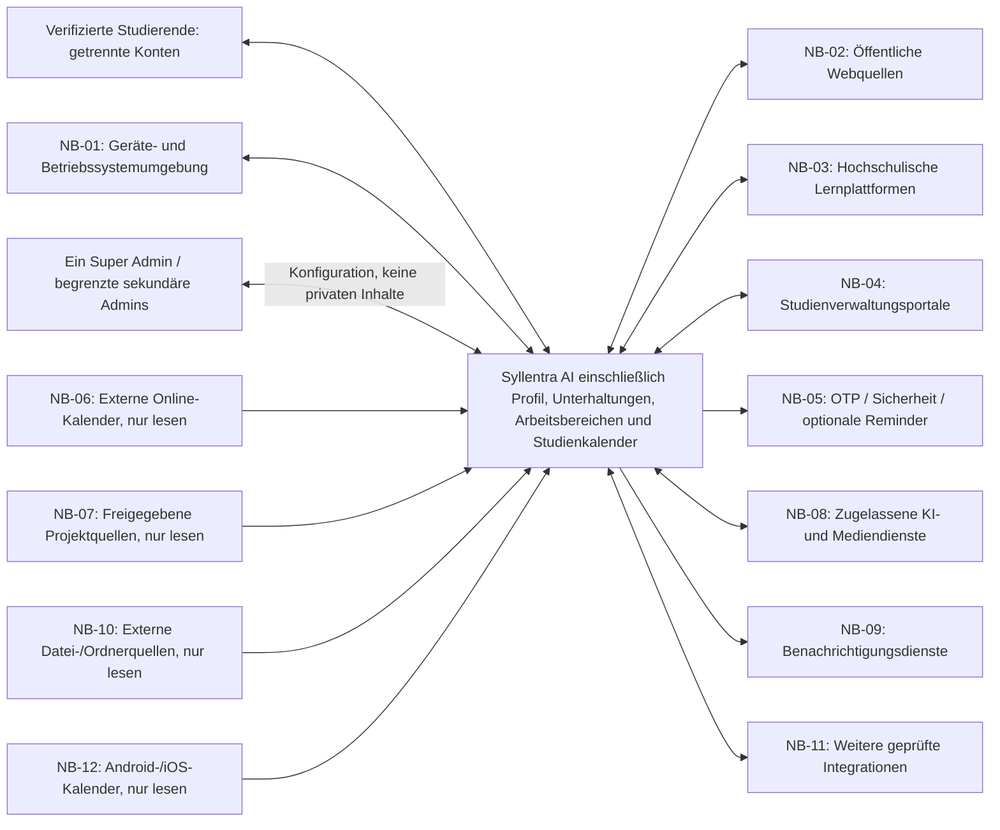

# P2 — Architekturüberblick

**Projekt:** Syllentra AI\
**Dokument:** P2 — Architekturüberblick\
**Version:** 0.12\
**Stand:** 26.10.2026\
**Status:** Zur Prüfung durch den Projektinhaber\
**Spezifikationsmethode:** Bausteine nach Johannes Siedersleben\
**Geltungsbereich:** Fachlicher Zielumfang der ersten Produktversion (V1)

---

## P2.1 Ziel, Systemkontext und Abgrenzung

### P2.1.1 Ziel dieses Bausteins

Dieser Baustein ordnet Syllentra AI in seine Systemumgebung ein. Er benennt Benutzer, Nachbarsysteme, wesentliche Informationsflüsse, Zugriffsrichtungen und fachliche Systemgrenzen. Er beschreibt außerdem die für diese Beziehungen grundlegenden Freigabe- und Konfigurationsprinzipien.

**P2 ist keine Festlegung einer technischen Komponentenarchitektur.** Entscheidungen über Programmiersprachen, Frameworks, Datenbanken, Hosting, konkrete APIs und Implementierungsmuster werden erst nach einer gesonderten Bewertung getroffen. Detaillierte Schnittstellenverträge gehören in S1, Dialogabläufe in B1, Hintergrundverarbeitungen in B2 und übergreifende Sicherheits- und Konfigurationskonzepte in N2.

### P2.1.2 Fachlicher Systemkern

Syllentra AI umfasst aus Benutzersicht die folgenden Verantwortlichkeiten:

- Individuelle Lernbegleitung und Prüfungsvorbereitung einschließlich Text-, Sprach- und weiterer geeigneter Medienformen.
- Einen geschützten Bereich „Mein Profil“ mit relevanten persönlichen Angaben, Foto oder Avatar, Sprachen, Hochschule, Studiengang, Abschluss, aktuellem und früheren Semestern, Modulen, Noten, ECTS, Zielen, Kompetenzen, Zertifikaten, Projekten, Erfahrungen und Lernpräferenzen.
- Gespeicherte „Unterhaltungen“, die der Nutzer anlegen, fortsetzen, umbenennen, durchsuchen, sortieren, organisieren, zuordnen, archivieren und kontrolliert löschen kann.
- Studienberatung sowie semester- und prüfungsbezogene Organisation in selbst verwaltbaren Semester-, Modul- und Kursarbeitsbereichen mit Lernzielen, Kapiteln, Themen, Materialien, Übungen, Bewertungen, Gesprächen, Terminen, Fortschritt und Kompetenzen.
- Persönliche, akademische und berufliche Projekte mit Beschreibung, Zielen, Ressourcen, Dateien, Unterhaltungen, Aufgaben, Fristen, Fortschritt, Kompetenzen und optional ausdrücklich freigegebenen Repository-Bezügen; unabhängig oder mit mehreren Modulen verbunden.
- Einen **eigenen internen Studienkalender** mit Vorlesungen, Prüfungen, Fristen und Lernphasen.
- Ein langfristiges, nachweisorientiertes Kompetenzportfolio.
- Verarbeitung, Verdichtung und zweckgebundene Speicherung persönlicher Lerninformationen.
- Recherche und autorisierte Nutzung externer Quellen und Werkzeuge.
- Wiederkehrende Prüfung relevanter Informationen, soweit Betrieb und Zugriffsrechte dies erlauben.
- Einen **Administrationsbereich**, in dem der Systeminhaber unterstützte Inhalte, Darstellungsmerkmale, Integrationen, Berechtigungen und Verhaltensparameter konfigurieren kann.
- Freigabe, Nachvollziehbarkeit und Kontrolle sensibler Aktionen.

Profil, Unterhaltungen, Semester-, Modul-, Kurs- und Projektarbeitsbereiche, Dokumenten- und Ressourcenverwaltung, interner Studienkalender, persönliche pädagogische Erinnerung, Kompetenzportfolio, Integrationskatalog und Administrationsbereich **sind fachliche Bestandteile von Syllentra AI und keine externen Nachbarsysteme**. Diese Aufzählung beschreibt Verantwortlichkeiten, keine technische Zerlegung in Komponenten oder Dienste.

Begriffe und Zielumfang entsprechen P1.4 K bis P. Ein Kurs bezeichnet eine Lehrveranstaltung im Studienkontext, ein Modul die zugehörige akademische Einheit. Projekte können unabhängig sein, mehrere Module verbinden und Semestergrenzen überschreiten. Dokumente und Unterhaltungen können mehreren fachlichen Kontexten zugeordnet sein. Die genaue Beziehungsmodellierung bleibt D1/D2 vorbehalten.

### P2.1.3 Benutzer und Systemgrenze

V1 unterstützt mehrere isolierte verifizierte Nutzerkonten und eine getrennte Administration. Die installierbare PWA besitzt auf unterstützten Android-/iOS-Konfigurationen eigene Identität und ein Startbildschirmsymbol; Smartphone-, Tablet- und Computeroberflächen sind angepasst. Framework und spätere native Apps bleiben offen. PWA-/Browser-/OS-Fähigkeiten werden geprüft, fehlende Funktionen verständlich durch Datei- oder Manuelleingabe ersetzt.

Lernende und Administratoren sind getrennte menschliche Rollen. V1 unterstützt mehrere isolierte Konten; genau ein Super Admin vergibt und entzieht die Rechte sekundärer Administratoren. Der KI-Assistent ist eine interne Assistenzfunktion, kein unabhängiger Akteur mit eigenen Entscheidungsrechten. Lehrende, Beratungsstellen und Hochschule bleiben externe fachliche Verantwortliche; Dienstanbieter verantworten ihre jeweiligen Nachbarsysteme. Eine Gerätefreigabe ist keine neue Benutzerrolle.

Außerhalb der fachlichen Systemgrenze befinden sich öffentliche Websites, Hochschulplattformen, Studienverwaltungsportale, E-Mail-Dienste, externe Kalender, mobile Betriebssystem-Kalenderfunktionen, GitHub und ausdrücklich freigegebene Projektquellen, externe KI- und Werkzeuganbieter sowie gegebenenfalls Benachrichtigungs- und Speicherdienste.

Offene Registrierung und E-Mail-OTP vor Anwendungsdatenzugriff gehören zu V1. Administrations-MFA, serverseitige Rollen- und Funktionsprüfung sowie freiwillige befristete Supportfreigaben schützen die privaten Konten (FE-59 bis FE-72).

### P2.1.4 Kontextdiagramm

Das Diagramm zeigt **logische Informationsbeziehungen**, keine bereits gewählten technischen Verbindungen. Bei lesenden Quellen zeigen die Pfeile die Übermittlung der Nutzdaten an Syllentra; zulässige Abrufanfragen ändern keine Quelldaten. NB-01 bezeichnet das Geräteumfeld, nicht eine externe Auslagerung der Syllentra-Clients. Bidirektionale Verbindungen gestatten nicht automatisch Schreibaktionen. Insbesondere bleiben **persönliche externe Kalender ausschließlich lesbar**; der Studienkalender wird intern geführt.

### P2.1.5 Leitprinzipien

1. **Quellenoffenheit:** Zugängliche Informationen aus geeigneten Quellen dürfen im zulässigen Umfang berücksichtigt werden; es besteht kein unbegrenzter Anspruch auf Zugriff auf alle Websites.
2. **Mehrere KI- und Werkzeuganbieter:** Syllentra soll nicht fachlich von einem einzigen Anbieter abhängig sein.
3. **Konfigurierbarkeit:** Die für den Betrieb vorgesehenen Inhalte und Einstellungen sollen über die Administrationsoberfläche änderbar sein, ohne Quellcode manuell anzupassen.
4. **Minimal erforderlicher Zugriff:** Jede Verbindung erhält nur die für ihren Zweck notwendigen Berechtigungen.
5. **Kontrollierte externe Aktionen:** Informationszugriff und tatsächliche Änderungen bei Dritten sind getrennt zu behandeln.
6. **Datensparsame Langzeitbegleitung:** Nützliche Wissens- und Kompetenzinformationen bleiben auf Wunsch erhalten; entbehrliche Roh- und Zwischendaten werden nach festgelegten Regeln entfernt.
7. **Überprüfbarkeit:** Quellen, wesentliche Freigaben und relevante Änderungen müssen nachvollziehbar sein.

---

## P2.2 Nachbarsysteme

### P2.2.1 Übersicht

Die Bezeichnungen sind zunächst **fachliche Systemkategorien** und keine Zusage einer schon funktionierenden technischen Integration. Die konkrete Auswahl und technische Machbarkeit werden in S1 geprüft.

| ID | Nachbarsystem / Kategorie | Aufgabe | Richtung und zulässiger Umfang | Voraussetzung |
|---|---|---|---|---|
| NB-01 | Benutzergeräte und ihre Betriebssystemumgebung | Gerätebedienung, Medienaufnahme und Berechtigungen für Syllentra-Clients | Bidirektionale Ein- und Ausgaben; synchronisierte Daten nur auf freigegebenen Geräten | Berechtigter Benutzer, Gerätefreigabe und erforderliche Betriebssystemrechte |
| NB-02 | Öffentliche Websites und Informationsquellen | Fachliche Recherche und Verifikation | Rechercheanfrage und Informationsabruf; keine unzulässigen Änderungen | Rechtlich und technisch zulässiger Zugriff |
| NB-03 | Hochschulische Lernplattformen | V1-Materialimport; optional offizielle Lesekonnektoren | Manuell bereitgestellte Inhalte; automatische Abrufe nur nach nachgewiesener Unterstützung und Opt-in | Nutzungsrechte und ausdrückliche Aktivierung (FE-27) |
| NB-04 | Studienverwaltungsportale | Freiwillig bereitgestellte Studieninformationen | V1 manuelle Importe; keine automatische Anmeldung oder verbindliche Hochschulaktion | Herkunft und Bestätigung; offizielle optionale Verbindung gesondert nachweisen (FE-27) |
| NB-05 | E-Mail-Dienste | OTP/Sicherheitspost; optionale Erinnerungen | Systemversand zweckgebunden; keine Postfachlektüre, -synchronisation oder -überwachung in V1 | Verifizierte private Primäradresse; Erinnerung opt-in, Inboxentscheidung FE-56: V1-Postfachzugriff ausgeschlossen, Zukunft unverbindlich |
| NB-06 | Externe Online-Kalender | Persönliche zeitliche Verfügbarkeit bestimmen | **Ausschließlich lesend**, keine Erstellung, Änderung oder Löschung | Autorisierte Verbindung |
| NB-07 | GitHub und andere freigegebene Projektquellen | Projekt- und Kompetenzanalyse | **V1 nur lesend: ausgewählte oder alle eigenen öffentlichen Repositories** | Freiwillige offizielle Kontoverbindung und sichtbar bestätigter Umfang (FE-43) |
| NB-08 | Externe KI- und Medienverarbeitungsdienste | Text, Sprache, Dokumente, Recherche, Bild, Audio und Video | Aufgabenabhängiger, kontrollierter Austausch | Unterstütztes Verfahren, Freigabe, Kosten- und Datenschutzprüfung |
| NB-09 | Benachrichtigungsdienste | Relevante Hinweise außerhalb der aktiven Sitzung | Überwiegend ausgehend | Geräteberechtigung und geeigneter Betrieb |
| NB-10 | Optionale externe Speicherdienste | Freiwilliger Datei-/Ordnerimport | **Ausschließlich lesend**, keine externen Änderungen | Offizieller unterstützter Konnektor, gewählter Umfang; eigene Syllentra-Cloud ist intern (FE-50) |
| NB-11 | Weitere integrierbare Anwendungen und Werkzeuge | Künftig ergänzte fachliche Fähigkeiten | Von der freigegebenen Integration abhängig | Prüfung und Autorisierung |
| NB-12 | Lokale Kalenderfunktionen von Android/iOS | Auf dem Gerät verfügbare Termine und freie Zeiträume ermitteln | **Ausschließlich lesend**, keine Änderung am Gerätekalender | Betriebssystemberechtigung |

### P2.2.2 NB-01 — Benutzergeräte und ihre Betriebssystemumgebung

Die Anwendung muss auf den in P1 definierten Geräteklassen bedienbar und auf Android und iOS installierbar sein. Der Benutzer kann Lernmaterialien bereitstellen, schriftlich oder sprachlich lernen, Profil und Unterhaltungen verwalten, Semester, Module, Kurse und Projekte organisieren, den internen Studienkalender verwenden sowie Daten und administrative Einstellungen ändern. V1 verwendet eine installierbare PWA; Framework und spätere native Apps bleiben offen. Tatsächliche PWA-/OS-Fähigkeiten werden geprüft und fehlende Zugänge durch manuelle oder dateibasierte Wege ersetzt (FE-55).

Die Syllentra-Client-Anwendungen gehören zum Produkt. Als Nachbar NB-01 wird die umgebende Geräte- und Betriebssystemfunktionalität betrachtet, über die Benutzeraktionen, Aufnahme und Berechtigungen vermittelt werden; die bisherige Kennung bleibt erhalten. Profil und Identität werden nicht als feste persönliche Angaben im Client hinterlegt.

Mikrofon-, Kalender- und Benachrichtigungszugriffe benötigen die vorgesehenen Berechtigungen. Ablehnen oder Widerrufen darf weder umgangen werden noch weiterhin mögliche Text- oder manuelle Organisationsfunktionen blockieren. Kalendereinträge der Geräte werden ausschließlich über den lesenden Umfang von NB-12 berücksichtigt.

Freigegebene Profil-, Verlaufs-, Studien-, Projekt-, Kalender- und Konfigurationsdaten müssen nach abgeschlossener Synchronisation auf den autorisierten Geräten konsistent verfügbar sein. Geräte können freigegeben und entzogen werden; nach Entzug sind weitere Zugriffe ausgeschlossen. Bereits lokal vorhandene Daten, Verbindungsunterbrechungen und Bearbeitungskonflikte benötigen transparente Behandlung nach N2. Ein veralteter Stand darf nicht unbemerkt einen neueren überschreiben. Text- und Sprachwechsel erhält den verfügbaren Gesprächskontext; nicht verfügbare Teile sind kenntlich zu machen. Heruntergeladene eigene Daten sind offline les- und bearbeitbar; Änderungen werden zur konfliktgeprüften Synchronisation vorgemerkt. Nicht heruntergeladene Inhalte und Cloud-KI stehen offline nicht zur Verfügung (FE-34, FE-35).

Direkt hochgeladene Dateien, Notizen und Aufzeichnungen werden über die Client-Anwendung eingebracht. **Benutzerdateien sind Eingaben, kein eigenständiges Nachbarsystem.**

### P2.2.3 NB-02 — Öffentliche Websites und Informationsquellen

Syllentra soll relevante öffentliche Quellen eigenständig recherchieren können, beispielsweise offizielle Hochschulseiten, Modulhandbücher, Dokumentationen, wissenschaftliche Veröffentlichungen und fachliche Lernressourcen.

Die Recherche muss Herkunft, Aktualität, Relevanz und Widersprüche berücksichtigen. Öffentlich zugängliche Inhalte sind **Informationen und keine Anweisungen**, die Berechtigungen des Assistenten verändern dürfen. Webseiten mit Zugangsbeschränkungen, unzulässigen Abrufverfahren oder nicht unterstützten technischen Voraussetzungen dürfen nicht umgangen werden.

### P2.2.4 NB-03 — Hochschulische Lernplattformen

V1 übernimmt rechtmäßig manuell bereitgestellte Kursunterlagen, Aufgaben und Meldungen. Ein automatischer Moodle-/THM-Abruf setzt einen nachweislich funktionierenden offiziellen Konnektor und ausdrückliches Opt-in voraus; dessen Existenz wird nicht zugesagt (FE-27).

Eine automatische Aufgabenabgabe oder Veröffentlichung ist durch einen bloßen Lesezugriff nicht autorisiert.

### P2.2.5 NB-04 — Hochschul- und Studienverwaltungsportale

V1 verarbeitet freiwillig manuell bereitgestellte Informationen über Module, Leistungen, Prüfungszeiträume und Fristen. Eine automatische Portalanmeldung oder Prüfungsan-/abmeldung gehört nicht zur V1-Freigabe. Spätere verbindliche Vorgänge benötigen eine eigene fachliche Entscheidung, offizielle Anbindung und ausdrückliche Bestätigung. Amtliche Entscheidungen trifft weiterhin die Hochschule (FE-27).

### P2.2.6 NB-05 — E-Mail-Dienste

V1 nutzt NB-05 ausgehend für angeforderte E-Mail-OTP, Sicherheits- und Kontomitteilungen sowie optional aktivierte Erinnerungen. Der jeweils ausgelöste Verifikationsvorgang beziehungsweise die Kanalwahl autorisiert diesen zweckgebundenen Systemversand ohne künstliche zweite Einzelbestätigung. Private verifizierte Primäradresse und zusätzliche Hochschuladresse sind getrennt. Manuell bereitgestellte Nachrichten dürfen als Dateien verarbeitet werden; sie erteilen keine Postfachberechtigung. **FE-56: Lektüre, Synchronisation und Überwachung jedes E-Mail-Postfachs sind in V1 ausgeschlossen, auch mit Nutzer- oder Adminfreigabe. Eine spätere Integration ist lediglich eine unverbindliche Zukunftsoption ohne Realisierungszusage.** Individuell entworfene externe Nachrichten benötigen weiterhin eine konkrete Versandfreigabe.

### P2.2.7 NB-06 — Externe Online-Kalender

Online-Kalender, auf die der Benutzer Zugriff gewährt, dienen Syllentra **nur zur Ermittlung von belegten und freien Zeiten**. Das System darf darüber keine Ereignisse erzeugen, verschieben oder löschen, auch wenn ein Anbieter technisch Schreibfunktionen anbietet.

Wo möglich, sollen reine Verfügbarkeitsangaben statt vollständiger privater Termindetails verarbeitet werden. Schreibberechtigungen sollen für diese Verbindung nicht angefordert werden.

### P2.2.8 NB-07 — GitHub und autorisierte Projektquellen

Nach freiwilliger offizieller Kontoverbindung wählt der Nutzer ausdrücklich einzelne öffentliche Repositories oder den Umfang „alle meine öffentlichen Repositories“. Eine Einzelauswahl erweitert sich niemals still auf das gesamte Konto. Neue eigene öffentliche Repositories dürfen nur im ausdrücklich gewählten Gesamtumfang und nach dessen Synchronisationsregel berücksichtigt werden. Private Repositories und jegliche Schreiboperation sind in V1 ausgeschlossen (FE-43).

Für Kompetenzbewertungen muss zwischen eigener Arbeit, Teambeiträgen und KI-generierten Anteilen differenziert werden, soweit entsprechende Nachweise vorliegen. Die reine Projektanalyse ist lesend. Eine zukünftige Schreibintegration wäre ein eigenständiger Berechtigungs- und Freigabefall.

### P2.2.9 NB-08 — KI- und Medienverarbeitungsdienste

Syllentra soll je nach Bedarf unterschiedliche KI-Modelle und spezialisierte Werkzeuge nutzen können, beispielsweise für:

- Fachliche Erklärungen, Zusammenfassungen und Prüfungstraining.
- Recherche und Quellenprüfung.
- Dokumenten- und Projektanalyse.
- Transkription, Spracherkennung und Sprachausgabe.
- Erstellung geeigneter Bilder, Audio- und Videolerninhalte.
- Weitere unterstützte fachspezifische Aufgaben.

**Vorhandene Benutzerabonnements** (beispielsweise ChatGPT oder Claude) sollen berücksichtigt werden können, **sofern** der betreffende Anbieter für die gewählte Anwendung und Betriebsform eine offizielle, geeignete Verbindung gestattet. Ein normales Benutzerabonnement ist **nicht automatisch** ein frei nutzbarer API-Zugang und verleiht keinen automatischen Zugriff auf frühere Gespräche oder die Erinnerungen eines fremden Dienstes.

Syllentra soll unterstützte Modelle und Werkzeuge anhand von Eignung, Berechtigungen, Datenschutz, Leistungsfähigkeit, Verfügbarkeit, Nutzungslimits und Kosten auswählen können. Der Benutzer soll unterstützte Anbieter aktivieren, deaktivieren und gegebenenfalls bevorzugen können. Eine kostenpflichtige Zusatznutzung darf nicht unbemerkt ausgelöst werden.

Eine Datenübermittlung an KI-Anbieter setzt geeignete Verarbeitungs- und Aufbewahrungsbedingungen voraus. Anbieter, deren Bedingungen den Anforderungen widersprechen, dürfen für die betreffenden Informationen nicht eingesetzt werden.

### P2.2.10 NB-09 — Benachrichtigungsdienste

Wichtige Änderungen und Hinweise sollen, soweit technisch unterstützt und erlaubt, auch bei geschlossener Anwendung zugestellt werden können. Nachrichten sollen möglichst keine unnötigen privaten Inhalte in Sperrbildschirmvorschauen offenlegen. Relevante Hinweise müssen außerdem innerhalb von Syllentra abrufbar bleiben.

### P2.2.11 NB-10 — Optionale externe Speicherdienste

Drive, OneDrive und Dropbox sind optionale externe Importquellen mit offiziell unterstütztem, freiwillig aktiviertem Lesezugriff auf ausgewählte Dateien oder Ordner. Syllentra erstellt, ändert und löscht dort nichts. Nach Widerruf stoppen weitere Zugriffe; zulässig importierte eigene Kopien bleiben erhalten. Die zentrale eigene Syllentra-Cloud mit EU-Datenhaltung und Sicherungen ist dagegen ein interner Produktbestandteil; ihr Anbieter ist offen (FE-33, FE-42, FE-50, FE-75).

### P2.2.12 NB-11 — Erweiterbare Anwendungen und Werkzeuge

Neue unterstützte Dienste sollen über einen **Integrationskatalog** hinzugefügt und verwaltet werden können. Dieser kann vordefinierte Anbieter und geeignete benutzerkonfigurierbare Verbindungen enthalten.

Das Einfügen einer URL stellt **für sich allein keine funktionsfähige oder vertrauenswürdige Integration** her. Der Dienst muss ein unterstütztes Verbindungsverfahren bieten, und die Verbindung muss vor ihrer Aktivierung auf Berechtigungen und Sicherheit geprüft werden. Eine Dienstadresse allein darf insbesondere keinen unbekannten Konnektor installieren oder ausführen. Anbieteridentität, unterstütztes Verfahren, Datenumfang, Rechte und Verarbeitungsbedingungen sind vor Aktivierung zu prüfen. Neue Protokolle oder bislang nicht unterstützte Fähigkeiten können zusätzliche Entwicklungsarbeit erfordern.

### P2.2.13 NB-12 — Lokale Android-/iOS-Kalender

Mit geeigneter Betriebssystemberechtigung soll die mobile Anwendung Termine der auf dem Gerät verfügbaren Kalender **lesend** berücksichtigen können. Zweck ist die Bestimmung von freien und belegten Zeiträumen für eine konfliktarme Studienplanung.

Syllentra erhält für diese Integration **keine fachliche Erlaubnis zum Schreiben, Ändern oder Löschen von Gerätekalenderterminen**. Auch hier sollen private Details nur verarbeitet werden, soweit sie für die Aufgabe erforderlich sind.

Die Hintergrundaktualisierung hängt von den tatsächlichen Möglichkeiten und Berechtigungen der jeweiligen Betriebssysteme ab. Eine doppelte Berücksichtigung desselben Kalenders über NB-06 und NB-12 muss bei der Planung vermieden werden.

---

## P2.3 Interner Studienkalender und Terminflüsse

### P2.3.1 Abgrenzung der zwei Kalenderarten

Syllentra unterscheidet verbindlich:

| Kalenderart | Verwendung | Schreibzugriff durch Syllentra |
|---|---|---|
| Persönlicher Online- oder Gerätekalender | Verfügbarkeit und Überschneidungen erkennen | **Nein: ausschließlich lesen** |
| Interner Syllentra-Studienkalender | Lehrveranstaltungen, Prüfungen, Fristen, Wiederholungen und Lernplanung verwalten | **Ja, nach den Freigabe- und Verwaltungsregeln der Anwendung** |

Persönliche und akademische Termine können zur Anzeige gemeinsam berücksichtigt werden; ihre Herkunft und Schreibzuständigkeit müssen aber unterscheidbar bleiben. Eine Zusammenführung der Ansicht bedeutet **keine Vermischung der tatsächlichen Kalenderbestände**.

### P2.3.2 Pflege des internen Studienkalenders

Der interne Studienkalender soll auf drei Wegen befüllt werden können:

1. **Manuelle Eingabe und Bearbeitung** durch den Benutzer.
2. **Import eines Stundenplans oder geeigneter Studienunterlagen**, wobei die erkannten Termine vor der Übernahme geprüft und bestätigt werden.
3. **Automatisch vorbereitete Vorschläge des Assistenten**, beispielsweise Lernzeiten, Wiederholungen und Klausurvorbereitung, die erst nach Bestätigung übernommen werden.

Eine vom Benutzer direkt vorgenommene und gespeicherte manuelle Bearbeitung ist bereits eine bewusste Benutzeraktion; dafür ist nicht zusätzlich ein zweiter KI-Freigabedialog erforderlich. **Vom Assistenten vorbereitete Einträge und Änderungen sowie Imports müssen vor der Übernahme überprüfbar und freigegeben sein.** Destruktive Löschungen behalten ihre angemessene Bestätigung nach P1; diese Regel begründet keinen zusätzlichen Dialog für gewöhnliche manuelle Speicherung.

Der Studienkalender soll Semester, Module, Prüfungsphasen, Lernfortschritt, Abgaben und persönliche Verfügbarkeiten berücksichtigen. Die Konsistenz des Studienkalenders über die autorisierten unterstützten Geräte hinweg ist erforderlich; der konkrete technische Synchronisationsmechanismus bleibt offen. Herkunft, Zuordnungen zu Kursen, Modulen oder Projekten, Zeitzonen, mögliche Dubletten und Überschneidungen müssen erkennbar berücksichtigt werden. Imports dürfen bei Wiederholung keine unbemerkten Dubletten oder Überschreibungen erzeugen.

### P2.3.3 Umgang mit persönlichen Kalenderdaten

Für die Lernplanung sollen vorzugsweise belegte und freie Zeiträume statt vollständiger privater Termininhalte verarbeitet werden. **Eine vollständige dauerhafte Kopie privater Kalender ist nicht vorgesehen.** Externe KI-Werkzeuge dürfen persönliche Kalenderdetails nur erhalten, wenn dies für die Aufgabe nötig und entsprechend autorisiert ist.

### P2.3.4 Kalenderbezogene Konflikte und Ausfälle

Kann ein externer Kalender nicht gelesen werden, muss Syllentra diese Einschränkung kenntlich machen und eine manuelle Pflege der Verfügbarkeiten ermöglichen. Fehlende Berechtigungen dürfen nicht umgangen werden. Nicht bestätigte Vorschläge sind von verbindlich eingeplanten Terminen zu unterscheiden.

---

## P2.4 Erweiterbarer Integrationskatalog und KI-Auswahl

### P2.4.1 Katalog in der Benutzeroberfläche

Syllentra soll eine Verwaltungsansicht **„Integrationen & Plugins“** bereitstellen. Dort sollen unterstützte KI-Anbieter, darunter ChatGPT, Claude und weitere kompatible Dienste, Hochschuldienste, Informationsquellen, Kalender, E-Mail- und Entwicklungswerkzeuge gesucht, nach Kategorie gefiltert und ausgewählt werden können.

Für jeden Eintrag soll angezeigt werden können:

- Name, Kategorie, Anbieter und Zweck.
- Verfügbare Funktionen sowie eventuelle Funktionsgrenzen.
- Unterstützte Anmelde- und Verbindungsmethoden.
- Benötigte Daten und Zugriffsrechte.
- Verfügbarkeit, Verbindungsstatus und eventuelle Kontingente.
- Mögliche Kosten und Freigabeanforderungen.
- Datenschutz-, Aufbewahrungs- und Löschbedingungen.
- Möglichkeiten zum Testen, Deaktivieren und Widerrufen.

### P2.4.2 Hinzufügen und Entfernen

Der Systeminhaber soll unterstützte Integrationen aus einer Liste auswählen und deren offizielle Verbindung einrichten können. Für geeignete Verbindungstypen kann alternativ eine geprüfte Dienstadresse oder Konfiguration eingegeben werden.

Die Eingabe einer Adresse darf nur einen bereits unterstützten Verbindungstyp konfigurieren. Sie darf keinen fremden Konnektor installieren oder ungeprüften Code ausführen. Vor Aktivierung sind Anbieteridentität, unterstütztes Verfahren, erforderliche Rechte, Kosten und Verarbeitungsbedingungen zu prüfen. Nicht unterstützte Adressen werden mit einer verständlichen Einschränkung abgewiesen.

Nach erfolgreicher Autorisierung sollen die freigegebenen Fähigkeiten erkennbar sein. Eine Verbindung muss deaktiviert und ihre Freigabe in Syllentra entzogen werden können; weitere Aufrufe werden dadurch unterbunden. Ein zusätzlich erforderlicher anbieterbezogener Widerruf und dessen erreichter Status müssen angezeigt werden, soweit das offizielle Verfahren ihn unterstützt. Der Entzug darf keine bereits an Dritte übermittelten Daten als automatisch gelöscht ausgeben. Zugangstoken und Geheimnisse dürfen nicht als normale Texteinstellungen oder im öffentlichen Repository gespeichert werden.

### P2.4.3 Nutzung mehrerer KI-Dienste

Der Benutzer soll einen unterstützten KI-Dienst auswählen, bevorzugen oder die Auswahl geeigneter Werkzeuge dem Assistenten überlassen können. Die Auswahl muss bestehende Nutzungslimits, zu erwartende Zusatzkosten, fachliche Eignung und Datenschutzbedingungen berücksichtigen.

**Unbekannte oder kostenpflichtige Dienste werden nicht stillschweigend als Ersatz verwendet.** Ist ein Dienst nicht verfügbar, muss der Benutzer über die Einschränkung und gegebenenfalls geeignete Alternativen informiert werden.

Vorhandene Abonnements ersetzen keine gesonderte API-Berechtigung. Offizielle Nutzbarkeit ist für Anbieter und Betriebsform zu prüfen; weder externe Gesprächsverläufe noch fremde Erinnerungen werden allein durch die Verbindung zugänglich. Ausgaben sind nur im ausdrücklich autorisierten Umfang zulässig. Verbrauch, Kontingente, Kostenrahmen und Grenzen eines Anbieter- oder Modellwechsels müssen sichtbar sein. Bei ausgeschöpftem Limit oder ungeeigneten Datenschutzbedingungen darf kein stillschweigender Ersatzaufruf erfolgen.

### P2.4.4 Grenzen der Erweiterbarkeit

Ein vorhandener, kompatibler Konnektor kann administrativ aktiviert oder konfiguriert werden. Eine völlig neue externe API, ein bisher nicht unterstütztes Anmeldeverfahren oder eine neue fachliche Fähigkeit kann hingegen zusätzliche Backend-Implementierung erfordern. Diese Grenze muss in der Benutzeroberfläche klar erkennbar sein.

---

## P2.5 Administrationsoberfläche und konfigurierbares Verhalten

### P2.5.1 Grundsatz: Konfiguration statt Quellcodeänderung

**Alle ausdrücklich vorgesehenen und dafür geeigneten Einstellungen der Anwendung müssen zur Laufzeit über das Administratorkonto verwaltbar sein.** Der Systeminhaber soll für normale redaktionelle, gestalterische, organisatorische und fachliche Anpassungen keinen Quellcode öffnen oder neu bereitstellen müssen.

Einstellungen sollen als **strukturierte, persistente Konfigurationsdaten** behandelt werden. Dabei handelt es sich nicht um die Forderung, jede Softwarefunktion durch eine einzelne Programmvariable ersetzen zu können. Welche Optionen administrierbar sind, wird im jeweiligen Funktionsbaustein spezifiziert und durch die Anwendung unterstützt.

### P2.5.2 Konfigurierbare Bereiche

| ID | Konfigurationsbereich | Erwartete administrative Möglichkeiten |
|---|---|---|
| CFG-01 | Anwendung und Branding | Anwendungsname, Seitenüberschriften, Untertitel, Logo, unterstützte Icons und Branding-Elemente verwalten |
| CFG-02 | Texte und Sprache | Sichtbare Texte, Beschriftungen, Hilfetexte, Begrüßungen und unterstützte Sprachfassungen ändern |
| CFG-03 | Erscheinungsbild | Unterstützte Farbpaletten, Hell-/Dunkelmodus, Typografieoptionen, Abstände und vordefinierte Gestaltungsvarianten auswählen |
| CFG-04 | Navigation und Seiten | Sichtbarkeit, Reihenfolge, Namen und unterstützte Anordnung vorhandener Menüpunkte, Seiten und Bereiche verwalten |
| CFG-05 | Dashboard | Unterstützte Kacheln, Kennzahlen, Reihenfolgen und Dashboard-Ansichten konfigurieren |
| CFG-06 | Studienorganisation | Semesterinformationen, Module, Fristenkategorien, Stundenplan- und Lernplanvorlagen verwalten |
| CFG-07 | Pädagogisches Verhalten | Unterstützte Lernmodi, Erklärungstiefe, Wiederholungs- und Übungspräferenzen sowie verfügbare Lernparameter anpassen |
| CFG-08 | Fortschritt und Kompetenzen | Unterstützte Darstellungs-, Bewertungs- und Nachweisregeln innerhalb fachlich zulässiger Grenzen verwalten |
| CFG-09 | Benachrichtigungen und Prüfungen | Themen, Prioritäten, zulässige Prüfrhythmen, Benachrichtigungskanäle und Ruhezeiten einstellen |
| CFG-10 | Integrationen und KI | Dienste hinzufügen, verbinden, bevorzugen, deaktivieren, Berechtigungen prüfen sowie kompatible Modelle und Werkzeuge auswählen |
| CFG-11 | Kostenkontrolle | Erlaubte kostenpflichtige Funktionen, Ausgabenlimits, Warnschwellen und entsprechende Freigaben verwalten |
| CFG-12 | Datenschutz und Datenhaltung | Daten einsehen, korrigieren, exportieren und löschen sowie zulässige Aufbewahrungseinstellungen verwalten |
| CFG-13 | Rollen und Aktionsfreigaben | Persönliche Verwaltungsberechtigungen und unterstützte Freigaberegeln innerhalb verbindlicher Sicherheitsgrenzen verwalten |
| CFG-14 | Mein Profil | Unterstützte Profilfelder, Sichtbarkeit, Sprachen, Präferenzen und Nachweiskennzeichnungen konfigurieren; persönliche Feldwerte bleiben geschützte Nutzerdaten |
| CFG-15 | Unterhaltungen | Unterstützte Ordnungs-, Such-, Sortier-, Zuordnungs- und Archivoptionen sowie Aufbewahrung und Kontextpräferenzen verwalten; Erinnerung und Nachrichtenverlauf getrennt behandeln |
| CFG-16 | Kurse und Projekte | Unterstützte Vorlagen, Metadaten, Kategorien, Lernziele, Fortschrittsdarstellungen und Zuordnungsoptionen für Module, Kurse und Projekte konfigurieren; unabhängige und modulübergreifende Projekte erhalten |
| CFG-17 | Mobile Navigation | Namen, Reihenfolge und Sichtbarkeit vorhandener mobiler Menüpunkte, Bereiche und Dashboard-Widgets konfigurieren; wesentliche Bedienung, Freigaben und Datenkontrolle erreichbar halten |

**Beispiel:** Soll aus einer Seite „Mein Studium“ später „Studienübersicht“ werden, soll der Administrator die entsprechende Beschriftung in der Anwendung bearbeiten und speichern können, **ohne eine Quellcodedatei zu ändern**. Dasselbe gilt für andere unterstützte Seitentitel, Schaltflächenbeschriftungen, Menünamen und Branding-Angaben.

CFG-14 bis CFG-17 präzisieren die bereichsbezogenen Optionen innerhalb der allgemeinen Bereiche CFG-01 bis CFG-13; sie schaffen keine voneinander unabhängigen widersprüchlichen Einstellungen. Persönliche Profilwerte, Gesprächsinhalte und konkrete Projektressourcen sind Nutzerdaten, keine öffentlich sichtbaren Administrationsparameter. Das Verbergen eines Bereichs ändert keine Datenzugriffsrechte.

Administrativ verwaltbare Anwendungsidentität, Logos und Symbole werden soweit möglich durch Konfiguration berücksichtigt. Vom Betriebssystem oder Installationspaket festgelegte Merkmale können zusätzlich eine aktualisierte Installation erfordern; damit wird kein beliebiges Umbenennen einer bereits installierten Anwendung außerhalb der Plattformregeln zugesagt.

### P2.5.3 Sicherer Konfigurationsprozess

Für wesentliche Einstellungen soll die Administrationsoberfläche — soweit für den Einstellungstyp sinnvoll — Folgendes anbieten:

1. Bestehenden Wert und Bedeutung anzeigen.
2. Neuen Wert eingeben oder aus unterstützten Optionen auswählen.
3. Eingaben validieren und unzulässige Werte zurückweisen.
4. Änderungen vor ihrer Veröffentlichung in einer Vorschau prüfen.
5. Gültige Änderungen geschützt und persistent speichern; wesentliche Änderungen nachvollziehbar versionieren.
6. Bei geeigneten Einstellungen eine vorherige gültige Fassung wiederherstellen und dabei aktuelle Schutzgrenzen erneut prüfen.

Gespeicherte Einstellungen sollen in den unterstützten Clients konsistent berücksichtigt werden. Änderungen müssen nach einem Neustart der Anwendung bestehen bleiben, sofern sie als dauerhaft konfiguriert wurden.

Nur der berechtigte Administrator darf diese Konfigurationen ändern. Ungültige Eingaben müssen vor Wirksamwerden abgewiesen werden; widersprüchliche gleichzeitige Änderungen dürfen nicht unbemerkt gespeichert werden. Vorschau und Rücknahme beziehen sich auf Konfigurationen, nicht auf eine automatische Rückabwicklung versandter Nachrichten, verbrauchter Kosten oder endgültig gelöschter Daten.

### P2.5.4 Unveränderliche Schutzgrenzen

Der Administrationsbereich darf nicht durch bloße Text- oder Variablenänderungen:

- Unzulässige Zugriffe auf externe Systeme oder nicht freigegebene Geräte erlauben.
- Schreibzugriffe auf persönliche externe Kalender aktivieren.
- Nicht autorisierte Ausgaben oder eine stillschweigende Erweiterung von Kostenfreigaben zulassen.
- Verbindliche Sicherheitskontrollen umgehen.
- Geheimnisse als öffentlich sichtbare Einstellungen offenlegen.
- Nicht unterstützte externe APIs als bereits funktionsfähig ausgeben.
- Gesetzliche oder zwingende datenschutzrechtliche Verpflichtungen abschalten.
- Beliebigen Programmcode, ungeprüftes HTML oder fremde Skripte als normale Gestaltungsoption ausführen.

**Konfigurierbarkeit bedeutet nicht beliebige Änderung der Softwarelogik ohne Entwicklung.** Neue fachliche Funktionen, neue Verbindungstechniken und Änderungen des Sicherheitskerns können weiterhin Code- und Architekturarbeit erfordern.

### P2.5.5 Detaillierungsgrenze

Dieser Baustein legt den fachlichen Anspruch an administrative Konfigurierbarkeit fest. Die konkreten Administrationsdialoge gehören nach B1, die fachlichen Funktionen nach F2/F3 und das Konfigurations-, Berechtigungs- und Sicherheitskonzept nach N2. Das zugehörige fachliche Datenmodell wird in D1 definiert.

---

### P2.5.6 Verbindlicher Darstellungs- und Konfigurationsrahmen aus Mission 23

Quelle: Eigentümerauftrag Mission 23, vollständig übergeben am 26.10.2026. Die folgenden fachlichen Prinzipien sind bestätigt; Dokumentfreigabe, konkrete Gestaltung und Produktnachweise bleiben getrennt. CFG-01 bis CFG-17 werden erweitert, nicht ersetzt. Es entstehen weder ein neues Nachbarsystem noch neue FE oder UC.

Syllentra ist eine eigenständige, hochwertige, farbenfrohe Lernumgebung mit wiedererkennbarer Typografie, ausgewogenen Farbwelten und unterscheidbaren Lernbereichsakzenten. Semester, Module, Kurse, Materialien, Aufgaben, Planung, Übungen, Fortschritt und persönliche Wissensorganisation tragen die Navigation; der KI-Assistent ist darin eingebettet. Ein austauschbares Chatfenster mit dekorativen Dashboard-Karten erfüllt diesen Anspruch nicht. Responsive, touchfreundliche Bedienung, klare Hierarchie, helle/dunkle Varianten, sichtbarer Fokus, zusätzliche Text-/Symbolsignale und reduzierte Bewegung bleiben verbindlich. Unterstützte Design-Tokens bilden ein einheitliches Designsystem; Logo, Markenpalette, konkrete Schriften und Illustrationsstil sind **Zur Entscheidung**, nicht durch Beispiele ausgewählt.

**Konfigurationshierarchie, von höchstem zu niedrigstem Vorrang:**

1. Verbindliche Sicherheits-, Datenschutz- und Barrierefreiheitsregeln.
2. Zentrale administrative Richtlinien.
3. Administrativ freigegebene System- und Theme-Standards.
4. Persönliche Benutzerpräferenzen innerhalb des erlaubten Rahmens.

Persönliche Auswahl darf freigegebene Standards übersteuern, soweit keine übergeordnete Richtlinie entgegensteht; ein Standard allein ist keine erzwungene Auswahl. AF-25 prüft die wirksame Darstellung gegen alle vier Ebenen. Zentrale Freigaben und Sperren werden serverseitig geprüft, auch bei manipuliertem Client, direktem API-Aufruf, Altpräferenz oder Reimport. Das ist keine Garantie über die Darstellung eines beliebig manipulierten Clients, sondern eine verbindliche Grenze der akzeptierten Konfiguration und geschützten Funktionen.

| Vorhandener Bereich | Bestätigte Präzisierung |
|---|---|
| CFG-01/02 | Branding, Seitentitel, Bereichs-/Navigationsnamen, Beschreibungen, Begrüßung, Einführung, Hilfe, Tooltips, Verfügbarkeitsmeldungen, Wartungs-/Ankündigungsbanner, freigegebene Startseitentexte und Theme-Namen/-Beschreibungen in unterstützten Sprachfassungen bearbeiten. |
| CFG-03/14 | Persönlich erlaubtes Farbschema, Akzentfarbe/-palette und unabhängig davon Hell-/Dunkel-/Systemmodus wählen, vor Übernahme ansehen und auf den aktuell gültigen Standard zurücksetzen. Nicht zulässige Farb-/Kontrastkombinationen begrenzen oder nachvollziehbar geeignet anpassen. |
| CFG-03/13 | Super Admin verwaltet im getrennten Administrationsbereich unterstützte Themes: erstellen/konfigurieren, bearbeiten, aktivieren/deaktivieren, ausblenden, zur Auswahl freigeben, Standard bestimmen oder ein einziges Theme erzwingen; individuelle Farbauswahl und saisonale Automatik erlauben/sperren. |
| CFG-04/05/15/16/17 | Unterstützte Navigation, Startseite, Dashboard-Komponenten und Bereichssichtbarkeit lernzentriert konfigurieren; Gesprächs- und Kurs-/Projektoptionen bleiben bereichsbezogen, keine neue Funktion durch Umbenennung. Mobile Zugänge zu Einwilligungen, Sicherheit und Datenkontrolle erreichbar halten. |
| CFG-03/13 und FE-58 | Theme-Testvarianten nur für ausdrücklich berechtigte Testkonten nach den bestehenden Rollen-/Serverflag-Regeln freigeben; die normale Benutzeroberfläche enthält keine administrativen Veröffentlichungsrechte. |

**Saisonale Darstellung:** Ein Benutzer kann bei administrativer Freigabe ausdrücklich „Automatisch nach Jahreszeit“ wählen. Frühling, Sommer, Herbst und Winter werden konfigurierbar freigegebenen Themes zugeordnet, nicht fest in fachlicher Programmlogik an Paletten gebunden. Die geltende Regel muss Region beziehungsweise Hemisphäre, Datum und Zeitzone eindeutig auswerten und eine Regelrevision benennen. Eine feste kalenderbasierte Zuordnung ist lediglich ein V1-Kandidat. Saisonbeginn/-grenzen, Herkunft und Standard von Region/Zeitzone sowie konkrete Saisonlogik bleiben **Zur Entscheidung**; keine stille Standortermittlung oder Wetterintegration. Ohne bestätigte vollständige Regel keine vorgetäuschte automatische Saisonbestimmung; zulässigen Standard mit Erklärung zeigen. Manuelle Wahl bleibt möglich, soweit freigegeben.

Wird ein Theme erzwungen oder eine persönliche Option gesperrt, gilt die zentrale Richtlinie. Gesperrte Optionen sind verborgen oder verständlich als nicht verfügbar gekennzeichnet, entsprechend FE-58. Frühere persönliche Präferenzen bleiben nur nach geltenden Retentions-/Löschregeln erhalten und werden erst nach erneuter Freigabe und erneuter Gültigkeitsprüfung berücksichtigt. Gelöschte Werte werden nicht rekonstruiert. Veraltete oder deaktivierte Theme-Referenzen führen zum aktuell zulässigen Standard und einer verständlichen Erklärung. Accessibility-Bedürfnisse haben Vorrang vor einer Markenentscheidung; insbesondere Kontrast, Fokus, Zoom und Bewegungsreduktion bleiben nutzbar.

**Grenzen und Veröffentlichung:** (a) Unterstützte Inhalte/Einstellungen sind ohne Codeänderung administrierbar; (b) Funktionsverfügbarkeit ist nur innerhalb des implementierten, bestätigten Flag-Systems steuerbar; (c) verbindliche Sicherheitsregeln sind durch gewöhnliche Verwaltungsfelder nicht abschaltbar; (d) neue Funktionen und strukturelle Softwareänderungen benötigen einen gesonderten Entwicklungsauftrag. Diese Aufzählung ist keine neue ADR-A/B/C-Klassifikation. FE-58 umfasst aktiviert, deaktiviert/verborgen, sichtbar „Bald verfügbar“ mit editierbarer Meldung sowie nur für berechtigte Tester verfügbar. Sichtbarkeit verleiht nie Ausführungsrechte; zulässige sichere Lesesichten bei Deaktivierung bleiben erhalten.

Entwurf, Vorschau, validierte persistente Fassung, kontrollierte Veröffentlichung, Änderungsverlauf und revalidierte Rücknahme werden unterschieden. Eingaben dürfen weder Skripte/XSS noch freie ausführbare Styles oder neue Softwarelogik einschleusen. Verbundene Geräte übernehmen gültige Revisionen nach zulässigem Abgleich; Offlinegeräte erhalten keine Sofortaktualisierungsgarantie. Neue administrative Gestaltung verändert keine persönlichen Lerninhalte und schafft kein privates Inhaltsleserecht. Auch die getrennte Administration bleibt hell/dunkel und zugänglich bedienbar; ein Plattformtheme darf notwendige Administrationsfunktionen nicht unerreichbar machen. Die vorgeschlagene Gruppierung in Plattform, Branding/Themes, Texte/Lokalisierung, Navigation/Dashboard, Flags/Testfreigaben, zulässige Rechte und Änderungsverlauf bleibt eine zu prüfende Navigationsgestaltung.

Primärbezüge: [F2](F2-anwendungsfaelle.md) UC-04/15/48, [F3](F3-anwendungsfunktionen.md) AF-03/25, [D1](D1-datenmodell.md) DM-02/21/23/48/49, [D2](D2-datentypen.md) DT-11/36/61/72/76 und [B1.14](B1-dialogspezifikation.md#b114-darstellung-konfiguration-und-quellennavigation-mission-23). Keine Architektur-, Anbieter-, Logo- oder Farbentscheidung.

## P2.6 Informationsverarbeitung, persönliche Erinnerung und Löschung

### P2.6.1 Datenwege

Informationen gelangen entweder durch direkte Bereitstellung des Benutzers oder durch einen autorisierten Abruf in das System. Für die Studienbegleitung sollen sie ausgewertet, bei Bedarf verdichtet, mit Quellen und Studienkontext verknüpft und nur im erforderlichen Umfang aufbewahrt werden.

Die fachlichen Austauschrichtungen sind in P2.2 katalogisiert: Hochschul- und öffentliche Quellen liefern Daten auf zulässige Abrufe; Kalender liefern nur Verfügbarkeit; ausgewählte Repositories liefern lesend Projektinformationen. Aufgabenbezogene Eingaben an KI-Anbieter und deren Ergebnisse sind kontrollierter Austausch, keine unbeschränkte Weitergabe des Profils oder vollständiger Verläufe. Externe Nachrichten und verbindliche Vorgänge sind separate bestätigungspflichtige Ausgaben. Geräte erhalten nur die für sie freigegebenen Daten.

### P2.6.2 Fachliche Datenklassen

| ID | Datenklasse | Grundregel |
|---|---|---|
| DK-01 | Temporäre Rohdaten und Verarbeitungskopien (z. B. flüchtige Uploadkopien oder Audio ohne Aufbewahrungszweck) | Nur solange nötig aufbewahren und anschließend regelgerecht löschen; bewusst gespeicherte Originale sind DK-10 zuzuordnen |
| DK-02 | Extrahierte Zwischeninformationen (z. B. vorläufige Transkripte und Textauszüge) | Relevanz prüfen; entbehrliche Zwischenstände entfernen, dauerhaft ausgewählte Inhalte mit Herkunft DK-03, DK-08 oder DK-10 zuordnen |
| DK-03 | Persönliche pädagogische Wissensgrundlage (Zusammenfassungen, Kenntnisse, Schwierigkeiten, Quellenhinweise und Lernpräferenzen) | Autorisiert und zweckgebunden langfristig nutzbar halten; von vollständigen Nachrichtenverläufen trennen und Ableitungen nachvollziehbar führen |
| DK-04 | Studien- und Kompetenzinformationen (aktuelle und frühere Semester, Hochschule, Studiengang, Abschluss, Module, Kurse, Lernziele, Kapitel, Themen, Übungen, Bewertungen, Noten, ECTS, Termine, Fortschritt und Nachweise) | Semesterübergreifend dokumentieren, korrigieren und kontrolliert löschen; offizielle Nachweise, manuelle Angaben und KI-Schätzungen unterscheiden |
| DK-05 | Berechtigungs- und Konfigurationseinträge (Integrationen, Gerätefreigaben, Kostenlimits, CFG-01 bis CFG-17 und Aufbewahrungsregeln) | Geschützt, persistent, validiert und nachvollziehbar verwalten; Geheimnisse nicht als sichtbare Parameter führen |
| DK-06 | An externe Anbieter übertragene Verarbeitungsdaten | Nur erforderlich und autorisiert übermitteln; Aufbewahrung und Löschung beim Anbieter prüfen |
| DK-07 | Persönliches Profil (persönliche Angaben, Foto oder Avatar, Sprachen, akademische Ziele, Zertifikate, Erfahrungen und Präferenzen) | Geschützt anlegen, einsehen und ändern; Herkunft und Bestätigungsstand getrennt führen, akademische und Kompetenzbezüge zu DK-04 statt widersprüchlicher Kopien erhalten |
| DK-08 | Nachrichten- und Gesprächshistorie (Text, gespeicherte Sprachbeiträge oder Transkripte, Titel, Zeitangaben, Thema, Zuordnungen und Archivstatus) | Wiederauffindbar und fortsetzbar halten; Aufbewahrung und bestätigte Löschung getrennt von DK-03 steuern, verfügbare Kontextteile kenntlich machen |
| DK-09 | Projekte und Arbeitsorganisation (Art, Beschreibung, Ziele, Aufgaben, Fristen, Fortschritt, Kompetenzen und freigegebene Repository-Bezüge) | Unabhängig oder modulübergreifend verwalten; Ressourcen- und Gesprächsbezüge erhalten, Semestergrenzen verursachen keine automatische Löschung |
| DK-10 | Bewusst gespeicherte Dokumente und Ressourcen (Kursunterlagen, Dateien, Notizen, Aufzeichnungen und Nachweise) | Aufbewahrungszweck, Nutzungsrechte, Herkunft und Kontext dokumentieren; Original und abgeleitete Information unterscheiden, keine automatische Einstufung als temporärer Upload |
| DK-11 | Beziehungen und Herkunftsmetadaten (Semester-, Modul-, Kurs-, Projekt-, Gesprächs-, Dokumenten- und Kompetenzbezüge, Quelle, Aktualität, Bestätigung und Nachweis) | Mehrfachzuordnungen konsistent halten; Verknüpfungsentfernung und Inhaltslöschung trennen, fehlende Quellen und Beziehungen nach Löschung kenntlich machen |
| DK-12 | Interne Studienkalenderdaten und externe Verfügbarkeitsangaben | Herkunft und Schreibzuständigkeit unterscheiden; interne Termine nach Freigaberegeln verwalten, externe Verfügbarkeit zweckbegrenzt lesen und keine vollständige dauerhafte Privatkalenderkopie anlegen |

Die Klassen können fachlich zusammenhängen: DK-06 kennzeichnet zusätzlich den Übermittlungsstatus von Daten anderer Klassen, DK-11 beschreibt deren Beziehungen. Sie sind keine disjunkten Speicherbereiche. Die Klassen sind **fachliche Unterscheidungen**, keine Vorentscheidung für eine Datenbank oder Speichertechnik.

Herkunft und Bestätigung sind unabhängige Merkmale: Eine Angabe kann manuell erfasst, importiert oder KI-geschätzt sein und separat vom Nutzer geprüft oder durch einen offiziellen Nachweis belegt werden. Eine Bestätigung durch den Nutzer macht eine KI-Schätzung nicht zu einer amtlichen Studienleistung.

Semester enthalten akademische Modul- und Kursbezüge; Projekte können unabhängig bestehen oder mehrere Module und Semester betreffen. Unterhaltungen und Ressourcen können mehreren Modulen, Kursen, Projekten oder Themen zugeordnet werden. Das Entfernen einer Zuordnung darf den geteilten Inhalt nicht löschen. Vor einer folgenreichen Löschung werden betroffene Inhalte, Ableitungen und Verknüpfungen angezeigt. Datenfelder, Kardinalitäten und Wertebereiche werden erst in D1/D2 festgelegt.

### P2.6.3 Verdichtung ohne unbemerkten Informationsverlust

Der Assistent soll umfangreiche Quellen in geeignete Zusammenfassungen, thematische Kenntnisse und nachvollziehbare Lerninformationen überführen können. Dabei sollen Herkunft, Aktualität, relevante Unsicherheiten und Bezüge zu Modulen oder Kompetenzen erhalten bleiben, soweit erforderlich.

**Eine Zusammenfassung ersetzt nicht automatisch das Original.** Nach Löschung einer Originalquelle darf Syllentra nicht behaupten, deren vollständigen Wortlaut weiterhin zu besitzen. Für exakte Zitate oder prüfungsrechtlich relevante Informationen muss eine verfügbare und überprüfbare Quelle vorhanden sein.

### P2.6.4 Langfristige Erinnerung

Zusammenfassungen, Lernfortschritte, erworbene Kenntnisse, Kompetenznachweise, Semesterhistorien und bestätigte Präferenzen sollen für die langfristige Begleitung erhalten bleiben können. Sie müssen überprüfbar, korrigierbar und grundsätzlich auf Löschanforderung hin behandelbar sein. Veraltete Angaben dürfen nicht ungeprüft als aktuell gelten.

Der gespeicherte Verlauf in DK-08 ist von der verdichteten pädagogischen Erinnerung in DK-03 zu unterscheiden. Neue Gespräche, Wiederaufnahme, Umbenennen, Suchen, Sortieren, Organisieren, Zuordnen und Archivieren dürfen die freigegebene Erinnerung nicht unbemerkt verändern. Archivierung ist keine Löschung. Eine Verlaufslöschung benötigt eine angemessene Bestätigung; der Benutzer kann den Löschumfang ausdrücklich auf abgeleitete Erinnerungen erweitern. Getrennt erhaltene Erkenntnisse behalten eine nachvollziehbare Herkunft und einen Hinweis auf nicht mehr verfügbare Originale. Externe Anbietererinnerungen werden nicht als Syllentra-Erinnerung vorausgesetzt.

### P2.6.5 Datenlöschung und externe Anbieter

Temporäre Rohdaten sollen nach Ende ihres erforderlichen Verarbeitungszwecks entfernt werden, sofern kein zulässiger Aufbewahrungsgrund entgegensteht. Die Löschung eines Originals darf nicht automatisch alle zuvor bewusst gespeicherten und rechtmäßig abgeleiteten Lernerkenntnisse entfernen. Der Benutzer soll aber ausdrücklich auch die Löschung solcher Ableitungen verlangen können.

Vor der Verwendung externer KI- oder Speicheranbieter müssen deren Zwecke, Aufbewahrungsfristen, Löschmöglichkeiten, eventuelle Weiterverwendung und Sicherheitsbedingungen geprüft werden. **Ist ein Anbieter mit den festgelegten Anforderungen nicht vereinbar, darf er die betreffenden Daten nicht erhalten.** Syllentra kann eine sofortige und vollständige Löschung durch fremde Anbieter nicht ohne geeignete Nachweise garantieren.

Bei einer Löschanforderung soll der Benutzer den betroffenen Umfang, die möglichen Folgen und den Status der tatsächlich durchgeführten Schritte nachvollziehen können. Irreversible Löschungen müssen ausdrücklich bestätigt werden. Konkrete Löschfristen, Sicherungskopien und Verfahren gehören in N2. Profil, Verlauf, Arbeitsbereiche, Ressourcen, Herkunft und pädagogische Erinnerung müssen einsehbar, korrigierbar und in einem unterstützten nachvollziehbaren Format exportierbar sein. Export und Löschung berücksichtigen freigegebene Geräte und Beziehungen; die Rücknahme einer Administrationskonfiguration darf gelöschte persönliche Daten nicht unbemerkt wiederherstellen.

---

## P2.7 Automatisierte Prüfungen, Benachrichtigungen und Freigaben

### P2.7.1 Wiederkehrende Informationsprüfungen

Syllentra prüft zulässige Quellen im bestätigten Umfang: allgemeine Informationschecks nach FE-22, externe Verbindungen standardmäßig manuell und nur nach verbindungsspezifischem Opt-in wiederkehrend. Hochschulmeldungen und E-Mails werden V1 manuell bereitgestellt; FE-56 ist für V1 als Ausschluss von Postfachlektüre, -synchronisation und -überwachung bestätigt; eine spätere Integration bleibt unverbindlich. Kalenderzugriffe bleiben nur lesend und tatsächlich unterstützungsabhängig.

Soweit Betriebssysteme, Zugriffsrechte und Betriebsmodell dies unterstützen, sollen solche Prüfungen auch bei geschlossener Client-Anwendung möglich sein. Es wird **keine unbegrenzte Hintergrundaktivität auf mobilen Geräten** vorausgesetzt. Prüffrequenzen und Benachrichtigungsregeln sollen über unterstützte Administrationseinstellungen anpassbar sein.

### P2.7.2 Handlungsgrenzen

| Tätigkeit | Grundsatz |
|---|---|
| Öffentliche und autorisierte Informationen lesen | Innerhalb zulässiger Berechtigungen eigenständig möglich |
| Lernmaßnahmen, Prüfungspläne und Vorschläge vorbereiten | Eigenständig möglich |
| Persönliche Kalender zur Verfügbarkeitsprüfung lesen | **Nur lesend**; keine Änderungen |
| Manuelle Termineingabe durch Benutzer im Syllentra-Kalender | Direkt durch die bewusste Benutzeraktion möglich |
| KI-Vorschläge und Stundenplanimporte in den Syllentra-Kalender übernehmen | Erst nach Sichtung und Bestätigung |
| Externe Nachrichten versenden oder verbindliche Hochschulvorgänge ausführen | Nur nach ausdrücklicher Freigabe und bei zulässiger Integration |
| Persönliche Daten endgültig löschen | Nach Beschreibung und erforderlicher Bestätigung |
| Kostenpflichtige Dienste oder zusätzliche Ausgaben auslösen | Nur innerhalb einer bewussten, zweck- und umfangsbezogenen Freigabe; kein stillschweigendes Überschreiten von Limits |
| Hochschuldaten in Profil oder Arbeitsbereiche importieren | Herkunft, Konflikte und Änderungen vor der Speicherung prüfen und bestätigen |
| Unterstützte Integrationen aktivieren | Erst nach Prüfung von Identität, Verfahren, Datenumfang, Rechten, Datenschutz und Kosten; keine Ausführung unbekannter Konnektoren durch URL-Eingabe |
| Konfiguration ändern oder frühere Fassung wiederherstellen | Nur berechtigt, validiert und innerhalb unveränderlicher Schutzgrenzen |
| Daten zwischen Geräten bereitstellen | Nur für autorisierte Geräte; Widerruf und erkennbare Synchronisationskonflikte beachten |

### P2.7.3 Nicht vertrauenswürdige Inhalte

Webseiten, E-Mails, Dokumente, Repositories und Werkzeugantworten gelten als Datenquellen und dürfen nicht die Funktion autorisierter Benutzerbefehle übernehmen. Ihre Inhalte dürfen keine bestehenden Freigabe-, Datenschutz- oder Kostenregeln umgehen.

---

## P2.8 Verweise und Verantwortung der Folgedokumente

| Baustein | Weitere Detaillierung |
|---|---|
| P1 | Ziele, Zielumfang V1, verbindliche Rahmenbedingungen und Erfolgskriterien |
| F1 | Unterstützte Studien-, Lern- und Verwaltungsprozesse |
| F2 | Anwendungsfälle einschließlich Profil, Unterhaltungen, Arbeitsbereichen, Kalender, Integrationskatalog und Admin-Konfiguration |
| F3 | Fachliche Funktionen und Regeln der Informationsverarbeitung |
| D1 / D2 | Fachliche Datenstrukturen und Wertebereiche für Profil, Unterhaltungen, Semester, Module, Kurse, Projekte, Ressourcen, Beziehungen, Herkunft, Kalender, Kompetenzen und Konfiguration |
| B1 | Benutzeroberflächen einschließlich mobiler Navigation, Profil, Unterhaltungen und Arbeitsbereichen; Adminbereich, Vorschau und Freigaben |
| B2 | Wiederkehrende Prüfungen und Hintergrundaufgaben |
| B3 | Berichte, Exporte und Kompetenzbilanzen |
| S1 | Konkrete Nachbarsysteme, zulässige Schnittstellen und Datenaustausch |
| [S2](S2-datenmigration.md) | Eigene Export-/Reimportpakete, sichere Migration und Wiederherstellung sowie kontrollierte Versions-/Betriebswechsel; keine neue externe Schreibintegration |
| S3 | Inbetriebnahme und Konfigurationsvoraussetzungen |
| N1 | Qualität, Leistung, Barrierefreiheit, Verfügbarkeit und Bedienbarkeit |
| N2 | Übergreifende Konzepte für Konfiguration, Berechtigungen, Sicherheit, Datenschutz, Löschung und Nachvollziehbarkeit |

**Referenzdokumente:**

- [P1 — Ziele und Rahmenbedingungen](P1-ziele-rahmenbedingungen.md)
- [Spezifikationsindex und Leseanleitung](README.md)
- [Projektvision](../PROJECT_VISION.md), insbesondere „Expected capabilities“ und „Design principles“
- [Bisherige Anforderungen](../REQUIREMENTS.md), insbesondere Abschnitte 1, 3 und 6
- [Architekturentscheidungen](../ARCHITECTURE_DECISIONS.md), insbesondere „Current position“
- [Roadmap](../ROADMAP.md), insbesondere Phasen 2 bis 5

**Methodische Referenz:** [Herold-Spezifikation von Carsten Lucke](https://github.com/carstenlucke/herold/tree/main/docs/spec), insbesondere [P2 — Architecture Overview](https://github.com/carstenlucke/herold/blob/main/docs/spec/P2-architekturueberblick.md): Nachbarsysteme vollständig benennen und Austauschrichtungen erläutern; technische Komponenten, Schichten und Bereitstellung bleiben außerhalb von P2. Die konkreten Herold-Anbieter und Betriebsgrenzen sind keine Vorgaben für Syllentra.

Die freigegebene Spezifikation ist bei Widersprüchen zu älteren Entwürfen maßgeblich; Differenzen sind nachvollziehbar zu prüfen. Diese Fassung und P1 Version 0.6 stehen zur Prüfung; bisherige fachliche Entscheidungen bleiben erhalten. Der unveränderte Spezifikationsindex kann einen historischen Bearbeitungsstand enthalten.

**Änderungsnachweis 0.6:** NB-01 bis NB-12, CFG-01 bis CFG-13, DK-01 bis DK-06 und P2-R-01 bis P2-R-07 bleiben erhalten. NB-01 unterscheidet nun die Syllentra-Clients vom benachbarten Geräteumfeld. CFG-14 bis CFG-17 präzisieren Profil, Gespräche, Kurse/Projekte und mobile Navigation. DK-07 bis DK-12 ergänzen die fachlichen Datenklassen; DK-01/DK-02 trennen temporäre Verarbeitung von bewusst aufbewahrten Originalen. P1 und P2 verwenden dieselben Regeln für externe Kalender, interne Planung, Gerätefreigaben, Verlauf und Erinnerung, Kosten, Integrationen und Konfiguration. Keine technische Architekturentscheidung wird dadurch getroffen.

---

## P2.9 Annahmen, Risiken und offene Fragen

### P2.9.1 Annahmen

- Verfügbare Zugriffe auf Hochschulsysteme und Drittanbieter hängen von deren aktuellen Schnittstellen und Berechtigungsmodellen ab.
- Der Benutzer stellt Informationen bereit oder genehmigt deren zulässige Übernahme.
- Die tatsächliche Nutzung vorhandener KI-Abonnements für Syllentra muss für jeden Anbieter und jede Betriebsform gesondert bestätigt werden.
- Konfigurationsmöglichkeiten sind durch unterstützte Optionen definiert; es besteht keine unbegrenzte Möglichkeit, beliebige Softwarefunktionen ohne Programmierung zu ergänzen.

### P2.9.2 Wesentliche kontextbezogene Risiken

| ID | Risiko | Umgang |
|---|---|---|
| P2-R-01 | Externe Systeme erlauben keinen geeigneten Zugriff | Unterstützte Alternativen und manuelle Übernahme vorsehen |
| P2-R-02 | Ein Drittanbieter speichert Daten länger als erlaubt | Anbieter vor Nutzung prüfen; ungeeignete Anbieter ausschließen |
| P2-R-03 | Ein angebundener Dienst verursacht unerwartete Kosten | Limits, Transparenz und Freigaben vorsehen |
| P2-R-04 | Kalender werden doppelt oder unvollständig berücksichtigt | Herkunft und Berechtigungen unterscheiden, Konflikte erkennbar machen |
| P2-R-05 | Ungeeignete Admin-Einstellungen beeinträchtigen die Bedienung | Eingabevalidierung, Vorschau und geeignete Rücknahme vorsehen |
| P2-R-06 | Unvertrauenswürdige Inhalte versuchen Aktionen auszulösen | Daten und Anweisungen trennen, Rechte und Freigaben erzwingen |
| P2-R-07 | Eine Konfigurationsoption suggeriert nicht vorhandene Funktionalität | Nur tatsächlich unterstützte Möglichkeiten als aktivierbar darstellen |

### P2.9.3 Offene Punkte

1. Welche konkreten Hochschulportale bieten zulässige direkte Integrationen?
2. Welche offiziellen Verbindungsverfahren werden für ChatGPT, Claude und weitere KI-Anbieter unterstützt und zu welchen Kosten?
3. Welche externen Werkzeuge können aus einem geprüften Katalog aktiviert werden und welche erfordern zusätzliche Backend-Entwicklung?
4. Welche Betriebssystemberechtigungen und Verfügbarkeitsdaten stehen auf Android und iOS zur Verfügung?
5. Wie werden über Online- und Gerätekalender doppelt sichtbare Termine erkannt?
6. Welche technischen Möglichkeiten ermöglichen Prüfungen bei geschlossener Anwendung?
7. Welche konkreten Anzeige-, Text-, Navigations- und Designoptionen sind administrativ konfigurierbar und wie erfolgt ihre Prüfung?
8. Welche Vorgaben gelten für sichere Versionierung, Vorschau und Rücknahme von Konfigurationsänderungen?
9. Welche Aufbewahrungs-, Lösch- und Wiederherstellungsregeln gelten für die verschiedenen Datenklassen?
10. Wie werden Anbieterwechsel, Nichtverfügbarkeit und ausgeschöpfte KI-Kontingente behandelt?
11. Welche Synchronisationsform ist für den internen Studienkalender auf mehreren Endgeräten geeignet?
12. Welche technischen Qualitäts- und Sicherheitsprüfungen müssen neue Integrationen vor ihrer Aktivierung bestehen?
13. Welche unterstützten Profilfelder, Nachweisarten, Wertebereiche und Sichtbarkeiten werden in D1/D2 und B1 festgelegt?
14. Wie werden Mehrfachzuordnungen und Löschfolgen für gemeinsam genutzte Dokumente, Gespräche und modulübergreifende Projekte detailliert dargestellt?
15. Wie werden Geräteautorisierung, Entzug, bereits lokal vorhandene Daten, Offline-Stände und gleichzeitige Bearbeitungskonflikte behandelt?
16. Welche Installations- und Vertriebswege sowie Betriebssystemversionen werden unterstützt, und welche Identitätsmerkmale erfordern eine aktualisierte Installation?
17. Welche Exportformate und Aufbewahrungsfristen gelten für Profil, Gesprächsverlauf, Originalressourcen und getrennte pädagogische Erinnerung?

Diese offenen Punkte präzisieren die spätere Umsetzung. Sie streichen keine bereits bestätigten fachlichen Ziele ohne erneute Entscheidung des Projektinhabers.

---

**Ende von P2 — Architekturüberblick.**\
**Freigabestatus:** Zur Prüfung durch den Projektinhaber. P2 und P1 sind in den aktuellen Fassungen des [Index](README.md) zusammen mit den S2-Verweisen zu prüfen. Der Index zeigt den tatsächlichen Dokumentbestand; frühere Änderungsgrenzen beziehen sich auf ihre ursprünglichen Lieferungen.

### P2.9.4 Abgeglichene Produktgrenzen und Informationsklassen

Die Entscheidungen FE-27 bis FE-89 ergänzen den Bestand. FE-56 war beim historischen Abgleich noch offen; seit der Eigentümerentscheidung aus Mission 19 vom 23.10.2026 sind Postfachlektüre, -synchronisation und -überwachung in V1 ausgeschlossen. Ausgehende OTP-/Sicherheitsmails, autorisierte Benachrichtigungen und manueller Import ausgewählter Inhalte bleiben möglich; eine spätere Integration ist unverbindlich. Die übrigen bestätigten Vorgaben bleiben erhalten. Die vollständige deutsche Entscheidungsmatrix und die zwölf Nachbarverträge stehen in [S1](S1-nachbarsysteme.md). Eine fachliche Entscheidung ist keine Aussage über implementierte Funktionen oder aktuell erteilte Anbieterrechte. Alle Bausteine bleiben **Zur Prüfung**. Historische Prüfstände, frühere FE-Teilmengen und alte Versionsbezüge bezeichnen ausschließlich ihre damalige Grundlage; maßgeblich ist der aktuelle Index mit [Änderungs- und Prüfnachweis](E3-pruefnachweis.md).

Die PWA, zentrale EU-Cloud, interne Datenhaltung, eigene KI-Verarbeitung, Administrationskonsole, Geräteabgleich und interne Sicherung gehören zu Syllentra. Geräte-/Browserumgebung, offizielle Konnektoren und tatsächlich externe KI bleiben Nachbarn. Diese Aussage legt keine interne technische Komponentenstruktur fest. Lokale KI benötigt geeignete Hardware; der künftige Zugriff vom Telefon auf ein PC-Modell wird nicht als V1 versprochen.

**Akteure:** Mehrere verifizierte persönliche Konten; ein Super Admin; von ihm begrenzt berechtigte sekundäre Administratoren; freiwillig eng zugelassener Support. Ein Administrationskonto erschließt keine fremden Lerninhalte. Verifikation, Sitzung, Gerät, Rolle, Funktion und Inhaltsschutz werden unabhängig geprüft.

**Datenklassen:** DK-05 umfasst zusätzlich Konten-, Rollen-, Sitzungs-, Verifikations- und Freigabemetadaten; DK-07 Geräteautorisation und selektiven Cache; DK-08 Gesprächskontext mit unabhängigen Sprachpräferenzen; DK-09 Projekte und erlaubte öffentliche GitHub-Bezüge; DK-10 Originalarchive/Extrakte und Dokumentrevisionen; DK-11 Beziehungen, Quellrevisionen, Schutzvererbung und Löschmarkierungen; DK-12 interne bestätigte Planung und getrennte externe reine Verfügbarkeit. Private Integrationshistorie, Sicherungen und Schlüsselverweise sind geschützte Betriebs-/Kontrolldaten, keine öffentlichen Kataloginhalte. D1/D2 konkretisieren Besitz, Kardinalitäten und Werte.

**Konfiguration:** CFG-01 bis CFG-17 behalten ihre Bedeutung. Innerhalb der unterstützten Bereiche werden Übersetzungen, mobile Navigation, getrennte Sprachpräferenzen, Quoten, Rollenscope, Supportdauer, Aufbewahrung, Retrygrenzen und Funktionsfreigabe validiert verwaltet. Entwurf, Vorschau, Test, manuelle/geplante Veröffentlichung und Rücknahme verändern keine Sicherheitsgrenze. Deaktivierung bewahrt Daten; neue Softwarefähigkeiten benötigen Entwicklung.

**Betriebsgrenzen:** Eigene Cloud und Sicherungen in der EU; kostenlose kommerziell zulässige Software-/Modelllizenzkette ohne verpflichtende bezahlte API, reale Infrastrukturkosten gesondert. Externe Synchronisation manuell, Automatik nur pro Verbindung opt-in. Allgemeine FE-22-Checks und interne Erinnerungen berechtigen nicht zu Postfachlektüre oder neuen externen Scopes. Kontowiederherstellung erzeugt keine Dokumentenschlüssel. Sensibler Cloudklartext nur minimal pro konkreter Freigabe, sichtbar erklärt und ohne dauerhafte Klartextkopie.

**Folgebausteine:** [S1](S1-nachbarsysteme.md) enthält NB-Verträge und Abnahmeszenarien; [N1](N1-nichtfunktional.md) Qualitätsbedingungen, [N2](N2-querschnittskonzepte.md) Konten-, Rechte-, Schlüssel-, Audit- und Löschgrenzen. [S2](S2-datenmigration.md) beschreibt jetzt die fachlichen Migrations-/Restoreverträge, während konkrete technische Verfahren offen bleiben; S3 sichere Inbetriebnahme und Bootstrap des einzigen Super Admin. Anbieter, Protokolle, Fristen und Zahlen bleiben dokumentierte offene technische Fragen.

### P2.9.5 Datenmigration innerhalb der Produktgrenze

[S2](S2-datenmigration.md) unterscheidet persönlichen Export/Reimport, akademische Dateieinfuhr, Geräteabgleich, internen Backup/Restore, Schemawechsel und EU-Betriebswechsel. Paketbesitz ist kein Konto- oder Inhaltsrecht. Persönliche Pakete enthalten keine Passwörter/Hashes, OTP, MFA-/Sitzungs-/OAuth-Geheimnisse, Gerätevertrauen oder aktiven Admin-/Integrationszustände. Der neue Portabilitätslauf gehört zur internen Produktverantwortung; NB-06/NB-12 Kalender sowie NB-07 GitHub und NB-10 Fremdspeicher bleiben nur lesend. S2 erweitert weder FE-56 noch externe Schreibrechte. Die sieben fachlichen Wege sind keine technische Komponentenarchitektur.

### P2.9.6 Fachgrenzen der vier bestätigten Entscheidungen

Pädagogische Reihenfolge und Wiederholungspriorität sind persönliche interne Lerninformationen (DM-75/DM-76); sie sind keine Termine DM-35 und keine Befugnis für Kalenderänderungen. L-08 erlaubt bei aktivierter persönlicher Automatik nur diese Reihenfolgeänderung. Für Kalenderübernahme, Verschiebung oder Löschung gelten konkrete Rechte und erforderliche Zustimmung weiter; externe Kalender bleiben ausnahmslos nur lesend.

UC-65 bündelt Ereignis-/Kategorie-/globale Regeln DM-77, Ruhezeiten, Kanäle, Hauptgerät, Digest und geschützte Historie. Interne Hinweise DM-52 bleiben unabhängig von externem Zustellerfolg; Zustellnachweise DM-78 sind weder der Hinweisinhalt noch pädagogische Langzeiterinnerung. M5 umfasst interne Regeln/Hinweise/Verlauf, M8 die erweiterten externen Wege nach [Entwicklungszuordnungen](ENTWICKLUNGSPLAN.md); P2 behauptet keine bereits verfügbare Anbindung.

UC-66 verarbeitet manuelle Hochschulunterlagen ohne Konnektorpflicht. DM-04 beschreibt die persönliche Geltungsgrundlage, DM-21/DM-23 die versionierte Quelle und DM-24 geprüfte Extraktion/Abgleich. Persönliche Bestätigung ist keine institutionelle Anerkennung. L-02 ändert den freiwilligen Darstellungsmodus, keine Konten-/Daten-/Adminrechte. Die [F2-Verträge](F2-anwendungsfaelle.md) konkretisieren alle vier Punkte; Anbieter, Architektur und Wiederholungsformel bleiben offen.

### P2.9.7 Hostingbewertung und unabhängige Sicherungsverantwortung

DEC-48 benennt Oracle Cloud Infrastructure ausschließlich als vorrangigen Bewertungskandidaten. Der interne Syllentra-Verantwortungsbereich für zentralen EU-Betrieb, Rechte, Synchronisation und eigene KI bleibt bestehen; dies ist keine technische Komponenten- oder endgültige Anbieterwahl. Alternativen bleiben bei unzureichender Eignung prüfbar, ein privater Dauer-PC ist weiterhin keine Betriebsbedingung.

DEC-49 verlangt eine verschlüsselte EU-Sicherung unabhängig vom jeweiligen Primäranbieter, bei Oracle als Primärhost also außerhalb von Oracle. Die interne Sicherungs-/Restoreverantwortung ist keine optionale persönliche NB-10-Dateiimportverbindung. Die Auswahl eines späteren Infrastrukturpartners erweitert weder NB-10 noch andere nutzerseitige Nachbarrechte. Technische Infrastrukturverträge und sichere Betriebsabläufe sind später in ADR/S3 zu konkretisieren; kein neuer NB wird fingiert. [ADR-0004/0005](../ARCHITECTURE_DECISIONS.md), [S2](S2-datenmigration.md) und [Matrix](ENTSCHEIDUNGSMATRIX.md) führen Grenzen und Nachweise; S3 wird in dieser Mission nicht erstellt.
