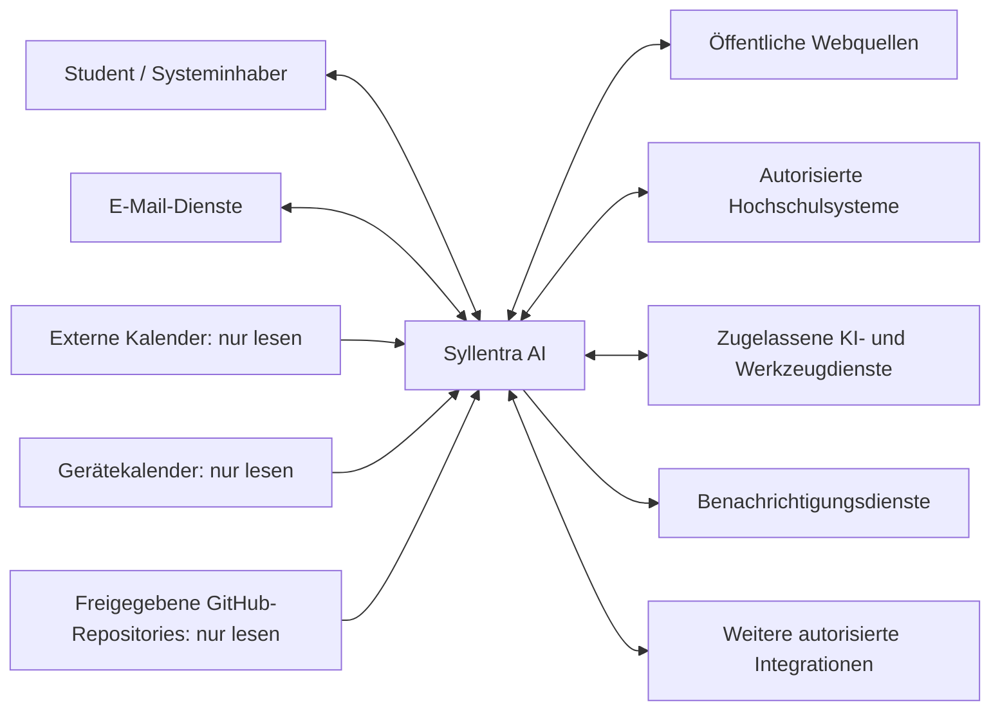

# P2 — Architekturüberblick

**Projekt:** Syllentra AI  
**Dokument:** P2 — Architekturüberblick  
**Version:** 0.5 — konsolidierter Entwurf  
**Stand:** 12.10.2026  
**Status:** Zur Prüfung durch den Projektinhaber  
**Spezifikationsmethode:** Bausteine nach Johannes Siedersleben  
**Geltungsbereich:** Fachlicher Zielumfang der ersten Produktversion (V1)

---

## P2.1 Ziel, Systemkontext und Abgrenzung

### P2.1.1 Ziel dieses Bausteins

Dieser Baustein ordnet Syllentra AI in seine Systemumgebung ein. Er benennt Benutzer, Nachbarsysteme, wesentliche Informationsflüsse, Zugriffsrichtungen und fachliche Systemgrenzen. Er beschreibt außerdem die für diese Beziehungen grundlegenden Freigabe- und Konfigurationsprinzipien.

**P2 ist keine Festlegung einer technischen Komponentenarchitektur.** Entscheidungen über Programmiersprachen, Frameworks, Datenbanken, Hosting, konkrete APIs und Implementierungsmuster werden erst nach einer gesonderten Bewertung getroffen. Detaillierte Schnittstellenverträge gehören in S1, Dialogabläufe in B1, Hintergrundverarbeitungen in B2 und übergreifende Sicherheits- und Konfigurationskonzepte in N2.

### P2.1.2 Fachlicher Systemkern

Syllentra AI umfasst aus Benutzersicht die folgenden Verantwortlichkeiten:

- Individuelle Lernbegleitung und Prüfungsvorbereitung einschließlich Text-, Sprach- und weiterer geeigneter Medienformen.
- Studienberatung sowie semester- und prüfungsbezogene Organisation.
- Einen **eigenen internen Studienkalender** mit Vorlesungen, Prüfungen, Fristen und Lernphasen.
- Ein langfristiges, nachweisorientiertes Kompetenzportfolio.
- Verarbeitung, Verdichtung und zweckgebundene Speicherung persönlicher Lerninformationen.
- Recherche und autorisierte Nutzung externer Quellen und Werkzeuge.
- Wiederkehrende Prüfung relevanter Informationen, soweit Betrieb und Zugriffsrechte dies erlauben.
- Einen **Administrationsbereich**, in dem der Systeminhaber unterstützte Inhalte, Darstellungsmerkmale, Integrationen, Berechtigungen und Verhaltensparameter konfigurieren kann.
- Freigabe, Nachvollziehbarkeit und Kontrolle sensibler Aktionen.

Der interne Studienkalender, das Kompetenzportfolio und der Administrationsbereich **sind Bestandteile von Syllentra AI und keine externen Nachbarsysteme**.

### P2.1.3 Benutzer und Systemgrenze

In V1 gibt es einen persönlichen Benutzer, der zugleich Systeminhaber und Administrator ist. Er kann Syllentra auf Android-Smartphones, iPhones, Tablets, Laptops und Desktop-Computern verwenden.

Außerhalb der fachlichen Systemgrenze befinden sich öffentliche Websites, Hochschulplattformen, Studienverwaltungsportale, E-Mail-Dienste, externe Kalender, mobile Betriebssystem-Kalenderfunktionen, GitHub und ausdrücklich freigegebene Projektquellen, externe KI- und Werkzeuganbieter sowie gegebenenfalls Benachrichtigungs- und Speicherdienste.

Die später mögliche Mehrbenutzerfähigkeit ist zu berücksichtigen, ohne für V1 eine Verwaltung mehrerer Studenten vorauszusetzen.

### P2.1.4 Kontextdiagramm

Das Diagramm zeigt **logische Informationsbeziehungen**, keine bereits gewählten technischen Verbindungen. Bidirektionale Verbindungen gestatten nicht automatisch Schreibaktionen. Insbesondere bleiben **persönliche externe Kalender ausschließlich lesbar**; der Studienkalender wird intern geführt.

### P2.1.5 Leitprinzipien

1. **Quellenoffenheit:** Zugängliche Informationen aus geeigneten Quellen dürfen im zulässigen Umfang berücksichtigt werden; es besteht kein unbegrenzter Anspruch auf Zugriff auf alle Websites.
2. **Mehrere KI- und Werkzeuganbieter:** Syllentra soll nicht fachlich von einem einzigen Anbieter abhängig sein.
3. **Konfigurierbarkeit:** Die für den Betrieb vorgesehenen Inhalte und Einstellungen sollen über die Administrationsoberfläche änderbar sein, ohne Quellcode manuell anzupassen.
4. **Minimal erforderlicher Zugriff:** Jede Verbindung erhält nur die für ihren Zweck notwendigen Berechtigungen.
5. **Kontrollierte externe Aktionen:** Informationszugriff und tatsächliche Änderungen bei Dritten sind getrennt zu behandeln.
6. **Datensparsame Langzeitbegleitung:** Nützliche Wissens- und Kompetenzinformationen bleiben auf Wunsch erhalten; entbehrliche Roh- und Zwischendaten werden nach festgelegten Regeln entfernt.
7. **Überprüfbarkeit:** Quellen, wesentliche Freigaben und relevante Änderungen müssen nachvollziehbar sein.

---

## P2.2 Nachbarsysteme

### P2.2.1 Übersicht

Die Bezeichnungen sind zunächst **fachliche Systemkategorien** und keine Zusage einer schon funktionierenden technischen Integration. Die konkrete Auswahl und technische Machbarkeit werden in S1 geprüft.

| ID | Nachbarsystem / Kategorie | Aufgabe | Richtung und zulässiger Umfang | Voraussetzung |
|---|---|---|---|---|
| NB-01 | Benutzergeräte und Client-Anwendungen | Interaktion, Medienaufnahme, Anzeige, Administration und Freigaben | Bidirektional zwischen Benutzer und Syllentra | Berechtigter Benutzer |
| NB-02 | Öffentliche Websites und Informationsquellen | Fachliche Recherche und Verifikation | Rechercheanfrage und Informationsabruf; keine unzulässigen Änderungen | Rechtlich und technisch zulässiger Zugriff |
| NB-03 | Hochschulische Lernplattformen | Kursunterlagen, Aufgaben, Ankündigungen und Fristen | Grundsätzlich lesend; andere Aktionen nur separat autorisiert | Freigegebener Zugang und verfügbare Anbindung |
| NB-04 | Studienverwaltungsportale | Module, Prüfungen, Leistungen und offizielle Regeln | Grundsätzlich lesend; verbindliche Aktionen nur mit Freigabe | Freigegebener Zugang und verfügbare Anbindung |
| NB-05 | E-Mail-Dienste | Studienrelevante Mitteilungen auswerten, Antworten vorbereiten | Lesen im genehmigten Umfang; Versand erst nach Einzelfreigabe | Autorisierte Verbindung |
| NB-06 | Externe Online-Kalender | Persönliche zeitliche Verfügbarkeit bestimmen | **Ausschließlich lesend**, keine Erstellung, Änderung oder Löschung | Autorisierte Verbindung |
| NB-07 | GitHub und andere freigegebene Projektquellen | Projekt- und Kompetenzanalyse | **Lesend nur für ausgewählte Repositories** | Explizite Auswahl und Berechtigung |
| NB-08 | Externe KI- und Medienverarbeitungsdienste | Text, Sprache, Dokumente, Recherche, Bild, Audio und Video | Aufgabenabhängiger, kontrollierter Austausch | Unterstütztes Verfahren, Freigabe, Kosten- und Datenschutzprüfung |
| NB-09 | Benachrichtigungsdienste | Relevante Hinweise außerhalb der aktiven Sitzung | Überwiegend ausgehend | Geräteberechtigung und geeigneter Betrieb |
| NB-10 | Optionale externe Speicherdienste | Gesondert genehmigte Speicherung und Abrufe | Zweckgebunden bidirektional | Nachweis geeigneter Datenschutzbedingungen |
| NB-11 | Weitere integrierbare Anwendungen und Werkzeuge | Künftig ergänzte fachliche Fähigkeiten | Von der freigegebenen Integration abhängig | Prüfung und Autorisierung |
| NB-12 | Lokale Kalenderfunktionen von Android/iOS | Auf dem Gerät verfügbare Termine und freie Zeiträume ermitteln | **Ausschließlich lesend**, keine Änderung am Gerätekalender | Betriebssystemberechtigung |

### P2.2.2 NB-01 — Benutzergeräte und Client-Anwendungen

Die Anwendung soll auf den in P1 definierten Geräteklassen bedienbar sein. Der Benutzer kann über die unterstützten Geräte Lernmaterialien bereitstellen, schriftlich oder sprachlich lernen, den internen Studienkalender verwenden, Daten verwalten und administrative Einstellungen ändern. Die konkrete Client-Technologie bleibt offen.

Direkt hochgeladene Dateien, Notizen und Aufzeichnungen werden über die Client-Anwendung eingebracht. **Benutzerdateien sind Eingaben, kein eigenständiges Nachbarsystem.**

### P2.2.3 NB-02 — Öffentliche Websites und Informationsquellen

Syllentra soll relevante öffentliche Quellen eigenständig recherchieren können, beispielsweise offizielle Hochschulseiten, Modulhandbücher, Dokumentationen, wissenschaftliche Veröffentlichungen und fachliche Lernressourcen.

Die Recherche muss Herkunft, Aktualität, Relevanz und Widersprüche berücksichtigen. Öffentlich zugängliche Inhalte sind **Informationen und keine Anweisungen**, die Berechtigungen des Assistenten verändern dürfen. Webseiten mit Zugangsbeschränkungen, unzulässigen Abrufverfahren oder nicht unterstützten technischen Voraussetzungen dürfen nicht umgangen werden.

### P2.2.4 NB-03 — Hochschulische Lernplattformen

Bei erteiltem Zugriff sollen Kursunterlagen, Mitteilungen, Aufgaben und Fristen abgerufen und mit den Lern- und Studieninformationen in Beziehung gesetzt werden können. Die konkret nutzbaren Funktionen einzelner Plattformen hängen von deren Schnittstellen und Nutzungsbedingungen ab.

Eine automatische Aufgabenabgabe oder Veröffentlichung ist durch einen bloßen Lesezugriff nicht autorisiert.

### P2.2.5 NB-04 — Hochschul- und Studienverwaltungsportale

Autorisierte Informationen über Module, Studienleistungen, Prüfungszeiträume und Verwaltungsfristen sollen genutzt werden können. Verbindliche Vorgänge wie Prüfungsanmeldungen oder -abmeldungen setzen eine technisch zulässige Anbindung und eine gesonderte ausdrückliche Bestätigung voraus. Amtliche Entscheidungen trifft weiterhin die zuständige Institution.

### P2.2.6 NB-05 — E-Mail-Dienste

Autorisierte E-Mails können zur Erkennung von Studieninformationen, Fristen, Terminänderungen und relevanten Mitteilungen ausgewertet und zusammengefasst werden. Der Assistent darf Antwortentwürfe vorbereiten. **Der Versand jeder externen Nachricht erfordert eine ausdrückliche Freigabe.** Der berechtigte Umfang des Postfachzugriffs ist zu begrenzen.

### P2.2.7 NB-06 — Externe Online-Kalender

Online-Kalender, auf die der Benutzer Zugriff gewährt, dienen Syllentra **nur zur Ermittlung von belegten und freien Zeiten**. Das System darf darüber keine Ereignisse erzeugen, verschieben oder löschen, auch wenn ein Anbieter technisch Schreibfunktionen anbietet.

Wo möglich, sollen reine Verfügbarkeitsangaben statt vollständiger privater Termindetails verarbeitet werden. Schreibberechtigungen sollen für diese Verbindung nicht angefordert werden.

### P2.2.8 NB-07 — GitHub und autorisierte Projektquellen

Syllentra darf ausschließlich ausdrücklich ausgewählte Repositories analysieren, beispielsweise Dokumentation, Quellcode, Tests und nachvollziehbare Entwicklungsbeiträge. Der Zugriff auf ein Repository darf keine Freigabe sämtlicher Repositories des Kontos auslösen.

Für Kompetenzbewertungen muss zwischen eigener Arbeit, Teambeiträgen und KI-generierten Anteilen differenziert werden, soweit entsprechende Nachweise vorliegen. Die reine Projektanalyse ist lesend. Eine zukünftige Schreibintegration wäre ein eigenständiger Berechtigungs- und Freigabefall.

### P2.2.9 NB-08 — KI- und Medienverarbeitungsdienste

Syllentra soll je nach Bedarf unterschiedliche KI-Modelle und spezialisierte Werkzeuge nutzen können, beispielsweise für:

- Fachliche Erklärungen, Zusammenfassungen und Prüfungstraining.
- Recherche und Quellenprüfung.
- Dokumenten- und Projektanalyse.
- Transkription, Spracherkennung und Sprachausgabe.
- Erstellung geeigneter Bilder, Audio- und Videolerninhalte.
- Weitere unterstützte fachspezifische Aufgaben.

**Vorhandene Benutzerabonnements** (beispielsweise ChatGPT oder Claude) sollen berücksichtigt werden können, **sofern** der betreffende Anbieter für die gewählte Anwendung und Betriebsform eine offizielle, geeignete Verbindung gestattet. Ein normales Benutzerabonnement ist **nicht automatisch** ein frei nutzbarer API-Zugang und verleiht keinen automatischen Zugriff auf frühere Gespräche oder die Erinnerungen eines fremden Dienstes.

Syllentra soll unterstützte Modelle und Werkzeuge anhand von Eignung, Berechtigungen, Datenschutz, Leistungsfähigkeit, Verfügbarkeit, Nutzungslimits und Kosten auswählen können. Der Benutzer soll unterstützte Anbieter aktivieren, deaktivieren und gegebenenfalls bevorzugen können. Eine kostenpflichtige Zusatznutzung darf nicht unbemerkt ausgelöst werden.

Eine Datenübermittlung an KI-Anbieter setzt geeignete Verarbeitungs- und Aufbewahrungsbedingungen voraus. Anbieter, deren Bedingungen den Anforderungen widersprechen, dürfen für die betreffenden Informationen nicht eingesetzt werden.

### P2.2.10 NB-09 — Benachrichtigungsdienste

Wichtige Änderungen und Hinweise sollen, soweit technisch unterstützt und erlaubt, auch bei geschlossener Anwendung zugestellt werden können. Nachrichten sollen möglichst keine unnötigen privaten Inhalte in Sperrbildschirmvorschauen offenlegen. Relevante Hinweise müssen außerdem innerhalb von Syllentra abrufbar bleiben.

### P2.2.11 NB-10 — Optionale externe Speicherdienste

Die Entscheidung über einen externen Speicheranbieter ist offen. Falls ein solcher Dienst benötigt wird, müssen Zugriff, Zweckbindung, Aufbewahrung, Datensicherheit und Löschmöglichkeiten geeignet sein. **Die persönliche Wissensgrundlage ist fachlich Teil von Syllentra**, unabhängig davon, wo sie später technisch gespeichert wird.

### P2.2.12 NB-11 — Erweiterbare Anwendungen und Werkzeuge

Neue unterstützte Dienste sollen über einen **Integrationskatalog** hinzugefügt und verwaltet werden können. Dieser kann vordefinierte Anbieter und geeignete benutzerkonfigurierbare Verbindungen enthalten.

Das Einfügen einer URL stellt **für sich allein keine funktionsfähige oder vertrauenswürdige Integration** her. Der Dienst muss ein unterstütztes Verbindungsverfahren bieten, und die Verbindung muss vor ihrer Aktivierung auf Berechtigungen und Sicherheit geprüft werden. Neue Protokolle oder bislang nicht unterstützte Fähigkeiten können zusätzliche Entwicklungsarbeit erfordern.

### P2.2.13 NB-12 — Lokale Android-/iOS-Kalender

Mit geeigneter Betriebssystemberechtigung soll die mobile Anwendung Termine der auf dem Gerät verfügbaren Kalender **lesend** berücksichtigen können. Zweck ist die Bestimmung von freien und belegten Zeiträumen für eine konfliktarme Studienplanung.

Syllentra erhält für diese Integration **keine fachliche Erlaubnis zum Schreiben, Ändern oder Löschen von Gerätekalenderterminen**. Auch hier sollen private Details nur verarbeitet werden, soweit sie für die Aufgabe erforderlich sind.

Die Hintergrundaktualisierung hängt von den tatsächlichen Möglichkeiten und Berechtigungen der jeweiligen Betriebssysteme ab. Eine doppelte Berücksichtigung desselben Kalenders über NB-06 und NB-12 muss bei der Planung vermieden werden.

---

## P2.3 Interner Studienkalender und Terminflüsse

### P2.3.1 Abgrenzung der zwei Kalenderarten

Syllentra unterscheidet verbindlich:

| Kalenderart | Verwendung | Schreibzugriff durch Syllentra |
|---|---|---|
| Persönlicher Online- oder Gerätekalender | Verfügbarkeit und Überschneidungen erkennen | **Nein: ausschließlich lesen** |
| Interner Syllentra-Studienkalender | Lehrveranstaltungen, Prüfungen, Fristen, Wiederholungen und Lernplanung verwalten | **Ja, nach den Freigabe- und Verwaltungsregeln der Anwendung** |

Persönliche und akademische Termine können zur Anzeige gemeinsam berücksichtigt werden; ihre Herkunft und Schreibzuständigkeit müssen aber unterscheidbar bleiben. Eine Zusammenführung der Ansicht bedeutet **keine Vermischung der tatsächlichen Kalenderbestände**.

### P2.3.2 Pflege des internen Studienkalenders

Der interne Studienkalender soll auf drei Wegen befüllt werden können:

1. **Manuelle Eingabe und Bearbeitung** durch den Benutzer.
2. **Import eines Stundenplans oder geeigneter Studienunterlagen**, wobei die erkannten Termine vor der Übernahme geprüft und bestätigt werden.
3. **Automatisch vorbereitete Vorschläge des Assistenten**, beispielsweise Lernzeiten, Wiederholungen und Klausurvorbereitung, die erst nach Bestätigung übernommen werden.

Eine vom Benutzer direkt vorgenommene und gespeicherte manuelle Bearbeitung ist bereits eine bewusste Benutzeraktion; dafür ist nicht zusätzlich ein zweiter KI-Freigabedialog erforderlich. **Vom Assistenten vorbereitete Einträge, Imports und wesentliche Änderungen müssen vor der Übernahme überprüfbar und freigegeben sein.**

Der Studienkalender soll Semester, Module, Prüfungsphasen, Lernfortschritt, Abgaben und persönliche Verfügbarkeiten berücksichtigen. Die Konsistenz des Studienkalenders über die unterstützten Geräte hinweg ist ein Ziel; der konkrete technische Synchronisationsmechanismus bleibt offen.

### P2.3.3 Umgang mit persönlichen Kalenderdaten

Für die Lernplanung sollen vorzugsweise belegte und freie Zeiträume statt vollständiger privater Termininhalte verarbeitet werden. **Eine vollständige dauerhafte Kopie privater Kalender ist nicht vorgesehen.** Externe KI-Werkzeuge dürfen persönliche Kalenderdetails nur erhalten, wenn dies für die Aufgabe nötig und entsprechend autorisiert ist.

### P2.3.4 Kalenderbezogene Konflikte und Ausfälle

Kann ein externer Kalender nicht gelesen werden, muss Syllentra diese Einschränkung kenntlich machen und eine manuelle Pflege der Verfügbarkeiten ermöglichen. Fehlende Berechtigungen dürfen nicht umgangen werden. Nicht bestätigte Vorschläge sind von verbindlich eingeplanten Terminen zu unterscheiden.

---

## P2.4 Erweiterbarer Integrationskatalog und KI-Auswahl

### P2.4.1 Katalog in der Benutzeroberfläche

Syllentra soll eine Verwaltungsansicht **„Integrationen & Plugins“** bereitstellen. Dort sollen unterstützte KI-Anbieter, Hochschuldienste, Informationsquellen, Kalender, E-Mail- und Entwicklungswerkzeuge auffindbar sein.

Für jeden Eintrag soll angezeigt werden können:

- Name, Kategorie, Anbieter und Zweck.
- Verfügbare Funktionen sowie eventuelle Funktionsgrenzen.
- Unterstützte Anmelde- und Verbindungsmethoden.
- Benötigte Daten und Zugriffsrechte.
- Verfügbarkeit, Verbindungsstatus und eventuelle Kontingente.
- Mögliche Kosten und Freigabeanforderungen.
- Datenschutz-, Aufbewahrungs- und Löschbedingungen.
- Möglichkeiten zum Testen, Deaktivieren und Widerrufen.

### P2.4.2 Hinzufügen und Entfernen

Der Systeminhaber soll unterstützte Integrationen aus einer Liste auswählen und deren offizielle Verbindung einrichten können. Für geeignete Verbindungstypen kann alternativ eine geprüfte Dienstadresse oder Konfiguration eingegeben werden.

Nach erfolgreicher Autorisierung sollen die freigegebenen Fähigkeiten erkennbar sein. Eine Verbindung soll deaktiviert und, soweit vom Anbieter unterstützt, widerrufen werden können. Zugangstoken und Geheimnisse dürfen nicht als normale Texteinstellungen oder im öffentlichen Repository gespeichert werden.

### P2.4.3 Nutzung mehrerer KI-Dienste

Der Benutzer soll einen unterstützten KI-Dienst auswählen, bevorzugen oder die Auswahl geeigneter Werkzeuge dem Assistenten überlassen können. Die Auswahl muss bestehende Nutzungslimits, zu erwartende Zusatzkosten, fachliche Eignung und Datenschutzbedingungen berücksichtigen.

**Unbekannte oder kostenpflichtige Dienste werden nicht stillschweigend als Ersatz verwendet.** Ist ein Dienst nicht verfügbar, muss der Benutzer über die Einschränkung und gegebenenfalls geeignete Alternativen informiert werden.

### P2.4.4 Grenzen der Erweiterbarkeit

Ein vorhandener, kompatibler Konnektor kann administrativ aktiviert oder konfiguriert werden. Eine völlig neue externe API, ein bisher nicht unterstütztes Anmeldeverfahren oder eine neue fachliche Fähigkeit kann hingegen zusätzliche Backend-Implementierung erfordern. Diese Grenze muss in der Benutzeroberfläche klar erkennbar sein.

---

## P2.5 Administrationsoberfläche und konfigurierbares Verhalten

### P2.5.1 Grundsatz: Konfiguration statt Quellcodeänderung

**Alle ausdrücklich vorgesehenen und dafür geeigneten Einstellungen der Anwendung sollen zur Laufzeit über das Administratorkonto verwaltbar sein.** Der Systeminhaber soll für normale redaktionelle, gestalterische, organisatorische und fachliche Anpassungen keinen Quellcode öffnen oder neu bereitstellen müssen.

Einstellungen sollen als **strukturierte, persistente Konfigurationsdaten** behandelt werden. Dabei handelt es sich nicht um die Forderung, jede Softwarefunktion durch eine einzelne Programmvariable ersetzen zu können. Welche Optionen administrierbar sind, wird im jeweiligen Funktionsbaustein spezifiziert und durch die Anwendung unterstützt.

### P2.5.2 Konfigurierbare Bereiche

| ID | Konfigurationsbereich | Erwartete administrative Möglichkeiten |
|---|---|---|
| CFG-01 | Anwendung und Branding | Anwendungsname, Seitenüberschriften, Untertitel, Logo, unterstützte Icons und Branding-Elemente verwalten |
| CFG-02 | Texte und Sprache | Sichtbare Texte, Beschriftungen, Hilfetexte, Begrüßungen und unterstützte Sprachfassungen ändern |
| CFG-03 | Erscheinungsbild | Unterstützte Farbpaletten, Hell-/Dunkelmodus, Typografieoptionen, Abstände und vordefinierte Gestaltungsvarianten auswählen |
| CFG-04 | Navigation und Seiten | Sichtbarkeit, Reihenfolge, Namen und unterstützte Anordnung vorhandener Menüpunkte, Seiten und Bereiche verwalten |
| CFG-05 | Dashboard | Unterstützte Kacheln, Kennzahlen, Reihenfolgen und Dashboard-Ansichten konfigurieren |
| CFG-06 | Studienorganisation | Semesterinformationen, Module, Fristenkategorien, Stundenplan- und Lernplanvorlagen verwalten |
| CFG-07 | Pädagogisches Verhalten | Unterstützte Lernmodi, Erklärungstiefe, Wiederholungs- und Übungspräferenzen sowie verfügbare Lernparameter anpassen |
| CFG-08 | Fortschritt und Kompetenzen | Unterstützte Darstellungs-, Bewertungs- und Nachweisregeln innerhalb fachlich zulässiger Grenzen verwalten |
| CFG-09 | Benachrichtigungen und Prüfungen | Themen, Prioritäten, zulässige Prüfrhythmen, Benachrichtigungskanäle und Ruhezeiten einstellen |
| CFG-10 | Integrationen und KI | Dienste hinzufügen, verbinden, bevorzugen, deaktivieren, Berechtigungen prüfen sowie kompatible Modelle und Werkzeuge auswählen |
| CFG-11 | Kostenkontrolle | Erlaubte kostenpflichtige Funktionen, Ausgabenlimits, Warnschwellen und entsprechende Freigaben verwalten |
| CFG-12 | Datenschutz und Datenhaltung | Daten einsehen, korrigieren, exportieren und löschen sowie zulässige Aufbewahrungseinstellungen verwalten |
| CFG-13 | Rollen und Aktionsfreigaben | Persönliche Verwaltungsberechtigungen und unterstützte Freigaberegeln innerhalb verbindlicher Sicherheitsgrenzen verwalten |

**Beispiel:** Soll aus einer Seite „Mein Studium“ später „Studienübersicht“ werden, soll der Administrator die entsprechende Beschriftung in der Anwendung bearbeiten und speichern können, **ohne eine Quellcodedatei zu ändern**. Dasselbe gilt für andere unterstützte Seitentitel, Schaltflächenbeschriftungen, Menünamen und Branding-Angaben.

### P2.5.3 Sicherer Konfigurationsprozess

Für wesentliche Einstellungen soll die Administrationsoberfläche — soweit für den Einstellungstyp sinnvoll — Folgendes anbieten:

1. Bestehenden Wert und Bedeutung anzeigen.
2. Neuen Wert eingeben oder aus unterstützten Optionen auswählen.
3. Eingaben validieren und unzulässige Werte zurückweisen.
4. Änderungen vor ihrer Veröffentlichung in einer Vorschau prüfen.
5. Änderungen speichern und nach Möglichkeit nachvollziehbar versionieren.
6. Bei geeigneten Einstellungen eine vorherige gültige Fassung wiederherstellen.

Gespeicherte Einstellungen sollen in den unterstützten Clients konsistent berücksichtigt werden. Änderungen müssen nach einem Neustart der Anwendung bestehen bleiben, sofern sie als dauerhaft konfiguriert wurden.

### P2.5.4 Unveränderliche Schutzgrenzen

Der Administrationsbereich darf nicht durch bloße Text- oder Variablenänderungen:

- Unzulässige Zugriffe auf externe Systeme erlauben.
- Verbindliche Sicherheitskontrollen umgehen.
- Geheimnisse als öffentlich sichtbare Einstellungen offenlegen.
- Nicht unterstützte externe APIs als bereits funktionsfähig ausgeben.
- Gesetzliche oder zwingende datenschutzrechtliche Verpflichtungen abschalten.
- Beliebigen Programmcode, ungeprüftes HTML oder fremde Skripte als normale Gestaltungsoption ausführen.

**Konfigurierbarkeit bedeutet nicht beliebige Änderung der Softwarelogik ohne Entwicklung.** Neue fachliche Funktionen, neue Verbindungstechniken und Änderungen des Sicherheitskerns können weiterhin Code- und Architekturarbeit erfordern.

### P2.5.5 Detaillierungsgrenze

Dieser Baustein legt den fachlichen Anspruch an administrative Konfigurierbarkeit fest. Die konkreten Administrationsdialoge gehören nach B1, die fachlichen Funktionen nach F2/F3 und das Konfigurations-, Berechtigungs- und Sicherheitskonzept nach N2. Das zugehörige fachliche Datenmodell wird in D1 definiert.

---

## P2.6 Informationsverarbeitung, persönliche Erinnerung und Löschung

### P2.6.1 Datenwege

Informationen gelangen entweder durch direkte Bereitstellung des Benutzers oder durch einen autorisierten Abruf in das System. Für die Studienbegleitung sollen sie ausgewertet, bei Bedarf verdichtet, mit Quellen und Studienkontext verknüpft und nur im erforderlichen Umfang aufbewahrt werden.

### P2.6.2 Fachliche Datenklassen

| ID | Datenklasse | Grundregel |
|---|---|---|
| DK-01 | Temporäre Rohdaten (z. B. Uploads, Audio, Verarbeitungskopien) | Nur solange nötig aufbewahren und anschließend regelgerecht löschen |
| DK-02 | Extrahierte Zwischeninformationen (z. B. Transkripte, Textauszüge) | Relevanz prüfen; entbehrliche Zwischenstände entfernen |
| DK-03 | Persönliche Wissensgrundlage (z. B. Zusammenfassungen, Erkenntnisse, Quellenhinweise) | Zweckgebunden und mit Benutzerkontrolle langfristig nutzbar halten |
| DK-04 | Studien- und Kompetenzinformationen (Semester, Noten, ECTS, Lernfortschritt, Nachweise) | Semesterübergreifend dokumentieren, korrigieren und bei Bedarf löschen |
| DK-05 | Berechtigungs- und Konfigurationseinträge | Geschützt und nachvollziehbar verwalten |
| DK-06 | An externe Anbieter übertragene Verarbeitungsdaten | Nur erforderlich und autorisiert übermitteln; Aufbewahrung und Löschung beim Anbieter prüfen |

Die Klassen sind **fachliche Unterscheidungen**, keine Vorentscheidung für eine Datenbank oder Speichertechnik.

### P2.6.3 Verdichtung ohne unbemerkten Informationsverlust

Der Assistent soll umfangreiche Quellen in geeignete Zusammenfassungen, thematische Kenntnisse und nachvollziehbare Lerninformationen überführen können. Dabei sollen Herkunft, Aktualität, relevante Unsicherheiten und Bezüge zu Modulen oder Kompetenzen erhalten bleiben, soweit erforderlich.

**Eine Zusammenfassung ersetzt nicht automatisch das Original.** Nach Löschung einer Originalquelle darf Syllentra nicht behaupten, deren vollständigen Wortlaut weiterhin zu besitzen. Für exakte Zitate oder prüfungsrechtlich relevante Informationen muss eine verfügbare und überprüfbare Quelle vorhanden sein.

### P2.6.4 Langfristige Erinnerung

Zusammenfassungen, Lernfortschritte, erworbene Kenntnisse, Kompetenznachweise, Semesterhistorien und bestätigte Präferenzen sollen für die langfristige Begleitung erhalten bleiben können. Sie müssen überprüfbar, korrigierbar und grundsätzlich auf Löschanforderung hin behandelbar sein. Veraltete Angaben dürfen nicht ungeprüft als aktuell gelten.

### P2.6.5 Datenlöschung und externe Anbieter

Temporäre Rohdaten sollen nach Ende ihres erforderlichen Verarbeitungszwecks entfernt werden, sofern kein zulässiger Aufbewahrungsgrund entgegensteht. Die Löschung eines Originals darf nicht automatisch alle zuvor bewusst gespeicherten und rechtmäßig abgeleiteten Lernerkenntnisse entfernen. Der Benutzer soll aber ausdrücklich auch die Löschung solcher Ableitungen verlangen können.

Vor der Verwendung externer KI- oder Speicheranbieter müssen deren Zwecke, Aufbewahrungsfristen, Löschmöglichkeiten, eventuelle Weiterverwendung und Sicherheitsbedingungen geprüft werden. **Ist ein Anbieter mit den festgelegten Anforderungen nicht vereinbar, darf er die betreffenden Daten nicht erhalten.** Syllentra kann eine sofortige und vollständige Löschung durch fremde Anbieter nicht ohne geeignete Nachweise garantieren.

Bei einer Löschanforderung soll der Benutzer den betroffenen Umfang, die möglichen Folgen und den Status der tatsächlich durchgeführten Schritte nachvollziehen können. Irreversible Löschungen müssen ausdrücklich bestätigt werden. Konkrete Löschfristen, Sicherungskopien und Verfahren gehören in N2.

---

## P2.7 Automatisierte Prüfungen, Benachrichtigungen und Freigaben

### P2.7.1 Wiederkehrende Informationsprüfungen

Syllentra soll autorisierte Quellen bei Bedarf wiederkehrend auf für den Nutzer wichtige Änderungen prüfen können: Kursmitteilungen, Fristen, Prüfungsinformationen, studienrelevante E-Mails und verfügbare Kalenderinformationen.

Soweit Betriebssysteme, Zugriffsrechte und Betriebsmodell dies unterstützen, sollen solche Prüfungen auch bei geschlossener Client-Anwendung möglich sein. Es wird **keine unbegrenzte Hintergrundaktivität auf mobilen Geräten** vorausgesetzt. Prüffrequenzen und Benachrichtigungsregeln sollen über unterstützte Administrationseinstellungen anpassbar sein.

### P2.7.2 Handlungsgrenzen

| Tätigkeit | Grundsatz |
|---|---|
| Öffentliche und autorisierte Informationen lesen | Innerhalb zulässiger Berechtigungen eigenständig möglich |
| Lernmaßnahmen, Prüfungspläne und Vorschläge vorbereiten | Eigenständig möglich |
| Persönliche Kalender zur Verfügbarkeitsprüfung lesen | **Nur lesend**; keine Änderungen |
| Manuelle Termineingabe durch Benutzer im Syllentra-Kalender | Direkt durch die bewusste Benutzeraktion möglich |
| KI-Vorschläge und Stundenplanimporte in den Syllentra-Kalender übernehmen | Erst nach Sichtung und Bestätigung |
| Externe Nachrichten versenden oder verbindliche Hochschulvorgänge ausführen | Nur nach ausdrücklicher Freigabe und bei zulässiger Integration |
| Persönliche Daten endgültig löschen | Nach Beschreibung und erforderlicher Bestätigung |
| Kostenpflichtige Dienste aktivieren | Nur nach bewusster Freigabe |

### P2.7.3 Nicht vertrauenswürdige Inhalte

Webseiten, E-Mails, Dokumente, Repositories und Werkzeugantworten gelten als Datenquellen und dürfen nicht die Funktion autorisierter Benutzerbefehle übernehmen. Ihre Inhalte dürfen keine bestehenden Freigabe-, Datenschutz- oder Kostenregeln umgehen.

---

## P2.8 Verweise und Verantwortung der Folgedokumente

| Baustein | Weitere Detaillierung |
|---|---|
| P1 | Ziele, Zielumfang V1, verbindliche Rahmenbedingungen und Erfolgskriterien |
| F1 | Unterstützte Studien-, Lern- und Verwaltungsprozesse |
| F2 | Anwendungsfälle einschließlich Kalender, Integrationskatalog und Admin-Konfiguration |
| F3 | Fachliche Funktionen und Regeln der Informationsverarbeitung |
| D1 / D2 | Fachliche Datenstrukturen für Quellen, Semester, Kalender, Kompetenzen und Konfiguration |
| B1 | Benutzeroberflächen, Adminbereich, Dialoge, Vorschau und Freigaben |
| B2 | Wiederkehrende Prüfungen und Hintergrundaufgaben |
| B3 | Berichte, Exporte und Kompetenzbilanzen |
| S1 | Konkrete Nachbarsysteme, zulässige Schnittstellen und Datenaustausch |
| S2 | Import vorhandener Studien- und Lerndaten |
| S3 | Inbetriebnahme und Konfigurationsvoraussetzungen |
| N1 | Qualität, Leistung, Barrierefreiheit, Verfügbarkeit und Bedienbarkeit |
| N2 | Übergreifende Konzepte für Konfiguration, Berechtigungen, Sicherheit, Datenschutz, Löschung und Nachvollziehbarkeit |

**Referenzdokumente:**

- [P1 — Ziele und Rahmenbedingungen](P1-ziele-rahmenbedingungen.md)
- [Spezifikationsindex und Leseanleitung](README.md)
- [Projektvision](../PROJECT_VISION.md)
- [Bisherige Anforderungen](../REQUIREMENTS.md)
- [Architekturentscheidungen](../ARCHITECTURE_DECISIONS.md)
- [Roadmap](../ROADMAP.md)

Die freigegebene Spezifikation ist bei Widersprüchen zu älteren Entwürfen maßgeblich; Differenzen sind nachvollziehbar zu prüfen.

---

## P2.9 Annahmen, Risiken und offene Fragen

### P2.9.1 Annahmen

- Verfügbare Zugriffe auf Hochschulsysteme und Drittanbieter hängen von deren aktuellen Schnittstellen und Berechtigungsmodellen ab.
- Der Benutzer stellt Informationen bereit oder genehmigt deren zulässige Übernahme.
- Die tatsächliche Nutzung vorhandener KI-Abonnements für Syllentra muss für jeden Anbieter und jede Betriebsform gesondert bestätigt werden.
- Konfigurationsmöglichkeiten sind durch unterstützte Optionen definiert; es besteht keine unbegrenzte Möglichkeit, beliebige Softwarefunktionen ohne Programmierung zu ergänzen.

### P2.9.2 Wesentliche kontextbezogene Risiken

| ID | Risiko | Umgang |
|---|---|---|
| P2-R-01 | Externe Systeme erlauben keinen geeigneten Zugriff | Unterstützte Alternativen und manuelle Übernahme vorsehen |
| P2-R-02 | Ein Drittanbieter speichert Daten länger als erlaubt | Anbieter vor Nutzung prüfen; ungeeignete Anbieter ausschließen |
| P2-R-03 | Ein angebundener Dienst verursacht unerwartete Kosten | Limits, Transparenz und Freigaben vorsehen |
| P2-R-04 | Kalender werden doppelt oder unvollständig berücksichtigt | Herkunft und Berechtigungen unterscheiden, Konflikte erkennbar machen |
| P2-R-05 | Ungeeignete Admin-Einstellungen beeinträchtigen die Bedienung | Eingabevalidierung, Vorschau und geeignete Rücknahme vorsehen |
| P2-R-06 | Unvertrauenswürdige Inhalte versuchen Aktionen auszulösen | Daten und Anweisungen trennen, Rechte und Freigaben erzwingen |
| P2-R-07 | Eine Konfigurationsoption suggeriert nicht vorhandene Funktionalität | Nur tatsächlich unterstützte Möglichkeiten als aktivierbar darstellen |

### P2.9.3 Offene Punkte

1. Welche konkreten Hochschulportale bieten zulässige direkte Integrationen?
2. Welche offiziellen Verbindungsverfahren werden für ChatGPT, Claude und weitere KI-Anbieter unterstützt und zu welchen Kosten?
3. Welche externen Werkzeuge können aus einem geprüften Katalog aktiviert werden und welche erfordern zusätzliche Backend-Entwicklung?
4. Welche Betriebssystemberechtigungen und Verfügbarkeitsdaten stehen auf Android und iOS zur Verfügung?
5. Wie werden über Online- und Gerätekalender doppelt sichtbare Termine erkannt?
6. Welche technischen Möglichkeiten ermöglichen Prüfungen bei geschlossener Anwendung?
7. Welche konkreten Anzeige-, Text-, Navigations- und Designoptionen sind administrativ konfigurierbar und wie erfolgt ihre Prüfung?
8. Welche Vorgaben gelten für sichere Versionierung, Vorschau und Rücknahme von Konfigurationsänderungen?
9. Welche Aufbewahrungs-, Lösch- und Wiederherstellungsregeln gelten für die verschiedenen Datenklassen?
10. Wie werden Anbieterwechsel, Nichtverfügbarkeit und ausgeschöpfte KI-Kontingente behandelt?
11. Welche Synchronisationsform ist für den internen Studienkalender auf mehreren Endgeräten geeignet?
12. Welche technischen Qualitäts- und Sicherheitsprüfungen müssen neue Integrationen vor ihrer Aktivierung bestehen?

Diese offenen Punkte präzisieren die spätere Umsetzung. Sie streichen keine bereits bestätigten fachlichen Ziele ohne erneute Entscheidung des Projektinhabers.

---

**Ende von P2 — Architekturüberblick.**  
**Freigabestatus:** Zur Prüfung. Nach Bestätigung wird der Dokumentstatus auf „Freigegeben“ gesetzt und der Spezifikationsindex entsprechend aktualisiert.
